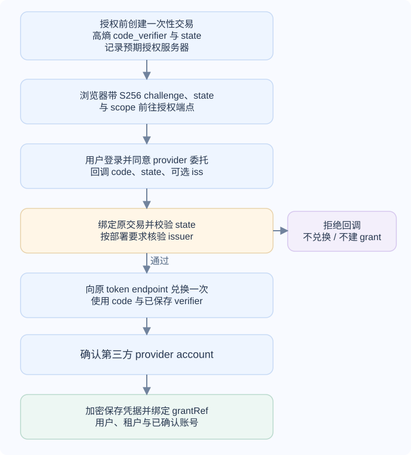

# 模型提出 `create_issue` 后，应用要过哪几道关才能放行？

模型提出一个写操作时，应用手上只有一条形状合法的结构化请求。形状合法不等于有权执行，这一点在[模型“调用工具”时实际发生了什么](tool-calls-are-requests.md)已经讲过。本章回答下一步：从这条请求到真正向第三方 API 发出写请求，应用要依次确认哪五件事，每一关不通过时停在哪里，全部通过后又留下哪些记录，供运行中断后恢复时读取。

## 案例：为 build 42 建一张缺陷单

本章继续 CI 诊断助手的运行 `run-r42-6`，这是一个虚构的教学案例，下文的账号、租户和授权编号也都是虚构值。和序章相比，这次的用户请求多了一句：用户 `user-17`（属于租户 `team-4`）提出“解释 build 42 为什么失败，给 `build-service` 仓库准备一张缺陷单，提交前让我看”。所以运行在给出诊断后不会结束，还要继续走到建单。

只读调用 `c1` = `read_build_log(build_id=42)` 已经取回观察：测试 `reject_empty_name` 预期 HTTP `400`、实际 `200`，`exit_status=1`。工单系统是第三方服务，用户在那里的账号是 `repo-owner-2`。模型读完 `c1` 的结果后，提出第二个调用 `c2`：

~~~text
create_issue(
  repository_id = "build-service",
  title = "build 42：空名称测试未按预期拒绝请求",
  body  = "测试 reject_empty_name 预期 HTTP 400，实际 200（exit_status=1）。请维护者检查空名称输入的校验路径。"
)
~~~

应用要把这条请求变成一次真实写入，必须依次通过五道关。每一关回答不同的问题，过了前一关不代表后一关自动成立：

~~~mermaid
flowchart TD
    Req["c2：create_issue 请求 参数形状已校验"]
    G1{"第一关 create_issue 对本轮可见？"}
    G2{"第二关 user-17 对 build-service 有权建单？"}
    G3{"第三关 有面向工单 API、scope 足够的凭据？"}
    G4{"第四关 用户批准的正是这一份草稿？"}
    G5{"第五关 由谁在什么环境里执行？"}
    Recheck["发送前刷新凭据 并复核第二到第四关"]
    Out["持久化放行记录 交给主线四"]
    Stop["拒绝：按 c2 记录原因 不发出任何写请求"]
    Req --> G1 -->|是| G2 -->|是| G3 -->|是| G4 -->|是| G5 --> Recheck -->|仍成立| Out
    G1 -->|否| Stop
    G2 -->|否| Stop
    G3 -->|否| Stop
    G4 -->|"否：拒绝、过期或内容变了"| Stop
    Recheck -->|失效| Stop
~~~

讲各道关之前，先要分清应用里的几种“身份”记录。五道关查的正是它们。

## 应用里的五种身份记录各证明什么？

“用户已登录”“用户授权了工单系统”“用户批准了这张单”是三件不同的事，再加上运行标识和远端操作键，一共五种记录。它们常被混成一个“用户同意了”，结果就是用一种记录去顶替另一种的检查：

| 记录 | 本例 | 能证明什么 | 不能证明什么 |
|---|---|---|---|
| 应用会话 | 本地账号 `user-17` 已登录，租户 `team-4` | 谁在应用里发起了任务 | 不授予任何第三方 API 权限；登录 cookie 不会变成工单 API 的令牌 |
| OAuth grant (授权) | `grantRef=g-31`：`user-17` 把工单 API 的建单权限委托给本应用，工单系统账号 `repo-owner-2` | 用户对哪个资源、哪些 scope (权限范围) 作了委托 | 不批准任何一条具体内容；`repo-owner-2` 是工单系统上的 OAuth 身份，不是目标仓库 |
| 运行与调用标识 | `runId=run-r42-6`；模型提出的调用 `c2`（模型 API 里叫 `call_id`，运行记录里存为 `tool_call_id`） | 这是哪次持久运行、模型提出的哪一个动作 | 不是凭据；`c2` 也不是外部去重键 |
| 动作审批 | 对“`build-service` + 标题 + 正文 + `c1` 证据”这份精确草稿的批准 | 用户看过并批准了这一份预览 | 内容或目标一变就失效；不授予任何 scope |
| 远端操作键 | `run-r42-6:create-issue:v1` | 接收端据此对这次副作用去重或查询 | 是否真能去重，由接收端的契约决定 |

应用会话怎样建立、OpenID Connect (OIDC) 身份令牌与访问 API 的令牌有什么区别，见[Cookie 会话与 OIDC 令牌怎样建立身份](../../engineering-foundations/security/web-sessions-and-oidc.md)。

grant 记录只保存描述和引用：`grantRef`、用户与租户、第三方账号、目标资源的 resource URI 或令牌的 audience (受众)、实际授予的 scope、到期与刷新状态，以及指向加密秘密存储的凭据引用。运行记录、动作草稿、审批和操作键各自存放，只通过 `grantRef` 关联到 grant。这样一来，模型、事件流和检查点里最多出现 `g-31` 这个引用，看不到令牌本身；模型也无法自己挑选令牌或改换资源。

本例里 `repo-owner-2` 和 `build-service` 不是一回事：前者是用户在工单系统里的账号，后者是这张单要写入的仓库。同一个账号可以对多个仓库有不同权限，所以第二关要单独核对目标仓库。

## 第一关：`create_issue` 对本轮可见吗？

应用按任务决定本轮给模型开放哪些工具。用户只要求诊断时，不该开放任何写工具；这次用户明确要建单，应用才开放 `create_issue`。模型请求一个本轮没有开放的工具时，应用在解析工具名时就拒绝它，什么也不执行。

开放的工具应当是窄封装：`create_issue` 只能在用户允许的仓库里建单，不提供“任意 HTTP 请求”这类通用能力。工具越窄，后面几关要防的情况越少，这就是 least privilege (最小权限) 落在工具设计上的样子。

工具可见只说明模型可以提出这类请求，不说明每次请求都会被允许。Skill 能教模型“先查证再建单”的流程，但不注册工具、也不授予权限，这条边界见[什么时候该让模型决定下一步](when-the-model-decides.md)。

## 第二关：调用者对目标仓库有权吗？

调用者身份来自已认证的应用会话，也就是 `user-17`，而不是模型参数或上下文里的任何文字。应用重新解析 `c2` 的参数，用自己的策略核对三件事：`user-17` 在 `team-4` 内能否给 `build-service` 建单；目标仓库属于当前租户；这个动作正是用户这次要求的。

工单 API 收到请求后还会用它自己的数据再查一次：这个用户能否向该仓库写入。两层检查都需要。应用这一层挡住用户没要求的动作和跨租户的目标；资源服务器那一层是它自己数据的最终裁决者。

模型如果把目标改成用户无权写入的仓库，在这一关就会被拒绝。日志里的注入文字诱导模型这样做时，结果也一样，见[为什么提示注入防不住“模型听话”](prompt-injection-as-permission-confusion.md)。

## 第三关：凭据面向哪个资源，带哪些 scope？

这一关回答：应用打算随请求发出的令牌，是否正好是给工单 API 用的，而且权限够建单。

### 两条令牌链不能互换，也不能透传

本例有两条独立的授权链。读日志时，应用作为 MCP client 访问日志 MCP server，用的是向日志服务的授权服务器换来的 `T_mcp`。建单时，应用代表用户访问工单 API，用的是 grant `g-31` 下的 `T_issue`。两条链的 authorization server (授权服务器)、资源标识和 scope 都可能不同：

| 调用 | 请求去向 | 随请求发送的令牌 | 资源服务器核验 | 应用核验 |
|---|---|---|---|---|
| `c1` 读 build 42 日志 | 日志 MCP server | `T_mcp`，面向日志 MCP 资源 | 令牌有效、scope 允许读、当前用户能读 build 42 | 调用前核对用户、运行和目标记录；结果配回 `c1` |
| `c2` 创建缺陷单 | 工单 API | `T_issue`，面向工单 API | 令牌有效、scope 允许建单、用户能向目标仓库写入 | 发送前核对实际仓库、正文和证据与已批准的草稿一致 |

资源服务器对每个令牌要查三层，三层同时成立才放行：

- **audience**：哪个服务可以接收这枚令牌。面向日志 MCP 的 `T_mcp`，工单 API 必须拒收。
- **scope**：令牌被授予了哪类访问，例如“读构建”或“建单”。它不说明能访问哪一条具体记录。
- **记录权限**：当前用户对这一条记录（build 42、`build-service` 仓库）是否有权。

所以两枚令牌即使都按 Bearer (持有者令牌) 方式传输、scope 名字也相似，也不能互换，更不能把收到的 `T_mcp` 转发给工单服务。MCP server 的后端如果还要访问别的服务，应当用它自己的服务凭据或另一个明确授权的机制。授权服务器支持时，client 可以在请求令牌时用 OAuth 的 `resource` 参数指明目标资源，让令牌只对该资源有效；不同 provider 返回的令牌格式和受众表示仍可能不同。

`T_mcp`、`T_issue` 是教学符号，不代表令牌一定是 client 能解码的 JWT。验证令牌的签发者、有效期、受众和权限是资源服务器的事；client 不能靠读一个不透明的令牌替服务端做授权判断。日志 MCP 这条链的协议细节见[MCP 2026-07-28 怎样把工具从发现接到有权限的执行](mcp-protocol.md)。

### grant 怎样取得并绑定到本地用户？

`g-31` 来自 OAuth 授权码流程，并用 PKCE (Proof Key for Code Exchange) 保护：应用在浏览器跳转之前就建立一笔一次性授权交易，授权码只在回调验证通过后兑换一次。

**图 1：PKCE 交易、授权码兑换与 grant 绑定**

按图 1 的顺序：

1. **建交易。** 应用生成高熵的 `code_verifier`，算出它的 S256 `code_challenge`，把 verifier、`state`、预期的授权服务器和这笔交易一起保存。
2. **去授权。** 浏览器带着 challenge、`state` 和所需 scope 跳到授权端点。用户登录工单系统并同意委托。
3. **验回调。** 授权服务器把一次性短效的授权码和 `state` 重定向回应用。服务端先把回调配回原交易并校验 `state`。如果应用会连接多个授权服务器，还要防 mix-up (授权服务器混淆) 攻击：比对授权响应里的 issuer 标识（RFC 9207 的 `iss` 参数），或为每个授权服务器用不同的回调地址。是否必须带 `iss`，取决于所用机制和 provider 的能力。
4. **兑换一次。** 只有校验都通过，服务端才向原交易记录的 token endpoint (令牌端点) 发一次兑换请求，带上同一笔交易保存的 verifier。verifier 由应用生成、只在兑换时使用，授权服务器不会再给一份。`state` 不匹配、issuer 校验失败或用户取消时，不兑换授权码，也就没有新的 grant。
5. **确认账号并绑定。** 兑换后，应用用 provider 支持的身份机制或已获授权的账户接口确认第三方账号是 `repo-owner-2`，然后才把它绑定到本地的 `user-17` 和 `team-4`，记下实际授予的资源和 scope，并加密保存凭据。回调本身不能当作已验证的账号。

provider 发放了 refresh token (刷新令牌) 时才保存它，而且只交给它所属授权服务器的 token endpoint 去换新的 access token (访问令牌)，不能发给工单 API。

### 凭据只出现在哪里？

access token 和 refresh token 不进入提示词、模型消息、事件流、普通日志、工具结果或检查点。`T_issue` 只出现在一处：经 TLS 保护的 HTTPS 请求里，HTTP `Authorization: Bearer <T_issue>` 请求头上，发往它所属的工单 API。

日志可以记录用户与租户、资源、scope、草稿摘要、运行标识、审批编号、操作键和结果状态，但不能记录令牌字符串、refresh token，或能还原它们的 URL。

## 第四关：用户批准的是不是这一份草稿？

高影响的写操作需要用户确认。确认的对象必须是这一份精确的动作草稿，而不是“允许这个模型操作工单”。这是审批绑定的核心规则：**批准只对它看过的那一份内容有效；内容、目标、证据或资格任一变化，原批准即失效。**

### 审批要让用户看到什么

审批要有意义，审核人必须看到会被发出去的全部内容：目标仓库、标题、正文、支撑这张单的证据（这里是 `c1` 的观察），以及出错后怎样修正或撤销。

> [!example] 本例的精确草稿
> 应用展示：目标仓库 `build-service`；标题“build 42：空名称测试未按预期拒绝请求”；正文说明 `reject_empty_name` 预期 HTTP `400`、实际 `200`、`exit_status=1`，并请维护者检查空名称输入的校验路径；证据为 `c1` 的原始观察。`user-17` 批准的是这一份草稿。改动其中任何一项，都要重新审批。

### 摘要把批准钉在内容上

应用为草稿的全部获批字段（仓库、标题、正文、证据引用）计算一个 `payload_digest`（动作载荷摘要），连同正文或其不可变引用存成一个不可变的待审版本。它和运行受理时的 `request_digest`（原始请求摘要）不是一回事：后者只识别“解释失败并准备缺陷单”这项任务，不能代替对具体草稿的批准。

审批记录写明审批人、时间、决定和它所针对的 `payload_digest`。摘要只用来比对：它不能还原正文，也不能单独证明有人批准过，证明批准的是审批记录。用户在审批界面改了正文，就是一份新草稿：新版本、新摘要、重新审批。

### 什么会让批准失效

审批可能要等几小时。等待期间以下任一变化发生，原批准都失效：

- **载荷**：标题或正文变了。
- **目标**：`repository_id` 变了。
- **证据**：`c1` 的观察被重读后不同，或其来源被撤回。
- **资格**：用户对仓库的权限、grant 的 scope、审批人的批准资格变了。
- **取消**：用户取消了这次运行。

两条容易混淆的边界：用户授予写 scope 不等于批准了这张单；批准了这张单也不会给 grant 增加 scope。迟迟没有回复也不是同意，等待和超时怎样处理见[用户断线、取消或要回答一个问题时，同一次运行怎样继续](../runs/disconnect-cancel-and-user-input.md)。

> [!info] 实例：Agents SDK 的审批暂停
> OpenAI Agents SDK 的文档（2026-11-12 核对）展示了一种实现：运行在需要人工审批的工具调用处暂停，保存状态，获批后从同一运行继续。这只解决“暂停与继续”；审批绑定哪份内容、审批人有没有资格、当前权限是否仍有效，仍要由应用自己定义和检查。

## 发送前为什么还要刷新凭据并复核？

从用户批准到真正发送，中间可能隔了很久。access token 可能已经过期，用户的权限、草稿或取消状态也可能变了。所以第二到第四关在发送前要再过一遍，而且要针对即将发出的那一份内容。

**按需刷新。** 应用在发送前根据 provider 给的到期信息决定是否刷新。RFC 9700 要求 public client (公共客户端) 的 refresh token 采用 sender constraint (发送方约束) 或 rotation (轮换)；采用轮换时，每次刷新都会签发新的 refresh token，旧的随之作废。因此刷新要以 grant 为单位串行进行，并在同一事务或可靠更新中替换秘密引用和版本号，否则两个并发刷新可能让新令牌被旧值覆盖。

**刷新后复核。** 刷新成功只说明拿到了新令牌。应用仍要重新核对用户资格、grant、目标仓库、精确草稿的摘要、审批状态和是否取消，全部成立才进入发送。

**刷新失败。** provider 返回 `invalid_grant`、grant 已被撤回，或出现其他不可恢复的错误时，应用把 grant 标为“需要重新授权”，阻止所有尚未发出的写入，不退回去用应用登录 cookie 或别人的令牌。已经在途的写入和撤权后的恢复走另一套分支，见[用户撤权或令牌失效后，进行中的写入怎样安全恢复](../runs/revocation-and-reauthorization.md)。

## 第五关：由谁在什么环境里执行？

`c2` 的执行者是应用里固定的一段发送代码：它读取已批准的草稿和 `grantRef`，取出 `T_issue`，按工单 API 的契约组装请求。模型不编写这条 HTTP 请求，也碰不到令牌。

如果工具执行的是模型写出的命令或补丁（shell、文件编辑），还要多一条边界：操作系统沙箱限制进程实际能读写哪些目录、能否联网。沙箱和审批是两条独立的轴：沙箱不判断用户能否操作某个业务资源，业务授权也不限制进程能碰到什么，详见[模型选到 shell 或文件工具后，由谁决定能否执行](coding-agent-harness.md)。

## 实例：scope 名字能说明什么？

scope 的名字只说明授予了哪类访问，具体含义要看 provider 的文档和实际授予结果。以 Google Calendar 为例（2026-11-12 核对）：

- `https://www.googleapis.com/auth/calendar.events.readonly` 只能读取日历事件；
- `https://www.googleapis.com/auth/calendar.events` 同时包含查看和编辑，申请它时要按实际权限告知用户。

有些 provider 的“创建”scope 也包含读取能力。所以应用要检查实际授予的 scope，而不是凭产品名或 scope 名推断“这是最小权限”。回到本例：`c1` 读到日志不会给 `c2` 增加任何工单 scope；拿到写 scope 也不等于批准了这份草稿。

## 放行之后，哪些记录交给主线四？

五道关全部通过、发送前复核也成立后，应用在一笔条件事务里核对审批、grant 与取消状态，并把发送意图持久化；提交成功后，请求才真正发出。从这一刻起，运行可能在任何地方中断：进程崩溃、请求超时、用户撤权。恢复时，应用不能凭对话记忆，只能读这一路留下的持久记录：

| 记录 | 本例字段 | 恢复时用来回答 |
|---|---|---|
| 获批草稿（不可变待审版本） | `runId=run-r42-6`、`tool_call_id=c2`、`repository_id=build-service`、标题、正文或其不可变引用、证据引用 `c1`、`payload_digest` | 原本要发出的到底是哪一份内容 |
| 审批记录 | 审批编号、审批人 `user-17`、决定时间、决定、所针对的 `payload_digest` | 这份内容是否被有资格的人批准过，现在是否仍有效 |
| grant 引用 | `grantRef=g-31`、目标资源（工单 API）、实际授予的 scope、秘密引用的版本；不含令牌 | 能否以用户名义继续写入或读取对账 |
| 发送意图 | `runId`、`tool_call_id=c2`、当前 attempt (执行代次)、操作键 `run-r42-6:create-issue:v1`、`payload_digest`、`grantRef` | 请求是否可能已经发出，用哪个键去查或去重 |

这些就是主线四恢复时读取的权威状态。它们为什么必须由应用自己持有、各类标识怎样分层，见[一次 AI 运行断线或崩溃后，凭什么恢复](../runs/run-identity-and-authoritative-state.md)；发送意图之后请求超时、结果未知时怎样查清而不重复，见[退款请求超时后，怎样查清结果而不重复扣款](../runs/external-writes-and-reconciliation.md)；用户撤权后进行中的写入怎样处理，见[用户撤权或令牌失效后，进行中的写入怎样安全恢复](../runs/revocation-and-reauthorization.md)。

本章假设模型提出的 `c2` 正是用户想要的。日志里如果混有诱导文字，模型就可能提出用户根本没要求的动作；这些动作会在哪一关被拦下，是下一章[为什么提示注入防不住“模型听话”，应用该在哪里拦](prompt-injection-as-permission-confusion.md)的问题。

> [!info]- 来源
>
> 授权原则于 2026-11-12 对照 RFC 与 provider 官方文档复核。令牌期限和撤销传播随 provider 而异；Google 的 OAuth 与 Calendar scope 只作 provider 特定的例子。
>
> - **授权码与 PKCE、多授权服务器的 mix-up 防护、令牌受众限制、refresh token 的发送方约束或轮换**（第三关“grant 怎样取得并绑定到本地用户”、“发送前为什么还要刷新凭据并复核”）。IETF，[RFC 9700: Best Current Practice for OAuth 2.0 Security](https://www.rfc-editor.org/rfc/rfc9700.html)，2025-01，§§2.1.1、4.4.2、4.10.2、4.14。受众限制是对当前服务的建议，不保证所有 provider 用相同的令牌格式实现。
> - **授权响应中的 `iss` 参数及其校验**（第三关第 3 步）。IETF，[RFC 9207: OAuth 2.0 Authorization Server Issuer Identification](https://www.rfc-editor.org/rfc/rfc9207.html)，2022-03。
> - **面向特定资源请求令牌的 `resource` 参数**（第三关“两条令牌链不能互换”）。IETF，[RFC 8707: Resource Indicators for OAuth 2.0](https://www.rfc-editor.org/rfc/rfc8707.html)，2020-02，§§2–3；是否支持由授权服务器决定。
> - **MCP 资源的令牌受众与 `resource` 参数**（第三关的 `T_mcp` 一侧）。Model Context Protocol，[Authorization](https://modelcontextprotocol.io/specification/2026-07-28/basic/authorization)，2026-07-28 版，“Resource Parameter Implementation”。
> - **Google 的 refresh token 获取、`invalid_grant` 与撤销**（“发送前为什么还要刷新凭据并复核”）。Google for Developers，[Using OAuth 2.0 for Web Server Applications](https://developers.google.com/identity/protocols/oauth2/web-server)，“Offline access”“Refreshing an access token”“Token revocation”。Google 特定行为，不外推到其他授权服务器。
> - **Calendar scope 的读写范围**（“实例：scope 名字能说明什么”）。Google for Developers，[Choose Google Calendar API scopes](https://developers.google.com/workspace/calendar/api/auth)，确认 `calendar.events.readonly` 只读事件、`calendar.events` 可查看和编辑。
> - **高影响动作的独立策略检查与人工批准、最小工具与最小权限**（第一关、第四关）。OWASP GenAI Security Project，[LLM03:2026 Excessive Agency](https://github.com/GenAI-Security-Project/GenAI-LLM-Top10/blob/main/2026/final/LLM03_ExcessiveAgency.md)，2026 final，“Prevention and Mitigation Strategies” §§1–9。
> - **运行暂停等待审批、获批后从同一运行继续**（第四关的 Agents SDK 实例）。OpenAI，[Guardrails and human review](https://developers.openai.com/api/docs/guides/agents/guardrails-approvals)，Agents SDK 文档，“Pause for human review”“Approval lifecycle”，2026-11-12 核对。审批内容绑定、审批人资格和当前权限仍是应用契约。
