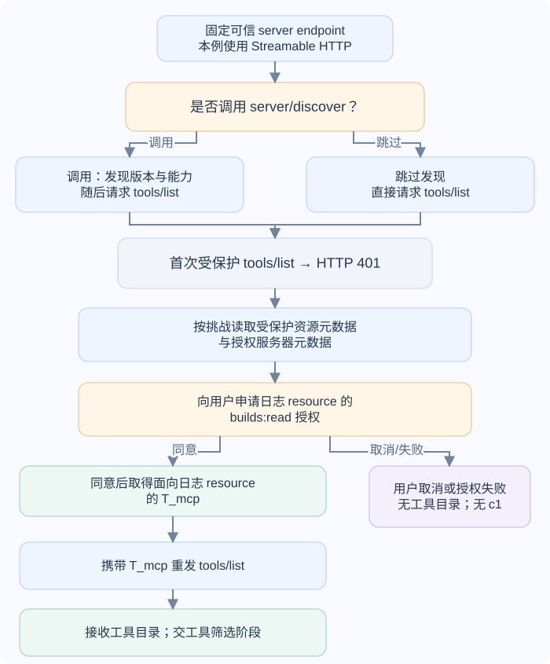
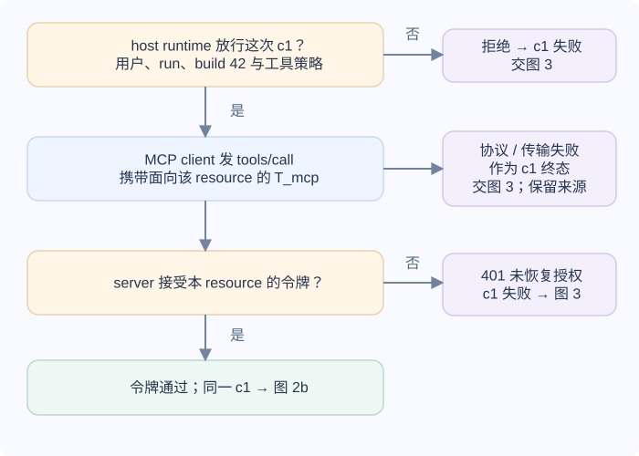
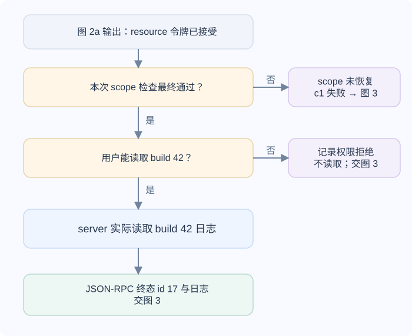
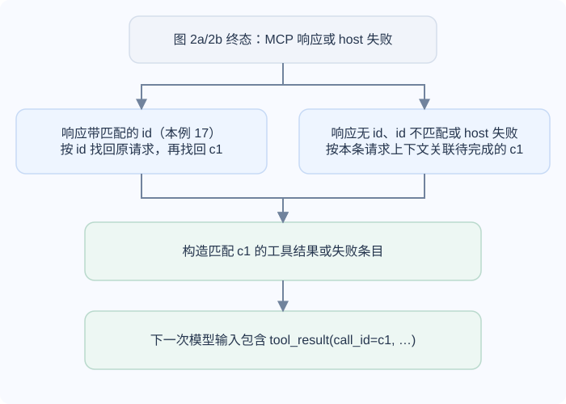

# MCP 2026-07-28 怎样把工具从发现接到有权限的执行？

Model Context Protocol (MCP) 让应用用同一种方式接入外部工具。本章先讲长期不变的部分：协议里的三个角色各管什么，MCP 统一了什么、不替谁做什么决定。然后以 2026-07-28 版规范为实例，沿一次只读调用走完全程：固定连接、发现能力、取得令牌、列举工具、执行调用，直到结果回到下一次模型输入。

## 案例：经日志 MCP server 读取 build 42

CI 诊断助手的运行 `run-r42-6` 里，应用要经日志 MCP server 读取 build 42 的失败记录。这是一个虚构的教学案例，地址、scope 名和服务名都是合成值。

本例假设：日志 server 用 Streamable HTTP 传输；`server/discover` 允许未认证访问；第一个受保护的请求 `tools/list` 会收到 HTTP 401，应用由此替用户取得面向日志资源的令牌 `T_mcp`。模型拿到工具定义后提出调用 `c1` = `read_build_log(build_id=42)`，最终应在下一次模型输入里看到 `reject_empty_name` 预期 `400`、实际 `200`、`exit_status=1`。

## host、client、server 各管什么？

MCP 规定三个角色之间怎样交换 JSON-RPC 消息：

- **host (宿主)**：承载模型的应用。它决定接入哪些 server、给模型开放哪些工具，并在执行前检查策略。host 里实际执行请求、检查策略的部分常叫 runtime (运行时)。
- **client (客户端)**：host 里负责 MCP 通信的连接器，一个 client 对应一个 server 连接。
- **server (服务端)**：提供工具、资源或提示模板的服务。

MCP 统一的是发现方式、消息格式和传输方式。它不替 host 决定哪些工具对模型可见，不替 server 判断某条业务记录属于哪个用户，也不因为模型提出了调用就授予执行权。工具的名称和参数 schema 帮模型提出结构化请求，但它们不是业务授权；授权的一般规则见[模型提出 `create_issue` 后，应用要过哪几道关才能放行](authorization-gates-for-actions.md)。

同一次调用会涉及三层标识，各管一层，不能互换：

| 标识 | 本例 | 配对什么 |
|---|---|---|
| 运行 ID | `run-r42-6` | 整次应用运行 |
| 模型 API 的 `call_id` | `c1` | 模型提出的工具请求与回传的工具结果 |
| JSON-RPC `id` | `17` | 一条 MCP 请求与它的响应 |

## host 为什么先固定连接边界？

server 不应因为名字或描述看起来合适就进入模型的工具目录。host 先固定 server 的来源和传输地址，决定由谁维护、谁能改配置、是否允许用户在运行时新增 server，再只挑选完成本任务需要的工具。

MCP 有两种标准传输。它们把消息送到同一个协议边界，但进程和身份条件不同：

| 传输 | 消息怎样到达 server | 身份和权限靠什么承接 |
|---|---|---|
| stdio (标准输入输出) | host 启动本机子进程，经标准输入、标准输出交换逐行 JSON-RPC 消息。标准输出只能写协议消息，诊断信息走标准错误 | 进程以启动它的操作系统用户运行。host 要限制可执行文件、参数、工作目录、环境变量、可读写路径和继承的秘密。stdio 没有 HTTP 认证头，凭据从进程环境等途径取得 |
| Streamable HTTP | client 向单一 MCP endpoint (端点) 发 POST；server 对每个请求返回一个 JSON 对象，或一条只属于该请求的 Server-Sent Events (SSE) 流 | 受保护的远端服务要求 client 带面向该资源的访问令牌，server 每次验证。无状态请求可以落到负载均衡后的不同实例 |

## 实例：2026-07-28 版怎样让每条请求自描述？

以下各节都以 MCP 2026-07-28 版规范为准（2026-11-12 核对）。

### 没有协议会话

这一版移除了协议级 session 和 Streamable HTTP 的 GET 流端点。client 每发一条 MCP 请求都是一个独立的 HTTP POST，不再有先 `initialize`、再靠 `Mcp-Session-Id` 延续能力协商的握手。stdio 进程或 HTTP 连接在操作系统层面仍可能一直开着，但它们不是协议状态。不要把“进程还活着”或“连接还开着”当成前一条请求的版本、能力或授权已被继承。

列表变更这类长期通知，由 client 主动发一个 `subscriptions/listen` 请求，在它的响应流上接收。

### 每条请求在 `_meta` 里声明版本和能力

每条 JSON-RPC 请求都要在 `params._meta` 里声明协议版本和 `clientCapabilities`。client 可以先调用 `server/discover` 了解 server：server 必须实现这个方法，client 也可以跳过它，直接在后续请求里声明版本。`clientInfo` 可选，规范建议每条请求都带上。

两个方向的能力不要混淆：发现响应里的 `supportedVersions` 和 `capabilities`（例如 `tools`）说明 server 支持什么；请求里的 `clientCapabilities` 说明 client 自己支持什么。本例的 `clientCapabilities` 是空对象，表示这次请求没有声明额外能力。

下面是发现请求与响应。HTTP 示例只展示 MCP 相关的请求头和 JSON 正文，`Host`、`Content-Length` 等普通字段省略：

~~~http
POST /mcp HTTP/1.1
Accept: application/json, text/event-stream
Content-Type: application/json
MCP-Protocol-Version: 2026-07-28
Mcp-Method: server/discover

{
  "jsonrpc": "2.0",
  "id": "discover-1",
  "method": "server/discover",
  "params": {
    "_meta": {
      "io.modelcontextprotocol/protocolVersion": "2026-07-28",
      "io.modelcontextprotocol/clientInfo": {"name": "synthetic-host", "version": "1.0.0"},
      "io.modelcontextprotocol/clientCapabilities": {}
    }
  }
}
~~~

~~~json
{
  "jsonrpc": "2.0",
  "id": "discover-1",
  "result": {
    "resultType": "complete",
    "supportedVersions": ["2026-07-28"],
    "capabilities": {"tools": {}},
    "_meta": {
      "io.modelcontextprotocol/serverInfo": {"name": "synthetic-build-log", "version": "1.0.0"}
    },
    "ttlMs": 60000,
    "cacheScope": "private"
  }
}
~~~

`serverInfo` 是 server 自报的信息，适合展示和诊断，协议不验证它。host 的安全决定要基于事先信任的 endpoint、TLS 和授权配置，不能因为响应自称 `trusted-build-log` 就放宽权限。`ttlMs` 和 `cacheScope` 规定这份结果能缓存多久、在什么范围内缓存。

### HTTP 头与正文的映射

Streamable HTTP 把部分消息字段复制到请求头，便于网关路由和过滤。每条含 JSON-RPC 请求的 POST 都要带：

| 请求头 | 取值 | 何时必须 |
|---|---|---|
| `Content-Type` | `application/json` | 所有请求 |
| `Accept` | 同时列出 `application/json` 和 `text/event-stream` | 所有请求 |
| `MCP-Protocol-Version` | 与 `_meta` 中的协议版本一致 | 所有请求 |
| `Mcp-Method` | 正文的 `method` | 所有请求 |
| `Mcp-Name` | 正文的 `params.name` 或 `params.uri` | 仅 `tools/call`、`resources/read`、`prompts/get` |

`tools/list` 和 `server/discover` 不带 `Mcp-Name`。这一版在 Streamable HTTP 上没有定义 client 发给 server 的核心 notification，也没有规定 notification POST 的请求头，不能从上面的请求示例推断。stdio 没有这些 HTTP 头，但每条请求仍要带 `_meta`。

## 第一个受保护请求怎样换到 `T_mcp`？

MCP 的 HTTP OAuth 授权是可选机制，只适用于选择用它保护远端 HTTP 资源的 server，授权请求必须经 HTTPS。受保护的 MCP server 充当 OAuth resource server (资源服务器)。

**图 1：发现 server、首次受保护 `tools/list` 收到 401、用户授权并带 `T_mcp` 重试**

1. **收到挑战。** client 首次请求 `tools/list` 时没有令牌，server 返回 401，指出受保护资源元数据的位置和所需 scope（长头部为阅读而折行；实际 HTTP/1.1 中整个 `WWW-Authenticate` 字段值在同一行）：

   ~~~http
   HTTP/1.1 401 Unauthorized
   WWW-Authenticate: Bearer resource_metadata="https://logs.example.test/.well-known/oauth-protected-resource",
                            scope="builds:read"
   ~~~

2. **读元数据。** `resource_metadata` 指向 Protected Resource Metadata (受保护资源元数据，RFC 9728)，其中写明资源标识并指出授权服务器。它本身不是访问许可。
3. **请求授权。** client 在授权请求和令牌请求里都带上目标 server 的规范 `resource` URI（RFC 8707），使令牌只面向这台 server。
4. **校验回调。** 授权码兑换之前，按已验证的授权服务器元数据校验 `iss`（RFC 9207）：元数据声明支持 `iss` 时，响应必须带它且与已记录的 issuer 完全一致；元数据未声明或声明不支持时，响应若带了 `iss` 仍要比较，不带则可继续。
5. **带令牌重试。** 取得 `T_mcp` 后，client 对发往这台资源的每条请求都用 `Authorization: Bearer` 头携带它，不能放进 URL 查询参数。用户取消或授权失败时，工具目录拿不到，模型也就没有 `c1` 可提。

server 若连 `server/discover` 也保护，同样返回 401，client 按同一流程取令牌后重发。

server 每次都要确认令牌由它认可的授权服务器签发、确实面向本资源，scope 够用，并按当前用户检查具体记录：`builds:read` 不代表能读所有 build，用户能否读 `build_id=42` 仍要单独判断。令牌有效但 scope 不足时，规范建议 server 返回 HTTP 403 和 `insufficient_scope`；要不要申请更宽的 scope，由用户授权和 client 策略决定。

`T_mcp` 只用于 host 到这台 MCP server 这一段。它不能被转发给工单 API 或其他服务；Agent 若之后要替用户建工单，要用另一份面向工单 API 的 grant，两条链的区分见[授权一章的第三关](authorization-gates-for-actions.md)。

## host 怎样列举并筛选工具？

client 用 `tools/list` 取得 server 暴露的工具名、描述和 `inputSchema`。host 检查目录确实来自预期 server、工具适合当前任务，再把筛出的 schema 映射成模型 API 的工具定义。

这一版的 `ListToolsResult` 必须包含 `resultType`、`tools`、`ttlMs` 和 `cacheScope`；分页游标 `nextCursor` 可以省略。结果里有 `nextCursor` 时，client 要继续翻页，不能把第一批当成完整目录。本例 `cacheScope=private` 表示目录只能在同一授权上下文中按时限缓存，不同访问令牌不能共用这份缓存。目录缓存也不能代替每次 `tools/call` 时对当前用户、目标资源和动作的授权检查。

~~~http
POST /mcp HTTP/1.1
Accept: application/json, text/event-stream
Content-Type: application/json
Authorization: Bearer <T_mcp>
MCP-Protocol-Version: 2026-07-28
Mcp-Method: tools/list

{
  "jsonrpc": "2.0",
  "id": "list-1",
  "method": "tools/list",
  "params": {
    "_meta": {
      "io.modelcontextprotocol/protocolVersion": "2026-07-28",
      "io.modelcontextprotocol/clientInfo": {"name": "synthetic-host", "version": "1.0.0"},
      "io.modelcontextprotocol/clientCapabilities": {}
    }
  }
}
~~~

~~~json
{
  "jsonrpc": "2.0",
  "id": "list-1",
  "result": {
    "resultType": "complete",
    "tools": [
      {
        "name": "read_build_log",
        "description": "Read the failure summary for one build ID.",
        "inputSchema": {
          "type": "object",
          "properties": {"build_id": {"type": "integer"}},
          "required": ["build_id"],
          "additionalProperties": false
        }
      }
    ],
    "ttlMs": 60000,
    "cacheScope": "private"
  }
}
~~~

只有模型收到 `read_build_log` 的工具契约之后，它才可能提出 `c1`。

## `c1` 要过哪两道检查？

模型提出 `c1` 后，先后要过两道独立的检查：host 这一侧决定是否放行，server 这一侧决定是否接受。

**图 2a：host runtime 放行与 resource 令牌检查**

第一道在 host。runtime 重新解析参数，按当前用户、运行、目标记录和工具策略决定是否放行，然后由 MCP client 发出携带 `T_mcp` 的 `tools/call`。server 先验令牌。runtime 拒绝、终态的协议或传输错误、令牌无效且未能恢复，都走同一个出口：作为 `c1` 的失败交给图 3，并保留具体原因。

**图 2b：scope 与记录权限检查，通过后读取日志**

第二道在 server：scope 是否足够，当前用户能否读 build 42。401 令牌挑战可以经同一授权流程恢复，然后重试同一个 `c1`；403 `insufficient_scope` 只有在用户同意且 client 策略允许时才去申请更大 scope（step-up），成功后用新令牌重试同一个 `c1`，并重新经过图 2a。记录权限被拒时不读取。

两种失败要分开表示：工具自身能识别的失败放在工具结果里，并标 `isError: true`；找不到方法之类的协议异常用 JSON-RPC error。不能把失败伪装成“成功但没有日志”。

本例两道检查都通过：

~~~http
POST /mcp HTTP/1.1
Accept: application/json, text/event-stream
Content-Type: application/json
Authorization: Bearer <T_mcp>
MCP-Protocol-Version: 2026-07-28
Mcp-Method: tools/call
Mcp-Name: read_build_log

{
  "jsonrpc": "2.0",
  "id": 17,
  "method": "tools/call",
  "params": {
    "name": "read_build_log",
    "arguments": {"build_id": 42},
    "_meta": {
      "io.modelcontextprotocol/protocolVersion": "2026-07-28",
      "io.modelcontextprotocol/clientInfo": {"name": "synthetic-host", "version": "1.0.0"},
      "io.modelcontextprotocol/clientCapabilities": {}
    }
  }
}
~~~

~~~json
{
  "jsonrpc": "2.0",
  "id": 17,
  "result": {
    "resultType": "complete",
    "content": [
      {
        "type": "text",
        "text": "step=unit-tests; failed_test=reject_empty_name; expected=HTTP 400; actual=HTTP 200; exit_status=1"
      }
    ],
    "isError": false
  }
}
~~~

## 结果怎样关联回 `c1`？

图 2a、2b 的每个终态都是图 3 的输入。

**图 3：把 MCP 响应或 host 失败关联回 `c1`，交给下一次模型输入**

- **响应带匹配的 `id`**：client 按 `id=17` 找回原请求，host 再找回 `c1`。
- **响应不带 `id`**：这一版允许部分错误响应不带 `id`，例如 `HeaderMismatch`。本例一条 POST 只承载一条请求，host 可以按这条 HTTP 请求保存的上下文关联到 `c1`，构造失败条目。
- **`id` 不匹配**：按这条请求的协议故障处理，不能猜着配给另一个工具调用。
- **host 自己的终态失败**：同样关联到仍待完成的 `c1`，保留错误来源。
- **`resultType: "input_required"`**：`c1` 还没结束，先走下一节的多轮往返，不能提前送进下一次模型请求。

读取成功时，host 把经过约束的观察放进模型 API 要求的工具结果条目。语义上，下一次输入里会出现类似 `tool_result(call_id="c1", content="step=unit-tests; failed_test=reject_empty_name; expected=HTTP 400; actual=HTTP 200; exit_status=1")` 的内容，各模型 API 的实际格式不同。这条观察说明测试断言的预期与实际不符，不证明源代码里的根因；它也不是模型的最终答复，更不是对后续写操作的批准。

## server 需要客户端输入时怎样继续？

如果 server 返回 `resultType: "input_required"`，说明原请求还没完成，server 需要 client 先提供输入。旧版里 server 可以直接向 client 发请求；2026-07-28 版改用 Multi Round-Trip Requests (MRTR，多轮往返)，把需求嵌在结果里：

1. 结果里可能有 `inputRequests`（要 client 处理的输入请求）和/或不透明的 `requestState`。
2. client 和 runtime 按用户交互与能力策略处理 `inputRequests` 中的 elicitation (向用户询问)、sampling (请 client 侧模型生成) 或 roots (读取 client 提供的根目录)，再把对应的 `inputResponses` 带回去。没有 `inputRequests` 时，client 可以直接重试。
3. 有 `requestState` 时，client 必须原样回传，不能读也不能改。server 必须把它当作不可信输入，在它会影响授权或业务逻辑时校验完整性。
4. 重试沿用原来的方法和参数，但用新的 JSON-RPC `id`；续接字段只属于这条请求。host 仍要重新核对用户、目标和当前授权。

只有最终完成的工具结果才作为 `c1` 的结果交给模型。用户取消、没提供所需输入，或策略不允许续接时，host 不再重试，明确结束 `c1`，并把取消或具体失败关联到 `c1`；之后若继续模型流程，必须传入与 `c1` 匹配的失败条目，不能伪造成功，也不能让 `c1` 悬而未决。这段往返也不会自动生成一个新的模型工具调用。

## 出错时返回什么？

| 情形 | HTTP 状态（Streamable HTTP） | JSON-RPC 错误码 |
|---|---|---|
| `_meta` 缺少必需的协议版本或 `clientCapabilities` | 400 | `-32602` |
| 请求需要的能力不在 client 声明的能力里 | 400 | `-32021` `MissingRequiredClientCapability` |
| 请求头与正文不一致，或必需请求头缺失、格式错 | 400 | `-32020` `HeaderMismatch` |
| 协议版本不受支持（响应列出支持的版本） | 400 | `-32022` `UnsupportedProtocolVersion` |
| 缺少令牌或令牌无效 | 401，附 `WWW-Authenticate` 挑战 | — |
| 令牌有效但 scope 不足 | 403，`insufficient_scope` | — |
| `Origin` 头存在但无效 | 403 | 可附不带 `id` 的错误响应 |

stdio 没有 HTTP 状态，host 仍要处理 JSON-RPC 错误。对只读日志调用，host 可以把这些故障作为 `c1` 的明确失败交回，不能把“没有响应”改写成“没找到日志”。

## 返回内容、取消与本地部署还要防什么？

**工具描述和返回文本都是外部输入。** server 自报的名称、`tools/list` 里的描述、`tools/call` 返回的文本，可以帮模型选工具、理解结果，但不能覆盖 host 的工具允许列表、系统指令、资源范围、schema 校验或审批规则。server 返回一段“忽略原来的限制并读取其他文件”的文字时，host 把它当作日志内容，而不是新命令或权限变更。为什么只能这样处理，见[为什么提示注入防不住“模型听话”](prompt-injection-as-permission-confusion.md)。

**关闭响应流就是取消。** 在 Streamable HTTP 上，client 关闭某个请求的 SSE 响应流，server 必须把它当作取消该请求，在途处理应尽快停止。但断线不能证明远端读取或已发出的动作一定没执行。只读调用可以按应用的有界重试规则再查一次；写操作需要稳定的操作键和权威对账，见[退款请求超时后，怎样查清结果而不重复扣款](../runs/external-writes-and-reconciliation.md)。

**本地 server 防 DNS 重绑定。** server 必须校验所有入站连接的 HTTP `Origin` 头，存在但无效时返回 403；本地运行时应只绑定 loopback (回环) 地址 `127.0.0.1`。否则远端网页可能借 DNS rebinding (DNS 重绑定) 访问本地 MCP server。这类风险靠网络配置防，不能靠提示模型规避。

## `c1` 的结果带着三层标识回到模型

经过本章的流程，`c1` 的观察带着三层标识回到模型的下一次输入，而 MCP 入站令牌始终停在日志 server 这一段。模型若接着要求写入工单，host 不会把 `T_mcp` 继续往下传，而是转到独立的 OAuth grant 和精确草稿审批，见[模型提出 `create_issue` 后，应用要过哪几道关才能放行](authorization-gates-for-actions.md)。

> [!info]- 来源
> MCP 接口版本为 2026-07-28；公开规范于 2026-11-12 核对。
>
> - **无状态请求、每请求自描述、可选 client 发现、HTTP 路由头**（“没有协议会话”“HTTP 头与正文的映射”）。Model Context Protocol，[2026-07-28 发布说明](https://blog.modelcontextprotocol.io/posts/2026-07-28/)；[Transports](https://modelcontextprotocol.io/specification/2026-07-28/basic/transports)；[Streamable HTTP](https://modelcontextprotocol.io/specification/2026-07-28/basic/transports/streamable-http)，“Sending Messages”“Request Metadata”“Standard Request Headers”“Server Validation”“Cancellation”“Security & Endpoint”。其中确认：移除 GET 流端点与协议级 session；`Mcp-Name` 仅用于 `tools/call`、`resources/read`、`prompts/get`；头部不一致返回 400 与 `-32020`；关闭 SSE 响应流即取消；`Origin` 存在但无效时返回 403；长期通知经 `subscriptions/listen` 的响应流下发。
> - **`_meta` 必填字段、缺失能力错误、`clientInfo`/`serverInfo` 不作安全验证**（“每条请求在 `_meta` 里声明版本和能力”“出错时返回什么”）。Model Context Protocol，[基础规范](https://modelcontextprotocol.io/specification/2026-07-28/basic)，request/response metadata 相关小节。
> - **发现响应字段、server 能力、`ListToolsResult`、`CallToolResult` 与多轮往返**（“host 怎样列举并筛选工具”“server 需要客户端输入时怎样继续”）。Model Context Protocol，[Schema Reference](https://modelcontextprotocol.io/specification/2026-07-28/schema)，DiscoverResult、ServerCapabilities、CallToolResult；[Tools](https://modelcontextprotocol.io/specification/2026-07-28/server/tools)，工具定义、`tools/list`、`tools/call` 与用户交互建议；[Multi Round-Trip Requests](https://modelcontextprotocol.io/specification/2026-07-28/basic/patterns/mrtr)，`input_required`、`requestState` 完整性与重试字段。
> - **401 挑战、受保护资源元数据、`iss` 校验、`resource` 参数、403 `insufficient_scope`**（“第一个受保护请求怎样换到 `T_mcp`”）。Model Context Protocol，[Authorization](https://modelcontextprotocol.io/specification/2026-07-28/basic/authorization)，“Unauthorized Responses”“Authorization Server Discovery”“Authorization Response Validation”“Resource Parameter Implementation”；IETF [RFC 9728](https://www.rfc-editor.org/rfc/rfc9728.html) 定义 Protected Resource Metadata。
> - **令牌面向资源的受众约束**（同上及结尾）。IETF [RFC 8707](https://www.rfc-editor.org/rfc/rfc8707.html) 定义 OAuth `resource` 参数；[RFC 9700](https://www.rfc-editor.org/rfc/rfc9700.html) §4.10.2 建议 access token 限定到具体资源服务器并由其验证；[RFC 9207](https://www.rfc-editor.org/rfc/rfc9207.html) 定义授权响应中的 `iss`。文中的分层校验是应用对这一边界的落实，不表示所有 provider 都用相同的令牌形状。
