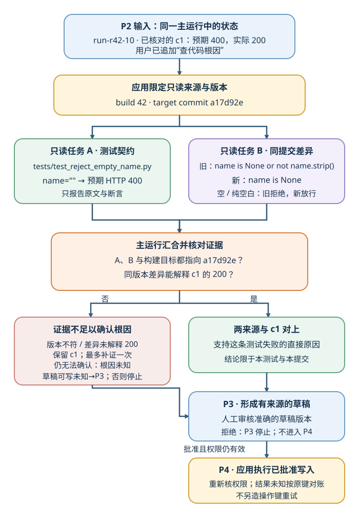

# 多阶段 AI 任务该按什么结构组织，怎样知道它在原地打转？

这一章回答两件事：一个要读多份证据、可能分给多个工作者、最后还要写入外部系统的任务，各步骤该由代码、主循环还是子智能体来组织；运行中模型一次次调用工具时，怎样判断它是在推进还是在空转。读者已经有前几章的结论：模型只提出下一步（[什么时候该让模型决定下一步](./when-the-model-decides.md)），工具调用是待核验的请求（[模型“调用工具”时实际发生了什么](./tool-calls-are-requests.md)），写操作要过授权关（[模型提出 `create_issue` 后，应用要过哪几道关才能放行？](./authorization-gates-for-actions.md)），被注入带偏的提议也停在执行之前（[为什么提示注入防不住“模型听话”](./prompt-injection-as-permission-confusion.md)）。案例仍是合成的 build 42：`c1` 已记录 `reject_empty_name` 预期 HTTP `400`、实际 `200`、`exit_status=1`。

## 先画依赖，再定结构

orchestration（编排）决定各步骤的顺序、执行条件、哪些可以并行，以及最终答复由谁负责。先画出步骤之间的依赖：谁要等谁的产物，谁只共享只读输入。结构跟着依赖走：

| 步骤关系 | 合适的结构 | 先核对的边界 |
|---|---|---|
| 顺序已知，每步都有可验证的中间结果 | 代码控制的串行流程 | 每个门槛能否挡住不合格结果进入下一步 |
| 输入类别对应不同的工具、要求或策略 | 路由到对应流程 | 分类模糊时有没有澄清或安全兜底 |
| 多个只读任务互不依赖，完成后能用证据汇总 | 并行子任务 | 有无共同写入、重复取数或共享资源冲突 |
| 后续任务取决于前一步尚未知的发现 | 单主循环或动态拆分 | 结果怎样回到同一运行状态，何时结束或升级 |
| 某个专家要接管后续用户交互 | 控制权交接 | 专家收到的身份、范围、历史和待办是否足够 |

先用最短的 build 42 任务套一下。用户只问“build 42 为什么失败？”：

| 步骤 | 输入 | 中间结果或门槛 |
|---|---|---|
| 接收问题 | 问题与 `build_id=42` | 目标是解释已有构建结果 |
| 读取日志 | 获准的 `read_build_log(build_id=42)` | `c1` 返回测试名、预期 `400`、实际 `200`、退出 `1` |
| 判断是否够答 | 问题与 `c1` | 能说明测试失败，不能证明代码根因 |
| 结束 | 证据缺口是否影响当前目标 | 不影响，按 `c1` 的范围作答 |

解释必须等 `c1` 回来，也没有能独立并行的调查分支，一个主循环就够了。若把“读日志”和“解释日志”拆成互相调用的两个专家，主流程最后还得把同一条 `c1` 拼回来，只多出交接和校验成本。

## 固定图、单主循环和 harness 可以分层共存

这些结构不互斥，常常在同一条运行路径的不同层同时出现：

- **外层应用**用固定的状态机或图维护运行身份、资源授权、审批、副作用和停止条件。
- **需要看观察决定下一步的节点**，可以复用现成 agent harness（智能体执行框架）提供的模型循环、工具执行和会话管理。
- **循环内部**再按需读取 Skill、调用工具，或把独立子任务委托出去。

build 42 里，应用先核验调用者对 `build_id=42` 的只读范围，内层循环读日志得到 `c1`。只有用户要求代码根因、应用开放了相应的只读来源，循环才继续查；只有这些来源能各自独立调查，才值得派出 worker（工作者）。写入审批和结束运行始终归应用。

已有 harness 能在所需范围内完成工具执行、恢复和验收时，配置它并接入所需工具即可。只有需要跨系统保存状态、强制执行不可跳过的阶段，或 harness 不提供所需契约时，才另写应用层编排。harness 能接管通用循环和本地执行。调用者身份、证据版本、业务不变量和幂等写入，仍要由应用的工具和服务定义并核验。命令行适合能用命令完成的任务；需要授权的业务 API、结构化证据读取和要求事务语义的写工具，不能用它代替。

> [!info] 实例：现成的执行层（核对于 2026-11-12）
> Claude Agent SDK 复用 Claude Code 的工具、agent loop 和上下文管理，并提供 sessions、permissions、hooks、subagents、MCP 等能力。Codex CLI 让模型在终端里检查和编辑本地仓库、运行已安装的工具，可接 Skills、plugins 和 MCP。两者都是可复用的执行层，不是业务决策层。

## 固定流程的五种构件

步骤事先已知时，Anthropic 的 *Building effective agents* 把代码控制的流程整理成几种可组合的构件，其中并行化又分两种，合计五种：

- **prompt chaining（提示链）**：子任务能预先排成顺序。例如起草 → 抽取结构字段 → 按程序规则校验 → 生成最终文本。中间结果不通过就停止或返工，不能盲目接到下一步。
- **routing（路由）**：不同输入类别需要不同的处理方式或权限。例如识别退款、售前或技术支持后转入对应流程。前提是分类足够可靠；不确定时询问用户或走安全的默认路径。
- **sectioning（分片并行）**：资料能拆成互不依赖的部分分别处理，例如同时总结不同章节再汇总。前提是各段保留来源，汇总者检查覆盖和冲突。
- **voting（投票并行）**：对同一问题独立生成多个候选或评审，能降低特定错误，且有明确的选择规则。多数意见本身不证明事实正确，选择最好依据外部测试或预定标准。
- **evaluator-optimizer（评估器—优化器）**：有清晰的质量标准，反馈能让下一版变好。例如生成代码 → 跑测试 → 按失败信息修订。要设最大轮数；评估器与生成器共享偏差时，换成独立测试或人工依据。

这些构件可以组合：先分类再走提示链，链中某一段并行生成候选。用哪种取决于依赖，而不是模式越多越好。

## 路径事先未知时才让模型拆分任务

Anthropic 所说的 orchestrator-workers（编排者—工作者）模式，是主模型在运行中拆出事先没有列出的子任务，交给工作者执行，再汇总结果。它和代码并行是两回事：步骤已知且互不依赖时，应用直接用代码并发发起只读调用即可，不需要再让一个模型来规划。“要不要拆分”和“由哪个模型或工具执行”是两个独立的选择。

把 build 42 扩展成一个长任务。这次是新的运行 `run-r42-10`，开始时的请求是“解释 build 42 失败，并准备一份待我审核的缺陷单”。它是与前几章 `run-r42-6` 并列的另一个教学场景，不是在那张单之外再建一张。运行引用已持久化的 `run-r42-6#c1` 作为日志证据，先核对它确实属于 build 42 的这次构建。之后用户追加：“找出 `reject_empty_name` 的代码级根因。”`c1` 不足以回答这个问题，应用核验权限后，开放目标提交 `a17d92e` 下的两个只读来源：测试定义（调用 `c-test`）和该提交的代码差异（调用 `c-diff`）。

决定要不要调查，取决于用户目标和已有观察；一旦决定调查，这两个来源已经确定、互不依赖，代码直接并发读取就行。只有来源要边查边发现时，才需要模型动态拆分：例如日志只指出失败模块，主运行得先找出可能相关的测试和实现，再按新发现决定下一批调查。

> [!example] 从 `c1` 到可复核的并行调查
> - **输入状态：** `build_id=42`，目标提交 `a17d92e`；证据 `c1` 已持久化，字段为 `step=unit-tests`、`failed_test=reject_empty_name`、`expected="HTTP 400"`、`actual="HTTP 200"`、`exit_status=1`。
> - **任务 A（`c-test`）的产物：** 合成测试 `tests/test_reject_empty_name.py:18` 原文为 `response = client.post("/items", json={"name": ""}); assert response.status_code == 400`，即契约要求空名称返回 `400`。A 不判断实现原因。
> - **任务 B（`c-diff`）的产物：** 合成提交 `a17d92e` 在 `app/routes.py:42` 把 `if name is None or not name.strip()` 改成 `if name is None`。这条合成路由从请求 JSON 取出 `name`，只做这一项校验，命中返回 `400`，否则返回 `200`，没有别的中间件或名称校验。空字符串命中旧检查，却能通过新检查，所以同一输入的返回值从 `400` 变成 `200`。B 只报告差异，不改代码也不建单。
> - **主运行汇合：** 先核对 build 元数据、A 的测试和 B 的差异都指向 `a17d92e`，再回读两处原文与 `c1` 对照。契约要求拒绝空名称，改后的检查放行空字符串，与 `c1` 的实际 `200` 一致，因此可以把这次校验变更报告为该失败的直接原因。结论只限这条测试和这次提交。

## 汇合时回到原证据核对

汇合是编排里最容易出错的一步。主运行要做的不是把两份摘要拼起来，而是：核对各份证据指向同一个版本，回读原文，确认合起来能解释原始观察。“两个工作者都这么说”不算独立验证：它们可能读的是同一份错误材料，或者摘要时丢了同一个限定条件。每条结论都要能回到来源引用。

**图：`c1` 之后的独立证据分支怎样汇回主运行**

图中的 `a17d92e`、测试文件和路由差异都是合成 fixture（测试夹具）。左侧分支是汇合失败的处理：版本不一致，或同版本的差异解释不了 `c1` 的 `200`。这时保留 `c1`，最多对构建元数据指明的目标提交再补读一次；仍然对不上，就把根因标为未知，不用模型的猜测补齐。之后若待审草稿允许写“根因未知”，就带着 `c1` 进入草稿阶段；若草稿必须包含代码根因，就停下来请求补充来源。

已知的依赖也可以直接写进程序：A、B 的证据都到齐、提交号一致，应用才把材料交给主运行解释；若 B 交回的是另一提交的差异，应用保留这份记录和它的版本，继续等 build 42 所用提交的证据。*Unfold your Agents* 讨论的就是这种做法：把新事件和依赖写成可检查的记录，适用于流程已经清楚的部分；根因未知时要查哪份材料，仍可以交给模型根据观察决定。

## 共享事实不等于共享语义

A、B 和主运行读到同一份事实，汇合也可能出错：大家对字段含义或没写明的协调约定理解不一样。`c1` 和提交号是共同事实；回传里一个 `passed` 字段表示什么，却是需要标版本、需要验证的约定。下表是合成的接口例子，两套协议分别称为“契约版”和“执行版”：

| 生产者 / 消费者 | `passed` 的约定 | 对 build 42 的解释 |
|---|---|---|
| 契约版 / 契约版 | `true` 表示测试契约已正确读取；消费者另外比较执行观察 | `expected=400`、`actual=200`、`exit_status=1`，测试失败；含义一致 |
| 执行版 / 执行版 | `true` 表示测试进程退出码为 `0` | 退出码为 `1`，写入和读取的都是 `false`，测试失败；含义一致 |
| 契约版 / 执行版 | 契约版写的 `true` 被执行版当成“测试执行通过” | 消费者只看这个标志，就会把失败误报为通过 |

每套协议内部都自洽，混用才出错。所以回传要带协议版本和语义明确的字段，例如 `contract_verified`、`execution_exit_status`，主运行还要核对证据与来源版本。schema 能拒绝缺字段或类型错误，却不能证明字段语义相同、证据真实或授权有效。

> [!example] Cat & Dog：都看见信号，不等于同意它的含义
> Zero-Shot Coordination 论文的最小协调游戏里，Alice 看见猫或狗，控制一盏灯；Bob 看不见动物，只能根据灯来猜。双方都采用“灯亮表示猫”时，Alice 看见猫就亮灯，Bob 猜猫，共得 `+10`。若 Alice 这样编码，Bob 却采用“灯亮表示狗”，同一次亮灯就会让他猜错，共得 `−10`。没有已共享的映射时，Alice 可以花 `5` 拆掉墙，让 Bob 直接看动物再猜对，净得 `10 − 5 = +5`。

论文用 self-play（自我对弈）检查同一套策略在不同角色间能否配合，再用 cross-play（交叉对弈）把各自独立形成的策略配在一起，结果表明各自自洽不保证混搭兼容。论文研究的 coordination-friendly definition（CFD，便于协调的定义）是一组共享的自然语言协调原则，例如不依赖未经约定的任意信号、考虑伙伴的多种合理解释；它在部分受测游戏中有帮助，也可能让智能体过于保守，错过本可在交互中形成的约定。论文里的 code agents 指生成可执行联合策略的智能体，不是代码编辑 harness。

下面是工程上的延伸，不是论文结论：把要共享的约定写清楚，并实际测试不同实现、模型或版本之间的组合；参与者能沟通时，先澄清含义再动作。给各方同一段提示，代替不了由程序执行的协议检查、所有权划分和授权。

## 交给工作者的任务要写清范围和回传

每个子任务都要写明 task scope（任务范围）：要回答的问题、所需事实、允许的工具、禁止的副作用、预期回传字段和停止条件。回传至少包括原始证据引用、局部结论、未验证项和失败状态；只回一段摘要会丢掉行号、版本或限定条件，主运行就没法检查结论是否越界。

按数据最小化原则，只给工作者完成任务所需的上下文；但如果它要判断实际状态码，就必须明确传入 `c1` 或它的可靠引用，不能假定子智能体看得到完整历史。本例里，主运行保留用户目标、运行标识和外部副作用状态；A、B 只拿到 `c1`、目标提交引用和各自的只读问题。

每次交接都要传送状态、等待结果、核验回传。要共享的状态多，或者步骤短而彼此依赖时，交接成本很容易超过并行的收益。只有两项读取互不等待、确实同时执行，且精简的回传足以让主运行复核时，并行才可能划算。

## 什么时候拆出子智能体

single-agent loop（单智能体循环）共享已验证的上下文，可以调用多个工具、按需读取 Skill，并不只能做一步。拆出 subagent（子智能体）有三类正当理由：

1. 测量显示长上下文正在降低任务质量；
2. 确实有可并行的任务，而且它们需要各自独立的上下文；
3. 不同任务必须受不同的工具、指令或权限约束。

短任务和有依赖的步骤，通常留在主循环里。

主循环自己也有几种组织手段。多个输入的处理步骤相同、只是几个含义一致的变量不同，用同一个 prompt template（提示模板）即可；变量过多、规则冲突或需要不同权限时，再拆模板或调整工具边界。

不同任务共享同一份会话状态和工具，差别只在处理步骤或不常用的参考资料时，按需载入 Skill 就能省掉前置的意图路由和专家交接（首次读取 Skill 本身可能要一次工具调用）；Skill 的机制见[工具、Skill 和权限分别约束什么](./when-the-model-decides.md#工具、Skill%20和权限分别约束什么)。Anthropic 关于电商 agent 的文章讨论的就是这类情形：购物车、用户偏好和历史记录交织在同一段长会话里。

反过来，任务确实需要互斥的政策、专门的合规要求、不同的数据隔离，或由不同方负责与用户交互，且分类可靠、能过端到端评估时，保留业务路由或 handoff。仅仅是用户权限不同，不需要新的 agent：工具可以按调用者核验实际范围。

简单说，Skill 回答“怎么做”，路由回答“由谁处理”，授权回答“能否执行”。

回到 build 42，三种设计各有适用条件：

- 测试契约和代码差异的位置都已知：主运行并行发出两次只读调用（就是上文的 `c-test`、`c-diff`）。
- 两条线索各要翻查许多文件，且从同一提交就能分别开工：才值得让 A 找契约、B 追踪处理逻辑，各自交回提交号、位置和观察。Anthropic 的研究系统把这种做法用在开放式检索上：主智能体按问题分派独立的调查方向，汇总带出处的发现，再决定还缺哪些证据。
- B 每一步都要问 A 刚查到了什么：一个循环连续读取更容易保住条件。Anthropic 2026 年的企业部署文章，就把这类频繁交接的专门流程折回主循环，改为按需载入 Skill。

## 专家是被调用的工具，还是接管对话

上面的 A、B 只回传证据，最终答复仍由主运行给出。专家参与的方式还有一种：直接接管与用户的后续交互。agents as tools（把智能体当工具调用）和 handoff（控制权交接）的区别，在于最终由谁对用户负责：

| 结构 | 谁继续对用户负责 | 例子 |
|---|---|---|
| agents as tools / 管理者模式 | 主智能体收集专家结果、比较证据并给出最终答复 | build 42 的主运行委托只读来源检查，再自己核对来源与 `c1` |
| handoff | 专家接手该分支的后续对话和决策 | 分类器确认用户要技术支持后，把问题交给负责下一轮澄清的支持专家 |

交接前要传递足够的背景和当前状态：接手方要知道谁授权了什么、已经读过哪些材料、哪些结论仍未知。不要不加筛选地转发整段对话，也不能把有损摘要当成权威运行记录。handoff 只改变后续由谁与用户交互；运行记录、授权和外部操作状态仍由应用维护。

## 写操作不并行

多个工作者适合并行读取不同材料，或分别验证彼此独立的产物；依赖上一步结果的写操作要按顺序执行。创建工单是一次外部副作用，不能让多个工作者并发发起同一写入。应用把已审批的草稿和这次写入绑定到同一个操作键，在发送前重新核验授权；超时后按原键对账，而不是另造一个键再试。审批怎样绑定精确草稿，见[模型提出 `create_issue` 后，应用要过哪几道关才能放行？](./authorization-gates-for-actions.md)；写入结果未知时怎样对账，见[退款请求超时后，怎样查清结果而不重复扣款？](../runs/external-writes-and-reconciliation.md)。

## 计划执行与重规划

plan-and-execute（先计划、再执行）适合这样的目标：能拆成若干步骤，每步有前提、证据和验收条件，但中间观察仍可能改变后续路线。计划是可以标版本的运行产物；它不证明模型内部怎样推理，也不是外部事实的账本。

`run-r42-10` 开始时的计划 v1 只有核对证据、形成草稿和提交三步。用户追加根因要求后，计划修订为 v2，插入 P2。这个追加要求作为事件写进进行中的运行，不改写启动请求；若把不同的启动输入当成另一次任务提交，就该新建运行。运行里要分开三种标识：启动请求摘要标识最初的输入，草稿摘要标识交给用户审核的那份具体内容，外部操作键标识同一次写入意图。它们各自的权威定义见[应用要过哪几道关才能放行](./authorization-gates-for-actions.md)和[一次 AI 运行断线或崩溃后，凭什么恢复？](../runs/run-identity-and-authoritative-state.md)。

| 阶段 | 前提与动作 | 完成条件 | 当前结果 |
|---|---|---|---|
| P1 核对证据 | 对照 `run-r42-6#c1` 与 build 42 的构建身份、失败测试和原始日志引用 | 断言差异与来源匹配，结论不超过日志 | 已完成：能解释测试为何失败，不能确认代码根因 |
| P2 补充根因证据 | 用户明确要求代码级解释后，读同一提交的测试契约（`c-test`）和差异（`c-diff`） | 两份来源都对应 build 42 的目标提交，差异能解释 `c1` 的 `200` | 已完成：`c1`、构建目标、`c-test`、`c-diff` 都对应 `a17d92e` |
| P3 形成草稿 | 按已核验的观察写缺陷单草稿；P2 未能确认根因时，只有草稿可以写明“根因未知”才继续 | 草稿目标、内容摘要与证据一致，可交审核；未获批就停在 P3 | 待起草并送人工审核 |
| P4 提交 | 只在该草稿摘要仍获批、权限仍有效时，由 `create_issue`（`c2`）以操作键 `run-r42-10:create-issue:v1` 建单；按接收方契约重放同一次写入时沿用该键 | 从应用账本核实远端 ID，或进入结果未知的对账 | 尚未进入：未批准，未调用写工具 |

调用 ID 只在运行内唯一：P4 的 `c2` 是 `run-r42-10` 自己的 `create_issue` 请求，和[授权一章](./authorization-gates-for-actions.md)里 `run-r42-6` 的 `c2` 同名但不是同一条，要过的关相同。操作键带着运行 ID，所以这里是 `run-r42-10:create-issue:v1`，不会和 `run-r42-6:create-issue:v1` 混淆。审批被拒或撤回，运行在 P3 结束，不进入 P4。前面那个短答任务解释完 `c1` 就能结束；这个长任务承诺了交付待审草稿，所以即使用户没追加根因、跳过 P2，也要走到 P3。

要不要显式计划、什么时候修订，可以这样判断：

- 步骤、依赖和分支事先已知：用代码控制的固定 DAG（directed acyclic graph，有向无环图），更便于验收。
- 下一步确实取决于尚未得到的观察：执行一步、评估一次、再修订计划。
- 只是几个短步骤，每步取决于上一次调用的发现：留在单主循环里，不必生成冗长的计划。

只有观察推翻了前提、来源版本变化、授权变化或用户目标变化时，才生成新版本的计划：保留已完成的证据，只调整剩余步骤。模型不能因为旧计划写过某个动作，就复用过期的批准或忽略权限变化。

## 三种“又调用了一次”要分开记录

运行中会出现三种看起来都像“又调用了一次”的情况：SDK 重试、运行恢复和模型循环重复。它们的含义完全不同，所以每一层都要记录自己的身份和输入，而不是只数工具被调用了几次。各层分工是：应用为每次模型调用分配 ID；SDK 在这次调用之下重试底层 HTTP 请求；执行进程从 checkpoint（检查点）恢复；模型响应提出各个工具调用；外部写入另由操作键去重。下文的图 thread 是编排框架（如 LangGraph）为这次图执行保存状态的标识，它能恢复什么见[LangGraph 能恢复什么](../runs/langgraph-recovery-boundaries.md)。

下面是 `run-r42-10` 一段简化的 trace（追踪），所有事件共用同一运行 ID 和同一图 thread：

1. **用户补充目标。** 用户追加“请查代码级根因”，计划从 v1 升为 v2，启动请求摘要不变。这是一次状态推进。
2. **底层请求重试，不是新一轮。** 应用的模型调用 `mi-17` 第一次只收到 HTTP `503`，没有模型输出。SDK attempt 从 `1` 变为 `2`，请求内容不变；第二次响应提出两条只读请求 `c-test`、`c-diff`，应用核验权限后并发执行。每次传输的服务方 request ID 只标识那一次尝试，不替代运行 ID 或调用 ID。
3. **执行进程恢复，已有观察不重取。** `c-test`、`c-diff` 的结果持久化后，执行进程崩溃；恢复时 worker attempt 加一。检查点里已有两份结果，应用重新载入，不产生新的模型调用或工具调用 ID，也不增加模型循环轮次。若模型调用已返回、节点状态尚未提交就崩溃，未提交的步骤可能再执行一次，要按应用记录和服务契约对账。
4. **模型重复提议，调用 ID 是新的，证据没变。** 恢复后的模型调用 `mi-18` 提出 `c-reread-1`，规范化参数仍是 `read_build_log(build_id=42)`，与 `c1` 相同；日志的来源版本也没变，`c1` 已在上下文里。这既不是 SDK 重试，也不是运行恢复。应用重新核验权限后，可以把已存的 `c1` 结果关联到这条新调用，不必重复取数。没有新增观察，也没有完成新阶段，这一轮计为无进展。
5. **证据使阶段完成。** 模型调用 `mi-19` 对照 `c1`、`c-test`、`c-diff` 给出解释；应用核对三者与构建元数据都指向 `a17d92e`，P2 完成，计划进入 P3。

如果契约或差异对应的提交与 build 42 不一致，P2 就不算完成：保留 `c1`，修订计划，改取 build 42 实际所用提交的证据；受权限或来源限制无法核实时，明确停在“根因未知”。

> [!info] 实例：middleware 里的重试也要单独观测（核对于 2026-11-12）
> LangChain 的 agent loop 允许 middleware 包住模型调用；`wrap_model_call` 这类 wrap-style hook 可以把内部 handler 调用零次、一次或多次。若既有 SDK 重试又有 middleware 重试，两者要分别记录，否则一次模型调用会被数成多轮，或者重试被误当成模型的重复提议。

## 无进展要用可核对的状态变化定义

事件 4 引出的问题是：怎样判断循环“没有进展”？进展要由可核对的状态变化来定义，例如新增了一条授权有效的来源观察、某个验收阶段由证据完成、用户确认了改变计划约束的信息。换一种措辞、多花一些 token、拿到一个新的随机调用 ID，都不算进展。判断时比较这些字段：运行与图 thread、worker attempt、应用模型调用 ID、SDK attempt、工具调用 ID、规范化参数摘要、来源版本、观察集合和计划版本。

按这个定义数上面的 trace：`mi-17` 内的 SDK 重试不是新一轮；从检查点恢复不增加模型调用数；`mi-18` 的 `c-reread-1` 同参同源、没有新观察，计为第 1 轮无进展；`mi-19` 完成了 P2，计数归零。本合成运行把“连续 2 轮无进展”设为停止门槛，这不是通用默认值。另外还要设总调用数、截止时间和费用上限。副作用始终走已审批的操作记录和对账流程，不允许模型新一轮的输出生成新的操作键。

## 长程任务怎样留下可复用的中间成果

上面的工作者都在一次运行内完成并回传。独立的短任务回传带来源引用的摘要就够了；长程研究或代码重建要在多次尝试之间积累发现，就得把中间产物、来源和依赖持久化下来。

> [!info] 实例：GitSwarm 用可分支的仓库保存中间产物
> GitSwarm 论文让同质的工作者异步读取一个可分支的 Git 仓库，自行选择探索、实验、验证、修复或综合，并用原子提交留下产物和显式依赖；执行 harness 负责并发、隔离和发布检查。它没有中央规划者分派研究角色，但仍有运行调度和发布验证。论文在数学证明、程序重建和三项依赖 GPU 计算的神经网络架构研究上评估；它的发布检查只验证提交是否满足任务的提交要求，不认证产物正确，论文也把投票与正确性证据分开。普通业务流程不能据此改用共享仓库的多工作者架构。

## 怎样验证编排值得维护

每种结构选择都附带“用端到端任务验证”的条件。具体做法是：用同一批任务比较单循环、固定工作流和委派结构，看端到端成功率、外部状态是否正确、证据覆盖、权限错误、重复副作用、总 token、工具成本、端到端时延和人工接管率。

再按依赖设计少量成对用例：

- 子任务无需等待彼此的产物时，检查是否真的并行；
- 上一步内容改变时，检查后续是否重新校验；
- 工作者回传缺字段或来源错误时，检查主运行能否拒收；
- 专家接管失败时，检查回退路径；
- 把“契约版生产者 + 执行版消费者”及反向组合加入回归，检查协议不兼容时能否拒收或澄清，而不只是 JSON 能否解析。模型、提示词、角色或工具版本变化后，重测实际会出现的组合。

运行记录要关联运行 ID、每个子任务的所有者、输入证据引用、模型和工具调用、重试、时延、资源消耗、完成状态和外部操作键，只保留诊断协作问题所需的内容并限制敏感上下文。观察到路由错误、回传失真或重复动作后，把最小复现加入端到端回归；不要用某个子智能体的局部得分代替系统交付结果。这些候选怎样做配对比较和独立验收，见[候选 B 比 A 好，是真改善还是抽样波动？](../evaluation-and-release/holdout-acceptance-and-paired-statistics.md)。

迁移到多智能体之前，先测当前模型单独能做到什么，并在升级模型后重测：原先靠分工弥补的差距可能已经缩小。实际选型时，把同一批任务交给“主循环并行调用工具”和“委派调查后汇合”两种实现，给相同的总预算，逐题核对证据是否齐全、版本是否一致，再比较耗时与成本。

> [!info] 实例：单智能体与协作的对照研究
> Google 等团队的研究在六个基准上比较了 260 种配置，比较不同编排时固定了工具、任务提示和计算预算。可拆分的财务推理任务和必须逐步更新状态的规划任务出现了不同结果；单智能体在任务上的基准成绩是研究中最稳健的预测因素。研究给出的经验分界只能帮助挑选值得做的对照，不能直接当成选型阈值。

## 运行中途断掉时，计划、证据和写入意图要由应用保存

这一章得到的结构是：按依赖决定哪些步骤由代码固定、哪些交给主循环、哪些值得拆给工作者；汇合回到原证据；写入串行、绑定操作键；进展按可核对的状态变化计数。`run-r42-10` 运行到 P3 时，手上已有持久化的证据 `c1`、`c-test`、`c-diff`，计划 v2，以及待审的草稿摘要；进入 P4 后还会有发送意图和操作键。若此时连接断开或 worker 崩溃，恢复时依据的正是这些由应用持有的记录。主线四从这里接手，见[一次 AI 运行断线或崩溃后，凭什么恢复？](../runs/run-identity-and-authoritative-state.md)。

> [!info]- 来源
> - **提示链、路由、并行（分片与投票）、orchestrator-workers、评估器—优化器（“固定流程的五种构件”“路径事先未知时才让模型拆分任务”）：** Anthropic，[Building effective agents](https://www.anthropic.com/research/building-effective-agents)，2024-12-19，“Building blocks, workflows, and agents”“Combining and customizing these patterns”；页面注明旧工具生态描述已变化，本章只保留模式结构与适用条件。
> - **管理者保留最终答复与专家接管（“专家是被调用的工具，还是接管对话”）：** OpenAI，[Orchestration and handoffs](https://developers.openai.com/api/docs/guides/agents/orchestration)，核对于 2026-11-12，Agents SDK 文档“Choose the orchestration pattern”；区分 handoffs 与 agents as tools，建议专家职责窄；代码接口属于该 SDK。
> - **独立子任务与结果契约（“交给工作者的任务要写清范围和回传”“什么时候拆出子智能体”）：** OpenAI，[Multi-agent](https://developers.openai.com/api/docs/guides/agents-api/multi-agent)，核对于 2026-11-12，Agents API beta 文档“When to use subagents”；建议并行处理独立工作、写清问题与预期结果、短任务和依赖步骤留在主智能体；`agent.multi_agent.enabled` 是此 API 的配置。
> - **开放式研究中的并行调查（“什么时候拆出子智能体”）：** Anthropic，[How we built our multi-agent research system](https://www.anthropic.com/research/multi-agent-research-system)，2025-06-13，“Benefits of a multi-agent system”“Production reliability and engineering challenges”；Anthropic Research 功能的工程经验，来源也强调协调、评估与可靠性挑战。
> - **折回主循环与渐进式披露（“什么时候拆出子智能体”）：** Anthropic，[Building agents: When to fold subagents into your main agent loop](https://claude.com/resources/articles/building-agents-when-to-fold-subagents-into-your-main-agent-loop)，2026-10-22，“Using an agent loop with progressive disclosure”“Task-completion evals”；基于 Anthropic 若干企业部署的对照，不是普遍因果结论。
> - **共享会话状态与业务 handoff 的边界（“什么时候拆出子智能体”）：** Anthropic，[A guide to the anatomy of effective commerce agents](https://claude.com/resources/articles/the-anatomy-of-effective-commerce-agents)，2026-09-02，“Skills, not subagents”“System prompt or skill: decide by frequency”“handoff”；商业 agent 场景的工程报告，不能据此推断跨领域的路由阈值。
> - **Skill 的结构（“什么时候拆出子智能体”）：** Anthropic，[Equipping agents for the real world with Agent Skills](https://www.anthropic.com/research/equipping-agents-for-the-real-world-with-agent-skills)，2025-10-16，2025-12-18 更新为开放标准；“The anatomy of a skill”“Skills and the context window”。
> - **把已知依赖交给程序（“汇合时回到原证据核对”）：** Peter Hollows，[Unfold your Agents](https://dojo7.com/2026/02/28/unfold-your-agents/)，2026-02-28；用发票重提和审批记录说明把循环展开为事件和依赖，属于设计论述。
> - **共享事实与协调约定（“共享事实不等于共享语义”、Cat & Dog callout）：** Hayler et al.，[Zero-Shot Coordination among LLM Agents](https://arxiv.org/html/2611.06409v1)，arXiv v1，2026-11-04，§2 Figure 1、§3、§4、§§6–7；Cat & Dog 的收益与两种不兼容灯光约定见 Figure 1 与 §4，`text agents` / `code agents` 定义见 §3。CFD 是自然语言的一般协调原则，不是字段 schema 或生产协议；`passed` 字段表是本章的合成工程例子。
> - **可复用执行层（“固定图、单主循环和 harness 可以分层共存”实例）：** Anthropic，[Agent SDK overview](https://code.claude.com/docs/en/agent-sdk/overview)，滚动文档，核对于 2026-11-12，“Compare the Agent SDK to other Claude tools”“Capabilities”；OpenAI，[Codex CLI](https://learn.chatgpt.com/docs/codex/cli)，滚动文档，核对于 2026-11-12，“Work against your local repository”“Use skills and plugins”“Connect external tools with MCP”。本章只据此说明它们是执行层，不推断其替应用实现业务授权。
> - **workflow 与 agent 的图式表达（“计划执行与重规划”）：** LangGraph，[Workflows and agents](https://docs.langchain.com/oss/python/langgraph/workflows-agents)，核对于 2026-11-12；计划状态表和无进展门槛是本章的应用层设计。
> - **middleware 重试（“三种‘又调用了一次’”实例）：** LangChain，[Middleware overview](https://docs.langchain.com/oss/python/langchain/middleware/overview)，“The agent loop”“Use middleware inside a LangGraph workflow”；[Custom middleware](https://docs.langchain.com/oss/python/langchain/middleware/custom)，“Wrap-style hooks”；核对于 2026-11-12。
> - **持久中间产物（GitSwarm 实例）：** Shah et al.，[GitSwarm: Decentralized Compounding Inference](https://arxiv.org/html/2610.04862v1)，arXiv v1，2026-10-04，§§2.1–2.5、§3、§4；发布验证不代表产物正确，本章只借其可追溯中间产物的设计。
> - **单智能体与协作的对照（“怎样验证编排值得维护”实例）：** Google Research，[Towards a science of scaling agent systems](https://research.google/blog/towards-a-science-of-scaling-agent-systems-when-and-why-agent-systems-work/)，2026-01-28，基于 180 种配置的初期解读；Kim et al.，[Capable language models can outgrow the benefits of collaboration](https://www.nature.com/articles/s42256-026-01268-y)，2026-07-24，Results、Methods，扩展到 260 种配置并说明经验分界的验证范围与统计限制；[作者实现 v2.2.3](https://github.com/ybkim95/agent-scaling/tree/v2.2.3) 提供配置与分析脚本。
