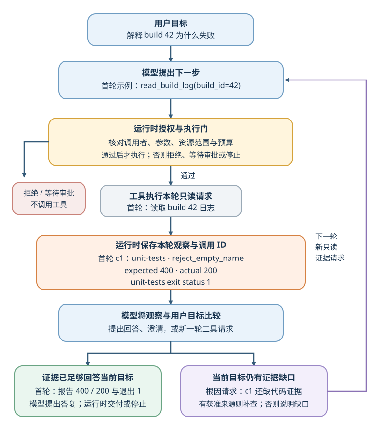

# 什么时候该让模型决定下一步？

这一章回答两个问题：多步任务里，下一步该由代码预先安排，还是让模型看了观察再提出；模型提出之后，它的判断能支撑到哪里、又在哪里必须由应用把关。读者手上的输入来自[序章](../overview/how-an-ai-answer-is-produced.md)：CI 诊断助手收到“build 42 为什么失败？”，模型请求只读工具 `read_build_log(build_id=42)`，应用核验后执行，这次调用记作 `c1`。build 42 及后文的退款、航班报价都是合成的教学例子。

## 区分 workflow 和 agent 只看一件事：谁在运行时决定控制流

workflow (工作流)由代码预先安排模型调用、工具操作和分支，模型只完成指定节点的分类、抽取或生成。agent (智能体)由模型根据目标和当前观察，在运行时允许的选项里提出下一步。聊天界面和 RAG 描述的是别的维度，不能单独说明谁掌握控制流：

| 概念 | 它描述什么 | 控制流由谁决定 | 例子 |
|---|---|---|---|
| workflow | 执行结构 | 代码确定步骤和分支 | 校验订单 → 算退款额 → 执行退款 → 发回执 |
| agent | 执行结构 | 模型依据观察提出下一步，应用决定是否执行 | 看过日志后决定再读一份证据、询问用户或报告缺口 |
| 聊天界面 | 用户怎样交互 | 背后可以是问答、workflow 或 agent | 用户在聊天窗口问 build 42 的状态 |
| RAG | 怎样把外部资料取进上下文 | 可嵌在固定流程里，也可由 agent 多次调用 | 先检索错误码说明，再决定是否继续诊断 |

观察会影响分支，并不等于 agent。代码读到工具结果后执行 `if`，只要分支是预先写好的，它仍是 workflow：已知只有“状态码不符”和“超时”两种失败时，代码按字段分派即可。同理，一次工具调用后就作答，也不足以判定是不是 agent。该问的是：模型能决定哪些步骤，哪些中间状态会改变它的选择，程序在哪些位置强制检查或停止。

## 先选最小流程，只在路径难以预列时交出控制权

先选一个满足任务契约的最小流程。多轮模型决策能提高开放任务的适应性，代价是更多调用、时延、工具错误和需要管理的运行状态；固定流程已稳定达标时，加自主性未必改善用户结果。

| 任务约束 | 起点 | 代价或边界 |
|---|---|---|
| 步骤稳定、输入范围清楚、结果可直接校验 | 代码 workflow | 灵活性有限，步骤变化时要改规则 |
| 新证据会打开难以事先列全的路径 | 有预算和停止条件的 agent 循环 | 要评估重复调用、坏观察的传播和未完成的运行 |
| 大部分路径固定，只有诊断或解释节点要适应 | 混合流程 | 授权与副作用门留在代码里，只把需要判断的节点交给模型 |

两个小例子能看出分界。从航班报价 `189`、`210`、`175` 美元里找最低价，代码取最小值 `175` 就完成了，不需要模型选下一步。用户申请退款时，订单显示已付款，但没写优惠券是否退回；这时 agent 可以选择读取退款规则或请用户补充信息，而退款金额和权限仍由应用校验。如果退款服务超时，结果处于未知状态，不能据此再退一次；这类写入怎样查清结果，见[退款请求超时后，怎样查清结果而不重复扣款？](../runs/external-writes-and-reconciliation.md)。

即使交出了部分控制权，应用仍固定必须成立的状态转换和校验。哪些步骤交给固定图、哪些留给主循环，见[先画依赖，再定结构](./multi-stage-orchestration.md#先画依赖，再定结构)。

## ReAct 循环：真实观察成为下一轮的输入

ReAct (reasoning and acting，推理与行动)让模型的推理文字、动作和环境观察交替出现。工程上要抓住的是“决策 → 行动 → 观察”：进入下一轮判断的是真实工具结果，而不是模型对结果的猜测。

| 环节 | 执行者 | 交给下一步的状态 |
|---|---|---|
| 决策 | 模型根据问题、已有观察和允许的动作，提出工具请求、澄清问题或最终答复 | 结构化的动作提议或答复 |
| 授权与执行 | runtime (运行时)核对调用者、参数、资源范围和业务条件，再执行或拒绝 | 真实工具结果、明确错误、等待审批或结果未知 |
| 观察与更新 | runtime 把结果和对应的调用关联起来，保存必要的应用状态 | 新证据与剩余预算 |
| 验收与停止 | 模型可以提出最终答复；runtime 据此交付，或按预算、截止时间、取消和安全规则先行停止 | 已交付、待澄清、转人工、受限停止或待对账 |

**图：build 42 中的动作提议、执行门与观察回流**

图中蓝色节点是模型提出或选择下一步，黄色节点是 runtime 决定是否执行，橙色节点保存每轮观察，首轮就是 `c1`。模型提出的是请求，怎样配对结果、怎样设计请求的契约，见[模型“调用工具”时实际发生了什么](./tool-calls-are-requests.md)。

生产运行要留下的记录是：动作请求、权限决定、工具结果和停止原因。证明一个动作发生过，靠的是这些记录，不需要保存模型的推理文字。

> [!example] 论文示范：观察怎样改变后续搜索
> ReAct 论文附录 C.1 给模型看的 HotpotQA 少样本示范，要找 Colorado orogeny 东部延伸区的海拔范围。`Search[Colorado orogeny]` 只返回造山运动概述，没有东部信息，模型改查 `Lookup[eastern sector]`，得到 High Plains；`Search[High Plains]` 返回的名称有歧义，模型再限定为 `Search[High Plains (United States)]`，观察到海拔约 `1,800–7,000 ft` 才作答。这是提示里的示范，不是一次评测轨迹。它展示了新观察怎样改变查询词和范围；反过来，若检索结果无关，循环也会把错误带下去。

## 模型说“答完了”，不等于答复已经验证

模型给出最终答复，只表示它不再请求工具。这是一个结束提议，不是验证结果。runtime 收到它后，按预算、截止时间、取消和安全规则决定交付还是停止；这些硬规则也可能在模型想结束之前就先停下运行。

答复内容是否被证据支持，是另一道检查：每条主张要能回到一条观察，而且不能超出这条观察记录的范围。下一节用 `c1` 说明“范围”是什么意思；逐条核对主张、答错时定位哪一环出错，见[回答写好后，怎样逐条核对证据](../context/claim-verification-and-failure-localization.md)。

## 一条观察只支持它直接记录的结论

模型决定“够了”的依据是观察，所以先要弄清一条观察能撑多远。规则是：观察只支持它直接记录的内容；字段之间的因果、观察背后的原因，需要另外的证据。

> [!example] `c1` 支撑到哪里？
> - **已知输入：** 用户问 build 42 为什么失败，任务是解释这次构建结果。
> - **观察 `c1`：** `step=unit-tests`；`failed_test=reject_empty_name`；`expected=HTTP 400`；`actual=HTTP 200`；`exit_status=1`。
> - **能支持：** 日志记录了 `reject_empty_name` 预期 HTTP `400`、实际 `200`，以及 `unit-tests` 步骤的退出状态为 `1`。
> - **还不能支持：** 这些字段没有说明状态码不符是否就是退出状态为 `1` 的原因；也没有源代码、提交差异或业务规则，指不出代码根因。
> - **下一步：** 用户只问构建结果时，模型可以按“能支持”一栏作答，runtime 再按规则交付。用户要代码根因时，只有存在合适且已授权的只读来源，才提出新的读取请求并逐次核验；没有就说明证据不足。

模型愿不愿意猜，不改变手上有哪些事实。“模型认为够了”不能替代上面这一步。用户追问代码根因后，调查怎样展开、怎样汇合，见[路径事先未知时才让模型拆分任务](./multi-stage-orchestration.md#路径事先未知时才让模型拆分任务)。

## 工具、Skill 和权限分别约束什么

模型能做什么，受三样东西约束，它们管的不是同一件事：

| 约束 | 回答的问题 | 由谁落实 | 它不能做什么 |
|---|---|---|---|
| 工具 | 模型可以请求哪些读写能力，参数长什么样 | 应用定义工具目录，runtime 执行 | 工具名或命名空间前缀（如 `browser_search`）不授予权限 |
| Skill | 某类任务该按什么步骤做，参考哪些资料 | 模型按需读取说明 | 教会流程，不扩大可读写的资源 |
| 权限 | 这个调用者此刻能否对这个目标执行这个动作 | runtime 每次执行前核对 | 不由模型输出、提示词或 schema 决定 |

Agent Skills (智能体技能包)把领域说明、步骤、脚本和参考资料打包成可按需载入的程序知识，靠 progressive disclosure (渐进式披露)控制占用的上下文：模型平时只看到每个 Skill 的名称和简短描述；判断相关时，才读取 `SKILL.md` 正文；正文再指向需要时才打开的附属文件或脚本。所以 Skill 回答“怎么做”。实际能读写哪些资源，仍由工具实现和 runtime 授权决定。遇到不同领域的步骤，也不一定要新建子智能体，可以比较“按需载入 Skill”和“拆到独立上下文”两种做法，见[什么时候拆出子智能体](./multi-stage-orchestration.md#什么时候拆出子智能体)。

权限这一栏是主线三后面几章的内容：模型提出写操作后要过哪几道关，见[模型提出 `create_issue` 后，应用要过哪几道关才能放行？](./authorization-gates-for-actions.md)；模型选到 shell 或文件编辑工具后，谁检查路径、批准越界动作、限制进程能力，见[模型选到 shell 或文件工具后，由谁决定能否执行？](./coding-agent-harness.md)。

> [!info] 实例：Manus 在解码时屏蔽不可选的工具
> Manus 的工程文章描述了一种实现：用上下文状态机决定当前哪些工具可选，在解码时把不允许的工具调用对应的 logits (未归一化分数)屏蔽掉，而不是从工具列表里删除定义。这依赖模型、序列化格式和推理框架，许多托管 API 不开放这种控制。它只约束模型能输出什么，不是授权机制；服务端执行工具时仍要重新检查权限。改动工具定义还可能破坏已缓存的提示词前缀，影响取决于服务的序列化和缓存规则，见[重复的前缀怎样复用](../model/prefix-reuse-and-prompt-caching.md)。

## 每一轮都检查预算和停止条件

agent 循环每轮都要检查：是否达到完成条件，调用次数、时间和费用是否超出上限，用户是否已取消。连续收到相同的无进展结果时，换一种已授权的查证方式、转人工，或停止并说明缺口。“无进展”要用可核对的状态变化来定义，而不是数调用次数，定义和计数方法见[无进展要用可核对的状态变化定义](./multi-stage-orchestration.md#无进展要用可核对的状态变化定义)。

长任务要把证据和真实副作用状态存在应用的运行记录里，不能靠对话回忆。断线或崩溃后凭什么恢复，见[一次 AI 运行断线或崩溃后，凭什么恢复？](../runs/run-identity-and-authoritative-state.md)。

## 怎样对照 workflow 和 agent

在同一组代表性任务上同时跑固定 workflow 和 agent 循环。除了最终文字，还要检查外部状态、证据引用、必须披露的信息、权限违规、重复动作、调用数、总成本、端到端时延和人工接管率。若用户与 agent 共同改变状态，测试时要让用户中途改动状态，检查 agent 是否重新读取权威值再继续。

比较之前先写清每类任务必须达成的结果和成本、时延、安全上限。模型动态选择只有在改善契约结果、且落在预算与风险边界内时才值得保留。怎样判断改善不是抽样波动、同一任务重复运行该怎样计分，见[候选 B 比 A 好，是真改善还是抽样波动？](../evaluation-and-release/holdout-acceptance-and-paired-statistics.md)。

> [!info] 实例：τ-bench 与 τ²-bench 检查结束状态
> τ-bench 用模拟用户和领域 API 构造对话，比较结束时的数据库状态与标注目标，而不只看最终回复；它报告 `pass^k`：同一任务 `k` 次独立试验全部成功的概率，再对任务取平均，衡量的是稳定完成，不同于“至少一次通过”的 `pass@k`。τ²-bench 的 Telecom 领域让模拟用户也能用工具改变共享环境。两者说明只检查自然语言答复会漏掉状态错误和协作失败；分数只代表各自的任务、模拟器和规则。

> [!info]- 历史：ReAct 论文的分数说明了什么
> ReAct 原论文用 PaLM-540B 在 HotpotQA 和 FEVER 上做提示实验（表 1）。ReAct 得 `27.4` EM (Exact Match，完全匹配)和 `60.9` 准确率；只行动的基线为 `25.7`、`58.9`，思维链（CoT）为 `29.4`、`56.3`。也就是说，ReAct 在 FEVER 上超过两项对照，在 HotpotQA 上超过只行动基线却低于 CoT，收益随任务而变。论文也记录了重复动作和无信息的检索结果会让轨迹偏离目标。这些是特定模型、数据集和提示下的研究结果，不能当作生产成功率。

## 模型选定的下一步，以结构化请求交给应用

这一章得到的结论是：控制流交给模型，只在路径难以预列时才值得；交出去之后，模型产出的仍然只是提议，包括“去调用某个工具”和“我答完了”两种，执行、验证和停止都留在应用手里。下一章看这份提议的具体形状：一次工具调用在应用里是什么、怎样和结果配对、契约怎样设计才让模型选对，见[模型“调用工具”时实际发生了什么，工具契约该怎样设计？](./tool-calls-are-requests.md)。

> [!info]- 来源
> - **workflow 与 agent 的控制流、适用权衡和终止条件（“区分 workflow 和 agent”“先选最小流程”“每一轮都检查预算和停止条件”）：** Anthropic，[Building effective agents](https://www.anthropic.com/research/building-effective-agents)，2024-12-19，“What are agents?”“When (and when not) to use agents”“Agents”；原文区分预定义代码路径与模型动态控制，提到任务常在完成时结束，也可设最大迭代次数。预算、安全与取消条件是本章说明的应用约束。页面注明其工具生态描述已有变化，本章不沿用旧的框架推荐。
> - **ReAct 机制、HotpotQA 示范和分数（“ReAct 循环”、历史 callout）：** Yao et al.，[ReAct: Synergizing Reasoning and Acting in Language Models](https://arxiv.org/html/2210.03629v3)，arXiv v3，2023-03-10，§2、图 1、§3.3 表 1、附录 C.1；C.1 首轮搜索后依次是 `Lookup[eastern sector]`、`Search[High Plains]`、`Search[High Plains (United States)]`。
> - **Manus 解码屏蔽（实例 callout）：** Manus，[Context Engineering for AI Agents: Lessons from Building Manus](https://manus.im/blog/Context-Engineering-for-AI-Agents-Lessons-from-Building-Manus)，2025-07-18，“Mask, Don't Remove”；描述 Manus 自身的状态机、工具可用性和受限解码，不表示其他 API 支持同一能力。
> - **工具命名不授予权限（“工具、Skill 和权限”）：** Anthropic，[Writing effective tools for agents — with agents](https://www.anthropic.com/research/writing-tools-for-agents)，2025-09-11，“Namespacing your tools”；命名评估细节见下一章来源。
> - **Skill 的结构与渐进式披露（“工具、Skill 和权限”）：** Anthropic，[Equipping agents for the real world with Agent Skills](https://www.anthropic.com/research/equipping-agents-for-the-real-world-with-agent-skills)，2025-10-16；2025-12-18 更新称 Agent Skills 已作为开放标准发布；“The anatomy of a skill”“Skills and the context window”说明名称与描述、`SKILL.md` 正文、附属文件的逐层载入。Skill 的调用权限由应用的工具实现决定。
> - **结束状态评估与 `pass^k`（τ-bench 实例）：** Yao et al.，[τ-bench](https://arxiv.org/html/2406.12045)，2024-06-17，摘要与 §3 的 `pass^k` 定义；Barres et al.，[τ²-Bench](https://arxiv.org/abs/2506.07982)，2025-06-09，摘要与 Telecom dual-control 领域。
