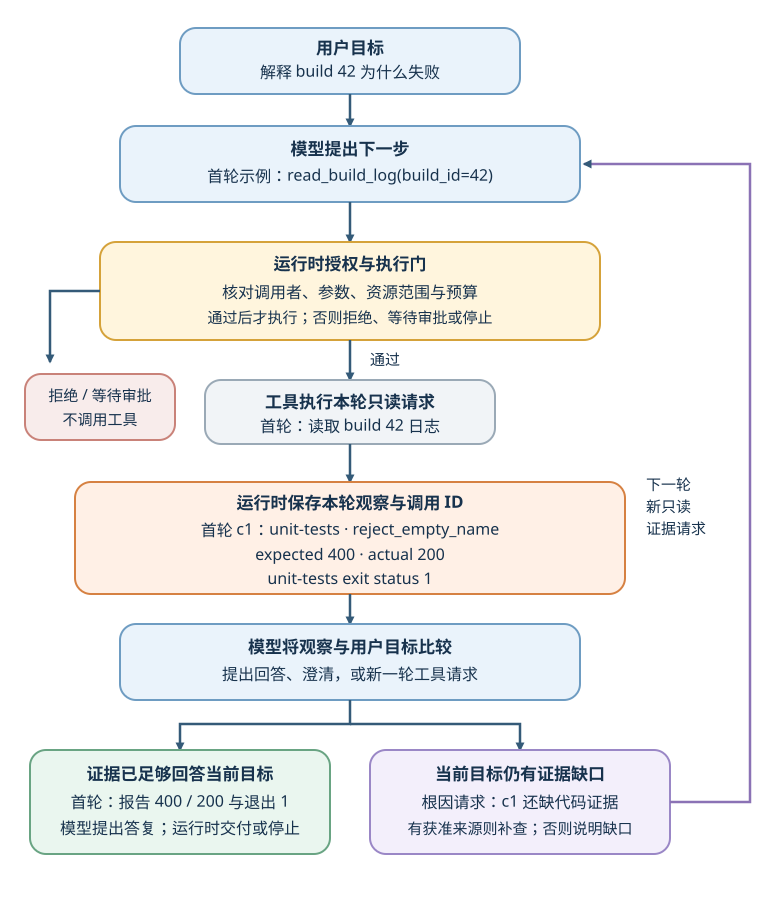

# 什么时候应该让模型决定下一步？

**案例背景。** 一次构建失败诊断从用户的问题“build 42 为什么失败？”开始。模型提出读取只读 tool（工具）`read_build_log` 的请求，应用核验权限后才执行。工具调用 ID `c1` 关联这次请求和返回结果；返回值显示 `unit-tests` 步骤中的 `reject_empty_name` 预期 HTTP（Hypertext Transfer Protocol，超文本传输协议）`400`、实际 `200`，进程退出状态为 `1`。这些字段足以说明测试观察到了什么；它们还不能证明是哪一行实现代码造成了问题。

如果每次请求只需读取固定日志并解释字段，程序可以安排全部步骤。如果下一步取决于日志中尚未知晓的内容，且可靠分支难以事先列全，模型在给定工具、权限和预算内决定“再查、澄清还是作答”可能有用。后者把更多控制权交给 agent（智能体）；是否值得，要用端到端任务结果判断。

## 智能体、工作流、聊天界面和检索增强生成分别描述什么？

workflow（工作流）指程序预先安排模型调用、工具操作和分支；agent 则由模型根据当前观察选择下一步。chat interface（聊天界面）描述用户交互方式，retrieval-augmented generation（检索增强生成，RAG）描述把外部资料取回上下文的一种方法；二者都不能单独说明谁掌握流程控制权。

| 概念 | 控制流由谁决定？ | 例子 |
|---|---|---|
| 工作流 | 代码确定步骤和分支，模型完成指定节点的分类、抽取或生成 | 校验订单 → 算退款额 → 执行退款 → 发回执 |
| 智能体 | 模型依据目标与中间观察，在运行时提供的选项里提出下一步 | 查看日志后决定再读一份证据、询问用户或报告缺口 |
| 聊天界面 | 只描述用户如何交互；背后可以是问答、工作流或智能体 | 用户在聊天窗口询问 build 42 状态 |
| RAG | 只描述向模型提供检索证据；可以嵌在固定流程，也可以由智能体多次调用 | 先检索错误码说明，再决定是否继续诊断 |

一次工具调用后就回答，不足以判定流程是否属于智能体。更有用的问题是：模型能决定哪些步骤、输入和中间状态怎样改变选择、程序会在哪些位置强制检查或停止。

## 什么时候动态选择值得额外成本？

先选一个满足任务契约的最小流程。多轮模型决策可能提高开放任务的适应性，但也会带来额外调用、时延、工具错误和需要处理的运行状态；若固定流程已稳定满足成功标准，增加自主性未必改善用户结果。

| 任务约束 | 合适的起点 | 成本或边界 |
|---|---|---|
| 步骤稳定、输入范围清楚、结果可直接校验 | 代码工作流 | 灵活性有限；步骤变化时需要更新规则 |
| 新证据可能改变路径，且可靠规则难以事先列全 | 有预算和停止条件的智能体循环 | 要评估重复调用、坏观察传播和未完成运行 |
| 大部分路径固定，只有诊断或解释节点需要适应 | 混合流程 | 由代码保留稳定的授权与副作用门；只把需要判断的节点交给模型 |

观察会影响下一步，并不自动要求智能体。即使代码依据工具观察执行 `if`，只要分支和路径是预先定义的，它仍是工作流；例如，已知仅有“状态码不符”和“超时”两种情况时，代码可以按字段分派。只有新证据会打开难以预列的路径、需要结合上下文选择补查、澄清或结束时，才值得让模型动态提出下一步。应用仍固定必须成立的状态转换和校验；如何判断还缺哪些编排，见[固定流程、主循环与委派怎样配合](./orchestration-patterns.md#先看哪些步骤依赖同一份观察)。

build 42 的 `c1` 是一个边界清楚的选择：若用户只问构建结果，可以报告日志记录的观察：`reject_empty_name` 实测 `200`、预期 `400`，而 `unit-tests` 步骤的退出状态为 `1`。现有字段没有说明这两项是否存在因果关系。若用户要求代码级根因，运行时只能在有合适、获授权的只读能力时继续查；否则说明证据不足。模型是否愿意猜，不应改变可用事实。

## ReAct 循环怎样让观察影响下一步？

ReAct（reasoning and acting，推理与行动）把模型生成的决策文字、实际动作和环境观察交替起来。它的工程要点是“决策 → 行动 → 观察”：真实工具结果而不是模型对结果的猜测，成为下一轮判断的输入。生产运行时记录动作请求、权限决定、工具结果和停止原因即可；不需要保存模型的内部推理文字来证明动作发生过。

> [!example] HotpotQA 中观察怎样改变后续搜索？
> 论文附录 C.1 的 few-shot prompt（少样本提示）示范要求找出 Colorado orogeny 东部延伸区的海拔范围。`Search[Colorado orogeny]` 只返回造山运动概述，没有东部地区信息；模型于是改查 `Lookup[eastern sector]`，得到 High Plains。`Search[High Plains]` 返回的名称不明确，模型再限定为 `Search[High Plains (United States)]`，观察到其海拔约为 `1,800–7,000 ft`，才结束回答。这是提示中给模型看的示范，不是独立报告的一次评测成功轨迹。后续查找的关键词和范围由新观察改变；若检索结果无关，循环也可能把错误继续带下去。

| 环节 | 执行者 | 交给下一步的状态 |
|---|---|---|
| 决策 | 模型根据问题、已核对的工具观察和允许动作提出工具请求、澄清问题或最终回答 | 结构化的动作提议或答复 |
| 授权与执行 | runtime（运行时）校验调用者、schema（结构模式）、资源范围和业务条件，再执行或拒绝 | 真实工具结果、明确错误、审批等待或结果未知 |
| 观察与更新 | 运行时关联工具调用和返回值，保存必要的应用状态 | 新证据与剩余预算 |
| 验收与停止 | 模型可输出最终答复；运行时据此交付，或按预算、截止时间、取消与安全规则先行停止 | 已交付、待澄清、转人工、运行受限停止或待对账 |

**图：build 42 中的动作提议、执行门与观察回流**

图里，中间两个蓝色节点表示模型提出或选择下一步，黄色节点表示运行时控制是否执行，橙色节点保存每轮工具观察，图内列出首轮的 `c1`。模型给出最终答复表示它不再请求工具，不等于运行时已验证答复正确。运行时收到结束信号后按预算、截止时间、取消和安全规则决定是否交付；这些硬性规则也可能在模型完成前先行停止。若用户要求代码根因，模型仍需提出新的只读证据请求，运行时逐次核验。

用 `c1` 重放一次：

> [!example] 一条观察支撑到哪里？
> - **已知输入：** 用户问 build 42 为什么失败，当前任务范围是解释这次构建结果。
> - **观察 `c1`：** `step=unit-tests`；`test=reject_empty_name`；`expected=400`；`actual=200`；`exit_status=1`。
> - **可支持的结论：** 日志分别记录 `reject_empty_name` 的实际状态码为 `200`、预期为 `400`，以及 `unit-tests` 的退出状态为 `1`。
> - **尚未支持的结论：** 这些字段没有说明状态码不符是否导致退出状态为 `1`，也没有源代码、提交差异或完整业务规则来指出代码根因。
> - **下一步：** 对只问构建结果的请求，模型可以提出答复；运行时仍按预算、安全和取消规则决定交付还是停止。对根因请求，要么提出只读代码查找请求并由运行时逐次核验，要么请求补充证据。不得把“模型认为够了”当成验证。

这个结构同时适用于需要动作的任务。退款例中，订单查询显示已付款，但没有说明优惠券是否应退回。智能体可以选择读取退款规则或请用户补齐信息；退款金额与权限仍由应用校验。若退款服务超时，`outcome_unknown`（结果未知）表示不能据此再次退款；应用先以 operation ID（操作标识）查询权威状态。若只是从航班报价 `189`、`210`、`175` 美元中找最低报价，固定代码取最小值 `175` 即可，不需要让模型选择下一步。这两个任务展示了两种不同结构的价值，不构成通用阈值。

ReAct 原论文在 PaLM-540B 的 HotpotQA 与 FEVER 提示实验中发现，ReAct 的表 1 分数分别为 `27.4` EM（Exact Match，完全匹配）、`60.9` accuracy（准确率）；仅行动基线为 `25.7`、`58.9`，chain-of-thought（思维链，CoT）为 `29.4`、`56.3`。这说明 ReAct 相对基线的结果随任务而变：它在论文设置的 FEVER 上超过两项对照，在 HotpotQA 上超过行动基线但低于 CoT。论文还记录了重复动作和无信息检索结果会让部分轨迹偏离目标；这些是特定模型、数据集、工具和提示设置中的研究结果，不是生产成功率预测。

## 工具、Skills 和权限分别约束什么？

工具定义模型可以请求哪类读写能力。一个清晰的 action space（动作空间）应让每个工具的用途、参数、失败方式和边界容易区分；用 `browser_search`、`file_read` 这样的服务或资源前缀，可以提示调用归属，却不能授予权限。Anthropic 的 2025 年工具评估发现，命名空间前缀或后缀的效果会随模型变化，因此应按本地任务测试，而不是把一种命名法当成通用最佳做法。每次执行仍由运行时核对调用者和目标资源；参数 schema 也不能证明业务动作已获用户授权。权限、审批和停止路径见[生产环境 AI 安全](../safety/ai-safety-in-production.md)，工具调用的具体契约见[工具设计与函数调用](./tool-design-and-function-calling.md)。

Agent Skills（智能体技能包）把领域说明、步骤、脚本和参考资料组织为可按需载入的程序知识；Anthropic 公开的方案通过逐层披露，让模型先看到简要说明，需要时再读取完整技能和附属文件。Skill 能教会流程，但实际可读写资源仍由运行时工具与授权决定。因而，领域步骤不同不一定需要一个新的子智能体；可比较按需加载技能与拆分上下文的效果。模型选到本地 shell 或文件编辑工具后，谁来检查路径、批准越界动作并限制进程实际能力，见[模型选到 shell 或文件工具后，由谁决定能否执行？](./coding-agent-harness.md)。

Manus 的工程文章给出一种特定实现：用上下文状态机决定哪些工具调用可选，并在解码期间把不允许调用对应的 logits（未归一化分数）设为不可选。该方法依赖模型、序列化格式和运行框架，不是托管 API（应用程序接口）都支持的授权机制。动态修改工具定义还可能改变被缓存的提示词前缀，但实际影响取决于服务的序列化和缓存规则；参见[上下文工程原则](../context/context-engineering-principles.md)。无论怎样限制模型输出，服务端执行工具时仍须重新做权限检查。

每轮都应检查是否达到完成条件、最大调用次数、时间和成本预算。重复收到相同的无进展结果时，可以改用另一个已授权查证方式、转人工或停止并说明缺口。长任务需要保存证据和真实副作用状态，不能让对话回忆替代运行记录；恢复边界见[AI 运行如何断线恢复](../systems/ai-application-architecture.md)。

## 怎样判断智能体循环真的改善了任务？

在同一组代表性任务上对照固定工作流和智能体循环。除了最终文字，还检查外部状态、证据引用、必须披露的信息、权限违规、重复动作、调用数、总成本、端到端时延和人工接管率。若任务由用户与智能体共同改变状态，测试时也要允许用户在中途更新状态；智能体应重新读取权威值再继续。

τ-bench 以模拟对话和领域 API 比较结束时的数据库状态与标注目标。`pass^k` 表示同一任务的 `k` 次独立试验全部满足该任务成功条件的概率，再对任务求平均；它衡量一致完成，不同于 `pass@k` 的“至少一次通过”。τ²-bench 的 Telecom 任务进一步让模拟用户也能通过工具改变共享环境。它们说明只检查最终自然语言可能漏掉状态错误或协作失败；测试结果仍受各自任务、模拟器和规则范围限制。做本地比较前，先写清每类任务必须达成的结果和成本、时延、安全上限，再对照成功率、`pass^k`、人工接管和单位完成成本；模型动态选择只有在改善契约结果且落在预算与风险边界内时才值得保留。

相关的编排选择见[多阶段 AI 任务怎样组织](./orchestration-patterns.md)；版本变化如何跨运行验收见[如何测试并保留 Agent 改进](./agent-improvement-and-version-acceptance.md)。

> [!info]- 来源
> - **工作流与智能体的控制流、适用权衡和终止条件：** Anthropic，[Building effective agents](https://www.anthropic.com/research/building-effective-agents)，2024-12-19，§§“What are agents?”、“When (and when not) to use agents”与“Agents”；原文区分预定义代码路径和模型动态控制，提到任务常在完成时结束，也可设置最大迭代次数。预算、安全与取消条件是本文说明的应用运行时约束。页面注明工具生态描述已有变化，本文不沿用旧框架推荐。
> - **ReAct 机制和实验边界：** Yao et al.，[ReAct: Synergizing Reasoning and Acting in Language Models](https://arxiv.org/html/2210.03629v3)，arXiv v3，2023-03-10，§2、图 1、§3.3 表 1、附录 C.1 的 HotpotQA 提示示范；C.1 的首轮搜索后依次是 `Lookup[eastern sector]`、`Search[High Plains]`、`Search[High Plains (United States)]`。原论文 PaLM-540B 在 HotpotQA、FEVER 上的分数不能外推为生产成功率。
> - **工具列表状态控制实例：** Manus，[Context Engineering for AI Agents: Lessons from Building Manus](https://manus.im/blog/Context-Engineering-for-AI-Agents-Lessons-from-Building-Manus)，2025-07-18，“Mask, Don't Remove”；来源描述 Manus 自身的状态机、工具可用性与受限解码设计，不表示其他 API 支持同一能力。
> - **工具范围与命名评估：** Anthropic，[Writing effective tools for agents — with agents](https://www.anthropic.com/research/writing-tools-for-agents)，2025-09-11，“Choosing the right tools”“Namespacing your tools”；其内部工具使用评估发现前缀与后缀命名的效果会随模型变化，本文据此只建议按自身任务测量。
> - **技能的渐进式加载：** Anthropic，[Equipping agents for the real world with Agent Skills](https://www.anthropic.com/research/equipping-agents-for-the-real-world-with-agent-skills)，2025-10-16；2025-12-18 更新称 Agent Skills 已作为开放标准发布；“The anatomy of a skill”与“Skills and the context window”说明 `SKILL.md`、附属资源和渐进式披露。技能的调用权限仍由应用工具实现。
> - **状态与用户交互评估：** Yao et al.，[τ-bench](https://arxiv.org/html/2406.12045)，2024-06-17，摘要、§3 的 `pass^k` 定义与 benchmark 设计；它定义 `pass^k` 为同一任务的 k 次独立试验全部成功，并对任务求平均。Barres et al.，[τ²-Bench](https://arxiv.org/abs/2506.07982)，2025-06-09，摘要与 Telecom dual-control domain。文中只概述其评估对象与状态指标，不把 benchmark 分数当作任意生产任务表现。
