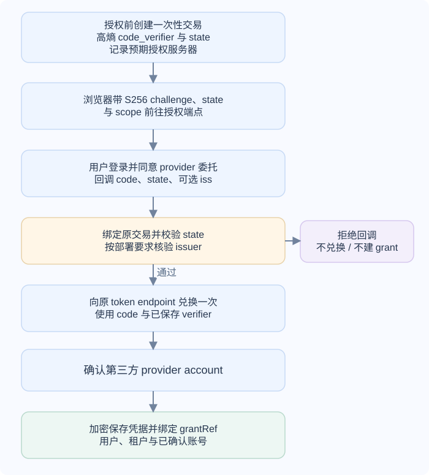
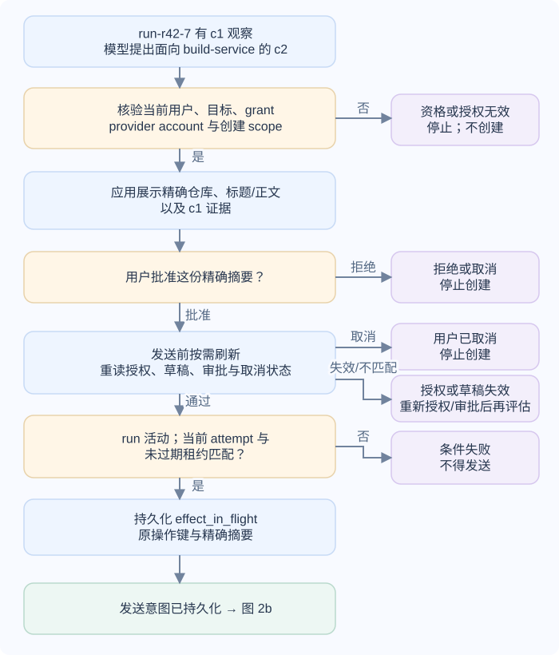
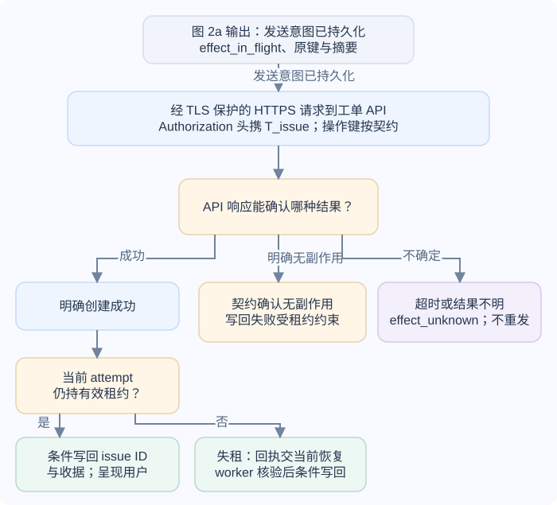
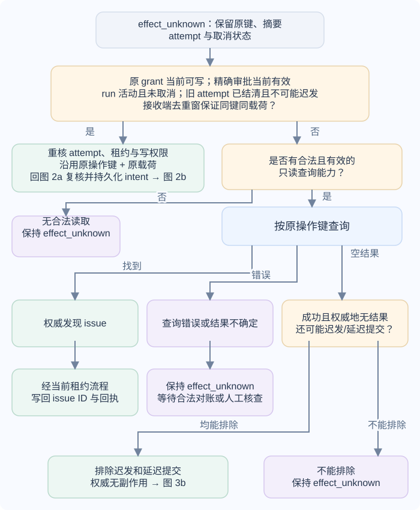
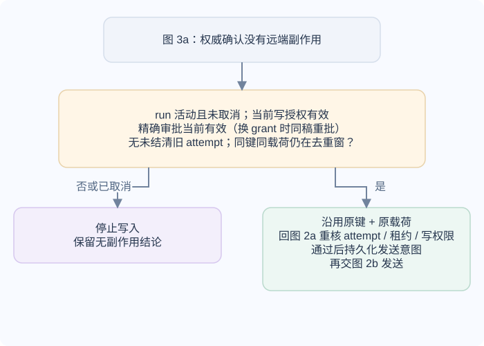

# 无人值守 Agent（智能体）怎样在用户授权内继续第三方操作？

**案例背景。** 以下是合成教学案例。同一 run-r42-7 已用只读调用 c1 从 Model Context Protocol（MCP，模型上下文协议）日志服务取得 build 42 的观察：reject_empty_name 预期 HTTP 400、实际 200。用户要求应用解释失败，并为 repository_id=build-service 准备缺陷单，提交前让用户审批。工单服务的 OAuth（开放授权）提供方（provider）账号是用户的 OAuth 身份，build-service 是动作目标；两者不是同一个标识。运行时要用用户对工单 API（应用程序接口）的委托授权，但不能把创建权限交给模型，也不能把此前读日志的令牌拿去创建 issue（工单）。

无人值守只表示用户不必为每个内部步骤重新登录；它不表示授权无限期有效，也不表示用户授予一个 API scope（权限范围）就批准了任意动作。完整链路要把用户会话、OAuth grant（授权）、动作批准和远端副作用记录分开保存。

本例中的 `attempt`（执行代次）标识同一 run/action 内的一次 worker（工作进程）执行；它可以负责发送，也可以在恢复时只做对账。一次 HTTP 重试不一定产生新的 attempt。租约是 worker 暂时获准更新本地动作状态的资格，带有代次和到期时间。旧 worker 即使还活着，也不能在租约过期后提交状态；但本地租约不能阻止已经暂停的 worker 稍后把请求发到远端。

本章按三个阶段说明这条链：先把工单 provider 的 OAuth 授权安全地绑定到本地 grant；再让应用审批并提交一份精确的缺陷单；如果远端结果不确定，保留原操作状态并按合法读取能力恢复。日志令牌 `T_mcp` 与工单令牌 `T_issue` 始终面向各自的资源。

## grant 为什么不能等同于登录会话或一次动作批准？

应用会话确认当前浏览器或客户端对应哪个本地用户；OpenID Connect（OIDC，开放身份连接）身份层和应用自己的会话建立方法见[Cookie 会话与 OIDC 令牌怎样建立身份？](../../engineering-foundations/security/web-sessions-and-oidc.md)。OAuth grant 则记录用户把哪些第三方资源和 scope 委托给哪个 client。它通常通过授权码流程取得，并由运行时把它绑定到当前本地用户、tenant（租户）和 provider account。一个登录 cookie 不会自动变成第三方 API token。

运行时还要为某个写动作记录独立的审批和副作用状态：

| 记录 | 例子 | 它能说明什么 |
|---|---|---|
| 应用会话 | 本地账号 user-17 当前已登录 | 谁在应用内发起任务；不授予 ticket API 权限 |
| 用户授权 grant | grantRef=g-31，用户 user-17，tenant（租户）=team-4，provider account=repo-owner-2 | 此用户对指定 resource（目标资源）/audience（受众）和 scopes（权限范围）的委托；不批准某一条正文。provider account 是 OAuth 身份，不是目标仓库 ID |
| 任务身份 | runId=run-r42-7 | 这次持久运行的身份；不是 OAuth 凭据 |
| 模型工具调用 | 后续 create_issue 请求的 call_id=c2 | 一次模型提出的动作；不是外部去重键 |
| 动作审批 | repository_id=build-service、标题、正文和 c1 证据的精确摘要 | 用户批准本次明确预览；内容或目标改变时应重新审批 |
| 远端操作键 | run-r42-7:create-issue:v1 | 接收端去重或查询这次副作用的稳定键；是否有效由接收端契约决定 |

grant 记录保存 grantRef、用户/tenant、provider account、目标资源 resource（资源标识）URI 或令牌受众 audience（受众）、实际授予的 scope、到期与 refresh 状态，以及到加密秘密存储的凭据引用。运行、动作摘要、审批状态和操作键保存在各自的任务与动作记录中，并通过 grantRef 关联。本例 provider account=repo-owner-2 是 OAuth 身份，repository_id=build-service 是同一 run 的目标仓库；两者可以不同。`access token`（访问令牌）和 `refresh token`（刷新令牌）不进入 prompt（提示词）、模型消息、事件流、普通日志、tool result（工具结果）或 checkpoint（检查点）。access token 用于向目标 API 发请求；其有效期和是否能刷新由 provider 决定。只有 provider 实际发放 refresh token 时才保存它，并且只把它交给所属授权服务器的 token endpoint（令牌端点）换取新 access token。

## 两条 OAuth 链分别在谁和谁之间？

MCP 日志读取是 host/client（主机/客户端）到 MCP server 的受保护资源访问。host/client 向日志 MCP 授权服务器请求并取得 T_mcp；该 token 的 audience（令牌受众）和 resource（目标资源）是日志 MCP 服务。工单创建是 Agent runtime 代表用户访问工单 API，使用 T_issue；其目标资源是工单 API，并受用户授予的 issue 权限范围约束。两条链的授权服务器、资源标识和权限范围可能不同。即使两个 token 都采用 Bearer（持有者令牌）传输，也不能互换或透传。

| 调用 | 请求去向 | 随请求发送的令牌 | 资源服务器核验 | 应用 runtime 核验 |
|---|---|---|---|---|
| `c1`：读取 build 42 日志 | 日志 MCP server | `T_mcp`，面向日志 MCP resource | 令牌有效、权限范围允许读取，且当前用户能读 build 42 | 在调用前检查模型参数、用户、run 和目标记录；将远端结果配回 `c1` |
| `c2`：创建缺陷单 | 工单 API | `T_issue`，面向工单 resource | 令牌有效、权限范围允许创建，且用户能向目标 repository 写入 | 在发送前检查实际 repository、正文与证据匹配用户已批准的精确摘要 |

这里的 `T_mcp` 和 `T_issue` 是教学符号，不代表 token 必须是可供 client 解码的 JSON Web Token（JWT，JSON 网络令牌）。资源服务器要用它支持的验证方式确认令牌签发者、有效性、受众和权限；client 不能靠读取一个不透明 token 来替服务端完成授权检查。

每个调用目标都要按其支持的方式校验收到的 token：是否来自预期 issuer（签发者）、是否仍有效、audience 是否覆盖这个 resource、scope 是否足够。授权服务器支持时，client 用 OAuth `resource` 参数请求目标资源；这不会令所有 provider 都返回同一种 access token。refresh token 只发给它所属的授权服务器 token endpoint，不能发给工单 API，更不能放进模型上下文。

## 一次长任务怎样在授权、刷新、审批和写入间前进？

### 先绑定 grant，再保存不含凭据的运行状态

一次授权码流程在浏览器跳转前就先建立 PKCE 交易；授权码只在回调验证完成后兑换一次：

应用必须在发起授权前生成高熵 `code_verifier`，计算它的 S256 `code_challenge`，并把 verifier、`state`、预期授权服务器和一次性交易关联保存。浏览器跳到授权端点时发送 challenge 与 state；用户登录并同意后，授权服务器把一次性短效 code 和 state 重定向回应用。服务端先把回调与原交易配对并验证 state，再按部署采用的 mix-up 防护确认授权服务器，只有通过时才向原交易记录的 token endpoint 发送一次授权码兑换请求，并带上同一笔交易保存的 verifier。PKCE verifier 由应用生成并在兑换时使用，不会由授权服务器再给一份。

若应用会连接多个授权服务器，RFC 9700 要求防护授权服务器混淆攻击（mix-up）；部署可按能力采用授权响应中的 issuer 标识（例如 RFC 9207 的 `iss`）并比对，或用不同回调 URI 区分授权服务器。并非每个 OAuth 流程都要求响应含 `iss`，具体校验要符合所用机制和 provider 能力。若 issuer 校验失败、state 不匹配或用户取消，应用不得兑换 code，也没有新的 grant。

成功兑换后，应用暂存 provider 发放的 `access token`，并用 provider 支持的身份机制或已获授权的账户接口确认第三方账号；确认后才将账号与本地 `user-17` / `team-4` 关联，记录实际授予的资源和 scope，并加密保存凭据。若 provider 同时发放 `refresh token`，也加密保存它，后续只交给所属授权服务器的 token endpoint 换取 access token。不能把 OAuth 回调本身当成已验证的 provider account；运行状态只保存 `g-31` 这样的引用。

开始处理 build 42 时，运行数据包含已持久化的 c1 观察。模型依据它提出新调用 c2，参数包括目标 repository_id=build-service、issue 标题和正文。运行时核验用户仍有该仓库的动作资格，grant 仍对应正确 provider account 与 issue API，scope 包含创建需要的写权限，并把动作摘要与 run-r42-7:create-issue:v1 一起持久化。模型不能自行指定可用 token 或更换 resource。

### 审批后在发送前按需刷新并复核

access token 可能早于长任务到期，任务也可能跨越多小时甚至多天。运行时在实际发送前依据 provider 返回的到期信息决定是否向授权服务器刷新。RFC 9700 要求 public client（公共客户端）的 refresh token 采用 sender constraint（发送方约束）或 rotation（轮换）；若 provider 使用轮换，它会在刷新时签发新 refresh token 并使旧 token 失效。运行时应以 grant 为粒度串行刷新，并在同一事务或可靠更新中替换秘密引用与版本，避免并发刷新把新 token 覆盖掉。刷新成功后，worker 仍要重新核验用户资格、grant、目标、精确动作摘要、审批和取消状态，再决定能否发送。provider 返回 invalid_grant、撤回或其他不可恢复错误时，把 grant 标成需重新授权，阻止尚未发送的写入，不回退到应用登录 cookie 或其他人的 token。

如果高影响动作需要确认，批准对象是精确的动作摘要，而不是“允许这个模型操作工单”。等待期间若标题、正文、repository_id、证据、当前用户资格、grant scope 或取消状态改变，原审批无效。真正调用前，worker 重新读取这些状态；审批与 grant 检查都要针对将发出的那一份内容成立。这个状态与审批后恢复同一 runId 的关系见[AI 运行怎样在断线或工作进程崩溃后恢复，并避免副作用重复](../systems/ai-application-architecture.md)。

### 把秘密只送到它所属的资源

通过检查后，运行时取出或换取面向工单 API 的 access token，通过 TLS 保护的 HTTPS 请求发送，并在 HTTP `Authorization: Bearer <T_issue>` 请求头携带它；正文携带 issue 草稿，操作键则按接收端契约放在其规定的位置。MCP 入站的 `T_mcp` 不会转给工单服务；`T_issue` 也不会回传到模型。日志可记录用户/tenant、resource、scope、动作摘要、运行标识、审批 ID、操作键与结果状态，但不能记录 bearer 字符串、refresh token 或可还原它们的 URL。

图 2a 的输出是已获批摘要和已持久化的发送意图；只有这条状态交给下图发送。拒绝、过期授权、草稿变化、取消或租约条件失败都在发送前停止。

### 发送意图持久化后怎样处理远端结果？

本例发往工单 API 的请求通过 TLS 保护的 HTTPS 发送，`T_issue` 放在 HTTP `Authorization: Bearer` 请求头，操作键的位置由接收端契约决定。下面只跟踪发送之后的远端结果与本地写回。

> [!example] 本例的精确审批与成功回执
> `c1` 观察到 `reject_empty_name` 预期 HTTP 400、实际 HTTP 200、`exit_status=1`。模型给 `c2` 拟定目标仓库 `build-service`、标题“build 42：空名称测试未按预期拒绝请求”，正文说明上述测试观察并请维护者检查空名称输入的校验路径。应用把目标仓库、标题、正文和 `c1` 证据一并展示，用户批准这份确切草稿；改动其中任一项都要重新审批。
>
> 假设工单 API 返回 `{"id":"ISSUE-842","status":"created"}`，当前 attempt 仍持有有效租约，应用就条件写回 issue ID 与收据，并向用户显示“已创建 ISSUE-842：build 42：空名称测试未按预期拒绝请求”。这里的 `ISSUE-842` 是工单服务的合成回执；`actual=200` 是测试观察。

发送前，worker 以条件事务核验当前 attempt、匹配的租约代次且租约尚未过期、预期运行与操作状态、获批动作摘要、当前写授权和取消标记，再持久化 `effect_in_flight`（副作用已进入发送流程）、原操作键与动作摘要；之后才发送请求。条件检查或更新失败时，必须停止且不得发送。这项事务只约束本地状态，不能向远端服务栅栏旧 worker：旧 worker 若在提交发送意图后暂停，即使租约已过期、恢复器已把状态转成 `effect_unknown`（远端结果未知），它恢复后仍可能发出请求。资源 API 的明确拒绝是否证明未产生副作用，要按 provider 的响应契约判断；超时、断连或无法确认的响应都不能一概解释为“没发生”。

若收到成功响应，只有在条件事务确认当前 attempt 仍持有未过期租约时，worker 才能写回 issue ID、操作收据和动作结果。若运行带有 `cancel_requested`，应保留这项请求；当前恢复流程确认外部动作成功后，可按实际结果将运行转为 `completed` 并停止其余步骤。只有确认没有已发出或仍可能提交的副作用时，运行才终结为 `canceled`。条件失败的旧 worker 不得直接完成该运行，应把响应交由持有当前租约的恢复流程核对并条件写回。若发送超时，或 attempt 在记录终态前失联，先前写入的 effect_in_flight 无法证明请求没有发出；租约过期后，恢复器须保留原键和摘要、条件转入 effect_unknown，再按下文的受控重放或合法对账条件处理，不能退回普通草稿步骤。相反，若刷新返回 invalid_grant 或撤权发生在持久化发送意图之前，当前 worker 明确停止且没有更早的未结清 attempt，则停止新写入本身不构成 effect_unknown。

若 API 响应契约明确证明本次请求未产生副作用，失败终态也只能由仍持有当前有效租约的 attempt 条件写回。旧 worker 失租时，不得直接更新动作状态；应把响应及其可核验依据交给当前租约恢复流程，再按当前状态条件记录失败。若响应无法证明无副作用，则按下文 `effect_unknown` 的恢复条件处理。

## 用户撤权或令牌失效后怎样安全恢复？

[应用架构章](../systems/ai-application-architecture.md)的恢复示例先查询原操作键。本节进一步展开授权条件；下图还展示一种可选路径：接收端契约明确允许且所有恢复条件成立时，可以受控重放原键、原载荷。

`effect_unknown` 表示请求可能已到远端，但运行时没有可判定的最终结果。先保留原操作键、动作摘要、attempt 与取消状态。原键受控重放要求原 grant 仍有当前写权限、精确审批仍有效、任务未取消、没有未结清或仍可能迟发的旧 attempt，且接收端仍在去重窗口内保证同键同载荷幂等。任一条件不满足就不新写；只有具备合法读取能力时才能查询对账，查询不确定时保持未知。

图 3a 选择原授权下的安全重放或合法读取对账。查询成功且权威地无结果后，还必须排除旧 attempt 迟发和接收端延迟提交；查询错误、结果不确定或不能排除时均保持 `effect_unknown`。只有“权威确认无副作用”这个输出进入下图；找到 issue 则按当前租约流程收尾。

确认无副作用后，若要恢复写入，run 必须仍活动且未取消，当前 grant 必须有目标写权限，精确审批必须仍有效；换用新 grant 时须对同一精确草稿重新审批。旧 attempt 必须已结清且不可能迟发，接收端同键同载荷去重窗口仍须有效。更改目标或正文不得复用原操作键。

用户主动在 provider 撤权、应用收到撤权通知或 refresh 返回 invalid_grant 时，运行时将 grant 标记为不可写，清除或撤销其秘密引用，并使依赖该 grant 的待审批草稿过期。若发送意图尚未持久化、当前 worker 已明确停止且没有更早的未结清 attempt，运行只有在未取消时才等待重新授权并重新核验；这本身不表示有远端副作用待核对。若动作已取消且没有旧 attempt，停止该动作，不能在重新授权后按原键提交一个此前未发送的效果。若旧 effect_in_flight attempt 失联，则不能据此推断请求未发出，恢复时按 effect_unknown 处理；撤权期间只允许合法查询和不会新建效果的对账，取得新 grant 后是否能恢复写入见下列条件。恢复器不得为已取消的运行发起新写入。若撤权后已发请求返回明确成功响应，仍须按前文相同的当前 attempt 与尚未过期租约条件写回 issue ID 和收据；失去资格的 worker 必须把回执交给当前租约恢复流程核对并条件写回。只有响应缺失或无法判定时才保持未知。RFC 7009 描述的是 client 通知授权服务器撤销 token；provider 可以同时影响同一 grant 的其他 token。资源服务器是否即时拒绝已经签发的 access token，取决于其验证和撤销机制。因此，撤权不会自动取消已在网络上的请求，也不能由 Agent 用一句“已取消”来代替状态对账。

当原 grant 或精确审批已失效，或同键同载荷重放条件不成立，而 `create_issue` 结果仍未知时，停止新写入并保留原操作键、请求摘要与取消状态；这条恢复路线只在仍有**合法且有效**的读取能力时查询同一操作键。若原 grant 和批准的动作仍有效、任务未取消、没有未结清或仍可能迟发的旧 attempt，且远端去重窗口仍开，可按图 3a 的安全条件重放原键和原载荷。原键不能配不同 payload：

- 如果用户刚撤销了唯一 grant，且没有另一份已授权的只读 grant、接收端状态查询能力或其他合法审计接口，运行必须保持 effect_unknown。不能用已撤销的 token 继续查，也不能仅为“确认一下”而偷偷申请新 scope。
- 如果仍有合法只读查询权限，查询成功且权威发现 issue 时，可将 issue ID 写回原操作记录；查询错误、超时或结果无法判定时保持 effect_unknown。只有查询成功且权威地无结果，才继续判断旧 attempt 是否可能迟发以及接收端是否可能延迟提交。无法排除任一情形时仍为未知。
- 用户重新授权后，得到的是新 grant，旧审批与旧 token 不会自动恢复有效。先用新授权允许的读取能力查询原操作键；查不到仍须同时排除旧 attempt 迟发和接收端延迟提交，才能记录权威无副作用。要在此后恢复写入，run 必须仍活动且未取消，新 grant 必须具备当前目标的写权限，用户须重新审批同一精确草稿，没有未结清或仍可能迟发的旧 attempt，远端同键同载荷去重保证仍在有效窗口内。恢复仅重放原操作键和原载荷；若要修改目标或内容，须先结清旧动作，再建立新的摘要、审批和操作键。若查询或迟发判定仍不确定，保持 effect_unknown 并请用户或管理员人工核查。

日志工具读到 c1 里的结果不会为 c2 增加工单 scope；获得写 scope 也不自动批准这份 issue 草稿。相同原则适用于长任务读取第三方日历或文档：Google Calendar 的 `https://www.googleapis.com/auth/calendar.events.readonly` scope 允许读取事件；创建或编辑事件需要实际授予相应的写 scope。Google 的 `https://www.googleapis.com/auth/calendar.events` scope 同时包含查看和编辑权限，因此申请它时仍需按实际 scope 告知用户。某些 provider 的创建 scope 会同时包含读取能力；应检查实际授予的 scope，不应把产品名当成最小权限保证。

相关机制：

- [浏览器会话与 OIDC 怎样确认身份并约束凭据受众？](../../engineering-foundations/security/web-sessions-and-oidc.md)：区分本地登录、身份令牌和面向 API 的访问令牌。
- [AI 运行怎样在断线或工作进程崩溃后恢复，并避免副作用重复？](../systems/ai-application-architecture.md)：沿同一操作键处理 effect_in_flight、effect_unknown 和恢复。
- [生产 AI 如何阻止不可信内容诱导模型越权？](../safety/ai-safety-in-production.md)：把动作预览、重新授权和停止规则连到运行时策略。
- [生产应用运行时怎样管理部署凭据？](../../engineering-foundations/infrastructure/production-application-runtime.md)：比较部署身份、短期工作负载令牌与用户 OAuth grant。

> [!info]- 来源
>
> 授权原则于 2026-11-12 对照 RFC 与 Google 官方文档复核；token 期限和撤销传播随 provider 而异，Google 的 OAuth 与 Calendar scope 仅作 provider 特定例子。
>
> - **授权码与 PKCE、多个授权服务器的 issuer 防混淆、受众限制和 refresh token 保护/轮换。** IETF [RFC 9700: Best Current Practice for OAuth 2.0 Security](https://www.rfc-editor.org/rfc/rfc9700.html)，2025-01，检查 §§2.1.1、4.4.2、4.10.2、4.14；其中受众限制是对当前服务的建议，不保证所有 provider 以相同 token 格式实现。`iss` 响应参数的具体校验见 [RFC 9207](https://www.rfc-editor.org/rfc/rfc9207.html)。
> - **面向特定资源的 token 请求。** IETF [RFC 8707: Resource Indicators for OAuth 2.0](https://www.rfc-editor.org/rfc/rfc8707.html)，2020-02，检查 §§2–3 的 resource 参数及其资源身份语义；是否支持由授权服务器决定。
> - **token 撤销接口及同一授权 grant 中其他 token 的可能影响。** IETF [RFC 7009: OAuth 2.0 Token Revocation](https://www.rfc-editor.org/rfc/rfc7009.html)，2013-08，检查 §§2–2.2；规范没有让调用方据此推断任意资源服务器已同步停止接受所有自包含访问令牌。
> - **provider 特定的 refresh token 获取与撤销示例。** Google for Developers，[Using OAuth 2.0 for Web Server Applications](https://developers.google.com/identity/protocols/oauth2/web-server)，检查 Offline access、Refreshing an access token、invalid_grant 和 Token revocation；[Choose Google Calendar API scopes](https://developers.google.com/workspace/calendar/api/auth) 确认 calendar.events.readonly 只读事件，calendar.events 可查看和编辑；这些是 Google 特定行为，不外推到其他授权服务器。
