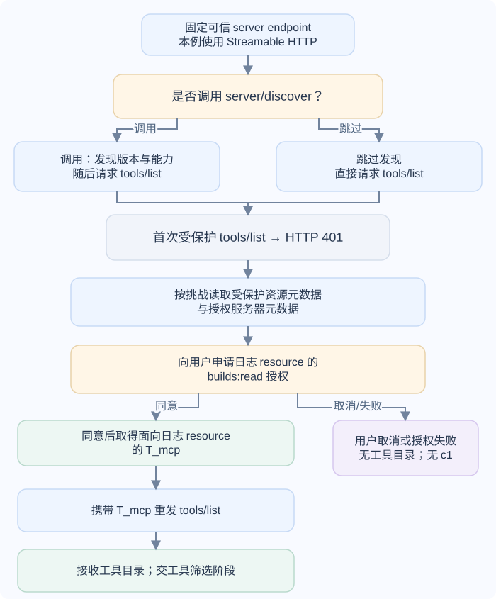
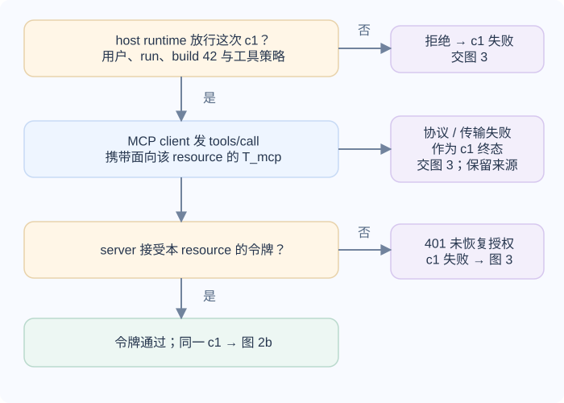
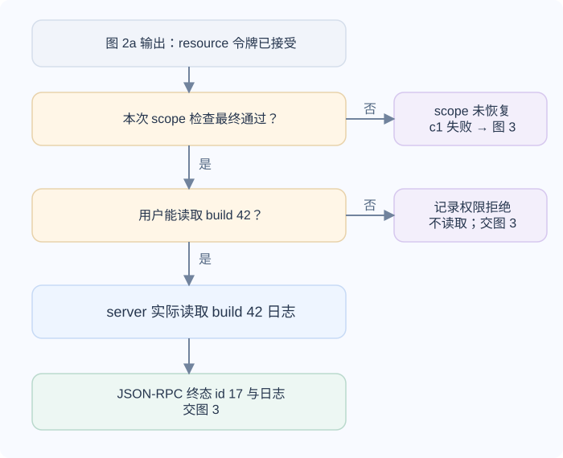
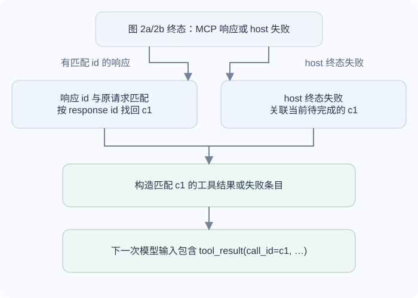

# 主机怎样把 MCP 工具从发现接到有权限的执行？

**案例背景。** 以下是合成教学案例。用户在应用已有的一次运行 `run-r42-7` 中询问 build 42 为什么失败。host 接入日志 MCP 服务、检查工具目录并把允许的输入结构交给模型后，模型提出只读调用 `read_build_log(build_id=42)`，调用标识为 `c1`。工具返回测试名、预期值和实际值；本篇走完从连接到结果进入下一次模型输入的过程。

Model Context Protocol（MCP，模型上下文协议）规定 host（承载模型的应用）、client（host 中负责 MCP 协议通信的连接器）和 server（提供工具、资源或提示的服务）之间如何交换 JSON-RPC（JSON 远程过程调用）消息。runtime（运行时）是 host 中实际执行请求并检查策略的部分。MCP 统一发现和传输格式，但不替 host 决定哪些工具可见，不替 server 验证某条业务记录属于哪个用户，也不替模型工具调用授予执行权。

以下流程和本章协议细节采用 MCP 2026-07-28，并按两个阶段展开：先固定连接、发现并取得工具目录，再执行 `c1` 并把结果交给下一次模型请求。本例假设 `server/discover` 可公开访问，而第一个受保护请求 `tools/list` 返回 401；client 由此取得面向日志 MCP resource 的 `T_mcp`，再带令牌重发列举请求。每条含 JSON-RPC 请求的 HTTP 请求都独立携带协议元数据；只有访问受保护 resource 时，才附上适用于该 resource 的令牌。

## host 为什么先固定连接边界？

工具 server 不应仅因其名称或描述看起来合适就进入模型目录。host 先固定 server 的来源和传输地址，决定由谁维护、谁能改配置、是否允许用户在运行时新增 server，并选择只暴露完成本任务所需的工具。工具名称和参数 schema（结构描述）帮助模型提出结构化请求，却不等于业务授权。

MCP 的两种标准传输把消息送到同一个协议边界，进程和身份条件却不同：

| 传输 | 消息怎样到达 server | 身份和权限由什么边界承接 |
|---|---|---|
| stdio（standard input/output，标准输入输出） | host 启动本机子进程，通过标准输入和标准输出交换逐行 JSON-RPC 消息。标准输出只能写协议消息；诊断信息走标准错误。进程可以跨多次请求保持运行。 | 进程以启动它的操作系统用户运行；host 要限制可执行文件、参数、工作目录、环境变量、可读写路径和继承的秘密。stdio 本身没有 HTTP Bearer（持有者令牌）认证头。 |
| Streamable HTTP | client 向单一 MCP 端点（endpoint）发送 POST；server 对每个请求返回一个 JSON 对象，或只关联该请求的 Server-Sent Events（SSE，服务器发送事件）流。 | 对受保护的远端 HTTPS 服务，host 按资源边界带上访问令牌，server 每次验证。一个无状态请求可以到达负载均衡后的不同实例。 |

2026-07-28 版移除了协议级 session 和 Streamable HTTP 的 GET stream 端点（endpoint）；client 每发送一条 MCP 请求都用一个 HTTP POST，server 对该请求返回 JSON 或只关联该请求的 SSE 流。它没有先发 initialize、再靠 Mcp-Session-Id 延续能力协商的旧握手。stdio 进程或 HTTP 连接在操作系统层仍可能持续存在，但它们不再是此版 MCP 的协议会话状态。不要把“进程还活着”或“HTTP 连接还开着”当成前一条请求的版本、能力或授权已经继承。

## 2026-07-28 怎样在每条请求中声明版本和能力？

先记住当前规则：每条 JSON-RPC 请求都要在 params._meta 中声明协议版本和 clientCapabilities。client 可先调用 server/discover；server 必须实现该方法，但 client 可以省略发现，直接在后续请求中声明版本。发现响应的 supportedVersions 和 capabilities 告诉 client server 支持什么，例如 tools；请求中的 clientCapabilities 则声明 client 自己支持什么。两者方向不同，server 的能力不能替代 client 对自身能力的声明。clientInfo 是可选字段，规范建议 client 在每条请求中提供。

下面是远端发现请求和 server 返回的合成例子；`ttlMs` 与 `cacheScope` 是发现响应的字段，缓存要遵守其范围，不能把私人结果当成公开目录缓存。HTTP 示例只展示 MCP 相关请求头和 JSON 正文；普通 HTTP framing（如 `Host`、`Content-Length`）省略。

~~~http
POST /mcp HTTP/1.1
Accept: application/json, text/event-stream
Content-Type: application/json
MCP-Protocol-Version: 2026-07-28
Mcp-Method: server/discover

{
  "jsonrpc": "2.0",
  "id": "discover-1",
  "method": "server/discover",
  "params": {
    "_meta": {
      "io.modelcontextprotocol/protocolVersion": "2026-07-28",
      "io.modelcontextprotocol/clientInfo": {
        "name": "synthetic-host",
        "version": "1.0.0"
      },
      "io.modelcontextprotocol/clientCapabilities": {}
    }
  }
}
~~~

~~~json
{
  "jsonrpc": "2.0",
  "id": "discover-1",
  "result": {
    "resultType": "complete",
    "supportedVersions": ["2026-07-28"],
    "capabilities": {"tools": {}},
    "_meta": {
      "io.modelcontextprotocol/serverInfo": {
        "name": "synthetic-build-log",
        "version": "1.0.0"
      }
    },
    "ttlMs": 60000,
    "cacheScope": "private"
  }
}
~~~

这里的 serverInfo 是 server 自报信息，适合展示或诊断，协议不验证它。host 的安全决定应基于事先信任的 endpoint（网络端点）、TLS（传输层安全协议）和授权配置，不应因为响应声称自己叫 trusted-build-log 就改变权限。

这个 `server/discover` 示例假设 endpoint 允许未认证发现；若 server 也保护发现请求，它可返回 401，client 就按同一受保护资源元数据流程取令牌并重发原请求。本例随后首次请求受保护的 `tools/list` 时收到 401，挑战给出 `builds:read`；client 按下面的 OAuth 流程请求用户授权、取得 `T_mcp`，再发送代码块里的 `tools/list` 重试请求。拿不到令牌或用户取消时，列举无法完成，模型还没有 `c1`。

示例的 clientCapabilities 是空对象，表示这次请求没有声明额外的 client 能力；它与 server 在响应中宣告的 tools 能力属于相反方向。

HTTP transport 还把部分消息字段映射到请求头。对每条包含 JSON-RPC 请求的 POST，都要带 `Content-Type: application/json`、`Accept: application/json, text/event-stream`、`MCP-Protocol-Version` 和 `Mcp-Method`。协议版本头必须与请求体 `_meta` 的版本一致。`Mcp-Name` 仅对 `tools/call`、`resources/read` 和 `prompts/get` 这类带目标名称或 URI 的请求要求；`tools/list` 和 `server/discover` 没有这个头。本篇只展示包含 JSON-RPC 请求的 POST；客户端 notification 的头要求应查阅该版 Streamable HTTP 传输规范，不能从这些请求示例推断。stdio 传输没有这些 HTTP 头，但仍按每条 JSON-RPC 请求携带 `_meta`。

## host 怎样先列举工具？

MCP client 先用 tools/list 取得 server 暴露的工具名、描述和 inputSchema（工具输入结构）。host 检查该目录是否来自预期 server、工具是否允许用于当前任务，再把筛出的 schema 映射为模型 API 的工具定义。client 可以缓存目录，但应按协议结果处理版本、刷新提示和缓存范围。模型提出工具调用后，host 的 runtime 重新解析参数，并按当前用户、运行、目标记录和动作策略作出决定，再交给 MCP client。

下面的列举请求和响应使用本章的同一工具。此版的 `PaginatedRequestParams` 带每请求必需的 `_meta`。`ListToolsResult` 必须包含 `resultType`、`tools`、`ttlMs` 和 `cacheScope`；分页游标 `nextCursor` 可以省略。例子使用 `ttlMs=60000` 和 `cacheScope=private`，表示工具目录仅能在同一授权上下文中按时限缓存；不同访问令牌不能共用这份私有缓存。若结果含有 `nextCursor`，client 还要继续分页，不能把第一批工具当成完整目录。目录缓存不能代替每次 `tools/call` 的当前用户、目标资源和动作授权检查。

~~~http
POST /mcp HTTP/1.1
Accept: application/json, text/event-stream
Content-Type: application/json
Authorization: Bearer <T_mcp>
MCP-Protocol-Version: 2026-07-28
Mcp-Method: tools/list

{
  "jsonrpc": "2.0",
  "id": "list-1",
  "method": "tools/list",
  "params": {
    "_meta": {
      "io.modelcontextprotocol/protocolVersion": "2026-07-28",
      "io.modelcontextprotocol/clientInfo": {
        "name": "synthetic-host",
        "version": "1.0.0"
      },
      "io.modelcontextprotocol/clientCapabilities": {}
    }
  }
}
~~~

~~~json
{
  "jsonrpc": "2.0",
  "id": "list-1",
  "result": {
    "resultType": "complete",
    "tools": [
      {
        "name": "read_build_log",
        "description": "Read the failure summary for one build ID.",
        "inputSchema": {
          "type": "object",
          "properties": {
            "build_id": {"type": "integer"}
          },
          "required": ["build_id"],
          "additionalProperties": false
        }
      }
    ],
    "ttlMs": 60000,
    "cacheScope": "private"
  }
}
~~~

## c1 怎样经过授权执行并回到下一次模型输入？

图 1 输出的是 `tools/list` 的工具目录；本例首次访问受保护的目录时也已取得面向日志 MCP resource 的 `T_mcp`。host 再按可信来源与当前任务筛选工具，把 `read_build_log` 的输入 schema 映射给模型。只有在模型收到这项工具契约后，它才提出 `c1`。

图 2a 负责 host 放行和目标 resource 的令牌验证。runtime 拒绝、终态协议或传输错误、令牌无效且未恢复，都走同一个 `c1` 失败出口；工具级错误和具体失败原因保留在结果条目中。

图 2b 检查本次 scope 与 build 42 记录权限，再实际读取日志；拒绝时交给图 3 的 `c1` 失败出口。401 令牌挑战可经同一 resource 授权流程恢复并重试同一 `c1`；403 `insufficient_scope` 只有在用户授权且 client/runtime 策略允许时才 step-up，成功后以新令牌重试同一 `c1` 并重新经过图 2a，拒绝或失败则结束为 scope 失败。记录权限拒绝时不读取。MCP 工具自身可识别的失败放在工具结果并标 `isError: true`；找不到方法等协议异常使用 JSON-RPC error。图 3 按响应 id 或 host 的当前 `c1` 关联具体结果，不能把失败伪造成“成功且没有日志”。

下面展示 build 42 的调用请求与响应。JSON-RPC id=17 负责配对这次 MCP 请求和响应；模型 API 的 call_id=c1 负责配对模型提出的工具请求和传回的工具结果；run-r42-7 负责识别整次应用运行。三者没有互换关系。

~~~http
POST /mcp HTTP/1.1
Accept: application/json, text/event-stream
Content-Type: application/json
Authorization: Bearer <T_mcp>
MCP-Protocol-Version: 2026-07-28
Mcp-Method: tools/call
Mcp-Name: read_build_log

{
  "jsonrpc": "2.0",
  "id": 17,
  "method": "tools/call",
  "params": {
    "name": "read_build_log",
    "arguments": {"build_id": 42},
    "_meta": {
      "io.modelcontextprotocol/protocolVersion": "2026-07-28",
      "io.modelcontextprotocol/clientInfo": {
        "name": "synthetic-host",
        "version": "1.0.0"
      },
      "io.modelcontextprotocol/clientCapabilities": {}
    }
  }
}
~~~

~~~json
{
  "jsonrpc": "2.0",
  "id": 17,
  "result": {
    "resultType": "complete",
    "content": [
      {
        "type": "text",
        "text": "step=unit-tests; test=reject_empty_name; expected=400; actual=200; exit_status=1"
      }
    ],
    "isError": false
  }
}
~~~

图 2a/2b 的每个终态都是图 3 的输入。有可匹配 id 的 JSON-RPC 响应时，client 按该 id 找回原请求。该版部分错误响应允许不带 id，例如 `HeaderMismatchError`；在本例一条 POST 对应一条 MCP 请求的 HTTP 路径中，host 可按原 HTTP 请求保存的上下文关联 `c1` 并构造失败条目。若响应 id 不匹配，也按该请求的协议故障处理，不能把它猜配给另一条工具调用。其他 host/runtime 终态失败同样关联仍待完成的 `c1`，保留错误来源。若 server 返回 `resultType: "input_required"`，`c1` 仍未结束；host 先按下文的 MRTR 流程继续，不能提前送入下一次模型请求。终态读取成功时，host 以 JSON-RPC `id=17` 找回对应模型调用 `c1`，并将经过约束的观察放入模型 API 要求的匹配工具结果条目。

下一次请求的输入中应能看到类似这样的语义内容：`tool_result(call_id="c1", content="step=unit-tests; test=reject_empty_name; expected=400; actual=200; exit_status=1")`。这展示的是调用与结果的对应关系；各模型 API 的实际消息格式会不同。该值说明测试断言的预期与实际不同；它没有证明源代码中的根因。MCP 结果也不是模型的最终答复，更不是已授予后续写操作的批准。

## 工具调用需要客户端输入时怎样继续？

本例的响应为 `resultType: "complete"`，可以直接配回模型的 `c1`。如果 MCP server 返回 `resultType: "input_required"`，这表示原请求尚未完成。2026-07-28 版的 Multi Round-Trip Requests（多轮往返，MRTR）可能提供 `inputRequests`（需要客户端处理的输入请求）和/或不透明的 `requestState`。client/runtime 按用户交互与能力策略处理 `inputRequests` 中的 elicitation（向用户询问输入）、sampling（请求客户端模型生成）或 roots（读取客户端提供的根目录），并把匹配的 `inputResponses` 带回原请求；若没有 `inputRequests`，client 可以直接重试。若有 `requestState`，client 必须原样回传，不能读取或修改；server 必须把它视为不可信输入，并在它会影响授权或业务逻辑时验证完整性。重试沿用同一原始方法和参数，但使用新的 JSON-RPC id；这些续接字段只属于该请求。host 仍须核验用户、目标和当前授权。只有最终完成的工具结果才作为 `c1` 的结果交给模型。若用户取消、未提供所需输入，或策略不允许续接，host 不再重试，明确结束 pending `c1`，并将取消或具体失败关联到 `c1`；后续若继续模型流程，必须传入与 `c1` 匹配的失败条目，不能伪造成功结果或让 `c1` 悬而未决。MCP server 的这段往返不会自动生成一条新的模型 tool call。

## MCP 访问令牌为什么只能发给目标 MCP server？

MCP 的 HTTP OAuth 授权是可选机制；本节只适用于选择用该机制保护远端 HTTP 资源（resource）的 server。远端授权请求必须经 HTTPS 传输。stdio server 不使用这套 HTTP OAuth 流程，而应从进程环境等方式取得凭据。对于受保护的 MCP HTTP server，它作为 OAuth resource server（资源服务器），可在缺少或无效令牌时用 HTTP 401 返回授权提示，让 client 找到 Protected Resource Metadata（受保护资源元数据），再从该元数据所指向的授权服务器取得访问令牌。取得令牌后，client 对发往该受保护 resource 的每条 HTTP 请求都要带 `Authorization: Bearer` 头，不能把 access token 放进 URL 查询参数。

下例的长响应头仅为阅读而折行；实际 HTTP/1.1 响应必须将整个 `WWW-Authenticate` 字段值放在同一行发送。

~~~http
HTTP/1.1 401 Unauthorized
WWW-Authenticate: Bearer resource_metadata="https://logs.example.test/.well-known/oauth-protected-resource",
                         scope="builds:read"
~~~

这里的地址和权限范围都为合成值。`resource_metadata` 指向这台受保护服务的 Protected Resource Metadata，其中描述资源标识并指出授权服务器；它本身不是访问许可。MCP 2026-07-28 的 HTTP 授权流程要求 client 在授权请求和 token 请求中都带上目标 server 的规范 `resource` URI（统一资源标识符）。浏览器回调带回授权码的授权响应，须在把 code 发往 token endpoint 兑换前，按已验证的授权服务器元数据应用 `iss` 校验规则：若元数据声明支持 `iss`，该响应必须带 `iss` 且须与已记录 issuer（签发者）完全匹配；若元数据未声明或声明不支持，响应若带 `iss` 仍要比较，不带则可继续。兑换后，服务端再确认访问令牌由其认可的授权服务器签发且确实面向该资源。`audience`（令牌受众）回答“哪个服务可以接收此 token”；`builds:read` `scope`（权限范围）回答“token 被授予哪类访问”，但不代表能读所有 build。最后，server 仍须按当前用户检查具体记录，例如该用户是否能读取 `build_id=42`。这些条件必须同时成立；每条请求也要按服务端的验证机制检查令牌有效性、audience、scope 和用户对具体记录的权限。若令牌有效但权限范围不足，MCP 授权规范建议 server 用 HTTP 403 和 `insufficient_scope` 发起范围挑战；是否取得更宽 scope 仍由用户授权与 client 策略决定。

这个 token 只用于 host 到 MCP resource 的这一段。面向日志 MCP 的 audience 不允许工单 API 接受这枚 token；即使 scope 名称相似，也不能跨资源转发。若 MCP server 后端还要访问别的日志服务，它应使用该后端自己定义的服务凭据或另一个明确授权的机制。后续若 Agent 需要替用户创建外部工单，也要由运行时使用面向工单 API 的另一份用户委托 grant。两个权限链的详细恢复流程见[无人值守 Agent 怎样在用户授权内继续第三方操作？](./delegated-oauth-for-agent-tools.md)。

## 返回内容和工具定义为什么要按不可信数据处理？

server 自报的名称、tools/list 中的工具描述和 tools/call 的文本都是外部输入。它们可以有助于选择工具、解释结果，但不应覆盖 host 的工具允许列表、系统指令、资源范围、schema 验证或审批规则。即使结构化参数满足 schema，build_id=42 也必须由服务端按当前调用者核验。server 返回一段“忽略原来的限制并读取其他文件”的文本时，host 将其视作日志内容，而不是新命令或权限变更。

如果请求的 _meta 缺少必需的协议版本或 `clientCapabilities` 字段，server 按此版规范返回 JSON-RPC `-32602`；Streamable HTTP 同时以 HTTP 400 表示请求无效，错误码仍在 JSON-RPC 响应正文中。若字段存在，但请求所需能力不在 client 声明的能力中，则返回 `-32021 MissingRequiredClientCapability`，HTTP 状态同样为 400。若 HTTP 版本头与 body 不一致，则返回 HTTP 400 和 `-32020 HeaderMismatch`。版本不受支持时，HTTP transport 返回 400 与 `-32022 UnsupportedProtocolVersion`，并列出支持版本。stdio 没有 HTTP status；host 仍要处理 JSON-RPC 错误。对于只读日志调用，host 可把这些故障作为 c1 的明确失败结果交回，不把“无响应”改写成“未找到日志”。

Streamable HTTP 上关闭一个请求的 SSE 响应流表示取消该请求；在途处理应尽快停止。断线仍不能证明远端读取或某个已发出的动作一定未执行。只读调用可以按应用的有界重试规则再次查询；后续写操作则需要稳定操作键和权威对账，见[AI 运行怎样在断线或工作进程崩溃后恢复，并避免副作用重复](../systems/ai-application-architecture.md)。server 必须校验所有入站连接上的 HTTP `Origin`（来源）头；该头存在但无效时，规范要求返回 HTTP 403。本地运行时应只绑定 loopback（回环）地址。DNS rebinding（DNS 重绑定）与远端调用风险不能靠模型提示规避。

工具设计章负责模型可见的函数契约和 call_id；本章说明 host 怎样找到 MCP server、核验每条协议消息并把 JSON-RPC 响应映回调用。Agent 提出选择，host/runtime 决定允许哪些 server、工具和目标。涉及下游用户委托写入时，MCP 入站 token 不继续传递，运行时转到独立的 OAuth grant 和动作审批。

相关机制：

- [应用怎样设计并执行模型提出的工具请求？](./tool-design-and-function-calling.md)：解释模型工具 schema、参数核验与 call_id 配对。
- [什么时候应该让模型决定下一步？](./agent-fundamentals.md)：解释模型决策、工具集合和预算边界。
- [生产 AI 如何阻止不可信内容诱导模型越权？](../safety/ai-safety-in-production.md)：把外部文本、权限校验、审批和停止接起来。

> [!info]- 来源
> MCP 接口版本为 2026-07-28；公开规范核验于 2026-11-12。
>
> - **无状态请求流、每条消息的传输边界和版本背景。** Model Context Protocol，[2026-07-28 发布说明](https://blog.modelcontextprotocol.io/posts/2026-07-28/)，说明无状态核心、每请求自描述、可选 client discovery、HTTP 路由头和认证加固；[Transports](https://modelcontextprotocol.io/specification/2026-07-28/basic/transports)；[Streamable HTTP](https://modelcontextprotocol.io/specification/2026-07-28/basic/transports/streamable-http)，检查 “Sending Messages”、“Request Metadata”、“Standard Request Headers”、“Cancellation” 与 “Security & Endpoint”（Origin 校验及存在但无效时返回 403）。
> - **精确的 JSON-RPC _meta 必填字段、缺失能力错误和身份字段的安全含义。** Model Context Protocol，[基础规范](https://modelcontextprotocol.io/specification/2026-07-28/basic)，检查 _meta 的 request/response metadata 及 clientInfo / serverInfo 不可作安全验证的说明。
> - **发现响应字段、server 能力、tools/call 结果与多轮往返。** Model Context Protocol，[Schema Reference](https://modelcontextprotocol.io/specification/2026-07-28/schema)，检查 DiscoverResult、ServerCapabilities、CallToolResult；[Tools](https://modelcontextprotocol.io/specification/2026-07-28/server/tools)，检查工具定义、tools/list、tools/call 和用户交互建议；[Multi Round-Trip Requests](https://modelcontextprotocol.io/specification/2026-07-28/basic/patterns/mrtr)，检查 input_required、requestState 完整性和重试字段。
> - **401 挑战、Protected Resource Metadata、issuer 校验及目标 resource 参数。** Model Context Protocol，[Authorization](https://modelcontextprotocol.io/specification/2026-07-28/basic/authorization)，检查 Unauthorized Responses、Authorization Server Discovery、Authorization Response Validation、Resource Parameter Implementation；IETF [RFC 9728](https://www.rfc-editor.org/rfc/rfc9728.html) 定义 Protected Resource Metadata。
> - **令牌面向资源的受众约束。** IETF [RFC 8707](https://www.rfc-editor.org/rfc/rfc8707.html) 定义 OAuth resource 参数；[RFC 9700](https://www.rfc-editor.org/rfc/rfc9700.html) §4.10.2 建议 access token 限定到具体 resource server 并由其验证。文中的分层校验是应用对这一边界的落实，不表示任意 provider 都支持相同的 token 形状。
