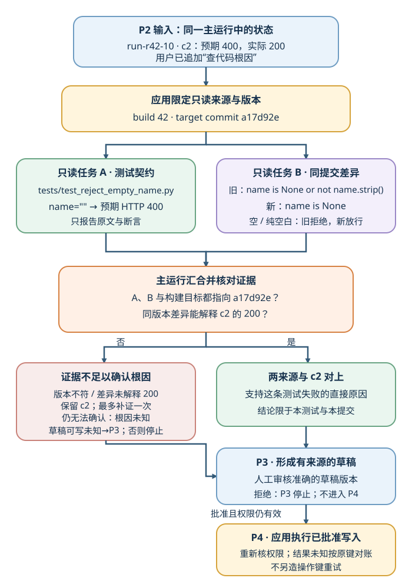

# 怎样按依赖、并行性和控制权组织多阶段 AI 任务？

**案例背景。** 本章沿用合成的 build 42 诊断案例。用户问构建为什么失败；模型请求调用只读 tool（工具）`read_build_log`，应用核验权限后执行。工具调用 ID `c1` 把这次请求和返回结果关联起来：`unit-tests` 步骤中的 `reject_empty_name` 测试预期 HTTP（Hypertext Transfer Protocol，超文本传输协议）`400`，实际得到 `200`，进程退出状态为 `1`。回答这个问题只需要一个运行循环：读取证据，再判断何时可以作答。若把每个职责都拆成单独的智能体，既没有可并行的独立工作，又多出交接和校验成本。

orchestration（编排）决定各步骤的顺序、执行条件、哪些步骤可以并行，以及最终答案由谁负责。设计时先画出依赖：子任务可以共享只读输入，但能并行的工作不能互相等待对方的产物。然后再看三件事：独立上下文是否在实测中提高了质量，是否需要不同的工具或隔离边界，委派能否缩短总耗时。至于该不该由模型决定下一步，基础判断见[什么时候应该让模型决定下一步](./agent-fundamentals.md)。

## 先看哪些步骤依赖同一份观察

workflow（工作流）用代码安排已知步骤；agent（智能体）在运行时根据观察选择下一步。单智能体循环也可以调用多个工具、按需读取技能；只保持一个主要上下文，并不意味着只能做一步。只有遇到下表中的结构，才有理由考虑更复杂的编排：

| 步骤关系 | 合适的结构 | 先核对的边界 |
|---|---|---|
| 输入到输出之间顺序已知，每步都有可验证的中间结果 | 代码控制的串行流程 | 每个门槛是否会阻止不合格结果进入下一步 |
| 用户输入类别对应不同工具、要求或策略 | 路由到对应流程 | 模糊分类是否有澄清或安全兜底路径 |
| 多个只读任务互不依赖，完成后能用证据汇总 | 并行子任务 | 是否有共同写入、重复取数或共享资源冲突 |
| 后续任务取决于前一步仍未知的发现 | 单主循环或动态编排 | 结果如何回到同一个运行状态，何时结束或升级 |
| 某个专家要接管后续用户交互 | 控制权交接 | 专家收到的身份、范围、历史和待办事项是否足够 |

这些结构可以出现在同一条运行路径的不同层：

- **外层应用**用固定的状态机或图维护运行身份、资源授权、审批、副作用和停止条件。
- **需要根据观察决定下一步的节点**可以复用现成 agent harness（智能体执行框架）提供的模型循环、工具执行和会话管理。
- **循环内部**再按需调用技能、工具，或把独立子任务委托出去。

以 build 42 为例：应用先核验调用者对 `build_id=42` 的只读范围，内层循环读取日志得到 `c1`。如果用户只要解释失败，循环根据 `c1` 作答后就停止。只有用户授权查代码根因，同一个循环才会继续读取已授权的其他来源；而且只有这些来源能各自独立调查时，才值得派出 worker（工作者）。写入审批和结束运行仍由应用负责。

所以，固定图、单主循环和 CLI（命令行界面）并不互斥，可以处于同一套系统的不同层。如果已有 harness 能在所需范围内完成工具执行、恢复和验收，直接配置它并接入所需工具即可；只有需要跨系统保存状态、强制执行不可跳过的阶段，或提供该 harness 没有的契约时，才需要另写应用层编排。

现有官方产品提供的是可复用的执行层，而不是通用的业务决策层：Claude Agent SDK 复用 Claude Code 的工具、agent loop 和 context management，并提供 sessions、permissions 与 hooks；Codex CLI 则让模型在终端中检查和编辑本地仓库、运行已安装工具，并可接 Skills、plugins 和 MCP。它们能承接通用循环和本地执行，但具体业务的调用者身份、证据版本、业务不变量和幂等副作用仍须由应用工具与服务定义、核验。CLI 适合可由命令行完成的任务；它不取代授权的业务 API、结构化证据读取或需要事务语义的写工具。

回到 `c1` 的诊断，每一步需要的状态都可以直接列出来：

| 步骤 | 输入 | 中间结果或门槛 |
|---|---|---|
| 接收问题 | “build 42 为什么失败？”及 `build_id=42` | 当前目标是解释已有构建结果 |
| 读取日志 | 运行时允许的 `read_build_log(build_id=42)` | `c1` 返回测试名、预期 `400`、实际 `200`、退出 `1` |
| 判断是否够答 | 用户问题与 `c1` 证据 | 能说明测试失败；不能证明具体代码根因 |
| 结束或继续 | 证据缺口是否影响用户目标 | 当前问题可先作答；若用户要求代码根因，才查获准的代码证据或请求补充资料 |

解释必须等 `c1` 读回来才能进行，而当前目标也没有可以独立并行的调查分支，所以主循环保留 `c1` 的证据、给出限定在证据范围内的结论即可。若把“读取日志”和“解释日志”拆成互相调用的两个专家，主流程最后还得把同一条 `c1` 记录重新拼回来。

## 固定流程有哪些可组合模式？

上表中“代码控制”的几种结构，在 Anthropic 的 *Building effective agents* 一文中被整理成可组合的构件：

| 模式 | 适用条件 | 例子和校验 |
|---|---|---|
| prompt chaining（提示链） | 子任务能预先按顺序列出 | 起草 → 抽取结构字段 → 按程序规则校验 → 生成最终文本。中间结果不通过时停止或返工，不能盲目接到下一步。 |
| routing（路由） | 输入类别需要不同的处理方式或权限 | 识别退款、售前或技术支持后转入对应流程；分类不确定时询问用户或转安全的默认路径。 |
| parallelization（并行化）中的 sectioning（内容分片） | 文档或资料可按互不依赖的部分分别处理 | 同时总结不同章节，再按统一交付要求汇总；保留各段来源，汇总者检查覆盖和冲突。 |
| parallelization 中的 voting（多次候选投票） | 独立生成或评审可降低特定错误，且有明确选择规则 | 对多个答案按外部测试或预定标准选取；多数意见本身不能证明事实正确。 |
| evaluator–optimizer（评估器—优化器） | 有清晰质量标准，反馈可能使下一版改善 | 生成代码 → 跑测试 → 按失败信息修订；设置最大轮数，若评估器与生成器共享偏差，就使用独立测试或人工依据。 |

这些模式可以组合：代码可以固定先分类、再走提示链，提示链中的某一段也可以并行生成候选。选哪种模式取决于任务依赖，而不是用的模式越多越好。

## 动态拆分时，怎样让工作者独立且结果可核？

固定流程要求步骤事先已知。若调查路径事先难以预测，可以用 Anthropic 所说的 orchestrator–workers（编排者—工作者）模式：主模型在运行中拆出事先没有列出的子任务，交给 worker models（工作者模型）执行，再汇总结果。反过来，若步骤已知且互不依赖，应用直接用代码并行发起只读调用即可，这属于工作流并行，不需要再加一个模型来做规划。“要不要拆分任务”和“由哪个模型或工具执行”是两个独立的选择。

下面把 build 42 扩展成一个合成的长任务。这次调查使用自己的运行标识 `run-r42-10`，与[运行恢复章](../systems/ai-application-architecture.md)的审批案例分开。一开始收到的请求就是“解释 build 42 失败，并准备一份待我审核的缺陷单”。它重新读取日志，得到同样的诊断结果，调用标识为 `c2`；前面产生 `c1` 的短答运行已经结束，这里不是接着那次运行继续。

之后用户补充：“找出 `reject_empty_name` 的代码级根因。”仅凭 `c2` 无法得出代码根因，于是应用核验权限后，开放目标提交 `a17d92e` 下的两个只读来源：测试定义，以及该提交的代码差异。要不要继续调查，取决于用户目标和已有观察；一旦决定调查，这两个来源已经确定、互不依赖，读取可以由代码直接并行，不必让模型规划分工。只有来源或调查路径还要边查边发现时，才需要动态拆分；例如日志只指出了失败模块，主运行要先定位可能相关的测试和实现，再根据新发现决定下一批互不依赖的调查。本例中 A、B 两项读取互不依赖，结果由主运行汇合：

> [!example] 从 `c2` 到可复核的并行调查
> - **输入状态：** `build_id=42`、目标提交 `a17d92e`；证据 `c2` 已持久化，字段为 `step=unit-tests`、`failed_test=reject_empty_name`、`expected="HTTP 400"`、`actual="HTTP 200"`、`exit_status=1`。
> - **只读任务 A 的产物：** 合成测试定义 `tests/test_reject_empty_name.py:18` 的原文为 `response = client.post("/items", json={"name": ""}); assert response.status_code == 400`，契约要求空名称返回 `400`；A 未判断实现原因。
> - **只读任务 B 的产物：** 合成提交 `a17d92e` 的差异 `app/routes.py:42` 将 `if name is None or not name.strip()` 改为 `if name is None`；此合成路由的完整处理路径是从请求 JSON 取出 `name`，仅执行这一项校验，命中时返回 `400`，否则返回 `200`；没有其他中间件或名称校验。空字符串会命中旧检查，却通过新检查，因此同一输入的返回值从 `400` 变为 `200`。B 只报告差异，不修改代码或创建工单。
> - **主运行的汇合：** 先核对 build 元数据、A 的测试和 B 的差异都指向 `a17d92e`，再回读两处原文并与 `c2` 对照。测试契约要求拒绝空名称，差异后的检查却放行空字符串，与 `c2` 的实际 `200` 相符；因此可以把这次校验变更报告为该失败的直接原因。结论限于这条测试和该提交，不外推到其他失败。
> - **验收：** 每个结论必须能回到来源引用；“两项回传都这么说”不算独立验证。

**图：`c2` 之后的独立证据分支怎样汇回主运行**

图中的 `a17d92e`、测试文件和路由差异都是合成 fixture（测试夹具）。只有用户提出代码根因目标、应用也开放了相应的只读范围，才会进入这条根因调查分支（后文计划表中的 P2）；用户若没有追加根因调查，就跳过 P2，继续用已确认的日志观察准备待审草稿。主运行保留用户目标和运行状态，A、B 各自只读取受限的来源，并回传可核对的引用；能否并行，取决于这两项读取能否各自独立完成。

### 共享事实为什么仍可能协作失败？

即使 A、B 和主运行读到的是同一份事实，汇合也可能出错：读到同一事实，不代表大家对字段含义或没有写明的协调约定理解一致。`c2` 和提交号是共同事实；而回传中一个 `passed` 字段究竟表示什么，则是需要标明版本并加以验证的约定。下面先用一个最小游戏说明这种错配。

> [!example] Cat & Dog：共同看见信号，不等于同意它的含义
> Zero-Shot Coordination 论文的最小协调游戏中，Alice 看见猫或狗并控制灯的亮灭，Bob 看不见动物，只能根据灯猜测。若双方都采用“灯亮表示猫”，Alice 看见猫后亮灯，Bob 猜猫，双方共得 `+10`。若 Alice 仍这样编码，Bob 却采用“灯亮表示狗”，同一次亮灯就会导致猜错，双方共得 `−10`。若没有已共享的映射，Alice 可以花 `5` 移除墙，让 Bob 直接看动物再猜对，净得 `+5`。如果游戏允许沟通，先明确约定灯的含义是另一种工程选择；不应把单方认为“自然”的映射当成双方已同意。

放回 build 42，同名字段也会让两套各自自洽的协议在混用时失效。下表是合成的接口例子，不是 `c2` 的实际回传格式；两套协议分别称为“契约版”和“执行版”：

| 生产者 / 消费者 | `passed` 的约定 | 对 build 42 的解释 |
|---|---|---|
| 契约版 / 契约版 | `true` 表示测试契约已正确读取；消费者仍比较执行观察 | `expected=400`、`actual=200`、`exit_status=1`，测试失败；含义一致 |
| 执行版 / 执行版 | `true` 表示测试进程退出码为 `0` | 退出码为 `1` 时写入和读取 `false`，测试失败；含义一致 |
| 契约版 / 执行版 | 契约版产生的 `true` 被执行版当作“测试执行通过” | 若消费者只依赖该标志，就会把失败误报为通过；混搭后的语义不兼容 |

因此，回传应带协议版本和明确字段（例如 `contract_verified`、`execution_exit_status`），主运行还要检查证据与来源版本。schema（结构模式）可以拒绝缺字段或错类型，却不能证明字段语义相同、证据真实或授权有效。

论文用 self-play（自我对弈）检查同一策略配置在不同角色之间能否配合，再用 cross-play（交叉对弈）把各自独立形成的策略配在一起；结果表明，各自自洽不保证混搭后兼容。论文研究的 coordination-friendly definition（CFD，便于协调的定义）是一组共享的自然语言协调原则，例如不依赖未经约定的任意信号、考虑伙伴的多种合理解释。CFD 在部分受测游戏中有帮助，但也可能让智能体过于保守，错过本可在交互中形成的约定。结果限于论文的简化协作环境；其中 code agents 指生成可执行联合策略的智能体，不是生产代码编辑 harness。

以下是本文的工程延伸，不是论文结论：把需要共享的约定写清楚，并实际测试不同实现、模型或版本之间的组合；若参与者可以沟通，先澄清含义再动作。给各方同一段提示，不能代替由程序执行的协议检查、所有权划分和授权。

因此，每个子任务都要写明 task scope（任务范围）、所需事实、允许使用的工具、禁止的副作用、预期回传字段和停止条件。便于汇总的回传至少包含原始证据引用、局部结论、未验证项和失败状态；只回一段摘要会丢掉行号、版本或限定条件，主运行就无法检查结论是否越界。按数据最小化原则，只给工作者完成任务所需的那部分上下文；但如果它要判断 `c2` 中的实际状态码，就必须明确传入 `c2` 或其可靠引用，不能假定子智能体能看到完整历史。

在本例里，主运行保留用户目标、运行标识和外部副作用状态；A、B 只需拿到 `c2`、目标提交引用和各自的只读问题。每次交接都要传送必要状态、等待结果、核验回传；需要共享的状态多，或步骤短且彼此依赖时，交接成本很容易超过并行带来的收益。只有两项读取互不等待、确实同时执行，而且精简的回传足以让主运行复核时，并行才可能抵消这些成本。

## 专家是工具还是接管用户交互？

上面的 A、B 只回传证据，最终答复仍由主运行给出。专家参与的方式还有另一种：直接接管与用户的后续交互。agents as tools（把智能体作为工具调用）和 handoff（控制权交接）的区别，就在于最终由谁负责答复用户：

| 结构 | 谁继续对用户负责？ | 适用例子 |
|---|---|---|
| 智能体作为工具／管理者模式 | 主智能体收集专家结果、比较证据并给出最终答复 | build 42 的主运行委托只读来源检查，再自行核对 `c2` 与来源 |
| 控制权交接 | 专家接手该分支的后续对话和决策 | 分类器确认用户需要技术支持后，把问题交给负责下一轮澄清的支持专家 |

交接前要传递足够的任务背景和当前状态：接手方应知道谁授权了什么、已经读过哪些材料、哪些结论仍然未知。不要不加筛选地转发整段对话，也不能把有损摘要当成权威运行记录。交接只改变后续由谁与用户交互；运行记录、授权和外部操作状态仍由应用维护。工具返回和副作用应由应用记录并关联任务身份；稳定 run ID、事件恢复和未知结果如何处理见[AI 运行怎样断线恢复](../systems/ai-application-architecture.md)。

多个工作者适合并行读取不同材料，或分别验证彼此独立的产物；依赖上一步结果的写操作仍要按顺序执行。创建工单是一次外部副作用，不能让多个工作者并发发起同一写入：应用要把已审批的目标和请求绑定到同一个幂等键，并在运行时核验授权。更多工具边界和审核流程见[工具设计与函数调用](./tool-design-and-function-calling.md)和[生产环境 AI 安全](../safety/ai-safety-in-production.md)。

## 什么时候保留单主循环，什么时候增加子智能体？

前面的 A、B 是否值得做成独立工作者，可以推广成一个更一般的问题。single-agent loop（单智能体循环）能共享已验证的上下文，按需调用工具或读取技能。拆出 subagent（子智能体）有三类明确理由：测量显示长上下文正在降低任务质量；确实有可并行的任务，且它们需要独立上下文；或者不同任务必须受不同的工具、指令或权限约束。短任务和有依赖的步骤通常留在主循环里。

prompt template（提示模板）也是主循环可用的组织方式：如果多个输入的处理步骤相同，只是几个含义一致的变量不同，就能复用同一份清楚的说明。变量过多、规则互相冲突，或任务需要不同权限时，应拆开模板或调整工具边界，并用代表性任务比较效果。

Agent Skills（智能体技能包）可以按需载入领域步骤和参考资料，工具提供可执行的读取或写入能力；这两者让单主循环能覆盖多个任务类型，无需给每个类别建立独立智能体。技能教会流程但不授予数据权限，工具的真实能力仍需应用限制。技能说明和上下文组织见[上下文工程原则](../context/context-engineering-principles.md)。

如果不同任务共享同一份会话状态和工具，差别主要在处理步骤或不常用的参考资料，那么单主循环按需载入 skill，就能省掉前置的意图路由和专家交接（首次读取技能本身仍可能需要一次工具调用）。Anthropic 关于电商 agent 的文章讨论的就是这类例子：购物车、用户偏好和历史记录交织在同一段长会话里。反过来，若任务确实需要互斥的政策、专门的合规要求、不同的数据隔离，或由不同方负责与用户交互，并且分类可靠、能通过端到端评估，就保留业务路由或 handoff。仅仅是用户权限不同，并不需要拆出新 agent：工具可以按调用者核验实际范围。简言之，技能回答“怎么做”，路由回答“由谁处理”，授权回答“能否执行”。

看 build 42 就能区分三种设计。如果测试契约和代码差异的位置都已知，主运行可以并行发出两次只读工具调用。如果两条线索各要翻查许多文件，而且从同一提交就能分别开工，才值得让 A 找出契约、B 追踪实际处理逻辑，各自交回提交号、位置和观察。Anthropic 的研究系统把这种方法用在开放式检索上，主智能体按问题分派独立的调查方向，汇总带出处的发现，再决定哪里还缺证据。反过来，如果 B 在每一步都得问 A 刚查到了什么，一个循环连续读取线索更容易保住条件。Anthropic 2026 年的企业案例就将这类频繁交接的专门流程折回主循环，按需加载相应技能。运行时仍负责授权和写入审批。

已知的依赖还可以由程序直接表达。比如 A 和 B 的证据都到齐、提交号也一致，应用才把两份材料交给主运行解释。若 B 交回另一提交的差异，应用保留这份记录的版本，继续等 build 42 所用提交的证据。这就是 *Unfold your Agents* 讨论的数据流做法：把新事件和依赖写成可检查的记录，适用于流程已经清楚的部分。遇到未知根因，要查哪份材料仍可由模型根据观察决定。

决定迁移前，先测当前模型单独能做到什么。Google 等团队后续发表的研究在六个基准上比较了 260 种配置。在比较不同编排时，研究者固定了工具、任务提示与计算预算。可拆分的财务推理与必须逐步更新状态的规划任务出现了不同结果。单智能体在该任务上的基准成绩，是研究中最稳健的预测因素。团队给出的经验分界只能帮助挑选值得做的对照。实际选型时，把同一批任务交给“主循环并行调用工具”和“委派调查后汇合”两种实现，给相同总预算，逐题核对证据是否齐全、版本是否一致，再比较耗时与成本。升级模型后重新测一遍，原先靠多个智能体分工弥补的差距可能已缩小。

## 长程任务怎样留下可复用的中间成果？

前面的工作者都在一次运行内完成并回传。独立的短任务返回带来源引用的摘要即可；但长程研究或代码重建若要在多次尝试之间积累发现，就需要把中间产物、来源和依赖持久化。GitSwarm 论文给出了这类特殊架构的一个例子：同质工作者异步读取可分支的 Git 资料库，自行选择探索、实验、验证、修复或综合，并以原子提交留下产物和显式依赖；执行 harness（执行框架）负责并发、隔离和发布检查。它没有一个中央规划者来分派研究角色，但仍有运行调度和发布验证。

论文在数学证明、程序重建和三项依赖 GPU（图形处理器）计算的神经网络架构研究中评估该实现。它的发布检查验证提交是否满足任务的提交要求，不认证产物正确；论文也明确把投票与正确性证据分开。结果只支持这些模型、任务和预算下的观察，不证明日常支持请求或普通业务流都应采用共享仓库的多工作者架构。

## 计划执行何时需要重规划，怎样识别无进展循环？

plan-and-execute（先计划、再执行）适合这样的目标：可以拆成若干步骤，每步有前提、证据和验收条件，但中间观察仍可能改变后续路线。计划是可以标版本的运行产物，既不能证明模型内部怎样推理，也不是外部事实的账本。下面回到前文的 `run-r42-10`，看它的计划怎样随新信息修订、在故障后怎样恢复。出发点仍是：`c2` 表明 `reject_empty_name` 预期 HTTP `400`、实际 `200`、进程退出 `1`，但仅凭这些字段不能断定代码根因。

运行尚未结束时，用户追加了“请查代码级根因”的要求。计划因此从 v1 修订为 v2，然后才启动下表的 P2。计划和后文 trace 会用到三种标识：

> [!info] 三种标识各管什么？
> - **启动请求摘要与启动去重键：** 标识本次运行最初收到的输入，追加事件不改写它。
> - **草稿摘要：** 标识这次交给用户审核的具体工单内容。
> - **外部操作键：** 标识同一次写入意图，供对账及接收端去重。

用户追加的要求作为事件写入进行中的运行，不改写启动请求；若把不同的启动输入当作另一次任务提交，就应新建 run 和启动去重键。本例保存的小计划如下（`c3`、`c4` 是 P2 中读取测试契约和代码差异的两次只读调用，对应前文的任务 A、B）：

| 阶段 | 前提与动作 | 完成条件 | 当前结果 |
|---|---|---|---|
| P1 核对证据 | 对照 `c2` 与 build 42 的构建身份、失败测试和原始日志引用 | 断言差异与来源匹配；结论范围不超过日志 | 已完成：能解释测试为何失败；仅凭日志无法确认代码根因 |
| P2 补充根因证据 | 用户明确要求代码级解释后，才查本合成 fixture 中同一提交的测试契约和差异摘要 | 两份来源都对应 build 42 的目标提交，差异能解释 `c2` | 已完成：`c2`、构建目标和 `c3` / `c4` 均对应 `a17d92e`，差异能解释实际 `200` |
| P3 形成草稿 | 按已核验的观察形成工单草稿；若 P2 未能确认根因，只有当草稿可明确写“根因未知”时才可继续 | 草稿目标、内容摘要和证据一致，可交审核；未获批则停在 P3 | 待起草并送人工审核；尚未获批 |
| P4 提交 | 仅在该草稿摘要仍获批且权限有效时，以外部操作键 `run-r42-10:create-issue:v1` 创建工单；按接收方契约获准重放同一次写入时沿用该键 | 从应用账本核实远端 ID 或进入结果未知对账 | 尚未进入：P3 尚待起草和审核；未批准、未调用写工具或创建工单 |

若 P2 的来源或版本核对失败，或者同版本的差异仍无法解释 `c2`，最多对构建元数据指明的目标提交再做一次限定范围的补读；补读后仍没有能解释 `c2` 的同版本证据，便将根因标为未知，不再无限扩展搜索。此时若待审草稿允许写明“根因未知”，可用 `c2` 进入 P3；若草稿必须包含代码根因，就停止并请求补充来源。审批拒绝或撤回同样在 P3 结束，绝不进入 P4。

章首的短答任务在解释 `c1` 后就能结束。这里的长任务已承诺交付待审草稿，所以即便跳过 P2，仍要走到 P3。什么时候需要显式计划、什么时候修订，可以这样判断：若步骤、依赖和分支事先已知，用代码控制的固定 DAG（directed acyclic graph，有向无环图）更便于验收；若下一步确实取决于尚未得到的观察，就执行一步、评估一次、再修订计划；若只是几个短步骤，每步都取决于上一次工具调用的发现，也可以留在单主循环里，不必生成冗长的计划。只有在观察推翻了前提、来源版本变化、授权变化或用户目标变化时，才生成新版本的计划：保留已完成的证据，只调整剩余步骤。模型不能因为旧计划写过某动作，就复用过期批准或忽略权限变化。

计划修订之外，运行中还会出现三种看起来都像“又调用了一次”的情况：SDK（软件开发工具包）重试、运行恢复和模型循环重复。区分它们时，要为每一层记录各自的身份和输入，而不是只数“工具被调用了几次”。各层的分工是：应用为每次模型调用分配 ID；SDK 在这次调用之下重试底层请求；执行进程从 checkpoint（检查点，已保存的运行状态）恢复；模型响应提出各个工具调用；外部写入另由操作键去重。下文的图 thread 是编排框架（如 LangGraph）为这次图执行保存状态所用的标识。

下面是这个合成任务的一段简化 trace（追踪）。四个事件共用 `run-r42-10` 和同一个已保存的图 thread，逐一看每层的身份、输入和状态怎样变化。

1. **底层请求重试，尚未产生工具调用。** 应用模型调用 `model_invocation_id=mi-17` 的第一次请求只收到 HTTP `503`，没有模型输出。SDK attempt 从 `1` 变为 `2`，模型请求摘要不变；第二次响应才首次带回 `tool_call_id=c2`。这是同一应用模型调用的传输重试。每次传输的服务提供方 request ID 只标识该次尝试，不替代 run ID 或工具调用 ID。
2. **执行进程恢复，已有观察不重新取得。** `c2` 结果已持久化后，执行进程崩溃；恢复时 worker attempt（工作进程执行尝试）增加。检查点包含 `c2`，应用重载同一观察，不创建新的模型调用或工具 ID，也不增加模型循环轮次和工具调用次数。若模型调用已返回、节点状态尚未提交时崩溃，未提交步骤仍可能再执行，须按应用记录和服务契约对账。
3. **模型重复提议，调用身份新但证据没变。** 恢复后的新模型调用 `mi-18` 又提出 `tool_call_id=c-reread-1`，归一化参数仍为 `read_build_log(build_id=42)`。来源版本相同，`c2` 已在上下文，未新增观察或完成新阶段。这不是 SDK 重试或运行恢复。重新核验权限后，应用可把已存结果关联到新调用，无需重复取数；记录仍引用同一份旧证据。如果之后也无新证据或状态推进，这一轮计为无进展。
4. **用户补充目标，新证据使计划前进。** 用户追加“请查代码级根因”，同一运行的计划从 v1 升为 v2，启动请求摘要不改写。在这段示例轨迹中，`mi-19` 这次模型调用提出两项读取请求，应用核验权限并并发执行 `c3`（`test-contract@commit-a17d92e`）和 `c4`。结果显示，同一提交 `a17d92e` 的测试契约要求 `/items` 空名称返回 HTTP `400`，差异却把 `name is None or not name.strip()` 改成 `name is None`，使空字符串返回 `200`，与 `c2` 相符。主运行核对这两份同版本证据后完成 P2，才能形成代码级解释并进入 P3；只读到契约还不够。

如果契约或差异对应的提交与 build 42 不一致，P2 不算完成：保留 `c2`，修订计划，改取 build 42 实际所用提交的证据；若受权限或来源限制无法核实，就明确停在“根因未知”，不用模型的猜测补齐。

事件 3 引出一个问题：怎样判断循环“没有进展”？进展应由可核对的状态变化来定义，例如新增了一条授权有效的来源观察、某个验收阶段由证据完成，或用户确认了计划约束的变化；换一种措辞、多花一些 token、拿到一个新的随机调用 ID，都不算进展。应用可以比较 run/thread、worker attempt、应用模型调用 ID、SDK attempt、工具调用 ID、规范化参数摘要、来源版本、观察集合和计划版本。

本 trace 的无进展计数只覆盖模型循环：`mi-17` 的 SDK 传输重试不是新模型轮，执行进程从检查点恢复也不增加模型调用数；`mi-18` 的 `c-reread-1` 重复同参同源、未增加观察，计为第 1 轮无进展。若下一轮仍无新证据或计划推进，本例在第 2 轮停止；这里用户授权的澄清和 `c3`、`c4` 新证据使计划前进，计数归零。连续两轮只是本合成运行的停止门槛，不是通用默认值。另设总调用数、截止时间和费用上限；副作用始终走已审批的操作记录与幂等/对账流程，不允许用模型新一轮输出生成新操作键。

## 如何验证复杂编排是否值得维护？

前面每个结构选择都附带了“用端到端任务验证”的条件。具体做法是：用相同任务集比较单循环、固定工作流和委托结构的端到端成功率、外部状态正确性、证据覆盖、权限错误、重复副作用、总 token、工具成本、端到端时延和人工接管率。按依赖设计少量成对用例：子任务无需等待对方产物时检查是否并行；上一步内容改变时检查是否重新校验；工作者返回缺字段或错误来源时检查主运行能否拒收；专家接管失败时检查回退路径。

运行记录应关联 run ID（运行标识）、每个子任务所有者、输入证据引用、模型和工具调用、重试、延迟、资源消耗、完成状态与外部 operation key（操作键）。只保留诊断协作问题所需的内容，并限制敏感上下文。观察到路由错、回传失真或重复动作后，把最小复现加入端到端回归；不要用单个子智能体的局部得分代替系统交付结果。汇总推理成本时也要计入输入和输出 token（词元），并和端到端质量、时延及人工处理量一起比较。

针对前文的共享约定，不能只测每套版本的内部配合：把“契约版生产者 + 执行版消费者”及反向组合加入回归，检查协议不兼容时能否拒收或澄清，而非仅检查 JSON 可解析。模型、提示词、角色或工具版本变化后，也要重测实际会出现的组合；共享证据缺失、字段换名与含义歧义可作为具体失败切片。

相关测量方法见[LLM 评估方法](../evaluation/llm-evaluation-methods.md)。

> [!info]- 来源
> - **提示链、路由、并行与评估—优化等构件：** Anthropic，[Building effective agents](https://www.anthropic.com/research/building-effective-agents)，2024-12-19，“Building blocks, workflows, and agents”与“Combining and customizing these patterns”；页面提示旧工具生态描述已变化，本文只保留模式结构与适用形状。
> - **管理者保留最终答复与专家接管：** OpenAI，[Orchestration and handoffs](https://developers.openai.com/api/docs/guides/agents/orchestration)，核对日期：2026-11-12，当前 Agents SDK 文档“Choose the orchestration pattern”，区分 handoffs 与 agents as tools，并建议为专家设窄职责；代码接口属于该 SDK。
> - **独立子任务与结果合同：** OpenAI，[Multi-agent](https://developers.openai.com/api/docs/guides/agents-api/multi-agent)，核对日期：2026-11-12，当前 Agents API beta 文档“When to use subagents”，建议把独立工作并行处理、为任务写清问题与预期结果，并让短任务和依赖步骤留在主智能体；文中的 `agent.multi_agent.enabled` 属于此 API 的配置。
> - **开放式研究中的并行工作：** Anthropic，[How we built our multi-agent research system](https://www.anthropic.com/research/multi-agent-research-system)，2025-06-13，“Benefits of a multi-agent system”及“Production reliability and engineering challenges”；这是 Anthropic Research 功能的工程经验，来源也强调协调、评估与可靠性挑战。
> - **如何比较单智能体与协作的收益**。Google Research 的[初期工程解读](https://research.google/blog/towards-a-science-of-scaling-agent-systems-when-and-why-agent-systems-work/)（2026-01-28）基于 180 种配置。Kim 等人的期刊定稿 [Capable language models can outgrow the benefits of collaboration](https://www.nature.com/articles/s42256-026-01268-y)（2026-07-24，Results、Methods）扩展到 260 种配置，说明经验分界的验证范围及统计限制。[作者实现 v2.2.3](https://github.com/ybkim95/agent-scaling/tree/v2.2.3) 提供配置与分析脚本。
> - **把已知依赖交给程序**。Peter Hollows，[Unfold your Agents](https://dojo7.com/2026/02/28/unfold-your-agents/)，2026-02-28。作者用发票重提和审批记录说明如何把循环展开为新的事件和依赖，属于设计论述。
> - **单循环与折叠子智能体的部署经验：** Anthropic，[Building agents: When to fold subagents into your main agent loop](https://claude.com/resources/articles/building-agents-when-to-fold-subagents-into-your-main-agent-loop)，2026-10-22，“Using an agent loop with progressive disclosure”“Task-completion evals”；报告基于 Anthropic 的若干企业部署对照，不是普遍因果结论。
> - **技能与渐进式披露：** Anthropic，[Equipping agents for the real world with Agent Skills](https://www.anthropic.com/research/equipping-agents-for-the-real-world-with-agent-skills)，2025-10-16，2025-12-18 更新称其为开放标准；“The anatomy of a skill”“Skills and the context window”说明技能目录包含 `SKILL.md`、脚本和资源，并按需载入。
> - **异步工作者与可组合产物：** Shah et al., [GitSwarm: Decentralized Compounding Inference](https://arxiv.org/html/2610.04862v1)，arXiv v1，2026-10-04，§§2.1–2.5、§3 和 §4；工作者运行在特定长程问题求解与 GPU 研究任务中，发布验证不代表产物正确。本文只借其持久、可追溯的中间产物设计作为架构例子。
> - **workflow 与 agent 的控制权、可观察图流程：** LangGraph，[Workflows and agents](https://docs.langchain.com/oss/python/langgraph/workflows-agents)，核对日期：2026-11-12；本文的固定步骤/模型决策取舍与之对应，计划状态表和 no-progress 门槛是应用层设计。
> - **Agent loop 内的 middleware 及可自定义重试钩子：** LangChain，[Middleware overview](https://docs.langchain.com/oss/python/langchain/middleware/overview) 的“The agent loop”“Use middleware inside a LangGraph workflow”，及[Custom middleware](https://docs.langchain.com/oss/python/langchain/middleware/custom) 的“Wrap-style hooks”，核对日期：2026-11-12；`wrap_model_call` 可将 handler 调用零次、一次或多次，故应分别观测 SDK 重试与 middleware 重试。
> - **协调事实与共享约定：** Hayler et al., [Zero-Shot Coordination among LLM Agents](https://arxiv.org/html/2611.06409v1)，arXiv v1，2026-11-04，§2 Figure 1、§3、§4 与 §§6–7；Cat & Dog 的收益和两种不兼容灯光约定见 Figure 1 和 §4，`text agents` / `code agents` 的定义见 §3。实验覆盖论文的最小协调环境；CFD 是自然语言的一般协调原则，不是字段 schema 或生产工具协议。
> - **Agent SDK 复用循环与工具：** Anthropic，[Agent SDK overview](https://code.claude.com/docs/en/agent-sdk/overview)，滚动官方文档，核验 2026-11-12，“Compare the Agent SDK to other Claude tools”与“Capabilities”；SDK 提供 Claude Code 的工具和循环，并列出 sessions、permissions、hooks、subagents、MCP 等能力。本文只据此说明可复用执行层，不推断其替应用实现领域授权。
> - **CLI 的执行范围：** OpenAI，[Codex CLI](https://learn.chatgpt.com/docs/codex/cli)，滚动官方文档，核验 2026-11-12，“Work against your local repository”“Use skills and plugins”“Connect external tools with MCP”；CLI 可用本机已安装工具并连接外部能力，仍需宿主为具体领域工具实现授权与业务契约。
> - **共享购物状态与业务 handoff 的边界：** Anthropic，[A guide to the anatomy of effective commerce agents](https://claude.com/resources/articles/the-anatomy-of-effective-commerce-agents)，2026-09-02，“Skills, not subagents”“System prompt or skill: decide by frequency”“handoff”；这是商业 agent 场景的工程报告，不能据此推断跨领域路由阈值或普遍质量收益。
