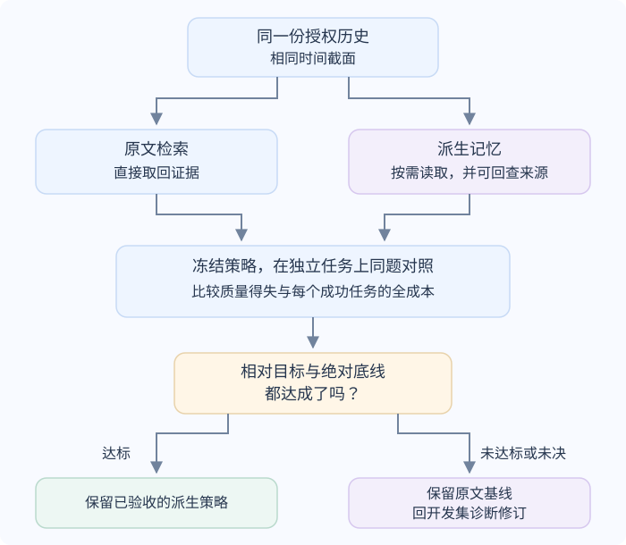

# 什么时候值得把历史加工成 Agent 记忆？

把历史加工成记忆之前，先要问两件事：它对同类新任务有多大帮助，整个生命周期要花多少成本。跨运行记忆可以压缩、关联或归纳原始记录，但也可能丢掉限定条件、让证据更难找，或者把旧推断当成当前事实。只有在同一份授权历史、同一类任务上测出质量的净变化，并把写入、维护、读取和失败的成本都算进去，才能判断这份加工是否值得保留。

[上下文工程原则](context-engineering-principles.md)已经说明了来源授权、读写范围、更新和遗忘流程；本章只讨论三件事：怎样从获准使用的历史中构造跨任务可用的信息，什么时候常驻注入、什么时候按需读取，以及怎样验收。以下的 build 和用户都是合成例子。

**案例背景。** 延续上下文工程章的 build 42 案例：旧运行 `run-r42-7` 中的工具调用 `c1` 读到了 build 42 的测试失败日志；用户 `user-42` 在之后的 `run-r42-8` 中确认“以后摘要默认用中文”。现在，用户在新任务 `run-r42-9` 中再次问：“按当前 CI 手册，build 42 应不应该重跑？”应用可以读取 `c1` 的日志观察，也可以检索当前已授权的手册 `CI-RETRY-v3@fixture-r1`。记忆可以保存这条偏好，也可以把以往排查 CI 根因的步骤归纳成以后可复用的经验；但旧运行的身份、结论和执行许可，都要在新任务中分别重新核对。



图中比较两种策略：“原文检索”直接检索原始记录；“派生记忆”检索经过加工的摘要、偏好或经验。原文始终是证据来源；派生记忆只有保存了来源、版本和适用范围，才能在需要时追回原文。

保留决策要过两道关。第一道是绝对底线，如任务质量下限和成本上限，它只能排除不可接受的方案，不能单独证明加工有价值。第二道是事先写明的相对目标和可接受的回退：质量优先时，派生策略要比原文检索质量更高，且成本不超预算；成本优先时，可以接受事先限定的质量回退，但每个成功任务的成本必须比原文检索低，同时仍过质量底线。如果派生策略质量更低、成本也更高，即使两项都过了绝对底线，也没有理由保留。

用于最终验收的留出题（held-out set）一旦用过，就不能再拿来挑选方案。候选版本没通过时，继续使用已接受的原文检索基线；修订只在开发集上进行，然后再用一批新的独立留出题验收。

## 记忆策略与 RAG 不是两个互斥架构

RAG（retrieval-augmented generation，检索增强生成）解决的是怎样从语料中找材料交给模型；跨运行记忆解决的是哪些历史信息经过整理后供以后的任务复用。系统可以直接对原始对话做 RAG，也可以对派生摘要、偏好或经验做 RAG，还可以在同一任务中并取两者。数据应该如何保存、保留多久、谁有权使用，取决于来源和应用治理；把内容放进向量库不会自动使它成为“记忆”或权威事实。

正因为派生记忆也可以用 RAG 查，比较时的对手应是一条认真调过的原文检索基线，而不是故意设弱的基线。本章建议：从同一份已授权的历史快照取材，使用在开发集上调试过的检索方式，让两种策略回答同一批问题，并给回答模型相同的上下文预算；长历史可以检索成短片段，不必整段塞进输入。

Memory Tax 论文采用的就是这样一条基线，记作 `naive RAG (1rd)`。它按对话轮次或观察步骤切分原文：合并过短的轮次、拆分过长的轮次，切片不跨会话；然后用 BM25 关键词检索和 Qwen3-Embedding-0.6B 稠密检索分别取候选，合并去重后由 Qwen3-Reranker-0.6B 重排，最后把选中的片段交给各策略共用的问答模型。为了公平，作者为多数记忆系统调节 top-k（记忆单元很少的系统例外，仍用固定 top-k），使 Retrieval Scope（检索范围，按可检索的记忆 token 计算）大致不低于并尽量接近这条 RAG 基线。检索范围衡量的是模型能接触到的存储份额，并不意味着每次推理的输入 token 完全相同。论文的评测集是 LongMemEval-s（GPT-5.6 Luna 使用按题型分层抽取、由 100 个语料组成的子集）、PersonaMem-v2 的 20% 语料子集和 MINT-Eval 的 10% 分层子集。结果显示，许多受测记忆系统在部分模型与任务组合上不如这条有竞争力的原文检索基线；但逐题看，仍存在只有记忆答对或只有原文答对的题目。这里的发现受论文任务、抽样范围、模型与配置限制，不能据此宣称 RAG 总胜过记忆或反之。

无论用哪种策略，每条事实、偏好或过程经验都应能追溯到来源记录、版本和时间。模型写的摘要是派生内容：它可能忠实，也可能漏掉限定词或归纳错误。即使原始记录本身就是模型生成的，也要记下来源身份、生成时间、模型或提示版本、审核状态和可复核的材料。有引用、能被检索到、被写进 `MEMORY.md` 这类记忆文件，都不能证明一条主张正确。遇到冲突时，依据来源权威性、时间、适用范围和当前授权来处理；无法确定时就保留冲突，而不是让负责合并的模型或相似度分数替读者裁决。

## 何时写入、何时注入、何时按需读取？

写入什么，取决于信息以后怎样使用、可信程度如何。用户明确确认的稳定偏好，可以在获准范围内更新到对应记录；模型从一次任务中推测出的模式，应标为候选经验，保留来源和适用条件，再用新任务验证。一次请求中的事实通常留在运行记录里，需要跨任务回忆时按权限查询；它不会因为被提取成摘要，就变成当前状态。

读取方式主要看使用频率和内容长短：稳定、已确认、几乎每次任务都要用的少量偏好，可以常驻在提示中；较长的历史证据、不常用的偏好和步骤经验，适合按需查找。按需读取减少了无关内容的注入，但会增加检索、权限检查和回查原文的成本。每次读取都要重新检查当前调用者、来源版本、有效期和适用范围；出现冲突或权限变化时，旧条目不能压过新证据。

什么时候写入、什么时候读取，是产品可以自行设计的。以开源 Codex 在固定提交 `c320b5c…`（核对于 2026-11-12）中的实现为例：

- **写入**：当会话不是临时会话、属于根会话（不是子智能体会话），且 `MemoryTool` 功能已开启时，系统先要求 provider auth context（模型提供方认证上下文）已就绪，再启动一个异步任务。该任务先确认记忆存储可用、再检查速率限制，通过后才抽取符合条件的旧运行记录（第一阶段），并进行合并（第二阶段）。
- **读取**：只有 `MemoryTool` 和 `config.memories.use_memories` 都启用、且非空的摘要文件可读时，系统才把摘要和检索指引注入提示；专用记忆工具另需开启 `dedicated_tools` 配置。读取模板随记忆版本配置而定，例如 v1 模板让模型先看摘要，需要时再查登记表和对应的运行轨迹。

这只是一个固定提交中的实现选择，不代表所有 Codex 配置、ChatGPT 或其他产品都采用相同的写入和读取机制；provider auth context 也不是针对应用数据的逐用户授权规则。

## 两种用途怎样走完一次新任务？

### build 42：摘要丢了版本与断言，可能误建议重跑

先看第一种用途：保存历史事实和偏好。下表列出本例的输入和当前判断所需的材料，全部是合成记录：

| 来源 | 可核对内容 |
|---|---|
| `run-r42-7#c1` | `build_id=42`；`step=unit-tests`；`test=reject_empty_name`；预期 HTTP `400`、实际 HTTP `200`、`exit_status=1`。这是旧运行的观察，不是根因证明。 |
| 旧政策 `CI-RETRY-v2@fixture-r0` | 曾把重跑范围概括为“失败即可重试”；发布者在 v3 的版本记录中声明它已被替代。 |
| 当前政策 `CI-RETRY-v3@fixture-r1` | 仅工作节点或网络中断可重试；断言失败须先调查，不自动重跑。 |
| 偏好 `run-r42-8#preference-1` | 用户 `user-42` 在上次任务中明确确认“以后摘要默认用中文”；只影响该用户的摘要语言。 |

如果压缩结果只剩“build 42 测试失败，可重试”，它就丢掉了“预期 HTTP 400、实际 HTTP 200”这条断言、旧政策的版本，以及两个版本各自的适用范围。下一轮模型若只看到这条记忆，就可能建议重跑。错误出在记忆构造时的信息损失加上过期政策，而不是原始的 `c1` 证据有误。

可用的记忆应保留能追查的指向关系，而不是替来源背书、照抄旧规则：

```text
用户偏好：摘要默认用中文；来源：run-r42-8#preference-1；scope=user-42。
历史观察：build 42 的 c1 是 reject_empty_name 断言失败；保留 run-r42-7#c1 来源定位。
政策提示：v3 的版本记录标记 v2 已被替代；查询时取当前已授权手册。
```

在 `run-r42-9` 回答之前，应用先确认调用者是 `user-42`、偏好仍然有效，并按当前权限过滤派生条目；然后按记忆中的来源定位取回 `c1`，重新读取手册 `CI-RETRY-v3@fixture-r1`。模型看到预期 HTTP 400、实际 HTTP 200 以及 v3 对重试的限制后，回答：“build 42 的 `reject_empty_name` 发生断言失败，按当前手册不能自动重跑，应先调查；现有记录不足以确定代码根因。”本例只评估建议，不执行重跑。用户用中文提问、模型用中文回答，这本身不能证明偏好记忆起了作用。

偏好真正起作用的地方，是应用另外为状态面板生成的摘要。这个合成应用按固定规则选择摘要语言：有有效的用户摘要偏好时按偏好；没有时组件默认用英文，不会根据前面的中文提问推断。有偏好时，摘要为：“build 42 的 `reject_empty_name` 单测断言失败（预期 HTTP 400，实际 HTTP 200）；按当前重试手册，应先调查，现有记录不足以确定代码根因。”只删除偏好记录、其他摘要输入不变时，摘要就按默认输出英文。这个对照只检验应用是否遵守偏好，不影响重跑结论；而且同一条偏好也能从原文历史中检索到，所以它本身不能证明派生记忆优于原文基线。

如果当前用户只能读 v3、已无权读取 `c1`，应用也不能把含有 `c1` 内容的旧摘要交给模型。此时只能给出通用的重跑规则，并说明现有获准材料不足以判断 build 42。派生条目继承来源的访问边界：保存过一次，不等于以后谁都能读。

### build 65 到 build 84：复用查证顺序，不复制旧根因

第二种用途是保存过程经验，下面是一个合成例子。早先一次经过授权、已验证完成的调查有三项相互一致的证据：build 65 记录绑定 `commit=31a0f7e`；同一提交对应的 `CI-PORT-v1` 契约要求探测 `8080`；该提交的服务配置绑定 `8081`，日志也观察到监听 `8081`、探测 `8080` 返回 `ECONNREFUSED`。这些同一版本的记录核对一致后，调查才确认根因是端口不匹配。系统把这次调查中经审核、可在该项目内复用的排查过程保存为 `ci-connection-check@v1`，来源指向 `build-65-investigation@v1`：

> [!example] 一条可按需读取的过程经验
> 遇到构建中的连接失败，先固定构建 commit，再读取该版本的探测契约、实现和运行观察。证据版本不一致时保留根因未知。来源调查中的端口号只描述 build 65，不是新任务的默认值。

现在用户另行授权排查 build 84。目前已读到的材料是：

| 记录 | 内容 |
|---|---|
| build 84 运行日志 | `commit=84b61d2`；构建使用 `CI-PORT-v2`；探测 `127.0.0.1:8080` 连续 5 次 `ECONNREFUSED`；集成测试随后跳过。 |
| 当前工作区 | `HEAD=91dc722`，当前代码绑定 `8081`；它与 build 84 的 `84b61d2` 不同。 |
| 仍缺材料 | build 84 所用提交的代码与对应 `CI-PORT-v2` 契约尚未读到。 |

查询“构建连接失败”命中 `ci-connection-check@v1` 后，应用先核对当前用户能否读取这条项目经验及其来源，再把其中的查证顺序交给模型。模型据此请求 `84b61d2` 对应的服务配置和契约。本例中，获准范围内的查询没有找到这两份材料，于是最终答复：“build 84 的探测连接连续失败，集成测试被跳过；当前工作区不是构建使用的提交，现有材料不足以确认根因。”它不把 build 65 的端口结论复制过来，也不把经验里的取证步骤当成已完成的检查。

两个例子说明了记忆怎样参与一次任务，但还不能证明它提升了结果：给两种策略相同的获准历史、现行手册和读取工具，原文检索也可能找到同样的步骤并答对。下表列的是两种策略各自合格的答案应满足什么，不是本地实测结果；评分同时检查事实、支持证据、是否遵守已确认偏好，以及证据不足时是否正确报告“未知”。

| 同一任务 | 原文检索可以做到 | 派生记忆可以做到 | 两边都满足要求时 |
|---|---|---|---|
| build 42 是否自动重跑 | 取回 c1、当前手册和偏好，判断断言失败须先调查；摘要按同一有效偏好生成 | 从带来源的条目回查相同资料，得出同一重跑结论和摘要偏好 | 重跑建议和摘要都记为同对；有/无偏好是行为对照，不是策略优劣比较 |
| build 84 的连接失败根因 | 先按该构建的 commit 查询；同版证据齐全且一致才确认根因，缺证或错版时报告未知 | 取回过程条目后按相同条件查询；缺证或错版也报告未知 | 两边都遵守相同的 commit/未知评分契约才合格；另记证据覆盖率，再比较查证成本 |

## 同题逐项比较：有多少得到，多少失去？

要量化收益，就要在同一批题上逐题比较。对每个任务固定来源快照、用户授权、问题、回答模型、提示和评分规则，再分别运行原文检索和派生策略。为了判断“加工”本身的影响，应尽量固定回答模型、检索与上下文预算以及允许的工具；如果比较的是两个预算不同的实际部署方案，就应报告各自的质量—成本前沿，不能把多花预算带来的收益算到记忆加工头上。

把每题按两个策略的结果放进四格：

| 原文检索 | 派生记忆 | 记号 | 计入 |
|---|---|---|---|
| 错 | 对 | `M_only` | 派生策略独自解决，计入质量收益侧 |
| 对 | 错 | `R_only` | 原文独自解决，计入质量损失侧 |
| 对 | 对 | — | 两者共有的成功 |
| 错 | 错 | — | 两者共有的失败 |

相对原文基线的配对正确率变化是：

$$
\Delta_{quality}=\frac{M_{only}-R_{only}}{N}
$$

其中 `N` 是这批题的总数。在 Memory Tax 论文以 `naive RAG (1rd)` 为参照的四格中，`M_only` 对应论文的 Memory Benefit（记忆收益），`R_only` 对应 Memory Tax（记忆税）。上式只是两种正确率相减的算术结果，论文没有把它定义成新指标；只有把收益题和损失题分别保留下来，才知道改进和回退各发生在哪里。

> [!example] 手算两种策略的题目得失
> 以下 100 题仅为算术演示，不是论文或产品测量。两种策略同对 55 题，派生记忆独对 23 题，原文检索独对 15 题，两者同错 7 题。原文成功 `55 + 15 = 70` 题，派生记忆成功 `55 + 23 = 78` 题；配对净增 `23 − 15 = 8` 题，即 **+8 个百分点**。仅说派生记忆准确率 78% 会藏掉它在 15 题上的回退。

除了质量变化，还要算清构建、维护和查询的成本。Memory Tax 分别统计了 ingestion（写入加工）和 QA（问答）两侧的 LLM 输入/输出 token、调用次数、折算成单并发口径的端到端时间，以及最终的记忆存储量；做系统比较时，还应按同一口径计入原文基线的索引构建费用。下式是本章建议的应用侧成本口径，不是 Memory Tax 论文定义的指标：把同一报告周期内的共享成本和所有尝试的成本相加，再除以通过验收的任务数。每项实际费用只能归入一类：注入的 token 已经含在模型请求费用里，就不要再单独加一次；一次人工审核也不能同时算进共享运维和单次任务。

$$
\text{每个成功任务的平均成本}
=\frac{C_{\text{shared}}+C_{\text{all attempts}}}{N_{\text{success}}}
$$

其中 $C_{\text{shared}}$ 是同一统计周期内记忆构建、更新、存储和共享运维/审核的费用；$C_{\text{all attempts}}$ 是该周期内每次任务尝试的全部模型、检索/工具和任务级校验开销，包括失败和所有重试，每次尝试只计一次；$N_{\text{success}}$ 是同一周期通过验收的任务数，不是调用次数。如果没有任何成功任务，这个比值没有定义，应直接报告“零成功”和总成本。共享成本如果按预期复用次数提前分摊，得到的是计划估值，应与当期实际账目分开列出。

> [!example] 质量提高了，成本仍可能挡住保留决策
> 沿用上面同一批 100 题，假设原文策略共享费用为 20 美元，全部尝试费用为 120 美元；每个成功任务成本为 `(20 + 120) / 70 = 2.00` 美元。派生策略两项费用分别为 42 和 132 美元，得到 `(42 + 132) / 78 ≈ 2.23` 美元。所有失败和重试已计入各自的尝试费用。
>
> 若预先规定每个成功任务最多花 2.20 美元，派生策略虽然多答对 8 题，仍因成本超限而不保留。这个算例只演示如何作取舍；真实质量收益还要按任务抽样和重复运行的不确定性判断，不能由这 100 题直接宣称泛化提升。

这与[时延与成本章节](../systems/ai-latency-and-cost-optimization.md)的决策思路一致：不能把质量百分点、延迟、存储量和费用硬压成一个没有业务权重的“净分”，而是按本章开头的两道关来判断——先设质量底线和每个成功任务的成本预算，再写明相对原文检索的目标收益和可接受的回退。如果不同信息需求上的得失相互抵消，或者构建和维护成本无法靠复用次数摊薄，就保留原文检索，或只加工确实受益的那部分信息。

## 逐层定位：证据没保存、没取到，还是没有用？

逐题比较能找出答错的题，但只看一个错误答案，无法判断记忆在哪一步出了问题。因此要为抽检的题保留四类能互相关联的证据：获准使用的原始记录及其时间快照、派生条目的来源映射和版本、检索命中的条目和最终进入上下文的片段、最终答案及其引用和检查结果。然后按失败出现的位置分类：

| 核查到的情况 | 诊断 | 要比较的改动 |
|---|---|---|
| 原始记录在该时点没有所需事实，或来源本身错误/未经验证。 | 原文质量、来源权威或数据时间边界；不能归成检索失败。 | 校验原始来源与时间截面，必要时停止回答。 |
| 原文含事实，派生记忆没有事实、丢了限定词/时间/否定，或写入错误结论。 | 构造、压缩或冲突处理失真。 | 固定查询与回答器，改提取/摘要；给记忆补来源定位，并在风险合适时取回原文。 |
| 记忆保留了证据，但候选或最终上下文没有它。 | 可访问性、授权过滤、排序、预算或上下文组装问题。 | 对齐候选、过滤规则和最终 token 预算，分别记录“取回”与“进入上下文”。 |
| 正确证据确实进入最终上下文，答案仍错或引用不支持主张。 | 模型读取/推理、提示或评分问题。 | 固定检索结果，单独改变回答器/指令，并按主张校验。 |
| 派生记忆与新来源冲突，或经验跨版本、跨用户错误套用。 | 来源时点、适用范围、隐含假设或权限治理错误。 | 重新验证当前证据；失效冲突条目，必要时拒绝迁移。 |

按这条链条定位，比把所有错答都归为“记忆幻觉”更有用。它也沿用 RAG 章的区分，把“证据已进入最终上下文、答案仍然错误”单列为使用错误。Memory Tax 论文对构造和取回两环做了专项分析，但不能替具体应用确定每一次错答的原因。

## 用历史生成监督，再用真正没参与选型的任务验收

前面的比较和诊断都需要一批带标准答案的题。若没有现成题目，历史本身可以用来生成监督信号，但每道题都必须能追溯到来源。MemSteer 论文 §3.2 的流程是：

1. 从同一段历史中挑出相关记录，构造一个有长度预算的材料包（论文记作 `B`）。
2. 先规划有证据支持的答案和引用，再据此生成问题。
3. 由 LLM 审计问题、参考答案和来源记录是否一致。
4. 另一个 blind recovery reader（盲答复核模型）只看问题、答案类型和材料包 `B` 中的源记录，不看参考答案和规划稿，自行作答。
5. 验收时检查：复核模型是否判定题目可答，规范化后的答案是否与参考答案一致，是否引用了全部指定的证据记录。

§3.3 的 MemSteer-Opt 则固定回答模型，反复调整历史的存储与组织方式、检索方式和上下文组装方式：用训练题归因失败、提出修订，再用验证题选择设计。它优化的是记忆设计，不是回答模型的权重。

模型生成并审查过的题目，答案也不是确定的真值。生成器、审查器和最终回答器可能有共同的偏差；“blind”表示 recovery reader 未见参考答案，不表示使用了人类审查，也不保证来源记录准确或每段证据都必需。论文还发现生成问题跟随历史中易提出的问题分布，而非用户的实际信息需求；MemSteer-Opt 研究的是范围受限、偏检索的设计空间，评估只含两个 benchmark，其中 RHELM 使用合成人格。验收前仍应抽检答案、支持片段、问题与时间范围，并用目标用户和实际任务分布验证需求覆盖。

论文的结果必须连同它的数据划分一起读：

| 对照或结果 | 论文实际划分 | 可得出的结论 |
|---|---|---|
| ATM-Bench 的 MemSteer 监督臂 | 使用 400 个历史生成 QA–evidence 训练题和 200 个验证题；没有用官方 benchmark QA 做设计优化。评估仍覆盖全部 1,013 道官方题。 | 在该数据和优化器设置下，生成监督用于修订设计；这不代表独立用户/时间截面的泛化。 |
| ATM-Bench Official-QA 参照 | 用 400 个官方 QA 训练、200 个官方 QA 验证；**这 600 题仍包含在完整 1,013 题评估内**。 | 不能把该参照描述为独立测试，也不能据此断言不同监督来源谁更优。 |
| RHELM Official-QA 参照 | 524 官方题训练、264 验证；两组仍在全部 1,305 题评估中。 | 同样存在题目复用。最终实际部署需另留不参与生成、修订、选型的测试题。 |
| 跨用户共享设计 | 六位源用户中四位用于训练、两位用于验证，另四位留出。源用户池准确率从 31.5% 升至 34.3%；留出用户池从 35.3% 变为 35.1%，各 persona 结果异质。 | 不能假定从其他用户提炼的策略会迁移。 |

用历史离线生成监督，还要防止未来信息泄漏：为每道待回答的题设定明确的“当时可见记录”快照，只能用该时点之前的材料生成记忆和训练题。开发集用于构造与修订，验证集用于选配置；最终测试按未参与这些步骤的题、用户或之后的任务时间段隔离。MemSteer v1 的 Appendix A.3 说明训练/验证/评估题目的使用关系，但论文没有报告按每个查询时点截断源记录的规则；仅凭这些划分无法判断是否落实了该时间边界，实际系统仍须显式落实。论文也提醒发布问答数据、对第三方模型 API 发送历史和跨记录合成可能泄露敏感事实；历史来源需要适当授权与数据保护。

回到本章的两个 CI 案例，它们可以转化为可观察的验收门槛。不过 build 42、65、84 已经用来挑选和说明记忆内容，只能作为开发和诊断案例；最终比较须冻结记忆构造、索引、读取规则、回答器和评分，再用未参与监督生成、修订或选型的题目、用户或后续时间段验收。

| 用途 | 独立验收要检查什么 | 失败例 |
|---|---|---|
| 历史事实与偏好 | 来源记录是否完整；是否读取当前政策版本；旧偏好是否被当前明确要求覆盖。比较同题正确回答、证据支持、偏好遵从与全成本。 | 摘要丢掉 `c1` 的预期 HTTP 400、实际 HTTP 200、测试名或 `run-r42-7` 来源，仍建议重跑；或把旧运行观察称成当前构建事实。 |
| 跨次过程经验 | 先按该构建的 commit 查询；可取得时以同版契约、实现与日志核对根因，缺证或错版时把未知判为正确。证据覆盖率另行统计。 | 将 build 65 的 `8081` 直接套到 build 84，绕过按 `84b61d2` 查询 `CI-PORT-v2` 及对应实现的要求。 |

相对收益/回退目标未达成、质量底线未通过、旧事实误用/权限/冲突超过门槛，或成功任务全成本超预算，就不保留该策略；低频信息可继续按需读取原文。阈值和复跑量按应用风险制定，不把论文百分比当通用门槛。错误样本如何进入受控迭代见[Agent 改进与版本验收](../agents/agent-improvement-and-version-acceptance.md)，任务契约与留出条件见[LLM 评估方法](../evaluation/llm-evaluation-methods.md)。

## 与上下文、检索和成本章节怎样衔接？

[上下文工程原则](context-engineering-principles.md)说明一次模型调用能看到什么，以及应用怎样保存和更新来源、偏好和状态；[RAG 章](../rag/rag-architecture-and-implementation.md)说明怎样授权、排序和核验文档证据。本章从这两章已经确定的、带授权的历史集合出发，决定是否值得另建跨运行摘要、事实索引或过程经验，并测试新增整理带来的收益和回退。RAG 不是被替换掉的架构：新记忆仍可用 RAG 查，必要时把派生条目与原文同时取回。

记忆是否值得保留，既看答案是否正确，也看处理整段生命周期需要多少资源；同一上下文如何降低重复传输、何时前缀缓存能复用计算，则见[AI 时延与成本优化](../systems/ai-latency-and-cost-optimization.md)。供应商的服务端临时会话（如 Message Threads）可以减少重复上传，由服务端重建历史；但比较两种策略时仍要固定所用的历史，持久记忆和授权仍由应用负责。断线恢复和运行账本见[AI 应用运行恢复](../systems/ai-application-architecture.md)。

> [!info]- 来源
> - **原文 RAG 与派生记忆的逐题收益/损失、证据忠实度、访问成本和资源量。** [Memory Tax: Dissecting the Net Value of Agent Memory](https://arxiv.org/html/2610.34073v1)，arXiv v1，2026-10-25：§2；§3.1/Table 1；§4.1–4.3、Figure 2–6 与 Table 2；§5.1；Appendix A.1 的 benchmark 抽样、A.2 的 naive RAG 配置、A.3 的质量/成本定义、A.4 的 retrieval scope；Appendix B.1 的 RAG 消融。Benefit/Tax 仅相对论文的 `naive RAG (1rd)` 定义。
> - **从历史生成 QA–evidence 监督，并在固定回答器下改记忆设计。** [MemSteer: Turning User Histories into Supervision for Agent Memory Optimization](https://arxiv.org/html/2610.39276v1)，arXiv v1，2026-10-29：§3.2–3.3、§4.2/Table 1–2；Appendix A.3 的官方 QA 与完整评估题复用关系；Appendix B.4/Table 9 的训练/验证/留出用户结果；Appendix C 的分布偏差、有限设计空间与合成人格限制；Ethics Statement。盲恢复和模型审计不等同人工认证。
> - **公开 Codex 的记忆写入触发与两阶段后台处理。** OpenAI [`codex` 固定提交 `c320b5c69e74755a6efd4075ff01d4524ad6a4bf`](https://github.com/openai/codex/commit/c320b5c69e74755a6efd4075ff01d4524ad6a4bf)，检查于 2026-11-12：[`start.rs` 的根会话条件与 auth context](https://github.com/openai/codex/blob/c320b5c69e74755a6efd4075ff01d4524ad6a4bf/codex-rs/memories/write/src/start.rs#L20-L43)、[异步任务中的记忆存储、速率限制和两阶段调用](https://github.com/openai/codex/blob/c320b5c69e74755a6efd4075ff01d4524ad6a4bf/codex-rs/memories/write/src/start.rs#L64-L95) 和 [`README.md` 的抽取/合并说明](https://github.com/openai/codex/blob/c320b5c69e74755a6efd4075ff01d4524ad6a4bf/codex-rs/memories/README.md#L24-L67)。这是固定提交实现，不是 SDK 的通用默认行为。
> - **公开 Codex 的读取注入和按需查询边界。** 同一提交的 [`extension.rs` 功能开关与 policy fragment](https://github.com/openai/codex/blob/c320b5c69e74755a6efd4075ff01d4524ad6a4bf/codex-rs/ext/memories/src/extension.rs#L41-L104)、[`prompts.rs` 的非空摘要读取](https://github.com/openai/codex/blob/c320b5c69e74755a6efd4075ff01d4524ad6a4bf/codex-rs/ext/memories/src/prompts.rs#L27-L59)、[`dedicated_tools` 条件](https://github.com/openai/codex/blob/c320b5c69e74755a6efd4075ff01d4524ad6a4bf/codex-rs/ext/memories/src/extension.rs#L127-L150) 和 [`read_path.md` 摘要/检索指引](https://github.com/openai/codex/blob/c320b5c69e74755a6efd4075ff01d4524ad6a4bf/codex-rs/ext/memories/templates/memories/read_path.md#L1-L41)。仅代表该公开代码版本。
