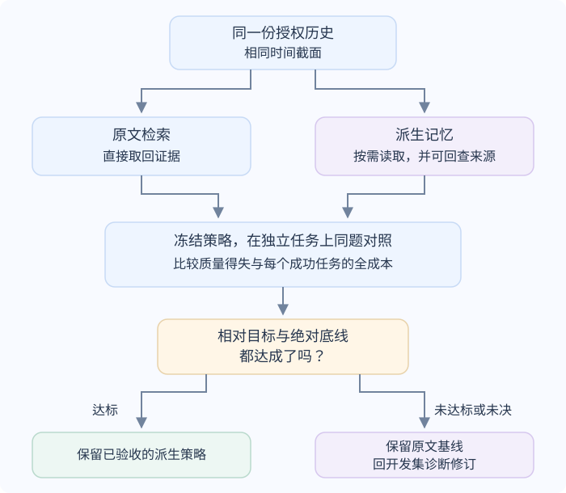

# 什么时候值得把历史加工成 Agent 记忆？

先决定历史是否需要加工，再比较它对同类新任务的帮助和全生命周期成本。跨运行记忆可能压缩、连接或归纳原始记录，也可能丢掉限定条件、让证据更难找，或把旧推断误作当前事实。只有在同一授权历史、同一类任务上测过净质量变化，并把写入、维护、读取和失败成本算全，才知道这份加工值不值得保留。

本章接手[上下文工程原则](context-engineering-principles.md)已定好的来源授权、读写范围、更新和遗忘流程；这里只讨论怎样从获准的历史中构造跨任务可用的信息、何时注入或按需读取，以及如何验收。以下 build 和用户均为合成例子。

**案例背景。** 用户 `user-42` 已在 `run-r42-8` 确认“以后摘要默认用中文”，现在于新任务 `run-r42-9` 再问：“按当前 CI 手册，build 42 应不应该重跑？”应用可读取旧运行 `run-r42-7` 的 `c1` 日志观察，也检索当前已授权的 `CI-RETRY-v3@fixture-r1`。记忆可以保留偏好，或把以往查 CI 根因的步骤归纳成未来可用的经验；旧运行身份、结论和执行许可则需在新任务中分别核对。



图中的“原文检索”和“派生记忆”是比较的两个策略。原文仍是证据来源；派生记忆只有在保存来源、版本和适用范围时，才能在需要时回到它。图中的绝对底线（如任务质量下限和成本上限）只能排除不可接受的方案，不能单独证明加工有价值。保留还要满足预先写明的相对目标和可接受回退：例如质量优先时相对原文提升质量且成本不超预算；成本优先时可接受事先限定的质量回退，但每个成功任务的成本要相对下降并通过质量底线。若派生策略质量更低、成本也更高，即使分别通过绝对边界，也没有保留理由。最终留出一旦用于验收就不再拿来选型；版本未过条件时保留已接受的原文基线，修订候选只在开发集上调整，再用新的独立审计判断。

## 记忆策略与 RAG 不是两个互斥架构

RAG（检索增强生成）说明如何从语料中找材料并交给模型；跨运行记忆说明哪些历史信息经过整理后供未来任务复用。系统可以直接对原始对话做 RAG，也可以对派生摘要、偏好或经验做 RAG，还可以在同一任务中并取两者。数据应该如何保存、保留多久、谁有权使用，取决于来源和应用治理；把内容放进向量库不会自动使它成为“记忆”或权威事实。

比较派生策略时，原文基线不能故意设弱。本章建议从同一份已授权历史快照取材，使用经开发集调试的检索方式，让两种策略回答同一批问题，并给回答器相同的上下文预算；长历史可以检索成短片段，不必一次性塞入整段会话。

Memory Tax 论文的具体基线是 `naive RAG (1rd)`：按对话轮次或观察步骤组织，合并短轮次、拆分超长轮次且不跨会话，再以 BM25 与 Qwen3-Embedding-0.6B 稠密检索取候选，合并去重后由 Qwen3-Reranker-0.6B 重排，再把选中的片段交给共用问答器。作者为多数系统调节 top-k（记忆单元很少的例外仍用固定 top-k），使按可检索记忆 token 计算的 Retrieval Scope（检索范围）大致不低于、并尽量接近该 RAG 基线；它衡量模型能接触的存储份额，不等于每次推理输入 token 完全相同。论文使用 LongMemEval-s（GPT-5.6 Luna 使用按题型分层的 100-corpus 子集）、PersonaMem-v2 的 20% 语料子集和 MINT-Eval 的 10% 分层子集；许多受测记忆系统在部分模型/任务组合中低于这条有竞争力的原文检索基线，逐题比较仍有记忆独答与原文独答的案例。这里的发现受论文任务、抽样范围、模型与配置限制，不能据此宣称 RAG 总胜过记忆或反之。

每条事实、偏好或过程经验都应能追到来源记录、版本和时间。模型撰写的摘要是派生内容；它可能忠实、遗漏限定词，也可能错误归纳。即使原始来源也是模型生成的，它仍需来源身份、生成时间、模型或提示版本、审核状态及可复核材料。引用、可检索性和被写入 `MEMORY.md` 都不能证明主张正确。遇到冲突时，根据来源权威、时点、适用范围和当前授权处理；若无法确定，就保留冲突而不是让合并模型或相似度替读者裁决。

## 何时写入、何时注入、何时按需读取？

写入策略看信息未来的使用方式和可信状态。用户明确确认的稳定偏好，可以在获准范围内更新相应记录；模型从一次任务中推测出的模式，应标成候选经验，先保留来源和适用条件，再用新任务验证。一次请求里的事实通常留在运行记录中，需要跨任务回忆时按权限查询；它不因被提取成摘要就变成当前状态。

读取侧优先区分频率与证据量：稳定、已确认且几乎每次任务都需要的最小偏好，可以常驻提示；较长的历史证据、低频偏好和步骤经验适合按需查找。按需读取减少无关注入，但增加检索、权限检查和可能的原文回查成本。每次回读仍须重新检查当前调用者、来源版本、有效期和适用范围；冲突或权限变化时，旧条目不能越过新证据。

一个具体公开实现说明“写入时点”可以由产品选择：截至 2026-11-12 核对的 Codex 固定代码提交 `c320b5c…` 中，会话不是临时会话、属于根会话且 `MemoryTool` 功能开启时，系统要求 provider auth context 已安装，然后启动异步任务；任务内先确认记忆存储可用，再检查速率限制，通过后才抽取符合条件的旧运行记录并做第二阶段合并。读取是另一道条件：`MemoryTool` 和 `config.memories.use_memories` 均启用、非空摘要文件可读时，系统才注入摘要和检索指引；专用记忆工具还需 `dedicated_tools` 配置开启。读取模板随记忆版本配置选择；例如 v1 模板让模型从摘要出发，在需要时查登记表与对应轨迹。这个固定提交说明一个实现选择，不代表所有 Codex 配置、ChatGPT 或其他产品都有相同写入与读取机制；provider auth context 也不是应用数据的逐用户授权规则。

## 两种用途怎样走完一次新任务？

### build 42：摘要丢了版本与断言，可能误建议重跑

本例把输入和当前判断材料放在一起。它们全是合成记录：

| 来源 | 可核对内容 |
|---|---|
| `run-r42-7#c1` | `build_id=42`；`step=unit-tests`；`test=reject_empty_name`；预期 HTTP `400`、实际 HTTP `200`、`exit_status=1`。这是旧运行的观察，不是根因证明。 |
| 旧政策 `CI-RETRY-v2@fixture-r0` | 曾把重跑范围概括为“失败即可重试”；发布者在 v3 的版本记录中声明它已被替代。 |
| 当前政策 `CI-RETRY-v3@fixture-r1` | 仅工作节点或网络中断可重试；断言失败须先调查，不自动重跑。 |
| 偏好 `run-r42-8#preference-1` | 用户 `user-42` 在上次任务中明确确认“以后摘要默认用中文”；只影响该用户的摘要语言。 |

若压缩结果只留下“build 42 测试失败，可重试”，它把“预期 HTTP 400，实际 HTTP 200”的断言、旧政策版本及两版适用范围都丢了。下一轮模型若只看到这条记忆，就可能建议重跑；这是构造损失叠加过期政策，不是原始 `c1` 证据本身错误。

可用的记忆保留的是可查关系，而非替来源背书的旧规则：

```text
用户偏好：摘要默认用中文；来源：run-r42-8#preference-1；scope=user-42。
历史观察：build 42 的 c1 是 reject_empty_name 断言失败；保留 run-r42-7#c1 来源定位。
政策提示：v3 的版本记录标记 v2 已被替代；查询时取当前已授权手册。
```

在 `run-r42-9` 回答前，应用先确认调用者为 `user-42`、偏好仍有效，并按当前权限过滤派生条目；随后按指针取回 `c1`，重新读取手册 `CI-RETRY-v3@fixture-r1`。模型看到预期 HTTP 400、实际 HTTP 200 和 v3 的重试限定，回答：“build 42 的 `reject_empty_name` 发生断言失败，按当前手册不能自动重跑，应先调查；现有记录不足以确定代码根因。”本例只评估建议，不执行重跑；中文问答本身不是记忆带来收益的证据。

应用另为状态面板生成独立摘要。这个合成应用的摘要任务按固定规则选语言：有效的用户摘要偏好优先；若无偏好，组件默认用英文，不从前面的中文问句推断摘要语言。有偏好时，摘要为：“build 42 的 `reject_empty_name` 单测断言失败（预期 HTTP 400，实际 HTTP 200）；按当前重试手册，应先调查，现有记录不足以确定代码根因。”只移除偏好记录、保持其他摘要输入相同，摘要就按应用默认输出英文。这个对照只检验应用遵守偏好的行为，不影响重跑结论；同一偏好也可从原文历史检索，所以它本身不证明派生记忆优于原文基线。

若当前用户只能读 v3、已无权读 `c1`，应用也不能把含 `c1` 内容的旧摘要交给模型。此时只能给出通用重跑规则，并说明获准材料不足以判断 build 42。派生条目沿用来源的访问边界；保存过一次不意味着以后都能读取。

### build 65 到 build 84：复用查证顺序，不复制旧根因

这是第二个合成过程例。另一次经过授权并验证完成的调查有三项一致证据：build 65 记录绑定 `commit=31a0f7e`；同一提交对应的 `CI-PORT-v1` 契约要求探测 `8080`；该提交的服务配置绑定 `8081`，日志也观察到监听 `8081`、探测 `8080` 返回 `ECONNREFUSED`。仅在这些同版本记录核对后，调查才确认端口不匹配。系统将经审核可在该项目内复用的过程保存为 `ci-connection-check@v1`，来源指向 `build-65-investigation@v1`：

> [!example] 一条可按需读取的过程经验
> 遇到构建中的连接失败，先固定构建 commit，再读取该版本的探测契约、实现和运行观察。证据版本不一致时保留根因未知。来源调查中的端口号只描述 build 65，不是新任务的默认值。

现在用户单独授权排查另一个任务 build 84。已读到的产物是：

| 记录 | 内容 |
|---|---|
| build 84 运行日志 | `commit=84b61d2`；构建使用 `CI-PORT-v2`；探测 `127.0.0.1:8080` 连续 5 次 `ECONNREFUSED`；集成测试随后跳过。 |
| 当前工作区 | `HEAD=91dc722`，当前代码绑定 `8081`；它与 build 84 的 `84b61d2` 不同。 |
| 仍缺材料 | build 84 所用提交的代码与对应 `CI-PORT-v2` 契约尚未读到。 |

“构建连接失败”命中 `ci-connection-check@v1` 后，应用核对当前用户对该项目经验及其来源的读取范围，再把查证顺序交给模型。模型据此请求 `84b61d2` 的服务配置和对应契约。本例的授权查询仍未找到这两份材料，于是最终答复：“build 84 的探测连接连续失败，集成测试被跳过；当前工作区不是构建使用的提交，现有材料不足以确认根因。”它不把 build 65 的端口结论复制过来，也不把经验里的取证步骤当成已完成的检查。

这说明经验如何参与一次任务，还没有证明它提升了结果。给两种策略相同的获准历史、现行手册和读取工具，原文检索也可能找到相同步骤并答对。下表列的是符合要求的答案，不是本地实测结果；评分同时检查事实、支持证据、已确认偏好，以及证据不足时是否正确报告未知。

| 同一任务 | 原文检索可以做到 | 派生记忆可以做到 | 两边都满足要求时 |
|---|---|---|---|
| build 42 是否自动重跑 | 取回 c1、当前手册和偏好，判断断言失败须先调查；摘要按同一有效偏好生成 | 从带来源的条目回查相同资料，得出同一重跑结论和摘要偏好 | 重跑建议和摘要都记为同对；有/无偏好是行为对照，不是策略优劣比较 |
| build 84 的连接失败根因 | 先按该构建的 commit 查询；同版证据齐全且一致才确认根因，缺证或错版时报告未知 | 取回过程条目后按相同条件查询；缺证或错版也报告未知 | 两边都遵守相同的 commit/未知评分契约才合格；另记证据覆盖率，再比较查证成本 |

## 同题逐项比较：有多少得到，多少失去？

对每个任务固定来源快照、用户授权、问题、回答模型、提示与评分规则，然后分别运行原文检索和派生策略。为判断“加工”本身的影响，尽量固定回答器、检索/上下文预算以及允许的工具；若要比较实际部署方案且两者预算不同，应报告各自的质量—成本前沿，不能把额外预算的收益算成记忆加工的效果。

把每题按两个策略的结果放进四格：

| 原文检索 | 派生记忆 | 记号 | 计入 |
|---|---|---|---|
| 错 | 对 | `M_only` | 派生策略独自解决，计入质量收益侧 |
| 对 | 错 | `R_only` | 原文独自解决，计入质量损失侧 |
| 对 | 对 | — | 两者共有的成功 |
| 错 | 错 | — | 两者共有的失败 |

相对原文基线的配对正确率变化是：

$$
\Delta_{quality}=\frac{M_{only}-R_{only}}{N}
$$

其中 `N` 是同一批题数。在 Memory Tax 论文以 `naive RAG (1rd)` 为参照的四格中，`M_only` 对应 Memory Benefit，`R_only` 对应 Memory Tax。上式只是两种正确率相减的算术结果，论文没有把它定义为新的标准指标；分别保留收益与损失的题目，才能知道改进和回退发生在哪里。

> [!example] 手算两种策略的题目得失
> 以下 100 题仅为算术演示，不是论文或产品测量。两种策略同对 55 题，派生记忆独对 23 题，原文检索独对 15 题，两者同错 7 题。原文成功 `55 + 15 = 70` 题，派生记忆成功 `55 + 23 = 78` 题；配对净增 `23 − 15 = 8` 题，即 **+8 个百分点**。仅说派生记忆准确率 78% 会藏掉它在 15 题上的回退。

质量变化之外，还要列清构建、维护与查询的账。Memory Tax 把 ingestion 和 QA 两侧的 LLM 输入/输出 token、调用次数、按单并发等效口径归一的端到端时间和最终记忆存储量分别统计；系统比较还应包括同一口径下原文基线的索引构建费。下式是本章建议的应用侧成本口径，不是 Memory Tax 论文定义的指标：它把同一报告周期的共享成本与所有尝试成本除以通过验收的任务数。把每项实际费用只放入一类，避免把注入 token 已含在模型请求费用中又单独相加，也避免把某次人审同时算入共享运维和单次任务。

$$
\text{每个成功任务的平均成本}
=\frac{C_{\text{shared}}+C_{\text{all attempts}}}{N_{\text{success}}}
$$

其中 `C_shared` 是同一统计周期的记忆构建、更新、保留存储和共享运维/审核费用；`C_all_attempts` 是该周期每次任务尝试的完整模型、检索/工具和任务级校验开销，含失败与所有重试，每次只计一次；`N_success` 是同一周期通过验收的任务数，不是调用次数。若没有成功任务，这个比值无定义，应报告零成功和总成本。输入注入 token 已计入对应模型调用，不再另收费。共享成本若按预期复用次数预摊，是计划估值，应与当期实际账分开呈现；维护与审核也要归在共享或任务级其中一处，不能双计。

> [!example] 质量提高了，成本仍可能挡住保留决策
> 沿用上面同一批 100 题，假设原文策略共享费用为 20 美元，全部尝试费用为 120 美元；每个成功任务成本为 `(20 + 120) / 70 = 2.00` 美元。派生策略两项费用分别为 42 和 132 美元，得到 `(42 + 132) / 78 ≈ 2.23` 美元。所有失败和重试已计入各自的尝试费用。
>
> 若预先规定每个成功任务最多花 2.20 美元，派生策略虽然多答对 8 题，仍因成本超限而不保留。这个算例只演示如何作取舍；真实质量收益还要按任务抽样和重复运行的不确定性判断，不能由这 100 题直接宣称泛化提升。

这也是已有[时延与成本章节](../systems/ai-latency-and-cost-optimization.md)使用的决策思路。不能把质量百分点、延迟、存储量和费用硬压成没有业务权重的单一“净分”；先设质量底线和成功任务成本预算，再写明相对原文的目标收益与可接受回退。质量优先的策略要提高相对质量且不过成本上限；成本优先的策略可接受预先限定的质量回退，但要确实降低相对成本并通过质量底线。两项绝对指标都过线，却在比较目标上不优于原文时，不足以证明值得保留。若不同信息需求上的得失抵消，或构建/维护成本无法由复用次数摊薄，就保留原文检索或只加工确实受益的部分。

## 逐层定位：证据没保存、没取到，还是没有用？

一次错误答案无法独自定位记忆在哪步出错。为被抽检的题保留四类可关联证据：授权的原始记录及时间快照、派生条目的来源映射和版本、检索命中的条目及最终上下文片段、最终答案及其引用/检查结果。然后按失败出现的位置分类：

| 核查到的情况 | 诊断 | 要比较的改动 |
|---|---|---|
| 原始记录在该时点没有所需事实，或来源本身错误/未经验证。 | 原文质量、来源权威或数据时间边界；不能归成检索失败。 | 校验原始来源与时间截面，必要时停止回答。 |
| 原文含事实，派生记忆没有事实、丢了限定词/时间/否定，或写入错误结论。 | 构造、压缩或冲突处理失真。 | 固定查询与回答器，改提取/摘要；给记忆补来源定位，并在风险合适时取回原文。 |
| 记忆保留了证据，但候选或最终上下文没有它。 | 可访问性、授权过滤、排序、预算或上下文组装问题。 | 对齐候选、过滤规则和最终 token 预算，分别记录“取回”与“进入上下文”。 |
| 正确证据确实进入最终上下文，答案仍错或引用不支持主张。 | 模型读取/推理、提示或评分问题。 | 固定检索结果，单独改变回答器/指令，并按主张校验。 |
| 派生记忆与新来源冲突，或经验跨版本、跨用户错误套用。 | 来源时点、适用范围、隐含假设或权限治理错误。 | 重新验证当前证据；失效冲突条目，必要时拒绝迁移。 |

这条链条比把所有错答归成“memory 幻觉”更有用。它也把 RAG 章已有的“证据进了最终上下文但仍未被正确作答”作为单独的使用错误。论文对构造和取回作了专项分析，但不会替具体应用提供每次错答的确定归因。

## 用历史生成监督，再用真正没参与选型的任务验收

历史可以提供监督信号，但必须能逐题追到来源。MemSteer §3.2 的流程是：从同一历史内相关记录构造有预算的材料包；先规划证据支持的答案和引用，再生成问题；LLM 审计检查问题、参考答案和来源记录是否一致；另一个 blind recovery reader（盲答复核模型）只看问题、答案类型与材料包 `B` 内的源记录，不看参考答案或规划稿；验收流程再检查它是否判定可回答、规范化后的作答是否与参考答案一致，以及是否引用全部指定证据记录。§3.3 的 MemSteer-Opt 固定回答器，迭代调整历史的存储/组织、检索和上下文组装方式，用训练问题归因失败并提议修订，以验证问题选择设计。它优化的是记忆设计，不是回答模型权重。

模型生成并审查的问题不是确定真值。生成器、审查器和最终回答器可能有共同偏差；“blind”表示 recovery reader 未见参考答案，不表示使用了人类审查，也不保证来源记录准确或每段证据都必需。论文还发现生成问题跟随历史中易提出的问题分布，而非用户的实际信息需求；MemSteer-Opt 研究的是范围受限、偏检索的设计空间，评估只含两个 benchmark，其中 RHELM 使用合成人格。验收前仍应抽检答案、支持片段、问题与时间范围，并用目标用户和实际任务分布验证需求覆盖。

论文的数据边界必须跟结果一起读：

| 对照或结果 | 论文实际划分 | 可得出的结论 |
|---|---|---|
| ATM-Bench 的 MemSteer 监督臂 | 使用 400 个历史生成 QA–evidence 训练题和 200 个验证题；没有用官方 benchmark QA 做设计优化。评估仍覆盖全部 1,013 道官方题。 | 在该数据和优化器设置下，生成监督用于修订设计；这不代表独立用户/时间截面的泛化。 |
| ATM-Bench Official-QA 参照 | 用 400 个官方 QA 训练、200 个官方 QA 验证；**这 600 题仍包含在完整 1,013 题评估内**。 | 不能把该参照描述为独立测试，也不能据此断言不同监督来源谁更优。 |
| RHELM Official-QA 参照 | 524 官方题训练、264 验证；两组仍在全部 1,305 题评估中。 | 同样存在题目复用。最终实际部署需另留不参与生成、修订、选型的测试题。 |
| 跨用户共享设计 | 六位源用户中四位用于训练、两位用于验证，另四位留出。源用户池准确率从 31.5% 升至 34.3%；留出用户池从 35.3% 变为 35.1%，各 persona 结果异质。 | 不能假定从其他用户提炼的策略会迁移。 |

离线历史监督还要防止未来信息泄漏。按每道待预测问题设定明确的“当时可见记录”快照，只能从该时点前的材料生成 memory 和训练题。开发集用于构造与修订，验证集用于选配置；最终测试按未参与这些步骤的题、用户或之后的任务时间段隔离。MemSteer v1 的 Appendix A.3 说明训练/验证/评估题目的使用关系，但论文没有报告按每个查询时点截断源记录的规则；仅凭这些划分无法判断是否落实了该时间边界，实际系统仍须显式落实。论文也提醒发布问答数据、对第三方模型 API 发送历史和跨记录合成可能泄露敏感事实；历史来源需要适当授权与数据保护。

上面的两个 CI 案例给出可观察的验收门槛。build 42、65、84 已用于挑选和说明记忆内容，因此只作开发/诊断案例；最终比较须冻结记忆构造、索引、读取规则、回答器和评分，再用未参与监督生成、修订或选型的题目、用户或后续时间段验收。

| 用途 | 独立验收要检查什么 | 失败例 |
|---|---|---|
| 历史事实与偏好 | 来源记录是否完整；是否读取当前政策版本；旧偏好是否被当前明确要求覆盖。比较同题正确回答、证据支持、偏好遵从与全成本。 | 摘要丢掉 `c1` 的预期 HTTP 400、实际 HTTP 200、测试名或 `run-r42-7` 来源，仍建议重跑；或把旧运行观察称成当前构建事实。 |
| 跨次过程经验 | 先按该构建的 commit 查询；可取得时以同版契约、实现与日志核对根因，缺证或错版时把未知判为正确。证据覆盖率另行统计。 | 将 build 65 的 `8081` 直接套到 build 84，绕过按 `84b61d2` 查询 `CI-PORT-v2` 及对应实现的要求。 |

相对收益/回退目标未达成、质量底线未通过、旧事实误用/权限/冲突超过门槛，或成功任务全成本超预算，就不保留该策略；低频信息可继续按需读取原文。阈值和复跑量按应用风险制定，不把论文百分比当通用门槛。错误样本如何进入受控迭代见[Agent 改进与版本验收](../agents/agent-improvement-and-version-acceptance.md)，任务契约与留出条件见[LLM 评估方法](../evaluation/llm-evaluation-methods.md)。

## 与上下文、检索和成本章节怎样衔接？

[上下文工程原则](context-engineering-principles.md)先说明一次模型调用能看见什么，以及应用怎样保存并更新来源、偏好和状态；[RAG 章](../rag/rag-architecture-and-implementation.md)再说明如何授权、排序和核验文档证据。此处从两者已知的、带授权的历史集合开始，决定是否值得另建跨运行摘要、事实索引或过程经验，并测试新增整理带来的收益和回退。RAG 不是被替换掉的架构：新记忆仍可用 RAG 查，必要时把派生条目与原文同时取回。

记忆是否值得保留，既看答案是否正确，也看处理整段生命周期需要多少资源；同一上下文如何降低重复传输、何时前缀缓存能复用计算，则见[AI 时延与成本优化](../systems/ai-latency-and-cost-optimization.md)。供应商的临时会话可减少重复上传，并在服务侧重建历史。比较两种策略时仍固定所用历史，应用继续负责持久记忆与授权。断线恢复和运行账本见[AI 应用运行恢复](../systems/ai-application-architecture.md)。

> [!info]- 来源
> - **原文 RAG 与派生记忆的逐题收益/损失、证据忠实度、访问成本和资源量。** [Memory Tax: Dissecting the Net Value of Agent Memory](https://arxiv.org/html/2610.34073v1)，arXiv v1，2026-10-25：§2；§3.1/Table 1；§4.1–4.3、Figure 2–6 与 Table 2；§5.1；Appendix A.1 的 benchmark 抽样、A.2 的 naive RAG 配置、A.3 的质量/成本定义、A.4 的 retrieval scope；Appendix B.1 的 RAG 消融。Benefit/Tax 仅相对论文的 `naive RAG (1rd)` 定义。
> - **从历史生成 QA–evidence 监督，并在固定回答器下改记忆设计。** [MemSteer: Turning User Histories into Supervision for Agent Memory Optimization](https://arxiv.org/html/2610.39276v1)，arXiv v1，2026-10-29：§3.2–3.3、§4.2/Table 1–2；Appendix A.3 的官方 QA 与完整评估题复用关系；Appendix B.4/Table 9 的训练/验证/留出用户结果；Appendix C 的分布偏差、有限设计空间与合成人格限制；Ethics Statement。盲恢复和模型审计不等同人工认证。
> - **公开 Codex 的记忆写入触发与两阶段后台处理。** OpenAI [`codex` 固定提交 `c320b5c69e74755a6efd4075ff01d4524ad6a4bf`](https://github.com/openai/codex/commit/c320b5c69e74755a6efd4075ff01d4524ad6a4bf)，检查于 2026-11-12：[`start.rs` 的根会话条件与 auth context](https://github.com/openai/codex/blob/c320b5c69e74755a6efd4075ff01d4524ad6a4bf/codex-rs/memories/write/src/start.rs#L20-L43)、[异步任务中的记忆存储、速率限制和两阶段调用](https://github.com/openai/codex/blob/c320b5c69e74755a6efd4075ff01d4524ad6a4bf/codex-rs/memories/write/src/start.rs#L64-L95) 和 [`README.md` 的抽取/合并说明](https://github.com/openai/codex/blob/c320b5c69e74755a6efd4075ff01d4524ad6a4bf/codex-rs/memories/README.md#L24-L67)。这是固定提交实现，不是 SDK 的通用默认行为。
> - **公开 Codex 的读取注入和按需查询边界。** 同一提交的 [`extension.rs` 功能开关与 policy fragment](https://github.com/openai/codex/blob/c320b5c69e74755a6efd4075ff01d4524ad6a4bf/codex-rs/ext/memories/src/extension.rs#L41-L104)、[`prompts.rs` 的非空摘要读取](https://github.com/openai/codex/blob/c320b5c69e74755a6efd4075ff01d4524ad6a4bf/codex-rs/ext/memories/src/prompts.rs#L27-L59)、[`dedicated_tools` 条件](https://github.com/openai/codex/blob/c320b5c69e74755a6efd4075ff01d4524ad6a4bf/codex-rs/ext/memories/src/extension.rs#L127-L150) 和 [`read_path.md` 摘要/检索指引](https://github.com/openai/codex/blob/c320b5c69e74755a6efd4075ff01d4524ad6a4bf/codex-rs/ext/memories/templates/memories/read_path.md#L1-L41)。仅代表该公开代码版本。
