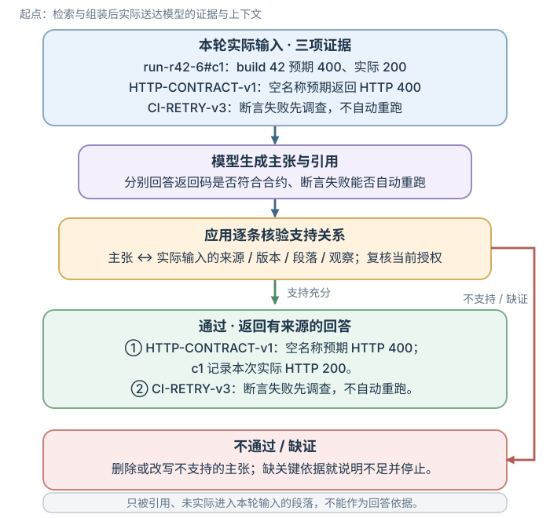

# 回答写好后，怎样逐条核对证据，答错时又怎样找到坏掉的一环？

[上一章](rag-indexing-and-retrieval.md)交给本章一份排好序的候选段落，都已按当前权限和版本复核，另外还有一条历史观察。本章回答剩下的三个问题：哪几段该放进模型输入；模型写出回答后，应用怎样逐条核对每条主张是否真有来源支持；回答错了，怎样判断坏在来源、检索、组装还是使用。最后一个问题的答案是一条统一的失败定位链，后面的 Agent 记忆和线上 trace 也按这条链诊断。

## 案例：从构建 42 的三段候选开始

案例沿用 CI 诊断助手（合成数据）。开发者问：“空名称请求预期返回 `400` 对吗？按当前 CI 手册，构建 42 应该自动重跑吗？”检索和重排之后，应用手上有：

| 材料 | 内容 | 状态 |
|---|---|---|
| `run-r42-6#c1` | 旧运行中 `read_build_log(build_id=42)` 的结果：`reject_empty_name` 预期 HTTP `400`，实际 `200`，`exit_status=1`。 | 历史观察，调用者有权查看，属于构建 42。 |
| 1. `HTTP-CONTRACT-v1#empty-name` | 空名称请求应返回 HTTP `400`。 | 当前，已授权。 |
| 2. `CI-RETRY-v3#assertion-failure` | 只可重试网络或工作节点中断；断言失败必须先调查，不自动重试。 | 当前，已授权。 |
| 3. `CI-TEST-v1#diagnosis` | 检查失败测试、输入、预期与实际响应，并沿请求路径调查。 | 当前，已授权。 |

已撤回的 `CI-RETRY-v2`（“任何失败都可重试一次”）在检索阶段就被排除了。

## 只把回答所需的最小段落集放进上下文

组装上下文时，每段都要保留来源 ID、版本、原文位置和适用范围，后面的核验要靠它们。在证据预算内，挑出足以支持必要主张的**最小段落集**。本例有两项判断：预期状态码是否符合契约，断言失败能否自动重跑。所以 HTTP 契约和重试规则都是必需证据。

> [!example] 64 token 的检索预算装得下哪几段
> 假设应用指令、用户问题、`c1` 和封装格式已经占好位置，留给检索段落的预算是 64 token（教学设定）。只计“来源 ID：段落正文”这一行文字，用 `tiktoken 0.12.0` 的 `cl100k_base` 编码实算：
>
> | 段落 | token 数 | 累计 |
> |---|---:|---:|
> | `HTTP-CONTRACT-v1#empty-name：空名称请求应返回 HTTP 400。` | 19 | 19 |
> | `CI-RETRY-v3#assertion-failure：只可重试网络或工作节点中断；断言失败必须先调查，不自动重试。` | 40 | 59 |
> | `CI-TEST-v1#diagnosis：检查失败测试、输入、预期与实际响应，并沿请求路径调查。` | 33 | 92 |
>
> 前两段合计 59，剩 5 token，放不下 33 token 的诊断段落。它也不是回答这两项判断的必要依据，所以不放。模型实际拿到的是 `c1` 加前两段。

这里有一条后面会反复用到的规则：**只进了候选、没进实际输入的段落，回答不能引用**。诊断段落虽然已授权，但模型没看到它，引用它就是引用了不存在的输入。64 token 只是本例单独划出的检索子预算；整次调用的预算怎样先算其他输入、再分配，见[每次调用的上下文预算该怎样分配，哪些状态必须留在应用里？](context-budget-and-state-layers.md)。

## 主张核验分两步：先看引用合法，再看来源是否支持

检索段落是作为不可信资料放进输入的。提示词可以要求模型只依据本轮提供的段落和运行记录作答、每条主张标注来源 ID、证据不足就停（写法见[模型这次能看见什么，提示词该怎样写成可验收的契约？](model-input-and-prompt-contract.md)），但模型仍可能误读、漏看，或者引用一个没给它的来源。所以应用要拿实际输入清单，对每条主张做两步检查：

1. **引用合法吗？** 检索段落：来源 ID 是否在本轮实际输入清单里，版本是否当前，调用者此刻是否仍有权读。日志观察 `c1`：来自哪份运行记录，旧的工具调用和结果是否配对，是否属于 `build_id=42`，调用者是否有权访问。
2. **来源支持这条主张吗？** 引用合法只说明“这段确实给了模型”，不说明段落内容撑得起主张。有引用标记，不等于来源支持。

> [!example] 逐条核验模型的初稿
> 假设模型初稿写了五条主张：
>
> | 主张 | 引用 | 第一步：引用合法？ | 第二步：来源支持？ | 处理 |
> |---|---|---|---|---|
> | 构建 42 的 `reject_empty_name` 预期 `400`，实际 `200`。 | `run-r42-6#c1` | 是：配对完整，属于构建 42，调用者可读。 | 是。 | 保留。 |
> | 测试的预期符合当前 HTTP 契约。 | `HTTP-CONTRACT-v1#empty-name` | 是。 | 是：契约规定空名称返回 `400`。 | 保留。 |
> | 断言失败不能自动重跑，应先调查。 | `CI-RETRY-v3#assertion-failure` | 是。 | 是。 | 保留。 |
> | 调查完可以手动重跑。 | `CI-RETRY-v3#assertion-failure` | 是。 | 否：该段没说调查后怎样处理。 | 改写成“手册没有说明调查后是否可以手动重跑”。 |
> | 原因是请求校验代码漏了空名称检查。 | `CI-TEST-v1#diagnosis` | 否：这段没进本轮输入。 | ——（即使进了，它也只说该调查什么，不证明根因） | 删除；改为不带结论的排查建议。 |
>
> 核验后的回答：“`run-r42-6#c1` 记录构建 42 的 `reject_empty_name` 预期 HTTP `400`、实际 `200`。`HTTP-CONTRACT-v1#empty-name` 规定空名称请求应返回 `400`，所以测试的预期符合当前契约。`CI-RETRY-v3#assertion-failure` 规定断言失败必须先调查，不能自动重跑；该段没有说明调查后能否手动重跑，要确定这一步还需要对应流程。可以先检查请求校验路径，但现有证据没有证明根因在那里。”

这个回答把三种东西分开了：观察（`c1` 记录了什么）、规范（契约规定什么）、处理规则（手册要求怎样做），各自绑定自己的来源。`c1` 支持“预期与实际不符”，v3 支持“断言失败须先调查”，没有一条证据支持具体根因。没通过核验的主张要删掉或改写；删完仍缺关键依据时，回答要说清缺的是哪类资料，然后停止推断，不能为了给出答案去用已撤回或未授权的内容。

## 有效资料互相冲突时，按预定规则裁决

两段都当前有效、都已授权，说法却矛盾时，先按事先定义的规则裁决：权威性（哪个发布方对这件事说了算）、适用范围（哪段适用于这个项目或环境）、版本和生效时间。规则也解决不了，就把冲突和各自的来源展示给用户，说明无法确定。不能按检索分数随便挑一段，也不能让模型自己选一个听起来合理的。

## 答错时沿同一条链找坏掉的一环

回答错了，最没用的诊断是“模型幻觉了”。同样一个错答“构建 42 可以自动重跑”，可能来自完全不同的环节，修法也完全不同。要定位，需要对每个抽检的错答保留四类能互相关联的记录：

- 获准使用的原始来源，以及它在提问时刻的快照；
- 派生表示（解析结果、chunk、摘要、记忆条目、wiki 页）到原始来源的映射和版本；
- 检索命中的候选，以及最终进入上下文的片段；
- 最终回答、它的引用和核验结果。

有了这些记录，就能沿证据流动的方向逐环检查。证据从来源出发，依次要进入候选、进入上下文、被正确使用：

链上任何一环断了，后面都不可能对。所以从上游往下查：上游已经断了，就不必在下游调参数。另外两类问题不在某一环上，而是可能出现在任何一环：派生表示在加工时失真，以及版本、范围和权限的治理出错。合起来是下面这张表：

| 坏掉的环节 | 判据：查哪条记录 | 构建 42 里会是什么样 | 先固定什么，再改什么 |
|---|---|---|---|
| **① 来源缺事实，或应用没拿到来源** | 原始文档、解析结果、版本状态、异步索引任务；工具读取的返回码与结果。 | v3 已生效，但同步任务失败，资料库里只有 v2；或者 `read_build_log` 返回空文件。 | 修解析、同步或工具读取；来源里确实没有，就回答依据不足。这不是检索失败。 |
| **② 来源里有，但没进候选** | ACL 和版本过滤、分块边界、查询措辞、向量契约、候选窗口；对同一可见集合做一次精确搜索。 | 分块把“断言失败不自动重试”切到了别的块；或者近似索引先扫描后过滤，凑不够候选。 | 先修范围和分块，再在固定查询集上比较词法、稠密和混合检索；只有精确搜索找得到、近似搜索找不到时才调索引参数。 |
| **③ 进了候选，但没进上下文** | 融合、重排、去重、预算截断、父块加载的记录。 | v3 排在第三，而上下文只取前两段。 | 调排序或组装，检查新的上下文包含了所有必要的限定条件。 |
| **④ 进了上下文，仍然用错** | 实际模型输入、每条主张到来源的映射、核验结果。 | 输入里有 v3，模型仍说“可以自动重跑”，或者把排查建议写成了已证实的根因。 | 固定检索结果，单独改提示、模型或核验流程，逐条主张校验。 |
| **加工失真**（可出现在任何派生表示上） | 派生条目和它所指原文的逐项对照：事实、限定词、时间、否定是否保留。 | 记忆条目写成“构建 42 测试失败，可重试”：丢了 `400 → 200` 的断言，也丢了版本。 | 固定查询和回答模型，改抽取或摘要规则；给派生条目补来源定位，风险高时取回原文。 |
| **治理错误**（版本、范围、权限、冲突） | 条目的来源时点、适用范围和当前授权；冲突裁决记录。 | 缓存里的 v2 命中被当成现行规则；当前调用者已无权读 `c1`，含 `c1` 内容的旧摘要却进了输入；把另一个构建、另一个提交上查实的根因直接套到构建 42。 | 按当前权威状态重新核定证据；让失效条目停止命中，必要时拒绝迁移或拒绝回答。 |

使用这张表有三点要注意：

- **一个错答可以同时有多处故障。** 模型给错分类，检索也可能漏了相关段落。两处都记下来，不要让一个标签抹掉另一条调查路径。
- **“④ 用错”说的是现象，不是根因。** 同样是模型用错证据，原因可能是提示没写清推断边界，也可能是模型能力不够，也可能是评分预期本身有歧义。要固定上游、只改一处来区分。
- **记录不全时，先承认定位不了。** 某个错答缺了候选或输入记录，就无法判断坏在 ② 还是 ③。这本身是一个可观测性缺口，不能用缺失的日志假装错误不存在。

## 离线评估：证据 Recall@k 和 IndexRecall@k 回答不同的问题

定位链说明一个错答坏在哪；离线评估则在一批固定的问题上，量出每一环平均有多可靠。评估要固定查询、文档和授权快照，给每道可回答的题标出必需的 `source_id`、版本和段落。

检索这一段常用两个召回率，名字相近，回答的问题完全不同：

| | 证据 Recall@k | IndexRecall@k |
|---|---|---|
| 回答的问题 | 前 k 个候选里，有多少是回答这道题必需的证据？ | 近似索引（ANN）返回的前 k 个，有多少和精确搜索的前 k 个一致？ |
| 参照物 | 人工标注的必需证据集合 | 同一可见集合上的精确向量搜索 |
| 对应定位链的环节 | ②（整体检索是否找到了证据） | ② 里面的一个子问题：近似索引是否漏掉了本该排在前面的向量 |
| 偏低时先查 | 分块、查询、向量表示、过滤范围 | 索引参数和过滤后的扫描量 |

**证据 Recall@k。** 对问题 $q$，令非空集合 $E_q$ 为人工标注的全部必需证据段落，$R_k(q)$ 为前 k 个候选：

$$
\text{Recall@}k(q)=\frac{|R_k(q)\cap E_q|}{|E_q|}.
$$

分母是这道题需要的证据段落数，不是问题数，也不是候选数。本例 $E_q=\{$`HTTP-CONTRACT-v1#empty-name`, `CI-RETRY-v3#assertion-failure`$\}$，重排后的前两名正是这两段：k=2 时召回为 2/2；k=1 时只有契约一段，召回最多 1/2。所以要先确认 k 容得下所需证据，再判断检索好坏。无答案的题没有必需证据，不算这个召回率，单独评估系统是否正确停下。

**IndexRecall@k。** 在同一份调用者可见的数据上穷举算出精确的前 k 个 $T_k(q)$，与近似索引返回的 $A_k(q)$ 比较，可见对象不少于 k 个时为 $|A_k(q)\cap T_k(q)|/k$。距离并列、可见对象少于 k 个、可见集合为空时的约定，以及一个过滤导致召回从 2/2 掉到 1/2 的手算，见[HNSW 怎样逐层找近邻，怎样知道搜索得够不够？](hnsw-vector-index-search.md)。

两者合起来给出调参顺序：如果**精确搜索**的证据召回已经很低，问题在分块、向量表示或距离度量，调大索引参数修不好；只有精确搜索的证据召回高、近似搜索低时，才去调图和扫描参数。

检索之后，还要沿定位链往下评：必需段落是否进了上下文（③）；回答是否事实正确、每条主张是否有来源支持、引用是否准确、无证据时是否停下（④）。RAGChecker 按主张粒度区分检索问题和生成问题；Ragas、ARES 从不同维度评估上下文或回答。这些框架能帮助定位，但仍要人工复核代表性案例，门槛按应用自己的来源权限、更新和引用要求设定，不存在跨应用通用的分数线。怎样用独立验收集判断改动是否值得保留，见[候选 B 比 A 好，是真改善还是抽样波动？](../evaluation-and-release/holdout-acceptance-and-paired-statistics.md)。

## 测试集要覆盖哪些情形

只用“正常能答”的题，测不出定位链上大部分环节。本例的测试集至少要覆盖：

- 已撤回的旧版本仍在索引里（v2）；
- 无答案的问题；
- 构建 42 这样的断言失败，以及工作节点中断这类可重试的失败；
- 调用者无权读的文档，以及评估期间权限被撤销；
- 稀有的过滤值；
- 精确标识符和数值问题（测试名、状态码）。

除了质量，还要量运行指标：建索引的完成时间、来源版本的新鲜度、95 百分位（P95）时延、成本和索引大小。回答流畅不是指标。

## 线上监控能看什么，不能冒充准确率

线上能直接观察的是过程信号：当前来源和索引代次、异步任务失败、权限拒绝、命中了哪个版本、候选和实际输入的来源、引用核验的抽样结果、调用时延和费用。这些信号能把线上错答放回定位链的某一环。

线上请求没有人工真值。点击率、点踩和模型自评分都不能冒充准确率。需要持续评估质量时，对有授权的真实请求抽样复核，并说明抽样偏差。trace 怎样关联、线上指标的分母怎样定，见[上线后，怎样从一条错误建议找回可修复的证据？](../evaluation-and-release/production-traces-and-metric-denominators.md)。

## 同一条定位链还会用在记忆和线上 trace

本章的产出有两样。一是一份核验过的回答：每条主张都绑定了实际进入输入、当前有效、调用者有权读的来源，不支持的主张已删除或改写，缺证时明确停下。二是一套诊断办法：错答沿“来源 → 候选 → 上下文 → 使用”逐环检查，另查加工失真和治理错误。

后面的章节直接复用这条链。[什么时候值得把历史加工成 Agent 记忆？](agent-memory-design-and-evaluation.md)把它用在派生记忆上，加工失真和治理错误在那里最常见；[上线后，怎样从一条错误建议找回可修复的证据？](../evaluation-and-release/production-traces-and-metric-denominators.md)把线上 trace 和用户反馈接到这条链上，只补充线上特有的采样和记录缺口。

> [!info]- 来源
> - **段落 token 计数（“只把回答所需的最小段落集放进上下文”）。** 用 `tiktoken 0.12.0` 的 `cl100k_base` 编码对表中三行文字实算（2026-11-26 复算）：19、40、33 token。64 token 预算是教学设定。
> - **按主张粒度区分检索与生成问题（“离线评估……”）。** Ru et al., [“RAGChecker: A Fine-grained Framework for Diagnosing Retrieval-Augmented Generation Systems,” arXiv v2](https://arxiv.org/abs/2408.08067), §§3–4。
> - **上下文与回答的自动评估（同节）。** Es et al., [“Ragas: Automated Evaluation of Retrieval Augmented Generation,” arXiv v2](https://arxiv.org/abs/2309.15217v2), §§3–4；Saad-Falcon et al., [“ARES: An Automated Evaluation Framework for Retrieval-Augmented Generation Systems,” arXiv v2](https://arxiv.org/abs/2311.09476v2), §§3–4。各自的指标、评审器和校准方式不同，不构成通用分数线。
> - **派生记忆的构造与取回两环分别分析（“答错时沿同一条链找坏掉的一环”中的加工失真一行）。** [Memory Tax: Dissecting the Net Value of Agent Memory](https://arxiv.org/html/2610.34073v1)，arXiv v1，2026-10-25，§§4.1–4.3 与 Appendix B.1。论文的分析不替具体应用判定每次错答的原因。
