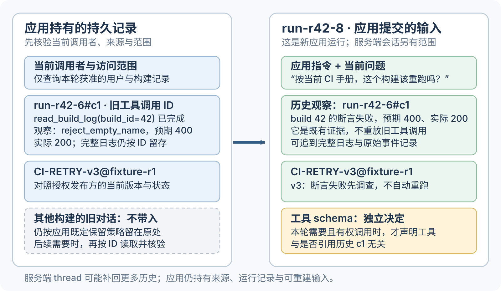

# 每次调用的上下文预算该怎样分配，哪些状态必须留在应用里？

[上一章](model-input-and-prompt-contract.md)写好了一次调用的输入约定：模型只看见本次组装的输入。可是一个任务往往跨好几轮、好几次调用，可用的指令、工具、历史、证据和任务状态越积越多，窗口装不下，也不该全装。本章回答两件事：每次调用前怎样从这些材料里挑出一份够用的输入；哪些事实必须保存在应用自己的记录里，而不能只留在上下文、摘要或缓存中。

输入是 CI 诊断助手的旧运行 `run-r42-6`：工具调用 `c1` 读到构建 42 的测试 `reject_empty_name` 预期 HTTP `400`、实际 `200`，`exit_status=1`。开发者看过那次报告，现在提出了新问题。

## 上下文工程管的是“这一轮看什么”

模型在一次调用中能看到的全部输入叫 context (上下文)。它不只是用户看到的聊天文本：消息分属不同角色，请求里还可能有工具 schema、图片等非文本内容、输出格式约束和服务侧的控制字段。如果服务会按会话 ID 自动补回历史，这部分也算在内。

Prompt engineering (提示工程) 关注指令和示例怎么写，上一章讲的就是这部分。Context engineering (上下文工程) 管的是更前面的一步：每次推理前，从所有可用材料里挑出一份足以完成下一步的输入，并决定其余材料放在哪里、需要时怎样取回。

## 追问来了：新运行怎样引用旧的工具结果

开发者问：“按当前 CI 手册，这个构建该重跑吗？”应用为此创建新运行 `run-r42-8`。它不沿用旧运行 `run-r42-6` 的身份。

应用先按当前调用者的权限，从旧运行的权威记录里取回已完成的 `c1` 及其日志观察。下文把它写成 `run-r42-6#c1`，意思是“`run-r42-6` 里的 `c1` 这次调用”。`c1` 只标识那次旧调用；新运行引用它，并不会让它再执行一次。

接着应用检索手册，得到当前版本 `CI-RETRY-v3`：只对工作节点（worker）或网络中断重试，断言失败须先调查，不自动重跑。

于是这次请求要包含四样东西：应用指令、当前问题、带来源的历史观察、检索到的当前手册段落。历史观察有两种写法：

- 写成一条**具名观察**，注明它来自构建 42 的旧运行 `run-r42-6#c1`；
- 如果所用接口允许在新输入里保留历史的工具调用与结果配对，也可以按那种格式放入。

两种写法表达的都是已经发生过的证据，不是让模型再调用一次。要不要在新请求里声明 `read_build_log` 的工具 schema，是另一项独立决定：只有本轮确实需要、调用者也仍有权使用这个工具时才声明，和是否引用 `c1` 无关。

图左是应用持有的持久记录，图右是本轮选进输入的内容。没放进请求的完整日志和其他构建的旧对话并没有被删除；之后需要时，应用可以按 ID 重新读取，并重新核验权限。

有了这份输入，本轮答案应当是：`c1` 记录的是断言失败；按 `CI-RETRY-v3` 不应自动重跑，应先调查。至于调查后能不能由人工重跑，手册没有规定，另按授权流程决定；仅凭 `c1` 也不足以断定代码根因。

## 按 tokenizer 算一遍预算

上下文按 token (词元) 计量。下面用一个小预算演示挑选过程：

> [!example] 为构建 42 的追问分配 145 个 token
> 假设这组文本的预算是 145 个 token，用 `tiktoken 0.12.0` 的 `cl100k_base` 编码计数。表中用一对字符串表示旧的 `c1` 请求和结果，它们只是对已完成事件的记录。单列一行工具说明只是为了演算，不表示新请求必须声明工具。这些字符串不是任何提供方的完整请求格式。
>
> | 输入片段 | token 数 |
> |---|---:|
> | 应用指令：`Use only supplied build evidence. Report observed failures separately from causes. Do not infer an unobserved root cause.` | 23 |
> | 用户问题：`According to the current CI guide, should build 42 be retried?` | 15 |
> | 当前仍可调用的只读工具说明：`read_build_log(build_id: integer) -> {step, test, expected, actual, exit_status}` | 21 |
> | 权威运行记录中的请求：`tool_call(id="c1", name="read_build_log", arguments={"build_id":42})` | 20 |
> | 该请求绑定的结果：`tool_result(id="c1", step="unit-tests", test="reject_empty_name", expected="HTTP 400", actual="HTTP 200", exit_status=1)` | 35 |
> | 当前手册证据：`CI retry policy, v3: Retry worker or network interruptions only. A test assertion failure requires investigation and is not automatically retried.` | 27 |
> | 合计 | **141** |
>
> 如果再放进一段已经解决、与构建 42 无关的旧对话 `Earlier conversation about a different build, already resolved.`，它占 10 个 token，合计 151，超出预算 6 个。该删的是这段无关历史；`expected=400`、`actual=200`、`reject_empty_name` 和手册版本都会影响判断，必须保留。

141 只是这些文本在指定 tokenizer (分词器) 下的计数，不是目标模型线上请求的实测值。真实请求还要计入角色标记、结构化工具字段、其他模态和输出预留，并用目标模型支持的方式估算或查看用量。工具循环每多走一步，下一次调用都要重新组装、重新估算。

## 窗口变长，不等于每条都用得好

窗口变长提高了一次能放进去的信息上限，但不保证模型能同样充分、准确地利用其中每一条。

- Chroma 的 Context Rot 报告在 18 个模型的受控测试中观察到，任务复杂度固定时，性能随输入变长而下降；问题与证据的相似度、干扰项和材料结构都会改变下降幅度。它在一组 Needle-in-a-Haystack 设置的 11 个位置上没有观察到明显的位置差异，也没有解释退化机制。
- Lost in the Middle 在其测试的模型和多文档问答、键值检索任务上发现，相关信息放在长输入中间时，模型利用得比放在首尾更差。

这些结果只覆盖各自测试的模型和任务，但工程含义一致：不要因为放得下就全放。模型内部怎样访问很长的历史，见[DeepSeek 怎样压缩长上下文的注意力状态？](../model/deepseek-compressed-attention.md)；替应用决定哪些消息进入请求的，仍是上下文构造逻辑。

## 超预算时先保留什么

超出预算时，按当前问题的依赖排序取舍：

1. 有效的应用指令、调用者范围和本轮必须遵守的约束。
2. 当前问题、尚未完成的步骤，以及影响下一个决定的最新观察。
3. 当前需要的工具定义和证据。日志很长时，先保留失败测试、预期与实际、退出码和日志 ID；不够再按 ID 读取原日志的相关部分。
4. 最后处理重复消息和与任务无关的旧回合：直接删掉。确实需要跨轮保留的长背景，可以压缩成带来源的状态摘要，保留待办、已完成项、未解决问题、资源标识和副作用状态。

第 4 步里的摘要要格外小心，下一节讲原因。

## 摘要是有损变换

摘要会丢信息，所以它不是权威记录。构建 42 有两个典型例子：

- 把 `c1` 记成“单测失败”，丢了测试名 `reject_empty_name` 和 `400 → 200` 的断言差异。追问“该不该重跑”时，手册区分的正是断言失败和网络中断，这条摘要已经不够回答。
- 把“根因需要检查”写成“代码校验已失败”，把推测写成了观察。上一章专门用 `root_cause_status` 隔开的两类信息，在摘要里混到了一起。

所以摘要要带上原始记录的 ID、版本或位置，让下一步能在需要时回到原文。回到原文也不是无条件的：来源已删除或权限变了，重新读取时必须重新校验访问范围。

## 把原件放在上下文之外，需要时再读

Offload (外置状态) 适合原始日志、完整文件、会话之外的长期资料：持久层保存原件和标识，上下文只带本轮需要的片段，或者一个可查询的 ID。

Just-in-time retrieval (按需检索) 让模型在需要时用工具去取，省掉了预先把整个资料库复制进上下文的成本，代价是多出一次或几次工具调用。检索端还要正确应用授权和版本条件。当前手册这类文档怎样建索引、按权限检索并进入上下文，见[怎样从授权文档里找到回答依据？](rag-indexing-and-retrieval.md)。

## 服务端 thread 只改变传输方式

有些服务能在服务端暂存对话，应用每轮只上传新增消息。这减少了重复传输，但不改变两件事：

- 服务按续接标识重建整段历史时，模型仍可能看到全部历史，上下文并没有变短；
- 服务端暂存有自己的期限和规则，不能代替应用自己的持久记录。

所以应用仍要保存自己的消息和重建请求所需的配置；暂存失效时，用自己的记录重新提交完整对话。删减输入、续接服务端会话、前缀缓存和 KV 缓存这四种操作各改变了什么（传输量、模型可见内容、计算复用），对照见[重复的前缀怎样在引擎里复用，又怎样体现在 API 账单上？](../model/prefix-reuse-and-prompt-caching.md)。

> [!info] 实例：Anthropic Message Threads beta（beta header `message-threads-2026-08-12`，核对于 2026-11-25）
> 服务端短暂保存对话，应用用**上一条响应的 ID** 续接；这个 ID 不是应用运行 ID `run-r42-8`。首次请求以 `thread.type="create"` 提交完整对话、系统指令和工具；之后以 `thread.type="continue"` 和 `previous_message_id` 只提交新增消息，由服务重建对话。续接沿用创建时的 `system` 和 `tools`，请求里不得再传这两个字段；要换工具配置或编辑旧消息，得按规则新建 thread。
>
> thread 在最后一次请求 5 分钟后过期，每次成功存储的响应都重新计时；服务端记录最晚在最后一次使用后 1 小时内删除；SDK thread helper 的副本只在进程内存里。续接返回 404 时，应用要用自己保存的消息重新提交完整对话。工具是否执行仍由应用按当前授权判断。

## 子 worker 只拿到交接给它的内容

把一部分工作交给独立上下文的 worker (工作者)，可以让并行研究或权限不同的子任务只接触必要信息。代价是 worker 不会自动共享主流程的记忆，它只知道交接时给它的东西。交接内容要写明：

- 目标；
- 输入证据及其来源；
- 权限范围；
- 输出格式；
- 已知的不确定项。

worker 交回的结论，主流程要对照原证据自己判断，而不是直接采信。如果各个子任务都依赖同一批近期状态，先比较“一个主循环按需加载工具或技能”和“新建独立上下文”在质量、成本和时延上的差别，再决定要不要拆。拆分的判断标准见[多阶段 AI 任务该按什么结构组织，怎样知道它在原地打转？](../actions/multi-stage-orchestration.md)。

## 六类状态由谁持有

到这里可以把散落的“状态”放在一起看。它们由不同的持有者保存，解决不同的问题：

| 数据 | 由谁持有 | 后续推理怎样使用 |
|---|---|---|
| 本次组装的消息与工具配置 | 本次请求；应用也可保存重建请求所需的消息、配置和版本 | 这是应用提交的输入；服务端会话可能补回更多历史。 |
| 工具请求及观察结果 | 应用运行记录 | `run-r42-6#c1` 连接旧运行中的调用和结果；新运行引用结果，不重做调用。 |
| 日志原文、文档和授权记录 | 日志库、文档库或业务存储 | 按权限查询；模型没看到的内容，不能假定它用过。 |
| 模型参数 | 已部署的模型 | 训练时更新；一次推理的上下文变化不会改动权重。 |
| KV cache (键值缓存) | 推理执行过程 | 生成时复用先前 token 的键和值，只服务于本次计算。 |
| Prompt cache (提示缓存) | 支持它的推理服务 | 按提供方的条件复用相同前缀的计算；不保存用户会话，也不验证答案。 |

一句话概括：应用状态记录发生过什么；输入上下文决定本轮模型看见什么；模型参数编码训练得到的行为；缓存只减少重复计算。参数与运行时状态的区别见[模型怎样把提示词算成下一个词元？](../model/next-token-computation.md)，两种缓存的命中条件和计费见[重复的前缀怎样在引擎里复用，又怎样体现在 API 账单上？](../model/prefix-reuse-and-prompt-caching.md)。

> [!warning] 压缩和缓存都不替你保存事实
> 摘要、服务端 thread、各种缓存和模型参数都不能代替权威任务记录。影响权限、操作是否已经发生、文档版本或重试是否安全的事实，必须留在应用可查询的状态里；每次取回后再验证当前授权。

## 长任务的短状态，以及重置时不能清掉的东西

长任务里，应用可以把目标、已完成项、下一步和阻塞项整理成一段简短状态，放回近期上下文，原始运行事件留在持久记录里。构建 42 适合保留的短状态是：

> 旧运行 `run-r42-6#c1` 观察到断言失败（预期 400、实际 200）；按 `CI-RETRY-v3` 已判断应先调查、不自动重跑；调查待进行。

本例既没有再查重跑状态，也没有执行重试。如果反复读取既没带来新的、有权使用的观察，也没让任务完成新的阶段，就把这一轮记为无进展；先查明缺什么证据，再考虑调整上下文。无进展怎样按可核对的状态变化计数，见[多阶段 AI 任务该按什么结构组织，怎样知道它在原地打转？](../actions/multi-stage-orchestration.md)。

保留还是重置，由任务决定：

- **继续调查构建 42**：保留 `c1`、已确认的断言、当前手册版本和待查步骤；原始日志留在运行记录里。
- **重新开始探索，或在不同任务间复用经验**：把结果和来源存到上下文之外、标上版本，在新任务里重新检验。

无论哪种，清空搜索状态都不能顺带清掉权限、任务契约，或尚未确认结果的外部副作用。

> [!info]- 研究案例：重置与跨任务复用
> - Manus 报告：批量审阅 20 份简历时，agent 会照着上下文里的相似记录重复同一动作；他们提出在序列化格式上加入少量有结构的变化来打破这种模式。这是 Manus 自有系统里的观察，属于待评估的假设，不能当作“往上下文里随意掺入格式变化”的依据。
> - *Scaling Discovery Requires Forgetting* 在四类带外部评分的搜索任务上，比较保留搜索状态与清空后从当前最佳候选重启。它不建立一般对话或生产运行的重置规则。
> - GitSwarm 用共享分支仓库复用中间产物：Git 的 `parent` 提交记录 worker 开始工作时的树，`informed_by=` 记录作者声明的语义来源（必须包含 parent，也可指向其他分支产物）。来源关系本身不证明因果。
> - Harness² 区分任务级尝试与另行积累的 harness 经验，结果受其框架、模型和专业任务基准限制。
>
> 保存并重读一条经验，不证明它改善了新任务；要按相同验收条件对照。这些研究的证据强度对比见[研究里的自动改进方法，哪些证据能借到工程里？](../evaluation-and-release/automated-improvement-research.md)。

## 跨运行的信息：范围、写入、读取、更新、遗忘

前面讲的都是一次调用的输入和一次运行内的状态。有些信息还要跨运行保留。仍以 `run-r42-8` 为例：开发者 `user-42` 在这次运行里还说了一句“以后摘要默认用中文”。于是涉及三类信息，各有自己的 owner (持有者) 和 scope (范围)：

| 范围 | 可读记录 | 状态与读取条件 |
|---|---|---|
| 用户偏好 | `user-42：以后摘要默认用中文`，来源是用户在 `run-r42-8` 中的明确要求 | 已确认；本例设 30 天后过期；只供认证后的 `user-42` 使用。 |
| 单次任务证据 | `run-r42-6：c1 显示 build 42 的 reject_empty_name 预期 400、实际 200` | 只属于旧运行。新运行按当前授权引用时，要标成历史证据，不当作当前观察。 |
| 公开规则 | `fixture-publisher：CI-RETRY-v3@fixture-r1`（`@fixture-r1` 标出发布修订） | 只在应用的保留和授权策略允许跨运行保存时共享；读取时核对来源当前版本、状态和适用范围。 |

旧运行 ID 不能当成新任务的身份。这些记录写入后，还会被读取、更新和失效：

| 操作 | 记录怎样变化 |
|---|---|
| 写入 | 只有用户明确要求以后沿用“中文摘要”时才存偏好；只要求本轮用中文，不写长期记录。公开来源是否跨运行保存，按应用既定的保留和授权策略。 |
| 按范围读取 | 先认证调用者，再查其偏好；按权限引用旧运行的 `c1`；取当前可读的手册。每条结果都核对状态、到期条件、当前授权和来源版本。 |
| 纠正或更新 | 用户改为“原文保留英文，只把结论摘要写中文”时，用这次确认更新偏好版本，并让旧值及其缓存、派生摘要停止命中。来源发布新版本时，先标旧版本过期，再按当前授权取新版本。 |
| 失效或遗忘 | 记录到期或所有者撤回时，先把主记录标为失效或删除并阻止读取，再处置索引、缓存、摘要和可恢复检查点里的副本。如果只是某个调用者失去访问权，就禁止该范围读取、清理或隔离该范围的派生副本，不删除其他合法使用者共用的原记录。删除审计只保留必要且不含原文的信息。 |

不同 owner 的记录互不连带。删除用户偏好，不会删掉某次运行里已经发生的外部操作记录，也不会删掉发布者自己的规则；发布者撤回规则，也不应删除用户偏好。

> [!info] 实例：LangGraph 的存储原语不替应用划分范围（LangGraph Python 1.2.20，文档检查于 2026-11-12）
> `thread_id` 标识一条图状态线程，checkpointer 在同一 thread 的多次图调用之间保存检查点，但一个 thread 不等于一次应用运行。Store 提供跨 thread 的读写和 namespace (命名空间) 原语。用户身份、授权、撤权传播、保留期限和派生内容清理，仍要由应用映射和执行。

什么时候值得把历史进一步加工成偏好摘要、事实索引或过程经验，并与认真调过的原文检索比较得失和成本，见[什么时候值得把历史加工成 Agent 记忆？](agent-memory-design-and-evaluation.md)。

## 过期版本的事故：旧手册还在缓存里

跨运行保存的信息会过期。假设缓存里还留着已撤回的旧版 `CI-RETRY-v2@fixture-r0`，写着“任何失败都可重跑”。如果应用直接用这条缓存命中回答，模型就会告诉开发者：构建 42 的断言失败可以重跑。这和当前 v3 的规定正好相反。

防住它的办法是读取时比对版本，而不是相信缓存：

1. `run-r42-8` 取出缓存条目，看它带的版本 `v2@fixture-r0`。
2. 向获准的发布方查询当前版本 ID，或使用可信的同步元数据。本例中 `fixture-publisher` 报告当前版本为 `v3@fixture-r1`。
3. 版本不一致，拒绝旧命中，重新读取 v3 原文再回答。
4. 如果当前版本或授权状态无法核实，就把规则记为未知，不依据可能过期的条目决定是否重跑。

向量检索的相似度只说明文本像，不能证明来源仍然有效。v2 和 v3 讲的是同一件事，相似度可能都很高。

把某次处理方式提升成共享经验，也要由有权的来源确认适用范围，并用独立样本验证；一次运行成功、或者模型“记住了”规则，都不足以推广。验证方法见[候选 B 比 A 好，是真改善还是抽样波动？](../evaluation-and-release/holdout-acceptance-and-paired-statistics.md)。

## 手册证据从哪里来

本章给每次调用划了边界：应用持有身份和事实来源，按预算和依赖组装模型能看到的内容；摘要、服务端 thread 和缓存都只是辅助，权威状态留在应用里，读取时核对授权和版本。

本章里“检索当前手册”只是一句话带过。手册怎样分块、授权、更新、排序并进入上下文，由[怎样从授权文档里找到回答依据？](rag-indexing-and-retrieval.md)从这里接手：已知 `c1`，新任务要取得当前手册的依据。各家编码 agent 怎样压缩和恢复会话、为什么恢复后仍要按本章的规则重建输入，见支线[Claude Code、Codex、Devin 和 Cursor 怎样恢复同一条任务事实？](coding-agent-task-recovery.md)。

> [!info]- 来源
> 构建 42、`run-r42-6`、`run-r42-8`、`CI-RETRY-v2/v3`、`user-42` 与 `fixture-publisher` 均为合成教学数据。
>
> - **token 演算**（“按 tokenizer 算一遍预算”，预算 145、合计 141、加无关历史后 151）：OpenAI [`tiktoken` 0.12.0 源码与 `cl100k_base` 编码](https://github.com/openai/tiktoken/tree/0.12.0)，对表中原始文本逐段计数，2026-11-26 复算一致；该 tokenizer 不等于所有模型的线上请求序列化。
> - **上下文工程与提示工程的边界、按需维护信息**（“上下文工程管的是‘这一轮看什么’”“把原件放在上下文之外”）：Anthropic，[Effective context engineering for AI agents](https://www.anthropic.com/research/effective-context-engineering-for-ai-agents)，2025-09-29，§§1–4；是组织的工程经验，不是通用实验结论。
> - **长输入的位置效应**（“窗口变长，不等于每条都用得好”）：Liu et al.，[Lost in the Middle: How Language Models Use Long Contexts](https://arxiv.org/abs/2307.03172v3)，TACL 2024 / arXiv v3，§§3–4；限于研究中的模型与多文档/键值任务。
> - **输入长度、相似度、干扰项和材料结构的影响**（同上节）：Hong et al.，[Context Rot: How Increasing Input Tokens Impacts LLM Performance](https://www.trychroma.com/research/context-rot)，Chroma technical report，2025-07-14，核对于 2026-11-25；测试 18 个模型，固定任务复杂度改变上下文长度，未识别退化机制。
> - **Message Threads 的续接字段、配置继承与状态期限**（“服务端 thread 只改变传输方式”实例）：Anthropic，[Message threads](https://platform.claude.com/docs/en/build-with-claude/message-threads)，beta header `message-threads-2026-08-12`，核对于 2026-11-25，How message threads work / What to send on each request。
> - **按需加载能力与独立 worker 的比较**（“子 worker 只拿到交接给它的内容”）：Claude Platform，[Building agents: When to fold subagents into your main agent loop](https://claude.com/resources/articles/building-agents-when-to-fold-subagents-into-your-main-agent-loop)，2026-10-22；数据来自若干企业部署，适用于其比较过的工作流。
> - **稳定前缀、追加式历史与重复动作的观察**（重置研究案例中的 Manus 条目）：Manus，[Context Engineering for AI Agents: Lessons from Building Manus](https://www.manus.im/blog/Context-Engineering-for-AI-Agents-Lessons-from-Building-Manus)，2025-07-18；来自 Manus 自有 agent。
> - **开放式搜索重置**（重置研究案例）：Tan et al.，[Scaling Discovery Requires Forgetting](https://arxiv.org/abs/2610.20563v1)，arXiv v1，2026-10-14，§§3–4、Appendix B、§6。
> - **跨 episode 的共享产物与语义依赖**（重置研究案例）：Shah et al.，[GitSwarm: Decentralized Compounding Inference](https://arxiv.org/html/2610.04862v1)，arXiv v1，2026-10-04，§§2.2、3.3–3.4、4；`parent` 与 `informed_by=` 按论文定义理解。
> - **任务级与 harness 级经验积累**（重置研究案例）：Xu et al.，[Harness²: Recursive Agent Harnessing for an Open World](https://arxiv.org/html/2610.14224v1)，arXiv v1，2026-10-09，§2.3。
> - **thread 检查点与跨 thread Store 的边界**（“跨运行的信息”中的 LangGraph 实例）：LangGraph Python [1.2.20](https://pypi.org/project/langgraph/1.2.20/)；文档检查于 2026-11-12：[Persistence](https://docs.langchain.com/oss/python/langgraph/persistence) 的 Checkpointer vs. store 与 thread ID scope，[Stores](https://docs.langchain.com/oss/python/langgraph/stores) 的 Basic usage / Namespace design / Base contract，[Memory](https://docs.langchain.com/oss/python/langgraph/add-memory) 的 short-term / long-term memory。
