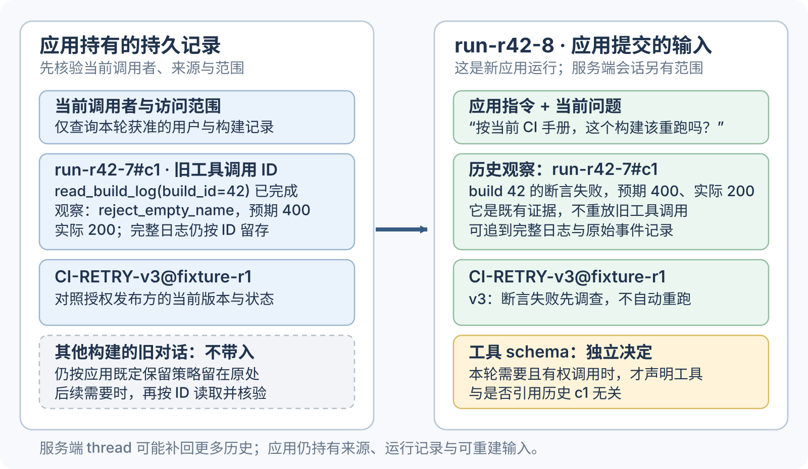
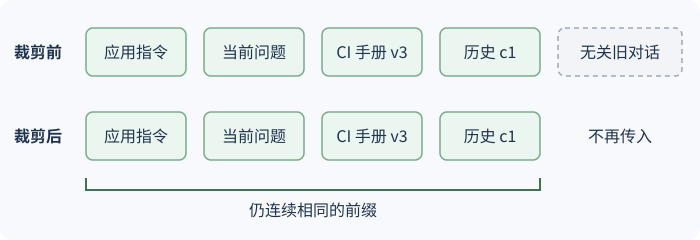
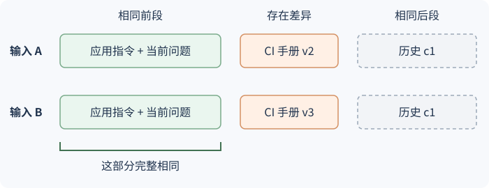

# 每次模型调用应看到什么，应用又应持久化什么？

模型本轮能看到的输入称为 context（上下文）。模型读取的是本次调用最终组装出的内容；如果服务根据会话 ID 自动加入历史，应用也要按该服务的会话语义理解实际输入。模型不会自行查询应用数据库或日志。Prompt engineering（提示工程）侧重指令和样例的写法；**context engineering（上下文工程）**则在每次推理前，把可用的指令、工具、历史、证据与任务状态选成一份足以完成下一步的输入。本章将《AI 服务如何将一条消息变成完整回答？》中 build 42 样板的那次应用运行记为 `run-r42-7`；其中 `c1` 是一次 `read_build_log` 工具调用 ID，它的结果绑定到构建 42。本章接着处理开发者看过失败后的新一轮追问。[AI 服务怎样把一条消息变成完整回答？](../systems/from-message-to-answer.md)

## 一次推理看到的不是整段会话

想象开发者已经从先前回答看到构建 42 的测试失败，现在开启新一轮追问：“按当前 CI 手册，这个构建该重跑吗？”应用为此创建新的应用运行 `run-r42-8`；它不是旧运行 `run-r42-7` 的延续身份。按当前调用者权限，应用从旧运行权威记录取回已完成的 `c1` 调用及对应日志观察；`c1` 只标识旧工具调用，不会因被引用而再次执行。然后应用检索手册。`CI-RETRY-v3` 是为演示检索结果而虚构的通用公开手册条目，不代表任何组织政策。它规定只对工作节点（worker）或网络中断重试，断言失败须先调查。

这次请求要包含应用指令、当前问题、带来源的历史观察，以及检索到的当前手册段落。默认可把 `run-r42-7#c1` 表达成一条具名观察，明确它来自构建 42 的旧运行。若当前接口支持在新输入中保留历史工具调用与结果的配对，也可用该形式；它仍然是已发生的历史证据，不是让模型重放 `c1`。工具 schema 是另一项独立选择：只有本轮确实需要、且调用者有权再用该工具时才声明。服务会话 ID 若自动带入历史，也要纳入当前输入与预算判断。

模型上下文（context）是当前调用最终可用的信息，不只包括用户看到的聊天文本。每条消息可能有不同角色；请求还可以包含工具 schema（工具结构约束）、图片或其他非文本内容、格式约束和服务侧控制字段。下图把应用持有的持久记录与本轮选定输入分开；它用提供方无关的“具名观察”表示 `c1`。服务若因会话 ID 补回旧历史，最终模型上下文还可能多于应用本次提交的消息。

图中 `run-r42-8` 是新的应用运行。`c1` 的身份固定在 `run-r42-7`；请求中只引用它的历史结果。`read_build_log` schema 是否放入新请求由本轮授权与需求决定，与是否引用 `c1` 无关。完整日志和被排除的对话并未删除，后续需要时由应用按 ID 重读。

> [!example] 为本轮回答留出上下文预算
> 假定这组文本的教学预算为 145 个 token（词元），用 `tiktoken 0.12.0` 的 `cl100k_base` 计数。为了复算，表中用成对字符串表示旧的 `c1` 请求与返回；这是对已完成事件的历史表达，不重跑 `c1`。它也不要求新请求声明工具 schema：表里为计算另列工具说明，实际应用仍独立决定是否开放工具。字符串只是 token 演算材料，不是任何提供方的完整请求格式。
>
> | 输入片段 | 演算 token 数 |
> |---|---:|
> | 应用指令：`Use only supplied build evidence. Report observed failures separately from causes. Do not infer an unobserved root cause.` | 23 |
> | 用户问题：`According to the current CI guide, should build 42 be retried?` | 15 |
> | 当前仍可调用的只读工具说明：`read_build_log(build_id: integer) -> {step, test, expected, actual, exit_status}` | 21 |
> | 权威运行记录中的请求：`tool_call(id="c1", name="read_build_log", arguments={"build_id":42})` | 20 |
> | 该请求绑定的结果：`tool_result(id="c1", step="unit-tests", test="reject_empty_name", expected="HTTP 400", actual="HTTP 200", exit_status=1)` | 35 |
> | 当前手册证据：`CI retry policy, v3: Retry worker or network interruptions only. A test assertion failure requires investigation and is not automatically retried.` | 27 |
> | 合计 | **141** |
>
> 若还把一段已经解决、与构建 42 无关的旧对话 `Earlier conversation about a different build, already resolved.` 放入输入，它要 10 个 token，合计就成 151，超过本例预算 6 个。先删除这段无关历史，保留 `expected=400`、`actual=200`、`reject_empty_name` 和来源版本，因为这些字段会改变判断。实际系统还要计入角色标记、结构化工具字段、其他模态和输出预留，并用目标模型支持的方式估算或查看用量。

表中的 141 token 只是被选文本在指定 tokenizer 下的计数，不是完整请求或目标模型线上输入的测量；后文再比较上下文裁剪、服务端会话重建与缓存前缀复用。

本轮答案应明确说：`c1` 记录的是断言失败；按 `CI-RETRY-v3` 不自动重跑，应先调查。是否人工重跑需另按授权流程判断；`c1` 本身不足以断定代码根因。

> [!info] 请求 ID 连接请求与观察
> `c1` 让应用能把结果追到 `run-r42-7` 的请求和 `build_id=42`；在 `run-r42-8` 中它只是历史证据。应用可以传入具名观察，也可以在当前接口接受时保留配对消息。无论采用哪种表示，是否声明新工具 schema 都由 `run-r42-8` 的需求与授权单独决定。

## 选择、压缩和按需读取

模型窗口有限，应用还需要为当前调用的输出和服务格式预留预算；若随后继续工具循环，下一次调用要重新组装输入并重新估算。窗口变长增加一次可提供的信息上限，却不保证模型会等量、等准地使用其中每条内容。测试过的模型在长输入中可能受相关信息位置影响；这种位置敏感性随模型、任务和提示结构变化，不能化成“第几轮以后必须总结”一类固定阈值。[DeepSeek 的长上下文 Attention](../foundations/long-context-attention.md)以指定模型为例解释内部怎样访问历史表示，但替应用决定哪些消息应进入请求的仍是上下文构造逻辑。

超预算时，先按当前问题的依赖排序：

1. 保留有效的应用指令、调用者范围和本轮必须遵守的约束。
2. 保留当前问题、尚未完成的步骤，以及影响下一决策的最新观察。
3. 只附上当前需要的工具定义和证据。日志很长时，先保留失败测试、预期与实际状态、退出码和日志 ID；代码上下文仍不足，就用 ID 继续读取原日志。
4. 清除重复消息和与任务无关的旧回合。对确实需要跨轮保留的长背景，可压缩成有来源的状态摘要，保留待办、已完成项、未解决问题、资源标识和副作用状态。

摘要是有损变换，不是权威记录。比如把构建 42 记成“单测失败”会丢失测试名与 `400 → 200` 的断言差异；再把“需要检查”写成“代码校验已失败”则会混淆观察和推测。摘要应保留原始记录的 ID、版本或位置，让下一步能在需要时回到原文。若来源已删除或权限改变，重新读取也必须重新校验访问范围。

**Offload（外置状态）**适合原始日志、完整文件或会话之外的长期资料：持久层保存原件与标识，上下文只带本轮需要的片段或可查询 ID。**Just-in-time retrieval（按需检索）**减少预先复制整库的成本，但会增加一次或多次工具调用；检索端还要正确应用授权和版本条件。[从授权文档中检索证据](../rag/rag-architecture-and-implementation.md)说明文档更新如何进入索引以及返回模型前应检查什么。

以 Anthropic Message Threads beta 为例，服务端短暂保存对话，应用用**上一条响应的 ID** 续接；这个 ID 不等于应用运行 ID `run-r42-8`。首次请求以 `thread.type="create"` 提交完整对话、系统指令和工具；之后以 `thread.type="continue"` 和 `previous_message_id` 提交新增消息，由服务重建对话。续接沿用创建时的 `system` 和 `tools`，请求中不得再传这两个字段。若要更换工具配置或编辑旧消息，需要按该服务的规则新建 thread，不能假定续接会覆盖配置或删掉历史。工具是否执行仍由应用按当前授权判断。

当前 beta 在最后一次请求 5 分钟后过期，最晚于最后一次使用后 1 小时删除服务端记录；SDK thread helper 的副本只存于进程内存。应用仍需持久保存自己的消息，在续接返回 404 时重新提交完整对话。这个生命周期只属于该 beta 实现；其他端点可能裁剪或压缩历史。如何区分重复传输、输入裁剪和前缀计算复用，见[Anthropic Message Threads beta 的输入与传输边界](../systems/ai-latency-and-cost-optimization.md#Message%20Threads%20%E5%87%8F%E5%B0%91%E9%87%8D%E5%A4%8D%E4%B8%8A%E4%BC%A0%EF%BC%8C%E4%BD%86%E4%BB%8D%E8%AE%A9%E6%A8%A1%E5%9E%8B%E5%A4%84%E7%90%86%E5%AE%8C%E6%95%B4%E5%8E%86%E5%8F%B2)。

**隔离任务**有助于让并行研究或权限不同的 worker（工作者）只接触必要信息，但不会自动共享主流程的记忆。交接中要明确目标、输入证据、权限、输出格式和不确定项；主流程保留来源并自行判断结论。若子任务都依赖同一批近期状态，先比较“一个主循环按需加载工具/技能”与“新建独立上下文”在质量、成本和时延上的差别，再决定是否拆分。[编排模式](../agents/orchestration-patterns.md)

## 上下文与应用状态分开保存

| 数据 | 由谁持有 | 后续推理怎样使用 |
|---|---|---|
| 本次组装的消息与工具配置 | 应用请求；应用也可保存重建请求所需的消息、配置及版本 | 这是应用提交的输入；会话 ID 可让服务端补回更多历史。 |
| 工具请求及观察结果 | 应用运行记录 | `run-r42-7#c1` 连接旧运行中的调用和结果；新运行可引用结果，不会重做旧调用。 |
| 日志原文、文档和授权记录 | 日志库、文档库或业务存储 | 按权限查询；模型没看到的内容不能假定它已使用。 |
| 模型参数 | 已部署模型 | 通过训练更新；一次推理的上下文变化不会改权重。 |
| Key-value cache（KV cache，键值缓存） | 推理执行过程 | 在一次生成中复用先前 token 的键和值；由本次模型计算使用。 |
| Prompt cache（提示缓存） | 支持它的推理服务 | 依提供方门槛复用匹配前缀的计算；缓存本身不承担用户会话或答案验证。 |

这些持有者解决不同问题：应用状态记录发生了什么，输入上下文决定本轮模型可见什么，模型参数编码训练得到的行为，缓存减少重复计算。同一次生成中的 KV cache 与服务跨请求复用的 prompt cache 也各有用途。服务线程会话只改变状态传输和恢复方式；如果服务按续接标识重建整段历史，模型仍可能看见全史。上下文裁剪则直接改变所提交或最终可见的内容。前缀缓存通常要求请求前缀匹配并满足模型/端点策略，不会替应用保存任务状态。缓存命中应结合用量和时延判断收益，再按既定验收标准检查回答。稳定前缀与缓存成本的取舍见[AI 时延与成本优化](../systems/ai-latency-and-cost-optimization.md)。

### 删减输入、续接服务线程和缓存前缀，各改变什么？

| 操作 | 发送给服务的内容 | 模型本轮可见内容 | 主要改变 |
|---|---|---|---|
| 上下文裁剪 | 应用删去不需要的片段后提交 | 通常不含被删片段；应用仍可保留原记录 | 传输量与本轮可用证据 |
| 服务端 thread 续接 | 按服务契约提交新增消息和 thread ID / 前次响应 ID | 该服务可能重建完整 thread 历史 | 重复传输与请求处理；不替代应用自己的持久状态 |
| Prompt cache | 仍提交本次请求内容 | 请求内容不因缓存而删减 | 若前缀符合缓存条件，可复用部分计算 |
| KV cache | 应用照常提交本次请求；生成过程中的缓存复用由推理服务处理 | 当前上下文仍由本次输入决定 | 同一生成内的计算复用 |

下面两图单独采用简化的输入顺序：应用指令、当前问题、手册、历史观察。它与前面的 token 演算排列不同，专门用来观察修改位置如何影响共同前缀。

先看**只删末尾无关对话**的情况。每一行都按从左到右排列输入片段；裁剪后，前面连续相同的内容仍是共同前缀。

再看**中间的手册换版**。即使后面的 `c1` 没变，前缀也会在手册中第一个不同的 token 处结束，不能越过差异再把相同后缀算进共同前缀。图按消息片段分组，橙色块内的具体分界仍取决于提供方如何序列化和 tokenize；它不是“整个消息块全有或全无”的缓存规则。

以 OpenAI API 文档在 2026-11-12 核对的规则为例，GPT-5.6 及以后模型至少需要 1,024 个可见输入 token 才能缓存前缀；较早模型的门槛会随请求设置变化。`cached_tokens` 用量字段可帮助核实命中，但不代替端到端测量。删减/摘要会改变本轮模型所见的信息；它可能缩短可复用前缀，也可能通过缩短输入降低总成本。按目标模型和任务比较质量、实际命中与每个成功任务成本，不存在通用的最佳删减比例。

> [!warning] 压缩不会替你保存事实
> 摘要、上下文缓存和模型参数都不能代替权威任务记录。影响权限、操作是否已发生、文档版本或重试安全性的事实，应留在应用可查询的状态中；每次取回后再验证当前授权。

在长任务里，应用可把目标、完成项、下一步和阻塞项作为短状态重新带入近期上下文，同时把原始运行事件留在持久记录中。对构建 42，适合保留“旧运行 `run-r42-7#c1` 观察到什么、按当前 v3 规则已判断先调查、下一步仍待调查”，并把完整日志留在可检索的运行记录中；本例没有发生再次查询重跑状态或执行重试。若运行反复读取同一结果，应记录失败状态并查明缺失证据，再通过任务评估比较调整上下文的影响。

保留还是重置也由任务决定。构建 42 继续调查时，应保留 `c1`、已确认断言、当前手册版本和待查步骤，并把原始日志留在权威运行记录中。要重启探索或复用跨任务经验，需把结果和来源外置、标版本，在新任务中重新检验；清空搜索状态不能清除权限、任务契约或尚未确认的外部副作用。

> [!info]- 研究案例：状态遗忘与跨任务复用
> Manus 报告批量审阅 20 份简历时观察到重复动作，并提出用结构化变体打破模式；这是其系统中的观察和待评估假设，不能支持向当前上下文注入无关格式变化。
>
> *Scaling Discovery Requires Forgetting* 在四类带外部评分的搜索任务中比较保留与清空搜索状态后从当前最佳候选重启；它不建立一般对话或生产运行的重置规则。GitSwarm 用共享分支仓库和显式语义依赖复用中间产物：Git 的物理 `parent` 提交记录 worker 开始工作时的树，`informed_by=` 则记录作者声明的语义来源，必须包含 parent，也可指向其他分支产物；来源关系不单独证明因果。其 worker 模型在一次运行中保持固定。Harness² 区分任务级尝试与另行积累的 harness 经验，其结果受特定框架、模型和专业任务基准限制。保存和重读一个经验也不证明它改善了新任务结果，应按相同验收条件对照。[LLM 评估方法](../evaluation/llm-evaluation-methods.md)

### 跨运行的记忆怎样写入、检索、更新和忘记？

同一合成追问在新应用运行 `run-r42-8` 中进行；旧的 `run-r42-7` 仍是 build 42 的独立运行，`c1` 是其中的历史证据，不能把旧运行 ID 当成新任务的身份。之后，用户 `user-42` 在该应用运行中又明确说“以后摘要默认用中文”；应用读取的虚构手册 `CI-RETRY-v3@fixture-r1` 规定“工作节点或网络中断可重跑；断言失败先调查”。这三条信息分别属于用户偏好、单次任务证据和可能跨任务复用的公开规则。LangGraph 的 `thread_id` 标识图状态的线程；checkpointer 可跨同一 thread 的图调用保存检查点，不等同于一次应用 run。LangGraph Store 则提供跨 thread 的存取和 namespace 原语，应用仍负责映射用户身份、授权与来源范围。[RAG 章](../rag/rag-architecture-and-implementation.md)展开检索内容的来源和访问控制。

| 范围 | 可读记录 | 状态与读取条件 |
|---|---|---|
| 用户偏好 | `user-42：以后摘要默认用中文`，来源是用户在 `run-r42-8` 的明确要求 | 已确认、合成示例中 30 天后过期；只供认证后的 `user-42` 使用。 |
| 单次任务证据 | `run-r42-7：c1 显示 build 42 的 reject_empty_name 预期 400、实际 200` | 只属于旧 run。`run-r42-8` 按当前授权引用它时要明确标成历史证据，不能把它当成当前观察。 |
| 公开规则 | `fixture-publisher：CI-RETRY-v3@fixture-r1` | 仅当应用既有保留和授权策略允许跨 run 保存、使用时才共享；读取时检查当前来源版本、状态和适用范围。 |

| 操作 | 记录如何变化 |
|---|---|
| 写入 | 本例只在用户明确要求未来沿用“中文摘要”时存偏好；若只是要求本轮使用中文，不写长期记忆。公共来源是否跨 run 保留与复用依应用既定的保留和授权策略；读取时仍要遵守来源条件并核对版本、状态和范围。 |
| 按范围读取 | 先认证调用者，再查其用户偏好；`run-r42-8` 按权限引用 `run-r42-7` 的 `c1`，并取当前可读手册。检索结果还要核对条目状态、到期条件、当前授权及来源版本。 |
| 纠正或更新 | 用户后来改为“原文保留英文，只把结论摘要写中文”时，用这条新确认更新偏好版本，并让旧值及其缓存、派生摘要停止命中。来源发布新版本时，先标旧版本过期，再按当前授权取新版本。 |
| 失效或遗忘 | 记录到期或所有者撤回时，先将主记录标为失效或删除并阻止读取，再处置索引、缓存、摘要及可恢复 checkpoint 中的副本。若只是某个调用者失去访问权，则禁止该范围读取，并清理或隔离该范围的派生副本，不因此删除其他合法使用者共用的原记录。删除审计只保留必要且不含原文的信息。 |

过期检查也能避免无效重跑：如果缓存里还留着合成旧版 `CI-RETRY-v2@fixture-r0`（“任何失败都重跑”），它会把 build 42 的断言失败误导成重跑。`run-r42-8` 必须将缓存条目所带的版本与获准发布方提供的当前版本 ID 或可信同步元数据比较；本例假定 `fixture-publisher` 报告当前版本为 `v3@fixture-r1`。应用据此拒绝旧命中，再读取 v3 原文；若当前版本或授权状态无法核实，就把规则记为未知，不能依据过期条目决定是否重跑。向量相似度不能证明来源仍有效。

运行状态、用户偏好和共享来源由各自的 owner（持有者）与 scope（范围）隔离。本例的 `run-r42-7` 只读取了日志；若某个旧运行另外记录了已发生的外部操作，忘记偏好并不删除那条操作事实或来源发布者自己的记录。发布者撤回公开规则则不应删除用户偏好。把某次处理方式提升成共享经验，还要由有权来源确认适用范围，并按[Agent 改进与版本验收](../agents/agent-improvement-and-version-acceptance.md)用独立样本验证；一次运行成功或模型记住规则都不足以推广。

本节回答哪些信息能跨运行保留、何时更新以及谁能读取；若要决定是否将历史加工为偏好摘要、事实索引或过程经验，并与原文检索比较它的题目得失和全成本，见[什么时候值得把历史加工成 Agent 记忆？](agent-memory-design-and-evaluation.md)。

## 下一章怎样接手

本章给每次模型调用建立边界：应用持有身份和事实来源，按需组装模型可见内容，必要时将工具请求或检索结果作为带来源的观察返回。接下来，RAG 章从已知 `c1`、需要在新任务中取得当前手册依据的状态开始，详细说明文档如何分块、授权、更新、排序并进入上下文。模型请求的字段与副作用如何执行和恢复则由[工具契约](../agents/tool-design-and-function-calling.md)承接。

> [!info]- 来源
> 本章的 145 token 演算由 `tiktoken 0.12.0` 的 `cl100k_base` 对表中原始文本逐段计算；消息封装与真实 provider 用量不包含在该演算中。
>
> - **上下文与提示工程的边界、按需维护信息。** Anthropic, [“Effective context engineering for AI agents”](https://www.anthropic.com/research/effective-context-engineering-for-ai-agents), 2025-09-29，§§1–4。组织对多轮输入的工程经验，不是通用实验结论。
> - **长输入的位置效应。** Liu et al., [“Lost in the Middle: How Language Models Use Long Contexts,” TACL 2024 / arXiv v3](https://arxiv.org/abs/2307.03172v3)，§§3–4。研究中的具体模型与多文档/键值任务，不证明所有模型在所有输入中都有相同的首尾偏好。
> - **Message Threads 的续接字段、配置继承、状态期限与应用重放责任。** Anthropic, [“Message threads”](https://platform.claude.com/docs/en/build-with-claude/message-threads), beta header `message-threads-2026-08-12`，检查于 2026-11-12，How message threads work / What to send on each request。以响应 ID 续接并沿用创建时配置；thread 5 分钟空闲过期，服务端最晚于最后使用后 1 小时内删除；SDK helper 副本仅在内存中。
> - **KV 前缀复用的 provider 示例。** OpenAI API, [“Prompt caching”](https://developers.openai.com/api/docs/guides/prompt-caching), 检查于 2026-11-12，Minimum cacheable length / Summary of model differences。GPT-5.6 及以后最低 1,024 个可见输入 token；更早模型依请求设置而变。实现细节、生命周期、计费和用量字段均依当前文档与部署配置。
> - **稳定前缀、追加式历史与任务清单的实践经验。** Manus, [“Context Engineering for AI Agents: Lessons from Building Manus”](https://www.manus.im/blog/Context-Engineering-for-AI-Agents-Lessons-from-Building-Manus), 2025-07-18。文中运行观察来自 Manus 自有 agent，不能当作跨 provider 的保证。
> - **按需加载能力与独立 worker 的部署比较。** Claude Platform, [“Building agents: When to fold subagents into your main agent loop”](https://claude.com/resources/articles/building-agents-when-to-fold-subagents-into-your-main-agent-loop), 2026-10-22；数据来自若干企业部署，适用于其比较过的工作流。
> - **开放式搜索重置。** Tan et al., [“Scaling Discovery Requires Forgetting,” arXiv v1](https://arxiv.org/abs/2610.20563v1), 2026-10-14，§§3–4、Appendix B、§6。测试四项带外部评分的搜索任务，范围见正文。
> - **跨 episode 的共享产物与语义依赖。** Shah et al., [“GitSwarm: Decentralized Compounding Inference,” arXiv v1](https://arxiv.org/html/2610.04862v1), 2026-10-04，§§2.2、3.3–3.4、4。`parent` 与 `informed_by=` 各自表达的来源关系只按论文定义理解。
> - **任务级和 harness 级经验积累。** Xu et al., [“Harness²: Recursive Agent Harnessing for an Open World,” arXiv v1](https://arxiv.org/html/2610.14224v1), 2026-10-09，§2.3。文中基准和模型配置限制外推范围。
> - **演算 tokenizer。** OpenAI [`tiktoken` 0.12.0 源码与 `cl100k_base` 编码配置](https://github.com/openai/tiktoken/tree/0.12.0)；该 tokenizer 不等同于所有模型的线上请求序列化。
> - **thread 检查点与跨 thread Store 的边界、namespace 与条目读写/删除：** LangGraph Python [1.2.20](https://pypi.org/project/langgraph/1.2.20/)；在线文档滚动更新，检查于 2026-11-12：[Persistence](https://docs.langchain.com/oss/python/langgraph/persistence) 的 Checkpointer vs. store 与 thread ID scope、[Stores](https://docs.langchain.com/oss/python/langgraph/stores) 的 Basic usage / Namespace design / Base contract，以及 [Memory](https://docs.langchain.com/oss/python/langgraph/add-memory) 的 Add short-term memory / Add long-term memory。checkpointer 按 thread 保存图状态，不天然等于单次应用 run；Store 提供跨 thread 存储原语。owner 授权、撤权传播、保留期限和派生内容清理仍是应用契约。
