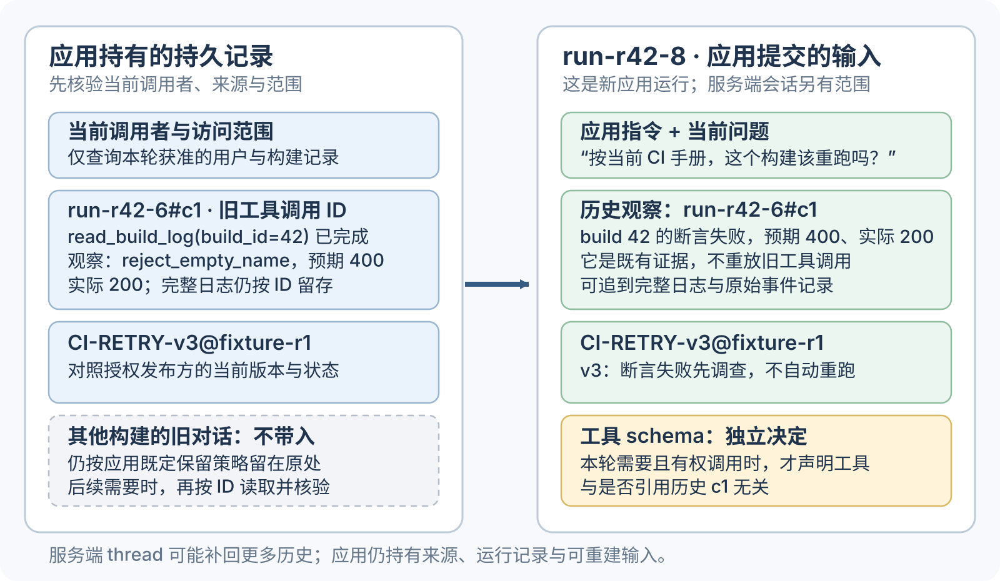
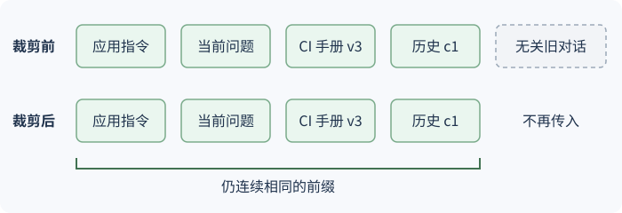
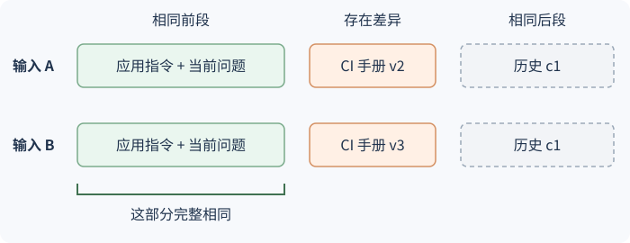

# 每次模型调用应看到什么，应用又应持久化什么？

模型在一次调用中能看到的全部输入称为 context（上下文）。模型读到的只是本次调用最终组装出的内容，它不会自己去查应用的数据库或日志；如果服务会根据会话 ID 自动补入历史，实际输入还要按该服务的会话规则来理解。Prompt engineering（提示工程）关注指令和示例怎么写；**context engineering（上下文工程）**则在每次推理前，从可用的指令、工具、历史、证据和任务状态中挑选出一份足以完成下一步的输入。

本章接续[AI 服务怎样把一条消息变成完整回答？](../systems/from-message-to-answer.md)中的 build 42 案例。那一章的应用运行在这里记为 `run-r42-6`，其中 `c1` 是一次 `read_build_log` 工具调用的 ID。本文将这两个标识写成 `run-r42-6#c1`，表示这次运行里的这次调用。调用结果显示构建 42 的 `reject_empty_name` 测试预期 HTTP 400、实际得到 HTTP 200。本章处理开发者看过这次失败之后的新一轮追问。

## 一次推理看到的不是整段会话

开发者看过上一轮回答后追问：“按当前 CI 手册，这个构建该重跑吗？”应用为此创建新的运行 `run-r42-8`，它并不沿用旧运行 `run-r42-6` 的身份。应用按当前调用者的权限，从旧运行的权威记录中取回已完成的 `c1` 调用及其日志观察；`c1` 只标识那次旧调用，被引用并不会让它重新执行。接着应用检索手册。`CI-RETRY-v3` 是为演示检索结果而虚构的通用公开手册条目，不代表任何组织政策。它规定只对工作节点（worker）或网络中断重试，断言失败须先调查。

这次请求要包含应用指令、当前问题、带来源的历史观察，以及检索到的当前手册段落。通常可以把 `run-r42-6#c1` 写成一条具名观察，注明它来自构建 42 的旧运行。如果当前接口支持在新输入中保留历史的工具调用与结果配对，也可以用这种形式；无论哪种写法，它都是已经发生过的历史证据，不是让模型再执行一次 `c1`。要不要声明工具 schema 是另一个独立的选择：只有本轮确实需要、且调用者仍有权使用该工具时才声明。如果服务会根据会话 ID 自动带入历史，这部分也要算进当前输入和预算。

上下文不只是用户看到的聊天文本。每条消息可能属于不同角色；请求还可以包含工具 schema（工具结构约束）、图片等非文本内容、格式约束和服务侧的控制字段。下图把应用持有的持久记录和本轮选中的输入分开画出，并用与提供方无关的“具名观察”来表示 `c1`。如果服务根据会话 ID 补回旧历史，模型最终看到的上下文还可能比应用本次提交的消息更多。

图中的 `run-r42-8` 是新运行，`c1` 仍归属 `run-r42-6`，新请求只引用它的历史结果。`read_build_log` 的 schema 是否放进新请求，取决于本轮的授权和需要，与是否引用 `c1` 无关。没有放入请求的完整日志和对话并没有被删除，之后需要时，应用可以按 ID 重新读取。

> [!example] 为本轮回答留出上下文预算
> 为了教学，假设这组文本的预算是 145 个 token（词元），用 `tiktoken 0.12.0` 的 `cl100k_base` 编码计数。为便于复算，表中用一对字符串表示旧的 `c1` 请求和返回结果，它们只是对已完成事件的记录，并不重新执行 `c1`。表里单列一行工具说明只是为了计算，并不表示新请求必须声明工具 schema，是否开放工具仍由应用单独决定。这些字符串只是演算材料，不是任何提供方的完整请求格式。
>
> | 输入片段 | 演算 token 数 |
> |---|---:|
> | 应用指令：`Use only supplied build evidence. Report observed failures separately from causes. Do not infer an unobserved root cause.` | 23 |
> | 用户问题：`According to the current CI guide, should build 42 be retried?` | 15 |
> | 当前仍可调用的只读工具说明：`read_build_log(build_id: integer) -> {step, test, expected, actual, exit_status}` | 21 |
> | 权威运行记录中的请求：`tool_call(id="c1", name="read_build_log", arguments={"build_id":42})` | 20 |
> | 该请求绑定的结果：`tool_result(id="c1", step="unit-tests", test="reject_empty_name", expected="HTTP 400", actual="HTTP 200", exit_status=1)` | 35 |
> | 当前手册证据：`CI retry policy, v3: Retry worker or network interruptions only. A test assertion failure requires investigation and is not automatically retried.` | 27 |
> | 合计 | **141** |
>
> 如果再把一段已经解决、与构建 42 无关的旧对话 `Earlier conversation about a different build, already resolved.` 放进输入，它占 10 个 token，合计变成 151，超出预算 6 个。这时应先删掉这段无关历史，而保留 `expected=400`、`actual=200`、`reject_empty_name` 和来源版本，因为这些字段会影响判断。实际系统还要计入角色标记、结构化工具字段、其他模态和输出预留，并用目标模型支持的方式估算或查看用量。

表中的 141 token 只是所选文本在指定 tokenizer（分词器）下的计数，不是完整请求或目标模型线上输入的实测值。上下文裁剪、服务端会话重建和前缀缓存复用的区别，留到后文比较。

有了这份输入，本轮答案应明确说明：`c1` 记录的是断言失败；按 `CI-RETRY-v3` 不应自动重跑，而要先调查。是否人工重跑另按授权流程决定；仅凭 `c1` 也不足以断定代码根因。

> [!info] 请求 ID 连接请求与观察
> `c1` 让应用能把结果追到 `run-r42-6` 的请求和 `build_id=42`；在 `run-r42-8` 中它只是历史证据。应用可以传入具名观察，也可以在当前接口接受时保留配对消息。无论采用哪种表示，是否声明新工具 schema 都由 `run-r42-8` 的需求与授权单独决定。

## 选择、压缩和按需读取

上面的预算演算只是一个小例子。一般来说，模型的上下文窗口有限，应用还要为本次调用的输出和服务格式预留空间；如果之后继续工具循环，下一次调用要重新组装输入、重新估算。窗口变长能提高一次可提供的信息上限，却不保证模型能同样充分、准确地利用其中每一条内容。Chroma 在 18 个模型的受控测试中观察到，性能会随输入长度增加而退化，问答与证据的相似度、干扰项和材料结构也会改变退化幅度；它在一组 Needle-in-a-Haystack 设置的 11 个位置上没有观察到明显差异。该报告没有解释退化机制，不能据此推断所有模型和任务都有相同的位置效应。[DeepSeek 的长上下文 Attention](../foundations/long-context-attention.md)以指定模型为例解释内部怎样访问历史表示，但替应用决定哪些消息应进入请求的仍是上下文构造逻辑。

超预算时，先按当前问题的依赖排序：

1. 保留有效的应用指令、调用者范围和本轮必须遵守的约束。
2. 保留当前问题、尚未完成的步骤，以及影响下一决策的最新观察。
3. 只附上当前需要的工具定义和证据。日志很长时，先保留失败测试、预期与实际状态、退出码和日志 ID；如果这些还不够，再用 ID 读取原日志的相关部分。
4. 清除重复消息和与任务无关的旧回合。对确实需要跨轮保留的长背景，可压缩成有来源的状态摘要，保留待办、已完成项、未解决问题、资源标识和副作用状态。

摘要是有损变换，不是权威记录。比如把构建 42 记成“单测失败”会丢失测试名与 `400 → 200` 的断言差异；再把“需要检查”写成“代码校验已失败”则会混淆观察和推测。摘要应保留原始记录的 ID、版本或位置，让下一步能在需要时回到原文。若来源已删除或权限改变，重新读取也必须重新校验访问范围。

**Offload（外置状态）**适合原始日志、完整文件或会话之外的长期资料：持久层保存原件和标识，上下文只带本轮需要的片段或可查询的 ID。**Just-in-time retrieval（按需检索）**省去了预先把整个资料库复制进上下文的成本，但会多出一次或多次工具调用；检索端还要正确应用授权和版本条件。[从授权文档中检索证据](../rag/rag-architecture-and-implementation.md)说明文档更新如何进入索引以及返回模型前应检查什么。

除了由应用裁剪输入，有些服务还能在服务端暂存对话，减少每轮重复上传。以 Anthropic 的 Message Threads beta 为例：服务端短暂保存对话，应用用**上一条响应的 ID** 续接；这个 ID 不等于应用运行 ID `run-r42-8`。首次请求以 `thread.type="create"` 提交完整对话、系统指令和工具；之后以 `thread.type="continue"` 和 `previous_message_id` 提交新增消息，由服务重建对话。续接沿用创建时的 `system` 和 `tools`，请求中不得再传这两个字段。若要更换工具配置或编辑旧消息，需要按该服务的规则新建 thread，不能假定续接会覆盖配置或删掉历史。工具是否执行仍由应用按当前授权判断。

当前 beta 中，thread 在最后一次请求 5 分钟后过期（每次成功存储的响应都会重新计时），服务端记录最晚在最后一次使用后 1 小时内删除；SDK thread helper 的副本只存于进程内存。应用仍需持久保存自己的消息，在续接返回 404 时重新提交完整对话。这个生命周期只属于该 beta 实现；其他端点可能裁剪或压缩历史。如何区分重复传输、输入裁剪和前缀计算复用，见[Anthropic Message Threads beta 的输入与传输边界](../systems/ai-latency-and-cost-optimization.md#Message%20Threads%20%E5%87%8F%E5%B0%91%E9%87%8D%E5%A4%8D%E4%B8%8A%E4%BC%A0%EF%BC%8C%E4%BD%86%E4%BB%8D%E8%AE%A9%E6%A8%A1%E5%9E%8B%E5%A4%84%E7%90%86%E5%AE%8C%E6%95%B4%E5%8E%86%E5%8F%B2)。

**隔离任务**能让并行研究或权限不同的 worker（工作者）只接触必要信息，但 worker 不会自动共享主流程的记忆。交接时要写明目标、输入证据、权限、输出格式和不确定项；主流程保留来源，自己判断结论。如果各个子任务都依赖同一批近期状态，先比较“一个主循环按需加载工具或技能”和“新建独立上下文”在质量、成本和时延上的差别，再决定是否拆分；具体判断见[多阶段 AI 任务怎样按依赖编排](../agents/orchestration-patterns.md)。

## 上下文与应用状态分开保存

| 数据 | 由谁持有 | 后续推理怎样使用 |
|---|---|---|
| 本次组装的消息与工具配置 | 本次请求；应用也可保存重建请求所需的消息、配置和版本 | 这是应用提交的输入；会话 ID 可能让服务端补回更多历史。 |
| 工具请求及观察结果 | 应用运行记录 | `run-r42-6#c1` 连接旧运行中的调用和结果；新运行可引用结果，不会重做旧调用。 |
| 日志原文、文档和授权记录 | 日志库、文档库或业务存储 | 按权限查询；模型没看到的内容不能假定它已使用。 |
| 模型参数 | 已部署模型 | 通过训练更新；一次推理的上下文变化不会改权重。 |
| Key-value cache（KV cache，键值缓存） | 推理执行过程 | 在一次生成中复用先前 token 的键和值；由本次模型计算使用。 |
| Prompt cache（提示缓存） | 支持它的推理服务 | 依提供方门槛复用匹配前缀的计算；缓存本身不承担用户会话或答案验证。 |

这些持有者解决的问题各不相同：应用状态记录发生过什么，输入上下文决定本轮模型能看到什么，模型参数编码训练得到的行为，缓存则减少重复计算。同一次生成内的 KV cache 和服务跨请求复用的 prompt cache 也是两回事。服务端 thread 只改变状态的传输和恢复方式；如果服务按续接标识重建整段历史，模型仍可能看到全部历史。上下文裁剪则直接改变提交给服务、也就是模型最终能看到的内容。前缀缓存通常要求请求前缀完全匹配并满足模型或端点的条件，它不会替应用保存任务状态。缓存命中应结合用量和时延判断收益，再按既定验收标准检查回答。稳定前缀与缓存成本的取舍见[AI 时延与成本优化](../systems/ai-latency-and-cost-optimization.md)。

### 删减输入、续接服务线程和缓存前缀，各改变什么？

| 操作 | 发送给服务的内容 | 模型本轮可见内容 | 主要改变 |
|---|---|---|---|
| 上下文裁剪 | 应用删去不需要的片段后提交 | 通常不含被删片段；应用仍可保留原记录 | 传输量与本轮可用证据 |
| 服务端 thread 续接 | 按服务契约提交新增消息和 thread ID / 前次响应 ID | 该服务可能重建完整 thread 历史 | 重复传输与请求处理；不替代应用自己的持久状态 |
| Prompt cache | 仍提交本次请求内容 | 请求内容不因缓存而删减 | 若前缀符合缓存条件，可复用部分计算 |
| KV cache | 应用照常提交本次请求；生成过程中的缓存复用由推理服务处理 | 当前上下文仍由本次输入决定 | 同一生成内的计算复用 |

前缀缓存只能复用请求开头连续相同的部分，所以修改发生在输入的哪个位置很重要。下面两图采用简化的输入顺序：应用指令、当前问题、手册、历史观察。这个顺序与前面 token 演算表不同，专门用来观察修改位置怎样影响共同前缀。

先看**只删末尾无关对话**的情况。每一行都按从左到右排列输入片段；裁剪后，前面连续相同的内容仍是共同前缀。

再看**中间的手册换版**。即使后面的 `c1` 没变，共同前缀也会在手册中第一个不同的 token 处结束，不能越过差异把后面相同的部分也算进来。图按消息片段分组，橙色块内的具体分界仍取决于提供方如何序列化和 tokenize；它不是“整个消息块全有或全无”的缓存规则。

以 OpenAI API 文档的规则为例（核对于 2026-11-16）：GPT-5.6 及以后的模型至少需要 1,024 个可见输入 token 才能缓存前缀；更早模型的门槛随请求设置（如工具、图片、输出 schema）而变。用量中的 `cached_tokens` 字段可以帮助确认是否命中，但不能代替端到端测量。删减或摘要会改变本轮模型看到的信息：它可能缩短可复用的前缀，也可能因为输入变短而降低总成本。按目标模型和任务比较质量、实际命中与每个成功任务成本，不存在通用的最佳删减比例。

> [!warning] 压缩不会替你保存事实
> 摘要、上下文缓存和模型参数都不能代替权威任务记录。影响权限、操作是否已发生、文档版本或重试安全性的事实，应留在应用可查询的状态中；每次取回后再验证当前授权。

在长任务里，应用可以把目标、已完成项、下一步和阻塞项整理成简短状态，重新放进近期上下文，同时把原始运行事件留在持久记录中。对构建 42，适合保留的短状态是：“旧运行 `run-r42-6#c1` 观察到了什么；按当前 v3 规则已判断应先调查；调查仍待进行”，完整日志留在可检索的运行记录中。本例既没有再次查询重跑状态，也没有执行重试。若重复读取后仍未增加授权有效的观察或推进验收阶段，将循环记为无进展，再查明缺少的证据并评估上下文调整。

保留还是重置，也由任务决定。构建 42 继续调查时，应保留 `c1`、已确认的断言、当前手册版本和待查步骤，原始日志留在权威运行记录中。如果要重新开始探索，或者在不同任务间复用经验，就要把结果和来源存到上下文之外、标上版本，在新任务中重新检验；清空搜索状态也不能顺带清掉权限、任务契约或尚未确认的外部副作用。

> [!info]- 研究案例：状态遗忘与跨任务复用
> Manus 报告批量审阅 20 份简历时观察到重复动作，并提出用结构化变体打破模式；这是其系统中的观察和待评估假设，不能支持向当前上下文注入无关格式变化。
>
> *Scaling Discovery Requires Forgetting* 在四类带外部评分的搜索任务中比较保留与清空搜索状态后从当前最佳候选重启；它不建立一般对话或生产运行的重置规则。GitSwarm 用共享分支仓库和显式语义依赖复用中间产物：Git 的物理 `parent` 提交记录 worker 开始工作时的树，`informed_by=` 则记录作者声明的语义来源，必须包含 parent，也可指向其他分支产物；来源关系不单独证明因果。其 worker 模型在一次运行中保持固定。Harness² 区分任务级尝试与另行积累的 harness 经验，其结果受特定框架、模型和专业任务基准限制。保存和重读一个经验也不证明它改善了新任务结果，应按相同的验收条件对照，方法见[LLM 评估方法](../evaluation/llm-evaluation-methods.md)。

### 跨运行的记忆怎样写入、检索、更新和忘记？

前面讨论的是单次调用的输入，以及一次运行内的状态。有些信息还需要跨运行保留。仍以 `run-r42-8` 为例：在这次运行中，用户 `user-42` 还明确说了“以后摘要默认用中文”。于是这次运行涉及三类信息：这条用户偏好；旧运行 `run-r42-6` 中的单次任务证据 `c1`；以及可能跨任务复用的公开规则，即虚构手册 `CI-RETRY-v3@fixture-r1`（“工作节点或网络中断可重跑；断言失败先调查”，带 `@fixture-r1` 的写法标出它的发布修订）。旧运行 ID 不能当成新任务的身份。

框架提供的存储原语不会替应用划分这些范围。以 LangGraph 为例：`thread_id` 标识一条图状态线程，checkpointer 在同一 thread 的多次图调用之间保存检查点，但一个 thread 不等于一次应用 run；LangGraph Store 提供跨 thread 的读写和 namespace（命名空间）原语，用户身份、授权和来源范围仍要由应用映射。检索内容的来源和访问控制见[RAG 章](../rag/rag-architecture-and-implementation.md)。三类信息的范围和读取条件如下：

| 范围 | 可读记录 | 状态与读取条件 |
|---|---|---|
| 用户偏好 | `user-42：以后摘要默认用中文`，来源是用户在 `run-r42-8` 中的明确要求 | 已确认；本合成示例设为 30 天后过期；只供认证后的 `user-42` 使用。 |
| 单次任务证据 | `run-r42-6：c1 显示 build 42 的 reject_empty_name 预期 400、实际 200` | 只属于旧 run。`run-r42-8` 按当前授权引用它时要明确标成历史证据，不能把它当成当前观察。 |
| 公开规则 | `fixture-publisher：CI-RETRY-v3@fixture-r1` | 仅当应用既有保留和授权策略允许跨 run 保存、使用时才共享；读取时检查当前来源版本、状态和适用范围。 |

这些记录写入之后，还会被读取、更新和失效：

| 操作 | 记录如何变化 |
|---|---|
| 写入 | 本例只在用户明确要求未来沿用“中文摘要”时存偏好；若只是要求本轮使用中文，不写长期记忆。公共来源是否跨 run 保留与复用依应用既定的保留和授权策略；读取时仍要遵守来源条件并核对版本、状态和范围。 |
| 按范围读取 | 先认证调用者，再查其用户偏好；`run-r42-8` 按权限引用 `run-r42-6` 的 `c1`，并取当前可读手册。检索结果还要核对条目状态、到期条件、当前授权及来源版本。 |
| 纠正或更新 | 用户后来改为“原文保留英文，只把结论摘要写中文”时，用这条新确认更新偏好版本，并让旧值及其缓存、派生摘要停止命中。来源发布新版本时，先标旧版本过期，再按当前授权取新版本。 |
| 失效或遗忘 | 记录到期或所有者撤回时，先将主记录标为失效或删除并阻止读取，再处置索引、缓存、摘要及可恢复 checkpoint 中的副本。若只是某个调用者失去访问权，则禁止该范围读取，并清理或隔离该范围的派生副本，不因此删除其他合法使用者共用的原记录。删除审计只保留必要且不含原文的信息。 |

过期检查还能避免错误的重跑：如果缓存里还留着合成的旧版 `CI-RETRY-v2@fixture-r0`（“任何失败都重跑”），它会让模型误以为 build 42 的断言失败应当重跑。因此 `run-r42-8` 必须把缓存条目所带的版本，与获准的发布方提供的当前版本 ID 或可信同步元数据进行比较；本例假定 `fixture-publisher` 报告当前版本为 `v3@fixture-r1`。应用据此拒绝旧命中，再读取 v3 原文；若当前版本或授权状态无法核实，就把规则记为未知，不能依据过期条目决定是否重跑。向量相似度不能证明来源仍有效。

运行状态、用户偏好和共享来源各有自己的 owner（持有者）和 scope（范围），互相隔离。本例的 `run-r42-6` 只读取了日志；如果某个旧运行还记录了已经发生的外部操作，删除用户偏好不会删掉那条操作记录，也不会删掉来源发布者自己的记录。反过来，发布者撤回公开规则，也不应删除用户偏好。把某次处理方式提升成共享经验，还要由有权来源确认适用范围，并按[Agent 改进与版本验收](../agents/agent-improvement-and-version-acceptance.md)用独立样本验证；一次运行成功或模型记住规则都不足以推广。

本节回答哪些信息能跨运行保留、何时更新以及谁能读取；若要决定是否将历史加工为偏好摘要、事实索引或过程经验，并与原文检索比较它的题目得失和全成本，见[什么时候值得把历史加工成 Agent 记忆？](agent-memory-design-and-evaluation.md)。

## 四种编码 Agent 怎样恢复同一条任务事实？

沿用 `run-r42-6#c1` 这组已完成记录，`run-r42-6` 是应用运行 ID，`c1` 是该运行内只读 `read_build_log` 工具调用的 ID。调用结果记录 build 42 的 `reject_empty_name` 测试预期 HTTP `400`、实际 `200`。下列内容依据公开的 Claude Code、Codex、Devin 和 Cursor 文档，核对日期为 2026-11-25，分别说明 CLI、云会话与 API 提供的压缩、历史恢复和按需读取入口。

### Claude Code 与 Claude API

Claude Code 文档分别列出清理较早工具结果和 compaction 两种上下文改写。运行 `/compact` 时，Claude Code 把较早对话压成摘要；项目根目录的 `CLAUDE.md` 会在压缩后由 Claude Code 从磁盘重新读取并注入会话。启用 auto memory 后，Claude Code 在会话开始时载入 `MEMORY.md` 的索引部分，之后按需使用标准文件工具读取相关主题文件。Messages API 的 context editing 会在请求进入模型前清理较早工具结果；应用要保留权威原记录，以便之后按当前权限重新取回。保留近期轮次的 beta compaction 会把旧轮次压成摘要块，并将选定的近期轮次接在摘要后。beta Message Threads 在服务端短期保存对话，应用应保留自己的权威历史和重建请求所需的信息。

### Codex CLI 与 Responses API

Codex CLI 的 `/compact` 和 `/resume`（或 `codex resume`）分别触发摘要与载入保存的聊天。本地 Memories 默认关闭；启用后，符合条件的旧聊天可在后台生成记忆，`/memories` 控制当前聊天读取已有记忆或贡献新记忆的权限，`AGENTS.md` 等项目文件承载稳定指引。固定源码标签 `rust-v0.172.0` 显示了两条压缩路径。常规 `Responses` 路径先由模型生成摘要，再由 CLI 按预算保留较新的用户消息并插入摘要；`ResponsesCompactionV2` 路径则向 Responses 提交 compaction trigger 并安装返回的压缩项。这是该源码版本的实现，不代表所有 Codex 版本都走相同路径。Responses API 的 Conversations API 用持久 ID 保存消息、工具调用和工具结果，支持跨会话、设备和任务继续。独立的 `POST /responses/compact` 返回压缩后的历史输入项；下一次 `POST /responses` 请求把这些项按原顺序放入 `input`，再附加新用户消息。

### Devin CLI 与 Devin Cloud

Devin CLI 保存会话历史，可用 `devin -r <session-id>`、`/resume` 或 `/continue` 恢复；`/compact` 触发会话压缩，`devin --cloud -r <URL>` 恢复托管云会话。Devin Memory 使用持久 Git 管理的 Markdown 仓库，每个会话载入 `MEMORY.md`，需要时由 Devin 搜索和读取其他笔记。公开文档列明这些命令、记忆加载方式及保存偏好、纠正、决策和环境经验的范围，也说明记忆不保存会话摘要与 PR 编号、状态等任务状态。本文依据的文档没有说明 `/compact` 的内部算法或云会话恢复时如何重建上下文。

### Cursor Agent CLI、Cloud Agent 与 Projects

Cursor CLI 用 `/summarize` 压缩上下文，`/compress` 是别名；`--resume <thread-id>`、`agent resume` 或 `/resume` 可继续历史线程。Cursor 的公开文章说明，摘要后 Agent 会收到历史文件引用，需要补回遗漏消息时可搜索该文件；较长 shell 或 MCP 输出会写入文件，Agent 可先用 `tail` 查看末尾，再读取所需内容。CLI 对话可交给 Cloud Agent 并在网页或移动端继续，Project 持久文件跨 agent 和上下文重置保存偏好、待办与工作流程。本文引用的公开资料说明这些可见入口，没有交代摘要保留算法、历史搜索排序或 Cloud Agent 的底层会话存储与重建细节。

服务端 thread 或 CLI resume 可以带回既有历史，历史仍须按本轮授权和来源版本筛选。旧线程若含有当前规则要求剔除的内容，或来源已经过期，应用应从权威记录按当前授权和有效版本重建输入，再创建新的上下文。

异步答复与超时也由应用运行状态裁定；截止时刻、条件事务和持久化续跑唤醒见[异步输入章节](../systems/ai-application-architecture.md#异步用户输入和时间提醒怎样进入同一次运行)。

对 `c1` 这类运行事实，摘要和跨任务记忆只能提供检索线索。核对测试名、预期值和实际值时，先在应用运行账本中定位 `run-r42-6`，从 `c1` 调用记录读取原始日志位置，再按 build 42 取回日志。继续代码任务时，还要检查当前工作树、测试命令及其对应的文件版本。相关检查见[harness 的恢复表](../agents/coding-agent-harness.md#中断断线或-resume-后怎样恢复)、[本地修复夹具与测试命令](../agents/coding-agent-harness.md#一个本地修复怎样通过-harness-前进)和[Codex CLI 被测版本](../agents/coding-agent-harness.md#codex-hooks-怎样介入工具生命周期)。应用状态应保留 `runId`、实际工具调用标识、日志位置、授权和版本核对结果以及下一步。

## 下一章怎样接手

本章为每次模型调用划定了边界：应用持有身份和事实来源，按需组装模型能看到的内容，必要时把工具请求或检索结果作为带来源的观察交给模型。本章中“检索当前手册”只用一句带过；[RAG 章](../rag/rag-architecture-and-implementation.md)从这一状态接手：已知 `c1`，新任务需要取得当前手册依据，再详细说明文档怎样分块、授权、更新、排序并进入上下文。模型请求的字段与副作用如何执行和恢复则由[工具契约](../agents/tool-design-and-function-calling.md)承接。

> [!info]- 来源
> 本章的 token 演算（预算 145，所选文本合计 141）由 `tiktoken 0.12.0` 的 `cl100k_base` 对表中原始文本逐段计算；消息封装与真实 provider 用量不包含在该演算中。
>
> - **上下文与提示工程的边界、按需维护信息。** Anthropic, [“Effective context engineering for AI agents”](https://www.anthropic.com/research/effective-context-engineering-for-ai-agents), 2025-09-29，§§1–4。组织对多轮输入的工程经验，不是通用实验结论。
> - **长输入的位置效应。** Liu et al., [“Lost in the Middle: How Language Models Use Long Contexts,” TACL 2024 / arXiv v3](https://arxiv.org/abs/2307.03172v3)，§§3–4。研究中的具体模型与多文档/键值任务，不证明所有模型在所有输入中都有相同的首尾偏好。
> - **输入长度、相似度、干扰项和材料结构对模型表现的影响。** Hong et al., [“Context Rot: How Increasing Input Tokens Impacts LLM Performance”](https://www.trychroma.com/research/context-rot), Chroma technical report, 2025-07-14，核对于 2026-11-25。报告测试 18 个模型，并在若干固定复杂度任务中逐项改变上下文长度；其结论不能外推为所有生产任务的误差率，也没有识别性能退化机制。
> - **Claude Code 和 Messages API 的会话、压缩与按需读取。** Anthropic, [“Claude Code commands”](https://code.claude.com/docs/en/commands), [“Manage sessions”](https://code.claude.com/docs/en/sessions), [“Memory”](https://code.claude.com/docs/en/memory), [“Costs”](https://code.claude.com/docs/en/costs), [“Context editing”](https://platform.claude.com/docs/en/build-with-claude/context-editing) 和 [“Compaction that keeps recent turns”](https://platform.claude.com/docs/en/build-with-claude/compaction-keep-recent-turns)，核对于 2026-11-25。Claude Code 文档分别列出清理旧工具结果和压缩对话；API 文档说明工具结果清理与保留近期轮次的 beta compaction。
> - **Codex CLI 与 Responses API 的会话状态。** OpenAI, [“Developer commands”](https://developers.openai.com/codex/cli/slash-commands), [“Memories”](https://learn.chatgpt.com/codex/customization/memories), [“Conversation state”](https://developers.openai.com/api/docs/guides/conversation-state) 和 [“Compaction”](https://developers.openai.com/api/docs/guides/compaction)，核对于 2026-11-25。CLI 文档说明聊天 transcript、`/compact`、恢复和本地 Memories。API 文档说明持久 Conversation 与压缩上下文。
> - **Codex CLI 固定版本的两条 compaction 路径。** OpenAI Codex, tag `rust-v0.172.0`，[`compact.rs` 的摘要生成与按预算保留用户消息](https://github.com/openai/codex/blob/rust-v0.172.0/codex-rs/core/src/compact.rs#L399-L408)及[`build_compacted_history` 的历史构建](https://github.com/openai/codex/blob/rust-v0.172.0/codex-rs/core/src/compact.rs#L733-L858)；[`compact_remote_v2.rs` 的 ResponsesCompactionV2 分支](https://github.com/openai/codex/blob/rust-v0.172.0/codex-rs/core/src/compact_remote_v2.rs#L152-L174)与[`compact_remote_v2_attempt.rs` 的 compaction trigger](https://github.com/openai/codex/blob/rust-v0.172.0/codex-rs/core/src/compact_remote_v2_attempt.rs#L224-L250)。这些链接固定在该源码 tag，用于说明实现分支。
> - **Devin CLI 会话与 Devin Memory。** Cognition, [“Essential commands”](https://docs.devin.ai/cli/essential-commands) 与 [“Memory and Dreaming”](https://docs.devin.ai/product-guides/memory)，核对于 2026-11-25。CLI 文档说明本地会话历史、云会话 URL、恢复与压缩；Memory 文档说明 `MEMORY.md` 常驻上下文、其他 Markdown 笔记按需读取，以及会话摘要和任务状态的排除项。
> - **Cursor Agent 的会话、Cloud Agent 与 Projects。** Cursor, [“Dynamic Context Discovery”](https://cursor.com/blog/dynamic-context-discovery), [“Using Agent in CLI”](https://cursor.com/docs/cli/using) 与 [“What is a Cursor Project?”](https://cursor.com/help/ai-features/projects)，核对于 2026-11-25。文章描述工具输出文件和摘要后搜索历史文件，CLI 文档说明 `/summarize`、resume 与云端交接，Projects 文档说明跨 agent 和上下文重置的共享文件。
> - **Message Threads 的续接字段、配置继承、状态期限与应用重放责任。** Anthropic, [“Message threads”](https://platform.claude.com/docs/en/build-with-claude/message-threads), beta header `message-threads-2026-08-12`，核对于 2026-11-25，How message threads work / What to send on each request。以响应 ID 续接并沿用创建时配置。thread 在最后一次请求后 5 分钟过期，每次存储响应重新计时。服务端最晚于最后使用后 1 小时内删除。SDK helper 副本仅在内存中。
> - **KV 前缀复用的 provider 示例。** OpenAI API, [“Prompt caching”](https://developers.openai.com/api/docs/guides/prompt-caching), 检查于 2026-11-12，2026-11-16 复核，Minimum cacheable length / Summary of model differences。GPT-5.6 及以后最低 1,024 个可见输入 token；更早模型依请求设置而变。实现细节、生命周期、计费和用量字段均依当前文档与部署配置。
> - **稳定前缀、追加式历史与任务清单的实践经验。** Manus, [“Context Engineering for AI Agents: Lessons from Building Manus”](https://www.manus.im/blog/Context-Engineering-for-AI-Agents-Lessons-from-Building-Manus), 2025-07-18。文中运行观察来自 Manus 自有 agent，不能当作跨 provider 的保证。
> - **按需加载能力与独立 worker 的部署比较。** Claude Platform, [“Building agents: When to fold subagents into your main agent loop”](https://claude.com/resources/articles/building-agents-when-to-fold-subagents-into-your-main-agent-loop), 2026-10-22；数据来自若干企业部署，适用于其比较过的工作流。
> - **开放式搜索重置。** Tan et al., [“Scaling Discovery Requires Forgetting,” arXiv v1](https://arxiv.org/abs/2610.20563v1), 2026-10-14，§§3–4、Appendix B、§6。测试四项带外部评分的搜索任务，范围见正文。
> - **跨 episode 的共享产物与语义依赖。** Shah et al., [“GitSwarm: Decentralized Compounding Inference,” arXiv v1](https://arxiv.org/html/2610.04862v1), 2026-10-04，§§2.2、3.3–3.4、4。`parent` 与 `informed_by=` 各自表达的来源关系只按论文定义理解。
> - **任务级和 harness 级经验积累。** Xu et al., [“Harness²: Recursive Agent Harnessing for an Open World,” arXiv v1](https://arxiv.org/html/2610.14224v1), 2026-10-09，§2.3。文中基准和模型配置限制外推范围。
> - **演算 tokenizer。** OpenAI [`tiktoken` 0.12.0 源码与 `cl100k_base` 编码配置](https://github.com/openai/tiktoken/tree/0.12.0)；该 tokenizer 不等同于所有模型的线上请求序列化。
> - **thread 检查点与跨 thread Store 的边界、namespace 与条目读写/删除：** LangGraph Python [1.2.20](https://pypi.org/project/langgraph/1.2.20/)；在线文档滚动更新，检查于 2026-11-12：[Persistence](https://docs.langchain.com/oss/python/langgraph/persistence) 的 Checkpointer vs. store 与 thread ID scope、[Stores](https://docs.langchain.com/oss/python/langgraph/stores) 的 Basic usage / Namespace design / Base contract，以及 [Memory](https://docs.langchain.com/oss/python/langgraph/add-memory) 的 Add short-term memory / Add long-term memory。checkpointer 按 thread 保存图状态，不天然等于单次应用 run；Store 提供跨 thread 存储原语。owner 授权、撤权传播、保留期限和派生内容清理仍是应用契约。
