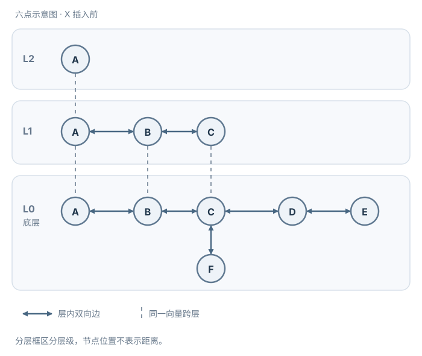
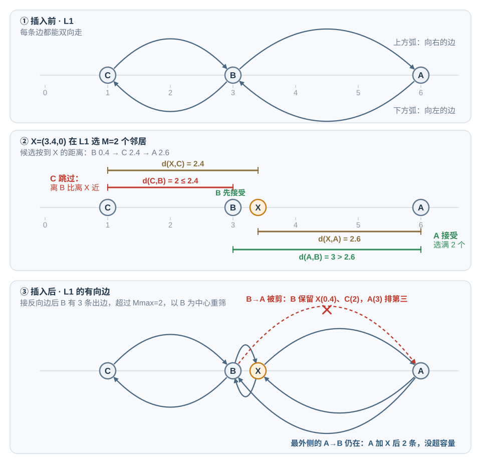

# HNSW 怎样逐层找近邻，怎样知道搜索得够不够？

[RAG 一章](rag-indexing-and-retrieval.md)的稠密检索要从大量向量里快速找出离查询最近的一批，精确比较每一个向量太慢，所以常用近似最近邻（Approximate Nearest Neighbor，ANN）索引。HNSW (Hierarchical Navigable Small World，分层可导航小世界)是其中最常见的一种。本章回答两个问题：HNSW 怎样建图、怎样沿图逐层找到近邻；它返回的结果离真正的最近邻差多少，怎样量出来。

“搜得够不够”要分清两件事。一是搜索何时停：HNSW 的停止条件只说明当前候选里已经没有值得继续扩展的节点，它证明不了图里没有没探索到的捷径。二是结果有多完整：要在同一份数据、同一批查询上跑一次精确搜索作参照，量出 IndexRecall@k。

本章先按原论文的算法，在一个二维六点小图上手算插入和查询。这张图是为展示中间状态构造的，真实数据不会连出同样的边。之后再集中对照 PostgreSQL 向量扩展 pgvector 0.8.7 的实现，它和论文在选邻上限和剪枝选项上不完全相同。

## 先固定向量、距离和图

令查询点 `q=(0,0)`，距离都用欧氏距离。索引里有六个点：

| 点 | 坐标 | 到 q 的距离 | 最高层 |
|---|---:|---:|---:|
| A | (6, 0) | 6 | 2 |
| B | (3, 0) | 3 | 1 |
| C | (1, 0) | 1 | 1 |
| D | (0, 2) | 2 | 0 |
| E | (0, 4) | 4 | 0 |
| F | (0, 0.5) | 0.5 | 0 |

为了便于手算，先假定这张图的初始边都能双向走：第 2 层（L2）只有 A；L1 是 `A—B—C`；L0 是 `A—B—C—D—E`，另有 `C—F`。

图中同名节点是同一个向量出现在不同层；分层框只区分层级，节点在框里的位置不代表距离。最高层为 h 的节点也出现在 h 以下的每一层，但每层的边是各自选出来的。这里 `A—B—C` 在 L1 和 L0 都出现，只是手算的设定，高层的边不一定在底层重现。真实的图由插入顺序、随机层级、候选搜索和邻居筛选共同形成，不一定对称，也不一定每层都是一条链。

## 节点怎样选层、怎样插入

上面的图是直接给定的；真实索引里，图是一个个插入节点长出来的。每个新向量插入时，先随机抽一个最高层：

$$
\ell=\lfloor -\ln(U)\cdot m_L\rfloor,\qquad U\sim\text{Uniform}(0,1).
$$

$m_L$ 是层级衰减参数。单个节点进入第 h 层及以上的概率是 $P(\ell\ge h)=P(U\le e^{-h/m_L})=e^{-h/m_L}$。论文建议的简单取值是 $m_L=1/\ln M$（M 是后面讲的每层邻居数），这时概率变成 $M^{-h}$：含 N 个节点的图，第 h 层的期望节点数是 $N/M^h$，整个图的最高层通常在 $\log_M N$ 附近。例如 M=16 时，一个节点进入 L1 的概率是 1/16，进入 L2 是 1/256；一百万个节点的图，最高层大约在 $\log_{16}10^6\approx 5$。抽层只决定节点出现在哪几层，不代表它在这些层的边已经连好。

插入分四步：

1. **快速下降。** 从当前入口点出发，在高于新节点最高层的各层逐层贪心下降：每一步只移到离新节点更近的邻居。这些层用 `ef=1`，只带一个最近点往下走。
2. **宽搜索收集候选。** 到达新节点所在的最高层后，从这一层往下逐层做较宽的局部搜索，候选集合 W 的大小由 `efConstruction` 控制。上一层的整个 W 都作为下一层的入口，所以能把多个有希望的点一起带到底层。
3. **选邻并接反向边。** 每层从候选中选至多 M 个邻居连给新节点，并把反向边接回这些邻居。
4. **超容量时重筛。** 接上反向边后，只有当某个原节点的连接数超过该层容量时，才围绕它重新筛选邻居。重筛可能剪掉旧边，所以最终的图可能出现 `A→B` 还在、`B→A` 已被删的非对称边。新节点的最高层高于原入口时，入口更新为新节点。

每层的连接容量另有参数：上层记作 `Mmax`，底层记作 `Mmax0`。论文在实验中观察到 `Mmax0=2M` 效果不错，底层容量通常比上层大。

### 手算一次邻居选择与剪边

继续用上面的图，再插入 `X=(3.4,0)`。为了能复算，设定：X 抽到的最高层是 1；当前图最高层是 L2，入口是 A；`efConstruction=4`；每层选 `M=2` 个邻居；上层容量 `Mmax=2`，底层容量 `Mmax0=2M=4`。本例关闭论文中“扩展邻居候选”和“回填被剪候选”两个可选步骤。

**收集候选。** L2 以 `ef=1` 搜索，`W={A}`，A 作为 L1 入口。L1 的宽搜索沿 `A—B—C` 找到 `W={B,C,A}`。这组 W 整个作为 L0 的入口，L0 搜索又发现 F，最终 `W={B,C,A,F}`。各点到 X 的距离是 B 0.4、C 2.4、A 2.6、F 约 3.437；D 约 3.945，比 F 更远，W 满 4 个后没有留下。

**选邻。** 论文 Algorithm 4 的多样化规则不是简单取最近的 M 个：

> [!info] 多样化选邻规则
> 按到新节点 X 的距离从近到远检查每个候选 c。只有当 c 到每个已选邻居 e 都满足 `d(c,e) > d(X,c)`（严格大于）时才接受 c；否则跳过。选满 M 个就停。
>
> 直觉：如果 c 离某个已选邻居比离 X 还近，它和那个邻居大概在同一个方向上，再连一条边帮助不大。

在 L1 上对 `{B,C,A}` 应用这条规则：

| 候选 | 到 X | 与已选邻居比较 | 结果 |
|---|---:|---|---|
| B | 0.4 | 还没有已选邻居 | 接受 |
| C | 2.4 | `d(C,B)=2`，不大于 2.4 | 跳过 |
| A | 2.6 | `d(A,B)=3 > 2.6` | 接受，选满 |

简单取最近两名会选 B、C；多样化规则选了 B、A，放弃了和 B 挤在同一方向的 C。L0 上对 `{B,C,A,F}` 做同样的选择，结果也是 B、A：检查到 F 之前已经选满。这个小例子只展示规则的差别，不证明多样化规则对任何数据都更好。

**接反向边、重筛。** X 连向 B、A 后，B 和 A 各自多出一条指向 X 的边：

| 节点 | 层 | 加 X 后的边数 | 容量 | 是否重筛 |
|---|---|---:|---:|---|
| B | L1 | 3（A、C、X） | 2 | 超了，重筛 |
| A | L1 | 2（B、X） | 2 | 没超 |
| B | L0 | 3（A、C、X） | 4 | 没超 |
| A | L0 | 2（B、X） | 4 | 没超 |

B 在 L1 的重筛以 B 为中心，候选按到 B 的距离排为 X 0.4、C 2、A 3：

| 候选 | 到 B | 与已选邻居比较 | 结果 |
|---|---:|---|---|
| X | 0.4 | 还没有已选邻居 | 保留 |
| C | 2 | `d(C,X)=2.4 > 2` | 保留，选满 |
| A | 3 | 已选满，不再检查 | 剪掉 |

下图按真实横坐标把 L1 上的这次插入画出来。四个点都在 x 轴上，“同一方向”就是同在 X 的一侧：C 躲在 B 后面，A 在另一侧。每条弧是一条出边（一个节点指向谁），上方弧向右、下方弧向左：

插入后 X 指向 A、B；A 指向 B、X；B 指向 X、C；C 仍指向 B。`A→B` 还在，`B→A` 已经没有了：图的结构由每个节点的出邻居列表决定，不要假设边永远双向。

多样化选邻试图让边指向不同方向，保留跨区域导航的机会。它是构图策略，不是正确性证明；连边稀疏、数据分布变化或过滤条件很严时，查询仍可能错过近邻。

## 查询怎样在图上扩展候选

查询从最高层的入口点开始。高层的贪心搜索只记住当前最近的一个节点：邻居比当前点更靠近查询就移过去，直到没有更近的邻居，再下沉一层。上层的目的只是迅速找到一个好的底层起点。

到第 0 层后，搜索维护两个集合：

- **候选队列 C**：按到查询的距离从近到远，取下一个要扩展的节点。
- **结果集合 W**：最多放 `efSearch` 个已发现的最好节点。`efSearch` 是 W 的容量，不是 C 的容量。请求 top-k 时需要 `efSearch ≥ k`。

实现通常用 min-heap (最小堆)维护 C，快速取出最近的待扩展点；用 max-heap (最大堆)维护 W，快速找到该淘汰的最远结果（堆的原理见[不断加入任务时，怎样持续取出最高优先级？](../../engineering-foundations/computation/heaps-and-priority-queues.md)）。另有一个 visited 集合，避免重复检查同一节点。

每轮从 C 取出最近的候选 c：

1. 如果 c 比 W 中最远的点还远，停止。
2. 否则逐个检查 c 还没访问过的邻居 e，标记为已访问。只有当 W 未满，或 e 比 W 中最远的点更近时，才把 e 同时加入 C 和 W；W 超出容量就踢掉最远的一个。不满足条件的邻居只标记访问，不进 C 也不进 W。
3. C 为空时也停止。

被踢出 W 的节点可能还留在 C 里等待扩展。停止只说明当前已发现的边界内没有更好的扩展，既不等于看过了图中所有点，也不能证明找到了全局最近邻。

### 查询队列逐步变化

下面回到插入 X 之前的六点图。上层从 A 出发：L2 停在 A；L1 沿 `A→B→C` 走到 C，所以 L0 从 C 开始。取 `k=efSearch=3`，规定 C 的邻居按 B、D、F 的顺序处理，以便演示“先进入 W、后被挤出”。候选队列写成近点在左，W 写成远点在左：

| 步 | 动作 | 候选队列 C | 结果集合 W |
|---|---|---|---|
| 0 | 从 C 开始 | `[C(1)]` | `[C(1)]` |
| 1 | 扩展 C，依次检查 B(3)、D(2)、F(0.5)：W 未满，先收下 B、D；F 更近，加入并把 B 踢出 W | `[F(0.5), D(2), B(3)]` | `[D(2), C(1), F(0.5)]` |
| 2 | 扩展 F；它的邻居 C 已访问 | `[D(2), B(3)]` | `[D(2), C(1), F(0.5)]` |
| 3 | 扩展 D；E(4) 标记访问，但 W 已满且 E 比最远的 D(2) 更远，不加入 | `[B(3)]` | `[D(2), C(1), F(0.5)]` |
| 4 | 取出 B(3)；它比 W 最远的 D(2) 更远，停止，不扩展 B | `[]` | `[D(2), C(1), F(0.5)]` |

按距离升序返回 F(0.5)、C(1)、D(2)。B 先进过 W，后被 F 挤出，但还留在 C 里；取出它时，它比 W 里最远的 D 还远，于是停止。换一张图，B 的邻居也许能通向还没发现的近点，停止条件只看当前候选的边界。

## IndexRecall@k 怎样量出来

上面的手算恰好找到了真正的前三名，但一般要靠测量才知道。做法是：在同一份调用者可见的数据上穷举算距离，得到精确的前 k 个 $T_k(q)$，再和 HNSW 返回的 $A_k(q)$ 比较。可见对象不少于 k 个时：

$$
\text{IndexRecall@}k(q)=\frac{|A_k(q)\cap T_k(q)|}{k}.
$$

它衡量近似搜索漏掉了多少本该排在前面的向量。几个边界情况要事先约定：

- **距离并列**：精确集合和近似集合都按稳定的唯一 ID 打破平局，保证 top-k 口径一致。
- **可见对象少于 k 个**：设可见对象数为 n，令 $k'=\min(k,n)$，按 $|A_{k'}(q)\cap T_{k'}(q)|/k'$ 算。过滤后 ANN 返回不足 $k'$ 个时，分母仍是 $k'$，缺的结果算漏召回。
- **可见集合为空**（n=0）：召回率没有定义，单独报告“可见集合为空”。

回到本例：不加过滤、k=3 时，精确结果 $T_3=\{F,C,D\}$，`efSearch=3` 的搜索也得到 $\{F,C,D\}$，IndexRecall@3 = 3/3。这只是这张小图上的结果，不说明 `efSearch=3` 一般就够。

IndexRecall@k 只衡量近似结果和精确向量近邻有多一致，不衡量找到的内容对回答有没有用。如果精确搜索本身也找不到人工标注的证据，先查分块、embedding 和距离度量；只有精确搜索的证据召回高、近似结果低时，才去调图和扫描参数。调大 `efSearch` 修不好不合适的向量表示。它和证据 Recall@k 的区别见[回答写好后，怎样逐条核对证据，答错时又怎样找到坏掉的一环？](claim-verification-and-failure-localization.md#离线评估：证据%20Recall@k%20和%20IndexRecall@k%20回答不同的问题)。

## 参数影响哪一段工作

召回不够时，三个参数分别作用在不同阶段：

| 参数 | 作用在哪 | 增大后的常见权衡 |
|---|---|---|
| M（以及容量 `Mmax`/`Mmax0`） | 连边规模：新节点每层选几个邻居，已有节点最多保留几条边。 | 图更密，存储和距离计算更多；召回收益要实测。 |
| `efConstruction` | 构建和插入时收集多少候选再选邻居。 | 建图更慢、插入开销更大；有机会形成更好的导航边，后续召回可能提高。 |
| `efSearch` | 每次查询的底层结果集合 W 的容量；候选队列 C 没有这个硬上限。 | 查询工作和时延增加，通常有机会提高召回；结果仍可能漏掉全局近邻。 |

调参要在固定的数据快照、查询集、过滤条件和可见范围上，同时看召回、95 百分位（P95）时延、内存、索引大小、构建与写入成本，不能只看单次查询。

## 过滤、权限与删除

### 先搜图再过滤，结果会变少

实际查询常带过滤条件，比如只看某个租户的数据。如果在一张共享图上先做近似搜索、再按条件过滤，近似搜索找到的有限候选可能大多不符合条件，过滤后就凑不够数。

把六个点分给两个租户来看：A、C、F 属于蓝租户，B、D、E 属于红租户。查询限定 `tenant_id=red`，取 top-2。精确参照要先把数据限制在红租户可见的范围内再排序：红色的前两名是 D(2)、B(3)，即 $T_2^{red}=\{D,B\}$。下表模拟在可信检索层内部先用共享图搜索、再按租户过滤 W：

| efSearch | 图搜索结果 W（距离升序） | 过滤后 | IndexRecall@2（对红色精确 top-2） |
|---:|---|---|---:|
| 3 | F, C, D | D | 1/2 |
| 4 | F, C, D, B | D, B | 2/2 |

`efSearch=3` 时，W 里三个点有两个是蓝色，过滤后只剩 D。`efSearch=4` 时，W 容得下 B（扩展 C 时 B、D、F 都进了 W，B 不再被挤出），召回恢复。这只是这张小图和这组参数下的观察。

### 权限必须在可信边界内生效

过滤前那些不属于红租户的候选，绝不能离开可信检索边界，不能发给外部重排服务或模型。查询前先确定调用者的授权和可见版本范围；可信的数据访问层要在候选返回应用、或送往外部服务之前完成授权校验。共享索引里过滤后候选不足，会同时影响每个租户的召回和时延；过滤后的结果数、分数或时延，还可能暴露其他租户数据的存在。需要强隔离时，按租户分开分区或索引，数据访问层仍要执行租户授权。

撤销内容权限以权威的 access control list (访问控制列表，ACL)为准：查询前确定权限范围，把候选送给外部重排模型或生成模型之前再确认一次权限和版本。权限一撤销就停止暴露，不等向量索引清理完成。

### 删除要分清撤销可见性和清理空间

删除有两件事：让被删内容立即不可见，以及从索引里回收空间、修复图结构。后者往往是异步的维护操作，可能很耗时。维护完成前，已删除的条目和过滤条件都可能让结果数不足，但可见性必须在删除时就由访问边界保证。敏感数据还要核对服务商的缓存、备份、保留与清除承诺。

### 实例：pgvector 0.8.7 与论文算法的差异

以下按 pgvector 0.8.7 的 README 和源码整理，其他向量库和 pgvector 其他版本可能不同。

| 方面 | 论文算法（本章手算） | pgvector 0.8.7 |
|---|---|---|
| 参数名与默认值 | M、`efConstruction`、`efSearch` | `m`、`ef_construction`、`ef_search`；README 默认 `m=16`、`ef_construction=64`、`ef_search=40`；源码限定范围 2–100、4–1000、1–1000，并要求 `ef_construction ≥ 2*m`。 |
| 新节点每层选几个邻居 | M | 直接用各层的连接上限：上层 `m`，底层 `2m`。 |
| 已有节点的连接容量 | `Mmax`、`Mmax0`（论文建议 `Mmax0=2M`） | 上层 `m`，底层 `2m`。 |
| 被剪候选回填 | 可选，本章手算关闭 | 未选满时回填被剪候选。 |
| 过滤 | 论文不涉及 | 近似索引先扫描候选，再应用 SQL `WHERE`。 |
| 删除 | 论文不涉及 | `DELETE` 产生死元组；HNSW 的 `VACUUM` 清理旧 heap TID (堆表行地址)并修复图。 |

所以本章 `M=2`、不回填的手算用来解释论文机制，不能照搬成 pgvector 的逐步执行结果。

**过滤。** README 举例：条件约命中 10% 的行、`ef_search=40` 时，平均只剩约 4 条符合条件的行（40 × 10%）。缓解办法有几种：过滤值只有少数几个离散值时，可以为每个值建部分索引；类别很多时，可以按过滤字段分区。pgvector 0.8.0 起支持 iterative scans (迭代扫描)，初次近似扫描后继续扫描，直到得到足够的行或达到扫描上限；`strict_order` 保持距离顺序，`relaxed_order` 允许结果略微乱序，换取更好的召回。SQL 条件筛选结果，但单独提供不了强租户隔离。

**删除。** README 提到先 `REINDEX INDEX CONCURRENTLY` 再 `VACUUM` 可以加快这类维护。迭代扫描有时能补足可见结果，但替代不了正确的删除维护。VACUUM 和重建描述的是 pgvector 的实现行为，不是所有 HNSW 服务的删除或擦除保证。

## 怎样做一次可信的质量检查

1. 固定数据、向量模型版本、距离度量、查询文本、过滤条件和 ACL 快照。精确结果和 HNSW 结果必须在同一个可见集合内比较。
2. 先报告 IndexRecall@k 和过滤后的有效结果数，再报告时延、构建时间、索引体积、内存和更新成本。需要足量结果的场景，要单独测过滤后的 IndexRecall@k，不要只报未过滤的结果。
3. 覆盖稀有过滤值、长尾查询、重复向量、刚删除或刚撤权的文档，以及索引重建或版本切换后的查询。抽查结果是否来自当前有效版本。
4. 小幅调整 M、`efConstruction`、`efSearch` 或过滤扫描上限，用同一批查询重测。召回提高的代价可能落在构建、每次查询、内存或过滤选择性上，把这些指标放进同一张结果表再决定。

用途决定错误的代价。检索 CI 手册时漏掉“断言失败”条款，可能给出错误的重跑建议；近重复文本去重则要用相似度阈值加进一步核验来判断重复对，漏检会留下重复，误报会错误合并不同内容。两者不能共用一个 top-k 召回门槛。

## HNSW 只交出候选，版本和权限仍归 RAG 流水线

HNSW 解决的是“从向量图里较快找到一批候选”，并附带一个可测量的近似程度 IndexRecall@k。文档版本是否当前、调用者是否有权查看、段落能否支持答案、引用是否准确，都不归它管。这些检查回到 RAG 流水线：索引召回之前确定权威版本和可见范围，重排和生成之前再核验权限（见[怎样从授权文档里找到回答依据？](rag-indexing-and-retrieval.md)），并把 IndexRecall@k、证据召回和主张支持率分开评估（见[回答写好后，怎样逐条核对证据，答错时又怎样找到坏掉的一环？](claim-verification-and-failure-localization.md)）。生成查询向量的请求还受[怎样让一次模型 API 调用在限额、失败和截止时间内有界？](../runs/bounded-model-api-calls.md)里的配额和截止时间约束。

> [!info]- 来源
> - **分层图、选层、插入、选邻、查询（“节点怎样选层、怎样插入”至“查询怎样在图上扩展候选”）。** Malkov & Yashunin, [“Efficient and robust approximate nearest neighbor search using Hierarchical Navigable Small World graphs,” arXiv v4](https://arxiv.org/pdf/1603.09320v4)，2018-08-14：§3、§4.1 与 Algorithms 1–5。Algorithm 1 是插入时跨层搜索并把上一层候选带往下层；Algorithm 2 是候选队列、结果集合和停止条件；Algorithm 4 是多样化选邻；Algorithm 5 是分层查询；§4.1 的 `mL=1/ln(M)` 与 `Mmax0=2M` 是论文评测中的参数建议，不是所有实现的保证。M=16、一百万节点的层级数字由本章按该公式计算。
> - **pgvector 参数、过滤与迭代扫描、删除维护（“实例：pgvector 0.8.7 与论文算法的差异”）。** pgvector [0.8.7 README：HNSW](https://github.com/pgvector/pgvector/blob/v0.8.7/README.md#hnsw) 与 [Filtering](https://github.com/pgvector/pgvector/blob/v0.8.7/README.md#filtering)，检查于 2026-11-12：默认值、10% / `ef_search=40` 约剩 4 行的示例、部分索引与分区、iterative scans 及其排序选项、`REINDEX INDEX CONCURRENTLY` 后 `VACUUM`。
> - **pgvector 参数范围与连接容量（同上表）。** [hnsw.h 参数范围](https://github.com/pgvector/pgvector/blob/v0.8.7/src/hnsw.h#L53-L62)、[底层与上层连接容量](https://github.com/pgvector/pgvector/blob/v0.8.7/src/hnsw.h#L126-L130)、[建图候选数的组合约束](https://github.com/pgvector/pgvector/blob/v0.8.7/src/hnswbuild.c#L716-L719)。
> - **pgvector 新节点选邻与回填（同上表）。** [新点按层容量选择邻居](https://github.com/pgvector/pgvector/blob/v0.8.7/src/hnswutils.c#L1322-L1357)、[回填被剪候选](https://github.com/pgvector/pgvector/blob/v0.8.7/src/hnswutils.c#L1154-L1156)。
> - **pgvector 删除时的图修复（同上表）。** [hnswvacuum.c 删除维护](https://github.com/pgvector/pgvector/blob/v0.8.7/src/hnswvacuum.c#L779-L794)。
