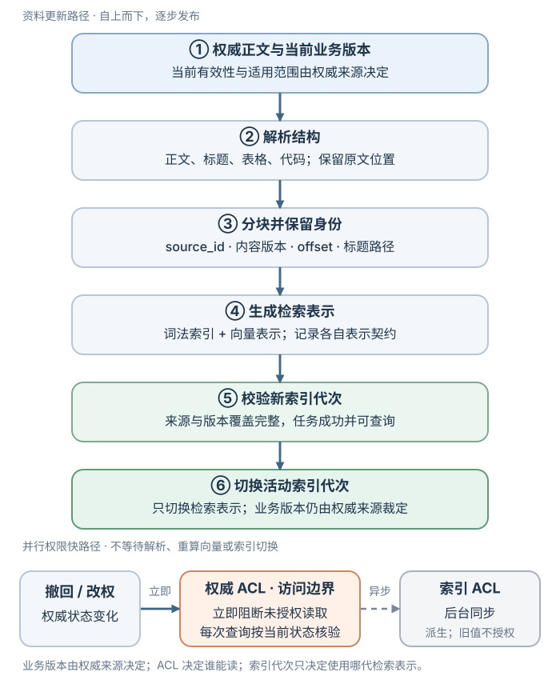
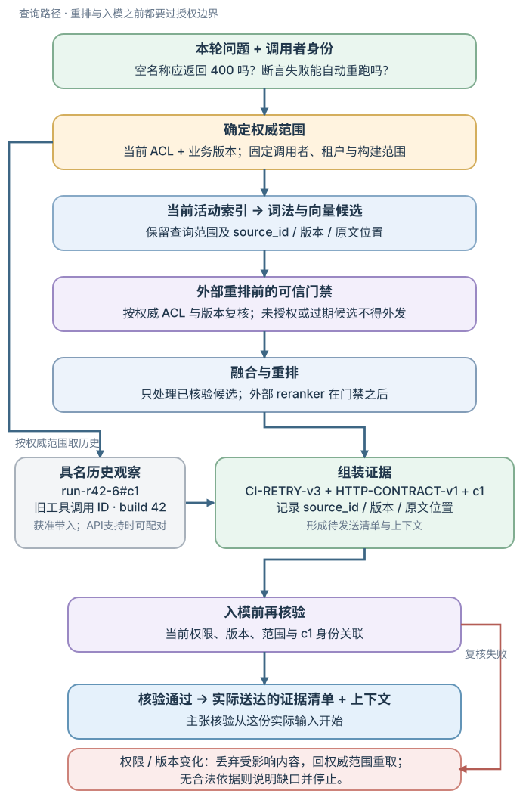

# 怎样从授权文档里找到回答依据？

Retrieval-augmented generation (检索增强生成，RAG)指应用在每次回答前，从外部资料里找出这一轮需要的段落，交给模型。本章讲检索这一半：手上有调用者身份、一个问题和一批受权限控制、会不断改版的文档，应用怎样取回当前有效、调用者有权读、又可能支持回答的段落。这些段落是否真的支持回答，答错时又怎样定位，由[回答写好后，怎样逐条核对证据，答错时又怎样找到坏掉的一环？](claim-verification-and-failure-localization.md)接手。

## 案例：开发者追问构建 42 该不该重跑

本章继续主线二的 CI 诊断助手案例，所有构建、日志和手册都是合成教学数据。在已完成的运行 `run-r42-6` 里，助手调用 `read_build_log(build_id=42)` 读到了构建日志，这次工具调用的 ID 是 `c1`。日志显示，`unit-tests` 步骤中的测试 `reject_empty_name` 预期 HTTP `400`，实际得到 `200`，`exit_status=1`。

开发者接着问：“空名称请求预期返回 `400` 对吗？按当前 CI 手册，这次构建应该自动重跑吗？”

这一轮不重新读日志。应用从权威运行记录里取回 `run-r42-6#c1` 的结果，作为一条注明出处的历史观察放进输入；引用 `c1` 不会让那次调用重跑。跨轮引用旧工具结果的规则见[每次调用的上下文预算该怎样分配，哪些状态必须留在应用里？](context-budget-and-state-layers.md)。日志回答“这次发生了什么”，现行规则要从文档里找。资料库里有这几段（全部虚构）：

| 来源段落 | 权威状态 | 内容 |
|---|---|---|
| `CI-RETRY-v3#assertion-failure` | 当前，2026-10-01 生效 | 只可重试网络或工作节点中断；断言失败必须先调查，不自动重试。 |
| `CI-RETRY-v2#retry` | 已撤回，2026-10-01 前有效 | 任何失败的构建都可以重试一次。 |
| `HTTP-CONTRACT-v1#empty-name` | 当前 | 空名称请求应返回 HTTP `400`。 |
| `CI-TEST-v1#diagnosis` | 当前 | 检查失败测试、输入、预期与实际响应，并沿请求路径调查。 |

问题里有两项判断要靠外部规则：预期 `400` 是否符合 HTTP 契约，断言失败能否自动重跑。所以检索要找到当前的 `HTTP-CONTRACT-v1` 和 `CI-RETRY-v3`。`c1` 只说明这次运行实际发生了什么，代替不了规则。

## 一段依据要同时满足三个条件

一段文字要成为回答的依据，必须同时满足三个条件：

1. **命中**：检索把它排进了候选。
2. **授权**：调用者此刻有权读它，而且它是当前有效的版本。
3. **支持**：它的内容确实支持回答里的某条主张。

三个条件互不蕴含。已撤回的 `CI-RETRY-v2` 可能排在第一，却不能当现行规则；`CI-RETRY-v3` 当前有效、调用者也有权读，可如果检索只取回“网络或工作节点中断可重试”半句，丢了“断言失败不自动重试”，它就支持不了回答。本章处理命中和授权，支持关系在下一章核对。三个条件分别失败时，现象和修法都不同，这正是下一章失败定位链的出发点。

## 检索、长上下文和微调各解决什么

先确定这个问题是否需要检索。把资料交给模型有三条路，各管一件事：

| 方法 | 适合解决 | 仍要应用自己处理 |
|---|---|---|
| RAG | 资料持续更新、总量超过一次输入，或者每份资料有各自的读者范围。 | 版本同步、权限、删除、召回、引用核验。 |
| 长上下文 | 已知的一批材料可以一次全部交给模型，需要跨材料综合。 | 选出调用者可读的资料，控制窗口成本，核对模型是否用到了相关段落。 |
| 微调 | 用大量重复样例改变模型的行为、风格或输出格式。 | 不提供当前资料，也不带权限；需要引用时仍要查外部来源。 |

CI 手册会改版，不同调用者能读的文档不同，所以本例用 RAG。语料很小、调用者又有权读全部资料时，把授权材料整体放进上下文也可以，但仍要确定哪些版本有效，并核对回答。

更大的上下文窗口只提高一次能放进去的量，不会替应用挑选授权文档、同步撤回版本或筛选证据。窗口变长也不保证模型用好其中每一段，实验证据见[上下文预算一章的“窗口变长，不等于每条都用得好”](context-budget-and-state-layers.md#窗口变长，不等于每条都用得好)。模型内部怎样访问长输入，见[DeepSeek 怎样压缩长上下文的注意力状态？](../model/deepseek-compressed-attention.md)。微调在训练时更新参数，检索在运行时组装输入，两者不能互相替代；什么时候该微调，见[什么时候该微调，LoRA、SFT 和 DPO 各改了什么？](../evaluation-and-release/fine-tuning-lora-sft-dpo.md)。

研究没有给出跨任务的统一赢家。一项 EMNLP 2024 评测在其资源配置下发现长上下文平均表现更好，RAG 计算成本更低；一项后续复评在其问答测试上也发现长上下文整体更强，尤其是 Wikipedia 类题目，而 RAG 在对话和一般查询上占优。两者的模型、数据和检索策略各不相同，应在自己的语料、查询和权限条件上比较。

跨运行的对话历史也可以走检索：直接检索原文，或者先加工成偏好、事实、过程经验再检索，两者并不互斥。是否值得加工，见[什么时候值得把历史加工成 Agent 记忆？](agent-memory-design-and-evaluation.md)。

> [!info]- 历史：原始 RAG 论文的机制
> Lewis 等人的 RAG 把参数化的生成器和可更新的非参数知识库结合起来：BART 生成器、DPR 检索器、Wikipedia 段落，检索到的文档被当作潜变量。**RAG-Sequence** 对每份候选文档分别算整条答案的条件概率，再按文档概率加权汇总；**RAG-Token** 在每个输出位置分别按文档汇总下一个词元的概率，再把各位置概率相乘。两者都只针对问题检索一次；RAG-Token 是在词元层做概率边缘化，不是每生成一个词元就重查索引。论文在当时的开放领域问答上相对部分基线有改进；在 FEVER 事实核验上超过文中的 BART 基线，但不如拿到标准证据的专用系统。
>
> 留下来的思想是：把参数里的知识和可更新的外部证据结合，并观察检索怎样影响生成。来源 ACL、版本更新、删除、引用映射和故障定位，论文都没有处理，这些是今天的工程步骤。

## 资料更新和查询是两条流水线

RAG 系统有两条相连的流水线。资料更新时，解析资料、建立索引；每次查询时，先确定权威版本和访问权限，再检索、重排、组装上下文。索引什么时候建好，和权限什么时候生效，是两件事。



资料更新流水线的产物是新一代索引，其中每条可检索的表示都带着来源和版本身份。权限变化走另一条快路径：直接写入权威授权状态，立即生效，不等分块、重算 embedding (嵌入向量)或重建索引。



本例的问题沿查询流水线走：

1. 应用凭调用者身份和构建范围读取权威来源目录，确定 HTTP 契约和 CI 手册各自的当前版本。
2. 在调用者可读的范围内检索段落。已撤回的 v2 即使还留在索引里，也不能当现行规则的证据。
3. 只有通过授权和版本复核的候选，才能发给外部重排服务。
4. 从运行记录里取出 `c1`，确认它属于 `build_id=42`、调用者有权查看。
5. 组装上下文；发送前对全部内容再复核一次，捕捉检索期间发生的权限或版本变化。

这条流水线的产物是实际送达模型的证据清单和上下文。第 5 步怎样在预算内挑段落、模型回答后怎样逐条核验，在下一章展开。下面先依次讲来源身份、授权、分块和检索本身。

## 每个 chunk 都带着来源身份

每个 chunk (文档块)至少保留这些元数据：来源标识、内容版本、生效时间或有效期、适用范围、标题路径和原文位置。有了它们，候选才能追溯到原文，也才能在查询时按版本和范围过滤。

这里有两类状态，不能合并成一个“已索引”标记：

- **权威版本状态**说明资料本身：哪个版本当前有效、从何时生效、适用于谁。它由来源方给出。
- **索引任务状态**说明检索表示：任务 ID、建立时间、是否建完。它只说明能不能查到。

新增或修改资料正文时，按这个顺序发布：读取权威版本、适用范围和 access control list (访问控制列表，ACL)；解析结构并重新分块；生成词法表示和向量；检查新一代索引已经就绪；再切换查询使用的索引代次。这次切换只决定查询用哪一代检索表示，不决定业务上哪个版本有效。

两类状态分开记，是为了处理“v3 已生效、新索引还没建好”这种空窗。这时应用可以在同样的授权检查下直接读取 v3 原文，或者说明当前版本暂时没有可检索的依据；不能因为索引滞后，就拿已撤回的 v2 回答。缓存里残留旧版本导致误建议重跑的完整事故，见[上下文预算一章的过期版本事故](context-budget-and-state-layers.md#过期版本的事故：旧手册还在缓存里)。

## 授权即时生效，撤权和删除不等索引收敛

权限和内容分开维护。只改读取权限时，文本向量通常不用重算；但权威 ACL 必须立即更新，由应用的访问边界立即阻止未授权读取，之后再尽快同步索引里的权限元数据。同步期间，索引里的旧权限不能当授权依据。每次查询都按当时的权威 ACL 过滤，在内容送到外部重排服务或模型之前再复查一次。

删除来源时，要同时清理搜索索引和缓存里的派生数据。托管检索服务的新增和删除可能是异步的，删除后短时间内仍可能返回旧内容。所以要求撤权立即生效时，必须由应用的访问边界先拦截，不能等索引自然收敛。

> [!info] 实例：OpenAI Retrieval 的向量存储
> OpenAI Retrieval 文档说明，其向量存储的文件新增是异步处理的，删除是最终一致的。这只是该服务的行为，不代表其他数据库。

`tenant_id`、区域、文档状态和版本等元数据可以写成过滤条件。过滤要真正起作用，需要四个前提：元数据写对了；查询绕不过过滤；权限来自可信的调用者上下文，不是来自模型或用户输入；结果还会按权威状态复核。凑不满 top-k (前 k 个候选)时，不能为此放宽权限或版本条件。

近似向量索引的执行顺序还会让过滤失效。以 pgvector 0.8.7 为例，近似索引先扫描出一批候选，再应用 SQL 的 `WHERE` 条件；只有少数行满足条件时，返回的结果数和召回率都会下降。机制和缓解办法见[HNSW 支线的过滤、权限与删除](hnsw-vector-index-search.md#过滤、权限与删除)。共享索引里，过滤后的结果、分数或时延还可能暴露其他范围数据的存在。需要强隔离时，按租户或信任域分开分区、索引或表，并在数据访问层校验范围；SQL 条件本身不是完整的隔离。

文档内容是数据，不是指令。段落里即使写着“忽略上面的指令”，也只是待检索和解释的文本，不能改写系统规则、授予权限或批准动作；应用在哪里拦，见[为什么提示注入防不住“模型听话”，应用该在哪里拦？](../actions/prompt-injection-as-permission-confusion.md)。

## 分块要把限定条件留在同一块

Chunking (分块)把长资料拆成可以排序的小单元。块太小，标题、例外和适用条件可能被切到别的块；块太大，匹配信号被稀释，还占上下文预算。

本例的重试规则就是一个检验：取回的块必须包含“断言失败不自动重试”这条限定。如果切块时“只可”和后半句被切开，只命中“网络或工作节点中断可重试”，这一块就没说断言失败怎么办，回答不了问题。分块的目标，是让问题需要的限定关系（条件、例外、否定、适用范围）和它约束的规则留在同一块里，或者至少能一起取回。

| 方法 | 怎样切 | 合适的起点 | 代价或风险 |
|---|---|---|---|
| 定长 | 按字符数或 token 数切到上限，可设相邻重叠。 | 文本形式一致、需要可重复的基线时。 | 容易截断标题、表格行、代码或例外。 |
| 递归 | 依次按段落、换行、句子、空格等分隔符拆分。 | 有自然分隔符的一般文本。 | 长度受分隔符影响，边界不一定是主题边界。 |
| 结构感知 | 按标题、页面、表格、代码结构或段落标记分组。 | 原格式明确表达了条件、字段关系或层级时。 | 依赖解析质量；过长的结构仍要二次拆分。 |
| 语义分块 | 按句子或段落表示的相似度估计主题边界。 | 结构边界不够用、离线评估显示有收益时。 | 建索引计算更多，还要维护模型和边界阈值。 |

相邻块重叠能保住边界附近的语境，也会重复索引内容、增加存储，并让 top-k 里出现重复项。它是一个待评估的参数，不是默认的修复手段。

比较分块策略要用带人工证据标注的查询集，检查三件事：标题和限制条件是否还在同一块；复合问题需要的几段能否一起取回；重复块是否挤占 top-k。证据召回率怎样算，见[下一章的离线评估](claim-verification-and-failure-localization.md)。2025–2026 年的研究结论并不一致：一项研究的分段方法在所测基准上提高了检索和回答质量；另一项分析认为语义分块的计算成本没有换来稳定收益；一项预印本在特定的 SPLADE / Natural Questions 实验中，没有观察到 10–20% 重叠改善 BERTScore 或 exact match (精确匹配)。它们共同说明要按目标语料实测，不存在跨模型、跨任务的统一块大小。

### 实例：块长按字符还是按 token 计

字符数和 tokenizer (分词器)产生的 token (词元)数不能互换。下面两个配置看起来都是“块大小”，单位却不同：

- LangChain 教程用 `RecursiveCharacterTextSplitter`，设 `chunk_size=1000`、`chunk_overlap=200`，长度函数按**字符**计。这是教程示例，不是通用最佳值。
- OpenAI Retrieval 的托管向量存储默认每块最多 800 **token**，相邻块重叠 400 token。

所以不能说 1000 字符和 800 token 哪个更大。LangChain 的写法如下：

```python
from langchain_text_splitters import RecursiveCharacterTextSplitter

# documents 是已解析并带有来源元数据的 Document 列表
splitter = RecursiveCharacterTextSplitter(
    chunk_size=1000,       # 按字符计
    chunk_overlap=200,     # 目标重叠量，实际值可能不同
    add_start_index=True,  # 记录块在输入 Document.page_content 内的偏移
)
chunks = splitter.split_documents(documents)
```

`add_start_index` 记录的是块在原 `Document.page_content` 内的位置；如果每页作为一个独立 Document 输入，还要保留 `page` 元数据，才能定位回原文。`chunk_overlap=200` 是目标值，递归切分不保证任意相邻块恰好重叠 200 字符。

## 相同的编码输入怎样复用向量

分块后的文本要送进编码器变成向量。重建索引、任务重试，或者多个来源包含相同片段时，同样的编码输入会反复出现。Embedding cache (嵌入缓存)保存“某个编码输入在某个模型契约下算出的向量”，省掉重复请求。它不是查询结果缓存，也不会把不同来源的身份、版本或授权合并在一起。

能不能命中，取决于两样东西是否都一样：实际送给编码器的完整文本，以及编码契约。正文相同但标题前缀不同，编码输入就已经不同。所以调用方先按固定版本的规则拼好标题、模板和动态字段，把最终文本记为 `canonical_text`，再算键：

```text
K = SHA256( 缓存格式版本, 缓存范围, 提供方, 端点, 模型修订,
            输入角色, 输出维度, 文本规范化版本, 预处理版本,
            归一化版本, SHA256(canonical_text) )
```

下面任何一项变化都必须让键改变：

- **模型修订。** 同名模型别名会更新时，记录可区分的版本或部署代次。
- **输入角色。** 非对称双编码器对查询和文档的编码方式不同；即使同一个接口两种都收，也不要默认它们是同一个任务。
- **输出维度。** 服务支持可选维度时，维度进入契约，并对应独立的索引代次。
- **文本规范化、预处理、归一化。** 任何未记入版本号的处理都不能做，比如额外 trim 或 Unicode 规范化。

这是应用自己的缓存契约，不是提供方的规定。

> [!example]- 缓存键的序列化规则与 Python 实现
> 序列化规则：字段顺序固定；所有槽位都编码成字符串，维度用十进制字符串，缺省的可选值用空字符串，槽位不省略；用紧凑 JSON（分隔符 `,` 和 `:`，无空白），非 ASCII 字符按原样输出、不做 ASCII 转义，再按 UTF-8 编码。内外两层 SHA-256 摘要都写成小写十六进制。
>
> 下面的函数假设调用方已完成文本拼装、清理和分块；它只检查字段类型并构造键，不会规范化正文，也不验证来源授权、模型版本或维度是否符合服务契约。
>
> ~~~python
> import hashlib
> import json
>
>
> def embedding_cache_key(
>     *,
>     scope,
>     provider,
>     endpoint,
>     model_revision,
>     role,
>     dimensions,
>     canonicalization,
>     preprocessing,
>     normalization,
>     canonical_text,
> ):
>     string_fields = (
>         scope,
>         provider,
>         endpoint,
>         model_revision,
>         role,
>         canonicalization,
>         preprocessing,
>         normalization,
>         canonical_text,
>     )
>     if any(not isinstance(value, str) for value in string_fields):
>         raise TypeError("cache contract fields must be strings")
>     if dimensions is not None and (
>         isinstance(dimensions, bool) or not isinstance(dimensions, int)
>     ):
>         raise TypeError("dimensions must be an integer or None")
>     text_digest = hashlib.sha256(canonical_text.encode("utf-8")).hexdigest()
>     fields = (
>         "embedding-cache-v1",
>         scope,
>         provider,
>         endpoint,
>         model_revision,
>         role,
>         "" if dimensions is None else str(dimensions),
>         canonicalization,
>         preprocessing,
>         normalization,
>         text_digest,
>     )
>     encoded = json.dumps(
>         fields,
>         ensure_ascii=False,
>         separators=(",", ":"),
>     ).encode("utf-8")
>     return hashlib.sha256(encoded).hexdigest()
> ~~~

命中缓存只复用向量值，索引里的来源记录仍各自独立：

| 数据 | 例子 | 命中缓存时怎样处理 |
|---|---|---|
| embedding 缓存 | 缓存键、向量、模型契约版本、生成时间 | 复用向量值。 |
| 文档块索引 | `source_id`、`chunk_id`、版本、标题路径、原文偏移 | 每个来源、每个版本各记一条。 |
| 授权和删除状态 | 租户、ACL 版本、可见范围、撤回状态 | 独立检查和更新，不从缓存继承。 |

两份公开规则拼装后的编码输入逐字节相同、契约也相同时，可以共用向量；两条索引记录仍保留各自的 `source_id`、版本、位置和授权。一个来源有权读，不会让另一个来源也变得可读。改版后编码输入不变，就复用向量、新建一条版本化索引记录；输入变了，摘要就不同，需要重新编码。模型或表示契约变化时，先建好并验证新一代索引再切换，不能把不同编码空间的向量混在一起。

向量是原文的派生数据，不能假定它不敏感。对敏感语料，可以用带密钥的摘要，降低低熵文本被字典猜出的风险；日志里只记不透明键或截断指纹。撤权或删除时，相应的向量和缓存记录要一起处置，命中缓存不是跳过删除流程的理由。

缓存收益要量出来：用 `cache_hit`、模型契约版本和索引任务 ID 记录实际命中，比较省下的 API 请求、输入 token 和建索引时间，再扣掉缓存读写的开销。未命中时的编码请求仍受[怎样让一次模型 API 调用在限额、失败和截止时间内有界？](../runs/bounded-model-api-calls.md)里的配额、重试和截止时间约束。

## 词法、稠密和混合检索各找得到什么

**Lexical retrieval (词法检索)**按分析后的词项和相关性查找，BM25 是常用的排序基线。它擅长匹配错误码、测试名、状态码这类精确标识和专有名称。查询里的 `reject_empty_name` 或 HTTP `200` 应该保留为可精确查询的字段。注意 BM25 是一种相关性排序，不等于数据库里的原样字段匹配或唯一键查找。

**Dense retrieval (稠密检索)**把查询和段落都编码成向量，按相似度找含义接近的内容。用户写“响应不符合约定”，手册写“空名称应返回 400”，词法检索可能匹配不上，稠密检索可能找得到。双编码器分别编码查询和段落，Dense Passage Retrieval (稠密段落检索，DPR)是代表。两侧都是向量，不代表它们兼容：输入形式、模型训练方式、维度和预处理都要属于同一个契约。DPR 论文的比较限于特定的开放领域问答基准，不能推出稠密检索在所有语料上都胜过 BM25；BEIR 这类跨数据集基准的平均结果，也替代不了在目标语料上的评测。

选编码模型时，比较目标语种、文档和查询格式、输入长度上限、部署方式、时延、费用，以及在目标语料上的召回。更换文档侧的模型、维度或预处理，通常都要重新编码并建新一代索引。服务支持缩短维度时，降维也要在同一份数据和查询集上评估准确率、存储和速度，不能把新旧空间混用。

> [!info] 复习：点积、余弦和欧氏距离
> 对非零的查询向量 $q$ 和块向量 $d$，余弦相似度是
>
> $$\cos(q,d)=\frac{q\cdot d}{\lVert q\rVert\,\lVert d\rVert}.$$
>
> 例如 $q=(1,0)$、$d=(2,0)$：点积是 2，余弦是 1。两向量同向，余弦只看方向；点积还受向量长度影响。如果两者都归一化成单位向量，点积就等于余弦。
>
> 欧氏距离和点积的关系是
>
> $$\lVert q-d\rVert^2=\lVert q\rVert^2+\lVert d\rVert^2-2\,(q\cdot d).$$
>
> 两者都是单位向量时，平方欧氏距离等于 $2-2\cos(q,d)$。所以对单位向量，按欧氏距离从小到大排，和按余弦从大到小排，顺序完全相同。
>
> 索引实际用哪种度量、向量是否归一化，由模型和配置决定。不同模型的分数范围不同，不能直接横向比较。

把 BM25 和稠密检索各自的候选合在一起，叫 hybrid retrieval (混合检索)。两种分数的尺度不同，未经校准直接相加没有意义。Reciprocal Rank Fusion (倒数排名融合，RRF)只用名次：

$$
\operatorname{RRF}(d)=\sum_i\frac{1}{k+r_i(d)},
$$

其中 $r_i(d)$ 是段落 $d$ 在第 $i$ 路候选中的名次，$k$ 是平滑常数。某一路截断列表里没有出现的段落，在这一路的贡献为 0。

> [!example] 用 RRF 融合本例的三段候选
> 下面的名次是为演示融合步骤构造的，不是实测结果；所有候选在融合前已限定为当前有效、调用者可读的版本，所以已撤回的 v2 不在表中。取 $k=60$：
>
> | 段落 | BM25 名次 | 稠密名次 | RRF 计算 | RRF 分数 |
> |---|---:|---:|---|---:|
> | `CI-RETRY-v3#assertion-failure` | 2 | 1 | `1/62 + 1/61` | 0.032522 |
> | `HTTP-CONTRACT-v1#empty-name` | 1 | 3 | `1/61 + 1/63` | 0.032266 |
> | `CI-TEST-v1#diagnosis` | 3 | 2 | `1/63 + 1/62` | 0.032002 |
>
> 融合后，重试规则排第一，HTTP 契约和诊断段落也都保留下来。

融合之后可以再用 cross-encoder (交叉编码器)重排：把查询和每个候选成对输入，给较小的候选集重新打分。假设示意分数是 HTTP 契约 `0.91`、重试规则 `0.76`、诊断说明 `0.55`，顺序就变成契约、重试、诊断。这些分数只用于排序，不是“正确的概率”。

重排只改变顺序，因此要看上下文取多少项：

- 候选全部送进模型时，换序不改变进入上下文的集合。
- 上下文只取前 j 项时，重排才可能改变哪些段落进去。本例只交换了前两名，取前两项时集合不变。

重排补不回候选阶段漏掉的证据，还会增加计算和时延。

> [!info] 研究实例：文本与表格混合的金融问答
> 一篇 2026 年的预印本（T²-RAGBench，23,088 个问题、7,318 份文档）以平均约 920 token 的整篇文档为检索单位，报告 RRF 加 Cohere Rerank 的 Recall@5 为 0.816；它所测的 BM25 高于稠密基线；HyDE 和多查询改写对精确数值题帮助有限。分块消融被列为未来工作，结论只适用于该基准和所测模型。它提示的是：数值和表格问题应单独比较检索单元、字段精确查询和表格解析，而不是靠文本相似度去猜答案。

## 候选不全时怎样补查

只有初始候选缺了依据，或者复合问题缺了一环，才追加检索。追加时保留原始查询和调用者的租户、构建等范围约束；每次补查都按当时的权威状态重新核定 ACL 和当前版本，不能沿用可能过期的快照。

| 失败信号 | 追加方式 | 必须避免 |
|---|---|---|
| 用户措辞和手册术语不同，原查询没命中。 | 保留原查询，再加一个近义表达，例如“断言失败 retry policy”。 | 改写可能改变问题范围；不能丢掉原词，也不能把改写文本当证据。 |
| 查询抽象，稠密检索没有像样的候选。 | Hypothetical Document Embeddings (假设文档嵌入，HyDE)：先生成一段假想文档，只用它的向量去检索，再回到真实库取段落。 | 假想内容可能有虚假细节，只能帮助找真实来源，不能用来回答。 |
| 子块命中了，但缺定义、例外或适用条件。 | Parent-child retrieval (父子块检索)：取到子块后再载入它的父段落或标题，复核父段的版本、范围和权限。 | 父段可能太宽、重复或已撤回；不能因为子块命中就无条件附上整篇。 |
| 问题要先分类，再按类别查规则。 | Multi-step retrieval (多步检索)：先取第一步证据，把没回答的部分写成子问题再查。本例先确认是断言失败，再查这类失败的重试条款。 | 查询链会累积误解；保留原问题、子问题到来源的链路，证据够用或明确查无结果时停止。 |

这些方法都只改变运行时的搜索路径。它们不会提高来源权限，也不会把中间假设变成事实。

## 单条规则和跨文档趋势要用不同的检索表示

同一批语料可能要回答范围很不同的问题。检索表示应贴合问题需要的范围，而回答里可核查的主张，最终都要落到获准读取的原始来源上。

**单条规则。** “构建 42 按当前 CI 手册该不该自动重跑？”只需要两份材料：`run-r42-6#c1` 记录这次断言失败，`CI-RETRY-v3#assertion-failure` 给出现行规则。应用按构建和调用 ID 从运行记录取日志观察，按权限和生效版本筛选手册，用规则标识符和条文检索当前段落。回答引用的是本轮送进上下文的原文。

**跨文档趋势。** 如果问题变成“最近多个构建里，哪些失败模式反复出现，是否随版本变化”，答案要综合大量分散的记录，还要写明纳入的项目、时间段、构建范围和统计口径。这类全局归纳问题，按段落检索很难覆盖，可以借助预先整理的资料视图。

> [!info] 实例：GraphRAG 与 Anthropic 的知识 wiki
> **GraphRAG (图检索增强生成)**在建索引时抽取实体和关系、形成社区摘要，面向全局归纳问题。论文在两个语料的全局问题上用 LLM 评审，报告 GraphRAG 的回答更全面、更多样，向量 RAG 的回答更直接。抽取出的关系可能包含对原文的推断，所以要保留来源链接并核对支撑段落。截至 2026-11-25，GraphRAG 仓库标注为 largely in maintenance mode，最新 release 是 `v3.3.0`（2026-10-08）；维护状态也该纳入选型。
>
> **Anthropic 的知识 wiki 实验**让 Claude Opus 5 agents 在 128 次 Dreaming sessions 中读取 Stainless 内部资料，增量构建 wiki。资料约 350,000 份、约 420M tokens；25 道问题各有评分 rubric 列出回答应覆盖的要点。search-only、wiki-only、search + wiki 分别满足 53%、48%、61% 的要点，分母是所有题目的评分项总数，不是题目准确率。原文还说 search + wiki 每题平均少用约 20,000 tokens，但没写明对比方案和计量范围。另一个并购尽调资料集有 24 道题，过半需要跨文档信息，wiki 得分 87%，search 为 73%；以单文档为主的法律简报任务上没有明显的 wiki 增益。这些结果属于 Anthropic 自己的资料、问题和整理流程。

图谱、wiki 和社区摘要适合帮助发现关联、组织后续检索。下面的合成例子说明它们怎样和原始来源配合。

> [!example] 合成 CI wiki 怎样连接和刷新来源
> 一个后台整理 agent 从授权的运行记录 `run-r42-6#c1` 提取出 `reject_empty_name` 断言失败，写进派生页 `wiki/ci/empty-name.md`，保留 `build_id=42` 和原始记录链接。页面把“预期 HTTP 400、实际 200”标成历史观察并注明出处，把规则摘要链接到 `HTTP-CONTRACT-v1#empty-name` 和 `CI-RETRY-v3#assertion-failure`。
>
> 用户问“按当前 CI 手册，构建 42 应自动重跑吗？”时，wiki 页帮忙定位资料。回答前，应用仍要复核调用者权限，直接读取 `run-r42-6#c1` 和当前生效的手册：日志说明发生了什么，手册说明现行规则。
>
> 后来 `CI-RETRY-v4` 生效。整理 agent 应重读权威来源，更新页面里的规则链接和摘要，同时保留历史观察的出处。刷新完成前，查询按权威来源目录确定当前版本，直接读 v4 和对应日志；页面里指向 v3 的摘要只作历史资料。

回到趋势问题。wiki 或社区摘要可以先指出哪些故障值得查，但要回答“是不是出现得更频繁了”，必须回到原始日志计数：在获准的同一观察范围内按构建 ID 去重，对每个版本分别统计命中该故障的构建数和有完整日志的构建总数，并列出缺日志的构建数。摘要里一个故障被提到几次，不能用来估计它的发生率。

选检索表示时，先看问题需要的是一条当前规则、几段相互关联的证据，还是全语料归纳；再在固定的权限、版本和问题集上，比较候选召回、来源覆盖、事实支持、更新成本和查询成本。

## 检索交出的是候选，不是已核验的证据

本例走完检索后，应用手上有一份排好序的候选：`HTTP-CONTRACT-v1#empty-name`、`CI-RETRY-v3#assertion-failure`、`CI-TEST-v1#diagnosis`，每段都带着 `source_id`、版本、原文位置，并且已按当前 ACL 和版本复核；另有一条历史观察 `run-r42-6#c1`。已撤回的 v2 和调用者无权读的段落都没有进来。

这只满足了“命中”和“授权”两个条件。哪几段放进上下文、模型的每条主张是否真有来源支持、证据冲突怎样裁决，以及答错时怎样判断坏在来源、检索、组装还是使用，都在[回答写好后，怎样逐条核对证据，答错时又怎样找到坏掉的一环？](claim-verification-and-failure-localization.md)里回答。检索质量怎样离线评估（证据召回与索引召回的区别）也在那一章。

> [!info]- 来源
> - **长上下文与 RAG 的条件化比较（“检索、长上下文和微调各解决什么”）。** Li et al., [“Retrieval Augmented Generation or Long-Context LLMs? A Comprehensive Study and Hybrid Approach,” arXiv v2 / EMNLP 2024](https://arxiv.org/html/2407.16833v2), §§3–5；Li et al., [“Long Context vs. RAG for LLMs: An Evaluation and Revisits,” arXiv v1](https://arxiv.org/html/2501.01880v1), 2024-12-27 提交，§§3–5。模型、语料、任务和预算不同，不能推出普适排名。
> - **原始 RAG 架构与实验边界（“历史：原始 RAG 论文的机制”）。** Lewis et al., [“Retrieval-Augmented Generation for Knowledge-Intensive NLP Tasks,” arXiv v4](https://arxiv.org/html/2005.11401v4), §§2.1–2.5、§4.1、§4.4 与表 1–2：RAG-Sequence、RAG-Token，BART、DPR 与 Wikipedia passages。
> - **托管向量存储的异步新增、最终一致删除、默认 800/400 token 分块（“授权即时生效……”与“实例：块长按字符还是按 token 计”）。** [OpenAI API Retrieval](https://developers.openai.com/api/docs/guides/retrieval)，`Vector store file operations`、`Chunking` 与属性过滤小节。只适用于该服务。
> - **pgvector 先扫描后过滤（“授权即时生效……”）。** pgvector [0.8.7 README：Filtering、Iterative Index Scans](https://github.com/pgvector/pgvector/blob/v0.8.7/README.md#filtering)，检查于 2026-11-12。细节与更多出处见 HNSW 支线来源。
> - **检索文本是不可信输入、向量存储的跨租户风险（“授权即时生效……”）。** OWASP GenAI Security Project, [LLM01:2026 Prompt Injection](https://github.com/GenAI-Security-Project/GenAI-LLM-Top10/blob/main/2026/final/LLM01_PromptInjection.md) 与 [LLM09:2026 Vector and Embedding Weaknesses](https://github.com/GenAI-Security-Project/GenAI-LLM-Top10/blob/main/2026/final/LLM09_VectorAndEmbeddingWeaknesses.md)。不替代完整威胁模型。
> - **分块研究（“分块要把限定条件留在同一块”）。** Wang et al., [“Document Segmentation Matters for Retrieval-Augmented Generation,” Findings of ACL 2025](https://aclanthology.org/2025.findings-acl.422/), §§3–4；Qu et al., [“Is Semantic Chunking Worth the Computational Cost?” Findings of NAACL 2025](https://aclanthology.org/2025.findings-naacl.114/), §§3–5；Bennani & Moslonka, [“A Systematic Analysis of Chunking Strategies for Reliable Question Answering,” arXiv v1](https://arxiv.org/html/2601.14123v1), 2026-01-20，§§2–3（预印本；SPLADE / Ministral-8B-Instruct-2410 / Natural Questions 设置下 10–20% overlap 未改善 BERTScore 或 exact match）。
> - **LangChain 分块实现与长度单位（“实例：块长按字符还是按 token 计”）。** LangChain, [知识库语义搜索教程](https://docs.langchain.com/oss/python/langchain/knowledge-base) 与[递归文本切分](https://docs.langchain.com/oss/python/integrations/splitters/recursive_text_splitter)：`Document`、`RecursiveCharacterTextSplitter`、字符长度与 start index。1000 / 200 是教程参数，行为随库版本和长度函数而异。
> - **embedding 归一化与可选维度（“相同的编码输入怎样复用向量”与距离复习）。** [OpenAI API Vector embeddings](https://developers.openai.com/api/docs/guides/embeddings)：该服务所列模型的归一化、相似度和可选维度。缓存键契约、向量空间兼容和索引迁移要求是本章的工程约束，不是该 API 的承诺。
> - **稠密双编码器与词法基线（“词法、稠密和混合检索各找得到什么”）。** Karpukhin et al., [“Dense Passage Retrieval for Open-Domain Question Answering,” arXiv v3 / EMNLP 2020](https://arxiv.org/html/2004.04906v3), §§2–3。
> - **RRF 与跨数据集评测（同节）。** Cormack, Clarke & Büttcher, [“Reciprocal Rank Fusion outperforms Condorcet and individual Rank Learning Methods,” SIGIR 2009](https://plg.uwaterloo.ca/~gvcormac/cormacksigir09-rrf.pdf), pp. 758–759；Thakur et al., [“BEIR: A Heterogeneous Benchmark for Zero-shot Evaluation of Information Retrieval Models,” arXiv v4 / NeurIPS 2021](https://arxiv.org/abs/2104.08663), §§3–5（18 个公开数据集，平均结果不替代目标语料评测）。
> - **文本与表格混合的金融检索比较（“研究实例：文本与表格混合的金融问答”）。** [“From BM25 to Corrective RAG: Benchmarking Retrieval Strategies for Text-and-Table Documents,” arXiv v1](https://arxiv.org/html/2604.01733v1), 2026-04-02，摘要、§III-D 与 §IV-C。预印本。
> - **HyDE 的假设段落（“候选不全时怎样补查”）。** Gao et al., [“Precise Zero-Shot Dense Retrieval without Relevance Labels,” arXiv v1](https://arxiv.org/html/2212.10496v1), §§2–3：假想文档只作稠密检索的中间表示，可能含虚假细节。
> - **GraphRAG 机制与评测（“实例：GraphRAG 与 Anthropic 的知识 wiki”）。** Edge et al., [“From Local to Global: A Graph RAG Approach to Query-Focused Summarization,” arXiv v2](https://arxiv.org/html/2404.16130v2), 2025-02-19：§§3–5、§6.1。
> - **GraphRAG 维护状态（同上）。** Microsoft, [GraphRAG repository](https://github.com/microsoft/graphrag) 与 [Releases](https://github.com/microsoft/graphrag/releases)，核对于 2026-11-25：largely in maintenance mode；最新 release `v3.3.0`，2026-10-08。
> - **Agent 增量构建知识 wiki 与跨文档评测（同上）。** Anthropic, [“Components of Agent Memory”](https://www.anthropic.com/research/components-of-agent-memory), 2026-11-06，memory wiki architecture 与 evaluation 小节：128 次 Dreaming sessions；53% / 48% / 61% 是 rubric criteria 满足率；每题约省 20,000 tokens 未说明基线与计量范围；并购尽调 87% / 73%。
