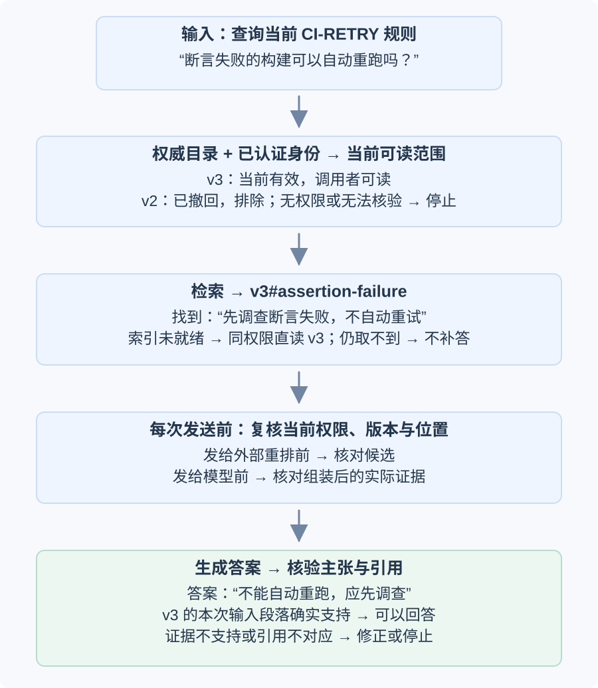

# 拿到一道 AI 系统设计题，怎样从风险推导出架构？

三类系统都用到语言模型，典型风险却完全不同：文档问答可能泄露用户无权访问的文件；退款助手可能重复执行资金写入；代码审查助手可能用大量误报耗尽工程师的信任。决定架构的不是“用了模型”，而是失败代价、可信数据的边界、外部副作用和可验证的用户结果。

读者手上已有五条主线的机制：模型调用的代价、上下文与证据、动作放行、运行恢复、验收与发布。本章拿这三道题演示怎样把它们组合起来：从一道设计题出发，推到检索、执行和发布各自该怎样设计。三个案例互相独立，案例里的吞吐、时延和评测数字都是设计假设，实际方案要用有代表性的评估和生产 trace 校正。

## 推导顺序：从用户要的结果到发布证据

每道题都按同样四个问题推：

1. **用户要什么结果？** 决定任务契约和“成功”怎样判定。
2. **哪些事实必须可信？** 决定证据从哪里来、谁维护权威版本。
3. **谁有权改变状态？** 决定授权检查放在哪里、模型能提出什么、应用放行什么。
4. **凭什么证据发布？** 决定验收集、硬门禁和上线模式。

三道题在四个问题上的答案不同，架构也就不同：

| | 文档问答 | 退款 | 代码审查 |
|---|---|---|---|
| 用户要的结果 | 有出处的规则答案 | 一笔正确、只发生一次的退款 | 能定位、有证据的审查意见 |
| 必须可信的事实 | 当前有效、调用者可读的文档版本 | 客户身份、订单、政策资格、提供方的退款状态 | 固定版本的 diff 与相关代码契约 |
| 谁改变状态 | 只读，不改变外部状态 | 应用执行受限的资金写入 | 人决定是否发布意见 |
| 主要风险 | 越权泄露、用旧版本补答 | 重复扣款、把未知写成失败 | 误报淹没真问题 |
| 适合的控制流 | 检索服务 + 生成 + 核验 | 固定工作流 | 固定流水线产出草稿 |

用 agent 主循环、固定工作流还是检索服务，应当由这些差异决定；区分的标准是谁在运行时决定控制流，见[什么时候该让模型决定下一步](../actions/when-the-model-decides.md)。

## 文档问答：权限必须在证据交给模型之前生效

### 请求要从哪里取得答案

> [!example] 案例：查询当前 CI 重跑规则
> 员工问：“按当前 `CI-RETRY` 规则，断言失败的构建可以自动重跑吗？”这是规则查询，不要求系统执行重跑。手册沿用 CI 诊断助手的虚构手册：`CI-RETRY-v3#assertion-failure` 当前有效，规定断言失败须先调查、不能自动重跑；旧版 `CI-RETRY-v2` 已撤回，曾写“任何失败都可重跑”。身份层已确认调用者是谁，应用仍要检查此人现在能否读这份手册。

语料已经预先索引，但“已索引”和“当前有效且获授权”是两套状态。文档源维护版本、生效时间、删除状态和读取权限；索引流程保留来源 ID、版本、段落位置、更新时间和处理状态，供查询准确找回原段落。索引更新滞后时，不能拿旧版本填补一个看似完整的答案。

这两套状态怎样分开维护、ACL 怎样即时生效，见[RAG 索引与检索](../context/rag-indexing-and-retrieval.md)。

### 授权在哪几个时点检查

授权不是检索开始时查一次就够了。证据每离开一次应用边界之前，都要按当前权威状态再核一次：

| 时点 | 检查什么 | 失败时 |
|---|---|---|
| 检索之前 | 用可信身份和权威来源目录算出允许的来源、版本与范围，只在其中找候选 | 身份无效或权限服务超时就停止，不让模型猜权限 |
| 索引未就绪时 | `v2` 即使还在索引里也不是可用证据；`v3` 没索引完时，可在同一授权边界下直读 `v3` | 仍取不到就说明暂时给不出有依据的回答，不用旧片段补答 |
| 发给外部重排服务之前 | 核对候选的当前权限和版本 | 剔除不合格候选。重排只决定顺序，不能让 `v2` 或无权读取的片段变合法 |
| 发给模型之前 | 核对组装后实际要发送的全部证据，处理检索期间发生的权限变化 | 剔除或停止；不能只检查最初的查询条件 |
| 命中缓存时 | 复核当前权限 | 按未命中处理 |
| 发布回答之前（按产品要求） | 若产品要求生成期间发生的撤权也对本次回复生效，再核一次 | 不发布，重新组装或停止 |

删除和撤权先由应用的访问边界执行，索引和缓存副本随后清理。托管检索也未必即时删除：OpenAI Retrieval 文档说明，从向量存储移除文件后，短时间内仍可能命中旧内容。所以“索引里查不到”不能当作删除已生效的依据，反之亦然。

文档里的指令文字只是待解释的数据，不能授予工具权限，见[提示注入为什么是权限混淆](../actions/prompt-injection-as-permission-confusion.md)。

### 检索方法要匹配问题形态

这个场景的问题既有自然语言表述，也有精确的规则编号：

- 自然语言问法可以比较 dense retrieval (稠密检索)。
- 精确的政策编号需要保留可精确查找的字段，并和 lexical retrieval (词法检索) 基线比较。BM25 的词项相关性不等于编号字段的精确相等。
- hybrid retrieval (混合检索) 结合两类候选，但是否值得多出的索引、重排和维护成本，要在同一组问题上比较召回、排序、时延和费用。

### 每条主张都要指回本次输入的证据

本例最后要形成一条可检查的支持关系：

| 实际输入的证据 | 回答中的主张 | 检查与结果 |
|---|---|---|
| 当前且可见的 `v3#assertion-failure`：“断言失败须先调查，不自动重跑” | “按当前规则不能自动重跑，应先调查断言失败” | 引用指向本次输入的同一段落，段落支持主张，可以回答 |
| 只有旧 `v2`，或 `v3` 读取失败 | 建立不了当前规则的结论 | 不用旧片段补答；说明证据不足或升级 |
| 取到了 `v3`，答案却写成“所有失败都可重跑” | 与证据相反 | 核验不通过，纠正或停止；附了引用也不放行 |

两份同为当前、都有权读取的来源互相冲突时，指出冲突，停止给确定结论或升级核对，不能只挑一个高分片段掩盖矛盾。模型调用超时也属于本次请求未完成：返回明确的失败或恢复入口，不把没生成的结论当答案。

这个回答只说明规则要求什么，不判断某次真实构建属于哪类失败。要判断 build 42 是不是断言失败，还得另取有权读取的构建日志，区分“日志记录了什么”和“手册要求什么”。主张核验的两步和答错时的失败定位链，见[主张核验与失败定位](../context/claim-verification-and-failure-localization.md)。

### 4 秒 p95 与 6 QPS 怎样分到各阶段

证据链定下来后，再看容量和时延撑不撑得住。假设团队要求高峰 6 个查询/秒、端到端 p95 不超过 4 秒；允许用托管模型 API，但没有专门资源运营 GPU 推理。

> [!example] 把 4 秒拆成各阶段预算
> 下表是给压测用的预算分配，不是测量结果，也不是各阶段的 p95：
>
> | 阶段 | 预算 |
> |---|---:|
> | 身份认证与请求建立 | 0.2 秒 |
> | 权限感知检索 | 0.6 秒 |
> | 模型生成 | 2.5 秒 |
> | 引用与结构核验、响应处理 | 0.2 秒 |
> | 网络与队列预留 | 0.5 秒 |
> | 合计 | 4.0 秒 |
>
> 预算可以相加，测出来的各阶段 p95 却不能相加成端到端 p95（见[指标分母与分位数](../evaluation-and-release/production-traces-and-metric-denominators.md)）。端到端 p95 要用联合负载测试测完整链路。请求里常有很长的文档或突发流量时，队列和生成的尾部时延会让这份预算失效。

预算之外，还要估模型阶段同时有多少请求在途。

> [!info] Little's Law（利特尔定律）
> 在稳定系统里，长期平均的在途数 $L$ 等于平均到达率 $\lambda$ 乘以平均停留时间 $W$：$L = \lambda W$。比如一家店平均每分钟进 2 位顾客、每人平均待 5 分钟，店里平均就有 10 人。它只给长期平均，不给分位数，也不直接给出要开几个 worker。

> [!example] 模型阶段的平均在途请求
> $$
> L_{\mathrm{model}} = \lambda_{\mathrm{model}} W_{\mathrm{model}} = 6\ \text{次/秒} \times 1.2\ \text{秒} = 7.2
> $$
>
> 这里 $\lambda_{\mathrm{model}}$ 是实际进入模型阶段的平均速率，$W_{\mathrm{model}}$ 是请求在模型阶段的平均停留时间（含该阶段的排队与执行），两者都是教学假设。1.2 秒是平均值；上表的 2.5 秒是给尾部请求留的预算上限，两者不矛盾。7.2 是长期平均量，不用上取整，也不是 worker 或 GPU 副本数。缓存、旁路、重试或被拒请求都会让模型阶段的实际 λ 不同于外层的 6 QPS，所以要用实测的进入速率。队列上限、突发和目标利用率还要靠实际负载确定，见[API 容量与背压](../../engineering-foundations/services/capacity-admission-and-backpressure.md)。

### 文档问答的方案与上线检查

综合起来：先比较混合检索与纯词法基线；权限在证据组装前过滤；托管模型放在检索服务之后；明确队列上限和超载时的行为。几种条件变化会改变方案：

- 任务扩展成长报告、满足不了交互时延：比较异步排队或批处理，并给用户明确的任务状态和恢复入口。
- 数据不能离开内网：比较私有端点或自托管模型，把 GPU 运维、容量冗余和故障恢复成本算进去。
- 检索或生成超出预算：先评估候选排序、上下文选择或换模型，而不是放宽质量门槛。

上线前的评估要把检索和生成分开：证据是否进了候选集，主张是否有来源支持，引用是否指向本次实际输入的片段；还要覆盖无答案问题、权限边界、文档更新与删除。上线后监控索引新鲜度、各阶段时延、访问拒绝和任务完成率。

## 退款：一次会改变资金状态的写入

文档问答只读资料，退款会改变外部的资金状态。客户要求把订单 `O-73` 已成功扣款的原支付 `P-73` 退款 20.00 USD，难点不在理解请求，而在写入：网络超时之后，退款可能根本没送达，也可能已经成功只是响应丢了。这类写入的完整机制——从确认绑定方案到超时后的只读对账、什么条件下能同键重放——是主线四的内容，这里不复述，只列设计时要落实的要点：

- **控制流用固定工作流。** 认证客户 → 读取订单和当前政策 → 应用代码校验资格 → 向客户展示拟退金额并确认 → 执行受限写入 → 查询最终状态 → 报告结果或交人工。步骤可预期又动资金，固定流程让确认点和停止路径明确；只有动态工具选择有明确收益、能受限且可观测时，才考虑 agent 循环。
- **模型不是授权边界。** 模型可以解析请求、说明流程；身份、订单归属、资格和权限由应用检查。工具 schema 约束字段和类型，不授权操作，也不判断资格，见[工具调用只是请求](../actions/tool-calls-are-requests.md)和[动作放行的几道关](../actions/authorization-gates-for-actions.md)。
- **确认绑定一份不可变方案。** 客户确认的是方案 `Q-204`（订单、原支付、金额、币种）；金额或目标一变就要重新确认。
- **先原子保存操作，再发送。** 确认被消费的同时保存操作 `R-204`、完整参数（`amount=2000` 美分）、幂等键 `K-R204` 和待发送状态；保存失败则确认也回滚。
- **超时不等于失败。** 结果不明时，同一个 `R-204` 进入 effect_unknown，保留原键原参，不新建 `R-205` 再试，转只读对账，见[外部写入与对账](../runs/external-writes-and-reconciliation.md)。
- **同键重放取决于提供方契约。** 例如 Stripe API v1 的同键去重窗口至少 24 小时；窗口和前提核不清就停止自动写入，转对账或人工。
- **恢复读应用自己的权威记录。** 连接、流和 worker 都只是参与者，见[运行身份与权威状态](../runs/run-identity-and-authoritative-state.md)。
- **发布前评估覆盖写入特有的情形**：常见意图、资格边界、重复请求、超时后结果未知、政策冲突、工具失败和人工升级。生产可观测性把每次状态迁移与交易 ID 关联，但不在通用日志里复制个人或支付正文。

## 代码审查：误报成本决定自动化边界

代码审查既不像文档问答那样只读，也不像退款那样直接改外部状态：它产出候选意见，由人决定是否采纳。关键约束因此变成误报成本。

助手读取 pull request (PR，合并请求) 的 diff 和必要的仓库上下文，输出有证据、能定位的 finding (审查发现)。团队不愿承受嘈杂评论时，先以草稿形式提供建议，由人决定是否发布；助手不自动批准或阻止合并。行内意见锚定到本次改动的 diff 行；证据可以来自相关的未修改代码，但必须说明本 PR 怎样引入了问题，说明不了就拒绝这条 finding。没有合适的行锚点时，改用文件级意见或摘要。还要先确认仓库代码、diff、评论和依赖元数据能否发给托管服务；不能越过仓库边界时，比较获准的私有端点或本地模型，并限制所提供的上下文。

> [!example] 案例：去掉 `await` 的保存操作
> 一个合成 PR 改了保存逻辑。前提：`persist(change)` 返回 Promise，写入失败时 reject；请求适配器等处理函数结束才发送结果，处理函数 reject 时走错误响应。
>
> ~~~diff
> - await persist(change);
> + void persist(change);
>   return { status: 200 };
> ~~~
>
> 修改前，写入还在等待时处理函数走不到 `200`；修改后它立即结束。之后写入失败，已经发出的成功结果也不会被那个 reject 撤回。这条 finding 的依据是“这次改动切断了等待关系”，而不是“代码里出现了 `void`”。

这条 finding 从 diff 走到待审草稿，经过下面几步：

| 阶段 | 必须保留的输入或产物 | 本例怎样走到下一步 |
|---|---|---|
| 固定审查版本 | PR 身份、base/head commit 和该版本的 diff | 保存被删的 `await` 和新增的 `void`，后续证据都对应同一个 head |
| 收集必要上下文 | `persist` 的返回契约、请求适配器的响应与错误处理 | 确认不了 Promise 和返回时机，就先补上下文，不凭片段断言 |
| 生成候选 finding | 位置、触发条件、从改动到后果的因果链 | “存储未完成即可返回 200；之后的 reject 不会撤销已发送的结果” |
| 核验证据与位置 | 必要时做最小重现；路径、diff side、行号与 head 一致 | 用同一个受控的未结算 Promise 对比两个版本；没有合适行锚点就改用文件级意见 |
| 形成待审草稿 | 去重、按影响排序、抑制没有支持的意见 | 人决定是否发布；发布前重查 PR head，变了就对新版本重新核验 |
| 收集反馈 | 接受/驳回的原因、修复情况、费用和时延 | 用来定位下一次改进；接受或驳回本身是有偏反馈，不直接当真值标签 |

仓库内容和 PR 描述是不可信输入：分析代码不意味着可以执行其中的脚本，注释里的命令也不能改写审查权限。必须运行代码验证时，交给受限的验证环境，工具和网络权限另行控制，见[编码 Agent 的执行边界](../actions/coding-agent-harness.md)。GitHub 评论 API 的 `commit_id`、`path`、`line`、`side` 只规定意见能锚在哪里，不证明意见正确。

上下文可以包括改动行、附近函数、相关调用方和仓库规范；因长度限制截断时，记录省略了哪些范围。大型或生成代码按文件或逻辑块处理，再合并重复的 finding。正确性和安全检查可以分开以便解释，但没有任务收益时，不要把一次审查拆成多个昂贵的模型调用。

### 用 precision 和 recall 决定发布模式

> [!example] 合成验收集上的 precision 与 recall
> 在与开发调参样本分开的验收标注集上，按被评估的草稿输出、去重后的 finding 计数。每个标注问题至多匹配一个 finding。统计 true positive (TP，真阳性)、false positive (FP，假阳性)、false negative (FN，假阴性)：TP = 15、FP = 10、FN = 5。
>
> - precision (精确率) = TP ÷ (TP + FP) = 15 ÷ 25 = 60%：这批 finding 里多少是真的。分母是系统给出的 finding 数。
> - recall (召回率) = TP ÷ (TP + FN) = 15 ÷ 20 = 75%：已知问题里多少被找到。分母是标注的真问题数。
>
> 两个分母都不是 PR 数。样本小、问题类型混杂或标签不全时，百分比不稳定，要按安全、正确性、风格等类别分层，并报告样本数。

团队如果希望高置信、可复核的 finding 帮人节省时间，60% 的 precision 可能不够自动发评论，但可以继续做草稿，或抑制低置信输出。漏掉安全问题代价更高时，也要盯 recall 和高风险类别，不能只优化 precision 让系统变沉默。

阈值是产品和工作流决策，不是模型的通用常数：先在开发标注样本上选，再在独立验收样本上按最终输出规则验收。**如果最终只自动发布草稿里的高置信子集，就要对这个子集重新计算 precision 和 recall**，不能沿用全部草稿的 60%/75%；后者也只对应这份标注集里的已知问题。

评估集要同时包含有已知问题的改动和干净的改动，按类别测 TP/FP/FN、行号有效率、证据支持、开发者接受与驳回、每次审查费用和增加的工作流时延，并以人工审查作基线；没有证据时不能宣称优于人工审查。指标怎样与任务相称，见[任务契约与质量维度](../evaluation-and-release/task-contracts-and-quality-dimensions.md)。

## 三类系统各有门禁，共用一副发布骨架

三类系统的“成功”不共用一个分数：

| | 文档问答 | 退款 | 代码审查 |
|---|---|---|---|
| 质量看什么 | 证据是否进入候选、主张是否有来源支持、引用是否对应本次输入 | 交易状态与本方记录是否一致、结果未知时是否转对账 | 分类别的 precision 与 recall、行号有效率 |
| 硬门禁 | 越权读取为零；不用撤回版本作答 | 未经确认或超出授权的写入为零；无重复扣款 | 不执行仓库里的不可信指令；不自动批准或阻止合并 |
| 上线模式 | 托管模型 + 检索服务，按时延预算压测 | 固定工作流，写入路径单独演练超时与恢复 | 先草稿、人审；高置信子集重新验收后才自动发布 |

发布证据的骨架却是共用的：

1. 固定任务样本、模型和相关配置，冻结成一个版本组合；
2. 与基线配对比较，看任务翻转，同时测成本、时延和硬门禁，规则见[独立验收与配对统计](../evaluation-and-release/holdout-acceptance-and-paired-statistics.md)；
3. 分阶段上线，按预设门槛停、维持或放量，回滚只撤得回平台管理的部分，见[部署与回滚](../evaluation-and-release/deployment-rollout-and-rollback.md)；
4. 上线后用 trace 解释实际失败、提出修复方向，见[生产 trace 与指标分母](../evaluation-and-release/production-traces-and-metric-denominators.md)；修复能否泛化到新问题，仍由独立样本验收。奖励训练分数代替不了这一步，线上用户反馈也不能自动当真值标签。

拿到一道新的设计题，先按四个问题填出上面那张对照表：风险落在哪一格，架构就从哪里开始收紧。

> [!info]- 来源
> 案例数字是标明的设计假设或合成计算，不是来源中的实测。
>
> - **Little's Law**（“4 秒 p95 与 6 QPS 怎样分到各阶段”）：Little，[“A Proof for the Queuing Formula: L = λW”](https://doi.org/10.1287/opre.9.3.383)，*Operations Research*，1961，9(3):383–387；适用于稳定系统的长期平均关系，不直接给出分位数或 worker 配置。
> - **每次请求验证权限、默认拒绝**（“授权在哪几个时点检查”）：[OWASP Authorization Cheat Sheet](https://cheatsheetseries.owasp.org/cheatsheets/Authorization_Cheat_Sheet.html) 的“Validate the Permissions on Every Request”“Deny by Default”，核对 2026-11-12。发送前复核与 v3/v2 分支是结合这些约束的本例设计。
> - **托管检索的删除最终一致**（同上）：OpenAI，[Retrieval](https://developers.openai.com/api/docs/guides/retrieval) 的“Vector store file operations”，核对 2026-11-12。
> - **退款幂等与重放窗口**（“退款”要点清单）：Stripe，[Idempotent requests](https://docs.stripe.com/api/idempotent_requests)，区分 API v1 的同键响应、参数一致性与至少 24 小时保留，以及 API v2 的不同失败重试行为；[Advanced error handling](https://docs.stripe.com/error-low-level) 的“Network errors”“Server errors”“POST requests”说明 500 可能已有副作用、保留期内同键重放仍返回缓存错误。核对 2026-11-12。完整机制与其余 Stripe 来源在[外部写入与对账](../runs/external-writes-and-reconciliation.md)。
> - **金额用最小货币单位、退款状态**（同上）：Stripe，[Refund object](https://docs.stripe.com/api/refunds/object)，退款对象有唯一 ID，状态区分 pending、requires_action、succeeded、failed、canceled；USD 20.00 记为 2000。核对 2026-11-12。
> - **schema 约束形状、不代替授权**（退款要点清单）：OpenAI，[Function calling](https://developers.openai.com/api/docs/guides/function-calling) 与 [Structured outputs](https://developers.openai.com/api/docs/guides/structured-outputs)，核对 2026-11-06。
> - **PR 评论的行级与文件级锚点**（“代码审查”）：GitHub，[Create a review comment for a pull request](https://docs.github.com/en/rest/pulls/comments#create-a-review-comment-for-a-pull-request)，API version header `2026-03-10`，核对 2026-11-12；`commit_id`、`line`、`side`、`subject_type`（`line` 或 `file`）规定评论能放在哪里，不证明 finding 由该 PR 引入。
