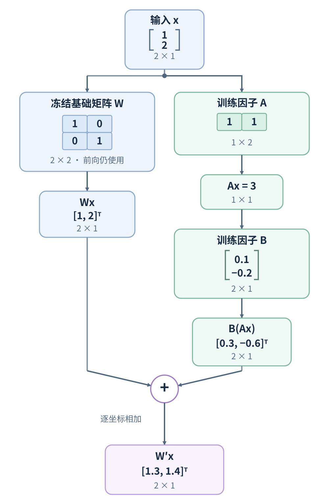

# 什么时候该微调，LoRA、SFT 和 DPO 各改了什么？

改提示词、工具和脚手架之后，同一类输入仍然稳定出错，这时才轮到考虑改权重。本章回答三件事：哪些差距值得用 fine-tuning (微调) 去修；一条训练示范怎样变成损失，梯度又落到哪些参数上；手上的反馈是示范、偏好比较还是可程序复核的结果时，各该用哪种训练信号。读者手上已有：一个反复出现的失败、一组固定的代表性输入，以及在这些输入上测好的无训练基线（怎样走到这一步见[让助手以后不再误诊，该改提示词、工具、脚手架还是权重？](choosing-what-to-change.md)）。

本章用一个独立的小例子贯穿：日志分类助手。它的输入、标签、矩阵和概率都是为教学合成的，不是实际训练记录；下文不再逐处重复这一点。

## 哪些失败值得用微调来修？

值班工程师希望日志分类助手把失败日志归入固定标签，并输出约定的 JSON，便于汇总统计。设定如下：

- build 1842 的配置已确认 `10.0.0.8:5432` 是构建用的数据库端点，每次请求都把这条配置事实一起传给模型。
- 标签只有三个：`database_connection_refused`（连接被拒绝）、`database_timeout`（连接尝试超时）和 `other`（都不是）。真实系统要给出完整的标签定义。
- 日志是 `Build 1842 failed: connect ECONNREFUSED 10.0.0.8:5432`，期望标签是 `database_connection_refused`，期望摘要是“构建进程无法连接数据库”。

实际运行出现两种失败：有时误标为 `database_timeout`，有时在 JSON 之外多写一段说明。两者对策不同。

多写说明是格式问题。应用若能用结构化输出稳定保证 JSON，就由应用层约束格式；微调代替不了 schema (结构模式) 校验。

标错标签要先查原因。如果是事实、标签定义、权限或流程不清，先修数据源、指令、标签和工作流。只有同时满足四个条件才值得评估微调：请求里已经有判断所需的信息；目标行为定义清楚；同类输入仍然反复标错；团队手上有经过审查的正确示例。

| 观察到的失败 | 先改什么 | 什么时候进入微调评估 |
| --- | --- | --- |
| 缺少或正在变化的服务事实 | 权威数据源、检索或 API | 微调代替不了实时事实和权限检查；必要时把稳定行为与检索结合。 |
| 指令、标签定义或流程不清 | 提示词、上下文、标签设计或工作流 | 这些稳定之后仍有可重复的行为差距，且能写出正确示例。 |
| 同一类输入反复违反风格、分类或响应格式 | 更清楚的提示词；应用能保证时用结构化输出 | 仍有稳定差距时，用代表性样例训练，再用独立评估验证收益。 |

还要注意：这条日志里的 `ECONNREFUSED` 加上已知端点，已经足够写出一条确定性规则。所以它在本章只用来展示输入格式和正确标注，不能证明微调比规则好。真要评估微调，候选任务应限定在规则和改进后的提示词仍会稳定出错、但每次输入都含足够判断依据的真实变体上。训练不能让模型在缺少端点信息时猜出是哪个服务。

## 微调改变了什么，改变不了什么？

微调用损失函数把训练信号传回可训练参数，让示例体现的回答方式在以后的调用中更常出现。它改的是模型在相似输入上的行为倾向。

它改变不了三件事：

- **训练数据不会变成一条可查询的记录。** 模型不会把这条日志当作数据库里的一行存下来；新日志的分布一变，学到的映射仍可能失效。
- **权重不能按请求实时更新事实。** 新事实仍要从有权限的来源检索。RAG、长上下文和微调各解决什么问题，见[怎样从授权文档里找到回答依据？](../context/rag-indexing-and-retrieval.md)。
- **权重不执行用户权限。** 微调后的模型照样需要应用在运行时放行或拒绝动作，见[模型提出 `create_issue` 后，应用要过哪几道关才能放行？](../actions/authorization-gates-for-actions.md)。

所以训练前，先在同一批代表性输入上测出提示词、结构约束、检索和工作流的基线。只有目标差距可以复现、示例能表达正确行为、预期收益又值得训练和维护的成本时，才继续。

## 一条示范怎样变成训练损失？

目标是稳定的标签映射时，训练数据把实际输入和经过审查的期望输出配成一条示范。日志助手的一条合成示范如下。

**输入消息（user）：**

> Use exactly one category from this approved list:
> - `database_connection_refused`: the connection was rejected.
> - `database_timeout`: the connection attempt timed out.
> - `other`: neither of the above.
>
> Return one JSON object with exactly two string-valued keys, `category` and `summary`, and no other text.
>
> Build 1842 config confirms `10.0.0.8:5432` is the build database endpoint.
>
> Classify this log: `Build 1842 failed: connect ECONNREFUSED 10.0.0.8:5432`

**目标回答（assistant）：**

```json
{
  "category": "database_connection_refused",
  "summary": "构建进程无法连接数据库。"
}
```

这里为了阅读把输入和目标分开展示。提交给训练器时，要按它规定的消息字段保存；哪些词元算提示词、哪些参与损失，由 loss mask (损失掩码) 配置决定。

supervised fine-tuning (SFT，监督微调) 把目标回答切成词元序列 `y₁,…,y_N`。预测第 `j` 个词元时，条件是输入 `x` 和样本里正确的前缀 `y_{<j}`，不是模型自己生成的前缀。这就是 teacher forcing (教师强制)：整段目标已知，带因果掩码的模型一次前向就能并行算出所有位置的预测。右移标签、teacher forcing 和交叉熵的来历见[训练怎样让这些参数变得更会预测？](../model/how-training-updates-parameters.md)。SFT 常用的目标是对目标词元做平均交叉熵：

$$
L(\theta)=-\frac{1}{N}\sum_{j=1}^{N}\log\pi_\theta(y_j\mid x,y_{<j}).
$$

$\pi_\theta(\cdot\mid x,y_{<j})$ 是参数为 $\theta$ 的模型在输入和真实前缀下对下一个词元给出的概率分布，$\pi_\theta(y_j\mid x,y_{<j})$ 是正确词元的概率。`N` 是实际参与平均的目标词元数：损失掩码排除了提示词或部分回答时，分母只算保留下来的位置。样本长度差异大时，还要确认训练器是按样本还是按词元聚合损失，两者给长短样本的权重不同。

### 纠正一个标签，梯度朝哪个方向？

为了只看“纠正一个标签”给出的信号，换成一个二候选玩具分类器：把 `database_timeout` 和 `database_connection_refused` 各简化成一个虚构词元，logits (未归一化分数) 设为 `[2,0]`，目标是第二个。softmax 后的概率是 `[e²,1]/(e²+1)≈[0.880797, 0.119203]`，损失为

$$
-\log\frac{1}{e^2+1}=\log(e^2+1)\approx2.126928.
$$

交叉熵对 logits 的梯度是 `p − onehot(y)≈[+0.880797, −0.880797]`，`onehot(y)` 在目标位置为 1、其余为 0。梯度下降沿反方向走：压低错误候选的相对分数，抬高正确候选的相对分数。

这只是一个位置上的方向。真实回答有很多目标词元，共享参数还会收到其他位置和其他样本的梯度，不能据此断言更新后的模型会给出某个精确概率。

## 全量微调还是 LoRA：梯度落在哪些参数上？

损失定下了信号，下一个问题是让哪些参数接收它。full fine-tuning (全量微调) 更新所有启用训练的基础权重。low-rank adaptation (LoRA，低秩适配) 冻结原有线性投影，在选定的线性层旁加一个低秩可训练分支，只训练这个增量。用 LoRA 要定两件事：给哪些层加分支，每层用多大的秩。

### 一个局部投影上的 LoRA 前向

本节照 LoRA 论文用列向量：线性层基础权重 `W` 形状为 `d×k`，输入 `x` 有 `k` 个坐标，输出 `Wx` 有 `d` 个坐标。（[训练梯度支线](training-gradients-and-optimizers.md)用行向量右乘，二者只差一次转置。）LoRA 用 `A`（`r×k`）和 `B`（`d×r`）表示增量，`BA` 与 `W` 同形，秩至多为 `r`：

$$
W'=W+\Delta W,\qquad \Delta W=BA,\qquad W'x=Wx+B(Ax).
$$

> [!example] 二维输入经过 LoRA 投影
> 取 `x=[1,2]^T`、`W=I`（二阶单位矩阵）、秩 `r=1`，`A=[1,1]`（`1×2`）、`B=[0.1,−0.2]^T`（`2×1`）。
>
> - 冻结的基础分支：`Wx=[1,2]^T`。
> - 适配分支先把二维输入压成一个数 `Ax=3`，再投影回二维：`B(Ax)=[0.3,−0.6]^T`。
> - 两支逐坐标相加：`W'x=[1.3,1.4]^T`。
>
> 这里特意给 `B` 非零值来展示增量。LoRA 原论文让 `A` 随机初始化、`B` 零初始化，所以训练开始时增量为零。



低秩分支改变的是一个局部表示，不会直接把最终输出换成目标标签。真实 LoRA 通常还把增量乘以缩放因子 `α/r`，并可能在适配分支用 dropout (随机失活)；上面的手算省略了这两项。权重存储约定或矩阵方向不同时，代码里的乘法和因子名可能转置，形状以具体实现为准。

### 损失怎样到达 LoRA 因子？

训练时，交叉熵的梯度沿计算图反向传播到 `A`、`B`，优化器再更新它们；`W` 不接收参数更新。冻结不等于切断计算图：`W` 仍参与前向，若 `x` 来自仍可训练的前一层，梯度照样穿过 `W` 和 LoRA 分支传回 `x`。冻结与 detach 的区别见[训练损失怎样变成每个权重矩阵的更新？](training-gradients-and-optimizers.md)。

> [!example] 把二类交叉熵接到 LoRA 投影上
> 暂且把上面的输出 `z=W'x=[1.3,1.4]^T` 当作两个候选标签的 logits，目标仍是第二类。这是为了教学把一个局部线性层直接接到二类交叉熵上，不对应真实模型的层结构。
>
> 前向：`p=softmax(z)≈[0.475021, 0.524979]`，损失 `−log 0.524979≈0.644397`，对输出的梯度 `g_z=p−onehot(y)≈[0.475021, −0.475021]^T`。
>
> 反向：记 `u=Ax=3`，它是标量。`W` 和 `x` 固定时，由 `W'x=Wx+B(Ax)` 和链式法则：
>
> - `B` 的梯度是输出梯度乘 `u`：$\partial L/\partial B=g_z u^T\approx[1.425062,\ -1.425062]^T$。
> - `A` 的梯度先用 `B` 给两个输出梯度加权，`B^T g_z=0.1×0.475021+(−0.2)×(−0.475021)≈0.142506`，再乘输入的转置：$\partial L/\partial A=(B^Tg_z)x^T\approx[0.142506,\ 0.285012]$。
>
> 两个结果形状分别是 `2×1` 和 `1×2`，与 `B`、`A` 一致。它们是参数梯度，还不是优化器给出的更新量。

许多输入和正确回答的梯度汇总到同一组参数上，使模型在相似条件下更常给出目标行为。全量微调让这些梯度改动所有启用训练的权重；LoRA 只让它们改动低秩因子。

### 参数量、秩与目标层

在单个 `4096×4096` 投影上取 `r=8`，两个因子共有 `r(k+d)=8×(4096+4096)=65,536` 个可训练数值，原矩阵有 `4096×4096=16,777,216` 个，约为后者的 0.39%。这只比较一个目标矩阵。整次训练的参数、优化器状态和激活显存还取决于目标层、批次和序列长度，不能由这个比例推算。

秩限制单个目标矩阵的增量 `BA` 能表达多少个独立方向；加分支的层决定哪些投影能改变。两者可以分别选，能否给不同层设不同的秩要看训练器是否支持。降低秩会减少适配参数和对应的优化器状态，也可能限制模型学到复杂行为。训练显存不会按同样比例下降，因为基础权重和激活仍要参与计算。秩没有能保证质量的通用值：从能跑通的配置起步，在相同数据和留出样例上比较。

### 推理时合并，还是单独加载 adapter？

单独加载 adapter（保留 LoRA 分支）时，秩越高，推理计算通常越多。基础权重稠密、推理路径兼容时，可以把增量合并进同形的基础矩阵；合并后投影形状和矩阵乘规模与秩无关。

基础权重已经量化时，能否合并取决于量化格式和后端。兼容的路径可能先反量化、相加、再重新量化；重新量化带来舍入差异，来回合并还会累积。因此不能假定合并后的输出与单独加载 adapter 完全相同，要在实际服务路径上复验。

### 其他参数高效方法

- **QLoRA (量化低秩适配)。** 冻结量化后的基础权重，只训练 LoRA 因子。原论文以 4-bit NF4 格式存基础权重、用 BF16 计算，梯度只更新 LoRA 因子；主实验把 LoRA 加在 Transformer block 的所有线性层上。PEFT 文档的 QLoRA 风格示例也用 `all-linear`，但目标层可以改。这些都是具体实现选择，不代表所有模型、后端或任务都该这样配。
- **adapter (适配器)。** 在 Transformer 层中插入可训练的小模块。
- **prefix tuning (前缀微调)。** 学一组连续向量，作为每一层的前缀。
- **prompt tuning (软提示微调)。** 在输入 embedding 序列前加少量可学习的连续向量。后两种学到的是向量，不是可见的文本词元，也不同于改写指令文字的提示工程。

全量微调适应能力强，但计算、训练状态和产物成本更高；LoRA 等方法减少可训练参数，实际开销还受目标层、训练器、保存方式和服务路径影响。选择时综合看行为差距有多复杂、显存够不够、是否要保留原底座、产物格式和部署支持，并在目标服务上评估；不要假定某种参数高效方法一定胜过另一种。

## 训练数据要覆盖什么，又要审查什么？

样例要覆盖真实变体，而不是重复同一行。对日志助手，这意味着 `ECONNREFUSED` 的不同措辞、日志的各种前后缀、合法标签的边界情况，以及最容易混淆的 timeout。把同一行日志复制很多遍不算覆盖。

审查至少检查五项：事实和标签是否正确；标注口径是否一致；有没有重复或近似重复的输入；是否含敏感信息；有没有数据使用权。切分训练集和评估集时按事故、来源或时间段分组，避免同一次事故的近似日志同时落在两边造成泄漏。样本数量本身不是质量证据，也没有保证成功的通用样本量。

> [!example] 摘要也可以作为监督目标
> SFT 也能示范摘要的写法。下面这条合成示范只保留交付承诺、省略发票信息，体现的是标注者事先定义的摘要口径；实际输出要符合应用自己定义的事实与风格标准。
>
> ```json
> {
>   "messages": [
>     {"role": "user", "content": "Summarize these notes: The supplier will deliver the parts by June 1. The invoice has already been sent."},
>     {"role": "assistant", "content": "The supplier will deliver the parts by June 1."}
>   ]
> }
> ```

## 训练怎样组织，超参数各管什么？

1. **定义重复失败和验收界限。** 固定输入范围、目标行为、运行约束和不可接受的回归。例如统计把 `ECONNREFUSED` 误判为 timeout 的比例，提供完整标签集，并事先约定关键切片要达到的改善，以及其他标签、JSON、安全、成本和时延允许的变化范围。
2. **建立无训练基线。** 固定基础模型、提示词、结构约束、检索、工作流和可用的确定性规则，在代表性样本上记录各失败切片的分母和表现。应用层能保证的 schema 约束也算进基线。
3. **准备并审查示范。** 按上一节去重、核对标签与目标词元、排除未授权或敏感数据、覆盖常见类型和重要边界。
4. **分开数据用途。** 训练集用来算梯度；验证集用来比较训练设置、挑检查点；所有方案固定后才运行最终留出集。记录切分方法和可能的泄漏。
5. **固定训练与部署路径。** 记录基础模型和版本、全量或参数高效方法、训练器版本、目标模块、数据格式、许可、产物保存方式，以及目标服务能否加载。
6. **跑小规模实验并记下配置。** 至少记录学习率与调度、训练轮数、批次与梯度累积、数据版本、LoRA 秩与目标模块、随机种子、检查点和验证指标。
7. **冻结选择后独立比较。** 见下一节。
8. **谨慎部署并监控。** 对模型和回滚路径做版本管理，遵守数据保留与同意规则，持续观察同样的业务结果。线上失败可以提示新增评估样例，但未经核验的用户反馈不自动成为训练标签。

第 6 步的几个超参数：

- **学习率** 决定优化器每次更新的步长。对给定的模型、数据和批次，太大可能让训练不稳定，太小可能在预算内学不到目标。
- **epoch (训练轮数)** 指完整过一遍训练集。轮数多可能拟合得更好，也可能过拟合。
- **有效批次** 是一次参数更新综合的样本数。设每个数据并行副本的微批次为 `b`、参与梯度同步的数据并行副本数为 `n_dp`、梯度累积步数为 `K`，在样本等权的常见配置下，有效批次约为 `b × n_dp × K`。`n_dp` 只数数据并行副本，不是集群设备总数；张量并行或流水线并行的设备不能再当作数据副本乘进去。梯度累积是先把几个微批次的梯度加起来再更新一次：有效批次不变时，它只改变每次更新前分几次计算；`b` 和 `n_dp` 不变而增大 `K` 时，有效批次变大，每遍数据的更新次数随之减少。

## 怎样和基线公平比较？

训练损失和验证损失能帮助诊断，但代替不了任务指标。比较时，基线和候选用相同的输入（包括相同的端点事实、标签集和其他判断上下文）和推理设置，检查总体成功率、关键标签切片、非法 JSON、安全、成本和时延。能用规则直接分类的那部分输入，仍以规则作为基线。

验证集参与挑选之后就成了开发证据；反复看最终留出集调参，它也会变成开发证据。哪些数据算开发证据、最终验收怎样隔离并做配对统计，见[候选 B 比 A 好，是真改善还是抽样波动？](holdout-acceptance-and-paired-statistics.md)。对日志助手而言，只有关键误标切片达到预设改善，同时其他标签、JSON、安全、成本和时延都没越过约定边界，才部署候选；否则继续用原基线。

## 手上的反馈决定用哪种训练信号

日志案例有现成的正确答案，所以用 SFT。但很多任务写不出唯一正确的回答。选训练信号先看手上是什么反馈，以及它能支持什么结论。下表是全书唯一一份训练信号选择表：

| 手上的反馈 | 训练信号 | 训练时的回答由谁生成 | 适合的问题 | 主要代价与边界 |
| --- | --- | --- | --- | --- |
| 经审查的目标回答 | SFT：目标词元交叉熵 | 固定示范 | 能写出希望的回答，例如稳定分类、格式、风格 | 只学到示范实际表达的行为；未见输入上的泛化要独立验证。 |
| 同一提示下的好坏对比 | direct preference optimization (DPO，直接偏好优化) 等偏好优化 | 固定偏好对 | 好坏容易两两比较，写唯一答案不自然 | 学到的是标注偏好，不是事实真值；目标可能靠压低被拒回答来满足。 |
| 偏好排序，且愿意另训奖励模型 | reinforcement learning from human feedback (RLHF，基于人类反馈的强化学习)：奖励模型 + PPO，带 KL 约束 | 策略在线采样，奖励模型打分 | 同上，并希望策略通过采样探索 | 多一个奖励模型和在线采样成本；策略越会优化分数，越可能钻奖励模型的漏洞。 |
| 能由程序或独立规则复核的结果 | reinforcement learning with verifiable rewards (RLVR，可验证奖励强化学习)，如 GRPO | 策略在线采样，检查器判分 | 答案、测试或结构有可靠检查器，希望模型通过尝试找到更好的解题轨迹 | 每题多次采样和判分，需要足够算力；奖励只覆盖检查器定义的目标。 |
| 更强教师生成并筛选过的轨迹 | offline distillation (离线蒸馏) 或 rejection-sampling SFT (拒绝采样后的 SFT)：目标词元交叉熵 | 教师，事先固定 | 让小模型学会教师的解法 | 受教师质量、样例覆盖和筛选器限制；学生自己会走到的前缀不一定被覆盖。 |
| 能在学生前缀上查询的教师模型 | on-policy distillation (OPD，在策略蒸馏)：在学生前缀上对齐教师的逐词分布 | 学生在线采样，教师给分布 | 想把一个或多个教师的能力并进一个学生 | 每步要跑教师推理；用外部教师时，同等计算下不一定胜过直接做 RL。 |

分类任务也可以把人工确认的标签做成精确匹配奖励，但既然每条样本已有明确的目标回答，SFT 通常更直接。只有采样探索、策略学习或结果奖励确实带来额外价值时，才考虑强化学习。

无论哪种信号，训练目标分数上升都不等于任务质量改善。偏好标签可能互相矛盾，或只反映标注者和 rubric (评分准则) 的选择；检查器也只核对它覆盖的东西。都要在没参与训练、调参或样本筛选的输入上验收，并检查事实、安全、分布变化、成本和时延。

### SFT 只教示范表达的行为

SFT 让模型模仿示范里的回答。它教的是样例实际表达的行为，不保证模型在没见过的场景中遵循所有指令或保持安全。

### RLHF：InstructGPT 的三阶段流程

“奖励模型 + 强化学习”的代表是 InstructGPT 论文。它分三步：先用人工示范做 SFT；再让人对同一提示下的多个回答排序，用这些偏好训练奖励模型；最后用 proximal policy optimization (PPO，近端策略优化) 优化策略（即模型），让它拿到更高奖励，同时用 Kullback–Leibler (KL) 散度惩罚限制它偏离 SFT 模型太远。这是一项具体研究的流程，不是所有助手模型的通用配方。PPO 的概率比、裁剪和 KL 项怎样作用在每个词元上，见[可验证奖励怎样训练推理能力？](reward-based-reasoning-training.md)。

### DPO：不训奖励模型，直接用偏好对训练策略

DPO 用同一提示 `x` 下的一对回答：被选的 $y_w$ 和被拒的 $y_l$。它固定一个参考策略 $\pi_{ref}$（通常是 SFT 后的模型），直接训练策略 $\pi_\theta$，省掉单独拟合奖励模型这一步。损失是

$$
L_{DPO}=-\log\sigma\!\left(\beta\log\frac{\pi_\theta(y_w\mid x)}{\pi_{ref}(y_w\mid x)}-\beta\log\frac{\pi_\theta(y_l\mid x)}{\pi_{ref}(y_l\mid x)}\right),
$$

$\sigma$ 是 sigmoid 函数，$\beta$ 控制偏离参考策略的力度。括号里是两个回答各自相对参考策略的对数概率变化之差，训练要把这个差拉大。

> [!example] 偏好差拉大，不等于被选回答变得更可能
> 取 $\beta=0.1$。训练开始时 $\pi_\theta=\pi_{ref}$，两个对数比都是 0，损失为 $\log 2\approx0.693147$。下面三种变化都把括号里的差变成 `0.1×1=0.1`，损失都降到 $-\log\sigma(0.1)\approx0.644397$：
>
> - 被选回答的对数比升到 `+1`，被拒回答不变；
> - 被选回答不变，被拒回答降到 `−1`；
> - 被选回答降到 `−1`，被拒回答降到 `−2`。
>
> 第三种情况下，被选回答的概率反而下降了，损失照样变小。

所以 DPO 的偏好差变大，可能只是被拒回答的概率在下降。部署前仍要用独立任务检验回答是否真的更正确、更符合标注者想表达的偏好。

### RLVR、蒸馏与 OPD

RLVR 用规则或可复核的结果产生奖励，适合有可靠结果检查的任务。推理任务里的同题采样、判分、组内优势、长度处理，以及 DeepSeek-R1 怎样组合 SFT、RLVR 和模型奖励，见[可验证奖励怎样训练推理能力？](reward-based-reasoning-training.md)；那一章也展开离线蒸馏和 OPD 的信号与证据。

> [!info] 不改参数、在推理时延长思考：s1 的预算强制
> s1 把两件事放在一起：先用很少的 SFT 数据训练，再在生成时控制思考长度。
>
> - **数据筛选与 SFT。** 先为约 5.9 万道候选题收集 Gemini Flash Thinking 的推理轨迹和答案，过滤 API 错误和低质量格式，直接保留 384 条来自高质量来源的样本；其余按难度和多样性挑选，其中一个难度指标是让 Claude 3.5 Sonnet 对照参考答案判断两种规模的 Qwen 能否解出该题。最终用 1,000 条示范对 Qwen2.5-32B-Instruct 做 SFT。论文的评审模型只把其中 53.6% 的蒸馏答案判为正确，作者仍保留了部分答错的轨迹。可见“选出难题”和“验收教师示范”是两件事。
> - **budget forcing (预算强制)。** 训练后，生成时另设思考预算：模型过早发出结束思考的标记时，压住它并追加 `Wait`，让模型继续算；达到上限时强制转入作答，可追加 `Final Answer:` 引导输出。这一步不更新参数。论文观察到延长思考的收益会趋于平坦。要判断多算是否值得，应在同一模型、同一批题上同时比较正确率、生成词元数和时延。

## 实例：训练方法的平台支持（OpenAI，核对于 2026-11-16）

微调是通用的训练概念；某个服务是否提供某种训练方法、哪些底座能训、训完怎样部署，是另一层产品约束。以 OpenAI 为例，截至 2026-11-16 官方文档说明其自助微调平台正逐步关闭：

- 2026-05-07 起，从未运行过微调的组织不能再创建训练任务；
- 2026-07-02 起，过去 60 天内没有调用过微调模型推理的组织不能再创建训练任务；
- 2027-01-06 起，仍活跃的既有客户也不能新建训练任务；底座更早退役的，以更早日期为准。

已训练模型的推理持续到对应基础模型退役。使用前要重新核对资格、模型时限和目标服务支持。

## 这一章交出的是一个待验收的权重候选

走完本章，团队手上有：一个证明“非改权重不可”的稳定差距、一份审查过并按事故分组切分的数据集、一个训练好的检查点或 adapter，以及完整记录的训练配置；它已与无训练基线在相同输入上比较过。它还只是候选。下一步按[候选 B 比 A 好，是真改善还是抽样波动？](holdout-acceptance-and-paired-statistics.md)在冻结的留出集上验收；通过后，换了权重或 adapter 的版本组合按[候选版本从离线通过到全量，要经过哪些关，回滚又撤得回什么？](deployment-rollout-and-rollback.md)逐步上线。

> [!info]- 来源
> - **LoRA 结构与部署（“全量微调还是 LoRA”各小节）。** Hu et al., *LoRA: Low-Rank Adaptation of Large Language Models*（arXiv:2106.09685；§4.1 低秩分解、冻结基础矩阵、`A` 随机/`B` 零初始化、`α/r` 缩放与合并推理；§4.2 Transformer 投影示例；§3.1 adapter 推理延迟比较），[论文 HTML](https://arxiv.org/html/2106.09685)。本章列向量记法与论文一致。
> - **QLoRA 与量化合并（“其他参数高效方法”“推理时合并”）。** Dettmers et al., *QLoRA: Efficient Finetuning of Quantized LLMs*（arXiv:2305.14314v1，2023-05-23；§2.2 LoRA 增量与冻结基础权重，§3 NF4 存储/BF16 计算与反向传播，§4 与附录 B.2 实验与超参数范围），[论文 HTML](https://arxiv.org/html/2305.14314)；4-bit 与实验结论只描述论文配置。Hugging Face PEFT [QLoRA-style training](https://huggingface.co/docs/peft/main/en/developer_guides/quantization#qlora-style-training)（`all-linear` 目标模块）与[量化权重合并](https://huggingface.co/docs/peft/main/en/developer_guides/quantization#merging-adapters-into-quantized-weights)（反量化、相加、再量化，来回合并累积舍入误差），main 版文档，2026-11-12 核对；需从源码安装，不自动保证目标服务支持同一路径。
> - **adapter、prefix tuning 与 prompt tuning（“其他参数高效方法”）。** Houlsby et al., *Parameter-Efficient Transfer Learning for NLP*（arXiv:1902.00751v2，2019-06-13，§2、§2.1 adapter 模块与插入位置），[论文 HTML](https://arxiv.org/html/1902.00751)；Li and Liang, *Prefix-Tuning: Optimizing Continuous Prompts for Generation*（arXiv:2101.00190v1，2021-01-01，§4.1–4.2 连续前缀与冻结语言模型），[论文 HTML](https://arxiv.org/html/2101.00190)；Lester et al., *The Power of Scale for Parameter-Efficient Prompt Tuning*（arXiv:2104.08691v2，2021-09-02，§2 软提示），[论文 HTML](https://arxiv.org/html/2104.08691)。
> - **损失掩码（“一条示范怎样变成训练损失”）。** Hugging Face TRL [SFT Trainer](https://huggingface.co/docs/trl/en/sft_trainer#train-on-assistant-messages-only) 的 assistant-only 与 completion-only 选项；可用性依赖数据类型和 chat template (对话模板)。2026-11-12 核对。
> - **SFT 目标、RLHF 三阶段与数据切分（“一条示范怎样变成训练损失”“RLHF”“训练怎样组织”）。** Vaswani et al., [*Attention Is All You Need*, v7, §3.1](https://arxiv.org/html/1706.03762v7#S3.SS1) 的 decoder 因果掩码与目标移位；Ouyang et al., *Training language models to follow instructions with human feedback*（arXiv:2203.02155v1，2022-03-04；§3.1 SFT→奖励模型→PPO 流程，§3.2 按用户分组切分与个人身份信息过滤，§3.4–3.5 人工数据与模型训练，§4.3 简单失败），[论文 HTML](https://arxiv.org/html/2203.02155v1)。OpenAI [SFT 指南](https://developers.openai.com/api/docs/guides/supervised-fine-tuning)与[微调最佳实践](https://developers.openai.com/api/docs/guides/fine-tuning-best-practices)支持示范数据、基线评估与训练结果验收，2026-11-12 核对。八步流程与按事故分组是工程实践，不是上述论文或平台的规定。
> - **DPO（“DPO”小节与选择表）。** Rafailov et al., *Direct Preference Optimization: Your Language Model is Secretly a Reward Model*（arXiv:2305.18290；§3 偏好数据与典型 RLHF 流程，§4 直接策略目标 Eq. 7 与偏好模型假设），[论文 HTML](https://arxiv.org/html/2305.18290)。版本化实现参考：Hugging Face [TRL `v1.18.2`](https://github.com/huggingface/trl/releases/tag/v1.18.2)（2026-11-19 发布，截至 2026-11-25 为最新版）的 [`DPOTrainer`](https://github.com/huggingface/trl/blob/v1.18.2/trl/trainer/dpo_trainer.py#L374) 与 [`_compute_loss`](https://github.com/huggingface/trl/blob/v1.18.2/trl/trainer/dpo_trainer.py#L1273-L1371)。“偏好差拉大”的三种情形是按 Eq. 7 手算的教学例。
> - **可验证奖励（选择表 RLVR 行）。** DeepSeek-AI, *DeepSeek-R1: Incentivizing Reasoning Capability in LLMs via Reinforcement Learning*（arXiv:2501.12948v2，2026-01-04，§2.2 用正确性和格式检查产生规则奖励），[v2 HTML](https://arxiv.org/html/2501.12948v2)。把精确匹配奖励用于分类是本章的教学延伸。
> - **蒸馏与 OPD（选择表最后两行）。** R1 论文同上（拒绝采样 SFT 与蒸馏，Appendix F）；DeepSeek-AI, *DeepSeek-V4: Towards Highly Efficient Million-Token Context Intelligence*（arXiv:2606.19348v1，§5.1.2 多教师 OPD），[v1 HTML](https://arxiv.org/html/2606.19348v1)；Liu et al., *Unpacking the Compute Efficiency of Strong-to-Weak OPD against GRPO*（arXiv:2611.08453v1，2026-11-05，§4–§6），[v1 HTML](https://arxiv.org/html/2611.08453v1)，支持“外部教师同等计算下不一定胜过 GRPO”，为预印本证据。细节与映射见 RLVR 一章的来源。
> - **s1（“推理时延长思考”callout）。** Muennighoff et al., *s1: Simple test-time scaling*（arXiv:2501.19393v3，2025-03-01；§§2.1–2.2 候选题、难度筛选与最终样本选择，§4.1 SFT，§§3.1、5.2 budget forcing，Appendix C.3 grader，Appendix D.2 训练样例），[v3 HTML](https://arxiv.org/html/2501.19393v3)。
> - **OpenAI 平台可用性（实例小节）。** [OpenAI API 弃用说明](https://developers.openai.com/api/docs/deprecations)的 “Update to OpenAI’s self-serve fine-tuning” 小节列出 2026-05-07、2026-07-02、2027-01-06 三个节点；[SFT 指南](https://developers.openai.com/api/docs/guides/supervised-fine-tuning)导言说明既有客户自 2027-01-06 起不能新建训练任务、底座更早关闭则以更早日期为准、微调模型推理持续至底座关闭。2026-11-16 复核。
