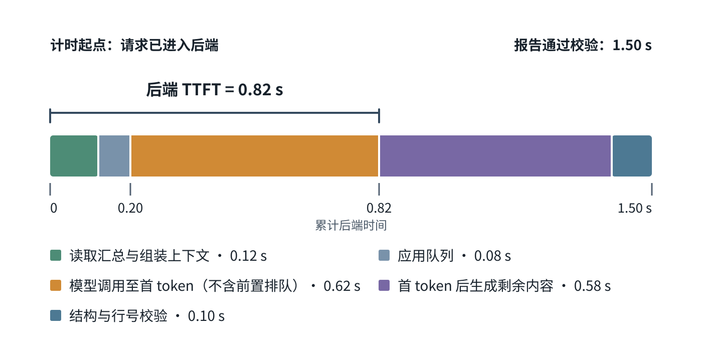

# 月报助手该选哪个模型，每份成功报告要花多少钱？

[上一章](choosing-what-to-change.md)的候选 B 只换了提示词；改动也可能是换一个模型。选模型不是比谁的排行榜分数高。先把任务的成功条件写成可检查的契约，淘汰不满足硬约束的候选，再在相同条件下比较剩下的候选：能否稳定交付合格结果，交付一份要多久，花多少钱。

CI 诊断助手的输出是一段短诊断，没有可复算的数值，也没有月度交付目标；为了把数值正确性和单位成本算清楚，本章换用一个月报助手的局部案例走完这条路。手上的输入是一份任务契约和两个匿名候选；产出是一个通过预筛的候选、它的时延测量口径，以及按“每份成功报告”计算的完整成本。这些交给[部署与回滚](deployment-rollout-and-rollback.md)去核验运行位置和上线路径。

## 月报助手要交付什么

> [!example] 案例：月报助手（虚构）
> 某公司要做一个月报助手。应用先完成授权检查，再把区域销售汇总交给模型，问它：“哪些区域的环比变化率绝对值超过 8%，总额变化了多少？”模型输入包含行号、区域名和两期原始金额；租户隔离和行级权限由应用负责。
>
> 本章的销售数据、候选成绩、时延、价格和流量目标都是教学假设，不是实测结果，也不是模型排名。这里声明一次，后文不再逐处重复。

下面是输入与参考答案，单位为万元。两期金额是模型输入；“环比变化”列和“合计”行是参考答案，不发给模型。行号必须随原始输入一起保留，供答案引用。

| 行号 | 区域 | 2026-09 | 2026-10 | 环比变化（参考答案） |
|---|---|---:|---:|---:|
| r1 | 华东 | 120 | 132 | +12（+10%） |
| r2 | 华北 | 80 | 72 | −8（−10%） |
| r3 | 华南 | 50 | 55 | +5（+10%） |
| 合计 | — | 250 | 259 | +9（+3.6%） |

合格的答案是：华东 +12 万元（+10%，r1）、华北 −8 万元（−10%，r2）、华南 +5 万元（+10%，r3）；三行总额 250→259 万元，净增 9 万元（+3.6%，依据 r1–r3）。区域、变化额、变化率、总额和支持它们的行号都是必填项。

边界情况要写进契约，不能留给模型猜：

- **阈值是严格大于。** 100→108 恰好 +8%，不入选。
- **总额包含全部获准区域**，包括变化没超过阈值的行。总变化率按两期总额计算。
- **上期为零**：变化率无法计算。报告变化额，把该行放进“需复核”，不参与阈值筛选。
- **上期为负**：不用百分比自动分类，标记为需业务复核。
- 上面两种情况只要两期金额齐全，仍按原符号计入各期总额；上期总额为零或为负时，只报净变化额，总变化率标为需复核。
- **任一期金额缺失**：该行变化额和变化率都不完整。报告缺值，把总额标为“不完整”，交回数据负责方补齐。
- 金额单位混用时，由应用先换算或拒绝，不交给模型处理。

这些边界例只用来说明契约，不计入上面三行的合计。把契约写成逐项可检查的验收条件：

| 维度 | 月报助手怎样检查 |
|---|---|
| 任务正确性 | 按变化率绝对值严格大于 8% 筛选；变化额、变化率、总额和行号与授权输入一致，引用的行确实支持相应说法 |
| 边界行为 | 零基数、负基数、缺值、单位混用、数据冲突和无数据，都按上面的约定报告或升级 |
| 指令与格式 | 不猜测变化原因；输出能通过目标接口的结构校验 |
| 时延 | 写明约束的是首 token、完整报告，还是两者；按真实峰值和服务区域测量 |
| 成本 | 每份成功报告的完整成本，算法见[每份成功报告的完整成本](model-selection-and-unit-cost.md#每份成功报告的完整成本) |
| 数据与运维 | 输入能否发给托管服务；谁负责密钥、扩缩容、更新、监控和故障响应 |

算术不一定要交给模型。应用可以用确定性代码先算好变化额、变化率和总额，模型只负责组织和解释；也可以让模型算，再严格评测。两种做法都要评估端到端结果。让模型去猜授权范围，或让它估算数字而不加校验，契约就没有落实。

契约里各维度为什么互不蕴含、怎样逐项写成可检查的条件，见[“回答得好”怎样写成任务契约](task-contracts-and-quality-dimensions.md)。

## 先定比较目标：只换模型，还是选可部署方案

比较之前要说清在比什么。两种目标的做法不同：

- **只想知道“换一个模型”本身的影响**：固定提示词、工具和应用调用路径，只替换模型。
- **要选出最终可部署的方案**：允许每个候选在开发集上使用各自适合的提示词、结构化调用方式和配置；调好后冻结，再用相同的任务契约、输入集合、评估协议和预算比较。

两种目标都不能用模型名称、排行榜或供应商的档位代替目标任务上的验证。整条选型流程如下，沿箭头前进表示前一项已经通过：

~~~mermaid
%%{init: {"flowchart": {"wrappingWidth": 420}}}%%
flowchart TD
  A["任务与数据契约 输入、授权、验收条件"] --> B["候选硬门槛 端点能力、数据规则、责任团队"]
  B -->|满足| C["开发与候选比较 按共同契约评测，选定并冻结方案"]
  C -->|候选达标| D["负载与部署核验 真实端点、峰值、成本、故障恢复"]
  D -->|运行条件通过| E["独立验收 使用未参与调优与选择的数据"]
  E -->|验收通过| F["交给发布流程"]
~~~

某一步没通过时，退回哪里取决于要改什么：

| 未通过的位置 | 下一步 |
|---|---|
| 候选硬门槛 | 淘汰该候选；换了模型就重查硬门槛 |
| 开发与候选比较 | 调整提示词或配置后重新比较；换候选则先重查硬门槛 |
| 负载或部署核验 | 修正运行方案，重查受影响的能力、数据边界和质量，再复测负载 |
| 独立验收 | 失败样本降级为开发证据；修订并重新冻结后，另用未参与这轮决策的数据验收 |

凡是用来调提示词、设阈值、挑胜者的数据都是开发证据；最终验收集要隔离并冻结整套版本。这条区分的完整规则和配对统计方法见[独立验收与配对统计](holdout-acceptance-and-paired-statistics.md)。本章只做到“预筛通过、可以进入部署核验”。

## 硬门槛先于质量比较

硬门槛是一票否决项。候选只要有一项不满足就淘汰，低价或高公开基准分都补不回来：

- 是否支持所需的模态和输入形式；
- 目标 API、模型版本或本地推理引擎能否提供所需的结构化输出与工具调用；
- 数据处理方式是否符合合同和内部规则；
- 有没有团队负责运行、运维和故障处理。

**能力要核对到具体模型和接口。** 同一家供应商，不同接口解决不同问题；结构校验通过，也只说明形状对了，不说明金额、事实或引用正确。结构化输出约束形状、不约束含义，这一点的完整说明见[提示词契约](../context/model-input-and-prompt-contract.md)。

> [!info] 实例：OpenAI 结构化输出与函数调用（核对于 2026-11-12）
> OpenAI Responses API 用 `text.format` 里的 JSON Schema 约束返回给用户的结构化响应；让模型请求调用应用的工具，则用 function calling (函数调用)。严格模式的 structured outputs (结构化输出) 只支持 JSON Schema 的一个子集。`GET /v1/models` 可返回模型标识和已公布的 `shutdown_date`。模型支持和接口细节会变化，部署前按所用端点和确切模型重新核验。

**模态要细分验证。** 标着 multimodal (多模态)，不说明它支持哪些图片、音频或视频格式，也不说明它能否准确读出所需内容。如果月报的输入以后改成扫描件或图表，就要按目标格式、分辨率和 API 逐项评测，纯文本表格的结果不能套用过去。

**数据边界要落到具体端点和功能。** 组织层面的一个留存设置，不一定覆盖所有应用状态、文件或第三方工具。例如 OpenAI 的数据控制文档按端点和功能分别列出了留存例外；其他供应商要查各自的条款和租户配置。

**档位名称和公共基准只能用于初筛。** “前沿”“均衡”“快速”是各家产品目录里的粗略叫法，没有统一标准：高档位不证明它在这个报表任务上更好，标着“低时延”也不代表端到端服务更快。公共基准的任务、样本、模型访问方式、评分协议或部署条件只要与本应用不同，就推不出本应用的质量。长文本任务还要把两件事分开验收：对早期事实的精确检索，和跨长上下文的归纳判断。上线前核验确切的模型标识、版本、接口能力、限制、区域和当前价格。

## 托管、自托管、端侧与混合部署各由谁负责

运行位置也是候选的一部分。下表是全书唯一的部署方式对照，[部署章](deployment-rollout-and-rollback.md)沿用它：

| 方式 | 可能合适的条件 | 仍需核对的成本与责任 |
|---|---|---|
| 托管 API | 想快速试验，且合同、地域、功能和数据要求都允许托管推理 | 服务条款、留存设置、速率限制、可用性、模型生命周期和按量价格，由具体提供方与配置决定；还要跟踪供应商侧的变更 |
| 开放权重、自托管 | 需要控制模型版本或运行位置，且团队能承担容量与运维 | 逐个核对该模型版本的许可和使用政策；团队负责硬件、服务引擎、扩缩容、安全更新、监控、on-call（值班响应）和模型升级 |
| 端侧 | 需要离线运行、设备本地响应或设备级数据处理 | 设备算力、内存、电量、机型覆盖、升级机制和模型体积限制质量与可用能力 |
| 混合部署 | 不同请求类确实需要不同模型或不同数据边界 | routing（请求路由）、策略一致性、回退、故障处理和重复运维增加复杂度，必须测出净收益 |

部署标签本身证明不了什么：“自托管”不等于更便宜，“端侧”不等于更私密，“云端”也不能代替查看实际合同、区域、留存设置、日志与功能例外。隐私结论来自具体的数据流和控制。

**开放权重不等于开源。** “开放权重”只说明模型参数可以获得，不说明训练数据、训练和推理代码、架构等组件能像开源软件那样自由研究、修改和再分发。按 OSI 的 Open Source AI Definition 1.0，要称为 Open Source weights，还必须同时提供生成这些参数的代码和数据信息。

**许可按模型版本核对。** 对准确的模型版本，检查许可和可接受使用政策是否覆盖预期的商业用途、衍生与再分发、署名和规模限制；推理代码、tokenizer 和部署依赖的许可也分别核验。例如 Meta 的 Llama 4 社区许可带有额外的使用、署名、再分发和大规模服务条款——这只是一份具体许可，不能推广到其他模型。

## 在同一条件下比较候选

通过硬门槛的候选，在相同条件下用有代表性的样本评测：

1. **固定应用侧的边界**：授权、模型能看到的业务数据、工具能执行的业务操作、校验规则和错误处理分支。消息格式、schema 和工具调用写法可以按候选能力适配，适配后随候选一起冻结。只比较“换模型”的影响时，提示词和整条调用路径也不变。
2. **开发集调、比较集比**：用开发集迭代提示词和配置；候选冻结后，用同一个比较集比较它们。
3. **覆盖边界**：样本要包含普通请求、零值或缺失值、负基数和格式边界。越权输入应由应用的授权入口拦截，评测时确认未授权的行不会送进模型，不能指望模型拒答来实现访问控制。
4. **分开记录**：任务是否通过、事实和数值是否正确、引用是否支持结论、格式是否有效、是否拒答或升级、时延和实际费用。
5. **报告分母和不确定性**：小样本上的差异不能直接外推到生产环境。

> [!example] 候选甲、乙的预筛表
> 两个匿名候选甲、乙用同一组 200 个合成开发样例、同一提示词和应用路径预筛。这组样例不是独立验收集。“内容判定”检查严格阈值筛选、变化额/变化率/总额/行号、不臆测原因，以及零基数、负基数和缺值的边界约定；“结构有效”单独统计。
>
> | 候选 | 内容判定通过 | 结构有效 | 成功（两项都过） | 常规负载后端完成时延 p95 | 模型 API 直接费 / 成功报告 |
> |---|---:|---:|---:|---:|---:|
> | 甲 | 198/200（99%） | 200/200（100%） | 198/200（99%） | 1.7 秒 | $0.007 |
> | 乙 | 199/200（99.5%） | 198/200（99%） | 197–198/200（交集未知） | 1.2 秒 | $0.004 |
>
> 预筛门槛：内容通过率至少 99%；结构有效率 100%（这批样本中不允许出现结构错误）；常规负载下 p95 不超过 2 秒；模型 API 直接费不超过 $0.01/成功报告。
>
> - **甲**：结构全部有效，所以成功数就是内容通过数 198/200。四项都满足预筛条件。
> - **乙**：内容更好、更快、更便宜，但结构有效率已经不是 100%，无论交集是多少都没过门槛，须修复后重评。

读这张表要抓住三点。

**一份报告只有内容和结构都通过，才算成功。** 两项分开统计，成功是它们的交集。只知道两项各自的通过数时，交集不能精确还原：乙的成功数最少是 199 + 198 − 200 = 197（两类失败落在不同报告上），最多是 198（两类失败重叠）。要拿到交集，评测必须逐份报告记录两项结果。

**200/200 不等于错误率为零。** 它只说明这批样例没出现格式错误。假如真实格式错误率是 1%、各次相互独立，200 次全部无错的概率仍有 0.99²⁰⁰ ≈ 13.4%。区间怎样估、样本要多大，见[独立验收与配对统计](holdout-acceptance-and-paired-statistics.md)。

**时延和费用列是单独设定的假设**，不是从这 200 个样例算出来的，也不是峰值实测。“模型 API 直接费”是全部尝试（含失败和重试）的模型费用除以成功报告数；$0.01 只约束这一项，不含人员、工程、评测、人工复核等费用，所以甲低于它不说明完整成本已经达标。

## 什么时候把请求路由到不同候选

前面默认所有请求用同一个候选。只有当不同类别的请求表现出稳定、可测量的需求差异时，才值得引入 model routing (模型路由)：把简单、低风险的请求交给便宜的候选，把经评测确实能从更强模型获益的请求交给其他候选。代价是分类错误、路由带来的时延、回退比例、维护负担，以及权限和策略的一致性，都要算进去。

如果月报助手按输入长度或报表类型路由，先给每一类（切片）定义通过条件，再比较路由前后的成功率、每份成功报告成本和尾部时延。分类器把握不足时回退到已验收的候选或人工处理。不要先入为主地认为“抽取”类请求一定简单、某个行业的请求一定困难。路由本身不授予任何权限，高影响的工具操作仍由应用逐项授权。

同一个请求也可以按步骤分工。月报里，阈值筛选、求和、舍入交给程序；从几个已定义的意图里选一个，可以交给快模型，置信度不足就回退到已验收的强模型；开放式解释另行评测。

> [!info] 实例：AnyS1 的步骤分工与两次对照（arXiv v1，2026-11-18）
> AnyS1 把工作流节点分成三类：确定性执行 D、有限候选决策 E、开放生成 G。检验这类路由要做两次对照：先把原始工作流与“已编译、所有语义决策仍交给强模型”的版本比较，再在相同流程上启用快模型委派，分别核算两步对整题质量、成本和时延的影响。
>
> 在 WebShop 的 warm 配置中，全部 E 类决策有 41.4% 被委派给快模型；已委派的决策中，84.3% 与强模型的选择一致，同覆盖率的随机委派为 69.8%。这个一致率可以用来校准回退门槛，但它不是整题成功率。要发布月报助手，仍要检查每份报告的区域、数值和证据行，并把回退调用计入每份成功报告的成本。

## 测量时延：先拆阶段，再按请求取分位数

time to first token (首 token 时延，TTFT)、完整响应时延、吞吐量和每份成功任务成本回答的是不同问题。更早输出部分文本，不一定减少总工作量。只看模型生成速度，会漏掉排队、数据访问和应用校验。

月报助手生成一份报告要经过：读取已授权的汇总数据、排队、组装上下文、调用模型、校验结构和行号、返回结果。客户端看到的时间还要加上网络传输和客户端处理。

> [!example] 一条合成 trace：各阶段相加与首 token
> 计时从请求进入后端开始。读取与上下文组装 0.12 秒，应用排队 0.08 秒，从发起模型调用到收到首 token 0.62 秒（不含前面的排队），首 token 后生成剩余内容 0.58 秒，schema 和行号校验 0.10 秒。示例假设五段串行、不重叠。
>
> - 后端完成时延：0.12 + 0.08 + 0.62 + 0.58 + 0.10 = **1.50 秒**。
> - 后端 TTFT：0.12 + 0.08 + 0.62 = **0.82 秒**。
>
> 用户必须等报告校验通过才能使用，所以 0.82 秒不能代替 1.50 秒。真实阶段如果有重叠，直接相加各段会重复计算；完成时延应以请求进入后端和结果可用的时间戳差为准。

*各段宽度按示例持续时间成比例；TTFT 在应用收到首 token 时结束。*

线上测量时，用同一个运行标识记录每个阶段的起止时间，分别报告后端时延和客户端观测时延的 p50 与 p95（必要时加 p99）。

> [!info] p95 是按请求算的
> p95（第 95 百分位）指：同一观察窗口里，约 95% 的请求时延不超过这个值。先按同一计时边界得到每个请求的完整时延，再对这些值取分位数。各阶段分别算出的 p95 不能相加成端到端 p95，原因与正确做法见[指标分母与分位数](production-traces-and-metric-denominators.md)。

还要注意三件事：

- **分位数只算成功请求时，会把难样本排除掉。** 同一窗口里要同时报告全部任务的超时率、失败率、重试和验收通过数，否则“变快了”可能只是失败的请求没被计入。
- **标明测量条件。** 每组测量都写明模型、提示词、检索与数据版本、服务区域、并发、输入/输出 token 长度和硬件配置，并在给定并发下报告完成请求的吞吐（如请求/秒）。尾部时延可能来自高并发下的排队，只看平均值定位不了。
- **客户端时延另外打点。** 上例从请求进入后端开始计时。用户从点击到拿到可用报告的等待，还包括入站网络、返回网络和页面显示。

> [!info] 实例：自托管引擎的时延指标（vLLM，核对于 2026-11-12）
> vLLM 的 Production Metrics 把 `vllm:e2e_request_latency_seconds`、`vllm:request_queue_time_seconds`、`vllm:request_inference_time_seconds`、`vllm:request_prefill_time_seconds`、`vllm:request_decode_time_seconds` 列为请求时延直方图，并另列 TTFT。它们能区分引擎内部的排队、prefill 和 decode，但应用外部的数据读取、校验和网络仍要靠应用自己的 trace 计入。

## 按瓶颈选改动，一次只改一个因素

定位到瓶颈后，每次只改一个因素，并把它可能带来的代价一起测：

| 观察到的瓶颈 | 可测试的改动 | 要一起检查的代价 |
|---|---|---|
| 模型在许多请求上都慢 | 比较已通过任务门槛的较小候选、受支持的推理格式或更快硬件 | 质量变化、硬件利用、尾部时延和成本是否真的改善 |
| 排队随并发上升 | 调整准入、容量、并发和 inference batching (推理批处理)；必要时拆分交互与异步工作负载 | 批处理能提高吞吐，但等待凑批可能拉长单次响应 |
| 每次输入都很长 | 删掉无关历史，只取必要证据，不把结构化数据渲染成重复长文本 | 删减是否漏掉报表依据；输入 token 减少不保证时延同比下降 |
| 输出很长或有多轮往返 | 约定简洁格式，合并确实可合并的独立工作，并行可并行的阶段 | 有先后依赖的步骤不能合并；缩短输出不能牺牲必要的解释或校验 |
| 数据或应用阶段占主导 | 聚合和算术改走确定性的数据库或代码路径；减少重复读取 | 应用代码同样要维护正确性、权限和缓存失效 |

常见的七类优化作用对象不同：

- **上下文裁剪与检索**：只传入回答需要的数据。月报的合计和变化率可以在授权后的确定性聚合阶段算好，模型再把核对过的结果写成说明。保留算术测试和行号引用，确认裁剪没有删掉依据。
- **prompt caching (提示缓存)**：复用相同前缀的计算状态，可能减少输入处理时间和费用；它不复用上一份答案。命中条件、计费和诊断口径见[前缀复用与提示缓存](../model/prefix-reuse-and-prompt-caching.md)。
- **应用响应缓存**：整份回答缓存或 semantic cache (语义缓存) 直接复用旧答案，跳过模型调用。只有能证明请求等价、数据仍新鲜，且租户、权限、语言和策略都相同时才能复用。美国与欧盟的退款政策问题向量相近，正确答案却可能不同；语义相似证明不了回答可以共享。月报数据一刷新，旧报告就不再是有效命中。
- **请求路由**：只有低成本候选在对应切片上通过同一质量门槛时才路由，见上文[什么时候把请求路由到不同候选](model-selection-and-unit-cost.md#什么时候把请求路由到不同候选)。
- **推理批处理与异步批任务**：支持 continuous batching (连续批处理) 的引擎能在生成步骤之间接纳和结束请求，提高设备利用和总吞吐，但批次策略会改变单请求的尾部时延，调度细节见[KV 缓存与服务容量](../model/kv-cache-and-serving-capacity.md)。供应商的 Batch API 是另一回事：它是接受延后完成的异步作业接口，不等于在线引擎的连续批处理。
- **quantization (量化) 与 distillation (知识蒸馏)**：量化用较低精度表示权重（有些方法也处理激活），通常能减少权重存储；某些格式在目标硬件和内核有高效实现时，也可能减少数据搬运、加快推理。但量化误差可能影响任务表现，低位宽不保证端到端更快。蒸馏用大的教师模型为选定输入生成训练信号，训练较小的学生模型，可能降低部署成本，也可能丢失能力，生成数据和评测本身也有成本。两者都要在具体模型、硬件、流量和验收集上实测；何时值得改权重见[微调支线](fine-tuning-lora-sft-dpo.md)。
- **streaming (流式输出)**：让用户更早看到部分结果，改善感知等待。如果用户必须等完整结构、引用和安全校验，它不降低任务完成时间。浏览器侧的处理见[流式交互体验](../../frontend/ui-state/streaming-updates-and-resume.md)。

一项优化算成功，要三个条件同时满足：没有把某个用户或租户的专属内容错误共享；质量门槛不变；每份成功报告的完整成本下降（或在成本不升的前提下达到时延目标）。吞吐提高但超过交互时延目标的批次，不算改善交互体验；费用降了、数值错误多了，也不叫优化。

## 每份成功报告的完整成本

只看单次 API 调用的价格，会漏掉失败、重试和人工返工。做预算决策时用这个指标：

$$
\text{每份成功报告完整成本}
=
\frac{\text{所有尝试的可变成本}+\text{本期固定/共享费用}}{\text{内容与结构均通过的报告数}}
$$

- **分子第一项：所有尝试的可变成本。** 每次模型调用和检索调用都算，包括失败和重试；按报告发生的人工复核、用量型存储也归这一项。
- **分子第二项：本期固定/共享费用。** 月度平台费、共享运维与控制费用，每期只计一次。
- **分母：成功报告数。** 同一报告 ID 的所有尝试费用汇总在一起；重试多次后才通过，分母也只计一份。失败的报告不进分母，但它们的费用留在分子里。

每项费用按实际计费方式归类，只归一处。可变成本已经是“所有尝试 ÷ 成功报告数”时，不要再另加一次“重试费”。

> [!example] 分母选错会低估多少
> 单独设一组演算数字：每次模型尝试输入 1,000 token、输出 200 token，教学价格为输入每百万 token $2、输出每百万 token $8，于是每次尝试花 (1,000 × 2 + 200 × 8) ÷ 1,000,000 = $0.0036。
>
> 100 次尝试、无重试，其中 98 份报告内容和结构都通过，人工工作另计。推理可变成本为 100 × $0.0036 = $0.36，每份成功报告 $0.36 ÷ 98 ≈ $0.00367。若误用“每次调用 $0.0036”做预算，就漏掉了两份失败报告的费用；失败率越高，差得越多。这组数字只演示分母，和候选甲的 $0.007 是两套独立假设，不能相加。

月度预算的结构是：

$$
\text{月度总成本} = \text{成功报告数} \times \text{每份成功报告的可变成本} + \text{本期固定/共享费用}
$$

月报助手的目标是每月 10,000 份成功报告——是报告数，不是请求数。按候选甲 $0.007 的直接费假设，模型 API 直接费约 10,000 × $0.007 = $70/月；$0.01 的上限对应 $100/月。这只是分子里的一项，实际月账还要加检索与其他按量费用、人工复核，以及一次本期固定/共享费用。

即使算出了完整成本，也还不能说投资回报率为正：那需要用同一个“质量合格报告”单位比较人工工作流与 AI 的端到端成本，并知道每份报告的业务价值。本例没有这些数据。

预算还要按真实流量分布测：日常与月末峰值、并发、最长输入、报告输出长度、缓存命中与失效率。部署方式之间的总拥有成本怎样比较，见[部署与回滚](deployment-rollout-and-rollback.md)。

## 候选甲只拿到了进入部署核验的资格

到这里，候选甲只通过了预筛表里的条件。本例还没有指定真实的供应商、API 端点、数据处理配置和负责运行与故障处理的团队，也没有在独立验收集上评测，所以它还不满足试点或部署的硬门槛。

交给部署核验的是：

- **任务契约与门槛**：上文的验收条件和预筛门槛（内容至少 99%、结构有效 100%、常规负载 p95 不超过 2 秒、模型 API 直接费不超过 $0.01/成功报告），以及每月 10,000 份成功报告的服务目标；
- **待冻结的候选组合**：候选甲及其提示词、schema 和配置；
- **测量口径**：按阶段打点的 trace、按请求计算的分位数、成功请求之外的超时与失败；
- **成本口径**：每份成功报告完整成本的公式。

仍未测的是真实请求与重试次数、峰值并发、月末峰值时延、端点的数据策略和完整总成本。[部署与回滚](deployment-rollout-and-rollback.md)从这里接手：先用这些门槛判断甲现在能做哪些测试，再分阶段取得剩下的证据。

> [!info]- 来源
> - **同任务比较、动态模型目录**（“先定比较目标”“硬门槛先于质量比较”）：OpenAI，[Model selection](https://developers.openai.com/api/docs/guides/model-selection)，核对 2026-11-12；“Experiment”建议尽量用相同输入比较，并提醒产品、模型版本、工具和使用限制会影响可用性。只作方法参考，不作跨供应商排名。
> - **任务化评测与持续追加样例**（“在同一条件下比较候选”）：OpenAI，[Evaluation best practices](https://developers.openai.com/api/docs/guides/evaluation-best-practices)，核对 2026-11-12，“Design task-specific evals”“Continuously evaluate”。页面声明 OpenAI Evals 平台已于 2026-10-31 转为只读、计划 2026-11-30 关闭；本章只引用其评测设计原则。
> - **结构化输出、函数调用、模型标识与生命周期**（“硬门槛先于质量比较”实例）：OpenAI，[Structured model outputs](https://developers.openai.com/api/docs/guides/structured-outputs)、[List models API](https://developers.openai.com/api/reference/resources/models/methods/list)、[Deprecations](https://developers.openai.com/api/docs/deprecations)，核对 2026-11-12。结构化响应与函数调用是不同接口方式；严格模式支持 JSON Schema 子集；`GET /v1/models` 返回模型标识与已公布的 `shutdown_date`。
> - **价格与数据留存按端点核对**（“硬门槛先于质量比较”数据边界段、成本节）：OpenAI，[API pricing](https://developers.openai.com/api/docs/pricing) 与 [Data controls](https://developers.openai.com/api/docs/guides/your-data)，核对 2026-11-12；“Storage requirements and retention controls per endpoint”列出功能级留存例外。目录价格不是完整成本，平台政策也不是通用隐私结论。
> - **开放权重与开源的边界、模型级许可例**（“托管、自托管、端侧与混合部署各由谁负责”）：Open Source Initiative，[Open Source AI Definition 1.0](https://opensource.org/ai/open-source-ai-definition)，核对 2026-11-12，“Open Source weights”须同时提供相关代码和数据信息；Meta，[Llama 4 Community License](https://github.com/meta-llama/llama-models/blob/main/models/llama4/LICENSE)，核对 2026-11-12，含可接受使用、署名/再分发和大规模服务的附加条款。
> - **节点级模型路由**（“什么时候把请求路由到不同候选”实例）：[Thinking Fast, Anywhere](https://arxiv.org/html/2611.23751v1)，arXiv v1，2026-11-18；表 2 区分未编译、已编译全强模型和小模型委派三种对照，附录 C 表 5 给出 WebShop warm 配置的 E 节点委派率 41.4%、一致率 84.3% 与随机委派 69.8%。[作者实现](https://github.com/middle-chunjie/AnyS1/tree/1ed6a09e057a090d8322e9de1807af9a6876554a)，核对 2026-11-25。
> - **定位时延瓶颈与流式输出的边界**（“按瓶颈选改动”表与流式条目）：OpenAI，[Latency optimization](https://developers.openai.com/api/docs/guides/latency-optimization)，核对 2026-11-12，“Seven principles”及“Generate fewer tokens”“Use fewer input tokens”“Make fewer requests”“Make your users wait less”；收益方向不是本案例的测量结果。
> - **Batch API 是异步作业接口**（推理批处理条目）：OpenAI，[Cost optimization](https://developers.openai.com/api/docs/guides/cost-optimization) 与 [Batch API](https://developers.openai.com/api/docs/guides/batch)，核对 2026-11-12。
> - **连续批处理的迭代级调度**（推理批处理条目）：Yu et al.，[Orca: A Distributed Serving System for Transformer-Based Generative Models](https://www.usenix.org/conference/osdi22/presentation/yu)，OSDI 2022；不表示当前任一引擎使用相同实现或获得相同性能。
> - **自托管时延指标**（“测量时延”vLLM 实例）：vLLM，[Production Metrics](https://docs.vllm.ai/en/latest/usage/metrics/)，核对 2026-11-12；列出端到端、排队、推理、prefill、decode 请求时延直方图与 TTFT。
> - **量化格式与硬件兼容性**（量化与蒸馏条目）：vLLM，[Quantization](https://docs.vllm.ai/en/latest/features/quantization/)，核对 2026-11-12，“Quantization”“Supported Hardware”；兼容表是特定实现的支持信息，不证明某格式在所有负载上更快。机制背景：Frantar et al.，[GPTQ](https://arxiv.org/abs/2210.17323)，v2，2023-03-22；Lin et al.，[AWQ](https://arxiv.org/abs/2306.00978)，v6，2026-04-25；Hinton et al.，[Distilling the Knowledge in a Neural Network](https://arxiv.org/abs/1503.02531)，2015。论文实验不等于本案例的速度、质量或成本结果。
