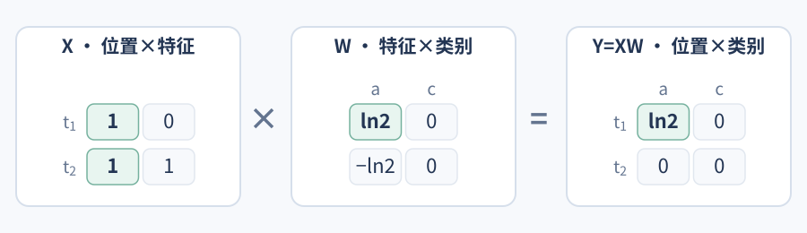
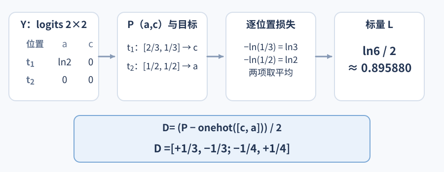
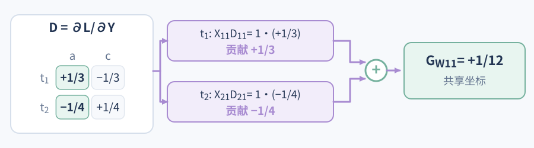
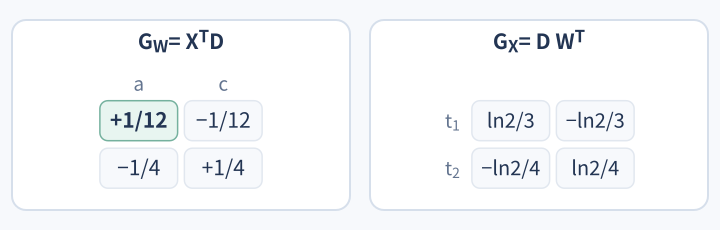
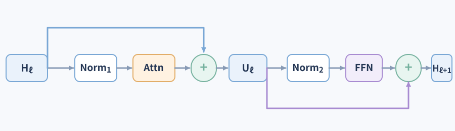
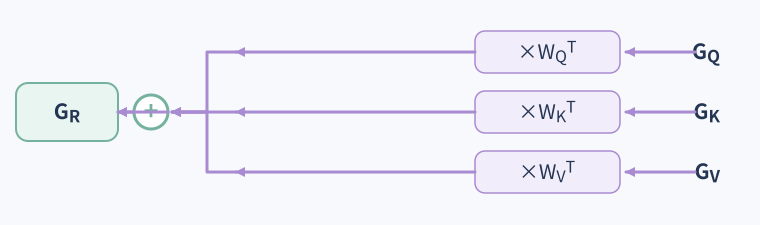
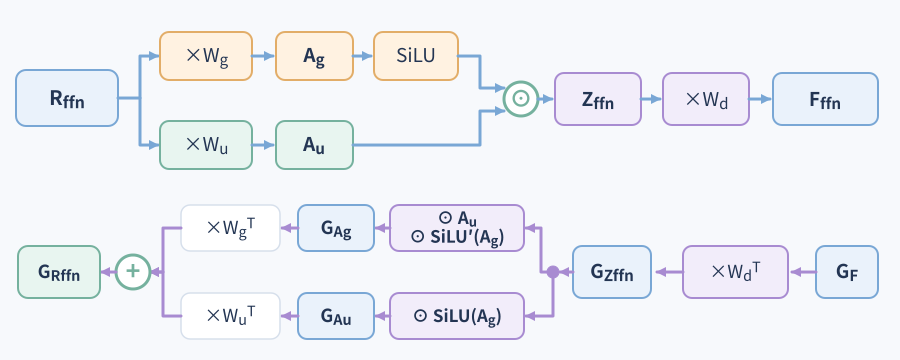
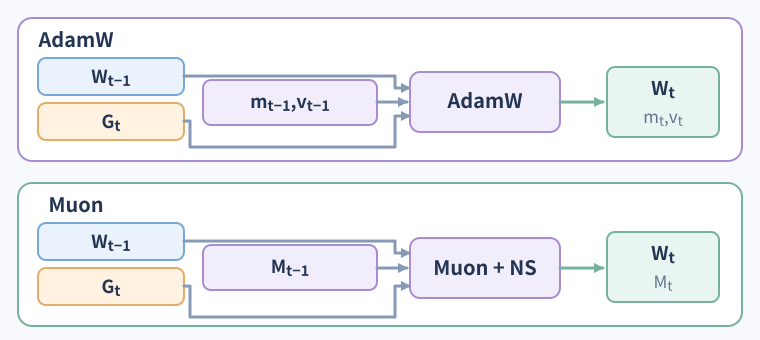
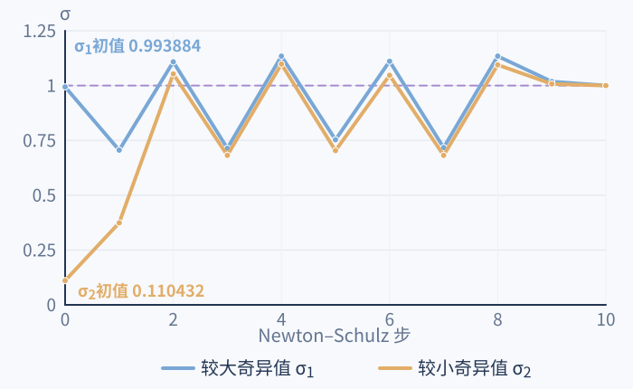

# 训练损失怎样变成每个权重矩阵的更新？

[训练怎样让这些参数变得更会预测？](../model/how-training-updates-parameters.md)已经讲了概念：模型对每个位置算出 logits，和真实的下一个词元比较得到一个标量 cross-entropy (交叉熵) 损失；backpropagation (反向传播) 把误差沿计算图分给每个参数，optimizer (优化器) 再据此改参数。本章把这两步算到矩阵层面：先在一次矩阵乘法上手算参数梯度和输入梯度，再让梯度穿过 attention、FFN、归一化、残差和 embedding，辨析冻结、detach 与离散选择各切断了什么，最后看 SGD、AdamW 和 Muon 怎样把同一份梯度变成新参数。加载已有权重只是给出计算起点，本身既不算梯度也不改参数。

与主线一玩具模型的关系只在这里说一次：第一节沿用[模型怎样把提示词算成下一个词元？](../model/next-token-computation.md)那套玩具 tokenizer 的训练样本，但把输出类别缩成两类、输入和权重人为指定，以便手算；它不是玩具 Transformer 的真实隐藏状态。从第二节起改用一般的 block 记号，不再带具体数值。全章数值都是按公式复算的教学值，不是训练测量。

> [!info] 本章记号
> 全章用行向量右乘：一行是一个位置，`Y=XW`。$G_\bullet$ 总表示损失对某个量的梯度，形状与该量相同，例如 $G_W=\partial L/\partial W$。
>
> | 记号 | 含义 | 用在 |
> | --- | --- | --- |
> | $X,\ W,\ Y,\ P$ | 输入（位置×特征）、权重（特征×类别）、logits、softmax 概率 | 第一节算例 |
> | $D$ | 损失对 logits 的梯度 $\partial L/\partial Y$（本章只此一义） | 第一节 |
> | $N_{loss}$ | 参与平均的有效标签数 | 第一节 |
> | $H_\ell,\ U_\ell$ | 第 $\ell$ 个 block 的输入；attention 残差加法后的中间状态 | 第二节起 |
> | $R_{att},\ R_{ffn}$ | 两次归一化的输出；self-attention 中 $R=R_Q=R_{KV}=R_{att}$ | attention、FFN |
> | $Q,K,V,\ S,\ A,\ Z$ | 查询/键/值、分数、attention 权重、加权输出 | attention |
> | $\mathrm{Mask}$ | 加性因果掩码（0 或 $-\infty$） | attention |
> | $O,\ W_O$ | 多头拼接后的输出投影结果及其权重 | attention |
> | $A_g,\ A_u,\ Z_{ffn},\ F^{ffn}_\ell$ | FFN 的 gate/candidate 预激活、门控后表示、FFN 输出 | FFN |
> | $\gamma_1,\gamma_2$ | 两个归一化层的可学习逐特征缩放 | FFN 一节 |
> | $E,\ N$ | embedding 表、词表大小 | embedding |
> | $t$ | 优化器一节之前是位置下标；优化器一节是训练步 | 该节开头再提示 |
> | $\eta,\ \lambda$ | 学习率、权重衰减系数 | 优化器 |
> | $m,v,\ \beta_1,\beta_2,\ \epsilon$ | AdamW 的一阶/二阶滑动平均、衰减率、防除零常数 | AdamW |
> | $M_t,\ \widetilde M_t,\ \mu$ | Muon 动量、Nesterov 型方向、动量系数 | Muon |
> | $\Delta'_t,\ \Delta_t,\ \kappa$ | Newton–Schulz 输出方向、按形状缩放后的更新、目标更新 RMS | Muon |

## 一次矩阵乘法怎样把梯度分给参数和输入？

训练样本 `ababcac` 被切成词元 `[abab, c, a, c]`，每个位置预测它后面的真实词元：`abab` 之后应是 `c`，`[abab, c]` 之后应是 `a`。这里只取这前两个受监督位置，目标是 `[c, a]`；输出类别只留 `[a, c]` 两类，省略 bias (偏置) 和 multi-token prediction (多词元预测，MTP) 等附加损失。

$X\in\mathbb{R}^{T\times d}$ 的行 `t` 是一个位置，列 `i` 是一个输入特征；$W\in\mathbb{R}^{d\times C}$ 的列 `j` 对应类别 `[a,c]` 之一，$W_{ij}$ 是一个可训练标量。本例 `T=d=C=2`：

$$
X=\begin{bmatrix}1&0\\1&1\end{bmatrix},\qquad
W=\begin{bmatrix}\ln 2&0\\-\ln 2&0\end{bmatrix},\qquad
Y=XW=\begin{bmatrix}\ln 2&0\\0&0\end{bmatrix}.
$$

要区分某一项对 logit 的贡献和完整的 logit：第二行对 `a` 的分数是 $Y_{21}=X_{21}W_{11}+X_{22}W_{21}=\ln2-\ln2=0$。后面追踪 $W_{11}$ 时，只取它在这个和式里的那一项。

### 从 logits 到损失，再到 logits 梯度 D

`Y` 的每一行是一个位置对 `[a,c]` 的打分，逐行 softmax 后得到

$$
P=\begin{bmatrix}2/3&1/3\\1/2&1/2\end{bmatrix}.
$$

第一个位置的目标 `c` 概率为 `1/3`，第二个位置的目标 `a` 概率为 `1/2`。两个负对数概率取平均，得到标量损失

$$
L=\frac{-\ln(1/3)-\ln(1/2)}{2}=\frac{\ln 6}{2}\approx 0.895880.
$$

这个数说明两行预测离目标多远，但没有列出每个 logit 的影响。单行交叉熵可以写成

$$
\ell(z,y)=\log\!\left(\sum_j e^{z_j}\right)-z_y.
$$

对第 `j` 个 logit 求导，第一项的斜率是 softmax 概率 $p_j$，第二项只在正确类别减去 `1`，所以单个位置的 logit 梯度是 $p-\operatorname{onehot}(y)$。本例无类别权重、无 label smoothing，两个标签都参与平均，于是

$$
D=\frac{\partial L}{\partial Y}=\frac{P-\operatorname{onehot}([c,a])}{2}
=\begin{bmatrix}1/3&-1/3\\-1/4&1/4\end{bmatrix}.
$$

$D$ 与 $Y$ 同为 `2×2`，但它不是概率矩阵，而是每个 logit 微小变化会怎样改变 $L$ 的局部斜率。正值表示提高这个分数会让损失上升，负值表示会让损失下降。第一行的 `a` 是错词，对应 `+1/3`；正确的 `c` 对应 `−1/3`。

### 参数梯度 $X^TD$ 与输入梯度 $DW^T$

把前向写成坐标和：$Y_{tj}=\sum_i X_{ti}W_{ij}$。同一个 $W_{ij}$ 出现在每个位置 `t` 的打分里。按链式法则，每次使用它的局部影响乘上对应的输入特征，再把所有位置的贡献相加：

$$
(G_W)_{ij}=\sum_t X_{ti}D_{tj},\qquad G_W=X^TD.
$$

同一个线性层也把梯度传回输入：

$$
(G_X)_{ti}=\sum_j D_{tj}W_{ij},\qquad G_X=DW^T.
$$

$G_W$ 与 $W$ 同为 $d\times C$，它沿位置轴汇总参数每一次被使用时的贡献；$G_X$ 与 $X$ 同为 $T\times d$，它沿类别轴汇总各 logit 传回同一输入特征的影响。$G_X$ 会继续传给更靠近输入端的层。这两条规则是后文每个线性层反向的模板。

> [!example] 一个共享权重怎样汇总两个位置的相反信号？
> $W_{11}$ 把第一个输入特征加到 `a` 的 logit。两行的第一个特征都是 `1`，所以它同时贡献于 $Y_{11}$ 与 $Y_{21}$：
>
> $$
> \frac{\partial L}{\partial W_{11}}=X_{11}D_{11}+X_{21}D_{21}
> =1\cdot\frac13+1\cdot\left(-\frac14\right)=\frac1{12}.
> $$
>
> 第一行单独看，倾向降低 $W_{11}$，减小错误类别 `a` 的分数；第二行单独看，倾向提高它，因为第二行的正确类别就是 `a`。共享矩阵不能为两行分别改同一个参数，只能把贡献相加，得到净梯度 `+1/12`。梯度下降会降低 $W_{11}$，这会同时降低两行的 `a` logit；一次完整更新还会改其他坐标，最终 logits 是多项更新共同作用的结果。

把全部坐标算出：

$$
G_W=\begin{bmatrix}1/12&-1/12\\-1/4&1/4\end{bmatrix},\qquad
G_X=\begin{bmatrix}(\ln2)/3&-(\ln2)/3\\-(\ln2)/4&(\ln2)/4\end{bmatrix}.
$$

真实训练中，一个批次常把多条序列的位置摊平后一起算损失。若有 $N_{loss}$ 个有效标签参与平均，每个有效位置的梯度要除以 $N_{loss}$（本例 $N_{loss}=2$）。被 padding 或任务规则排除的位置，自身的 logit 行没有直接的交叉熵梯度；但它仍可能作为上下文影响其他受监督位置，从而经由那些位置的损失收到梯度。

## 反向模式自动微分怎样把局部规则串成整张图？

真实模型由许多算子串接。框架用 reverse-mode automatic differentiation (反向模式自动微分) 统一处理：从 $\partial L/\partial L=1$ 开始，沿前向实际执行过的算子逆序传播；每个算子用自己的局部导数处理收到的上游梯度，再交给它的输入。上一节的 $X^TD$ 和 $DW^T$ 就是矩阵乘法这个算子的局部规则。

一个标量损失要对大量参数求导时，反向模式一次反向遍历就得到全部梯度，不必为每个参数分别扰动并重跑前向，也不必存下“输出坐标 × 参数坐标”的完整 Jacobian (雅可比矩阵)。代价是要保存（或重新计算）前向的中间激活。

接下来追踪的是一个 pre-norm (前置归一化) decoder-only self-attention block。$H_\ell$ 是第 $\ell$ 个 block 的输入，有 $T$ 个位置和 $d_{model}$ 个特征。前向依次经过两次归一化、两个子层和两次残差加法：

$$
R_{att}=\operatorname{Norm}_1(H_\ell),\qquad
F_\ell^{att}=\operatorname{SelfAttention}(R_{att}),\qquad
U_\ell=H_\ell+F_\ell^{att},
$$

$$
R_{ffn}=\operatorname{Norm}_2(U_\ell),\qquad
F_\ell^{ffn}=\operatorname{FFN}(R_{ffn}),\qquad
H_{\ell+1}=U_\ell+F_\ell^{ffn}.
$$

反向时，梯度从 $H_{\ell+1}$ 进入 block，在每次残差加法处同时流向子层分支和直通旁路，又在共同的输入处相加（合流）。反向实际先经过 FFN，再经过 attention。下面为了先讲最复杂的部分，按前向顺序先展开 attention；它从上游收到的梯度 $G_{U_\ell}$ 在 FFN 一节给出。

## Attention 的反向（一）：从输出回到分数和 Q、K、V

只看一个样本、一个 attention head (注意力头)，省略投影偏置和 attention dropout (注意力随机失活)；启用 dropout 时，梯度要按前向实际用的掩码和缩放回传。RoPE 放到下一节处理。本节和下一节的 `t`、`j`、`k` 都是位置下标。

设 $Q\in\mathbb{R}^{T_q\times d_h}$、$K,V\in\mathbb{R}^{T_k\times d_h}$，$d_h$ 是一个 head 的宽度，$T_q$、$T_k$ 是 query 轴和 key/value 轴的位置数。$\mathrm{Mask}\in\mathbb{R}^{T_q\times T_k}$ 是固定的加性掩码：可读位置加 `0`，屏蔽位置加 $-\infty$。分数沿 key 轴逐行归一化，得到 attention 权重 $A$ 和加权输出 $Z$：

$$
S=\frac{QK^T}{\sqrt{d_h}}+\mathrm{Mask},\qquad
A=\operatorname{softmax}_{keys}(S),\qquad
Z=AV.
$$

`S`、`A` 形状为 $T_q\times T_k$，`Z` 为 $T_q\times d_h$。下面假设每个参与计算的 query 至少有一个未屏蔽的 key；整行都被屏蔽时输入全为 $-\infty$，普通 softmax 公式不适用。

**第一步：穿过 $Z=AV$。** 从输出端收到 $G_Z$ 后，按矩阵乘法规则分别传向 V 和权重：

$$
G_V=A^TG_Z\in\mathbb{R}^{T_k\times d_h},\qquad
G_A=G_ZV^T\in\mathbb{R}^{T_q\times T_k}.
$$

**第二步：穿过逐行 softmax。** 一行共用同一个分母，一个分数变了会影响该行所有权重。对 query 位置 `t`、key 位置 `j`：

$$
(G_S)_{tj}=A_{tj}\left((G_A)_{tj}-\sum_k A_{tk}(G_A)_{tk}\right).
$$

> [!example] 一行 softmax 的反向
> 设某行 $A=(1/4,\ 3/4)$、$G_A=(2,\ 0)$。加权平均 $\sum_k A_{tk}(G_A)_{tk}=1/2$，所以
> $G_S=(1/4\cdot 3/2,\ 3/4\cdot(-1/2))=(3/8,\ -3/8)$，一行之和为零。

因果掩码屏蔽的位置权重为零，对应的分数梯度也为零；$\mathrm{Mask}$ 是常量，不接收梯度。

**第三步：穿过 $QK^T/\sqrt{d_h}$。**

$$
G_Q=\frac{G_SK}{\sqrt{d_h}},\qquad
G_K=\frac{G_S^TQ}{\sqrt{d_h}}.
$$

到这里，一个 head 的输出梯度已经变成了 $G_Q$、$G_K$、$G_V$ 三份。

## Attention 的反向（二）：从 Q、K、V 回到投影、输入和多个头

$Q$、$K$、$V$ 由三个投影得到。投影输入记为 $R_Q\in\mathbb{R}^{T_q\times d_{model}}$ 和 $R_{KV}\in\mathbb{R}^{T_k\times d_{model}}$，权重形状为 $d_{model}\times d_h$：

$$
Q=R_QW_Q,\qquad K=R_{KV}W_K,\qquad V=R_{KV}W_V.
$$

全序列 self-attention 里两者是同一个输入：$R_Q=R_{KV}=R=R_{att}=\operatorname{Norm}_1(H_\ell)$，$T_q=T_k=T$。

**投影权重的梯度**仍用第一节的规则：

$$
G_{W_Q}=R_Q^TG_Q,\qquad
G_{W_K}=R_{KV}^TG_K,\qquad
G_{W_V}=R_{KV}^TG_V.
$$

**共同输入的梯度要相加**，因为三路投影读的是同一个 $R$：

$$
G_R=G_QW_Q^T+G_KW_K^T+G_VW_V^T.
$$

图里只画这一处局部合流。由于 $R=\operatorname{Norm}_1(H_\ell)$，$G_R$ 还要穿过归一化的局部导数，才成为 attention 分支对 $H_\ell$ 的贡献 $G_{H_\ell}^{attn}$；它再与残差直通的梯度相加，才是完整的 $G_{H_\ell}$（见 FFN 一节末尾）。

**cross-attention (交叉注意力) 不能套用单个 $R$ 的公式。** query 与 key/value 来自不同输入时：

$$
G_{R_Q}=G_QW_Q^T,\qquad
G_{R_{KV}}=G_KW_K^T+G_VW_V^T.
$$

Q 的梯度回到 query 的来源；K 和 V 共享 key/value 输入，在那里相加。$T_q\ne T_k$ 的另一个常见场景是增量解码：当前 query 只有一行，K/V 轴包含整个可读前缀。

**RoPE 的反向是乘旋转矩阵的转置。** 前向里 Q、K 还会经过 rotary positional embedding (旋转位置编码，RoPE)。行向量记法下若 $q'=q\operatorname{Rot}_t$，则

$$
G_q=G_{q'}\operatorname{Rot}_t^T,
$$

K 同理，`t` 是该 query 或 key 的位置。也就是先算出对旋转后 Q/K 的梯度（上一节第三步），再乘转置映回投影输出。前面省略 RoPE 只为缩短推导，不表示真实模型可以去掉它。

**多头时，先过输出投影再切回各头。** 有 `h` 个头时，拼接 $H_{cat}=\operatorname{Concat}(Z_1,\ldots,Z_h)$ 形状为 $T_q\times(hd_h)$，$W_O$ 为 $(hd_h)\times d_{model}$，$O=H_{cat}W_O$。反向：

$$
G_{H_{cat}}=G_OW_O^T,\qquad G_{W_O}=H_{cat}^TG_O.
$$

再沿拼接轴把 $G_{H_{cat}}$ 切回各头的 $G_{Z_i}$，分别走上一节和本节的路径。各头共享同一个输入但用各自的投影权重，所以各头传回输入的梯度也要相加。

在本 block 的记号里，$O$ 就是 $F_\ell^{att}$，它进入 $U_\ell=H_\ell+F_\ell^{att}$。加法把上游梯度原样分给两个加数，所以 attention 分支收到 $G_O=G_{U_\ell}$；这个 $G_{U_\ell}$ 已经包含从 FFN 和第二次残差传回的梯度。

## FFN、归一化和残差处，梯度怎样分流又合流？

门控 FFN 先把每个位置投影到更宽的维度，逐元素门控后再投影回 $d_{model}$。gate (门控) 支路经过 SiLU 激活，candidate (候选) 支路提供逐元素相乘的另一项：

$$
A_g=R_{ffn}W_g,\qquad A_u=R_{ffn}W_u,\qquad
Z_{ffn}=\operatorname{SiLU}(A_g)\odot A_u,\qquad F_\ell^{ffn}=Z_{ffn}W_d.
$$

反向时 FFN 最先收到梯度。block 输出端传来 $G_{H_{\ell+1}}$，经过第二次残差加法，FFN 分支收到 $G_{F_\ell^{ffn}}=G_{H_{\ell+1}}$，直通旁路把同一梯度送到 $U_\ell$。

**FFN 内部先分流。** 先过下投影：$G_{Z_{ffn}}=G_{F_\ell^{ffn}}W_d^T$。逐元素乘法再把它分到两条支路，这里只是分流，还没有相加：

$$
G_{A_g}=G_{Z_{ffn}}\odot A_u\odot\operatorname{SiLU}'(A_g),\qquad
G_{A_u}=G_{Z_{ffn}}\odot\operatorname{SiLU}(A_g).
$$

**权重梯度和输入合流。** $G_{W_g}=R_{ffn}^TG_{A_g}$，$G_{W_u}=R_{ffn}^TG_{A_u}$，$G_{W_d}=Z_{ffn}^TG_{F_\ell^{ffn}}$。两条支路穿过各自投影后，在共同输入处相加：

$$
G_{R_{ffn}}=G_{A_g}W_g^T+G_{A_u}W_u^T.
$$

**归一化层有两条不同的梯度路径。** 若归一化带可学习的逐特征缩放，它会收到自己的参数梯度。令 $\widehat H_\ell$、$\widehat U_\ell$ 为 $\operatorname{Norm}_1$、$\operatorname{Norm}_2$ 归一化后、乘缩放前的值；每个缩放坐标在所有位置共用，梯度沿位置轴相加：

$$
(G_{\gamma_1})_i=\sum_{t=1}^{T}(G_{R_{att}})_{ti}\widehat H_{\ell,ti},\qquad
(G_{\gamma_2})_i=\sum_{t=1}^{T}(G_{R_{ffn}})_{ti}\widehat U_{\ell,ti}.
$$

`i` 是特征坐标，`t` 是位置；带可学习偏置时，其梯度同样沿位置轴累加。这是归一化层的参数梯度；穿过归一化局部导数、传回 $H_\ell$ 或 $U_\ell$ 的是另一条路径的输入梯度。

**两次残差处合流。** $G_{R_{ffn}}$ 穿过 $\operatorname{Norm}_2$ 的局部导数，成为 FFN 分支对 $U_\ell$ 的贡献 $G_{U_\ell}^{ffn}$；attention 一节的 $G_R$ 穿过 $\operatorname{Norm}_1$，成为 $G_{H_\ell}^{attn}$。每个残差式一项来自子层分支，一项来自直通路径：

$$
G_{U_\ell}=G_{H_{\ell+1}}+G_{U_\ell}^{ffn},\qquad
G_{H_\ell}=G_{U_\ell}+G_{H_\ell}^{attn}.
$$

整个 block 的反向因此是：从 $H_{\ell+1}$ 经第二次残差回到 $U_\ell$，再经 attention 残差回到 $H_\ell$，然后进入上一层。有些模型不用普通残差，例如 mHC 把单条旁路扩展为多条状态流的混合，混合系数也由状态算出；这时梯度沿实际执行的各条状态流和系数的计算路径返回，结构见[MoE、mHC 和 MTP 分别改了 Transformer 的哪一块？](../model/architecture-variants.md)。无论结构如何，前向没经过的边不会把损失传回去。

## 梯度怎样到达 embedding，共享词表头时又怎样相加？

梯度最终到达最底层的 embedding。embedding lookup (嵌入查表) 从 $E\in\mathbb{R}^{N\times d}$ 中按整数 ID 取一行：位置 `t` 的 ID 是 `q` 时，$X_t=E_{q,:}$。反向把该位置的 $G_{X,t}$ 加到 $G_E$ 的第 `q` 行。同一 ID 出现多次，贡献累加；ID 本身是离散整数，不从连续损失得到普通梯度。

若 embedding 表与 language model head (语言模型头，LM head) 绑定（weight tying），按行向量约定必须有 $C=N$ 且 $W=E^T$。查表路径汇总的梯度 $G_{lookup}\in\mathbb{R}^{N\times d}$ 与输出打分路径的 $G_W^T\in\mathbb{R}^{N\times d}$ 形状相同，共享表的完整梯度是两者之和：

$$
G_E=G_{lookup}+G_W^T.
$$

## 冻结、detach 和离散选择各切断了什么？

这三种操作都会让人说“梯度不过去”，但切断的东西不同：

| 操作 | 这个参数或张量会被更新吗 | 梯度还能穿过它传到更早的量吗 |
| --- | --- | --- |
| 冻结权重 $W$ | 不更新，也不为它累积参数梯度 | 能。前面可训练的 $X$ 经 $XW$ 影响损失时，仍用固定的 $W$ 算 $G_X=DW^T$ |
| detach 一个张量 | —— | 不能。它从产生它的上游计算图上被切下，损失不再沿这条边传回 |
| 离散选择（argmax、top-k 取 ID） | —— | 整数 ID 没有普通的连续导数，无法表示“改选另一个 ID”对损失的影响；被选中的值仍可沿后续连续运算收到梯度 |

**冻结。** LoRA 是典型例子：有效权重 $W'=W+\Delta W$，基础矩阵 $W$ 冻结，低秩增量 $\Delta W$ 的两个因子可训练；梯度仍可穿过冻结的 $W$ 回到输入。手算见[什么时候该微调，LoRA、SFT 和 DPO 各改了什么？](fine-tuning-lora-sft-dpo.md)。PyTorch 2.15 中，`requires_grad=False` 让这个参数本身不接收梯度；只要乘法的另一个输入需要梯度，这次乘法仍会被记录，用来算那个输入的梯度。

**detach 与离散选择一起出现时。** DeepSeek-V3.2 的稀疏注意力先用 indexer 打分、再按 top-k 选位置，训练时用 detach、离散选择和 indexer 自己的辅助损失共同限定梯度路径，见[DeepSeek 怎样压缩长上下文的注意力状态？](../model/deepseek-compressed-attention.md)。DeepSeek-V4 报告公开了训练阶段安排，但没有给出能直接照用的完整 indexer 损失和 detach 配方；不应从推理代码里的整数选择反推 V4 的训练损失。

## 优化器怎样用算好的梯度改参数：SGD、AdamW 和 Muon

到这里，反向传播只回答了“损失怎样依赖参数”：它在当前 $W$ 上算出 $G_W$，还没有改 $W$。优化器回答另一个问题：根据梯度、学习率和历史状态，这一步之后参数取什么值。**从这一节起 $t$ 表示训练步**：第 $t$ 次更新从 $W_{t-1}$ 开始，在它上面算出 $G_t=\nabla_W\mathcal{L}_t(W_{t-1})$，得到 $W_t$。

图中 $W_{t-1}$、本步梯度 $G_t$ 和各自的历史状态进入 AdamW 或 Muon，产生 $W_t$ 和更新后的状态。AdamW 逐坐标使用 $m,v$；Muon 对整个矩阵使用动量 $M$ 和 Newton–Schulz 变换。

### SGD：沿梯度反方向走一步

stochastic gradient descent (随机梯度下降，SGD)：

$$
W_t=W_{t-1}-\eta G_t.
$$

$\eta$ 是学习率，决定这一步走多远。沿用第一节的 $G_W$、取 $\eta=0.01$ 对整张矩阵走一步，再用新矩阵对同一批数据重算交叉熵，损失从 `0.895880` 降到约 `0.894492`。实际训练不保证每一步损失都下降。学习率调度器可以随训练步调整 $\eta$，但它本身不保证到达全局最优。

### AdamW：逐坐标按历史缩放

AdamW 为每个可训练坐标维护两类历史：$m_t$ 是梯度的指数滑动平均；$v_t$ 是梯度平方的指数滑动平均（不是先减均值的方差）。从全零状态开始：

$$
m_t=\beta_1m_{t-1}+(1-\beta_1)G_t,\qquad
v_t=\beta_2v_{t-1}+(1-\beta_2)(G_t\odot G_t),
$$

$$
\widehat m_t=\frac{m_t}{1-\beta_1^t},\qquad
\widehat v_t=\frac{v_t}{1-\beta_2^t},\qquad
W_t=(1-\eta\lambda)W_{t-1}-\eta\frac{\widehat m_t}{\sqrt{\widehat v_t}+\epsilon}.
$$

`⊙`、平方根、除法和衰减都逐坐标执行。$\beta_1$、$\beta_2$ 控制新梯度替换旧历史的速度；偏差校正补偿状态从零开始造成的初期低估；$\epsilon$ 防止除零。decoupled weight decay (解耦权重衰减) 直接缩小参数，不进入 $m_t$ 或 $v_t$。

> [!example] AdamW 第一步怎样更新 $W_{11}$？
> 沿用 $W_{11}=\ln2$、$G_{11}=1/12$，从 $m_0=v_0=0$ 开始，取 $\eta=0.01$、$\lambda=0.1$、$\beta_1=0.9$、$\beta_2=0.95$、$\epsilon=10^{-20}$（相对梯度可忽略）。偏差校正后 $\widehat m_1=1/12$、$\widehat v_1=(1/12)^2$，自适应项约为 `1`。参数先由衰减从 $\ln2$ 缩为 $0.999\ln2$，再减去 `0.01`，得到 $W_{11}\approx0.682454$。
>
> 注意参数值、损失梯度和优化器状态是三种不同的量。这里的 $\beta_1,\beta_2,\epsilon$ 和衰减 `0.1` 与 DeepSeek-V4 技术报告中 V4-Flash/V4-Pro 的 AdamW 设置一致；学习率、参数起点和梯度是教学设定。

### Muon：把整个矩阵梯度变成正交化方向

Muon 是针对隐藏层二维权重矩阵的优化器，不是新的反向传播方法；输入仍是反向传播算好的 $G_t$。Keller Jordan 的原始说明建议把标量、向量和输入/输出层参数交给 AdamW 等标准优化器。

**动量与 Nesterov 型方向。** 按 DeepSeek-V4 报告 Algorithm 1 的写法，先累积矩阵动量，再形成要正交化的方向（其他实现的动量写法可能不同）：

$$
M_t=\mu M_{t-1}+G_t,\qquad \widetilde M_t=\mu M_t+G_t.
$$

**正交化：把所有奇异值拉到 1。** 设 $W\in\mathbb{R}^{n\times m}$，$M_t$、$\widetilde M_t$ 同形。用 compact singular value decomposition (紧致奇异值分解，SVD) 写 $\widetilde M_t=U_r\Sigma_rV_r^T$，`r` 是秩，$\Sigma_r$ 的奇异值描述沿配对方向的伸缩（这里的 $U_r$、$V_r$ 只是 SVD 因子）。理想的正交化方向是 $U_rV_r^T$：保留非零奇异方向，把伸缩倍数都改成 `1`，零方向仍为零。实际不每步做完整 SVD，而是从 $\widetilde M_t/\lVert\widetilde M_t\rVert_F$ 开始，用 Newton–Schulz (牛顿–舒尔茨，NS) 迭代的矩阵多项式逼近这个方向。归一化要求 $\widetilde M_t\ne0$。

**按形状缩放并更新。**

$$
\Delta'_t=\operatorname{NewtonSchulz}(\widetilde M_t),\qquad
\Delta_t=\kappa\sqrt{\max(n,m)}\,\Delta'_t,\qquad
W_t=(1-\eta\lambda)W_{t-1}-\eta\Delta_t.
$$

为什么乘 $\sqrt{\max(n,m)}$：若 $\Delta'_t$ 满秩且奇异值约为 `1`，其 Frobenius norm (弗罗贝尼乌斯范数) 约为 $\sqrt{\min(n,m)}$，摊到 $nm$ 个元素上，每元素均方根约为 $1/\sqrt{\max(n,m)}$；乘上 $\sqrt{\max(n,m)}$ 后约为 `1`，再由 $\kappa$ 设定更新的整体 RMS。秩不足时，达到 `1` 的方向更少，实际 RMS 低于这个估算。$\Delta_t$ 是从梯度变换出的更新方向，不会把模型权重 $W$ 本身变成正交矩阵。

**为什么要完整矩阵。** NS 迭代的矩阵乘法把不同行列方向耦合起来，把一张逻辑权重切块后各自迭代，通常不等价于对完整矩阵迭代。

AdamW 逐坐标累计梯度与梯度平方再逐坐标缩放；Muon 按逻辑矩阵累计动量，正交化方向后按形状缩放。两者都从同一份梯度开始，差别只在怎样把梯度和历史状态变成更新。哪些参数交给哪种优化器，属于具体训练配方。

### 实例：DeepSeek-V4 的 Muon 配方（技术报告 v1，2026-11-11 核对）

- **参数分工。** V4 在大多数矩阵参数上用 Muon；embedding、prediction head (预测头)、mHC 静态偏置与门控因子、RMSNorm 权重交给 AdamW。按这个分工，第一节那张词表打分矩阵会由 AdamW 更新；下面的例子只演示一般矩阵怎样得到方向。
- **NS 系数。** 前 8 步用 $(a,b,c)=(3.4445,-4.7750,2.0315)$，后 2 步改用 $(2,-1.5,0.5)$，共 10 步；每步对奇异值 $x$ 作用 $x'=ax+bx^3+cx^5$。
- **其他数值。** 动量 $\mu=0.95$，权重衰减 $\lambda=0.1$，更新 RMS 调到 $\kappa=0.18$，以沿用其 AdamW 学习率尺度。这些是 V4 配方的值，不是所有 Muon 实现的默认值。（本章把这个缩放系数记作 $\kappa$，以免与归一化缩放 $\gamma_1,\gamma_2$ 混淆。）
- **分布式。** 报告说明 Muon 更新需要完整梯度矩阵，用 hybrid ZeRO (零冗余优化器) bucket 分配协调数据并行；超出相应 ZeRO 并行范围时，在额外的数据并行组上冗余计算更新。“完整”指更新数学上作用的逻辑矩阵，不表示每块 GPU 都常驻一份完整权重。

> [!example] 对角矩阵上的 8+2 步 NS 迭代
> 取 $\widetilde M_t=\operatorname{diag}(9,1)$。Frobenius norm 为 $\sqrt{82}$，归一化后两个奇异值从 `(0.993884, 0.110432)` 开始。对角矩阵可以逐个奇异值用 $x'=ax+bx^3+cx^5$ 计算：
>
> | 步 | 奇异值（按原对角顺序） |
> | ---: | --- |
> | 1 | `(0.705643, 0.373984)` |
> | 8 | `(1.094391, 1.134267)` |
> | 10 | `(1.000030, 1.000190)` |
>
> 前 8 步多次越过 `1`，最后两步换成第二组系数后收拢到约 `1`；有限步迭代不会精确等于 `1`，初始为零的奇异值始终为零。这只复算了标量多项式，不是 BF16 内核或训练实测。

图中每一步按奇异值从大到小排序，所以和上表的对角顺序可能不同。

## 新参数接回下一步训练

一步结束时，参数从 $W_{t-1}$ 变为 $W_t$，优化器状态同步更新；下一步用 $W_t$ 重新前向、算新的损失和梯度。本章的规则在两条支线里直接复用：微调时，[LoRA 冻结基础矩阵、只让梯度落到低秩因子上](fine-tuning-lora-sft-dpo.md)；强化学习时，[检查器的奖励变成每个已采样词元的优势权重](reward-based-reasoning-training.md)，之后同样经反向传播和优化器更新参数。

> [!info]- 来源
> - **交叉熵与反向模式（第一、二节；“冻结、detach”一节）。** [PyTorch `CrossEntropyLoss` 2.15](https://docs.pytorch.org/docs/2.15/generated/torch.nn.CrossEntropyLoss.html)：输入为未归一化 logits，类别索引目标、忽略位置与平均规则；本例取无类别权重、无 label smoothing。[PyTorch Autograd mechanics 2.15](https://docs.pytorch.org/docs/2.15/notes/autograd.html)：“How autograd encodes the history” 说明计算图沿链式法则反向求导，“Setting `requires_grad`” 说明只有启用梯度的叶参数累积参数梯度、所需输入梯度仍沿已记录运算传播。[`torch.Tensor.detach` 2.15](https://docs.pytorch.org/docs/2.15/generated/torch.Tensor.detach.html)：detach 返回与当前图分离的张量。[Baydin et al., *Automatic Differentiation in Machine Learning: A Survey*, arXiv v4, 2018-02-05, §§3.2、4.2](https://arxiv.org/html/1502.05767v4#S3.SS2)：反向模式从标量目标沿计算图计算对多个输入的导数。
> - **Attention 与位置旋转（两节 attention 反向）。** [*Attention Is All You Need*, v7, §3.2](https://arxiv.org/html/1706.03762v7#S3.SS2) 给出 $QK^T$、softmax 与 $AV$ 的前向结构；[RoFormer, v5, §3.2.2, equations 14–16](https://arxiv.org/html/2104.09864v5#S3.SS2) 定义 Q/K 位置旋转。反向式由本章按链式法则从这些前向关系推导，RoPE 的转置来自对右乘矩阵求导。
> - **AdamW（“AdamW”小节）。** [Kingma and Ba, *Adam: A Method for Stochastic Optimization*, arXiv v9, Algorithm 1](https://arxiv.org/abs/1412.6980v9)：矩估计与偏差校正；[Loshchilov and Hutter, *Decoupled Weight Decay Regularization*, arXiv v3, §2](https://arxiv.org/html/1711.05101v3#S2)：权重衰减与自适应更新解耦；[PyTorch `AdamW` 2.15](https://docs.pytorch.org/docs/2.15/generated/torch.optim.AdamW.html)：更新公式与参数。
> - **Muon 机制（“Muon”小节）。** Jordan, [*Muon: An optimizer for hidden layers in neural networks*](https://kellerjordan.github.io/posts/muon/), 2024-12-08：面向隐藏层二维权重，用 Newton–Schulz 近似正交化，其余参数交给标准优化器；Liu et al., [*Muon is Scalable for LLM Training*, arXiv v1](https://arxiv.org/html/2502.16982v1), §§2.1–2.3：大模型中的更新缩放与分布式实现。
> - **DeepSeek-V4 配方（AdamW 例中的超参数；“实例：DeepSeek-V4 的 Muon 配方”）。** DeepSeek-AI, [*DeepSeek-V4* Technical Report v1](https://arxiv.org/html/2606.19348v1)：§2.4 Algorithm 1 给出动量、Nesterov 方向、缩放与权重衰减，式 (28) 与 “Hybrid Newton-Schulz Iterations” 给出 8+2 步系数；§3.4.1 “Efficient Implementation of Muon” 说明完整梯度矩阵与 hybrid ZeRO bucket；§4.2.2 “Training Setups” 给出 AdamW/Muon 参数分工与 V4-Flash/Pro 数值。2026-11-11 核对。
