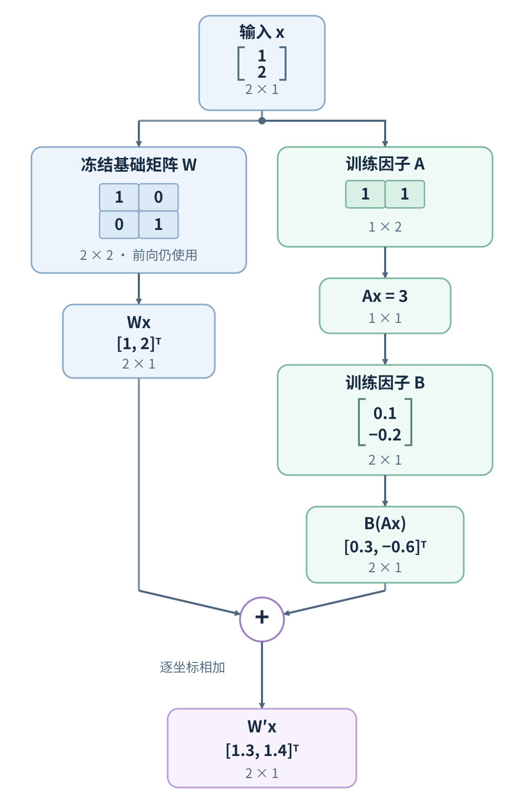

# 何时应微调来弥补稳定的行为差距？

## 案例：日志助手反复给出错误标签

值班工程师想让日志助手把失败日志归入固定标签，并按 JSON 契约输出，方便后续聚合。这个合成案例假设 build 1842 的配置已确认 `10.0.0.8:5432` 是构建数据库端点，而且运行请求会把该配置事实一并传给模型。为完整展示小样例的输入契约，假设标签集合只有 `database_connection_refused`（连接被拒绝）、`database_timeout`（连接尝试超时）和 `other`（不属于前两类）；真实系统需要提供完整标签定义。日志是 `Build 1842 failed: connect ECONNREFUSED 10.0.0.8:5432`，目标标签为 `database_connection_refused`，摘要为“构建进程无法连接数据库”。模型有时误标成 `database_timeout`，有时又在 JSON 外加说明。

先区分这两种失败。若应用能用结构化输出稳定保证 JSON，格式应由应用层约束；微调不能替代 schema（结构模式）校验。若模型在事实、标签定义、权限或流程不清时出错，先修正数据源、指令、标签和工作流。只有请求已含判断所需信息、目标行为定义明确、同类输入仍反复映射错误，而且团队有经过审查的正确示例时，才值得评估微调。

| 观察到的失败 | 先改变什么 | 何时进入微调评估 |
| --- | --- | --- |
| 缺少或变化中的服务事实 | 权威数据源、检索或 application programming interface（API，应用程序接口） | 微调不能代替实时事实更新或权限检查；必要时把稳定行为与检索结合。 |
| 指令、标签定义或流程不清 | 提示词、上下文、标签设计或工作流 | 这些因素稳定后，仍有可重复的行为差距，且能写出正确示例。 |
| 同一输入反复违反风格、分类或响应格式 | 更清楚的提示词；应用可保证时用结构化输出 | 仍有稳定的目标行为差距，再用代表性样例训练，并以独立评估验证收益。 |

fine-tuning（微调）用损失函数把训练信号传回可训练参数，使目标示例所表达的响应模式在之后的调用中更常出现。训练数据不是附加到模型里的可查询记录；权重不能按请求实时刷新事实或实施用户权限。新事实仍需从有权限的来源检索，参见[如何检索并使用经过授权的外部证据？](../rag/rag-architecture-and-implementation.md)。训练前，应在同一批代表性输入上比较提示词、结构约束、检索和工作流基线；只有目标差距可复现、示例能表达正确行为，且预计收益值得训练与维护成本时，才继续。

这个示例中的 `ECONNREFUSED` 和已知端点足以支持一条确定性规则，因此这条日志用于说明输入契约与正确标注，不能证明微调优于规则。若要评估微调，应把候选任务限定在规则或改进后的提示词仍会稳定出错、但每次输入都含有足够判断证据的真实变体；不能靠训练让模型从缺失的端点信息中猜服务。

## 标签差距应该更新哪些参数？

full fine-tuning（全量微调）会更新所有启用训练的基础权重。若要在选定的线性层增加低秩可训练分支，可用 low-rank adaptation（LoRA，低秩适配）说明参数高效微调的思路：冻结原投影，只训练低秩增量。目标哪些层与每层的秩是两个配置选择，本节只用一个局部线性层手算；这个二输入、二输出玩具向量不是模型真实隐藏状态，也不是训练实测值。

采用列向量约定，线性层的基础权重 `W` 形状为 `d×k`，输入 `x` 有 `k` 个坐标，输出 `Wx` 有 `d` 个坐标。LoRA 用 `A`（`r×k`）和 `B`（`d×r`）表示增量，因此 `BA` 与 `W` 同形，秩至多为 `r`。本例取 `x=[1,2]^T`、`W=I`（二阶单位矩阵）、瓶颈秩 `r=1`，并设 `A=[1,1]`（形状 `1×2`）、`B=[0.1,−0.2]^T`（形状 `2×1`）。LoRA 将投影写成

$$
W'=W+\Delta W,\qquad \Delta W=BA,\qquad W'x=Wx+B(Ax).
$$

先算冻结的基础分支：`Wx=[1,2]^T`。适配分支先把二维输入压成一个数 `Ax=3`，再投影回二维，得到 `B(Ax)=[0.3,−0.6]^T`。两支逐坐标相加，`W'x=[1.3,1.4]^T`。这里特意给 `B` 非零值来展示增量；LoRA 原论文采用 `A` 随机初始化、`B` 零初始化，因此初始增量为零。这说明低秩分支如何改变一个局部表示；它不会直接把最终输出替换成目标标签。



训练时，cross-entropy loss（交叉熵损失）产生的 gradient（梯度）沿计算图做 backpropagation（反向传播）到 `A`、`B`，optimizer（优化器）再逐步更新它们；基础矩阵 `W` 不接收参数更新。冻结参数仍会参与前向计算。若 `x` 来自仍可训练的前一层，反向传播仍通过冻结的 `W` 和 LoRA 分支计算传回 `x` 的梯度；冻结不等于在这里切断计算图。相关梯度路径见[一个矩阵怎样把梯度传给参数和输入](../foundations/training-gradients-and-optimizers.md#一个矩阵怎样把梯度传给参数和输入)。

真实 LoRA 常再乘 `α/r` 缩放因子，并可能在适配分支使用 dropout（随机失活）；上面的手算省略这两项。若权重存储约定或矩阵方向不同，代码中的乘法和因子名称可能转置，形状应以具体实现为准。

在单个 `4096×4096` 投影上取 `r=8`，LoRA 两个因子共 `r(k+d)=8(4096+4096)=65,536` 个可训练数值，原稠密矩阵有 `dk=4096×4096=16,777,216` 个数值。这只比较一个目标矩阵的参数量；整个模型的训练参数、优化器状态和激活显存还取决于目标层、批次与序列长度，不能由这个比例推算整次训练的质量或显存。

`rank`（矩阵秩）限制单个目标矩阵的增量 `BA` 可表达的方向数。目标层数决定哪些投影可改变；每层秩决定该层增量的容量，这两项可分别选择，但若要给不同层设不同秩，还要看训练器是否支持。降低秩会减少适配参数及对应优化器状态，但也可能限制适应复杂行为的能力；训练显存不会按比例下降，因为基础权重和激活仍要参与计算。独立加载 adapter 时，提高秩通常会增加推理运算；对稠密权重及兼容的推理路径，把增量合并进同形基础矩阵后，投影形状与矩阵乘规模不因秩而变。若基础权重已量化，合并支持取决于量化格式和后端；兼容路径可能先反量化、相加、再量化，重新量化会有舍入差异，不能假定输出与独立 adapter 完全相同。应在实际服务路径复验，并选能运行的起点，在相同数据与留出样例上比较，不存在保证质量的通用秩。

其他方法更新不同位置。QLoRA（量化低秩适配）冻结量化基础权重并训练 LoRA 因子；原论文把基础权重以 4-bit NF4 存储，在其配置中以 BF16 计算，梯度只更新 LoRA 因子。论文主实验配置将 adapter 放在 Transformer block 的所有线性层；当前 PEFT 的 QLoRA-style 指南也用 `all-linear`，而训练器仍允许配置其他目标层。4-bit NF4、BF16 和全线性层都是具体实现选择，不代表任何模型、后端或任务都应使用相同配置。adapter（适配器）在 Transformer 层中加入可训练小模块；prefix tuning（前缀微调）学连续向量，作为各层的前缀表示；prompt tuning（软提示微调）在输入嵌入前学少量连续向量。后两者不是普通可见文本词元，也不同于编辑指令文字的提示词工程。

全量微调的适应容量较大，但计算、训练状态和模型产物成本更高；LoRA 等方法减少可训练参数，但目标层选择、可用训练器、保存与服务路径都会影响实际开销。有些服务栈可在兼容的稠密路径中把 LoRA 合并进基础权重，有些在推理时保留额外分支。量化权重的合并步骤与舍入误差还取决于具体后端。选择时要同时看行为差距的复杂度、显存、底座是否要保留、训练产物格式和部署支持，并用目标服务评估，而不要假定一种参数高效方法必然胜过另一种。

## 案例中的标签如何变成训练损失？

当目标是稳定的标签映射，训练数据要把实际输入和经过审查的期望输出配成示范。日志助手的一个合成样例如下：

**输入消息（user）：**

> Use exactly one category from this approved list:
> - `database_connection_refused`: the connection was rejected.
> - `database_timeout`: the connection attempt timed out.
> - `other`: neither of the above.
>
> Return one JSON object with exactly two string-valued keys, `category` and `summary`, and no other text.
>
> Build 1842 config confirms `10.0.0.8:5432` is the build database endpoint.
>
> Classify this log: `Build 1842 failed: connect ECONNREFUSED 10.0.0.8:5432`

**同一条示范的目标回答（assistant）：**

```json
{
  "category": "database_connection_refused",
  "summary": "构建进程无法连接数据库。"
}
```

这里拆开展示同一条训练示范的输入消息与目标回答，便于阅读。提交给训练器时，再按它规定的消息字段和格式保存这对内容；提示词边界和 loss mask（损失掩码）也由训练配置确定。

supervised fine-tuning（SFT，监督微调）将期望回答分成目标词元序列 `y₁,…,y_N`。预测第 `j` 个目标词元时，模型以输入 `x` 和样本中正确的前缀 `y_{<j}` 为条件。teacher forcing（教师强制）就是把训练样例的真实前缀用作条件；对带因果掩码的 decoder（解码器），可以一次并行处理整段已知序列来计算各位置的预测，不必逐个词元重跑完整前向。常见 cross-entropy（交叉熵）目标为

$$
L(\theta)=-\frac{1}{N}\sum_{j=1}^{N}\log\pi_\theta(y_j\mid x,y_{<j}),
$$

其中 `N` 是参与这项平均的目标词元数；$\pi_\theta(\cdot\mid x,y_{<j})$ 表示当前模型在输入和真实前缀条件下，对下一个词元给出的概率分布，$\pi_\theta(y_j\mid x,y_{<j})$ 是正确目标词元的概率。若训练器用损失掩码排除提示词或部分回答，分母会对应实际保留的目标位置。

为单独看清“纠正一个标签”会给出什么信号，切换到一个二候选玩具分类器：把多词标签 `database_timeout` 与 `database_connection_refused` 各简化成一个虚构词元，logits（未归一化分数）设为 `[2,0]`，目标是第二个候选。softmax（归一化指数函数）后的概率为 `[e²,1]/(e²+1)≈[0.880797,0.119203]`，目标类别的损失为

$$
-\log\frac{1}{e^2+1}=\log(e^2+1)\approx 2.126928.
$$

对这两个候选 logit 的梯度是 `p − onehot(y)≈[+0.880797,−0.880797]`，其中 `onehot(y)` 是目标类别坐标为 1、其他坐标为 0 的独热向量。所以梯度下降倾向降低错误候选的相对分数，提高正确候选的相对分数。这个二类演算只说明一个位置的梯度方向；真实回答包含许多目标词元，共享参数还会收到其他位置和其他样本的梯度，不能据此断言更新后的模型会给出某个精确概率。这里假设完整 assistant 回答都在监督区间；其他数据可用损失掩码排除部分词元。

> [!example] 这项损失怎样到达 LoRA 因子？
> 切回上一节的合成 LoRA 投影，把输出 `z=W'x=[1.3,1.4]^T` 暂当两个候选标签的 logits，并令目标为第二类。这只是把局部线性层接到二类交叉熵上的教学组合；它不是日志助手真实模型的层边界，也不是训练记录。此时 `p=softmax(z)≈[0.475021,0.524979]`，所以损失约 `−log(0.524979)≈0.644397`，对输出的梯度为 `g_z=p − onehot(y)≈[0.475021,−0.475021]^T`。
>
> 记 `u=Ax=3`。`u` 是标量，所以 `B` 的两个元素梯度分别是对应输出梯度乘 3。对 `A`，先用 `B` 对两个输出梯度加权：`B^Tg_z=0.1×0.475021+(−0.2)×(−0.475021)≈0.142506`；再把这个标量乘输入行向量 `[1,2]`。在 `W'x=Wx+B(Ax)` 中，`W` 与 `x` 固定时，链式法则给出
>
> $$
> \frac{\partial L}{\partial B}=g_z u^T\approx\begin{bmatrix}1.425062\\-1.425062\end{bmatrix},\qquad
> \frac{\partial L}{\partial A}=(B^Tg_z)x^T\approx\begin{bmatrix}0.142506&0.285012\end{bmatrix}.
> $$
>
> 两个结果的形状分别为 `2×1` 和 `1×2`，与 `B`、`A` 一致。它们是这组玩具数值下的参数梯度，不是优化器更新；若基础矩阵冻结，反向计算仍可使用它，但不会对它应用参数更新。

梯度经共享计算图传到被选的参数：全量微调可更新所有启用训练的基础权重，LoRA 则更新低秩因子而冻结基础投影。许多不同输入和正确回答共同塑造参数，使相似条件下的目标行为更常出现；微调不会把这条日志作为一行数据库记录插入模型。若新日志分布变了，标签映射仍可能失效。

训练样例应覆盖 `ECONNREFUSED` 的不同措辞、日志前后缀、合法标签边界，以及容易混淆的 `timeout`。不要把同一行重复很多次当作覆盖。数据审查还要检查事实和标签是否正确、标注口径是否一致、重复或近重复输入、敏感信息和数据使用权。按事故、来源或时间段分开训练与评估，避免同一次事故的近重复日志落在两边而造成泄漏。样本数本身不是质量证据，也没有保证成功的通用样本量。

> [!example] 摘要也可以作为监督目标
> 下面仍是合成输入—输出对，只说明 SFT 也能示范摘要措辞；输出要遵循应用定义的事实与风格标准。
>
> ```json
> {
>   "messages": [
>     {"role": "user", "content": "Summarize these notes: The supplier will deliver the parts by June 1. The invoice has already been sent."},
>     {"role": "assistant", "content": "The supplier will deliver the parts by June 1."}
>   ]
> }
> ```

## 怎样组织训练、调参并验收？

1. **定义重复失败和验收界限。** 固定输入范围、目标行为、运行约束和不可接受的回归。例如统计把 `ECONNREFUSED` 误判为 timeout 的比例，提供完整合法标签集，并事先约定关键切片需要达到的改善及其他标签、JSON、安全、成本和时延允许的变化范围。
2. **建立无训练基线。** 固定基础模型、提示词、结构约束、检索、工作流和可用确定性规则，在代表性样本上记录各失败切片的分母和表现。能由应用层保证的 schema 约束也应纳入基线。
3. **准备并审查示范。** 去重，检查标签与目标词元，排除未授权或敏感数据，确保输入覆盖常见类型和重要边界。
4. **分开数据用途。** 训练集用来算梯度；验证集用于比较训练控制和选检查点；所有方案固定后才运行最终留出测试集。根据事故或来源分组，并记录切分方法及可能泄漏。
5. **固定训练与部署路径。** 记录基础模型和版本、全量或参数高效方法、训练器版本、目标模块、数据格式、许可、产物保存方式及目标服务是否能加载。
6. **跑小规模实验并记下配置。** 至少记录学习率与调度、训练轮数、批次和梯度累积、数据版本、LoRA 秩与目标模块、随机种子、检查点和验证指标。
7. **冻结选择后独立比较。** 对基线和候选使用相同输入（包括相同的端点事实、标签集和其他判断上下文）与推理设置，检查总体成功率、关键标签切片、非法 JSON、安全、成本和时延；最终测试结果不能再用于选参。
8. **谨慎部署并监控。** 对模型和回滚路径做版本管理，遵守数据保留与同意规则，并持续观察相同业务结果。线上失败能提示新增评估样例，但未经核验的用户反馈不自动成为训练标签。

学习率决定优化器更新的尺度：对某个模型、数据和批次，过大可能使训练不稳定，过小则可能在预算内学不到目标。epoch（训练轮数）是一遍训练集；增加轮数可能改进拟合，也可能导致过拟合。batch size（批次大小）决定一次更新综合多少样本。若每卡微批次为 `b`、设备数为 `D`、梯度累积步数为 `K`，在每个样本等权的常见配置下，有效样本批次近似 `bDK`。梯度累积让多个较小微批次先累积梯度，再进行一次参数更新；在有效批次固定时，它主要改变每次更新前分几次计算，不会增加每次更新代表的样本数。若保持 `b` 和 `D` 而增大 `K`，有效批次增大，每遍数据的优化器更新次数会减少。样本长度差异较大时，还要确认训练器按样本还是按词元聚合损失。

训练损失和验证损失可帮助诊断，却不能替代任务指标。验证集参与选模型后不再是最终独立证据；反复据最终测试集调参也会让它泄漏进开发过程。至少将微调候选与未微调基线比较，并查清楚提升是否覆盖重要输入切片。任务契约与独立评估设计见[如何判断 AI 系统是否满足任务契约？](../evaluation/llm-evaluation-methods.md)。

回到日志案例，所有候选都应在带有同一端点事实和完整标签集的评测输入上比较；先能用规则确定分类的子集仍由规则作为基线。只有关键误标切片达到预设改善界限，同时其他标签、JSON、安全、成本和时延均未越过约定边界，才部署候选；否则沿用原基线，不把单条合成示例当作成功证据。

## SFT、偏好优化和奖励训练怎样取舍？

选择训练目标时，先看手里是什么反馈，以及它能支持什么结论：

| 可用反馈 | 常用训练信号 | 更适合的问题 |
| --- | --- | --- |
| 经审查的目标回答 | SFT，对目标词元做交叉熵 | 能清楚写出希望模型怎样回应，例如稳定分类、风格或格式习惯。 |
| 同一提示下的优劣回答比较 | DPO，或“奖励模型 + 强化学习”流程 | 目标质量更容易相对比较，逐条写出唯一正确回答不自然。偏好依赖评审口径与样本覆盖。 |
| 可由程序或其他独立规则复核的结果 | 可验证奖励强化学习（RLVR） | 答案、结构或任务结果有可靠检查器；奖励只支持检查器覆盖的结论。 |

supervised fine-tuning（SFT）让模型模仿示范中的回答。它教的是样例实际表达的行为，不保证模型在未见场景中遵循所有指令或保持安全，部署时仍需运行时控制，可参阅[生产环境中的 AI 安全](../safety/ai-safety-in-production.md)。

InstructGPT 论文描述的 reinforcement learning from human feedback（RLHF，基于人类反馈的强化学习）是一个具体多阶段方法：先用人工示范做 SFT，再从同一提示下的多个回答收集偏好排序以训练奖励模型，最后用 proximal policy optimization（PPO，近端策略优化）优化策略，使其获得更高奖励，同时用 Kullback–Leibler（KL）散度惩罚限制其偏离 SFT 模型。不要把这一研究流程误当成所有助手模型的训练流程。

direct preference optimization（DPO，直接偏好优化）直接用同一提示下被选中和被拒绝的回答训练策略；论文通过偏好模型假设推导出直接的二元分类式目标，不必先单独训练奖励模型。它仍依赖偏好数据、参考策略和目标函数；简化训练流程不等于一定更准确、更安全或不需要独立验收。

reinforcement learning with verifiable rewards（RLVR，可验证奖励强化学习）用规则或可复核结果产生奖励，适用于有可靠结果检查的任务。分类任务可用人工确认的目标标签做精确匹配奖励，但若每条样本已有明确目标回答，SFT 往往更直接；只有当采样、策略学习或结果奖励确有价值时才考虑强化学习。奖励也只能表达检查器真正覆盖的标准。推理任务中的采样、判分、组内优势与长度处理见[可验证奖励如何训练推理能力？](reward-based-reasoning-training.md)。

偏好标签可能互相矛盾，或只反映标注者和 rubric（评分准则）的选择。无论 SFT、DPO 还是强化学习，训练目标分数上升都不等于任务质量已改善；应在未参与训练、调参或样本筛选的输入上验收，并检查事实、安全、分布变化、成本和时延。

> [!warning] 训练方法的支持随平台变化
> 微调是通用训练概念，具体服务是否提供某种训练方法、可训练的底座和部署路径是另一项产品约束。例如截至 2026-11-12，OpenAI 官方文档称其自助微调平台正在逐步结束：2026-05-07 起，从未运行过微调的组织不能创建新训练任务；2026-07-02 起，过去 60 天没有对微调模型运行推理的组织不能创建新任务；符合资格的既有活跃客户自 2027-01-06 起也不能再创建新训练任务，若底座更早退役则以更早日期为准。已训练模型的推理则持续到对应基础模型退役。使用该 API 前应重新核对资格、模型时限和目标服务支持。

> [!info]- 来源
> 下列来源支持正文中的机制与边界。矩阵、标签、logits 和输出均为合成教学值，不是实际模型训练结果。
>
> - **LoRA 结构与部署。** Hu et al., *LoRA: Low-Rank Adaptation of Large Language Models*（arXiv:2106.09685，§4.1 的低秩分解、冻结基础矩阵、训练因子和合并推理；§4.2 的 Transformer 投影示例；§3.1 对 adapter 推理延迟的比较），[论文 HTML](https://arxiv.org/html/2106.09685)。本章为便于与前一训练梯度篇对照而采用明确的列向量教学记法。
> - **QLoRA。** Dettmers et al., *QLoRA: Efficient Finetuning of Quantized LLMs*（arXiv:2305.14314v1，2023-05-23，§2.2 的 LoRA 增量与冻结基础权重、§3 的 NF4 存储/BF16 计算与反向传播、§4 和附录 B.2 的实验/超参数范围），[论文 HTML](https://arxiv.org/html/2305.14314)。该论文的主实验配置对 Transformer block 线性层都加 LoRA；4-bit 与实验结论只描述论文配置，不能推广为所有任务的保证。Hugging Face [PEFT QLoRA-style training](https://huggingface.co/docs/peft/main/en/developer_guides/quantization#qlora-style-training)与[量化权重合并](https://huggingface.co/docs/peft/main/en/developer_guides/quantization#merging-adapters-into-quantized-weights)页面于 2026-11-12 核对：前者展示 `all-linear` 目标模块；后者说明兼容量化合并时会反量化、相加、再量化，来回合并可能累计舍入误差。该页显示为 main 版，需从源码安装，并不自动保证目标服务支持相同路径。
> - **Adapter、prefix tuning 与 prompt tuning。** Houlsby et al., *Parameter-Efficient Transfer Learning for NLP*（arXiv:1902.00751v2，2019-06-13，§2 与 §2.1 的 adapter 模块和 Transformer 插入位置），[论文 HTML](https://arxiv.org/html/1902.00751)；Li and Liang, *Prefix-Tuning: Optimizing Continuous Prompts for Generation*（arXiv:2101.00190v1，2021-01-01，§4.1–4.2 的连续前缀与冻结语言模型），[论文 HTML](https://arxiv.org/html/2101.00190)；Lester et al., *The Power of Scale for Parameter-Efficient Prompt Tuning*（arXiv:2104.08691v2，2021-09-02，§2 的软提示），[论文 HTML](https://arxiv.org/html/2104.08691)。这些工作定义各自方法，不表示任意模型或服务都支持。
> - **训练监督区间。** Hugging Face TRL [SFT Trainer](https://huggingface.co/docs/trl/en/sft_trainer#train-on-assistant-messages-only) 的 assistant-only 与 completion-only 选项说明损失掩码；实际可用性还依赖数据类型和 chat template（对话模板）。核对于 2026-11-12。
> - **SFT、数据与评估。** Vaswani et al., [*Attention Is All You Need*, v7, §3.1](https://arxiv.org/html/1706.03762v7#S3.SS1) 的 decoder causal mask 与目标移位；Ouyang et al., *Training language models to follow instructions with human feedback*（arXiv:2203.02155v1，2022-03-04，§3.1 的 SFT→奖励模型→PPO 流程、§3.2 的按用户分组数据切分与个人身份信息过滤、§3.4–3.5 的人工数据和模型训练、§4.3 记录的简单失败），[论文 HTML](https://arxiv.org/html/2203.02155v1)。OpenAI [SFT 指南](https://developers.openai.com/api/docs/guides/supervised-fine-tuning)和[微调最佳实践](https://developers.openai.com/api/docs/guides/fine-tuning-best-practices)支持示范数据、基线评估与训练结果验收；页面截至 2026-11-12 核对。训练流程和事故分组建议是工程实践，不是上述论文或平台规定的通用保证。
> - **DPO。** Rafailov et al., *Direct Preference Optimization: Your Language Model is Secretly a Reward Model*（arXiv:2305.18290，§3 的偏好数据与典型 RLHF 流程、§4 的直接策略目标与偏好模型假设），[论文 HTML](https://arxiv.org/html/2305.18290)。
> - **可验证奖励。** DeepSeek-AI, *DeepSeek-R1: Incentivizing Reasoning Capability in LLMs via Reinforcement Learning*（arXiv:2501.12948v2，2026-01-04，§2.2 以正确性和格式检查产生规则奖励），[v2 HTML](https://arxiv.org/html/2501.12948v2)。正文把精确匹配奖励用于分类只是教学上的延伸；具体结论仍限于检查器覆盖的目标。
> - **OpenAI API 当前可用性。** [OpenAI API 弃用说明](https://developers.openai.com/api/docs/deprecations)的“Update to OpenAI’s self-serve fine-tuning”小节列出 2026-05-07、2026-07-02 和 2027-01-06 的训练资格节点；[SFT 指南](https://developers.openai.com/api/docs/guides/supervised-fine-tuning)导言说明既有客户自 2027-01-06 起不能新建训练任务，若基础模型更早关闭则以更早日期为准，微调模型推理持续至底座关闭。页面截至 2026-11-12 核对。时间线仅适用于该平台。
