# 语言模型如何把提示词变成文本？

## 沿着一段短输入追踪模型处理过程

[服务篇](../systems/from-message-to-answer.md)的第 2 步中，构建日志助手已经把 `Why did build 42 fail?`、应用指令和工具定义格式化为模型输入。本章从这次调用的完整输入开始，解释它如何变成输出序列，以及训练如何得到其中使用的参数。

为了让运算能在纸上跟下来，我们把完整请求暂时切换成独立的玩具输入 `ababca`，用独立的 tokenizer (分词器) 和 `N=258` 项词表。示意的 decoder-only Transformer (仅解码器 Transformer) 宽度 `d=8`、有两个 attention head (注意力头)、使用 gated feed-forward network (门控前馈网络，FFN)，把三个 token (词元) 位置一起送入模型。这里有 `T=3`、`d=8`、两个头且每头宽度 `d_h=4`；不等于服务篇单独采用的四位置教学输入。下文只借用各局部数值说明运算，没有一整套可复现完整前向计算的权重；这些值与构建助手的实测状态无关。真实消息的分词只用于对照词元边界，不与玩具词表混用。

~~~mermaid
flowchart TD
    Req["服务篇交来的完整请求"] --> Case["切换为独立玩具输入 ababca"]
    Case --> Tok["toy BPE [257, 99, 97]"]
    Tok --> E["嵌入查表 X₀：3 × 8"]
    E --> Layers["L 层 prefill / 新行 decode Norm₁ → QKV、RoPE、Attention → 残差 Norm₂ → SwiGLU → 残差；逐层保留 K/V"]
    Layers --> Head["最终 Norm → 取末行 h_last × W_LM：1×8 · 8×258"]
    Head --> Select["logits → 贪心或采样 选出 ID_t"]
    Select --> Stop{"已选 ID / 调用状态应停止？ EOS、stop、上限、取消"}
    Stop -->|是| Out["按结束规则收尾 解码已输出的生成词元"]
    Stop -->|否| EmbedNext["嵌入 ID_t 放在下一位置"]
    EmbedNext --> Layers
~~~

每次模型选出一个 ID 后，调用方先把它纳入生成结果并判断结束条件；只有还要继续时，才把这个 ID 嵌入下一位置并从第 1 层开始续算。结束时再按应用规则解码已输出的词元，输入部分仍留在上下文中。

## 分词器如何划分词元边界？

token 是特定词表中的一个条目。它可以表示标点、一个字节、部分单词、整个单词，也可以是带前导空格的一段文本。tokenizer 把文本映射为这些条目的整数 ID。ID 用来标识条目；ID 数字更大，并不表示对应的词更重要或更有力量。

在 byte-level byte pair encoding (字节级字节对编码，BPE) 中，训练从单字节片段开始，反复合并相邻且频繁出现的片段对。常见实现会先用正则表达式把文本分成若干段，再在每段内部执行 BPE。编码新文本时，会使用已经学到的合并优先级。

假设训练片段是 `abab`、`ab` 和 `ac`。先建立 256 个单字节条目，编号为 `0` 到 `255`。`a+b` 这一对出现三次，因此第一次合并会创建 `ab`，ID 为 `256`。此时各段变为 `[ab, ab]`、`[ab]` 和 `[a, c]`。接下来，`ab+ab` 和 `a+c` 都各出现一次。假定这个玩具示例的平局规则选择 `ab+ab`，于是创建 ID 为 `257` 的 `abab`。

| 步骤 | 对此前未见的输入 `ababca` 所做的处理 |
| --- | --- |
| 从字节开始 | `[a, b, a, b, c, a]` |
| 应用优先级最高的可用合并 | `[ab, a, b, c, a]`，然后是 `[ab, ab, c, a]` |
| 应用下一次合并 | `[abab, c, a]` |
| 查找这三个 ID | `[257, 99, 97]` |

作为真实词表的对照，服务章节中的用户消息 `Why did build 42 fail?` 使用 `tiktoken 0.12.0` 和 `cl100k_base` 单独编码后是七个片段 `["Why", " did", " build", " ", "42", " fail", "?"]`，对应 ID `[10445, 1550, 1977, 220, 2983, 3775, 30]`。这只覆盖用户原句；实际调用把应用指令、工具定义和用户消息按模型模板格式化后再编码，有历史时还可加入选定的消息。它与上面 `ababca` 的玩具词表是两套独立的 ID，不能互换。同一版本对 `The transformer architecture revolutionized NLP.` 的分词也显示边界不等于词界：`revolutionized` 被切成 `revolution` 与 `ized`，`NLP` 被切成 `N` 与 `LP`。

> [!info] 词元边界不一定是字符边界
> 一个 Unicode 字符可能由多个 UTF-8 字节组成。字节级词元片段可能会拆开这些字节，因此逐个把词元当作完整字符串解码，可能得到损坏的字符。增量文本解码会暂存尚未完整的字节，直到后续字节到达。

这会影响请求的 token 预算。统计输入时，要使用已部署模型的 tokenizer，并计入请求格式中的角色标记和工具定义。如果完整对话太长，接下来要决定的是[每次模型调用应保留哪些信息](../context/context-engineering-principles.md)，而不是简单地数词。BPE 只是 tokenizer 的一种类型，并非后续 Transformer 计算的必需条件。

## 第一个 Transformer 块接收什么？

embedding table (嵌入表) 为词表中的每个条目保存一个已学习的 vector (向量)。设词表大小为 `N`、模型宽度为 `d`、输入长度为 `T`。在这个玩具模型中，`N = 258`、`d = 8`、`T = 3`，所以表 `E` 的形状是 `258 × 8`。

ID `257` 选出 `E` 中索引为 `257` 的行，ID `99` 和 `97` 则选出相应的行。把取出的行堆叠起来，就得到初始 hidden state (隐藏状态)`X₀`，形状为 `3 × 8`。此时第一个位置是 `abab` 的向量，第二个位置是 `c` 的向量，第三个位置是 `a` 的向量。

**图：三个 ID 如何查出并堆成 `X₀`**

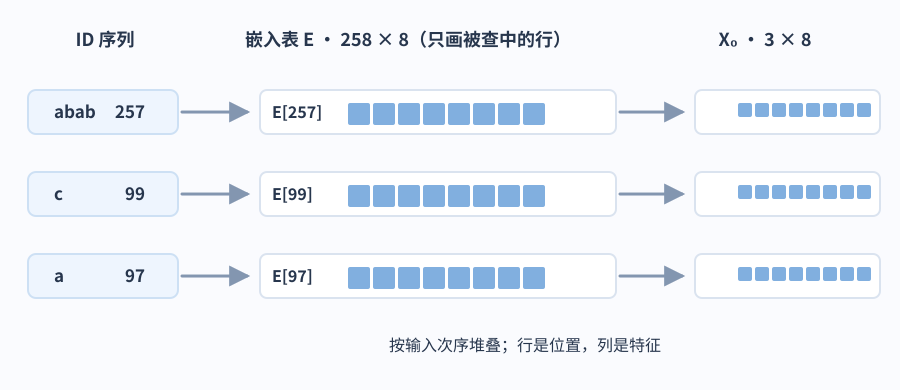

> [!info] 读数之前先看清各轴
> 在 `T × d` 中，行表示词元位置，列表示已学习的特征坐标。一行是一个 vector，也就是由 `d` 个数字按顺序组成的列表。一列则表示某个坐标在各个位置上的取值。如果添加一个 batch axis (批次维)，它就能把多个这样的序列放在一起。某个特征坐标并没有固定、可读作“篮球”之类的含义。

同一 ID 选出的初始行相同，但后续各层会根据位置和上下文改变它的表示。从数学上看，查表等价于用一个 one-hot vector (独热向量) 乘以 `E`：独热向量在对应 ID 的位置上是 `1`，其余位置都是 `0`。实际实现通常直接取出相应行。

attention sublayer (注意力子层) 使用这些向量之前，我们的模型会做 normalization (归一化)。例如，RMSNorm (均方根归一化) 会让每行除以其坐标均方值加上一个很小的稳定常数后所得的平方根，再乘上可学习的坐标缩放值。忽略这个很小的常数，并假定缩放值都为 `1`，`[3, 4]` 除以 `√((9+16)/2) ≈ 3.536` 后约为 `[0.849, 1.131]`。这能控制数值尺度，不会改变行数或列数。我们把归一化后的矩阵记为 `U`。接下来的步骤会在 Q 和 K 中引入位置信息。

## Q、K、V 如何生成注意力更新？

### 将每一行投影为 Q、K、V

attention (注意力) 计算每个位置应从可见位置汇集哪些信息。它从当前 hidden state 推导出三种表示。query (查询，Q) 参与决定要匹配什么；key (键，K) 参与计算匹配分数；value (值，V) 提供将根据这些分数组合的内容。这些名称描述的是向量在计算中的用途。

本例先用 multi-head attention (多头注意力，MHA) 与全量因果 attention：每个 Q 头各有自己的 K/V 头和对应投影。在本例中，每个头的宽度为 `4`。将 `3 × 8` 的矩阵 `U` 乘以该头形状为 `8 × 4` 的查询投影权重，得到形状为 `3 × 4` 的 Q。K 和 V 也以相同方式计算，只是使用各自的矩阵。

> [!info] 矩阵乘法会得到什么？
> 每个输出坐标都是输入行与权重列的 dot product (点积)。例如，`[2, 3] · [4, 5] = 2×4 + 3×5 = 23`。如果权重的两列分别是 `[4, 5]` 和 `[1, −1]`，同一输入行就会变成 `[23, −1]`。每一列定义了输入特征的一种加权组合。因此，`3 × 8` 乘以 `8 × 4` 后仍有三个位置，每个位置产生四个特征。相乘的内侧维度相同，决定了哪些坐标会相乘并求和。

把两个头一起计算很方便。有 `Hq = 2` 个头、每个头宽度 `dh = 4` 时，每个合并投影矩阵的形状为 `d × (Hq·dh) = 8 × 8`。我们计算 `Q = UW_Q`、`K = UW_K` 和 `V = UW_V`，然后沿特征轴拆分为两个宽度为 `4` 的头。每个头各自得到一个 `3 × 4` 的 Q、K 和 V。这里使用行向量右乘权重的记法。库也可能按转置后的方向存储权重；例如 PyTorch `Linear` 会按输出特征数 × 输入特征数存储权重。

模型使用 rotary position embedding (旋转位置编码，RoPE)。它会根据 Q 和 K 所属的位置旋转其中成对的坐标，再计算点积。因此，所得分数可以受相对位置影响，但张量形状不变。

只看一对二维坐标，并按列向量记法，位置 `i` 的 Q 与位置 `j` 的 K 的点积满足

$$
\langle R(\theta_i)q_i,R(\theta_j)k_j\rangle
=\langle q_i,R(\theta_j-\theta_i)k_j\rangle.
$$

两边的位置旋转在点积里合成相对角度 `θⱼ−θᵢ`；高维 RoPE 会对不同坐标对使用各自的频率。

### 把两两分数转换为加权混合

对一个头，计算每个 query 位置与每个 key 位置之间的分数。

$$
S_{raw} = \frac{QK^\top}{\sqrt{d_h}},\qquad
S = S_{raw}+M,\qquad
P = \operatorname{softmax}_{\mathrm{keys}}(S),\qquad
Z = PV.
$$

**图：从 Q、K、V 到头输出与残差更新**

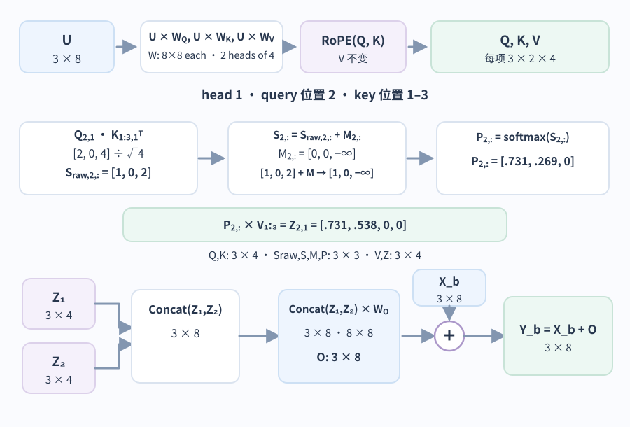

这里的 `Kᵀ` 表示 K 的 transpose (转置)，也就是交换 K 的行与列。`Q` 的形状是 `3 × 4`，`Kᵀ` 的形状是 `4 × 3`，所以乘积形状为 `3 × 3`。其中 `(i, j)` 项是位置 `i` 的 Q 与位置 `j` 的 K 的点积；随后 mask 会排除不可见的位置对。本例的每一行都可直接考虑其前缀位置，所以全量因果注意力会为可见的位置对打分。这次乘法比较的是各个位置；前面的 `UW_Q` 则是在每个位置内部变换特征。

随着头宽增大，除以 `√dh` 会控制分数的尺度。在一个用来解释这一做法的近似假设下，各坐标彼此独立、均值为 `0` 且方差为 `1`，那么 `dh` 个乘积之和的方差与 `dh` 成正比。缩放能抑制分数差异随头宽增大，降低 softmax 过度集中于单项的风险。

causal mask (因果掩码) `M` 在每个 query 行上，把未来 key 对应的分数加上 `−∞`，其他可见分数加 `0`。它阻止当前位置读取未来，但因果性本身不要求所有历史位置都可见；本例没有使用滑动窗口。对第二个位置，也就是词元 `c`，假设已经按位置旋转的 Q 是 `[2, 0, 0, 0]`。设 `abab`、`c` 和 `a` 的旋转后 K 分别为 `[1, 0, 0, 0]`、`[0, 1, 0, 0]` 和 `[2, 0, 0, 0]`。这些 K 与 Q 的点积为 `[2, 0, 4]`。除以 `√4 = 2` 后，未掩码分数 `S_raw` 为 `[1, 0, 2]`。未来的词元 `a` 分数最高，但把 `M=[0,0,−∞]` 加到该行后得到 `S=[1,0,−∞]`，再沿 key 轴做 softmax。

> [!example] softmax 把分数变成相对权重
> softmax 对每个分数取指数，再除以所有指数之和。这里 `e ≈ 2.718`。`[1, 0, −∞]` 对应的权重为 `[e/(e+1), 1/(e+1), 0] ≈ [0.731, 0.269, 0]`，总和为 `1`。这些权重表示这个头如何混合 V 向量；它们不是对应词语为真的概率。

假设前两个 V 向量是 `(1, 0, 0, 0)` 和 `(0, 2, 0, 0)`。那么第二个位置的加权和为

$$
0.731(1,0,0,0)+0.269(0,2,0,0)=(0.731,0.538,0,0).
$$

对全部三个 query 位置而言，`P` 的形状是 `3 × 3`，`V` 的形状是 `3 × 4`，所以 `Z = PV` 的形状是 `3 × 4`。现在每个输出行都包含它能够看到的位置汇集来的信息。

### 合并注意力头并保留已有状态

每个头的 `Z_i=P_iV_i` 都是一行对应一个 query 位置的加权和，形状为 `3 × 4`。有两个头时，concatenation (拼接) 会把两个宽度为 `4` 的输出并排放在每个位置，得到 `3 × 8`；形状为 `8 × 8` 的输出投影 `W_O` 再混合头与特征：

$$
O=\operatorname{Concat}(Z_1,Z_2)W_O\in\mathbb{R}^{3\times 8}.
$$

有些论文把单个位置、单个头的加权和写成 `o_{t,i}`；它对应这里的 `Z_i` 的第 `t` 行。`O` 在本章表示拼接后经过输出投影的整张矩阵，符号会因资料而异。attention 输出 `O` 是供残差流接收的更新，和最终由 LM head 算出的词表 logits 不是一回事。

在 pre-norm 的 decoder-only block 中，residual connection (残差连接) 会把注意力更新加回未归一化的输入状态：`Y=X+O`。两项同为 `3 × 8`，所以输出仍是每个位置一行、每行宽度为 `8`。例如某行输入 `[1, 2]`、相应更新 `[0.1, −0.2]` 时，相加结果为 `[1.1, 1.8]`。下一步 FFN 再对这个状态做一次独立的残差更新。

不同层、任务和输入中的 attention head 行为可能不同。某个头可能经常关注前一个位置，但仅凭权重图并不能确定它的完整功能。它的 V 向量、输出投影以及后续层也都会影响结果。

### 注意力头共享 K 和 V 时会怎样？

上面的计算使用 multi-head attention (多头注意力，MHA)，每个 Q 头都有一个 K/V 头。grouped-query attention (分组查询注意力，GQA) 让一组 Q 头共享一个 K/V 头。如果仍保留两个 Q 头、但只使用一个 K/V 头，那么 `W_Q` 仍是 `8 × 8`，而 `W_K` 和 `W_V` 会变为 `8 × 4`。两个 Q 仍各自生成宽度为 `4` 的输出，所以拼接后的形状和 `W_O` 都不变。

`Hkv` 表示 K/V 头数。在本例的全量因果注意力中，生成时每层都会保留此前位置的 K 和 V，供后续 token 复用。滑动窗口或稀疏注意力还会限制直接可见的历史，缓存长度与策略须按模型结构确认；例如 Mistral 7B 的滑动窗口层只直接读取最近 `W` 个位置，并以固定大小 `W` 的滚动缓存覆盖更早条目，远处信息可经多层向后传递。MHA 中 `Hkv = Hq`；multi-query attention (多查询注意力，MQA) 则是 `Hkv = 1` 的情况。这些选择会影响所学权重，以及生成过程中存储的 K/V 数量。把 MHA checkpoint 转为其他结构会改变 K/V 权重和模型行为；GQA 论文评估了基于权重平均的转换以及后续训练。在这个例子中，缓存了三个位置时，每层的 MHA 会存储 `2 × 3 × 2 × 4 = 48` 个 K/V 数值，依次对应 K/V 两种表示、三个位置、两个头和每头四个坐标。共享一个 K/V 头后，数量降为 `2 × 3 × 1 × 4 = 24`，而两个 Q 头仍各自计算分数。若想了解服务环节的影响，请继续阅读[KV cache 和调度如何决定推理容量](../systems/llm-serving-and-kv-cache.md)。对于 `T` 个位置的一次完整 prefill 或 full-sequence 训练，dense attention 对 mask 允许的 query/key 位置对计算分数，配对数量仍随 `T²` 增长；增量解码若只处理一个新 query，它对长度为 `T` 的全量缓存逐项打分，单步随 `T` 线性增长。实际时延还取决于 kernel (计算内核)、其他层和硬件。

共享 K/V 头减少了每个位置的表示数量，却没有减少历史位置数。输入长到几十万甚至百万个 token 时，还可以追问：能否压缩每个位置的 K/V，或让当前 query 只读取部分历史？[DeepSeek 的长上下文 Attention](long-context-attention.md)以 V3、V3.2 和 V4 预览版为例，展开 MLA 的矩阵吸收，以及选择、压缩历史各自会丢掉什么。

## FFN 增加了什么，多个块如何堆叠？

### 变换每个位置的特征

attention 更新已经把上下文信息带入每一行。FFN 会在每行内部应用非线性变换。它也常被称为 multilayer perceptron (多层感知机，MLP)。同一层内的所有位置共用一套 FFN 权重，不同层通常使用不同权重。如果投影之间没有非线性操作，多次线性变换会合并为一次线性变换；加入非线性后，更新就能更丰富地取决于输入特征的组合。

以 SwiGLU FFN 为例，先对经过 attention 更新的状态做归一化，得到形状为 `3 × 8` 的 `R`。两个投影 `W_g` 和 `W_u` 的形状都是 `8 × 16`，分别生成门控输入和候选分支。对门控输入应用 SiLU，用 `⊙` 表示逐元素相乘两个分支，最后通过 down projection (降维投影) `W_d` 投影回去；它的形状为 `16 × 8`。

$$
F(R)=\big[\operatorname{SiLU}(RW_g)\odot(RW_u)\big]W_d,
\qquad \operatorname{SiLU}(x)=x\sigma(x),
\qquad \sigma(x)=\frac{1}{1+e^{-x}}.
$$

sigmoid `σ` 的取值介于 `0` 和 `1` 之间。SiLU 将输入乘以这个比例，形成平滑的非线性变换。在这里，最后得到的门控值可能是负数，也可能大于 `1`。它们连续地缩放候选特征，而不是像二进制开关那样只有开或关。

> [!example] SiLU 如何门控候选特征
> 对某一行取两个门控输入 `[0, 1]` 和候选值 `[2, 3]`。SiLU 先把门控输入变为约 `[0, 0.731]`，再逐元素相乘，得到 `[0, 2.193]`。这只是 `3 × 16` 中两个通道的例子；`W_d` 随后把整行的 16 个通道混合为 8 个，再将这个更新加回 attention 状态。逐元素乘法保持宽度为 16，不会像点积那样求和为单个数字。
>
> **图：同一 `3 × 8` 算例中的 SwiGLU 通道流**
>
> 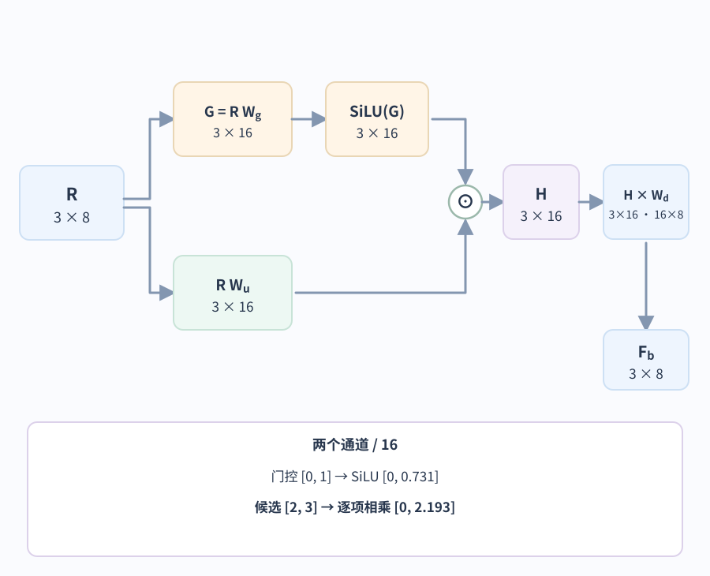

由于门控分支和候选分支都取决于当前行，同一套权重可以针对不同上下文产生不同更新。

这有助于解释学习到的知识为何会影响预测。如果某一行代表篮球语境中的人名，学到的特征组合就可能激活某些方向，从而影响相关的输出词元。Geva 等人发现，他们所研究的部分 FFN 中存在文本模式关联和输出影响。这一发现适用于那些模型，并不表示每个 FFN 都是字面意义上的事实数据库。模型输出事实的能力也取决于 attention、多层计算和最终词表投影。若信息必须保持最新或能够核验，[检索与依据构建](../rag/rag-architecture-and-implementation.md) 介绍了应用如何提供外部证据。

### 把更新后的状态传给下一层

这里的块使用 pre-normalization (预归一化)，也就是在 attention 和 FFN 之前分别做归一化。用 `b` 标记 Transformer block：

$$
Y_b=X_b+\operatorname{Attention}_b(\operatorname{Norm}_{b,1}(X_b)),
$$
$$
X_{b+1}=Y_b+F_b(\operatorname{Norm}_{b,2}(Y_b)).
$$

**图：同一块中的两次更新与两条残差旁路**

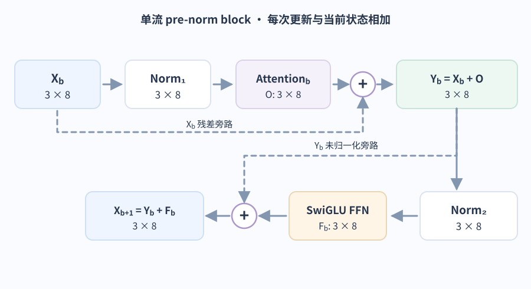

上面用 `b` 数整个 block；在下面的 mHC 记号中，`l` 改为数单次残差更新步骤，所以一个 decoder-only block 的 attention 和 FFN 各占一步。若只看序列中的位置 `t`，可把该行状态记为 $x_{l,t}$。attention 的 $F_l$ 会读取它允许访问的上下文位置，FFN 则逐位置变换特征。损失 `L` 是模型最终预测与训练目标比较后得到的标量；它不是 $X_l$ 或 $F_l(X_l)$ 这样的状态或更新向量。

残差相加让同一个输出同时依赖原样旁路和变换分支。反向传播时，两个分支对同一输入的梯度会相加；旁路贡献会直接到达更早的状态，但总梯度仍可能被变换分支抵消。看一维例子 $y=x+ax$，若输出处收到的损失梯度是 $g=\partial L/\partial y$，则旁路贡献为 `g`，更新分支贡献为 `ag`，总梯度是 $(1+a)g$。当 `a=0` 时旁路仍传回 `g`；当 `a=-1` 时两条路径相消。因而，残差旁路提供一条直接路径，却不能单独保证整个网络的梯度大小或训练稳定性。

前面的块是单流教学模型。从这里暂时离开主算例，分别看三个不可混为一套 toy 配置的版本例子：mHC 展示 DeepSeek-V4 怎样扩展残差流；MoE 使用 DeepSeek-V3 的路由分数；MTP 按 V3 论文的训练示例展开。看完这些结构对照后，回到单流主算例，从所有块的末位置接入 LM head。

Manifold-Constrained Hyper-Connections（流形约束超连接，mHC）把每个词元的残差状态扩成 4 条宽度为 `d` 的流，再将它们读成普通层输入、混合旧流，并把同一次子层更新写回各流。先用两个宽度为 `2` 的流手算结构：

> [!example] 两条流怎样读取、混合并写回同一个更新
> 状态矩阵的行是流，列是特征。为隔离这次手算，图中把当步 $A_l$、$B_l$、$C_l$ 的矩阵值作为已给输入；$X_l$ 与子层输出 $u_{l,t}$ 是它们分别作用的状态操作数。真实 V4 会按下文所述由当前状态生成这些映射权重。
> 先用 $A_l$ 读出当前词元的子层输入：
>
> $$
> X_l=\begin{bmatrix}1&2\\3&0\end{bmatrix},\qquad
> A_l=\begin{bmatrix}0.5&0.5\end{bmatrix},\qquad
> A_lX_l=\begin{bmatrix}2&1\end{bmatrix}.
> $$
>
> 假设对整段输入执行这次 attention 或 FFN 后，取当前词元对应的一行输出 $u_{l,t}=[0.1,-0.2]$。残差旁路矩阵和写回权重取为
>
> $$
> B_l=\begin{bmatrix}0.75&0.25\\0.25&0.75\end{bmatrix},\qquad
> B_lX_l=\begin{bmatrix}1.5&1.5\\2.5&0.5\end{bmatrix},\qquad
> C_l=\begin{bmatrix}1\\0.5\end{bmatrix}.
> $$
>
> 子层只计算一次；$C_l$ 把同一个输出切片分别按 $1$ 倍和 $0.5$ 倍写进两条流，再与旁路相加：
>
> $$
> C_lu_{l,t}=\begin{bmatrix}0.1&-0.2\\0.05&-0.1\end{bmatrix},\qquad
> X_{l+1}=B_lX_l+C_lu_{l,t}=\begin{bmatrix}1.6&1.3\\2.55&0.4\end{bmatrix}.
> $$
>
> 这里为了便于阅读选了平均式的 $A_l$，但 $A_l$ 没有双随机约束。
>
> **图：两条流的 A / B / C 路径和实际加数**
>
> 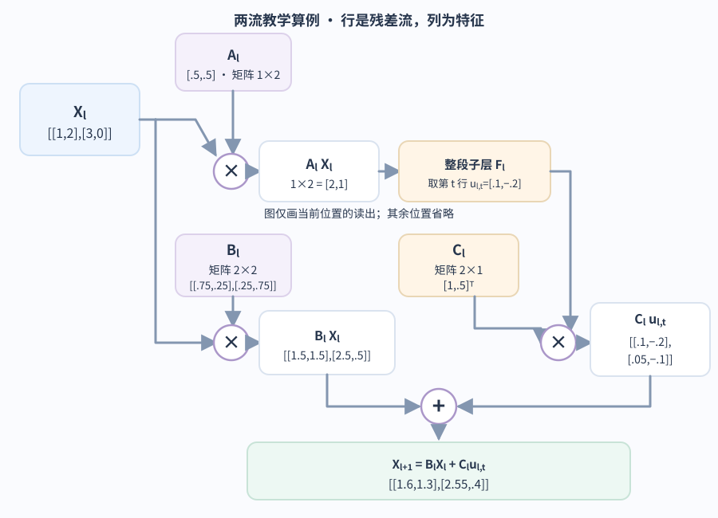

在实际 DeepSeek-V4 中，每个位置的状态形状可写成 `4 × d`，批次和序列合起来为 `[B, T, 4, d]`。官方 V4-Pro 推理代码先展平一个位置的流状态并按 RMS 尺度归一化，再用输入相关线性映射和静态参数产生映射权重。对位置 `t`，令 $X_{l,t}\in\mathbb{R}^{4\times d}$；$A_{l,t}\in\mathbb{R}^{1\times4}$ 读出宽度为 `d` 的输入，$F_l$ 表示带前置归一化的子层，输出仍为宽度 `d`；$C_{l,t}\in\mathbb{R}^{4\times1}$ 把该位置的子层输出分配回 4 条流，$B_{l,t}\in\mathbb{R}^{4\times4}$ 混合它已有的流。attention 的输入必须保留整段位置轴：先对每个位置分别按 $A_{l,t}$ 读出一行，再把这些行组成序列运行 attention；只有在取回位置 `t` 的输出行后，才能写回该位置的残差流。若 $F_l$ 是 FFN，则逐位置变换，不跨行汇集：

$$
\tilde{x}_{l,t}=A_{l,t}X_{l,t},\qquad
U_l=F_l(\tilde{x}_{l,1:T}),\qquad
u_{l,t}=U_l[t,:],\qquad
X_{l+1,t}=B_{l,t}X_{l,t}+C_{l,t}u_{l,t}.
$$

$u_{l,t}$ 是对整段输入执行子层后，取出的当前位置输出行；它不是由 $A_{l,t}$ 或 $B_{l,t}$ 生成的另一条残差流。$A_{l,t}$、$B_{l,t}$、$C_{l,t}$ 都由当前残差状态动态生成，并带有可学习的静态偏置与缩放；$A_{l,t}$ 和 $C_{l,t}$ 分别经 sigmoid 与 `2·sigmoid` 限制为非负有界权重。mHC 的目标是让 $B_{l,t}$ 落在 doubly stochastic（双随机）矩阵集合：元素非负，每行与每列的和都为 `1`。行和为 `1` 使每条输出流按权重混合输入流，列和为 `1` 则防止单条输入流被多个输出流重复加权放大。只要求行和并不够，例如 $\begin{bmatrix}1&0\\1&0\end{bmatrix}[1,0]^T=[1,1]^T$ 会把一个输入坐标复制到两条输出流，长度从 `1` 增至 `√2`。

V4 对 $B_l$ 的原始分数先取指数，再用 20 步 Sinkhorn–Knopp 交替归一化行与列；官方 kernel 还加了 `eps`，所以有限步的数值结果只是双随机约束的近似。理想双随机矩阵的 spectral norm（谱范数，即最大长度放大倍率）满足 $\lVert B_l\rVert_2\le1$，因此固定 $B_l$ 时，前向 $B_lX_l$ 不会增加 Frobenius norm（弗罗贝尼乌斯范数，即矩阵元素平方和再开根）。反向看同一条线性旁路，把 $B_l$ 暂时视为常数，其直接梯度贡献为 $B_l^TG$，长度也不增加。实际 $B_l$ 又由当前状态动态生成，完整导数还包括 $B_l(X_l)$ 的变化；加上 $C_{l,t}u_{l,t}$ 等分支（其中 attention 的 $u_{l,t}$ 还依赖整段输入）后，不能把这个界扩大成整个层的输入到输出梯度保证，也不能当作整层或全模型稳定性的证明。

> [!example] 四条流的两种双随机混合
> 单位矩阵 $I_4$ 保持每条流不变；若 `B` 的 16 个元素全是 `0.25`，每条流就变成四条流的平均。例如，只看一个特征坐标，流值 `(1,0,0,0)` 会变为 `(0.25,0.25,0.25,0.25)`，长度从 `1` 降为 `√(4×0.25²)=0.5`。两者都满足理想的非负、行和为 `1`、列和为 `1` 条件。

在 V4-Pro 参考实现里，HyperHead 会再把这 4 条流合成为一个宽度为 `d` 的表示，然后做最终归一化并投影到词表。因此后文主算例的 `1 × 8` LM head 输入是单流教学路径；多流模型会在末端先把残差流收回单行表示。

### 哪些数字属于可学习参数？

矩阵的权重元素数等于行数乘以列数。在普通 MHA 且 `Hq·dh = d` 时，仅计 Q、K、V 和输出投影的矩阵权重、不计偏置，合计有 `4d²` 个可学习数值。若 `d = 8`，则共有 `256` 个。三个 SwiGLU 投影矩阵的权重元素也不计偏置，合计有 `3d·dff` 个；若 `dff = 16`，则共有 `384` 个。

完整模型还包含 embedding table、归一化权重，有时还包含单独的词表投影。每一层都有自己权重时，逐层重复计算；共享权重只计一次。hidden state 和缓存的 K/V 是根据这些参数计算出来的临时数据。因此，参数数量本身无法决定 GPU 上能同时容纳多少请求。这也是继续阅读[推理内存与调度章节](../systems/llm-serving-and-kv-cache.md) 的原因之一。

## 有些模型为什么只运行部分 FFN？

Mixture-of-Experts (MoE，混合专家)把一层 FFN 分成多个专家网络，通常由 router（路由器）根据每个词元当前的 hidden state 选择其中一部分。它改变的是 FFN 子层的计算路径；attention 仍负责汇集位置间的信息。一个 MoE 层可把 shared expert（共享专家）用于所有词元，再把 routed experts（路由专家）的加权输出加到残差上。专家是学习到的 FFN 参数组，不是预先命名的知识类别或外部检索库。

> [!warning] 这组路由数字属于 DeepSeek-V3
> 前面的完整玩具网络采用标准 MHA 和普通 SwiGLU FFN；本节只借 DeepSeek-V3 展示稀疏 FFN 路由，不是把它说成该模型的完整配置。V3 实际注意力使用 MLA，路由亲和度用 sigmoid。DeepSeek-V4 延续 DeepSeekMoE，但改用 $\sqrt{\operatorname{Softplus}(\cdot)}$ 亲和度，并对初始层采用 hash routing；V4-Pro 配置为 384 个 routed experts、每 token 选 6 个，V4-Flash 为 256 个、每 token 选 6 个。因而下方的 sigmoid 路由数例和 V3 的 `8/256` 不能套到 V4。
>
> DeepSeek-V3 给出了具体配置：前 3 层仍用 dense FFN，其余 MoE 层各有 1 个共享专家和 256 个路由专家，每个词元选 8 个路由专家。为和前面的 pre-norm 块衔接，令 attention 残差后的状态为 `y_t`，FFN 前归一化后的路由/专家输入为 `u_t=Norm(y_t)`。按本章的行向量约定，路由输入 $u_t$ 与专家向量 $e_i$ 都是 $1\times d$；路由器计算点积，再经 sigmoid 得到亲和度 $s_i=\operatorname{sigmoid}(u_te_i^\top)$。批次负载调节偏置 `b_i` 加到亲和度上供 `top-k` 选专家；选中项再按原始 `s_i` 归一化为混合权重 `g_i`，所以计算图中既有“离散选谁”，也有“连续混多少”。为突出核心计算，下式与后面的手算均采用 `route_scale=1` 的简式，省略实际路由中的专家组、设备/节点限制。在只有一个共享专家时，这层更新为

$$
h'_t=y_t+\operatorname{FFN}_{shared}(u_t)+\sum_{i\in selected}g_i\operatorname{FFN}_i(u_t).
$$

> [!example] 偏置只参与选人，混合用原分数
> 用 3 个专家、每词元选 2 个的玩具路由器。原始亲和度为 `s=(0.80, 0.70, 0.60)`，偏置为 `b=(0, 0, 0.25)`。不加偏置时 top-2 是专家 1 和专家 2；加偏置后按 `s+b=(0.80, 0.70, 0.85)` 排序，候选集合变为专家 3 和专家 1。混合权重仍用原始亲和度：分母是 `0.80+0.60=1.40`，所以专家 1 的权重为 `0.80/1.40≈0.571`，专家 3 为 `0.60/1.40≈0.429`。若这两个专家对归一化输入 `u_t` 的 FFN 输出分别为 `(1,0)` 和 `(0,2)`，路由分量就是 `0.571(1,0)+0.429(0,2)≈(0.571,0.857)`；完整层输出还要加上共享专家的输出和残差 `y_t`。分数和向量值是人为设定的。这个例子中偏置确实让专家 3 进入 top-2，但偏置值本身不参与输出混合权重。
>
> **图：V3 的 top-k 怎样决定专家并混合输出**
>
> 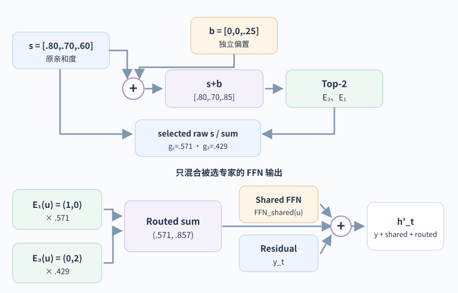

路由器中的专家向量是可学习参数。主任务损失可以沿被选专家的输出、归一化后的路由权重和 sigmoid 亲和度回传；但 `top-k` 返回的索引是离散值，普通反向传播不会直接求导“换选另一个专家”的效果。某个词元没有运行的专家不会从该词元的 FFN 输出获得主任务梯度。V3 还用 sequence-wise balance loss（序列级平衡损失）约束单条序列上的极端负载，所以未选路由的亲和度仍可经这项辅助损失受到训练信号。这是由论文公式和可学习 Gate 参数得到的梯度解释；论文没有公开其训练代码的完整自动微分路径。

V3 的 batch-level load balancing（批次级负载平衡）另维护每个专家的偏置：每个训练批次统计选中量，过载专家的偏置减 `γ`，低于平均负载的偏置加 `γ`。再看一个独立批次负载例，与上面使用 `b=(0,0,.25)` 的单词元 top-2 演算分开：若一个批次有 6 个词元且每个词元只选 1 个，实际负载 `[4,1,1]`，均匀目标为 `[2,2,2]`；若教学用 `γ=0.01`，这一步就把偏置从 `(0,0,0)` 更新为 `(-0.01,+0.01,+0.01)`。这些偏置是在训练批次间调节的路由校正，不是输出混合权重；部署时的固定偏置也不是按每个请求的瞬时 GPU 队列随机改派专家。V3 前 14.3T 训练词元使用 `γ=0.001`，最后 500B 设为 `0`。称为“aux-loss-free（无辅助损失）”只是在说主要批次级平衡机制不依赖传统负载损失；V3 仍用 `α=0.0001` 的序列级辅助项来抑制单条序列的极端失衡。

路由也不是语义分类器。固定输入、权重和偏置时，top-k 路由是确定的；训练中不同领域可能使专家负载呈现统计上的专门化，但不保证某个专家只对应“数学”或“代码”。实际收益取决于稀疏计算节省能否覆盖专家分布、通信和热门专家带来的负载不平衡。服务容量需要按全部专家权重、路由通信和 KV 状态共同估算，可继续看[KV 缓存与调度怎样决定模型推理容量](../systems/llm-serving-and-kv-cache.md)。

## 模型如何选择词元并继续生成？

### 为词表打分并选择一个 ID

回到单流主算例。生成下一个 token 时，第三个位置经过所有 Transformer blocks 和最终归一化后，取其行向量 `h_last` 交给 language model head (语言模型头，LM head)；形状是 `1 × 8`。对 `[abab, c, a]`，它来自末位置 `a` 的更新状态。DeepSeek-V4 这类 mHC 模型在此之前还要先把每位置的 4 条流合成一条宽度为 `d` 的表示；官方 V4-Pro 推理实现的 HyperHead 用非负权重合并流，再做最终 Norm 和词表投影。前面的 attention 算例特意选了第二个位置来演示未来屏蔽；第三个位置也按同样规则计算。因果 attention 下，末位置可以关注整个输入前缀。格式化的对话中，它也可能是 assistant 起始标记，而不是用户问题的最后一个字符。

将 `h_last: 1 × 8` 乘以词表权重 `W_LM: 8 × 258`，会得到 `logits: 1 × 258`，每个词表 ID 对应一个未归一化分数。下面的图只确认形状和末行路径；前向例子没有完整权重，因此不编造 logits 数值。

**图：从末行隐藏状态得到全词表 logits**

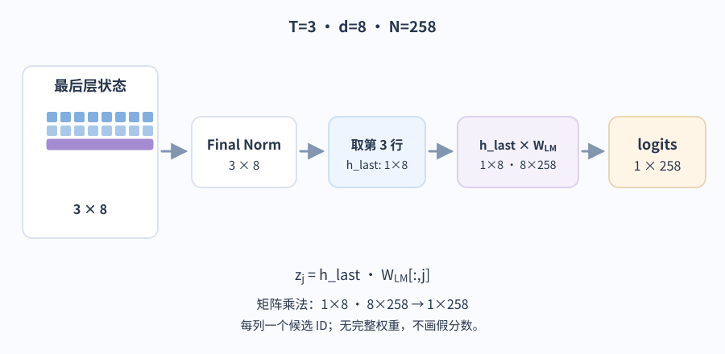

`W_LM` 的每一列都会与 `h_last` 做点积，算出一个分数。weight tying (权重绑定) 会把 embedding table 的转置用作这个输出权重，从而省去一张单独的参数矩阵。有些架构会分别使用输入和输出权重。

做 sampling (采样) 时，temperature (温度)`τ > 0` 会在 softmax 之前缩放 logits。

$$
p_i=\frac{\exp(z_i/\tau)}{\sum_j\exp(z_j/\tau)}.
$$

为单独观察 temperature 的作用，下面只允许两个候选 token，其余词表项暂设为不参与采样。这个人为限制不代表完整词表的真实预测。两个候选是：`c` (ID `99`) 和 `a` (ID `97`)，为它们设定演算用的 logits `[2, 1]`，不由前面的局部 QKV 数字推导。温度为 `1` 时，概率约为 `[0.731, 0.269]`；温度为 `0.5` 时，概率变为 `[0.881, 0.119]`；温度为 `2` 时，则为 `[0.622, 0.378]`。温度越低，概率越集中于分数较高的候选项；温度越高，分数较低的候选项也越有机会被选中。这些是下一个词元的概率，并不代表答案在事实层面正确的置信度。

greedy decoding (贪心解码) 会直接选择分数最高的词元；它是独立的 argmax 路径，上面的温度公式要求 $\tau>0$，不能把 $\tau=0$ 代入。不同模型和 API 对温度参数的支持范围会变，温度为零是否可用、如何映射也应查对应契约。Top-k sampling 会保留分数最高的 `k` 个候选项，采样时在保留的候选上重新归一化。Top-p，也称 nucleus sampling (核采样)，会保留按概率降序排列、累计概率首次达到阈值的最短前缀，然后重新归一化。在常见流水线里，温度先改 logits，再对候选作过滤；具体顺序和是否支持这些参数由模型/API 版本决定。对于 `[0.50, 0.30, 0.15, 0.05]` 和 top-p `0.75`，保留前两个概率，除以它们的总和 `0.80` 后变为 `[0.625, 0.375]`。

**采样区间使用独立的 `N=5` 小例。** 假设 logits 为 `[2, 1, 0, −1, −2]`，温度为 `1`，且不筛除候选；softmax 得到 ID `0–4` 的概率约为 `[0.6364, 0.2341, 0.0861, 0.0317, 0.0117]`。累计区间中，抽到 `r=0.72` 会选中 ID `1`。这组分数只为展示 greedy 与采样、累计区间如何分工，不是 `N=258` 主算例产生的 logits。

**图：独立五项分数怎样沿累计概率选出一个 ID**

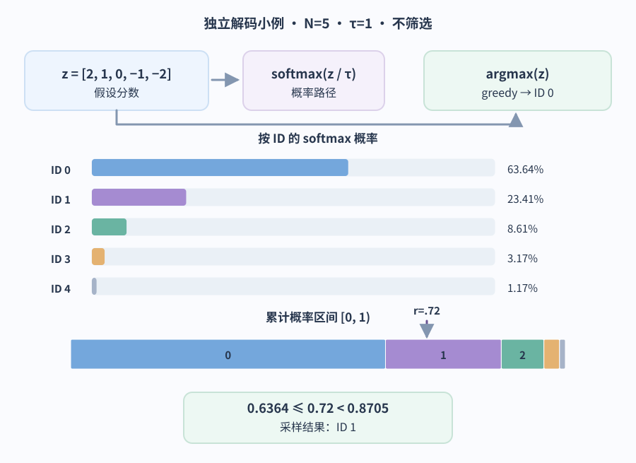

### 复用已有前缀并预测下一个词元

prefill (预填充) 会让初始序列通过各层。末位置的 logits 选出第一个输出 ID。假设选出 `c`，ID 为 `99`，生成序列就先记录它，变成 `[257,99,97,99]`；当前可见的生成文本只有 `c`，输入 `ababca` 仍留在上下文中。调用方先检查这个已选 ID 和调用状态：如果命中结束条件，就按应用规则收尾，不必再为这个 ID 运行下一轮模型；如果还要继续，decode (增量解码) 才把 `c` 嵌入位置 4，并从第一层开始处理它，以预测位置 5 的 ID。之后每次选出 ID 都按相同次序先判停，再决定是否续算。

**图：选出的 ID 如何成为下一次前向的一个新位置**

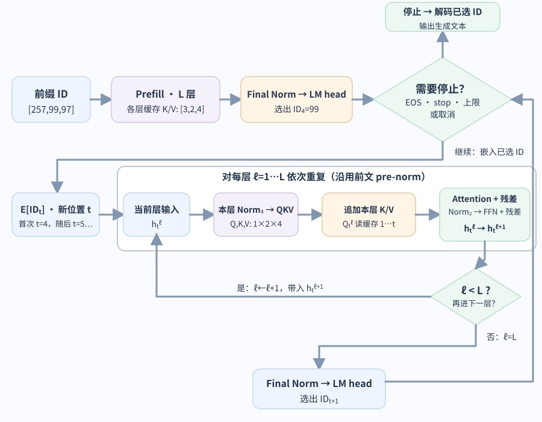

在本例的全量因果模型中，对于相同的前缀和推理配置，添加新位置不会改变先前位置的 hidden state。因此，KV cache (键值缓存) 会存储每一层此前所有位置算出的 K 和 V。先把新 ID 嵌入为第 1 层输入 $h_t^1$。对每一层 $l$，先从本层输入 $h_t^l$ 做前置归一化并计算本层新的 Q、K、V；把新的 K/V 加入这一层自己的 cache，再让本层新 Q 读取位置 `1…t` 的 K/V。attention 更新加回本层输入后，再做第二次前置归一化、FFN 和第二次残差，得到 $h_t^{l+1}$，它才是下一层计算 Q/K/V 的输入。图为聚焦张量依赖而省略各 Norm 框，逐层顺序沿用前文的 pre-norm block。只有第 `L` 层完成并得到末层状态后，才做 final Norm 与 LM head，选择 $ID_{t+1}$。更早位置的 Q 向量已经参与过各自位置的计算，不会作为输入再参与这个新 query 的 attention 运算。因果掩码只排除未来；滑动窗口会进一步限制可见历史。例如 Mistral 7B 的 SWA 每层只直接读取最近 `W` 个位置，并用固定大小的滚动缓存覆盖更早条目，较远信息可经层间传递。

全量注意力下，每层的 cache 各自独立，因为每一层的输入表示和投影权重不同；输出变长时，cache 也会随之增大。滑动窗口 cache 可在窗口长度固定时停止增长，具体取决于该层的注意力结构。生成可以在模型发出结束词元、应用匹配停止序列、达到长度上限或收到取消操作时结束。这些是不同的收尾条件；长度上限可能截断尚未完成的回答，因此应用要保留完成原因并判断是否需要报告未完成。对本例的 byte-level toy tokenizer，正常结束后可把要返回的生成 ID 查回 token bytes，按序拼接后再解码完整 UTF-8 文本；真实 tokenizer 应使用其解码接口，特殊结束 token 还要按模型/API 协议处理。[服务容量](../systems/llm-serving-and-kv-cache.md) 会进一步说明内存影响；[应用运行状态与恢复](../systems/ai-application-architecture.md) 会展开生成结束或中断后的处理。

### 应用应如何选择解码设置？

实际选择应从已部署的模型和 endpoint (端点) 入手。先确认支持哪些控制项、哪些组合可用，再以支持的默认值建立基线。采样控制取决于模型和 API 版本；一些托管接口会限制、固定或省略这些参数。不存在适用于所有模型和任务的最佳温度。

对于构建日志助手，如果多次运行的工具参数或证据报告不必要地发生变化，可以尝试一个受支持的较低温候选设置。将其与基线进行比较，覆盖常见故障、日志缺失、权限失败，以及带有误导性文字的日志。较低设置也可能反复偏向错误操作，所以结果稳定本身并不代表成功。

如果任务本来就需要生成多个候选解释或解法供后续核验，那么尝试更高的采样多样性可能有用。代价是出现更多质量较差或无效的候选结果，也需要更多核验工作。提高温度既不会补上缺失证据，也不会让没有依据的说法变得可接受。多样性是否能改善最终结果，取决于候选生成器与验证器的整体效果。

做受控比较时，应固定模型版本、指令、工具和案例集，只改变所选的解码设置。对每个候选设置重复完整运行，并衡量工具选择及参数是否正确、解释是否有依据、故障处理是否恰当，以及成本和时延。用一组数据开发设置，再用单独的留出集验收。这是一种工程测试方法，并非宣称较低或较高的温度必然更好。[如何构建可比较的评估集](../evaluation/llm-evaluation-methods.md#建立可比较的回归集) 会进一步介绍评估方法，而不只关注这一项设置。

## 下一个词元训练如何更新这些参数？

### 为每个位置设置目标

前面使用的都是已经学到的权重。训练会根据“接下来应该是什么”的示例来调整这些权重。沿用玩具 tokenizer，训练样本 `ababcac` 会被分成 `[abab, c, a, c]`，即 `[257, 99, 97, 99]`。用前三个位置预测后一个：前缀 `abab` 预测 `c`，前缀 `[abab, c]` 预测 `a`，前缀 `[abab, c, a]` 预测 `c`。后两个预测都能读取完整的左侧前缀，不是只看紧邻的前一个词元。这里末尾的 `c` 是训练语料中的真实目标，不是刚才生成步骤采出的结果。causal mask 允许并行计算这些位置，同时阻止每个位置读取右侧的目标词元。某些模型的训练格式还会加入 beginning-of-sequence marker (序列起始标记，BOS) 等特殊 token；它们需要由相应词表和模板定义，本例不额外加入。

teacher forcing (教师强制) 指训练时使用训练样本中真实的前序词元。生成时，后续输入则包含模型实际选出的词元。这就是为什么生成序列开头的错误可能改变后续预测。

### 训练时如何预测多个未来词元？

multi-token prediction（多词元预测，MTP）在 next-token prediction（下一个词元预测）之外增加未来位置的训练目标。DeepSeek-V3 的 MTP 深度 `D=1`：对位置 `i`，主模型表示 `h_i` 预测真实的 `t_{i+1}`；MTP 模块再把 `h_i` 与训练样本中真实的 `Emb(t_{i+1})` 分别做 RMSNorm 后拼接。按本章的行向量右乘约定，投影 $M_1\in\mathbb{R}^{2d\times d}$ 把宽度 `2d` 的拼接向量压回 `d`，再送入附加 Transformer block 和与主模型共享的 output head（输出头），预测 `t_{i+2}`；词元 embedding 也与主模型共享。它训练的是“已知正确前一个词元时再预测下一个”，不是让多个互不相干的输出头同时猜同一个前缀之后的词。

> [!example] 同一训练串怎样多监督一个位置
> 沿用样本 `ababcac → [abab, c, a, c]`，把位置编号为 1 到 4。主模型在位置 1 用 `h₁` 预测位置 2 的真实词元 `c`。MTP 将 `RMSNorm(h₁)` 和 `RMSNorm(Emb(c))` 两条独立路径拼接后投影，再经过附加块，预测位置 3 的 `a`。同样，位置 2 会把 `RMSNorm(h₂)` 与真实 `RMSNorm(Emb(a))` 拼接，再经同一 MTP 模块预测位置 4 的 `c`。因此训练标签仍来自右移后的语料；位置维度的计算可以并行，而更深的 MTP 预测模块彼此按深度串接。V3 只设一个额外预测深度。DeepSeek-V4 报告说明其 MTP 配置沿用 V3 的策略；下方路径按 V3 的 D=1 训练公式讲解，不表示所有运行时都能直接启用 MTP 解码。

**图：V3 的 D=1 MTP 怎样从真实 t₂ 再监督 t₃**

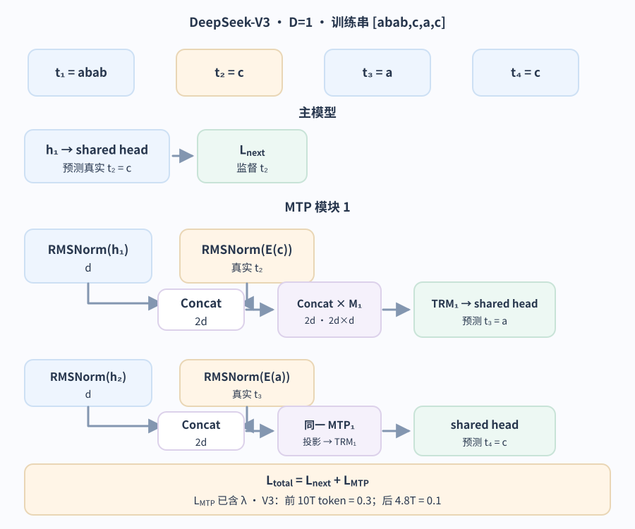

每个深度各算一份交叉熵 $\mathcal{L}^{k}_{MTP}$。把深度平均并乘训练权重后，定义加权项 $\mathcal{L}_{MTP}=(\lambda/D)\sum_{k=1}^{D}\mathcal{L}^{k}_{MTP}$；总目标只加一次：$\mathcal{L}_{total}=\mathcal{L}_{next}+\mathcal{L}_{MTP}$。本例 V3 设 `D=1`；报告中的 `λ` 前 10T 训练词元为 `0.3`，之后 4.8T 为 `0.1`。额外预测让每个训练位置提供更多监督，也可能帮助主模型形成对未来的表征；它不意味着推理时必须保留 MTP 模块。推理可以只运行主模型，也可把已训练的 MTP 模块用作推测解码的 proposer（提议器）。后者如何组织草稿状态、目标模型验证和缓存回滚，属于服务实现问题，见[推测解码如何验证候选并处理临时缓存](../systems/llm-serving-and-kv-cache.md#%E6%8E%A8%E6%B5%8B%E8%A7%A3%E7%A0%81%E5%A6%82%E4%BD%95%E9%AA%8C%E8%AF%81%E5%80%99%E9%80%89%E5%B9%B6%E5%A4%84%E7%90%86%E4%B8%B4%E6%97%B6%E7%BC%93%E5%AD%98%EF%BC%9F)。

### 计算误差并反向传播更新

上面的 MTP 是 V3 特定的附加训练目标。现在回到各因果语言模型都可用的主 next-token loss，先不包含 MTP：对每个受监督位置，把完整词表 logits 做普通 softmax，再取正确词元的负对数概率并求平均；训练主目标不使用推理时的温度或 top-k/top-p 过滤。

沿训练样本 `[abab, c, a, c]`，三个输入位置分别预测后面的真实词元 `c`、`a`、`c`。单个位置的损失可写成

$$
\ell_i=-\log p_i(y_i)=\operatorname{logsumexp}(z_i)-z_{i,y_i},\qquad
\mathcal{L}_{next}=\frac{1}{3}\sum_{i=1}^{3}\ell_i.
$$

若一个位置的正确词元概率是 `0.8`，损失约为 `0.223`；另一个位置若为 `0.25`，损失约为 `1.386`，两者平均约 `0.805` nat。然后切换到一个只有三个候选的局部梯度例：`p=[0.7,0.2,0.1]` 且第二项正确时，单位置梯度是 `∂ℓ/∂z=p−onehot(y)=[0.7,−0.8,0.1]`。这个三类向量只用于看清导数；它没有流向下面的 `8×258` 主矩阵。

回到全词表主配置，令 `H∈ℝ^{3×8}` 为三个受监督位置经过最终 Norm 的隐藏状态，`W_LM∈ℝ^{8×258}` 为共享词表头，`Z=H W_LM`。令 `Δ∈ℝ^{3×258}` 的第 `i` 行为 `p_i−onehot(y_i)`，则平均交叉熵传回词表头与隐藏状态的梯度为

$$
\nabla_{W_{LM}}\mathcal{L}_{next}=\frac{H^\top\Delta}{3}\in\mathbb{R}^{8\times258},\qquad
\nabla_H\mathcal{L}_{next}=\frac{\Delta W_{LM}^\top}{3}\in\mathbb{R}^{3\times8}.
$$

`H^TΔ` 沿三个位置相加，因为它们共用同一张 `W_LM`；隐藏状态梯度再经最终 Norm 和各 Transformer block 传给更早的参数。以最简单的 SGD 为例，参数的一步更新是 `W_LM ← W_LM − η∇_{W_LM} L_next`，其中 `η` 是学习率。这行只把梯度与参数更新接起来；实际训练还会按所选优化器处理梯度和历史状态，[下一章](training-gradients-and-optimizers.md)会展开具体的反向矩阵计算与 AdamW/Muon 更新。

**图：右移真实标签怎样产生主损失与 logit 梯度**

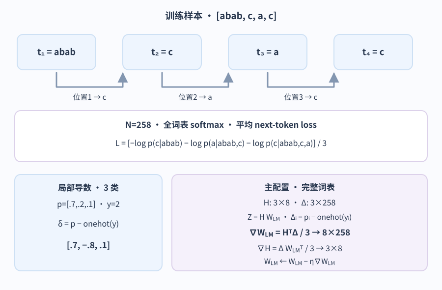

本章到这里给出了从语料、因果前向与可选 MTP 标签到 logits、主损失、梯度和一次一般形式的参数更新。[模型怎样从训练损失得到每个权重的更新](training-gradients-and-optimizers.md) 会用更小的矩阵算例逐项追踪反向传播，并比较 AdamW 与 Muon。两章中的玩具数值都只为解释步骤，不是同一组权重的一次完整前向与训练实测。

所选的训练目标也很重要。BERT 使用的 masked language modeling (掩码语言建模) 会根据左右两侧可见的上下文，预测选定的缺失位置。它的常规过程与上面从左向右的循环不同。研究者可以基于掩码模型构造迭代生成过程，但这需要另外的采样过程。

如果应用反复以稳定的方式失败，接下来要判断的是：它缺少证据、指令，还是已经学到的行为。[何时进行微调](../fine-tuning/fine-tuning-strategies.md) 会进一步说明这个选择，包括应更新哪些参数。把新证据加入 prompt (提示词) 会改变当前计算；训练则会改变能在后续运行中持续生效的参数。

> [!info]- 来源
> 下列来源支持对应机制或具体模型配置。文中的 `ababca`、小矩阵、路由值和训练概率是教学数例；除特别标明外均按正文手算。
>
> - **BPE 和精确 tokenizer 对照。** [Sennrich et al., ACL 2016, §3.2](https://aclanthology.org/P16-1162/) 支持按频率合并相邻子词对；[OpenAI tiktoken 0.12.0 educational implementation](https://github.com/openai/tiktoken/blob/0.12.0/tiktoken/_educational.py) 说明字节级合并实现。正文英文对照在本机 `tiktoken 0.12.0`、`cl100k_base` 上复现：原句得到 ID `[10445, 1550, 1977, 220, 2983, 3775, 30]`；边界样例 `The transformer architecture revolutionized NLP.` 得到 `[791, 43678, 18112, 14110, 1534, 452, 12852, 13]`。
> - **Transformer 的因果前向、Attention、FFN 与词表投影。** [Attention Is All You Need, v7, §§3.1–3.5、§5.1](https://arxiv.org/html/1706.03762v7#S3) 支持 decoder 的未来位置掩码、scaled dot-product、多头拼接后输出投影、逐位置 FFN、嵌入/softmax 和右移训练目标。原论文是 encoder–decoder 且采用 post-norm；本页另选 decoder-only、pre-norm、RoPE 与 SwiGLU 作为教学组合，不把它说成原论文原样。
> - **RoPE 与 RMSNorm。** [RoFormer, v5, §§3.2.1–3.2.2](https://arxiv.org/html/2104.09864v5#S3.SS2) 给出旋转位置嵌入及相对角度形式；本页的点积恒等式对应 §3.2.1 的式 (12)–(13)。[Root Mean Square Layer Normalization, v1, §4](https://arxiv.org/html/1910.07467#S4) 支持 RMSNorm。向量 `[3,4]` 的 `[0.849,1.131]` 是本页按单位缩放、忽略 epsilon 的手算值。
> - **pre-norm、权重布局和 bias。** [The Llama 3 Herd of Models, v3, §3.2](https://arxiv.org/html/2407.21783v3#S3.SS2) 记录 Llama 3 的 RoPE、SwiGLU、GQA 架构配置；[Meta 的 Llama 3 参考实现](https://github.com/meta-llama/llama-models/blob/main/models/llama3/model.py) 给出其实现路径，作为现代 decoder-only 选择的对照，不代表本页小维度配置。[PyTorch 2.10 `Linear`](https://docs.pytorch.org/docs/2.10/generated/torch.nn.Linear.html) 说明存储权重按 `out_features × in_features` 排列，bias 是独立可选参数；本页右乘式与参数算例只数矩阵权重、不计 bias。
> - **MHA/GQA、滑动窗口和 cache。** [GQA, EMNLP 2023, §2](https://aclanthology.org/2023.emnlp-main.298/) 说明多个 Q 头可共享较少的 K/V 头，并研究由 MHA checkpoint uptrain 的条件；[Mistral 7B, v1, §2、Figures 1–3](https://arxiv.org/html/2310.06825v1#S2) 支持滑窗 `W` 的可见范围与固定长度 rolling cache。[Transformers “How caching works” (main docs，核对日期：2026-11-11)](https://huggingface.co/docs/transformers/main/en/cache_explanation) 说明因果前缀的逐层 K/V 可复用，以及单个新 query 怎样追加 cache；这描述通用 cache，不替代特定模型的缓存布局。
> - **SwiGLU 与 FFN 解释范围。** [GLU Variants Improve Transformer, v1, §2](https://arxiv.org/html/2002.05202#S2) 给出 SwiGLU 的门控逐元素乘法及第三个降维投影；[Geva et al., EMNLP 2021](https://aclanthology.org/2021.emnlp-main.446/) 分析其研究的若干 FFN 中的文本模式与输出影响。Geva 的发现不能推广成每个 FFN 都是字面事实库。
> - **解码策略和 API 边界。** [The Curious Case of Neural Text Degeneration, v2, §3](https://arxiv.org/abs/1904.09751v2) 支持 top-p 的最小累计概率集合定义；[Transformers Generation Strategies (核对日期：2026-11-11)](https://huggingface.co/docs/transformers/generation_strategies#basic-decoding-methods) 区分 greedy argmax 与按分布采样。[OpenAI Responses 创建接口](https://developers.openai.com/api/reference/resources/responses/methods/create) 与 [GPT-6 参数兼容说明](https://developers.openai.com/api/docs/guides/latest-model?model=gpt-6-astra) 展示采样参数会因 endpoint、模型和推理配置变化；[Claude API 参数迁移说明](https://platform.claude.com/docs/en/about-claude/model-deprecations) 记录其 2026-10-21 API version 移除 temperature/top-p/top-k。正文因此不把温度零等同为跨接口通用的行为。
> - **主训练目标与其他目标。** [Llama 3 Herd, v3, §3](https://arxiv.org/html/2407.21783v3#S3) 支持自回归预训练目标；[PyTorch 2.10 `CrossEntropyLoss`](https://docs.pytorch.org/docs/2.10/generated/torch.nn.CrossEntropyLoss.html) 说明 logits、目标索引、逐项损失与平均 reduction；`p−onehot(y)` 和 `h^T δ` 是由 softmax cross-entropy 与线性 LM head 用链式法则得到的手算式。[BERT, 2019, §3.1](https://arxiv.org/html/1810.04805#S3.SS1) 支持 masked LM 与左右上下文的区别；[Wang & Cho, 2019, §3](https://arxiv.org/html/1902.04094#S3) 是从 masked model 构造不同迭代生成方式的研究，并非把 BERT 的训练任务直接改成因果 next-token。
> - **标准残差与 mHC。** [Identity Mappings in Deep Residual Networks, v3, §2](https://arxiv.org/html/1603.05027v3#S2) 支持恒等旁路的前向/反向路径解释。[mHC, v2, §§4.1–4.2](https://arxiv.org/html/2512.24880v2#S4) 定义非负双随机残差映射、谱范数界与动态参数化；[DeepSeek-V4 Technical Report, v1, §§2.2、4.2.1](https://arxiv.org/html/2606.19348v1#S2.SS2) 指定 V4 的 4 流 mHC、20 次 Sinkhorn-Knopp 迭代和模型配置。官方 [V4-Pro config](https://huggingface.co/deepseek-ai/DeepSeek-V4-Pro/blob/main/config.json) 的 `hc_mult=4`、`hc_sinkhorn_iters=20`、`hc_eps=1e-6` 与 [V4-Pro 推理层实现](https://huggingface.co/deepseek-ai/DeepSeek-V4-Pro/blob/a1fd202632e91bc0efe4eedb63ce554649c53997/inference/model.py)、[Sinkhorn kernel](https://huggingface.co/deepseek-ai/DeepSeek-V4-Pro/blob/5607980f3a4b8ea0371b9f11e1848ac41f14979e/inference/kernel.py) 一致（核对日期：2026-11-11）。有限次且含 `eps` 的实现只是逼近双随机约束；本文把固定 `B` 的线性界与动态全层梯度分开。
> - **MoE 路由与版本。** [DeepSeek-V3 Technical Report, v2, §2.1.2](https://arxiv.org/html/2412.19437v2#S2.SS1.SSS2) 支持 sigmoid 亲和度、偏置只改 top-k 选择、原分数重新归一化和 sequence-wise balance loss；[§4.2 “Model Hyper-Parameters”](https://arxiv.org/html/2412.19437v2#S4.SS2.SSS0.Px1) 给出 V3 的 1 个 shared / 256 个 routed / 每 token 选 8 个，[§4.2 “Training Hyper-Parameters”](https://arxiv.org/html/2412.19437v2#S4.SS2.SSS0.Px2) 记录批次偏置的 `γ` 调度与序列级平衡项的 `α` 数值，§§4.5.2–4.5.3 讨论平衡机制。[V3 官方 Gate 实现](https://github.com/deepseek-ai/DeepSeek-V3/blob/main/inference/model.py#L576-L599) 对照原分数与偏置后的选择；教学例令 `route_scale=1` 并省略真实组/节点约束。[V4 report v1, §§2.1、4.2.1](https://arxiv.org/html/2606.19348v1#S2.SS1) 说明 V4 改用 sqrt-softplus affinity 和初始 Hash routing；Pro / Flash 的专家数与每词元路由数分别见 §4.2.1。本页只在 V3 路由段使用 sigmoid 数例。
> - **MTP 与推测解码。** [DeepSeek-V3 Technical Report, v2, §2.2](https://arxiv.org/html/2412.19437v2#S2.SS2) 支持真实偏移词元 embedding、串接预测深度、共享 embedding/output head、MTP loss，并在末段 “MTP in Inference” 说明模块可从推理模型中移除或用作 speculation proposer；[§4.2 “Model Hyper-Parameters”](https://arxiv.org/html/2412.19437v2#S4.SS2.SSS0.Px1) 记录 V3 的 `D=1` 配置；[§4.2 “Training Hyper-Parameters”](https://arxiv.org/html/2412.19437v2#S4.SS2.SSS0.Px2) 记录 `λ` schedule，§4.5.1 给出对应消融。DeepSeek-V4 report v1 §2.1 说其 MTP strategy/configuration 沿用 V3；这不表示任意框架均能运行。[vLLM MTP guide (核对日期：2026-11-11)](https://docs.vllm.ai/en/latest/features/speculative_decoding/mtp/) 限定该路径适用于运行时支持的模型族及其原生 MTP 模块。[Leviathan et al., ICML 2023](https://proceedings.mlr.press/v202/leviathan23a.html) 支持目标模型并行验证与保持分布的 speculative sampling 思路。
>
> 查看 [AI 好文集](../../review/ai-literature-index.md)，可按主题查找相关论文。
