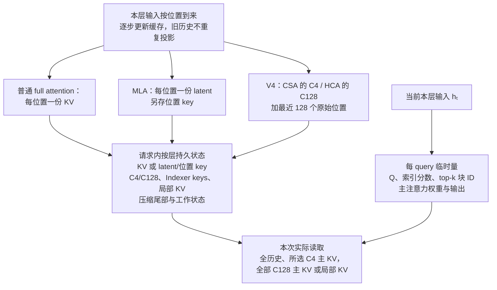
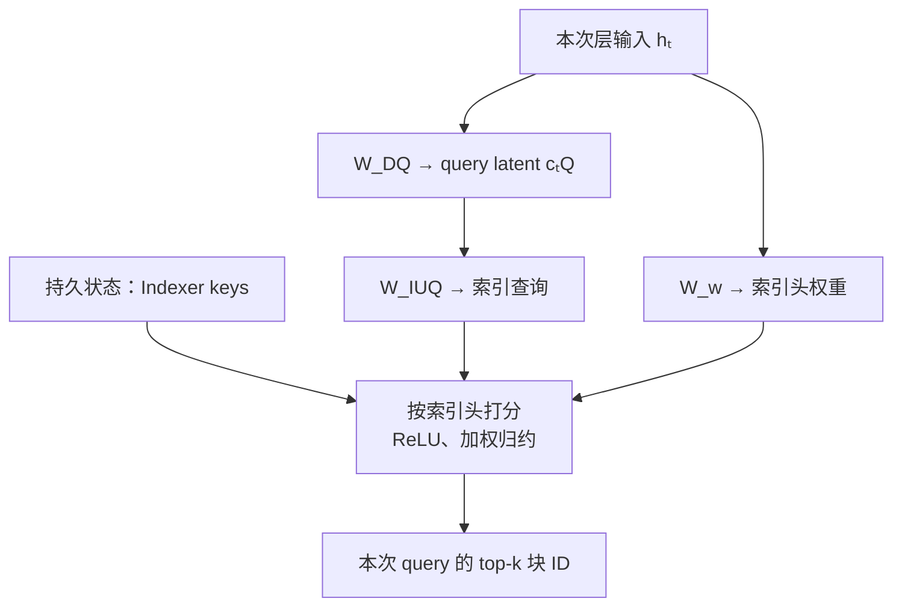
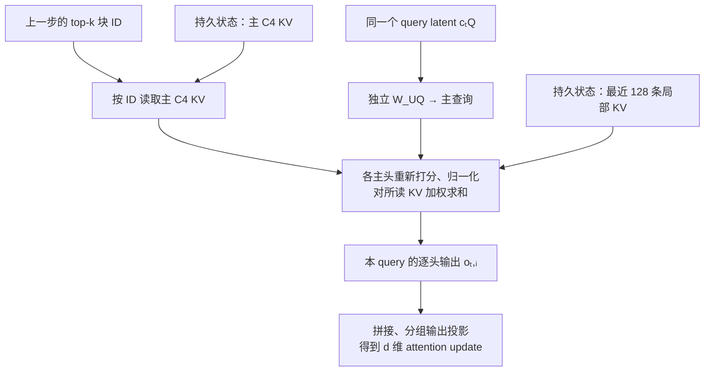

# 长上下文怎样少存、少读历史，同时保留需要的信息？

设模型读入一份百万词元的长技术报告，随后要回答一个需要拼接相隔多处内容的问题：查询既可能需要远处线索，也依赖最近句子；逐层保存并读取全部历史 KV 会增加缓存与读取成本。本文看模型结构怎样压缩状态或挑候选以降低这些成本；摘要和选择都可能漏掉回答所需线索，不保证答案信息一定保留。

普通 causal full attention（因果全注意力）提供一个起点：prefill（提示预填充）或 decode（增量解码）处理新位置时，每层计算当前位置的 query（查询）、key（键，K）和 value（值，V），把该层的 KV 添入缓存，后续 query 再读取可见历史。比较其他架构时要分别问三件事：每条已存表示有多宽、截至当前位置保存多少条、当前 query 实际读取多少个候选。共享 K/V 头或潜变量可缩窄每条表示；CSA/HCA 还把多个序列位置合并为更少条目；top-k 则改变单次查询读取的集合。它们作用于不同维度，也可以组合；摘要与选择都可能漏掉回答所需线索。

> [!info] 先约定符号
> `T` 是已处理的词元数，`H_q` 是查询头数，`H_kv` 是实际存储的 K/V 头数，`d_h` 是每头宽度，`b` 是每个缓存数值的字节数。向量点积要求两个向量坐标数相同；矩阵乘向量的结果维度等于矩阵的行数。这里的 KV cache 指同一请求生成过程中的状态，不是跨请求的提示缓存或应用的长期记忆。

下图把三种量放在一起：每条表示的宽度、保存的条目数、以及 query 读取的候选数。V3.2 将低维缓存表示与逐查询索引结合；V4 则合并相邻序列位置后，对不同层采用稀疏或密集读取。

## 多头注意力和分组查询注意力缓存了什么？

Multi-Head Attention（多头注意力，MHA）为每个查询头保存各自的 K/V 表示。Grouped-Query Attention（分组查询注意力，GQA）让一组查询头共享一组 K/V 头；查询头数仍可不变，但每个历史词元需要保留的 K/V 坐标变少。

若每个 K/V 头宽 `d_h`、缓存精度占 `b` bytes，则每个词元、每层的数值载荷为

$$
\text{bytes/token/layer}=2H_{kv}d_hb,
$$

其中 `2` 分别代表 K 和 V。以一个合成例子说明：`H_q=32`、`d_h=128`、BF16 每数值 2 bytes。MHA 保存 32 组 K/V，每词元每层是 $2\times32\times128\times2=16{,}384$ bytes $=16$ KiB；GQA 若用 8 组 K/V，则是 $2\times8\times128\times2=4{,}096$ bytes $=4$ KiB。一百万词元时，两者分别约为 `15.26 GiB` 和 `3.81 GiB` **每层**；总量还要乘层数和活跃请求数。

这减少的是**每个历史词元要存的 K/V 坐标数**，不改变历史位置数。dense attention（密集注意力）的新查询仍要逐头查看所有历史 K/V。GQA 改变模型所学的 K/V 投影；不能把头数变少就当作对任意 MHA checkpoint 的无损推理开关。生成阶段缓存让旧位置不必重复投影，但本身不改变注意力的历史读取集合。更完整的注意力计算见[语言模型如何把提示词变成文本？](how-llms-work.md)。

## 怎样把每位置的 K/V 收进一个潜变量？

Multi-Head Latent Attention（多头潜注意力，MLA）用一组学习到的低秩投影共同生成各头的内容 K/V。$h_t\in\mathbb{R}^d$ 是当前层、当前位置的 hidden state（隐藏状态）；先把它投影成共享的低维表示 $z_t^{KV}=W_{DKV}h_t\in\mathbb{R}^{d_c}$，其中 $W_{DKV}\in\mathbb{R}^{d_c\times d}$。如果具体实现会在展开前归一化 latent（潜变量），就令 $c_t^{KV}=\operatorname{Norm}(z_t^{KV})$。DeepSeek-V3 的 absorb 路径确实对 latent 调用 RMSNorm（均方根归一化）；为突出维度与乘法结合律，下文省略这个不改变形状的算子，并用 $c_t^{KV}$ 表示模型实际使用的 latent。$d_c$ 是一份共享表示的宽度；“低秩”指它可以比逐头 K/V 内容坐标总数 $H_q(d_k+d_v)$ 小，不代表能无损压缩任意 MHA 缓存。对第 $i$ 个注意力头，$d_k$、$d_v$ 分别是内容 key、value 的每头宽度；$W_i^{UK}\in\mathbb{R}^{d_k\times d_c}$ 与 $W_i^{UV}\in\mathbb{R}^{d_v\times d_c}$ 分别展开内容 key 和 value：

$$
k^C_{t,i}=W_i^{UK}c_t^{KV},\qquad v^C_{t,i}=W_i^{UV}c_t^{KV}.
$$

如果把展开后的每头 K/V 内容都写入缓存，每位置要存 $H_q(d_k+d_v)$ 个内容数值；latent 缓存路径只保留 $c_t^{KV}$，未来需要时再用同一组投影恢复该模型定义的 K/V。推理实现也不一定选择 latent 缓存：DeepSeek-V3 官方参考代码同时提供 `naive`（展开缓存路径）和默认 `absorb`（矩阵吸收路径）；前者缓存逐头 K/V，后者缓存经过 RMSNorm 的 latent 与独立位置 key。仅对后一路径，V3 配置示例每层缓存 512 维 latent 加 64 维位置 key，即 576 个数值；字节数还取决于两支的存储精度。它减少的是每位置缓存坐标，不是历史位置数；如果整段 latent 仍做 dense attention，候选位置数依旧随 $T$ 增长。

### 怎样把 K/V 投影移到查询和输出侧？

matrix absorption（矩阵吸收）利用的是乘法结合律：不用先把 $c_s^{KV}$ 展开成每头的内容 key，再和查询点积。下式把模型规定的归一化视为已包含在 $c_s^{KV}$ 中，并省略不会改变维度推导的其他算子。给定当前头的内容查询 $q^C_{t,i}\in\mathbb{R}^{d_k}$，可将查询变换为 $\widetilde q_{t,i}=(W_i^{UK})^Tq^C_{t,i}\in\mathbb{R}^{d_c}$，于是

$$
(q^C_{t,i})^Tk^C_{s,i}=(q^C_{t,i})^TW_i^{UK}c_s^{KV}=(\widetilde q_{t,i})^Tc_s^{KV}.
$$

维度可逐步核对。直接展开时，$W_i^{UK}$ 的 $d_k\times d_c$ 矩阵乘 $d_c$ 维 $c_s^{KV}$ 得到 $d_k$ 维 key，再与 $d_k$ 维 query 点积成一个标量。吸收到 query 一侧时，$(W_i^{UK})^T$ 是 $d_c\times d_k$，乘 $d_k$ 维 query 得到 $d_c$ 维 $\widetilde q$ 向量；它本身还不是分数，继续与 $d_c$ 维缓存 latent 点积后才得到同一个标量。值侧同样可把上投影延后：

$$
\sum_s \alpha_{t,s,i} W_i^{UV} c_s^{KV}
=W_i^{UV}\left(\sum_s \alpha_{t,s,i}c_s^{KV}\right).
$$

其中 $\alpha_{t,s,i}$ 是当前位置 $t$ 的第 $i$ 个 query head 分给历史位置 $s$ 的注意力权重。因此推理可以先对缓存 latent 算注意力并做加权和，再把结果投影到该头的 value 空间；各头的 value 投影也可与输出投影合并。等式成立是因为同一个线性矩阵可以分配到加权和的每一项：先分别投影再相加，或先相加再投影，结果相同。这个计算重排减少了中间展开，不会缩短 dense attention 仍要扫描的历史长度。

> [!example] 用 2 维向量手算矩阵吸收
> 取 $q=[1,2]^T$、$c=[3,4]^T$，并令
>
> $$
> W=\begin{bmatrix}2&1\\0&3\end{bmatrix}.
> $$
>
> 先展开 key：$Wc=[10,12]^T$，所以 $q^T(Wc)=1\times10+2\times12=34$。反过来先吸收矩阵：$W^Tq=[2,7]^T$，再算 $(W^Tq)^Tc=2\times3+7\times4=34$。两条路径对这个线性投影得到相同分数。实际模型维度大得多，示例只展示形状与结合律。

### 为什么还要单独缓存位置 key？

Rotary Position Embedding（旋转位置编码，RoPE）让查询和 key 的一部分坐标随位置旋转。若对已展开的内容 key 逐位置施加不同 RoPE，再把 $W_i^{UK}$ 吸收到查询侧，位置相关旋转会夹在投影中；查询侧没有一个对全部历史位置都通用的单一变换可以替代它。

令 $R_s$ 为历史位置 $s$ 的旋转矩阵、$c_s^{KV}$ 为送入内容上投影 $W_i^{UK}$ 的 latent，则

$$
 (q^C_{t,i})^T R_s W_i^{UK}c_s^{KV}=\left((W_i^{UK})^TR_s^Tq^C_{t,i}\right)^Tc_s^{KV}.
$$

虽然矩阵可以代数上移到 query 一侧，移后的 query 仍含随历史位置变化的 $R_s$，所以不能用一个与 $s$ 无关的查询投影替代逐位置旋转。另一路 query latent $c_t^Q$ 则是 V3 参考实现中 `wq_b` 的输入。

MLA 因此把内容与位置分开。query latent（查询潜变量）$c_t^Q\in\mathbb{R}^{d'_c}$ 由当前位置的隐藏状态生成；MLA 论文写作 $c_t^Q=W_{DQ}h_t$，而 V3 参考实现把这条路径写成 `wq_b(RMSNorm(wq_a(h_t)))`。下式用 $c_t^Q$ 指 `wq_b` 实际接收的 latent；对 V3 参考实现，它已包含 RMSNorm。内容查询也从同一 latent 投影：$q^C_{t,i}=W_i^{UQ}c_t^Q\in\mathbb{R}^{d_k}$，其中 $W_i^{UQ}\in\mathbb{R}^{d_k\times d'_c}$。令 $d_R$ 为 RoPE 支路的宽度，$W_i^{QR}\in\mathbb{R}^{d_R\times d'_c}$；先由 query latent 投影出位置分量，再施加 RoPE，得到 $q^R_{t,i}=\operatorname{RoPE}(W_i^{QR}c_t^Q)\in\mathbb{R}^{d_R}$。每个历史位置则独立生成并保存 $k^R_s=\operatorname{RoPE}(W^{KR}h_s)\in\mathbb{R}^{d_R}$。每头打分可写为

$$
\text{score}_{t,s,i}=
\frac{(q^C_{t,i})^T W_i^{UK} c_s^{KV}+(q^R_{t,i})^T k^R_s}{\sqrt{d_k+d_R}},
\qquad
\text{cache}_s=[c_s^{KV};k_s^R].
$$

这是基础的注意力分数缩放式，省略了长上下文实现可能采用的 YaRN 缩放修正和因果 mask。

位置 key 单独保留，内容投影就能在另一侧吸收；代价是 latent 缓存还需要每位置的 RoPE 支路。查询 latent `c_t^Q` 只用于构造当前 query，不是每个历史词元的持久 KV 状态。若实现选择 latent 路径，MLA 降低每个位置要存和要读的坐标数；若仍对整段 latent 做 dense attention，候选位置数依旧随 `T` 增长。使用 naive 展开缓存的实现并不会获得同样的每位置坐标节省。

## 怎样按当前查询挑历史？

DeepSeek Sparse Attention（DeepSeek 稀疏注意力，DSA）在主注意力之前增加 lightning indexer（闪电索引器）：它用轻量的查询/key 表示给每个候选历史位置打分，再只取前 `k` 项（top-k）对应的主 KV 进入主注意力。索引 key 是单独生成、用于打分的状态；它既不是被选中后送入主注意力的 KV，也不是原始历史 KV 的另一个名字。其一类打分形式为

$$
I_{t,s}=\sum_{j=1}^{H^I}w^I_{t,j}\,\operatorname{ReLU}\!\left((q^I_{t,j})^Tk^I_s\right),
\qquad
\mathcal{S}_t=\operatorname{TopK}_s(I_{t,s}).
$$

`q^I` 来自当前查询，`k^I_s` 是缓存的索引 key，`w^I` 调整各索引头的贡献；ReLU（修正线性单元）把负分数截为零。比如玩具分数 $[2.3,1.9,0.3]$、`k=2` 时，主注意力只读取前两个候选对应的 K/V。这个选择由当前查询决定，不是全局固定窗口；不同查询可以挑不同位置。

V3.2 的 top-k 单位是历史位置，选出的索引再指向对应的主 KV 条目；其解码 MQA 路径让所有查询头共享同一个 MLA latent 条目，每个被选历史位置各保存一份供这些头共同使用，而不是每头一份。短序列 prefill 则可用带掩码的 MHA 模拟 DSA，因此不要把索引单位与所有阶段的实体缓存表示画等号。它让主注意力从遍历 `T` 个位置变为处理 `k` 个位置，但索引器仍要为当前查询给全部候选打分：单步 decode 的打分工作随 `T` 增长，整段 prefill 对所有查询评分仍有近似 `T²` 的候选对。于是 **前 k 项选择减少主注意力的历史读取，不会自动让候选搜索成为常数成本**。精度/量化、索引器头数、选择条数、计算内核（kernel）和检索召回都会影响实际速度与任务质量；纸面复杂度不能替代端到端测量。

## V4 怎样压缩后再选择或密集读取？

V4 预览模型沿用“按查询选择历史”的 DSA 思路，但先沿序列轴把 KV 压成更少条目。轻压缩的稀疏层把条目交给索引器选择；重压缩层则对更短的压缩序列做密集注意力。CSA/HCA 压缩分支采用 Multi-Query Attention（多查询注意力，MQA）：所有查询头共享压缩 KV，每个 512 维条目同时作为 key 和 value。也就是说，后文的“512 维 KV 条目”是一个共享向量，不是独立的 512 维 key 加 512 维 value，也不应乘查询头数。两类层还各自保留最近 128 个未压缩 KV，补回局部细节；这个分支称为 Sliding Window Attention（滑动窗口注意力，SWA）。配置中的 `compress_ratio=0` 层只走这个局部分支。

这里有三种容易混在一起的“共享”。普通 MQA 通常是所有查询头共享一组 key 和一组 value，二者仍是不同向量；V3 MLA 缓存的是同一份低维 latent，再用两套上投影定义各头的内容 K 和 V；V4 的一个压缩条目则直接在核心注意力中兼作 K 与 V，虽然其中末尾 64 维会走 RoPE 位置处理。MLA 改变每个位置保存的坐标，V4 CSA/HCA 还减少序列条目数。各层有各自的缓存状态：CSA 层有压缩 KV、索引 key 和窗口 KV；HCA 层有压缩 KV 和窗口 KV，不含索引器；SWA-only 层只保留窗口 KV。它们不跨层共用缓存，逐层条目数见后面的容量表。对同一请求，这些每层 KV、latent、索引 key、压缩器尾部和工作状态会跨 query 保留；当前位置的 query、索引分数与 top-k 块 ID、主注意力权重和输出则按 query 重算，块 ID 本身不是缓存条目。

本节从 V3 MLA 的列向量 `W h` 切换为 V4 报告的行向量 `h W`。两者只是转置后的记号约定；下文的矩阵维度均按行向量右乘书写。

### 轻压缩稀疏层怎样每 4 个位置出一条重叠摘要？

Compressed Sparse Attention（压缩稀疏注意力，CSA）为每个原始位置生成两组学习投影 `a`、`b`，以及逐坐标的门控 logit 向量；logit 还会加上可学习的块内位置偏置。令每块有 `m=4` 个位置：第 `i` 条压缩 KV 由当前块的 `a` 流和前一块的 `b` 流共同加权汇总。对每个 KV 坐标，分别把两流共 `2m=8` 个位置的 logit 做 softmax（归一化指数函数），只在该坐标上归一化并加权求和。第一块前面没有 `b` 流，用零向量和 $-\infty$ 分数补齐。

把三个连续输入块记为 `B0、B1、B2`，则输出关系可简写为 `C0≈a(B0)`、`C1≈b(B0)+a(B1)`、`C2≈b(B1)+a(B2)`。这里 `+` 代表带可学习权重的逐坐标求和，不是普通平均。虽然每条 `C_i` 汇总两块，共涉及 8 个投影位置，但相邻输出重叠，输出步长仍为 4，因此 `N` 个原始位置产生约 `N/4` 条可寻址条目，而不是 `N/8`。跨块输入会让边界两侧的内容共同参与摘要；这不保证相位差消失。

### Lightning Indexer 怎样从当前表示选出压缩块？

CSA 另用同一压缩分组生成索引 key，但这是与主 KV 分开的投影流。两种条目按同一 C4 块编号对齐：索引 key 负责快速筛选，主 KV 才负责后续注意力的内容读取。所有查询头对同一个当前位置共用一次 top-k 选出的块 ID 集合；随后每个主查询头再对这些候选和局部窗口独立计算注意力权重。

设 $h_t\in\mathbb{R}^{1\times d}$ 是当前位置在当前层送入 Attention 的行向量：参考实现先以 mHC 读出矩阵 $A$ 从多路 residual stream（残差流）得到单路表示，再经过 `attn_norm`。$W^{DQ}$、$W^{IUQ}$、$W^w$、$W^{UQ}$ 都是训练得到的参数；$h_t$、$c_t^Q$、查询、索引头权重与分数则是当前输入计算出的激活。这里 $H_I$ 是索引头数，$c_I$ 是每个索引头的宽度，$S$ 是当前可用的已完成压缩索引 key 数，$c$ 是每个主查询头的宽度。V4 论文式子从 $c_t^Q=h_t W^{DQ}$ 开始，$W^{DQ}\in\mathbb{R}^{d\times d_c}$ 把它压到 $1\times d_c$；参考实现还会在这个 query latent 上做 RMSNorm。接着 $W^{IUQ}\in\mathbb{R}^{d_c\times(H_I c_I)}$ 一次产生所有索引头的坐标，reshape 成 $Q_t^I\in\mathbb{R}^{H_I\times c_I}$，第 $j$ 行记为 $q^I_{t,j}$。索引头权重来自另一条投影 $w_t^I=h_t W^w\in\mathbb{R}^{1\times H_I}$，其中 $W^w\in\mathbb{R}^{d\times H_I}$。训练学到的是 $W^w$；每次 query 的头权重则由它和当前 $h_t$ 计算而来，可以是有符号实数，不是 softmax 概率，也不要求非负或和为 1。

令 $K^{IComp}\in\mathbb{R}^{S\times c_I}$ 为另一套压缩器从历史表示生成的索引 key 矩阵。每个候选块 $s$ 与每个索引头各产生一个点积，再经 ReLU 并按头权重相加：

$$
I_t[s]=\sum_{j=1}^{H_I}w^I_{t,j}\,\operatorname{ReLU}\!\left(q^I_{t,j}(K^{IComp}_s)^T\right),
\qquad
\mathcal{S}_t=\operatorname{TopK}_s(I_t[s]).
$$

$Q_t^I(K^{IComp})^T$ 先得到形状为 $H_I\times S$ 的索引点积分数表，沿索引头轴用当前权重加权归约为 $S$ 个候选分数。$I_t[s]$ 是排序分数，不是概率分布。候选全集大小为 $S$（因果可见时不超过 $\lfloor t/4\rfloor$）；top-k 最多选中 $\min(k,S)$ 个有效块。核心查询从同一个 $c_t^Q$ 经独立矩阵 $W^{UQ}\in\mathbb{R}^{d_c\times(H_qc)}$ 展开并 reshape 为 $H_q$ 个 $c$ 维主查询；$W^{IUQ}$ 与 $W^{UQ}$ 是不同的参数矩阵，索引头数也不必等于主注意力头数。

缓存随本层输入到来增量更新：每个新位置贡献自己的投影，组满时生成新摘要。当前 query 读取已经积累的状态，不重新压缩整段历史。先看索引阶段如何得到块 ID：

主 KV 与索引 key 使用不同宽度、不同投影，索引分数不会用作主注意力权重。得到块 ID 后，主头从同一个 $c_t^Q$ 经独立的 $W^{UQ}$ 生成 query，对所选主 KV 和最近的原始窗口重新打分：

两图中的 query、分数、块 ID 与输出均为本次查询的临时计算结果；标为“持久状态”的缓存跨 query 保留。对每个主头，核心输出 $o_{t,i}$ 的宽度为 $c$；拼接全部主头后，V4 先分组投影到较窄的中间表示，再投影回该层的 $d$ 维 attention update。下面的玩具例只算到每头的 $o_{t,i}$，不模拟真实模型的归一化、旋转与分组输出层。

> [!example] 从索引打分走到两个主头的输出
> 以下均为教学用小矩阵，不是模型参数或实验结果。令 $h=[1,2,0]$，取
>
> $$
> W^{DQ}=\begin{bmatrix}1&0\\0&1\\1&1\end{bmatrix},\quad
> W^{IUQ}=\begin{bmatrix}1&0&0&0\\0&0&0&1\end{bmatrix},\quad
> W^w=\begin{bmatrix}2&1\\0&0\\0&0\end{bmatrix}.
> $$
>
> 于是 $c_t^Q=[1,2]$，两个索引查询为 $q^I_{t,1}=[1,0]$、$q^I_{t,2}=[0,2]$，头权重为 $[2,1]$。给三条索引 key $K_0=[3,-1]$、$K_1=[-1,2]$、$K_2=[1,0.5]$，两头点积分别是 $(3,-1,1)$ 与 $(-2,4,1)$。ReLU 后乘权重并相加，分数为 $[6,4,3]$，故取 $k=2$ 时选中块 0、1。
>
> 这两个块的**主** KV 假设为 $C_0=[1,0]$、$C_1=[0,2]$，并取一个合成的局部 KV $[1,1]$。索引查询与主查询使用独立上投影。取
>
> $$
> W^{UQ}=\begin{bmatrix}\sqrt2&0&0&0\\0&0&0&\sqrt2/2\end{bmatrix}.
> $$
>
> $c_t^Q=[1,2]$ 右乘后得到 $[\sqrt2,0,0,\sqrt2]$，reshape 为两个主查询 $[\sqrt2,0]$、$[0,\sqrt2]$。在宽度 2 下按 $1/\sqrt2$ 缩放后，两头主分数分别为 $[1,0,1]$、$[0,2,1]$。每个主头沿块 0、块 1、局部这三条 **KV 一起做 softmax**：
>
> | 主头 | 主分数（块 0、块 1、局部） | 主注意力权重 | $o_{t,i}$ |
> | --- | --- | --- | --- |
> | 0 | $[1,0,1]$ | $[0.422319,0.155362,0.422319]$ | $[0.844638,0.733044]$ |
> | 1 | $[0,2,1]$ | $[0.090031,0.665241,0.244729]$ | $[0.334759,1.575210]$ |
>
> 因而索引分数 $[6,4,3]$ 只决定“读哪两个压缩块”；$o_{t,i}$ 则由另一组主查询对选中的主 KV 和局部项重新计算。头 0 的三项加权和为
>
> $$o_{t,0}\approx0.422319[1,0]+0.155362[0,2]+0.422319[1,1]=[0.844638,0.733044].$$
>
> 权重列只显示到小数点后六位；输出由未舍入的 softmax 权重计算，因此用显示权重回算时，末位可能有 `0.000001` 的舍入差。
>
> 真实 V4 还对 query 和 KV 条目做 RMSNorm、对末 64 维应用 RoPE、在 softmax 分母加入 attention sink，并对每头输出应用当前位置对应的逆 RoPE，再执行分组输出投影；表中为隔离两种打分而省略这些步骤。由于 sink 的指数权重也计入分母，真实 KV 候选对应的权重和可以小于 1。真实局部窗口为 128，而本例只用一条以便手算。

V4-Pro 的报告配置为 $d=7168$、$d_c=1536$、$H_q=128$、$H_I=64$、$c=512$、$c_I=128$、$k=1024$；V4-Flash 为 $d=4096$、$d_c=1024$、$H_q=64$、$H_I=64$、$c=512$、$c_I=128$、$k=512$。Flash 虽然两类头数碰巧都是 64，查询和索引仍经过独立投影，功能不能因此等同。

> [!warning] 训练损失和 top-k 的梯度属于不同问题
> 离散 top-k 把排序结果变成块 ID，普通反向传播没有一条连续导数能表示“本该改选哪一个块”；对已选中条目的注意力计算和压缩器仍可沿可微路径回传。V4 v1 §4.2.2 只公开了先做 dense attention、再短暂 warm up indexer、随后以 sparse attention 训练的阶段安排；§5.2.1 还另述 post-training 的 FP4 QAT。它没有公布可据以照抄的完整 indexer loss/detach 配方。
>
> V3.2 v1 §2.1.1 则详细给出自己的一种训练法：dense warm-up 时保留 dense attention、冻结主干，只训练 indexer。同一 query 下，先把各主头已经归一化的 attention 位置权重按候选位置对齐并沿头轴求和，再沿候选轴做 L1 归一化得到目标分布 $p$；indexer 的候选分数另做 softmax 得到 $q$，再以 $\mathrm{KL}(p\|q)$ 更新 indexer。报告将主头信号称为 `main attention scores` 并把归一化结果定义为 KL 目标分布；按概率分布语义，这里将其理解为 attention 权重，而非可为负的原始点积 logits。进入 sparse stage 后，模型按 indexer top-k 选位置，只在该集合内继续对齐主头目标与 indexer 分数；报告披露对送入 indexer 的输入使用 `detach`，切断 indexer loss 沿输入表示回传到主干的路径。该阶段主干由语言模型 loss 更新，indexer 只由辅助 KL 更新。以上是 V3.2 报告披露的 loss/梯度分工，不能直接写成 V4 的训练机制。反向传播如何处理连续分支可见[梯度怎样穿过 Attention、FFN 和 Embedding](training-gradients-and-optimizers.md#%E6%A2%AF%E5%BA%A6%E6%80%8E%E6%A0%B7%E7%A9%BF%E8%BF%87%20Attention%E3%80%81FFN%20%E5%92%8C%20Embedding)。

### 重压缩密集层怎样每 128 个位置保留一条摘要？

Heavily Compressed Attention（重度压缩注意力，HCA）将 $m'=128$ 个位置的 KV 投影汇总为一条压缩 KV，不做相邻块重叠，也不设稀疏索引器。对第 `i` 个 128 词元块，令 $u_j\in\mathbb{R}^{512}$ 是位置 `j` 的 KV 投影，`z_j` 是由输入计算并加上可学习块内位置偏置的压缩分数；对每个坐标分别沿块内 128 个位置做 softmax，得到权重向量 `s_j`。符号 `⊙` 表示逐坐标相乘：

$$
C_i^{\mathrm{comp}}=
\sum_{j=128i}^{128(i+1)-1}s_j\odot u_j.
$$

后续查询会密集查看所有已完成的 HCA 条目，长度约 `N/128`。它的优点是远距离摘要不再经过前 k 项决策；代价是原来每个位置的独立地址被合并，细节只能通过这条学习到的摘要保留。CSA 和 HCA 都是模型学习的表示压缩，不是无损存档。

### 最近 128 个原始位置与未完成尾块

当前层的因果掩码先限定已完成条目的可见集合：CSA 的 indexer 对可见索引 key 打分，主注意力只读取 top-k 选中的压缩 KV；HCA 的主注意力则读取全部可见的压缩 KV。预览模型另在两类层中把最近 128 个未压缩位置并入核心注意力。对于一基绝对位置 `t`，处理该位置会产生用于预测位置 `t+1` 的 logits。官方参考实现先在组末生成刚完成的压缩条目，再运行 attention，因此组末 query 可以看到该条目，且其中不含未来输入。论文 §2.3.3 则用“preceding compressed blocks”描述可读集合；这个文字约定与参考代码在组末是否准许当前块可见应分开读。比如位置 4 的 C4 条目在参考实现中先形成再供当前位置注意力使用。

| 当前处理的绝对位置 `t` | 每层已完成 C4 条目 | 每层已完成 C128 条目 | 局部窗口读取位置 | 状态变化 |
| ---: | ---: | ---: | --- | --- |
| 127 | 31（至 124） | 0 | 1…127，共 127 条 | 第 128 个位置尚未输入；压缩尾部等待组满 |
| 128 | 32（至 128） | 1（1…128） | 1…128，共 128 条 | 组末完成 C4 与 C128 条目；当前 query 随后预测位置 129 |
| 129 | 32 | 1 | 2…129，共 128 条 | 位置 1 滑出原始窗口；没有新 C4 或 C128 条目 |

上表中的 C4 候选全集是截至当前已完成的所有 C4 index keys；CSA 对它们评分后，每个 query 最多选中 $k$ 条，并读取编号对齐的主 KV。HCA 则读取全部已完成的 C128 主 KV；两者还可并读各自的 128 个局部原始 KV。参考实现允许同一输入同时经局部原始 KV 与已完成摘要参与注意力：例如位置 128 可以在组末 query 中作为局部项出现，也已进入刚完成的 C4/C128 摘要；CSA 是否实际读到该摘要由 top-k 决定，HCA 会读。局部位置滑出窗口后，已完成摘要不会因此自动删除。处理到位置 129 时，位置 1 已离开局部窗口，但它对这些摘要的影响仍可能保留；SWA-only 层则只有局部窗口，没有压缩摘要。上表只说明可读状态与生成时序，不能推断压缩表示一定保存了某条事实，也不能据此断言第 129 个输出词元突然遗忘。Serving 中候选 128 被接受或回滚时的缓存状态见[KV 缓存与调度怎样决定模型推理容量](../systems/llm-serving-and-kv-cache.md#V4%20%E7%9A%84%E5%BC%82%E6%9E%84%E7%BC%93%E5%AD%98%E6%80%8E%E6%A0%B7%E5%91%BD%E4%B8%AD%E3%80%81%E6%81%A2%E5%A4%8D%E5%92%8C%E5%9B%9E%E6%94%B6)。

临近词元关系通常需要细节，窗口提供的是逐词元的局部表示，不能替代任意远处词元的原文。局部窗口与压缩器尾部是两类状态：尚未凑成一组的输入按层计数为 `N mod m`。以 `N=1,000,000` 为例，C4 正好整除，C128 则每个 HCA 层还有 64 个尾部位置；这些位置即使也在 SWA 窗口里，仍可能需要留在压缩器状态中。尾部状态不是已完成的 HCA 条目，不能加进可供密集注意力搜索的压缩条目数。

这个逻辑尾数不等于压缩器运行时工作缓冲的分配量。CSA 的重叠路径还需保留两条相邻投影流：DeepSeek 官方朴素参考实现为每层分配 `kv_state` 与 `score_state`，各有 `2m=8` 个时槽、每槽宽 `2×512=1024`；`score_state` 记录与投影逐坐标对应的门控分数。HCA 两个状态缓冲各有 128 个时槽、每槽宽 512。即使 `N` 恰好整除，固定工作缓冲仍可能存在。这里的槽位是压缩中间状态，不是已完成的 attention KV 条目；当前 serving backend 的 pool / layout 也可以不同。最大长度 `1,048,576` 同时可被 4 和 128 整除，表示没有未完成的逻辑分组，**不表示状态缓冲归零**。部署状态池、块对齐、回收与并发预算见[KV 缓存与调度怎样决定模型推理容量](../systems/llm-serving-and-kv-cache.md)。

## 压缩块位置怎样造成周期性弱点？

按固定步长压缩后，相同内容相对块边界的位置会影响它与哪些词元合并、得到什么摘要。把同一段 tokenized 内容前后移动若干词元，就改变了相对压缩网格的相位；这是模型内部 KV 的分组变化，不会减少用户输入计数或模型上下文中实际处理的词元数。CSA 的相邻双流只让相邻输出可重叠，并不保证相位差消失。

> [!example] 一个补全结果随填充长度反转
> Seed 论文在 DeepSeek-V4-Flash-Base 上考察一段代码补全：正确的下一词元是 `8`，竞争错误项是 `32`。只改变前置装饰性注释的 tokenized 长度 `L=24…39`，其余代码保持不变；在这个例子中，`L mod 4∈{0,1}` 时模型更偏向 `32`，`L mod 4∈{2,3}` 时更偏向 `8`，偏好每四个词元重复。它是一个受测代码片段的结果，不表示多加固定数量的填充就普遍有益。

更受控的单词元 needle-in-a-haystack（大海捞针，NIAH）测试在 128K 输入中放入 16K 组 key-value 记录；每条记录的 key 与 value 都是单词元，查询 prompt 中部某个 key 对应的 value，并按被问 key 在 prompt 中的位置 `mod 8` 分组。论文的位置坐标从 0 开始；本节窗口表中的绝对位置 $t$ 从 1 开始。DeepSeek-V4-Flash-Base 的 CSA 压缩步长是 4，HCA 压缩率则为 128，因此此处按 CSA 相位分组覆盖两个步长周期。各组固定总 prompt 长度、查询位置与键值绑定，并匹配来源位置分布的均值和方差。论文报告的最好与最弱相位准确率差为：

| 检查点 | 最大相位差 |
| --- | ---: |
| V4-Flash-Base | 40.2 个百分点 |
| V4-Flash post-trained-0731 | 19.1 个百分点 |
| V4-Pro-Base | 34.8 个百分点 |
| V4-Pro post-trained-0813 | 14.8 个百分点 |
| V4.1-Flash post-trained-0910 | 6.1 个百分点 |

这些数字只描述指定 checkpoint 在受控长上下文检索任务上的相位差，不是整体能力或一般 benchmark 的分数变化。V4.1-Flash-0910 的 CSA 压缩步长是 2，而 V4-Flash-Base 的 CSA 步长是 4；因此同样按 `mod 8` 分组时，前者覆盖四个 CSA 步长周期，后者覆盖两个。论文还用 Qwen3-0.6B 家族做了压缩方案受控预训练：测过的周期跟随压缩步长，而不是单由窗口宽度决定；去掉 RoPE、以均匀平均替代学习门控后仍有相位差。W8/S8 表示窗口宽 8、压缩步长为 8；在 8 个 KV 头的 W8/S8 对照中，压缩模型的平均准确率与验证损失接近同训练的全注意力 baseline，但最差相位准确率是 9.9%，baseline 为 58.4%；在 1 或 4 个 KV 头的配置里，压缩模型也有平均准确率更高而验证损失相近的情况。因此 W8/S8 对照中，全注意力 baseline 守住了更高的最差相位准确率，但在这些控制里平均表现不总是同一排序。整体训练损失聚合不同词元位置的目标，并不要求每种压缩相位达到相同的检索准确率。

受控小模型证据把相位周期与分块压缩联系起来，却不能单独确定 V4 大模型形成周期差异的唯一训练原因。Seed 对 V4-Flash-Base 的干预使用与评估 prompt 不重合的 calibration prompts，按层、按 16-token 查询后缀的每个位置分别计算替换均值；Figure 4c 将某层整段 16-token 后缀的 attention readout 换成这些均值，观察到不同来源相位的准确率下降幅度不等。它没有分别敲除该层的每个主查询头，因此不能据此把因果贡献归给某个单独 query head。工程上评估压缩模型时，可在保持内容、查询位置和总长度可比的前提下，对 tokenized 输入作相位切片，并报告平均值、最弱相位与失败案例；固定 padding 不应作为通用补丁。

公开架构也不必采用同一种长历史路径。OpenAI 的 gpt-oss-120b 实现使用 64 个 query heads、8 个 KV heads、128 词元窗口，并按层交替使用局部窗口与全历史注意力；全历史层可直接读取窗口之外的 KV。相反，GPT-4 技术报告 v6 §2 明确不披露模型架构；Claude Opus 5 system card §1.1 说明其评估范围，但未给逐层注意力或 KV 布局。不能从模型家族名或能力描述推断未公开的缓存结构。

## 按层复算一百万词元时的状态

以下计数对应 DeepSeek-V4 论文预览的目标解码主干，不把 Multi-Token Prediction（多词元预测，MTP）草稿 attention 混入主干。Pro 有 61 个目标层，其中 30 个 CSA、31 个 HCA；Flash 有 43 个目标层，其中 21 个 CSA、20 个 HCA、2 个仅局部层。配置还各有一个单独的 MTP 仅局部 attention 层。各层共享 KV 条目宽度为 512，其中最后 64 维带 RoPE；局部窗口为 128，参考实现中每层的每个窗口位置各有一条 512 维局部 KV，共享给主查询头。索引器有 64 个、每个宽 128 的 query 头；每条完成的 C4 压缩候选对应一条所有头共享的 128 维索引 key。Pro `top-k=1024`，Flash `top-k=512`。

这些层型由 checkpoint 配置固定，不是请求运行时选择。按一基层号，主干排布为：

| 模型 | 第 1–2 层 | 第 3 层起 | 目标主干合计 | 另计的 MTP attention |
| --- | --- | --- | --- | --- |
| V4-Pro | HCA、HCA | CSA 与 HCA 交替，至第 61 层以 CSA 结束 | 30 CSA、31 HCA | 1 个 SWA-only 层 |
| V4-Flash | SWA-only、SWA-only | CSA 与 HCA 交替，至第 43 层以 CSA 结束 | 21 CSA、20 HCA、2 SWA-only | 1 个 SWA-only 层 |

令 `N` 为当前已处理位置数。每个 CSA 层的完成条目数是 `⌊N/4⌋`，每个 HCA 层为 `⌊N/128⌋`；每个 target 层另有 `min(N,128)` 条局部原始 KV。于是主干的 512 维 KV 条目数为：

$$
\begin{aligned}
E_{\text{Pro}} &=30\lfloor N/4\rfloor+31\lfloor N/128\rfloor+61\times\min(N,128),\\
E_{\text{Flash}} &=21\lfloor N/4\rfloor+20\lfloor N/128\rfloor+43\times\min(N,128).
\end{aligned}
$$

Indexer key 是独立状态；CSA 每层各有一条压缩候选流，所以其条目数分别为 `30⌊N/4⌋` 和 `21⌊N/4⌋`。压缩尾部则按层保留：Pro 为 `30×(N mod 4)+31×(N mod 128)` 个未完成输入位置，Flash 为 `21×(N mod 4)+20×(N mod 128)` 个。尾部计数不等同于尾部字节数，缓冲还含压缩所需的中间状态。

| `N` | 模型 | 目标主干 KV 条目数 | C4 索引 key 条目数 | 未完成的逻辑输入位置（跨层） |
| ---: | --- | ---: | ---: | ---: |
| 1,000,000 | V4-Pro | 7,749,980 | 7,500,000 | 1,984（31 层各 64） |
| 1,000,000 | V4-Flash | 5,411,744 | 5,250,000 | 1,280（20 层各 64） |
| 1,048,576 | V4-Pro | 8,126,080 | 7,864,320 | 0 |
| 1,048,576 | V4-Flash | 5,674,368 | 5,505,024 | 0 |

压缩和 top-k 让主注意力读取更少，但索引器仍要比较全部 C4 候选。`N=1,000,000` 时，每个 CSA 层有 `250,000` 条候选；按 64 个、每个宽 128 的索引头计算，一条 decode query 需约 `250,000×64×128=2.048×10^9` 次乘加（multiply-accumulate，MAC）/CSA 层。Pro 的 30 个 CSA 层约为 `61.44×10^9 MAC`，若一个乘加按 2 浮点运算次数（floating-point operations，FLOPs）计约 `122.88 GFLOPs`；Flash 的 21 层约为 `43.008×10^9 MAC`、`86.016 GFLOPs`。随后主注意力每个 CSA query 才只处理至多 1,024 条（Pro）或 512 条（Flash）压缩 KV，再加 128 条局部 KV。到最大长度 `1,048,576` 时 C4 候选增至 `262,144` 条/层。这是从公开维度推算的算术量级，不含索引器投影、ReLU、top-k 排序、读写与 kernel 融合成本，也不是实测延迟。

这里的主 KV 条目数已包含目标主干每层的 128 条局部窗口。MTP 层若启用，另加每请求 128 条局部 KV；它不属于表中目标解码主干的条目数。尾部输入的位置可能也在局部窗口中，但仍需留在压缩器状态里；不要把“位置数”直接当成不重复的压缩 KV 条目数。上一段所述固定工作缓冲另算，不纳入主 KV 条目数。

按论文描述的混合精度，一个共享 KV 条目可粗略计为 `448×1 + 64×2 = 576 bytes`（非 RoPE 部分 FP8，RoPE 部分 BF16）；一条 128 维 FP4 索引 key 每个数值占 4 bit，数值载荷约为 `128×4/8=64 bytes`。以 `N=1,000,000`、不含 MTP 为例，Pro 的主 KV 数值载荷约 `7,749,980×576=4.464 GB`，索引器约 `7,500,000×64=0.480 GB`；Flash 分别约 `3.117 GB` 和 `0.336 GB`。这是论文精度口径下的纯数据载荷估算，不是参考 PyTorch 代码的实际分配量：该实现注释说明 KV 量化路径是在 BF16 中模拟，Indexer KV 当前也存 BF16。估算不含量化缩放元数据、逻辑尾部/固定工作缓冲、对齐、页空位、工作区、权重或并发请求，也不是实测显存占用。

## “10% KV、27% FLOPs”比较的是什么？

DeepSeek-V4 论文把 Pro 在 **约一百万词元上下文**的单步 decode 与 DeepSeek-V3.2 比较：单词元推理 FLOPs 约为 V3.2 的 27%（约 `1/3.7`），KV cache 约为 10%（约 `1/10`）。图 1 的终点为 1024K，这不同于上表用十进制 `N=1,000,000` 复算条目的场景。论文将 FLOPs 按 equivalent FP8 FLOPs 计。这两项是论文直接给出的配置估算，不由上面的层条目数单独重算；它不表示端到端时延、首 token latency、完整 GPU 显存或任意 MHA/GQA 模型都缩到同一比例。主文还另举了 BF16 GQA8、头宽 128 的通用 cache 基线，称 V4 在 1M 时约为其 2%；这个基线不是 V3.2，不能与 10% 混用。

该差距来自多项共同作用：C4 压缩后再 top-k，C128 密集读取更短序列，近邻窗口只留 128 个原始位置，Indexer 使用 FP4，主 KV 混合 FP8/BF16，且 top-k 配置也低于 V3.2。论文给出的是特定配置下的比例；本节条目数是依据公开层配置复算，字节数是按论文精度估算，不足以推出某个 serving 后端的实占显存或端到端延迟。

各层随着新位置的 hidden state 到来，增量更新主 KV、Indexer key、局部 KV，以及压缩尾部和工作状态；这些状态在同一请求中跨 query 保留。Decode 每步只追加新位置的贡献，不把旧 hidden states 重新投影或压缩。当前 query 的 Q、索引分数、top-k 块 ID、主注意力权重与输出则临时计算，选中的块 ID 不进入 KV cache。应用层仍要决定哪些对话、工具结果和文档进入 prompt（提示词）；模型内部 KV cache 不替应用选历史，也不是持久记忆。应用上下文选择见[每次推理应看到什么、应用应持久化什么？](../context/context-engineering-principles.md)，文档检索见[RAG 怎样检索并使用经过授权的外部证据？](../rag/rag-architecture-and-implementation.md)。

> [!info]- 来源
> - **MHA/GQA 的每词元缓存量、MLA 的低秩 KV latent、矩阵吸收、RoPE 解耦与 query latent 边界：** DeepSeek-V2 最新公开版本 v5（2024-06-19），§2.1.1–2.1.4、式 (1)–(19)，[arXiv HTML](https://arxiv.org/html/2405.04434v5)。DeepSeek-V3 的 `d_c=512` 与 RoPE key 64 维参数见 [DeepSeek-V3 Technical Report v2](https://arxiv.org/html/2412.19437v2)，§2.1.1。实现路径上的限制由官方 [DeepSeek-V3 `inference/model.py`](https://github.com/deepseek-ai/DeepSeek-V3/blob/9b4e9788e4a3a731f7567338ed15d3ec549ce03b/inference/model.py) 核对：默认 `absorb` 见 [构造参数](https://github.com/deepseek-ai/DeepSeek-V3/blob/9b4e9788e4a3a731f7567338ed15d3ec549ce03b/inference/model.py#L17-L22)，`naive` 缓存展开 K/V、`absorb` 缓存归一化 latent 与独立位置 key 见[缓存和前向路径](https://github.com/deepseek-ai/DeepSeek-V3/blob/9b4e9788e4a3a731f7567338ed15d3ec549ce03b/inference/model.py#L430-L495)；该官方仓库 `main` commit `9b4e9788e4a3a731f7567338ed15d3ec549ce03b`，核对日期 2026-11-06。
> - **DSA 的 indexer 分数、top-k 选择、基于 MLA 的构造，以及 V3.2 报告披露的 indexer 训练：** DeepSeek-V3.2 技术报告 v1（2025-12-02），§2.1、§2.1.1、§2.3；dense 阶段按候选对齐的主头 attention 权重沿头轴求和，再沿候选轴 L1 归一化为 $p$，indexer 分数另做 softmax 得到 $q$。报告称主头信号为 `main attention scores` 并将 $p$ 定义为 KL 目标；按概率分布语义，本文将其解释为 attention 权重，而非可为负的原始点积 logits。输入 `detach` 与 LM/indexer loss 分工也来自报告；推理代码仅用于核对 inference 路径，不作为训练证据。arXiv 版本查询截至 2026-11-06 仍只有 v1，[arXiv HTML](https://arxiv.org/html/2512.02556v1)。官方推理实现 [DeepSeek-V3.2-Exp `inference/model.py`](https://github.com/deepseek-ai/DeepSeek-V3.2-Exp/blob/87e509a2e5a100d221c97df52c6e8be7835f0057/inference/model.py#L435)，核对该仓库 `main` commit：`87e509a2e5a100d221c97df52c6e8be7835f0057`（2026-11-06）。
> - **CSA/HCA 的序列压缩公式：** DeepSeek-V4 预览技术报告 v1（2026-04-26），CSA 重叠双流、每 `m` 个位置生成一条压缩 KV 见 §2.3.1 式 (9)–(12)；HCA 非重叠压缩见 §2.3.2 式 (20)–(23)，压缩率与共享 KV MQA 见 §2.3.2；局部 SWA 和未完成尾部状态见 §2.3.3、§3.5.1，[arXiv HTML](https://arxiv.org/html/2606.19348v1)。
> - **CSA 的 Lightning Indexer 公式、独立压缩索引 key、top-k 后主 KV 重新打分与逐头输出：** DeepSeek-V4 预览技术报告 v1（2026-04-26），§2.3.1 式 (13)–(19)、§2.3.3 式 (27)；其中也说明共享 KV 兼作核心注意力的 key/value、末 64 维 RoPE、输出逆 RoPE 与 attention sink。官方 Pro 参考实现 `inference/model.py` 的 [`Indexer`](https://huggingface.co/deepseek-ai/DeepSeek-V4-Pro/blob/b5968e9190ef611bbf34a7229255be88a0e937c1/inference/model.py#L380-L430)、[`Attention`](https://huggingface.co/deepseek-ai/DeepSeek-V4-Pro/blob/b5968e9190ef611bbf34a7229255be88a0e937c1/inference/model.py#L432-L543) 与 [`Block.forward`](https://huggingface.co/deepseek-ai/DeepSeek-V4-Pro/blob/b5968e9190ef611bbf34a7229255be88a0e937c1/inference/model.py#L688-L693) 核对 latent RMSNorm、索引掩码、组末条目可读性、量化模拟、逆旋转，以及 Attention 输入先经 mHC 读出再过 `attn_norm`（2026-11-11）。
> - **V4 的公开训练阶段和 FP4 QAT 边界：** DeepSeek-V4 报告 v1，§4.2.2 与 §5.2.1。它说明 dense warm-up、短 indexer warm-up、sparse attention 和后训练 QAT 阶段，但没有公开可移植的完整 indexer loss/detach 配方；与 V3.2 的 KL/detach 方法分开陈述。
> - **压缩相位现象与控制实验：** Zhu et al., “Periodic Weak Spots: Phase Sensitivity from Chunked KV-Cache Compression,” arXiv v1（2026-09-28），§2.1–2.2、§3、§4.1、附录 E.6；原始 [arXiv PDF](https://arxiv.org/pdf/2609.36322v1)。本文数字对应论文的单个 V4-Flash-Base 代码补全、指定 128K NIAH 检查点及 Qwen3-0.6B 受控实验，不是本地模型复现。
> - **另一种公开局部/全注意力混合：** OpenAI gpt-oss-120b 固定配置 [`config.json`](https://huggingface.co/openai/gpt-oss-120b/blob/b5c939de8f754692c1647ca79fbf85e8c1e70f8a/config.json) 与固定提交 [`gpt_oss/torch/model.py`](https://github.com/openai/gpt-oss/blob/277020131d524f06bed5f66b694a92ed7f6e5224/gpt_oss/torch/model.py#L176-L241)（64 query heads、8 KV heads、128 窗口、隔层滑窗；2026-11-11）。材料边界：[GPT-4 Technical Report v6 §2](https://arxiv.org/html/2303.08774v6#S2)；[Claude Opus 5 System Card §1.1](https://www-cdn.anthropic.com/b514064af1408018e64b1ad24e7d5e75850b4ffd/Claude%20Opus%205%20System%20Card.pdf)。
> - **V4-Pro/Flash 每层数、窗口、宽度、Index top-k 与压缩率：** DeepSeek 官方公开配置快照，Pro commit `b5968e9190ef611bbf34a7229255be88a0e937c1` 的 [`config.json`](https://huggingface.co/deepseek-ai/DeepSeek-V4-Pro/blob/b5968e9190ef611bbf34a7229255be88a0e937c1/config.json) 与 [`inference/model.py`](https://huggingface.co/deepseek-ai/DeepSeek-V4-Pro/blob/b5968e9190ef611bbf34a7229255be88a0e937c1/inference/model.py)；参考代码的压缩状态见 [`Compressor`](https://huggingface.co/deepseek-ai/DeepSeek-V4-Pro/blob/b5968e9190ef611bbf34a7229255be88a0e937c1/inference/model.py#L279-L377)，索引掩码、FP4 模拟与 BF16 索引 KV 存储说明见 [`Indexer`](https://huggingface.co/deepseek-ai/DeepSeek-V4-Pro/blob/b5968e9190ef611bbf34a7229255be88a0e937c1/inference/model.py#L398-L427)；Flash commit `60d8d70770c6776ff598c94bb586a859a38244f1` 的 [`config.json`](https://huggingface.co/deepseek-ai/DeepSeek-V4-Flash/blob/60d8d70770c6776ff598c94bb586a859a38244f1/config.json)。每层计数由 `num_hidden_layers` 与压缩率数组复算，额外 MTP 项单独列出。
> - **V4 当前服务框架实现支持与状态布局核对：** 2026-11-06 的 vLLM `main` 快照 `86564975c5a5ba96b0bea94708101480ca18a2cd`，[attention.py](https://github.com/vllm-project/vllm/blob/86564975c5a5ba96b0bea94708101480ca18a2cd/vllm/models/deepseek_v4/attention.py)、[compressor.py](https://github.com/vllm-project/vllm/blob/86564975c5a5ba96b0bea94708101480ca18a2cd/vllm/models/deepseek_v4/compressor.py)；SGLang `main` 快照 `91fd6756e773ab857d5f6ddf3876fead1992b29b`，[deepseek_v4.py](https://github.com/sgl-project/sglang/blob/91fd6756e773ab857d5f6ddf3876fead1992b29b/python/sglang/srt/models/deepseek_v4.py)。这些是实现核对，不是本机运行测试或性能实测。
> - **10% KV / 27% FLOPs 的适用条件与其他 baseline：** V4 报告 v1，§1 图 1、§2.3.4；比较对象是 V3.2、上下文约 1M，FLOPs 为 equivalent FP8，另一个 2% 数字使用 BF16 GQA8 头宽 128 基线，见同一 [arXiv 报告](https://arxiv.org/html/2606.19348v1)。公开的 V4.1 后续发布使用新的非对称因果 encoder-decoder 架构，因此本文层数和 cache 比例仅适用于 V4 预览配置；见[DeepSeek-V4.1 官方发布](https://www.deepseek.com/en/news/deepseek-v4-1-flash/)。
