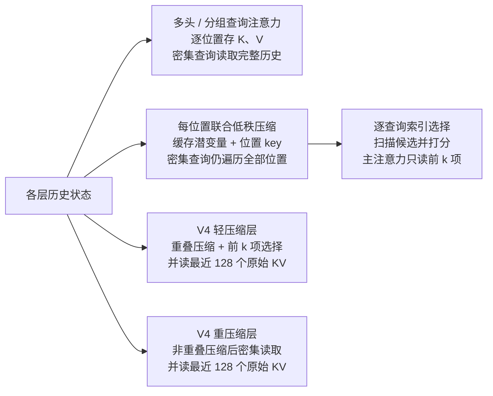

# 长上下文怎样少存、少读历史，同时保留需要的信息？

设模型读入一份百万词元的长技术报告，随后要回答一个需要拼接相隔多处内容的问题：查询既可能需要远处线索，也依赖最近句子；逐层保存并读取全部历史 KV 会增加缓存与读取成本。本文看模型结构怎样压缩状态或挑候选以降低这些成本；摘要和选择都可能漏掉回答所需线索，不保证答案信息一定保留。

自回归模型在 prefill（提示预填充）后进入 decode（增量解码）；每次处理一个新位置，每层都会计算当前位置的 query（查询）、key（键，K）和 value（值，V），并把新 KV 添入 key-value cache（键值缓存，KV cache）。更早位置的 K/V 则直接复用。但普通注意力仍会让新查询读取每个历史位置。长上下文因此有两种不同成本：缓存占多少空间，以及一次查询要从历史读取多少表示。不同模型通过共享 K/V 头、压缩每个位置的表示、按查询选择候选，或组合这些方法来降低成本；DeepSeek-V4 还把这些做法分配到不同层。

> [!info] 先约定符号
> `T` 是已处理的词元数，`H_q` 是查询头数，`H_kv` 是实际存储的 K/V 头数，`d_h` 是每头宽度，`b` 是每个缓存数值的字节数。向量点积要求两个向量坐标数相同；矩阵乘向量的结果维度等于矩阵的行数。这里的 KV cache 指同一请求生成过程中的状态，不是跨请求的提示缓存或应用的长期记忆。

下图把两条优化轴放在一起：压缩改变“每个历史位置存什么”，选择改变“当前查询读哪些位置”。V3.2 将低维缓存表示与逐查询索引结合；V4 则在序列压缩后，对不同层采用稀疏或密集读取。

## 多头注意力和分组查询注意力缓存了什么？

Multi-Head Attention（多头注意力，MHA）为每个查询头保存各自的 K/V 表示。Grouped-Query Attention（分组查询注意力，GQA）让一组查询头共享一组 K/V 头；查询头数仍可不变，但每个历史词元需要保留的 K/V 坐标变少。

若每个 K/V 头宽 `d_h`、缓存精度占 `b` bytes，则每个词元、每层的数值载荷为

$$
\text{bytes/token/layer}=2H_{kv}d_hb,
$$

其中 `2` 分别代表 K 和 V。以一个合成例子说明：`H_q=32`、`d_h=128`、BF16 每数值 2 bytes。MHA 保存 32 组 K/V，每词元每层是 `2×32×128×2=16,384 bytes=16 KiB`；GQA 若用 8 组 K/V，则是 `2×8×128×2=4,096 bytes=4 KiB`。一百万词元时，两者分别约为 `15.26 GiB` 和 `3.81 GiB` **每层**；总量还要乘层数和活跃请求数。

这减少的是**每个历史词元要存的 K/V 坐标数**，不改变历史位置数。dense attention（密集注意力）的新查询仍要逐头查看所有历史 K/V。GQA 改变模型所学的 K/V 投影；不能把头数变少就当作对任意 MHA checkpoint 的无损推理开关。生成阶段缓存让旧位置不必重复投影，但本身不改变注意力的历史读取集合。更完整的注意力计算见[语言模型如何把提示词变成文本？](how-llms-work.md)。

## 怎样把每位置的 K/V 收进一个潜变量？

Multi-Head Latent Attention（多头潜注意力，MLA）用一组学习到的低秩投影共同生成各头的内容 K/V。`h_t∈R^d` 是当前层、当前位置的 hidden state（隐藏状态）；先把它投影成共享的低维表示 `z_t^KV=W_DKV h_t∈R^{d_c}`，其中 `W_DKV∈R^{d_c×d}`。如果具体实现会在展开前归一化 latent（潜变量），就令 `c_t^KV=Norm(z_t^KV)`。DeepSeek-V3 的 absorb 路径确实对 latent 调用 RMSNorm（均方根归一化）；为突出维度与乘法结合律，下文省略这个不改变形状的算子，并用 `c_t^KV` 表示模型实际使用的 latent。`d_c` 是一份共享表示的宽度；“低秩”指它可以比逐头 K/V 内容坐标总数 `H_q(d_k+d_v)` 小，不代表能无损压缩任意 MHA 缓存。对第 `i` 个注意力头，`d_k`、`d_v` 分别是内容 key、value 的每头宽度；`W^UK_i∈R^{d_k×d_c}` 与 `W^UV_i∈R^{d_v×d_c}` 分别展开内容 key 和 value：

$$
k^C_{t,i}=W^UK_i c_t^{KV},\qquad
v^C_{t,i}=W^UV_i c_t^{KV}.
$$

如果把展开后的每头 K/V 内容都写入缓存，每位置要存 `H_q(d_k+d_v)` 个内容数值；latent 缓存路径只保留 `c_t^KV`，未来需要时再用同一组投影恢复该模型定义的 K/V。推理实现也不一定选择 latent 缓存：DeepSeek-V3 官方参考代码同时提供 `naive`（展开缓存路径）和默认 `absorb`（矩阵吸收路径）；前者缓存逐头 K/V，后者缓存经过 RMSNorm 的 latent 与独立位置 key。仅对后一路径，V3 配置示例每层缓存 512 维 latent 加 64 维位置 key，即 576 个数值；字节数还取决于两支的存储精度。它减少的是每位置缓存坐标，不是历史位置数；如果整段 latent 仍做 dense attention，候选位置数依旧随 `T` 增长。

### 怎样把 K/V 投影移到查询和输出侧？

matrix absorption（矩阵吸收）利用的是乘法结合律：不用先把 `c_s^KV` 展开成每头的内容 key，再和查询点积。下式把模型规定的归一化视为已包含在 `c_s^KV` 中，并省略不会改变维度推导的其他算子。给定当前头的内容查询 `q^C_{t,i}∈R^{d_k}`，可将查询变换为 `q̃_{t,i}=(W^UK_i)^T q^C_{t,i}∈R^{d_c}`，于是

$$
(q^C_{t,i})^T k^C_{s,i}
= (q^C_{t,i})^T W^UK_i c_s^{KV}
= (q̃_{t,i})^T c_s^{KV}.
$$

维度可逐步核对。直接展开时，`W^UK_i` 的 `d_k×d_c` 矩阵乘 `d_c` 维 `c_s^KV` 得到 `d_k` 维 key，再与 `d_k` 维 query 点积成一个标量。吸收到 query 一侧时，`(W^UK_i)^T` 是 `d_c×d_k`，乘 `d_k` 维 query 得到 `d_c` 维 `q̃` 向量；它本身还不是分数，继续与 `d_c` 维缓存 latent 点积后才得到同一个标量。值侧同样可把上投影延后：

$$
\sum_s \alpha_{t,s,i} W^UV_i c_s^{KV}
=W^UV_i\left(\sum_s \alpha_{t,s,i}c_s^{KV}\right).
$$

其中 `α_{t,s,i}` 是当前位置 `t` 的第 `i` 个 query head 分给历史位置 `s` 的注意力权重。因此推理可以先对缓存 latent 算注意力并做加权和，再把结果投影到该头的 value 空间；各头的 value 投影也可与输出投影合并。等式成立是因为同一个线性矩阵可以分配到加权和的每一项：先分别投影再相加，或先相加再投影，结果相同。这个计算重排减少了中间展开，不会缩短 dense attention 仍要扫描的历史长度。

> [!example] 用 2 维向量手算矩阵吸收
> 取 `q=[1,2]^T`、`c=[3,4]^T`，并令
>
> $$
> W=\begin{bmatrix}2&1\\0&3\end{bmatrix}.
> $$
>
> 先展开 key：`Wc=[10,12]^T`，所以 `q^T(Wc)=1×10+2×12=34`。反过来先吸收矩阵：`W^Tq=[2,7]^T`，再算 `(W^Tq)^Tc=2×3+7×4=34`。两条路径对这个线性投影得到相同分数。实际模型维度大得多，示例只展示形状与结合律。

### 为什么还要单独缓存位置 key？

Rotary Position Embedding（旋转位置编码，RoPE）让查询和 key 的一部分坐标随位置旋转。若对已展开的内容 key 逐位置施加不同 RoPE，再把 `W^UK_i` 吸收到查询侧，位置相关旋转会夹在投影中；查询侧没有一个对全部历史位置都通用的单一变换可以替代它。

MLA 因此把内容与位置分开。query latent（查询潜变量）`c_t^Q∈R^{d'_c}` 由当前位置的隐藏状态生成；MLA 论文写作 `c_t^Q=W_DQ h_t`，而 V3 参考实现把这条路径写成 `wq_b(RMSNorm(wq_a(h_t)))`。下式用 `c_t^Q` 指上投影实际接收的 latent；对 V3 参考实现，它已包含 RMSNorm。内容查询也从同一 latent 投影：`q^C_{t,i}=W^UQ_i c_t^Q∈R^{d_k}`，其中 `W^UQ_i∈R^{d_k×d'_c}`。令 `d_R` 为 RoPE 支路的宽度，`W^QR_i∈R^{d_R×d'_c}`；先由 query latent 投影出位置分量，再施加 RoPE，得到 `q^R_{t,i}=RoPE(W^QR_i c_t^Q)∈R^{d_R}`。每个历史位置则独立生成并保存 `k^R_s=RoPE(W^KR h_s)∈R^{d_R}`。每头打分可写为

$$
\text{score}_{t,s,i}=
\frac{(q^C_{t,i})^T W^UK_i c_s^{KV}+(q^R_{t,i})^T k^R_s}{\sqrt{d_k+d_R}},
\qquad
\text{cache}_s=[c_s^{KV};k_s^R].
$$

这是基础的注意力分数缩放式，省略了长上下文实现可能采用的 YaRN 缩放修正和因果 mask。

位置 key 单独保留，内容投影就能在另一侧吸收；代价是 latent 缓存还需要每位置的 RoPE 支路。查询 latent `c_t^Q` 只用于构造当前 query，不是每个历史词元的持久 KV 状态。若实现选择 latent 路径，MLA 降低每个位置要存和要读的坐标数；若仍对整段 latent 做 dense attention，候选位置数依旧随 `T` 增长。使用 naive 展开缓存的实现并不会获得同样的每位置坐标节省。

## 怎样按当前查询挑历史？

DeepSeek Sparse Attention（DeepSeek 稀疏注意力，DSA）在主注意力之前增加 lightning indexer（闪电索引器）：它用轻量的查询/key 表示给每个候选历史位置打分，再只取前 `k` 项（top-k）对应的主 KV 进入主注意力。索引 key 是单独生成、用于打分的状态；它既不是被选中后送入主注意力的 KV，也不是原始历史 KV 的另一个名字。其一类打分形式为

$$
I_{t,s}=\sum_{j=1}^{H^I}w^I_{t,j}\,\operatorname{ReLU}\!\left((q^I_{t,j})^Tk^I_s\right),
\qquad
\mathcal{S}_t=\operatorname{TopK}_s(I_{t,s}).
$$

`q^I` 来自当前查询，`k^I_s` 是缓存的索引 key，`w^I` 调整各索引头的贡献；ReLU（修正线性单元）把负分数截为零。比如玩具分数 `[2.3,1.9,0.3]`、`k=2` 时，主注意力只读取前两个候选对应的 K/V。这个选择由当前查询决定，不是全局固定窗口；不同查询可以挑不同位置。

V3.2 的 top-k 单位是历史位置，选出的索引再指向对应的主 KV 条目；其解码 MQA 路径让所有查询头共享同一个 MLA latent 条目。短序列 prefill 则可用带掩码的 MHA 模拟 DSA，因此不要把索引单位与所有阶段的实体缓存表示画等号。它让主注意力从遍历 `T` 个位置变为处理 `k` 个位置，但索引器仍要为当前查询给全部候选打分：单步 decode 的打分工作随 `T` 增长，整段 prefill 对所有查询评分仍有近似 `T²` 的候选对。于是 **前 k 项选择减少主注意力的历史读取，不会自动让候选搜索成为常数成本**。精度/量化、索引器头数、选择条数、计算内核（kernel）和检索召回都会影响实际速度与任务质量；纸面复杂度不能替代端到端测量。

## V4 怎样压缩后再选择或密集读取？

V4 预览模型沿用“按查询选择历史”的 DSA 思路，但先沿序列轴把 KV 压成更少条目。轻压缩的稀疏层把条目交给索引器选择；重压缩层则对更短的压缩序列做密集注意力。CSA/HCA 压缩分支采用 Multi-Query Attention（多查询注意力，MQA）：所有查询头共享压缩 KV，每个 512 维条目同时作为 key 和 value。也就是说，后文的“512 维 KV 条目”是一个共享向量，不是独立的 512 维 key 加 512 维 value，也不应乘查询头数。两类层还各自保留最近 128 个未压缩 KV，补回局部细节；这个分支称为 Sliding Window Attention（滑动窗口注意力，SWA）。配置中的 `compress_ratio=0` 层只走这个局部分支。

### 轻压缩稀疏层怎样每 4 个位置出一条重叠摘要？

Compressed Sparse Attention（压缩稀疏注意力，CSA）为每个原始位置生成两组学习投影 `a`、`b` 和对应的门控分数；分数还会加上可学习的块内位置偏置。令每块有 `m=4` 个位置：第 `i` 条压缩 KV 由当前块的 `a` 流和前一块的 `b` 流共同加权汇总，归一化权重在两组共 `2m` 个投影位置上做 softmax（归一化指数函数）。第一块前面没有 `b` 流，用零向量和 `−∞` 分数补齐。

把三个连续输入块记为 `B0、B1、B2`，则输出关系可简写为 `C0≈a(B0)`、`C1≈b(B0)+a(B1)`、`C2≈b(B1)+a(B2)`。这里 `+` 代表带可学习权重的逐坐标求和，不是普通平均。虽然每条 `C_i` 汇总两块，共涉及 8 个投影位置，但相邻输出重叠，输出步长仍为 4，因此 `N` 个原始位置产生约 `N/4` 条可寻址条目，而不是 `N/8`。它增加压缩投影和状态管理，却避免块边界把相邻信息硬切成互不相关的摘要。

CSA 也用同一分组方式得到独立的索引 key。每个 query 的索引器扫描所有已完成的 C4 候选，选出 `top-k` 条主 KV，再由多头查询与这些共享 KV 进行核心注意力。选择到的是压缩条目，不是精确还原出的原始词元；索引器候选数约降为 `N/4`，但仍须扫这些候选。

### 重压缩密集层怎样每 128 个位置保留一条摘要？

Heavily Compressed Attention（重度压缩注意力，HCA）将 `m′=128` 个位置的 KV 投影汇总为一条压缩 KV，不做相邻块重叠，也不设稀疏索引器。对第 `i` 个 128 词元块，令 `u_j∈R^{512}` 是位置 `j` 的 KV 投影，`z_j` 是由输入计算并加上可学习块内位置偏置的压缩分数；对每个坐标分别沿块内 128 个位置做 softmax，得到权重向量 `s_j`。符号 `⊙` 表示逐坐标相乘：

$$
C_i^{\mathrm{comp}}=
\sum_{j=128i}^{128(i+1)-1}s_j\odot u_j.
$$

后续查询会密集查看所有已完成的 HCA 条目，长度约 `N/128`。它的优点是远距离摘要不再经过前 k 项决策；代价是原来每个位置的独立地址被合并，细节只能通过这条学习到的摘要保留。CSA 和 HCA 都是模型学习的表示压缩，不是无损存档。

### 最近 128 个原始位置与未完成尾块

压缩分支只让当前 query 访问截至当前词元已完成的压缩块：一个分组中途尚未凑齐时，尾块还不能供它读取；到组末词元时，参考实现先生成压缩条目，再运行 attention，所以这个刚完成的块可以被当前 query 看到，其中不含未来词元。以 C4 为例，从 0 计的位置 `t=2` 还看不到完整压缩条目，`t=3` 可见刚完成的第一条。临近词元关系通常需要细节，因此 CSA 和 HCA 还并行使用最近 128 个按词元区分的局部 KV；这些位置仍可能量化，且窗口无法替代任意远处词元的原文。

这里有两类不同状态：局部注意力读取最近 128 个原始 KV；压缩分支则要留住未凑成一组、暂时还不能作为摘要寻址的尾部输入及其压缩状态。按逻辑上“尚未凑成一组”的输入位置计，尾部是每层 `N mod m`。`N=1,000,000` 时 C4 正好整除，C128 每个 HCA 层剩 64 个尾部位置；这些位置可能也在局部窗口里，但局部 KV 与压缩器尾部状态用途不同。尾部状态不是已完成的 HCA 条目，不能加进可供密集注意力搜索的压缩条目数。

这个逻辑尾数不等于压缩器运行时工作缓冲的分配量。CSA 的重叠路径还需保留两条相邻投影流：DeepSeek 官方朴素参考实现为每层分配 `kv_state` 与 `score_state`，各有 `2m=8` 个时槽、每槽宽 `2×512=1024`；`score_state` 记录与投影逐坐标对应的门控分数。HCA 两个状态缓冲各有 128 个时槽、每槽宽 512。即使 `N` 恰好整除，固定工作缓冲仍可能存在。这里的槽位是压缩中间状态，不是已完成的 attention KV 条目；当前 serving backend 的 pool / layout 也可以不同。最大长度 `1,048,576` 同时可被 4 和 128 整除，表示没有未完成的逻辑分组，**不表示状态缓冲归零**。部署状态池、块对齐、回收与并发预算见[KV 缓存与调度怎样决定模型推理容量](../systems/llm-serving-and-kv-cache.md)。

## 按层复算一百万词元时的状态

以下计数对应 DeepSeek-V4 论文预览的目标解码主干，不把 Multi-Token Prediction（多词元预测，MTP）草稿 attention 混入主干。Pro 有 61 个目标层，其中 30 个 CSA、31 个 HCA；Flash 有 43 个目标层，其中 21 个 CSA、20 个 HCA、2 个仅局部层。配置还各有一个单独的 MTP 仅局部 attention 层。各层共享 KV 条目宽度为 512，其中最后 64 维带 RoPE；局部窗口为 128，参考实现中局部 KV 也使用每层一个 512 维共享条目。索引器有 64 个、每个宽 128 的 query 头；每条完成的 C4 压缩候选对应一条所有头共享的 128 维索引 key。Pro `top-k=1024`，Flash `top-k=512`。

令 `N` 为当前已处理位置数。每个 CSA 层的完成条目数是 `⌊N/4⌋`，每个 HCA 层为 `⌊N/128⌋`；每个 target 层另有 `min(N,128)` 条局部原始 KV。于是主干的 512 维 KV 条目数为：

$$
\begin{aligned}
E_{\text{Pro}} &=30\lfloor N/4\rfloor+31\lfloor N/128\rfloor+61\times\min(N,128),\\
E_{\text{Flash}} &=21\lfloor N/4\rfloor+20\lfloor N/128\rfloor+43\times\min(N,128).
\end{aligned}
$$

Indexer key 是独立状态；CSA 每层各有一条压缩候选流，所以其条目数分别为 `30⌊N/4⌋` 和 `21⌊N/4⌋`。压缩尾部则按层保留：Pro 为 `30×(N mod 4)+31×(N mod 128)` 个未完成输入位置，Flash 为 `21×(N mod 4)+20×(N mod 128)` 个。尾部计数不等同于尾部字节数，缓冲还含压缩所需的中间状态。

| `N` | 模型 | 目标主干 KV 条目数 | C4 索引 key 条目数 | 未完成的逻辑输入位置（跨层） |
| ---: | --- | ---: | ---: | ---: |
| 1,000,000 | V4-Pro | 7,749,980 | 7,500,000 | 1,984（31 层各 64） |
| 1,000,000 | V4-Flash | 5,411,744 | 5,250,000 | 1,280（20 层各 64） |
| 1,048,576 | V4-Pro | 8,126,080 | 7,864,320 | 0 |
| 1,048,576 | V4-Flash | 5,674,368 | 5,505,024 | 0 |

压缩和 top-k 让主注意力读取更少，但索引器仍要比较全部 C4 候选。`N=1,000,000` 时，每个 CSA 层有 `250,000` 条候选；按 64 个、每个宽 128 的索引头计算，一条 decode query 需约 `250,000×64×128=2.048×10^9` 次乘加（multiply-accumulate，MAC）/CSA 层。Pro 的 30 个 CSA 层约为 `61.44×10^9 MAC`，若一个乘加按 2 浮点运算次数（floating-point operations，FLOPs）计约 `122.88 GFLOPs`；Flash 的 21 层约为 `43.008×10^9 MAC`、`86.016 GFLOPs`。随后主注意力每个 CSA query 才只处理至多 1,024 条（Pro）或 512 条（Flash）压缩 KV，再加 128 条局部 KV。到最大长度 `1,048,576` 时 C4 候选增至 `262,144` 条/层。这是从公开维度推算的算术量级，不含索引器投影、ReLU、top-k 排序、读写与 kernel 融合成本，也不是实测延迟。

这里的主 KV 条目数已包含目标主干每层的 128 条局部窗口。MTP 层若启用，另加每请求 128 条局部 KV；它不属于表中目标解码主干的条目数。尾部输入的位置可能也在局部窗口中，但仍需留在压缩器状态里；不要把“位置数”直接当成不重复的压缩 KV 条目数。上一段所述固定工作缓冲另算，不纳入主 KV 条目数。

按论文描述的混合精度，一个共享 KV 条目可粗略计为 `448×1 + 64×2 = 576 bytes`（非 RoPE 部分 FP8，RoPE 部分 BF16）；一条 128 维 FP4 索引 key 每个数值占 4 bit，数值载荷约为 `128×4/8=64 bytes`。以 `N=1,000,000`、不含 MTP 为例，Pro 的主 KV 数值载荷约 `7,749,980×576=4.464 GB`，索引器约 `7,500,000×64=0.480 GB`；Flash 分别约 `3.117 GB` 和 `0.336 GB`。这是论文精度口径下的纯数据载荷估算，不是参考 PyTorch 代码的实际分配量：该实现注释说明 KV 量化路径是在 BF16 中模拟，Indexer KV 当前也存 BF16。估算不含量化缩放元数据、逻辑尾部/固定工作缓冲、对齐、页空位、工作区、权重或并发请求，也不是实测显存占用。

## “10% KV、27% FLOPs”比较的是什么？

DeepSeek-V4 论文把 Pro 在 **约一百万词元上下文**的单步 decode 与 DeepSeek-V3.2 比较：单词元推理 FLOPs 约为 V3.2 的 27%（约 `1/3.7`），KV cache 约为 10%（约 `1/10`）。图 1 的终点为 1024K，这不同于上表用十进制 `N=1,000,000` 复算条目的场景。论文将 FLOPs 按 equivalent FP8 FLOPs 计。这两项是论文直接给出的配置估算，不由上面的层条目数单独重算；它不表示端到端时延、首 token latency、完整 GPU 显存或任意 MHA/GQA 模型都缩到同一比例。主文还另举了 BF16 GQA8、头宽 128 的通用 cache 基线，称 V4 在 1M 时约为其 2%；这个基线不是 V3.2，不能与 10% 混用。

该差距来自多项共同作用：C4 压缩后再 top-k，C128 密集读取更短序列，近邻窗口只留 128 个原始位置，Indexer 使用 FP4，主 KV 混合 FP8/BF16，且 top-k 配置也低于 V3.2。论文给出的是特定配置下的比例；本节条目数是依据公开层配置复算，字节数是按论文精度估算，不足以推出某个 serving 后端的实占显存或端到端延迟。

本文的输入是模型各层已经计算出的历史 hidden state 与当前 query；输出是各层压缩后的 KV、Indexer 候选、近期原始 KV 和必要的未完成尾部状态，以及供 query 使用的 attention 更新。应用层仍要决定哪些对话、工具结果和文档进入 prompt（提示词）；模型内部 KV cache 不替应用选历史，也不是持久记忆。应用上下文选择见[每次推理应看到什么、应用应持久化什么？](../context/context-engineering-principles.md)，文档检索见[RAG 怎样检索并使用经过授权的外部证据？](../rag/rag-architecture-and-implementation.md)。

> [!info]- 来源
> - **MHA/GQA 的每词元缓存量、MLA 的低秩 KV latent、矩阵吸收、RoPE 解耦与 query latent 边界：** DeepSeek-V2 最新公开版本 v5（2024-06-19），§2.1.1–2.1.4、式 (1)–(19)，[arXiv HTML](https://arxiv.org/html/2405.04434v5)。DeepSeek-V3 的 `d_c=512` 与 RoPE key 64 维参数见 [DeepSeek-V3 Technical Report v2](https://arxiv.org/html/2412.19437v2)，§2.1.1。实现路径上的限制由官方 [DeepSeek-V3 `inference/model.py`](https://github.com/deepseek-ai/DeepSeek-V3/blob/9b4e9788e4a3a731f7567338ed15d3ec549ce03b/inference/model.py) 核对：默认 `absorb` 见 [构造参数](https://github.com/deepseek-ai/DeepSeek-V3/blob/9b4e9788e4a3a731f7567338ed15d3ec549ce03b/inference/model.py#L17-L22)，`naive` 缓存展开 K/V、`absorb` 缓存归一化 latent 与独立位置 key 见[缓存和前向路径](https://github.com/deepseek-ai/DeepSeek-V3/blob/9b4e9788e4a3a731f7567338ed15d3ec549ce03b/inference/model.py#L430-L495)；该官方仓库 `main` commit `9b4e9788e4a3a731f7567338ed15d3ec549ce03b`，核对日期 2026-11-06。
> - **DSA 的 indexer 分数、top-k 选择、基于 MLA 的构造，以及稀疏主注意力仍有全候选索引成本：** DeepSeek-V3.2 技术报告 v1（2025-12-02），§2.1、§2.3；arXiv 版本查询截至 2026-11-06 仍只有 v1，[arXiv HTML](https://arxiv.org/html/2512.02556v1)。官方实现 [DeepSeek-V3.2-Exp `inference/model.py`](https://github.com/deepseek-ai/DeepSeek-V3.2-Exp/blob/87e509a2e5a100d221c97df52c6e8be7835f0057/inference/model.py#L435)，核对该仓库 `main` commit：`87e509a2e5a100d221c97df52c6e8be7835f0057`（2026-11-06）。
> - **CSA 的重叠双流压缩、每 `m` 个位置一个输出、压缩后 indexer/top-k 与共享 KV MQA；HCA 的非重叠 128 倍压缩、共享 KV MQA；RoPE、滑窗 128、状态尾部：** DeepSeek-V4 预览技术报告 v1（2026-04-26），§2.3.1–2.3.4、§3.5.1；截至 2026-11-06 arXiv API 仍只列 v1，[arXiv HTML](https://arxiv.org/html/2606.19348v1)。
> - **V4-Pro/Flash 每层数、窗口、宽度、Index top-k 与压缩率：** DeepSeek 官方公开配置快照，Pro commit `b5968e9190ef611bbf34a7229255be88a0e937c1` 的 [`config.json`](https://huggingface.co/deepseek-ai/DeepSeek-V4-Pro/blob/b5968e9190ef611bbf34a7229255be88a0e937c1/config.json) 与 [`inference/model.py`](https://huggingface.co/deepseek-ai/DeepSeek-V4-Pro/blob/b5968e9190ef611bbf34a7229255be88a0e937c1/inference/model.py)；参考代码的压缩状态见 [`Compressor`](https://huggingface.co/deepseek-ai/DeepSeek-V4-Pro/blob/b5968e9190ef611bbf34a7229255be88a0e937c1/inference/model.py#L279-L377)，索引掩码、FP4 模拟与 BF16 索引 KV 存储说明见 [`Indexer`](https://huggingface.co/deepseek-ai/DeepSeek-V4-Pro/blob/b5968e9190ef611bbf34a7229255be88a0e937c1/inference/model.py#L398-L427)；Flash commit `60d8d70770c6776ff598c94bb586a859a38244f1` 的 [`config.json`](https://huggingface.co/deepseek-ai/DeepSeek-V4-Flash/blob/60d8d70770c6776ff598c94bb586a859a38244f1/config.json)。每层计数由 `num_hidden_layers` 与压缩率数组复算，额外 MTP 项单独列出。
> - **V4 当前服务框架实现支持与状态布局核对：** 2026-11-06 的 vLLM `main` 快照 `86564975c5a5ba96b0bea94708101480ca18a2cd`，[attention.py](https://github.com/vllm-project/vllm/blob/86564975c5a5ba96b0bea94708101480ca18a2cd/vllm/models/deepseek_v4/attention.py)、[compressor.py](https://github.com/vllm-project/vllm/blob/86564975c5a5ba96b0bea94708101480ca18a2cd/vllm/models/deepseek_v4/compressor.py)；SGLang `main` 快照 `91fd6756e773ab857d5f6ddf3876fead1992b29b`，[deepseek_v4.py](https://github.com/sgl-project/sglang/blob/91fd6756e773ab857d5f6ddf3876fead1992b29b/python/sglang/srt/models/deepseek_v4.py)。这些是实现核对，不是本机运行测试或性能实测。
> - **10% KV / 27% FLOPs 的适用条件与其他 baseline：** V4 报告 v1，§1 图 1、§2.3.4；比较对象是 V3.2、上下文约 1M，FLOPs 为 equivalent FP8，另一个 2% 数字使用 BF16 GQA8 头宽 128 基线，见同一 [arXiv 报告](https://arxiv.org/html/2606.19348v1)。公开的 V4.1 后续发布使用新的非对称因果 encoder-decoder 架构，因此本文层数和 cache 比例仅适用于 V4 预览配置；见[DeepSeek-V4.1 官方发布](https://www.deepseek.com/en/news/deepseek-v4-1-flash/)。
