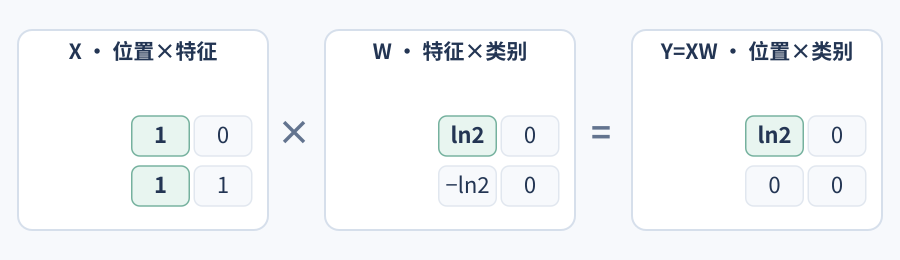
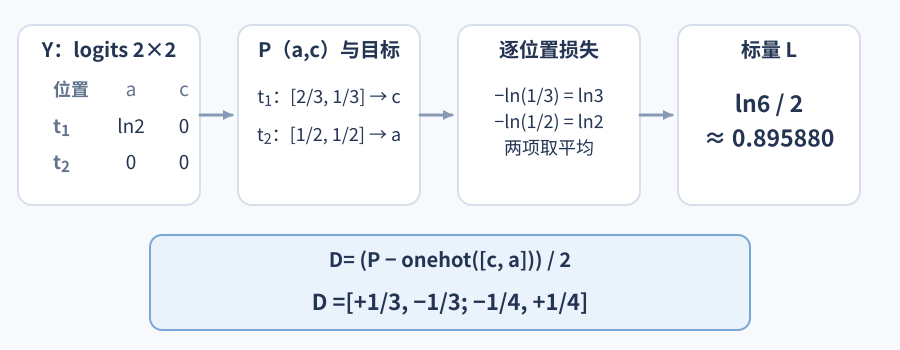
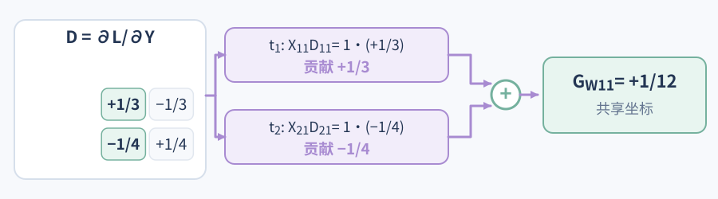
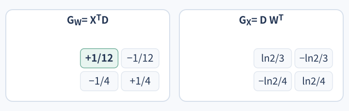
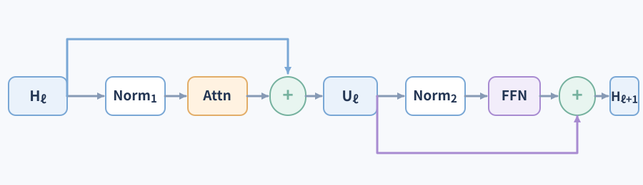
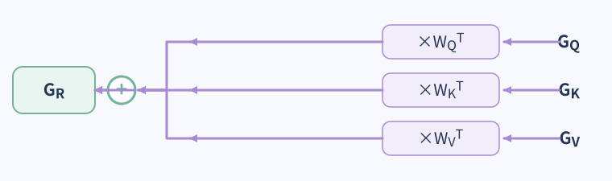
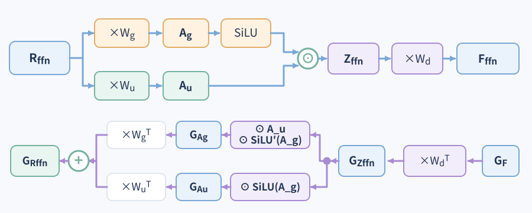
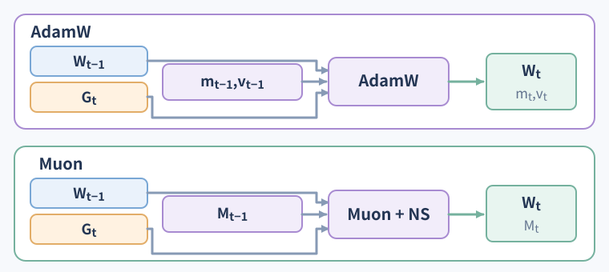
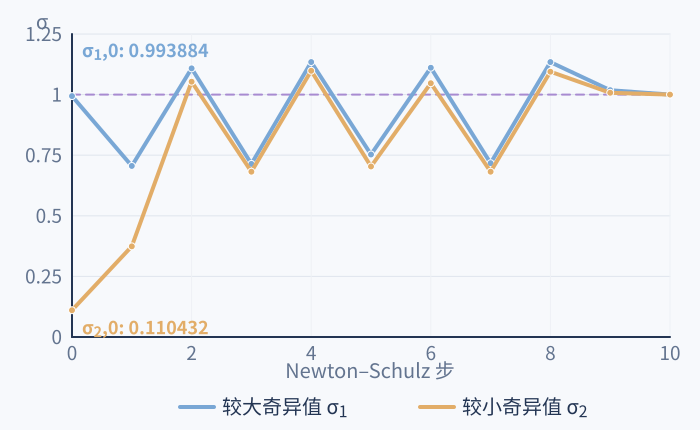

# 模型怎样从训练损失得到每个权重的更新？

[语言模型前向篇](how-llms-work.md#下一个词元训练如何更新这些参数？)已经从训练文本算出各位置的 logits（未归一化分数），并用真实下一个词元计算 cross-entropy（交叉熵）标量损失。本章继续追踪这个数：backpropagation（反向传播）按链式法则把损失的导数传回每个参数和更早的输入；optimizer（优化器）再结合梯度、学习率与自己的历史状态，决定参数的新值。装载已有权重只提供计算起点，不会计算梯度或执行更新。

## 一个矩阵怎样把梯度传给参数和输入

先把前向篇中的主下一个词元（next-token）训练目标缩成一个可手算的矩阵例。训练串仍是 `ababcac → [abab, c, a, c]`，这里取前两个受监督位置，真实目标是 `[c, a]`。为便于手算，只保留 `[a, c]` 两类，并人为指定输入特征和权重；这个教学例省略 bias（偏置），也不含 multi-token prediction（多词元预测，MTP）等附加损失。它不是前一章 Transformer 的隐藏状态或模型实测结果。

记 $X\in\mathbb{R}^{T\times d}$ 为输入表示：行 `t` 是一个位置，列 `i` 是一个输入特征。$W\in\mathbb{R}^{d\times C}$ 是共享权重矩阵，列 `j` 对应输出类别 `[a,c]` 中的一类。$W_{ij}$ 是一个可训练标量。按行向量右乘的约定，logits 为 $Y=XW$；本例 `T=d=C=2`：

$$
X=\begin{bmatrix}1&0\\1&1\end{bmatrix},\qquad
W=\begin{bmatrix}\ln 2&0\\-\ln 2&0\end{bmatrix},\qquad
Y=XW=\begin{bmatrix}\ln 2&0\\0&0\end{bmatrix}.
$$

要区分某一项对 logit 的贡献和完整 logit：第二行对类别 `a` 的分数是 $Y_{21}=X_{21}W_{11}+X_{22}W_{21}=\ln2-\ln2=0$。后面追踪 $W_{11}$ 时，只取它在这个和式里的那一项。

这三张矩阵沿用同一例子的坐标：$X$ 按位置×特征，$W$ 按特征×类别，$Y$ 按位置×类别。图中高亮 $X$ 的第一列和被追踪的 $W_{11}$。

这里 `Y` 的每一行都是一个位置对 `[a,c]` 的打分。每行经 softmax（归一化指数函数）后得到概率：

$$
P=\begin{bmatrix}2/3&1/3\\1/2&1/2\end{bmatrix}.
$$

第一个位置的目标是 `c`，它的概率为 `1/3`；第二个位置的目标是 `a`，概率为 `1/2`。对两个位置的负对数概率取平均，得到这次前向计算的标量损失：

$$
L=\frac{-\ln(1/3)-\ln(1/2)}{2}=\frac{\ln 6}{2}\approx 0.895880.
$$

这个数概括了两行预测离目标有多远，却没有直接列出每个 logit 的影响。单行交叉熵可以写成

$$
\ell(z,y)=\log\!\left(\sum_j e^{z_j}\right)-z_y.
$$

对第 `j` 个 logit 求导，第一项的斜率是 softmax 概率 $p_j$；第二项只在正确类别减去 `1`。所以单个位置的 logit 梯度是 $p-\operatorname{onehot}(y)$。本例无类别权重、无 label smoothing、两个标签都参与平均，因此平均损失对 logits 的梯度是

$$
D=\frac{\partial L}{\partial Y}=\frac{P-\operatorname{onehot}([c,a])}{2}
=\begin{bmatrix}1/3&-1/3\\-1/4&1/4\end{bmatrix}.
$$

两行 logits 分别给出概率和目标词元；平均负对数概率形成标量 $L$，再为 $Y$ 的每个坐标留下导数：

$D$ 与 $Y$ 同为 `2×2`，但它不是概率矩阵，而是各个 logit 微小变化会怎样改变 $L$ 的局部斜率。正值表示局部提高这个分数会提高损失，负值表示局部提高这个分数会降低损失。比如第一行的 `a` 是错词，增加它的分数会使损失上升；正确的 `c` 得分增加则使损失下降。

把前向的矩阵乘法写成坐标求和：

$$
Y_{tj}=\sum_i X_{ti}W_{ij}.
$$

一个参数 $W_{ij}$ 会出现在每个位置 `t` 的打分里。按链式法则，每次使用它的局部影响要乘上对应输入特征，再将所有位置的贡献相加：

$$
(G_W)_{ij}=\frac{\partial L}{\partial W_{ij}}
=\sum_t X_{ti}D_{tj},\qquad G_W=X^TD.
$$

同一个线性层也把梯度传回输入：

$$
(G_X)_{ti}=\frac{\partial L}{\partial X_{ti}}=\sum_j D_{tj}W_{ij},\qquad G_X=DW^T.
$$

`G_W` 与 $W$ 同为 $d\times C$；`G_X` 与 $X$ 同为 $T\times d$。在 `XW` 里，$G_W=X^TD$ 沿位置轴汇总“每次使用参数”的贡献；$G_X=DW^T$ 则沿类别轴汇总每个 logit 传回某个输入特征的影响。反向时 $G_X$ 沿前向的反方向传给更靠近输入端的层，继续计算更早层的梯度。

> [!example] 一个共享权重怎样汇总两个位置的相反信号？
> 看 $W_{11}$：它把第一个输入特征加到类别 `a` 的 logit。两行的第一个特征都是 `1`，所以它分别贡献于 $Y_{11}$ 与 $Y_{21}$。反向时，第一行产生正梯度，第二行产生负梯度：
>
> $$
> \frac{\partial L}{\partial W_{11}}=X_{11}D_{11}+X_{21}D_{21}
> =1\cdot\frac13+1\cdot\left(-\frac14\right)=\frac1{12}.
> $$
>
> 第一行单独看，会倾向降低 $W_{11}$，减小错误类别 `a` 的分数；第二行单独看，会倾向提高它，以提高正确类别 `a` 的分数。共享矩阵不能为这两行分别改变同一个参数，只能把贡献相加，得到净梯度 `+1/12`。梯度下降会降低 $W_{11}$；由于这两行的该特征都是 `1`，这一坐标的变化会同时降低两行的 `a` logit。一次完整更新还会修改其他权重坐标，所以最终 logits 是多项更新共同作用的结果。

将同一次矩阵乘法的全部坐标算出：

$$
G_W=\begin{bmatrix}1/12&-1/12\\-1/4&1/4\end{bmatrix},\qquad
G_X=\begin{bmatrix}(\ln2)/3&-(\ln2)/3\\-(\ln2)/4&(\ln2)/4\end{bmatrix}.
$$

这两张完整梯度矩阵分别显示参数坐标与输入坐标的结果；$G_W$ 的位置轴汇总已在上图展开，$G_X$ 则按类别轴回传。

真实批次可能把很多序列的位置摊平后再计算损失。若有 $N_{loss}$ 个有效标签参与平均，每个有效位置的梯度还要除以 $N_{loss}$；被 padding 或任务规则排除的 logit 行没有直接交叉熵梯度。即使如此，该位置的表示仍可能作为上下文影响其他受监督位置，并经那些位置的损失收到梯度。

## 梯度怎样穿过 Attention、FFN 和 Embedding

反向模式自动微分（reverse-mode automatic differentiation）从标量损失的单位梯度 $\partial L/\partial L=1$ 开始，沿前向实际执行的算子反向传播。每个算子用自己的局部导数处理收到的上游梯度，再将结果送到输入。一个标量损失要对大量参数求导时，反向模式可以在一次反向遍历中得到这些梯度；无需为每个参数分别扰动、重跑完整前向，也不必显式存下“输出坐标 × 参数坐标”的完整 Jacobian（雅可比矩阵）。算子会保存或重算所需的中间激活。

前面的 $Y$ 专指分类算例的 logits。现在切回前向篇中的一个 pre-norm decoder-only self-attention block（前置归一化、仅解码器自注意力块），改用 $H_\ell$ 表示第 $\ell$ 个 block 的输入状态，$\ell$ 是层号；它有 $T$ 个位置和 $d_{model}$ 个特征。$U_\ell$ 是 attention 残差加法后的中间状态。这个 block 前向依次经过两次归一化、两个子层和两次残差加法：

$$
R_{att}=\operatorname{Norm}_1(H_\ell),\qquad
F_\ell^{att}=\operatorname{SelfAttention}(R_{att}),\qquad
U_\ell=H_\ell+F_\ell^{att},
$$

$$
R_{ffn}=\operatorname{Norm}_2(U_\ell),\qquad
F_\ell^{ffn}=\operatorname{FFN}(R_{ffn}),\qquad
H_{\ell+1}=U_\ell+F_\ell^{ffn}.
$$

两次加法的旁路分别把 $H_\ell$ 送到 $U_\ell$，再把 $U_\ell$ 送到 $H_{\ell+1}$。本节下文的 $R_Q$、$R_{KV}$ 和 $R_{ffn}$ 都是各子层归一化后的表示，不是前一节的 logits $Y$。

反向传播会沿这个 block 的两条残差分支继续合流。attention 子层内部的 Q/K/V 输入合流如下；逐层的两个残差合流会在 FFN 后统一写出。

先展开这个 block 的 attention（注意力）计算。为对照矩阵规则，下面只看一个样本、一个 attention head（注意力头），并省略 rotary positional embedding（旋转位置编码，RoPE）、投影偏置与 attention dropout（注意力随机失活）；若启用 dropout，还需按前向实际使用的掩码与缩放继续回传梯度。$R_Q\in\mathbb{R}^{T_q\times d_{model}}$、$R_{KV}\in\mathbb{R}^{T_k\times d_{model}}$ 分别是 query 与 key/value 投影输入，特征宽度为 $d_{model}$。本节的全序列 self-attention 中二者相同，即 $R_Q=R_{KV}=R=R_{att}=\operatorname{Norm}_1(H_\ell)$、$T_q=T_k=T$；cross-attention（交叉注意力）中 query 与 key/value 可以来自不同输入。$T_q$ 行 query（查询）和 $T_k$ 行 key/value（键/值）分别是 query 轴与 key/value 轴的位置数，二者不必相同；$d_h$ 是一个 head 的宽度。按行向量约定，投影权重形状为 $d_{model}\times d_h$：

$$
Q=R_QW_Q\in\mathbb{R}^{T_q\times d_h},\qquad
K=R_{KV}W_K\in\mathbb{R}^{T_k\times d_h},\qquad
V=R_{KV}W_V\in\mathbb{R}^{T_k\times d_h}.
$$

本 block 的 self-attention 使用前文定义的共同输入 $R$。前向篇的 Q/K 还会经过 RoPE。这里为缩短推导而省略旋转；若实际前向使用 RoPE，先求对旋转后 Q/K 的梯度，再用每个位置旋转矩阵的转置映回投影输出。以行向量记法，若 $q'=q\operatorname{Rot}_t$，则

$$
G_q=G_{q'}\operatorname{Rot}_t^T,
$$

K 同理。`t` 是 query 或 key 的位置。这个转置来自对右乘矩阵的求导，并不是把 RoPE 从真实模型中删除。

令 $B\in\mathbb{R}^{T_q\times T_k}$ 是固定的加性掩码：可读位置加 `0`，被屏蔽的位置加 $-\infty$。分数沿 key 轴逐行归一化，得到 attention 权重 $A$ 与加权输出 $Z$：

$$
S=\frac{QK^T}{\sqrt{d_h}}+B,\qquad
A=\operatorname{softmax}_{keys}(S),\qquad
Z=AV.
$$

`S` 与 `A` 的形状为 $T_q\times T_k$，`Z` 为 $T_q\times d_h$。此处用 $A$ 表示注意力权重，以免和前一节分类概率矩阵 $P$ 混淆。以下 softmax 公式假设每个纳入计算的 query 至少有一个未屏蔽的 key；整行都被屏蔽时，输入全为 $-\infty$，不适用普通 softmax 公式。若从 attention 输出端收到 $G_Z=\partial L/\partial Z$，线性加权和分别沿 V 路径与权重路径传回：

$$
G_V=A^TG_Z\in\mathbb{R}^{T_k\times d_h},\qquad
G_A=G_ZV^T\in\mathbb{R}^{T_q\times T_k}.
$$

softmax 的每一行共用同一个分母，因此一个 key 分数的变化会影响该 query 的整行权重。对 query 位置 `t`、key 位置 `j`，梯度为

$$
(G_S)_{tj}=A_{tj}\left((G_A)_{tj}-\sum_k A_{tk}(G_A)_{tk}\right).
$$

例如 $A=(1/4,3/4)$、$G_A=(2,0)$ 时，加权平均为 `1/2`，所以 $G_S=(3/8,-3/8)$，该行梯度之和为零。因果掩码中不可读的位置权重为零，对应分数梯度也为零。这里的掩码 $B$ 被视为常量。

分数对 Q、K 的梯度是

$$
G_Q=\frac{G_SK}{\sqrt{d_h}},\qquad
G_K=\frac{G_S^TQ}{\sqrt{d_h}}.
$$

回到投影矩阵，线性层仍使用相同规则：

$$
G_{W_Q}=R_Q^TG_Q,\qquad
G_{W_K}=R_{KV}^TG_K,\qquad
G_{W_V}=R_{KV}^TG_V.
$$

若三路共享同一个 self-attention 输入 $R$，则它们对该输入的梯度相加：

$$
G_R=G_QW_Q^T+G_KW_K^T+G_VW_V^T.
$$

三路投影的局部输入梯度先在共同表示 $R$ 处相加；图只画这一局部合流。由于本 block 的 $R=\operatorname{Norm}_1(H_\ell)$，它还要穿过归一化算子的局部导数，得到 attention 子层对 $H_\ell$ 的贡献 $G_{H_\ell}^{attn}$。与残差直通路径收到的梯度相加后才得到 $G_{H_\ell}$。

cross-attention（交叉注意力）不应套用单个 $R$ 的公式：若 $Q=R_QW_Q$、$K=R_{KV}W_K$、$V=R_{KV}W_V$，则

$$
G_{R_Q}=G_QW_Q^T,\qquad
G_{R_{KV}}=G_KW_K^T+G_VW_V^T.
$$

Q 的梯度回到 query 来源；K 与 V 因共享 key/value 输入而在另一来源处相加。增量解码时当前 query 可只有一行，而 K/V 轴包含整个可读前缀；因此 $T_q$ 与 $T_k$ 可以不同。

多头 attention 的输出投影也依线性规则反传。若有 `h` 个头，拼接 $H_{cat}=\operatorname{Concat}(Z_1,\ldots,Z_h)$ 的形状为 $T_q\times(hd_h)$；输出投影 $W_O$ 的形状为 $(hd_h)\times d_{model}$，输出 $O=H_{cat}W_O$ 为 $T_q\times d_{model}$。令

$$
G_{H_{cat}}=G_OW_O^T,\qquad G_{W_O}=H_{cat}^TG_O.
$$

穿过输出投影后，先沿拼接轴把 $G_{H_{cat}}$ 切回每个头的 $G_{Z_i}$，再分别传回各头的 Q/K/V。各头仍共享原始输入，但使用各自的投影权重。在本 block 的记号里，多头 attention 输出投影的结果就是 $O=F_\ell^{att}$，并进入 $U_\ell=H_\ell+F_\ell^{att}$。因此残差相加传给 attention 分支的是 $G_{F_\ell^{att}}=G_{U_\ell}$，也就是 $G_O=G_{U_\ell}$；这里的 $G_{U_\ell}$ 已包含从 FFN 与第二次残差回来的梯度。

门控 FFN 对每个位置投影到更宽的特征，再逐元素门控并投影回来。这里 block 输入是 $H_\ell$；attention 子层先归一化、计算并与旁路相加，得到 $U_\ell$，所以 FFN 的归一化输入为 $R_{ffn}=\operatorname{Norm}_2(U_\ell)$。这与分类例中代表 logits 的 $Y$ 无关。gate（门控）支路经 SiLU（Sigmoid Linear Unit，Sigmoid 线性单元）激活，candidate（候选）支路提供逐元素相乘的另一项。令中间门控表示为 $Z_{ffn}$、FFN 输出为 $F_\ell^{ffn}$：

$$
A_g=R_{ffn}W_g,\qquad A_u=R_{ffn}W_u,\qquad
Z_{ffn}=\operatorname{SiLU}(A_g)\odot A_u,\qquad F_\ell^{ffn}=Z_{ffn}W_d.
$$

从 block 输出端收到 $G_{H_{\ell+1}}$ 后，沿第二次残差相加，FFN 分支收到 $G_{F_\ell^{ffn}}=G_{H_{\ell+1}}$；直通分支把同一梯度送到 $U_\ell$。FFN 内先有 $G_{Z_{ffn}}=G_{F_\ell^{ffn}}W_d^T$。逐元素门控把它分回两条支路；这是分流，还没有相加：

$$
G_{A_g}=G_{Z_{ffn}}\odot A_u\odot\operatorname{SiLU}'(A_g),\qquad
G_{A_u}=G_{Z_{ffn}}\odot\operatorname{SiLU}(A_g).
$$

于是权重梯度分别是 $G_{W_g}=R_{ffn}^TG_{A_g}$、$G_{W_u}=R_{ffn}^TG_{A_u}$、$G_{W_d}=Z_{ffn}^TG_{F_\ell^{ffn}}$；两条支路穿过各自投影后，才在共同输入 $R_{ffn}$ 处相加：

$$
G_{R_{ffn}}=G_{A_g}W_g^T+G_{A_u}W_u^T.
$$

归一化层若带可学习的逐特征缩放，也会收到独立的参数梯度。令 $\widehat H_\ell$、$\widehat U_\ell$ 分别表示 $\operatorname{Norm}_1$、$\operatorname{Norm}_2$ 归一化后、乘上缩放前的值；每个缩放坐标在所有位置共用，因此其梯度沿位置轴相加：

$$
(G_{\gamma_1})_i=\sum_{t=1}^{T}(G_{R_{att}})_{ti}\widehat H_{\ell,ti},\qquad
(G_{\gamma_2})_i=\sum_{t=1}^{T}(G_{R_{ffn}})_{ti}\widehat U_{\ell,ti}.
$$

这里的 $i$ 是特征坐标，$t$ 是位置；若归一化还带可学习偏置，其梯度也按位置累加。参数梯度这条路径与穿过归一化局部导数、回到 $H_\ell$ 或 $U_\ell$ 的输入梯度不同。

穿过 $\operatorname{Norm}_2$ 的局部导数后得到 FFN 对 $U_\ell$ 的贡献 $G_{U_\ell}^{ffn}$，再与第二次残差的直通梯度相加。随后 attention 分支与第一次残差在 $H_\ell$ 处合流：

$$
G_{U_\ell}=G_{H_{\ell+1}}+G_{U_\ell}^{ffn},\qquad
G_{H_\ell}=G_{U_\ell}+G_{H_\ell}^{attn}.
$$

其中 $G_{U_\ell}^{ffn}$ 已穿过 $\operatorname{Norm}_2$，$G_{H_\ell}^{attn}$ 已穿过 $\operatorname{Norm}_1$；每个残差式的一项来自子层分支，另一项来自直通路径。图中展开 FFN gate/candidate 两路，分流节点不做相加；只有投影梯度回到共同输入时才相加。

反向传播按与前向相反的顺序，从 $H_{\ell+1}$ 经第二次残差回到 $U_\ell$，再经 attention 残差回到更早的 $H_\ell$。Manifold-Constrained Hyper-Connections（流形约束超连接，mHC）把普通旁路扩展为多条状态流的混合，混合系数也由状态计算；梯度会沿这些实际执行的流与系数生成路径继续返回。[模型前向篇的残差流与 mHC 说明](how-llms-work.md#把更新后的状态传给下一层)展开了这些状态和映射。无论分支多少，若前向没有经过某条边或张量被切断，损失都不会沿那条边传回。

Embedding lookup 从 $E\in\mathbb{R}^{N\times d}$ 中按整数 ID 取一行。若位置 `t` 的 ID 是 `q`，前向为 $X_t=E_{q,:}$；反向把该位置的 $G_{X,t}$ 加到 $G_E$ 的第 `q` 行。重复 ID 的贡献会累加；ID 本身是离散整数，不从连续损失取得普通梯度。若 embedding 表与 language model head（语言模型头，LM head）绑定，按本章行向量约定必须有 $C=N$ 且 $W=E^T$。查表路径的汇总梯度 $G_{lookup}\in\mathbb{R}^{N\times d}$ 与输出打分路径梯度 $G_W^T\in\mathbb{R}^{N\times d}$ 形状相同，故共享表的完整梯度为

$$
G_E=G_{lookup}+G_W^T.
$$

冻结与停止梯度是两种不同操作。冻结权重 $W$ 的意思是训练步不更新它，也不为它累积参数梯度；若前面的可训练表示 $X$ 仍通过 $XW$ 影响损失，自动微分仍可用固定的 $W$ 计算 $G_X=DW^T$。在 PyTorch 2.15 中，`requires_grad=False` 使参数本身不接收梯度；只要另一个输入需要梯度，这个乘法仍会被记录，以计算该输入的梯度。low-rank adaptation（低秩适配，LoRA）中的有效权重可写为 $W'=W+BA$：基础矩阵 $W$ 冻结，增量支路中的 $A$ 与 $B$ 可训练；梯度仍可穿过冻结的 $W$ 回到输入。[微调策略](../fine-tuning/fine-tuning-strategies.md)进一步比较这些参数选择。

`detach`（停止梯度）则把一个张量从产生它的上游计算图切开，后续损失不会再沿这条边回到被切断的计算。离散 `top-k`（取前 k 项）选择产出的整数 ID 也没有普通连续导数去表示“改选另一个 ID”的影响；但被选中的值仍可沿后续连续运算收到梯度。[长上下文中的 V3.2 索引器训练例](long-context-attention.md#DeepSeek-V3.2%20怎样训练离散选择之前的%20Indexer？)展示了 detach、离散选择与索引器自身辅助损失如何限定路径。V4 报告虽公开训练阶段安排，但没有公布可直接照用的完整 indexer loss/detach 配方；不应从推理代码中的整数选择推断 V4 的训练损失。

## AdamW 和 Muon 怎样使用已经算好的梯度

到这里，反向传播只回答“损失怎样依赖参数”：它在当前 $W$ 上产生 $G_W=\partial L/\partial W$，尚未改动 $W$。优化器回答另一个问题：根据梯度、学习率和历史状态，本步参数取什么值。以下 $t$ 表示训练步，不是前面的位置索引：第 `t` 次更新从 $W_{t-1}$ 开始，在这个参数上计算 $G_t=\nabla_W\mathcal{L}_t(W_{t-1})$，然后得到新参数 $W_t$。

图中 $W_{t-1}$、本步梯度 $G_t$ 和各自历史状态分别进入 AdamW 或 Muon；优化规则给出更新方向，再产生 $W_t$。AdamW 逐坐标使用 $m,v$，Muon 对矩阵使用动量 $M$ 和 Newton–Schulz（牛顿–舒尔茨，NS）变换；正文展开各自的计算。

先看 stochastic gradient descent（随机梯度下降，SGD）：

$$
W_t=W_{t-1}-\eta G_t.
$$

`η` 是学习率，把梯度转换成本步的更新尺度。沿用前面的 $G_W$，取教学用 `η=0.01`，对整张矩阵做一步 SGD 后，再用更新后的矩阵重新计算同一批交叉熵，损失从 `0.895880` 降到约 `0.894492`。这是人为指定矩阵与步长的数值结果，不是实测训练，也不保证每个训练步的损失都下降。学习率调度器可以随训练步改变 `η`，但本身不保证最终到达全局最优点。

### AdamW 怎样逐坐标使用梯度和历史？

AdamW 为每个可训练参数坐标维护两类历史：$m_t$ 是梯度的一阶指数滑动平均；$v_t$ 是梯度平方的指数滑动平均，不是先减去均值后的统计方差。若从全零状态开始：

$$
m_t=\beta_1m_{t-1}+(1-\beta_1)G_t,\qquad
v_t=\beta_2v_{t-1}+(1-\beta_2)(G_t\odot G_t),
$$

$$
\widehat m_t=\frac{m_t}{1-\beta_1^t},\qquad
\widehat v_t=\frac{v_t}{1-\beta_2^t},\qquad
W_t=(1-\eta\lambda)W_{t-1}-\eta\frac{\widehat m_t}{\sqrt{\widehat v_t}+\epsilon}.
$$

`⊙`、平方根、除法和权重衰减都按坐标执行。$\beta_1$、$\beta_2$ 控制新梯度替换旧历史的速度；偏差校正补偿状态从零开始带来的初期低估。$\epsilon$ 避免分母为零。decoupled weight decay（解耦权重衰减）先独立缩小参数，不进入 $m_t$ 或 $v_t$；AdamW 使用的是已经由反向传播算好的 $G_t$。

> [!example] AdamW 第一步怎样更新一个权重？
> 沿用 $W_{11}=\ln2$、$G_{11}=1/12$，从 $m_0=v_0=0$ 开始，取教学用学习率 `η=0.01`、衰减 `λ=0.1`、$\beta_1=0.9$、$\beta_2=0.95$，并令 $\epsilon=10^{-20}$ 相对梯度可忽略。偏差校正后 $\widehat m_1=1/12$、$\widehat v_1=(1/12)^2$，故自适应梯度项约为 `1`。参数先由解耦衰减从 `ln2` 缩为 `0.999 ln2`，再减去 `0.01`，得到 $W_{11}'\approx0.682454033$。参数值、损失梯度和优化器状态是三种不同的量。
>
> 这里的 $\beta_1=0.9$、$\beta_2=0.95$、$\epsilon=10^{-20}$ 和 weight decay `0.1` 与 V4 Flash/Pro 报告一致；学习率 `0.01`、参数起点与梯度仍是教学设置。

### Muon 怎样把一个矩阵梯度变成方向？

Muon 是针对隐藏层二维权重的优化器，而不是新的反向传播方法；它接收的仍是 $G_t$。其原始说明把标量、向量和输入/输出层参数交给标准优化器。DeepSeek-V4（下称 V4）则在大多数矩阵参数上用 Muon，并将 embedding、prediction head（预测头）、mHC 静态偏置与门控因子，以及 RMSNorm（均方根归一化）权重交给 AdamW。因此本章词表预测头若按 V4 的分工，会由 AdamW 更新；下面的 Muon 是通用矩阵方向示例，不是同一个 prediction head 的更新。

V4 的配方先积累矩阵动量 $M_t$，再形成 Nesterov 型方向 $D_t$。从这里开始，$D_t$ 是优化器中的方向矩阵，与前面表示 logits 梯度的 $D$ 不同；它随后进入混合 Newton–Schulz 迭代并按形状调整整体尺度：

$$
M_t=\mu M_{t-1}+G_t,\qquad D_t=\mu M_t+G_t,
$$

$$
O'_t=\operatorname{HybridNewtonSchulz}(D_t),\qquad
O_t=\gamma\sqrt{\max(n,m)}\,O'_t,
$$

$$
W_t=(1-\eta\lambda_{wd})W_{t-1}-\eta O_t.
$$

这里 $W\in\mathbb{R}^{n\times m}$ 是数学上的逻辑矩阵，$M_t$ 是同形状的动量缓冲，$O'_t$ 与 $O_t$ 是从梯度变换出的更新方向。它们不是前向篇 attention 输出的 `O`，也不会把模型权重 $W$ 本身变成正交矩阵。

在本节 V4 配方中，进入混合 Newton–Schulz 迭代的矩阵正是前面 Nesterov 型方向：$D_{\mathrm{Muon}}:=D_t=\mu M_t+G_t$。用 compact singular value decomposition（紧致奇异值分解，SVD）写它为 $D_{\mathrm{Muon}}=U_r\Sigma_rV_r^T$，其中 `r` 是秩，$U_r\in\mathbb{R}^{n\times r}$、$V_r\in\mathbb{R}^{m\times r}$，对角矩阵 $\Sigma_r$ 中的奇异值描述沿配对方向的伸缩。用列向量写，每对方向满足 $D_{\mathrm{Muon}}v_i=\sigma_i u_i$；这只是线性映射的列向量约定，与前向篇行向量右乘权重的记法相对应。理想的正交化方向是 $U_rV_r^T$：保留非零奇异方向，把它们的伸缩倍数改成 `1`，零方向仍为零。实际迭代以 $D_{\mathrm{Muon}}/\lVert D_{\mathrm{Muon}}\rVert_F$ 开始，通过矩阵乘法多项式近似这个方向，而不是每步显式计算完整 SVD。这个归一化要求 $D_t\ne0$；全零输入不能直接代入除以 Frobenius 范数的公式。

V4 在前 8 步使用系数 $(a,b,c)=(3.4445,-4.7750,2.0315)$，后 2 步改用 $(2,-1.5,0.5)$，总计 10 步。对角教学矩阵 $D_{\mathrm{Muon}}=D_t=\operatorname{diag}(9,1)$，Frobenius norm（弗罗贝尼乌斯范数）为 $\sqrt{82}$，所以归一化后的两个奇异值从 `(0.993884, 0.110432)` 开始。因为该例为对角矩阵，每一步可分别计算 $x'=ax+bx^3+cx^5$。第一步约为 `(0.705643, 0.373984)`，第八步约为 `(1.094391, 1.134267)`，第十步约为 `(1.000030, 1.000190)`。有限步迭代近似单位方向，不会精确得到 `1`；初始零奇异值也一直保持为零。这个结果只复算了对角教学例的标量多项式，不是 bfloat16（BF16）内核或模型训练实测。

图展示对角教学矩阵的两个非零奇异值从第 0 步到第 10 步的轨迹：前 8 步中多次超过 `1`，最后两步改用第二组系数后回到约 `1`；零奇异值始终为零。

图中每一步都按奇异值从大到小排序；前文的数对按原对角方向顺序列出。若 $O'_t$ 满秩且奇异值约为 `1`，其 Frobenius norm 约为 $\sqrt{\min(n,m)}$。分摊到 $nm$ 个元素后，每元素均方根约为 $1/\sqrt{\max(n,m)}$；乘上 $\sqrt{\max(n,m)}$ 后约为 `1`，再由 $\gamma$ 设置更新的整体 RMS。秩不足时，达到 `1` 的方向数变少，实际 RMS 也会低于满秩估算。V4 的训练设置报告动量 `μ=0.95`、权重衰减 `λ=0.1`，并把更新矩阵 RMS 调到 `0.18`，以沿用其 AdamW 学习率尺度；这些是该 V4 配方的具体值，不是所有 Muon 实现的默认值。

Newton–Schulz 的矩阵乘法把不同的行列方向耦合起来。将一张逻辑权重切成几块并对每块独立迭代，通常不等价于对完整逻辑矩阵迭代。V4 报告明确说明 Muon 更新需要完整梯度矩阵，并用 hybrid Zero Redundancy Optimizer（零冗余优化器，ZeRO）bucket 分配协调数据并行；超过相应 ZeRO 并行范围时，会在额外的数据并行组上冗余计算更新。因此可把“完整梯度”理解为 Muon 更新数学上作用的逻辑矩阵；这条约束本身不表示每块 GPU 都常驻一份完整权重。

AdamW 按坐标累计梯度与梯度平方，再逐坐标缩放；Muon 按逻辑矩阵累计动量，正交化方向后按形状缩放。两者都从反向传播已算好的梯度开始，差别在于怎样把梯度和历史状态转换为更新；选择哪种优化器、哪些参数交给哪组，属于具体训练配方。参数更新为 $W_t$ 后，下一步再用新参数前向并计算新的损失梯度。

> [!info]- 来源
> 本页主矩阵、位置与奇异值均为教学示例；数值由本页明示的公式复算，不表示训练测量。
>
> - **交叉熵与反向模式。** [PyTorch `CrossEntropyLoss` 2.15](https://docs.pytorch.org/docs/2.15/generated/torch.nn.CrossEntropyLoss.html) 的输入是未归一化 logits，并定义类别索引目标、忽略位置和平均规则；本例取无类别权重、无 label smoothing 的情况。[PyTorch Autograd mechanics 2.15](https://docs.pytorch.org/docs/2.15/notes/autograd.html) 的 “How autograd encodes the history” 说明计算图沿链式法则反向求导，“Setting `requires_grad`” 说明只有启用梯度的叶参数会累积参数梯度，所需输入梯度仍可沿已记录运算传播；[`torch.Tensor.detach` 2.15](https://docs.pytorch.org/docs/2.15/generated/torch.Tensor.detach.html) 说明 detach 返回与当前图分离的张量。[Baydin et al., *Automatic Differentiation in Machine Learning: A Survey*, arXiv v4, 2018-02-05, §§3.2、4.2](https://arxiv.org/html/1502.05767v4#S3.SS2) 解释反向模式从标量目标沿计算图计算对多个输入的导数。
> - **Attention 与位置旋转。** [Attention Is All You Need, v7, §3.2](https://arxiv.org/html/1706.03762v7#S3.SS2) 给出 $QK^T$、softmax 与 $AV$ 的前向结构；[RoFormer, v5, §3.2.2, equations 14–16](https://arxiv.org/html/2104.09864v5#S3.SS2) 定义 Q/K 位置旋转。本页从这些前向关系按链式法则推导反向式，RoPE 梯度转置由行向量右乘的矩阵求导得到。
> - **AdamW。** [Kingma and Ba, *Adam: A Method for Stochastic Optimization*, arXiv v9, Algorithm 1](https://arxiv.org/abs/1412.6980v9) 给出矩估计与偏差校正；[Loshchilov and Hutter, *Decoupled Weight Decay Regularization*, arXiv v3, §2](https://arxiv.org/html/1711.05101v3#S2) 解释权重衰减与 Adam 自适应更新解耦；[PyTorch `AdamW` 2.15](https://docs.pytorch.org/docs/2.15/generated/torch.optim.AdamW.html) 给出更新公式及参数。
> - **Muon 与 V4 配方。** Jordan, [*Muon: An optimizer for hidden layers in neural networks*](https://kellerjordan.github.io/posts/muon/), 2024-12-08，定义 Muon 面向隐藏层二维权重并使用 Newton–Schulz 近似正交化；Liu et al., [*Muon is Scalable for LLM Training*, arXiv v1](https://arxiv.org/html/2502.16982v1), §§2.1–2.3，讨论大模型中的更新缩放与分布式实现。DeepSeek-V4 [Technical Report v1](https://arxiv.org/html/2606.19348v1) 的 §2.4 Algorithm 1 给出动量、Nesterov 方向、缩放和权重衰减，式 (28) 与 “Hybrid Newton-Schulz Iterations” 给出 8+2 步系数；§3.4.1 “Efficient Implementation of Muon” 说明完整梯度矩阵与 hybrid ZeRO bucket；§4.2.2 “Training Setups” 给出 AdamW/Muon 的参数分工与 V4-Flash/Pro 数值。以上版本和段落于 2026-11-11 核对。
