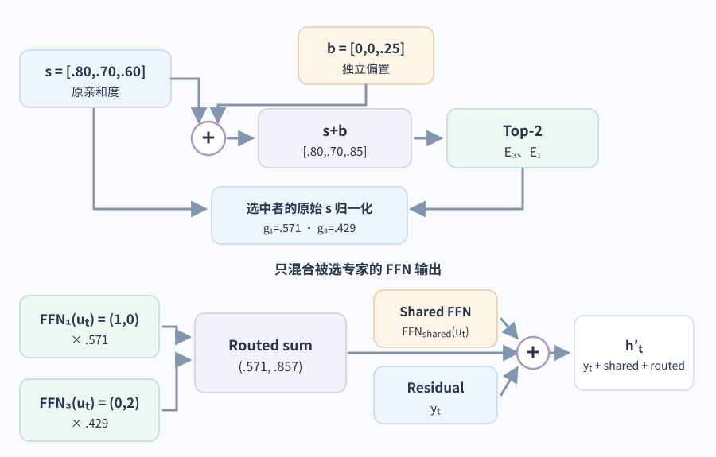
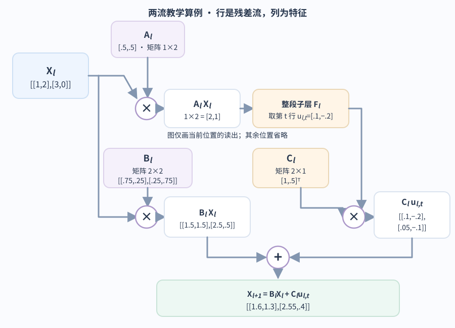
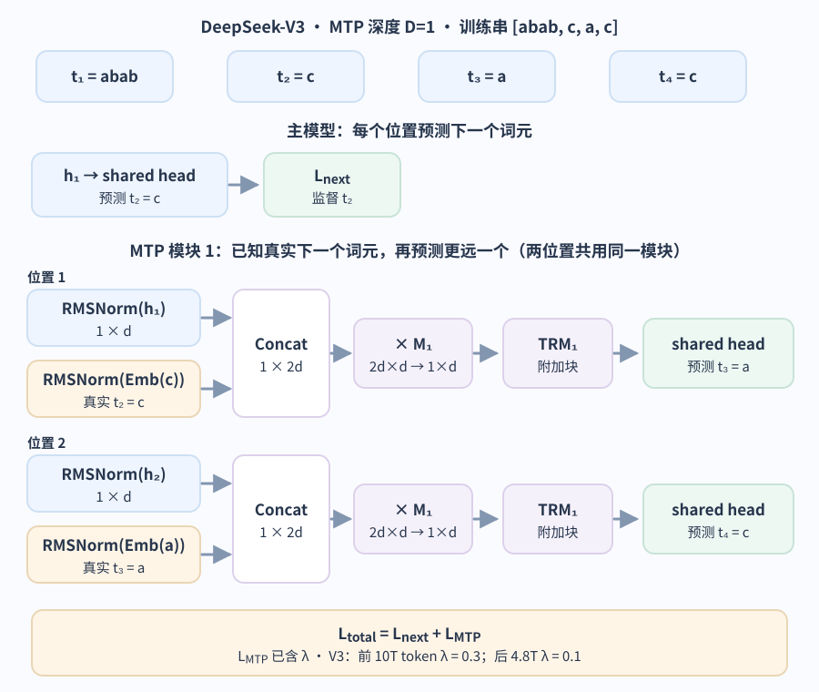

# MoE、mHC 和 MTP 分别改了 Transformer 的哪一块？

[模型怎样把提示词算成下一个词元](next-token-computation.md)用的是一个标准块：一条残差流，每层一个稠密的 SwiGLU FFN，训练只预测下一个词元。DeepSeek 的模型在这三处各做了一个改动：MoE 改 FFN，mHC 改残差流，MTP 改训练目标。本章分三节讲它们各自怎样计算，以及改动之后什么变了、什么没变。

三处改动来自不同的模型版本，每节开头说明用的是哪个配置。它们不能拼成一套玩具模型，也不能把某一节的数字套到另一个版本上。

| 改动 | 改了哪一块 | 本章所用配置 | 推理时是否必须运行 |
| --- | --- | --- | --- |
| MoE | FFN 子层：每个词元只运行部分专家 | DeepSeek-V3 | 是 |
| mHC | 残差流：每个位置从一条扩成四条 | DeepSeek-V4 | 是 |
| MTP | 训练目标：多预测一个更远的词元 | DeepSeek-V3，深度 `D=1` | 否，可移除或用作推测解码的草稿来源 |

记号沿用主线一的行向量约定：一行是一个位置的表示，权重右乘。

## MoE：每个词元只运行一部分 FFN

> [!info] 本节配置：DeepSeek-V3
> 前 3 层仍用稠密 FFN，其余各层是 MoE 层：1 个 shared expert (共享专家) 加 256 个 routed expert (路由专家)，每个词元选 8 个路由专家。V3 的 attention 实际用 MLA，本节只看 FFN 子层。

### 共享专家与路由专家

Mixture-of-Experts (混合专家，MoE) 把一层 FFN 拆成多个专家，每个专家本身就是一个 FFN。router (路由器) 根据每个词元当前的表示，挑出其中几个来运行。attention 不变，仍负责位置之间的信息汇集。专家是学到的参数组，不是预先命名的知识类别，也不是外部检索库。

接上标准块的记号：令 attention 残差之后的状态为 `y_t`，FFN 前归一化后的输入为 `u_t = Norm(y_t)`，形状 `1 × d`。每个路由专家 `i` 有一个学到的专家向量 `e_i`（也是 `1 × d`）。V3 的路由按三步走：

1. **算亲和度**：$s_i=\operatorname{sigmoid}(u_te_i^\top)$。
2. **选人**：把负载偏置 `b_i` 加到亲和度上，按 `s_i + b_i` 取 top-k。
3. **定权重**：只在被选中的专家里，用**原始的** `s_i` 归一化出混合权重 `g_i`。

只有一个共享专家时，这层的更新为

$$
h'_t=y_t+\operatorname{FFN}_{shared}(u_t)+\sum_{i\in\text{selected}}g_i\operatorname{FFN}_i(u_t).
$$

共享专家对每个词元都运行，路由专家只运行被选中的那几个。为突出核心计算，这里和下面的手算都取 `route_scale = 1`，并省略实际路由中的专家分组和设备/节点限制。

### 偏置只参与选择，混合用原分数

> [!example] 3 个专家、每词元选 2 个
> 原始亲和度 `s = (0.80, 0.70, 0.60)`，偏置 `b = (0, 0, 0.25)`。这些数值是人为设定的。
>
> - 不加偏置，top-2 是专家 1 和专家 2。
> - 加偏置后按 `s + b = (0.80, 0.70, 0.85)` 排序，选中专家 3 和专家 1。
> - 混合权重用原始亲和度：分母 `0.80 + 0.60 = 1.40`，专家 1 得 `0.80/1.40 ≈ 0.571`，专家 3 得 `0.60/1.40 ≈ 0.429`。
>
> 若两位专家对 `u_t` 的输出分别为 `(1, 0)` 和 `(0, 2)`，路由部分就是 `0.571·(1, 0) + 0.429·(0, 2) ≈ (0.571, 0.857)`。完整输出还要加上共享专家的输出和残差 `y_t`。偏置让专家 3 进了 top-2，但偏置值本身不进入混合权重。
>
> 

所以计算里有两种性质不同的决定：离散的“选谁”和连续的“混多少”。

### top-k 不可导：梯度能传到哪里

专家向量 `e_i` 是可学习参数。主任务损失可以沿被选专家的输出、归一化后的权重 `g_i` 和 sigmoid 亲和度传回 `e_i`。但 top-k 返回的是离散的下标，普通反向传播算不出“换选另一个专家会怎样”。某个词元没有运行的专家，也就拿不到来自这个词元 FFN 输出的主任务梯度。

V3 另加了一个 sequence-wise balance loss (序列级平衡损失)，约束单条序列上的极端负载。这项辅助损失用到所有专家的亲和度，所以未被选中的专家亲和度仍能收到训练信号。以上是由论文公式和可学习的 Gate 参数推出的梯度解释，论文没有公开训练代码的完整自动微分路径。

### 负载偏置怎样在批次之间调整

上例的偏置 `b` 来自 batch-level load balancing (批次级负载平衡)。每个训练批次统计各专家被选中的次数：过载专家的偏置减 `γ`，负载低于平均的专家偏置加 `γ`。

举一个与上例无关的批次：6 个词元，每个只选 1 个专家，实际负载 `[4, 1, 1]`，均匀目标 `[2, 2, 2]`。取教学值 `γ = 0.01`，这一步把偏置从 `(0, 0, 0)` 调成 `(−0.01, +0.01, +0.01)`。

V3 在前 14.3T 训练词元用 `γ = 0.001`，最后 500B 设为 `0`。这套机制被称为 aux-loss-free (无辅助损失)，意思是主要的批次级平衡不靠传统负载损失；V3 仍保留系数 `α = 0.0001` 的序列级平衡项。

这些偏置是训练批次之间的路由校正，不是输出混合权重。部署时偏置是固定的，不会按每个请求的瞬时 GPU 队列随机改派专家。

### 路由不是语义分类器

输入、权重和偏置固定时，top-k 路由是确定的。训练后不同领域的词元可能在统计上偏向某些专家，但不保证某个专家只对应“数学”或“代码”。

MoE 节省的是每个词元的 FFN 计算量，存储却没有省：全部专家的权重都要放在服务里。实际收益要看稀疏计算省下的时间能否抵消专家分布、路由通信和热门专家造成的负载不均。服务容量要按全部专家权重、路由通信和 KV 状态一起估算，见[KV 缓存怎样决定一台服务能接多少请求](kv-cache-and-serving-capacity.md)。

> [!info] 实例：DeepSeek-V4 的路由与 V3 不同（V4 技术报告 v1）
> V4 延续 DeepSeekMoE 结构，但亲和度改用 $\sqrt{\operatorname{Softplus}(\cdot)}$，并在初始几层用 hash routing。V4-Pro 有 384 个路由专家、每词元选 6 个；V4-Flash 有 256 个、每词元选 6 个。上面的 sigmoid 数例和 V3 的“256 选 8”不能套到 V4。

## mHC：把一条残差流扩成四条

> [!info] 本节配置：DeepSeek-V4
> 每个位置的残差状态是 4 条宽度为 `d` 的流，形状 `4 × d`；批次和序列合起来是 `[B, T, 4, d]`。数值细节以 V4-Pro 的官方配置和推理代码为准。

### 读取、混合、写回

标准块里每个位置只有一条残差流，子层更新直接加回去。Manifold-Constrained Hyper-Connections (流形约束超连接，mHC) 把它扩成多条流，每次子层更新分三步：

1. **读取**：从多条流里读出一份普通的子层输入；
2. **计算**：子层（attention 或 FFN）照常算一次；
3. **写回**：把同一个子层输出按权重写进各条流，同时把旧的各流混合一次。

用 `l` 给单次残差更新编号，一层的 attention 和 FFN 各占一步。三个矩阵分工如下：$A_l$ 读取，$B_l$ 混合旧流，$C_l$ 写回。状态矩阵的行是流，列是特征。

> [!example] 两条流、宽度 2 的一次更新
> 为了单独演示这一步，这里直接给定 $A_l$、$B_l$、$C_l$ 的数值；真实 V4 由当前状态动态生成它们（见下一小节）。
>
> 先用 $A_l$ 读出当前位置的子层输入：
>
> $$
> X_l=\begin{bmatrix}1&2\\3&0\end{bmatrix},\qquad
> A_l=\begin{bmatrix}0.5&0.5\end{bmatrix},\qquad
> A_lX_l=\begin{bmatrix}2&1\end{bmatrix}.
> $$
>
> 假设对整段输入运行子层后，当前位置那一行输出是 $u_{l,t}=[0.1,-0.2]$。旁路混合和写回权重取
>
> $$
> B_l=\begin{bmatrix}0.75&0.25\\0.25&0.75\end{bmatrix},\qquad
> B_lX_l=\begin{bmatrix}1.5&1.5\\2.5&0.5\end{bmatrix},\qquad
> C_l=\begin{bmatrix}1\\0.5\end{bmatrix}.
> $$
>
> 子层只算一次。$C_l$ 把同一个输出按 `1` 倍和 `0.5` 倍分别写进两条流，再与旁路相加：
>
> $$
> C_lu_{l,t}=\begin{bmatrix}0.1&-0.2\\0.05&-0.1\end{bmatrix},\qquad
> X_{l+1}=B_lX_l+C_lu_{l,t}=\begin{bmatrix}1.6&1.3\\2.55&0.4\end{bmatrix}.
> $$
>
> 这里为了好读选了平均式的 $A_l$，但 $A_l$ 本身没有双随机约束。
>
> 

### V4 中的形状与动态映射

对位置 `t`，令 $X_{l,t}\in\mathbb{R}^{4\times d}$。$A_{l,t}\in\mathbb{R}^{1\times4}$ 读出宽度 `d` 的输入，$F_l$ 是带前置归一化的子层，$C_{l,t}\in\mathbb{R}^{4\times1}$ 把输出分配回 4 条流，$B_{l,t}\in\mathbb{R}^{4\times4}$ 混合已有的流：

$$
\tilde{x}_{l,t}=A_{l,t}X_{l,t},\qquad
U_l=F_l(\tilde{x}_{l,1:T}),\qquad
u_{l,t}=U_l[t,:],\qquad
X_{l+1,t}=B_{l,t}X_{l,t}+C_{l,t}u_{l,t}.
$$

attention 要跨位置汇集，所以必须保留整段位置轴：先对每个位置按 $A_{l,t}$ 读出一行，把这些行组成序列运行 attention，取回位置 `t` 的输出行后才写回该位置的残差流。FFN 则逐位置计算。$u_{l,t}$ 是子层输出的当前位置一行，不是另一条残差流。attention 和 FFN 本身仍在宽度 `d` 的单行输入上计算。

三个映射都随当前状态变化。V4-Pro 的官方推理代码先把一个位置的 4 条流展平，按 RMS 尺度归一化，再用输入相关的线性映射加上可学习的静态偏置与缩放，生成 $A_{l,t}$、$B_{l,t}$、$C_{l,t}$。$A_{l,t}$ 和 $C_{l,t}$ 分别经 sigmoid 和 `2·sigmoid` 限制为非负、有界的权重。

### 为什么要求混合矩阵双随机

mHC 的核心约束落在 $B_{l,t}$ 上：让它属于 doubly stochastic (双随机) 矩阵，即元素非负、每行和每列之和都为 `1`。

- **行和为 1**：每条输出流是输入流的加权平均。
- **列和为 1**：每条输入流分给各输出流的权重合计恰为 `1`，不会被多条输出流重复放大。

只要求行和不够。例如 $\begin{bmatrix}1&0\\1&0\end{bmatrix}[1,0]^\top=[1,1]^\top$：每行和都是 `1`，却把一个输入复制到两条输出流，长度从 `1` 增到 `√2`。

> [!example] 四条流的两种双随机混合
> 单位矩阵 $I_4$ 让每条流保持不变；16 个元素全是 `0.25` 的矩阵把每条流变成四条流的平均。只看一个特征坐标，流值 `(1, 0, 0, 0)` 在后者下变成 `(0.25, 0.25, 0.25, 0.25)`，长度从 `1` 降到 `√(4 × 0.25²) = 0.5`。两个矩阵都满足非负、行和为 `1`、列和为 `1`。

理想双随机矩阵的 spectral norm (谱范数，即最大的长度放大倍数) 不超过 `1`。所以固定 $B_l$ 时，前向的 $B_lX_l$ 不会增大 Frobenius norm (弗罗贝尼乌斯范数，矩阵元素平方和再开方)。把 $B_l$ 视为常数，这条线性旁路在反向传回的梯度 $B_l^\top G$ 长度也不增加。

这个界的范围要说清：$B_l$ 本身随状态变化，完整导数还包含 $B_l(X_l)$ 的变化；再加上 $C_{l,t}u_{l,t}$ 分支（attention 的输出还依赖整段输入），不能把它扩大成整层输入到输出的梯度保证，也不能当作整层或全模型稳定的证明。

V4 怎样得到这个矩阵：对 $B_l$ 的原始分数取指数，再用 20 步 Sinkhorn–Knopp 迭代交替归一化行和列。官方 kernel 还加了 `eps`，所以有限步的结果只是近似双随机。

### 末端怎样收回单流

LM head 只接收一行宽度为 `d` 的向量。V4-Pro 的参考实现用 HyperHead 以非负权重把 4 条流合成一行，再做最终归一化并投影到词表。主线一里单流模型的 `1 × 8` LM head 输入，在 mHC 模型中对应这一步合成之后的结果。

## MTP：训练时多预测一个更远的词元

> [!info] 本节配置：DeepSeek-V3，MTP 深度 `D=1`
> V4 技术报告说明其 MTP 策略和配置沿用 V3；本节按 V3 的训练公式讲解。

### V3 的 D=1 模块

标准训练只让每个位置预测下一个词元（见[训练怎样让这些参数变得更会预测](how-training-updates-parameters.md)）。multi-token prediction (多词元预测，MTP) 再加一个更远位置的训练目标。

V3 的做法是串接一个附加模块。对位置 `i`：

1. 主模型用最终表示 `h_i` 预测真实的 `t_{i+1}`，这是原来的目标。
2. MTP 模块把 `RMSNorm(h_i)` 和**训练样本中真实的** `RMSNorm(Emb(t_{i+1}))` 拼接成宽度 `2d` 的向量。
3. 用投影 $M_1\in\mathbb{R}^{2d\times d}$ 压回宽度 `d`，送进一个附加 Transformer 块，再经与主模型共享的 output head 预测 `t_{i+2}`。词元 embedding 也与主模型共享。

它训练的是“已知正确的下一个词元后，再预测下一个”，不是让几个互不相干的输出头对同一个前缀同时猜后面几个词。

> [!example] 同一训练串怎样多监督一次
> 沿用样本 `ababcac → [abab, c, a, c]`，位置编号 1 到 4。
>
> - 主模型在位置 1 用 `h₁` 预测位置 2 的 `c`。
> - MTP 把 `RMSNorm(h₁)` 和 `RMSNorm(Emb(c))` 拼接、投影，经附加块预测位置 3 的 `a`。
> - 同理，位置 2 把 `RMSNorm(h₂)` 与 `RMSNorm(Emb(a))` 拼接，经同一个 MTP 模块预测位置 4 的 `c`。
>
> 标签仍来自右移后的语料。各位置可以并行计算；若有多个深度，各深度的模块按顺序串接。
>
> 

### 损失怎样加进总目标

每个深度 `k` 各算一份交叉熵 $\mathcal{L}^{k}_{MTP}$。按深度平均、乘以权重 `λ` 后，加到主损失上一次：

$$
\mathcal{L}_{MTP}=\frac{\lambda}{D}\sum_{k=1}^{D}\mathcal{L}^{k}_{MTP},\qquad
\mathcal{L}_{total}=\mathcal{L}_{next}+\mathcal{L}_{MTP}.
$$

V3 取 `D = 1`；`λ` 在前 10T 训练词元为 `0.3`，之后 4.8T 为 `0.1`。额外的预测让每个训练位置多一份监督，也可能帮助主模型形成对更远未来的表示。

### 推理时 MTP 模块可以不运行

MTP 是训练目标，不要求推理时保留附加模块。推理可以只运行主模型；也可以把训练好的 MTP 模块当作 speculative decoding (推测解码) 的草稿来源：它先猜后面的词元，再由主模型一次验证。草稿怎样被接受、拒绝后哪些缓存还有效，见[推测解码怎样加速又不改变输出分布](speculative-decoding.md)。

能否用 MTP 做推测解码取决于运行时。例如 vLLM 的 MTP 路径只适用于它支持的模型族及其原生 MTP 模块（核对日期 2026-11-11）。

## 三处改动各自影响什么？

- **MoE** 让每个词元只算少数专家，降低单词元的 FFN 计算；但全部专家的权重都要存，还多了路由通信和负载均衡问题。它影响服务容量的方式见[KV 缓存怎样决定一台服务能接多少请求](kv-cache-and-serving-capacity.md)。
- **mHC** 改变层与层之间传递的残差状态形状（每个位置 `4 × d`），attention 与 FFN 仍在读出的单行上计算；它的双随机约束只给固定旁路一个范数界，不保证整个模型稳定。
- **MTP** 只在训练时增加监督；推理时可以丢掉模块，也可以拿它做推测解码的草稿。

这些改动都没有改变主线一的基本循环：输入算出最后一个位置的 logits，选出一个词元，再接回下一轮。长上下文下 attention 状态本身怎样压缩，是另一类改动，见[DeepSeek 怎样压缩长上下文的注意力状态](deepseek-compressed-attention.md)。

> [!info]- 来源
> 路由分数、专家输出、批次负载、`γ = 0.01` 与两流 mHC 矩阵都是教学设定，数值按正文公式复算。
>
> - **MoE 路由与 V3 配置（MoE 一节）。** [DeepSeek-V3 Technical Report, v2, §2.1.2](https://arxiv.org/html/2412.19437v2#S2.SS1.SSS2) 支持 sigmoid 亲和度、偏置只改 top-k 选择、原分数重新归一化和 sequence-wise balance loss；[§4.2 “Model Hyper-Parameters”](https://arxiv.org/html/2412.19437v2#S4.SS2.SSS0.Px1) 给出前 3 层稠密、1 个共享 / 256 个路由 / 每词元选 8 个；[§4.2 “Training Hyper-Parameters”](https://arxiv.org/html/2412.19437v2#S4.SS2.SSS0.Px2) 记录 `γ` 调度（前 14.3T 为 0.001、最后 500B 为 0）与 `α = 0.0001`；§§4.5.2–4.5.3 讨论平衡机制。[V3 官方 Gate 实现](https://github.com/deepseek-ai/DeepSeek-V3/blob/main/inference/model.py#L576-L599) 对照原分数与偏置后的选择；教学例令 `route_scale = 1` 并省略组/节点约束。
> - **V4 路由差异（实例 callout）。** [DeepSeek-V4 Technical Report, v1, §§2.1、4.2.1](https://arxiv.org/html/2606.19348v1#S2.SS1) 说明 sqrt-softplus 亲和度、初始层 hash routing，以及 Pro / Flash 的专家数与每词元路由数。
> - **mHC 定义与 V4 实现（mHC 一节）。** [mHC, v2, §§4.1–4.2](https://arxiv.org/html/2512.24880v2#S4) 定义非负双随机残差映射、谱范数界与动态参数化；[DeepSeek-V4 Technical Report, v1, §§2.2、4.2.1](https://arxiv.org/html/2606.19348v1#S2.SS2) 指定 4 流 mHC 与 20 次 Sinkhorn–Knopp 迭代。官方 [V4-Pro config](https://huggingface.co/deepseek-ai/DeepSeek-V4-Pro/blob/main/config.json) 的 `hc_mult=4`、`hc_sinkhorn_iters=20`、`hc_eps=1e-6` 与 [V4-Pro 推理层实现](https://huggingface.co/deepseek-ai/DeepSeek-V4-Pro/blob/a1fd202632e91bc0efe4eedb63ce554649c53997/inference/model.py)（动态映射、sigmoid / `2·sigmoid`、HyperHead）、[Sinkhorn kernel](https://huggingface.co/deepseek-ai/DeepSeek-V4-Pro/blob/5607980f3a4b8ea0371b9f11e1848ac41f14979e/inference/kernel.py) 一致（核对 2026-11-11）。固定 `B` 的线性界与动态全层梯度的区分是本章的推论。
> - **MTP 与推理时的去留（MTP 一节）。** [DeepSeek-V3 Technical Report, v2, §2.2](https://arxiv.org/html/2412.19437v2#S2.SS2) 支持真实偏移词元 embedding、按深度串接、共享 embedding / output head 与 MTP loss，末段 “MTP in Inference” 说明模块可移除或用作推测解码；[§4.2](https://arxiv.org/html/2412.19437v2#S4.SS2.SSS0.Px1) 记录 `D = 1` 与 `λ` 调度，§4.5.1 给出消融。V4 report v1 §2.1 说明 MTP 策略沿用 V3。[vLLM MTP guide（核对 2026-11-11）](https://docs.vllm.ai/en/latest/features/speculative_decoding/mtp/) 限定该路径适用的模型族。
>
> 相关论文见 [AI 好文集](../../review/ai-literature-index.md)。
