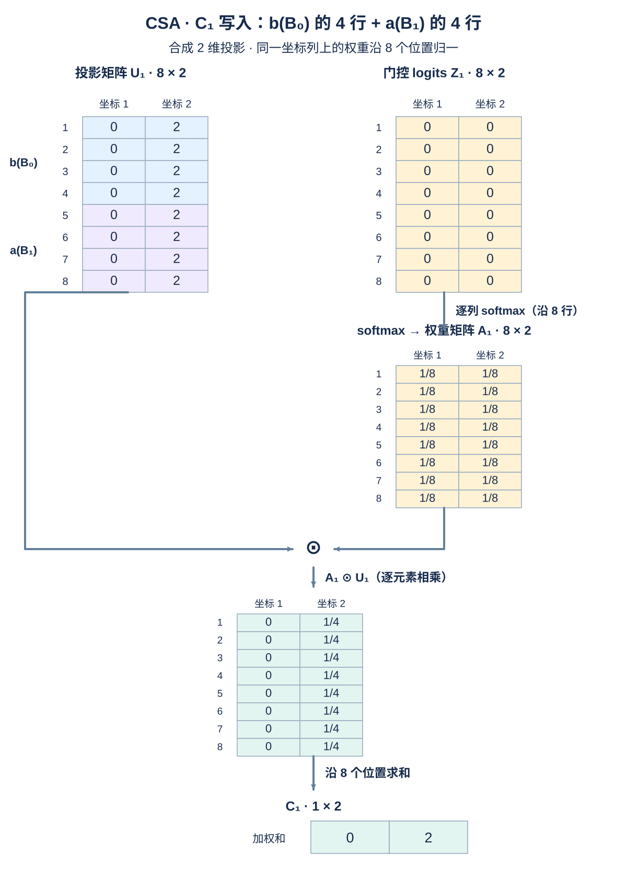
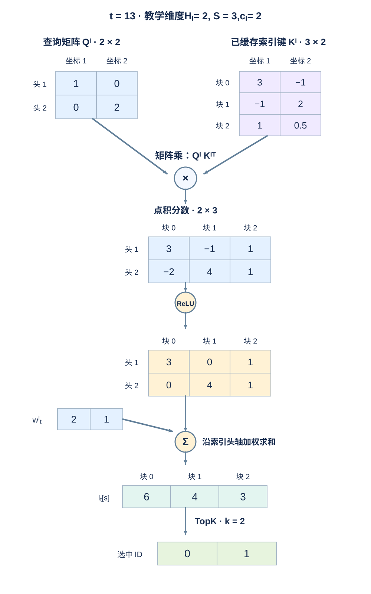
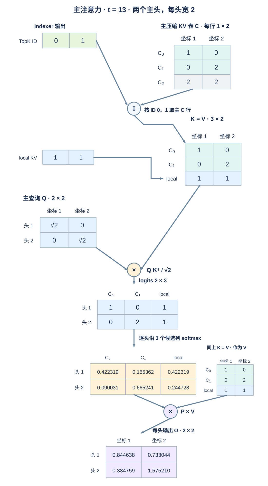
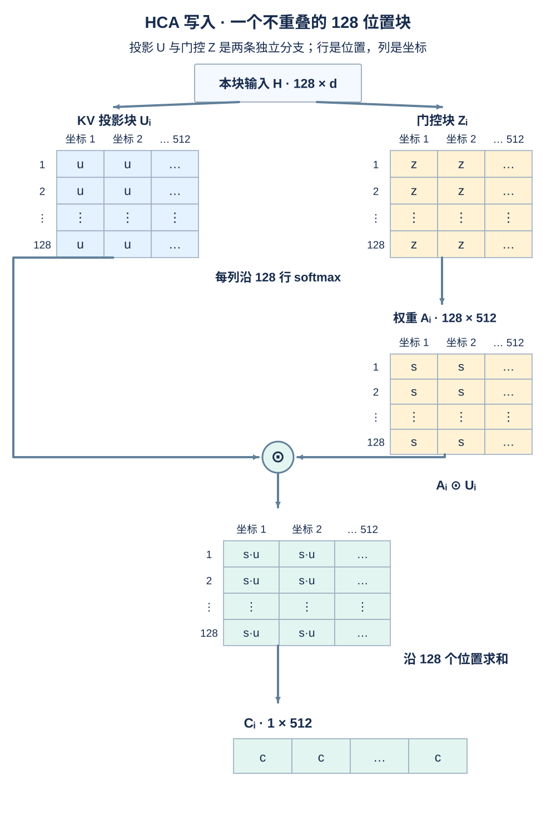
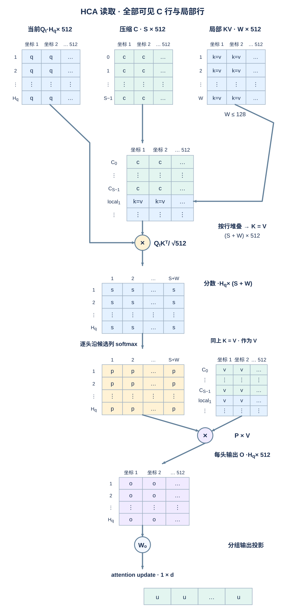
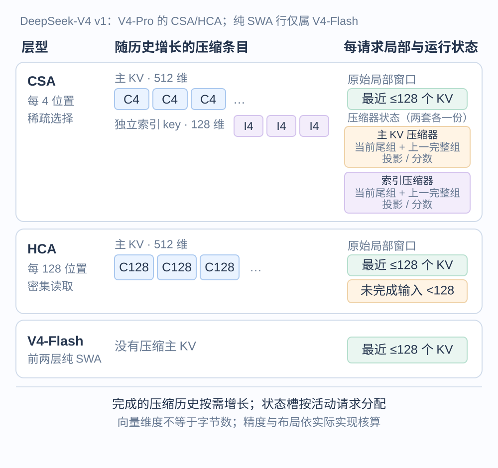

# DeepSeek 怎样压缩长上下文的注意力状态？

案例：模型读入一份长技术报告，随后要回答一个需要拼接相隔很远的几处内容的问题。它既要找到远处线索，又要保留最近几句的细节；如果每层都保存并读取全部历史 K/V，存储和读取都会随长度线性增长。本章用 DeepSeek 公开的三代设计回答怎样压缩这份状态：V3 的 Multi-Head Latent Attention（多头潜注意力，MLA）、V3.2 的 DeepSeek Sparse Attention（DeepSeek 稀疏注意力，DSA），以及 V4 预览版的 Compressed Sparse Attention（压缩稀疏注意力，CSA）和 Heavily Compressed Attention（重度压缩注意力，HCA）。读者手上已有的输入是因果注意力和 KV 缓存的基本概念：每个新位置在每层算出 query、key、value，把 K/V 存起来供后面的位置读取（见[模型怎样把提示词算成下一个词元？](next-token-computation.md)）。

这三种设计分属不同模型，一条请求只经过所用模型实际包含的层。文中的压缩率、窗口、层排布和实验数字只属于注明的模型配置。CSA/HCA 的机制、层数和容量演算特指 DeepSeek-V4 **预览版**（技术报告 v1，2026-04-26）；2026 年 9 月发布的 V4.1-Flash 已改用另一套架构（报告称 CED 与 CSA2，并改用 Single-Pass mHC），它报告的 890 bytes/token 是 V4.1 配置的全局 KV，不能用本章公式套算。

> [!info] 本章的记号
> - **行向量约定。** 本章所有向量都是行向量，权重矩阵右乘：$h W$。DeepSeek-V2/V3 论文用列向量 $W h$，二者互为转置；V4 论文用行向量。缓存矩阵和 key 矩阵每行对应一个位置或一条摘要。
> - `T`、`N` 都表示已处理的词元数；`t` 是正在处理的绝对位置（从 1 开始编号），该位置的输出用于预测位置 `t+1`。块编号 `B0`、`C0` 从零开始。
> - $H_q$ 是查询头数，$H_{kv}$ 是实际存储的 K/V 头数，$d_h$ 是每头宽度，`b` 是每个缓存数值的字节数。
> - $d_c$ 只指 MLA 的 KV latent 宽度；$d_c^Q$ 指 query latent 宽度（V3 论文记作 $d_c'$，V4 论文记作 $d_c$）。
> - V4 部分沿用论文记号：$c$ 是主查询头和共享 KV 条目的宽度（512），$H_I$ 是索引头数，$c_I$ 是每个索引头的宽度，$S$ 是当前可读的已完成压缩条目数，$k$ 是 top-k 条数。
> - 本章的 KV cache 指同一请求生成过程中的状态，不是跨请求的提示缓存，也不是应用的长期记忆。

## 长上下文的注意力成本由哪三个量决定？

普通 causal full attention（因果全注意力）里，无论 prefill（提示预填充）还是 decode（增量解码），每处理一个新位置，每层都算出该位置的 Q、K、V，把 K/V 存入该层缓存，之后的 query 再读取全部可见历史。分析任何一种压缩设计，都分别问三件事：

1. **每条缓存有多宽**：一条缓存条目有多少个数值、每个数值几字节。
2. **截至当前位置存多少条**：每层的条目数，按层、按请求求和。
3. **当前 query 读多少条**：多少条候选进入主注意力的 softmax。

存储量约等于宽度乘条数；每步的读取和计算则取决于第三项。第三项还要再拆开，因为下面三个数经常不相等：

- **逻辑候选数**：参与主注意力加权的条目数，例如 top-k 选中的 $k$ 条。
- **扫描量**：为了挑出候选而打分的条目数。DSA 和 CSA 的索引器要给全部候选打分，扫描量仍随长度增长。
- **显存流量**：实际从高带宽显存读出的字节。它由 kernel（计算内核）决定：多个查询头可以复用同一次读入的共享 KV；反过来，用“先算全部分数再掩码”实现的稀疏选择，逻辑上只用 $k$ 条，实际仍读完整缓存。

先用普通的 Grouped-Query Attention（分组查询注意力，GQA）建立基线。每层每词元缓存 $2H_{kv}d_hb$ 字节，`2` 代表 K 和 V；这个载荷公式及其对并发的影响见[KV 缓存怎样决定一台服务能接多少请求？](kv-cache-and-serving-capacity.md)。取合成配置 $H_q=32$、$d_h=128$、BF16（2 字节）：Multi-Head Attention（多头注意力，MHA）为每个查询头存一组 K/V，每词元每层 $2\times32\times128\times2=16{,}384$ 字节（16 KiB）；GQA 让每 4 个查询头共享一组、只存 8 组，降为 4 KiB。一百万词元时分别约 `15.26 GiB` 和 `3.81 GiB`，而且这只是**一层**。

按三个量看，GQA 只缩小了宽度：条数仍是 `T`，每个查询头仍以全部可见位置为候选。GQA 的 K/V 投影是训练出来的，减少头数不是任意 MHA checkpoint 上的无损推理开关。

DeepSeek 的三代设计分别压另外的量：

| 设计 | 压缩的量 | 留下的成本与代价 |
| --- | --- | --- |
| V3 的 MLA | 宽度：每位置只存一份共享 latent 和一条位置 key | 条数仍是 `T`；dense 路径仍读全部可见历史 |
| V3.2 的 DSA | 逻辑候选数：独立 indexer 先选出 top-k 个位置 | 索引器仍扫描全部位置；未选位置的主 KV 仍保留；实际流量看稀疏 kernel |
| V4 预览版的 CSA/HCA | 条数和读取量：把相邻位置合并成摘要，再稀疏或密集读取，另加局部窗口 | 压缩可能丢细节；CSA 还可能漏选摘要；状态按层异构 |

另一条路线是 linear attention（线性注意力）：把历史写进每个头一张固定形状的矩阵，不再为任何历史位置保留条目，三个量都不随长度增长，但也失去了按位置回查。它的读写机制见[Kimi Delta Attention 怎样用一张固定矩阵读写历史？](kimi-delta-attention-state.md)。

## DeepSeek-V3 的 MLA 怎样让每个位置只存一份潜变量？

GQA 靠减少 K/V 头数缩小缓存。MLA 换了一条路：所有头的内容 K/V 都由同一份低维表示展开，于是缓存只需保存这份表示。

### 潜变量和上投影

令 $h_t\in\mathbb{R}^{1\times d}$ 是当前层、当前位置的 hidden state（隐藏状态）。MLA 先把它投影成共享的 latent（潜变量）：

$$
c_t^{KV}=h_tW^{DKV}\in\mathbb{R}^{1\times d_c},\qquad W^{DKV}\in\mathbb{R}^{d\times d_c}.
$$

DeepSeek-V3 的推理实现还会对 latent 做一次 RMSNorm（均方根归一化）。它不改变形状，下文把它并入 $c_t^{KV}$。对第 $i$ 个注意力头，两套上投影 $W_i^{UK}\in\mathbb{R}^{d_c\times d_k}$、$W_i^{UV}\in\mathbb{R}^{d_c\times d_v}$ 分别展开内容 key 和 value：

$$
k^C_{t,i}=c_t^{KV}W_i^{UK},\qquad v^C_{t,i}=c_t^{KV}W_i^{UV}.
$$

把展开后的逐头 K/V 写进缓存，每个位置要存 $H_q(d_k+d_v)$ 个数值。既然它们完全由 latent 和固定的上投影决定，缓存也可以只存 $d_c$ 维的 $c_t^{KV}$。“低秩”指 $d_c$ 可以比 $H_q(d_k+d_v)$ 小；这是训练时就学成的结构，不代表能无损压缩任意 MHA 缓存。

只存 latent 带来一个问题：每次打分都先把全部历史 latent 展开成逐头 key，代价反而更高。矩阵吸收解决这个问题。

### 矩阵吸收：把上投影移到查询和输出一侧

matrix absorption（矩阵吸收）利用矩阵乘法的结合律。给定当前头的内容查询 $q^C_{t,i}\in\mathbb{R}^{1\times d_k}$，先把它变换成 $\widetilde q_{t,i}=q^C_{t,i}(W_i^{UK})^\top\in\mathbb{R}^{1\times d_c}$，就有

$$
q^C_{t,i}\,(k^C_{s,i})^\top
=q^C_{t,i}\,(W_i^{UK})^\top (c_s^{KV})^\top
=\widetilde q_{t,i}\,(c_s^{KV})^\top .
$$

维度可以逐步核对。直接展开时，$1\times d_c$ 的 latent 乘 $d_c\times d_k$ 的矩阵得到 $d_k$ 维 key，再与 $d_k$ 维 query 点积成一个标量。吸收到查询侧时，$d_k$ 维 query 乘 $d_k\times d_c$ 的转置矩阵得到 $d_c$ 维的 $\widetilde q$；它还不是分数，要再与 $d_c$ 维 latent 点积，才得到同一个标量。$\widetilde q$ 每步只算一次，之后对所有历史位置都直接读 latent。

value 一侧同理。令 $p_{t,s,i}$ 是第 $i$ 个头在位置 $t$ 分给历史位置 $s$ 的注意力权重：

$$
\sum_s p_{t,s,i}\,\bigl(c_s^{KV}W_i^{UV}\bigr)
=\Bigl(\sum_s p_{t,s,i}\,c_s^{KV}\Bigr)W_i^{UV}.
$$

同一个线性矩阵可以分配到加权和的每一项，先投影再求和与先求和再投影结果相同。于是推理先在 latent 上做加权和，再投影到该头的 value 空间；各头的 value 投影还可以与输出投影合并。这个重排省去了中间展开，但 dense attention 要扫描的历史长度不变。

> [!example] 用小矩阵核对吸收前后的分数
> 取三维查询 $q=[1,2,1]$、二维 latent $c=[3,4]$，上投影
>
> $$
> W=\begin{bmatrix}2&0&1\\1&3&0\end{bmatrix}\in\mathbb{R}^{2\times3}.
> $$
>
> 先展开 key：$cW=[10,12,3]$，所以 $q\,(cW)^\top=10+24+3=37$。先吸收矩阵：$qW^\top=[3,7]$，三维查询变成二维，再算 $[3,7]\cdot[3,4]=9+28=37$。两条路径分数相同；第二条始终用二维 latent 读取历史，省去了逐位置展开三维 key。

### 为什么位置 key 要单独缓存？

Rotary Position Embedding（旋转位置编码，RoPE）让 query 和 key 的一部分坐标按位置旋转。如果对展开后的内容 key 施加位置 $s$ 的旋转矩阵 $R_s$，再试图吸收：

$$
q\,\bigl(c_s^{KV}W_i^{UK}R_s\bigr)^\top=\bigl(q\,R_s^\top (W_i^{UK})^\top\bigr)(c_s^{KV})^\top .
$$

矩阵在代数上仍能移到 query 一侧，但移过去的部分含有随历史位置变化的 $R_s$。查询侧没有一个对所有历史位置通用的变换，吸收就失效了。

MLA 因此把内容和位置拆成两条支路。query 一侧，先由当前隐藏状态得到 query latent $c_t^Q=h_tW^{DQ}\in\mathbb{R}^{1\times d_c^Q}$（V3 参考实现写作 `wq_b(RMSNorm(wq_a(h_t)))`，这里的 $c_t^Q$ 指 `wq_b` 接收的、已归一化的 latent），再分别投影出内容查询 $q^C_{t,i}=c_t^QW_i^{UQ}$ 和位置查询 $q^R_{t,i}=\operatorname{RoPE}(c_t^QW_i^{QR})\in\mathbb{R}^{1\times d_R}$。key 一侧，每个历史位置另外生成一条所有头共享的位置 key $k^R_s=\operatorname{RoPE}(h_sW^{KR})\in\mathbb{R}^{1\times d_R}$。每头的分数是两部分之和：

$$
\text{score}_{t,s,i}=
\frac{\widetilde q_{t,i}\,(c_s^{KV})^\top+q^R_{t,i}\,(k^R_s)^\top}{\sqrt{d_k+d_R}},
\qquad
\text{cache}_s=[\,c_s^{KV},\;k_s^R\,].
$$

这是基础缩放式，省略了长上下文实现可能使用的 YaRN 缩放修正和因果掩码。内容部分可以吸收，位置部分直接用缓存的 $k^R_s$ 点积；代价是每个位置多存 $d_R$ 个数。query latent $c_t^Q$ 只用于构造当前 query，不进入缓存。

### DeepSeek-V3 实际缓存多少？

MLA 的持久缓存形状取决于推理走哪条计算路径。DeepSeek-V3 官方参考实现提供两条：

- `naive`：先展开逐头 K/V，写入 `k_cache` 和 `v_cache`，没有缓存节省。
- `absorb`（默认）：缓存归一化后的 latent 和独立的位置 key（`pe_cache`），用上面的矩阵吸收计算。

V3 的配置是 $d_c=512$、$d_R=64$、61 层。下面的核算只针对 `absorb` 路径。

> [!example] 复算 DeepSeek-V3 `absorb` 路径的缓存载荷
> - 每词元每层：$512+64=576$ 个数值；按 BF16 是 $576\times2=1{,}152$ 字节。
> - 61 层合计：$1{,}152\times61=70{,}272$ 字节/词元，约 68.6 KiB。
> - 8,192 词元的一条序列：$70{,}272\times8{,}192\approx0.536$ GiB；32 条无共享前缀的同长序列约 17.16 GiB。
>
> 作量纲对照，假设一个普通 MHA 有 128 个头、每头 K 和 V 各 128 维，每词元每层要存 $2\times128\times128=32{,}768$ 个数，即 65,536 字节，约为 `absorb` 路径的 56.9 倍。这个假设基线不是 V3 `naive` 路径的实际布局。再对照[KV 容量那章](kv-cache-and-serving-capacity.md)的 32 层 GQA 例子：它每词元 128 KiB，比层数近两倍的 V3 还多。
>
> 这些数是纸面数据载荷，不含块元数据、对齐、临时缓冲、并行分片和其他模型状态。

回到三个量：MLA 把每条缓存的宽度压到 576 个数，条数仍是 `T`；若仍做 dense attention，每步候选也仍是全部 `T` 个位置。

## DeepSeek-V3.2 的 DSA 怎样按当前查询挑选位置？

MLA 压小了每个位置的缓存，但 dense attention 仍要读全部历史。V3.2 的 DSA 改为减少读取的位置数：在主注意力之前加一个 lightning indexer（闪电索引器），用轻量的查询和 key 给每个候选位置打分，只把前 $k$ 名（top-k）对应的主 KV 送进主注意力。

### 索引器怎样给历史位置打分？

索引器的打分形式是

$$
I_{t,s}=\sum_{j=1}^{H_I}w^I_{t,j}\,\operatorname{ReLU}\!\left(q^I_{t,j}\,(k^I_s)^\top\right),
\qquad
\mathcal{S}_t=\operatorname{TopK}_s(I_{t,s}).
$$

$q^I_{t,j}$ 是当前位置单独生成的第 $j$ 个索引查询，$k^I_s$ 是为每个历史位置缓存的索引 key，$w^I_{t,j}$ 调整各索引头的贡献，ReLU（修正线性单元）把负分截为零。索引 key 是专门用于打分的另一份状态，既不是被选中后送进主注意力的 KV，也不是原始 KV 的别名。

比如三个候选的玩具分数为 $[2.3,1.9,0.3]$、$k=2$，只有前两个位置的主 KV 参与本次加权。选择由当前 query 决定，不是固定窗口：如果第三个位置才含所需线索，它仍在缓存里，只是这次不能直接参与主注意力；后面的 query 仍可能选中它。

V3.2 的 top-k 单位是历史位置。它的解码路径仍为每个位置保留 MLA latent 和独立位置 key，供所有查询头共享；也就是说，宽度和条数与 V3 相同，只是逻辑候选数降到 $k$。

### 逻辑上只读 k 条，实际省了多少？

逻辑上只有至多 $k$ 条主 KV 参与加权，实际少读少算则需要稀疏 kernel。DeepSeek-V3.2-Exp 的 PyTorch 参考实现在 prefill 和 decode 中都先算完整的 dense 分数，再把未选位置掩成负无穷；decode 的最终加权也仍覆盖完整 latent 缓存。这份演示代码用“dense 加掩码”实现同样的选择语义，不能据它说物理访问已从 `T` 降到 $k$。

即使主注意力换成稀疏 kernel，索引器仍要给全部候选打分：单步 decode 的打分工作随 `T` 增长，整段 prefill 的候选对仍是 $O(T^2)$。top-k 缩小了主注意力的范围，但候选搜索不会因此变成常数成本。实际速度和质量还取决于精度、索引头数、选择条数、kernel 和检索召回，需要端到端测量。

### 离散选择之前的索引器怎样训练？

top-k 把排序结果变成位置 ID，普通反向传播没有一条连续导数能表达“本该改选哪个位置”；已选中条目的主注意力计算仍可沿连续路径回传。于是主模型怎样更新、索引器怎样学会选位置，要分开处理。

V3.2 报告（§2.1.1）公开的做法分两个阶段：

1. **dense warm-up**：保留 dense attention，冻结主干，只训练索引器。对同一个 query，把各主头已归一化的注意力权重按候选位置对齐、沿头轴求和，再沿候选轴做 L1 归一化，得到目标分布 $p$；索引器分数另做 softmax 得到 $q$，用 $\mathrm{KL}(p\|q)$ 更新索引器。报告把主头信号称为 `main attention scores`；按概率分布的语义，这里理解为注意力权重，而不是可为负的原始点积。
2. **sparse 阶段**：按索引器的 top-k 选位置，只在选中集合内继续对齐主头目标和索引器分数。送入索引器的输入做 `detach`，切断索引器损失沿输入表示回传到主干的路径。主干只由语言模型损失更新，索引器只由辅助 KL 更新。

这是 V3.2 披露的损失与梯度分工，不能直接当作 V4 的配方。连续分支上的梯度怎样回传，见[训练损失怎样变成每个权重矩阵的更新？](../evaluation-and-release/training-gradients-and-optimizers.md)。

## DeepSeek-V4 预览版怎样先压缩再读取？

DSA 减少了主注意力读取的位置数，但每个历史位置仍各占一条缓存。V4 预览版先沿序列轴把相邻位置的 KV 合并成更少的摘要，再决定怎样读：轻压缩层把摘要交给索引器挑选，重压缩层对更短的摘要序列做密集注意力。两类层还各保留最近 128 个未压缩位置，补回局部细节。这些是 V4 预览版某些层的具体做法，不是 Transformer 或长上下文模型的通用模块。

### 每一层读什么？

每层属于哪种类型由 checkpoint 配置固定，不是请求运行时的选择。下表中的 C4、C128 分别指每 4 个、每 128 个位置压缩出的一条摘要 KV；Sliding Window Attention（滑动窗口注意力，SWA）指只看最近位置的局部分支。

| 本层配置 | 全局路读哪些候选 | 局部路 | 进入主注意力的条目 |
|---|---|---|---|
| CSA，`compress_ratio=4` | 扫描可见的 C4 索引 key，选 top-k 块 ID，再读对应的主 C4 KV | 最近至多 128 条原始 KV | 选中的 C4 加局部 KV |
| HCA，`compress_ratio=128` | 读全部已完成且可见的 C128 主 KV | 最近至多 128 条原始 KV | 全部可见 C128 加局部 KV |
| SWA-only，`compress_ratio=0` | 无 | 最近至多 128 条原始 KV | 只有局部 KV |

压缩分支采用 Multi-Query Attention（多查询注意力，MQA）：所有查询头共享压缩 KV，而且每个 512 维条目**同时充当 key 和 value**，末尾 64 维走 RoPE。所以后文的“512 维 KV 条目”是一个共享向量，不是 512 维 key 加 512 维 value，也不乘查询头数。这里有三种容易混淆的“共享”：

- 普通 MQA：所有查询头共享一组 key 和一组 value，二者仍是不同的向量。
- V3 的 MLA：缓存同一份 latent，再用两套上投影定义各头的内容 K 和 V。
- V4 的压缩条目：同一个向量在核心注意力里直接兼作 K 和 V。

缓存不跨层共用：CSA 层有压缩 KV、索引 key 和窗口 KV；HCA 层有压缩 KV 和窗口 KV，没有索引器；SWA-only 层只有窗口 KV。

### CSA 怎样每 4 个位置写出一条重叠摘要？

CSA 为每个原始位置生成两路投影 `a`、`b`，以及逐坐标的门控 logit（还加上可学习的块内位置偏置）。令每块 $m=4$ 个位置，第 $i$ 条摘要 $C_i$ 由当前块的 `a` 流和前一块的 `b` 流共同汇总：对每个坐标，把两流共 $2m=8$ 个位置的 logit 做 softmax，在该坐标上归一化后加权求和。第一块前面没有 `b` 流，用零向量和 $-\infty$ logit 补齐。

把三个连续输入块记为 `B0、B1、B2`，来源关系是 `C0←a(B0)`、`C1←b(B0)+a(B1)`、`C2←b(B1)+a(B2)`，其中 `+` 是带学习权重的逐坐标求和。每条摘要涉及 8 个投影位置，但相邻摘要重叠，输出步长仍是 4，所以 `N` 个位置产生约 `N/4` 条摘要，而不是 `N/8`。跨块输入让边界两侧的内容共同进入摘要，但不保证相位差消失（见[后文](#压缩块的位置为什么会造成周期性弱点？)）。

CSA 实际有两套互相独立的压缩器：主 KV 一套，索引 key 一套。$n$ 是本层输入位置数：

| 流 | 投影与门控矩阵 | 每条输出用到的行 | 输出 |
| --- | --- | --- | --- |
| 主 KV | $U^a,U^b,Z^a,Z^b\in\mathbb{R}^{n\times512}$ | 当前块 `a` 与前块 `b` 各 4 行；门控对 8 行逐坐标 softmax | $C\in\mathbb{R}^{\lfloor n/4\rfloor\times512}$ |
| 索引 key | 独立的 $U_I^a,U_I^b,Z_I^a,Z_I^b\in\mathbb{R}^{n\times128}$ | 同编号块、同样 4+4 行；参数和门控与主 KV 分开 | $K^I\in\mathbb{R}^{\lfloor n/4\rfloor\times128}$ |

下面用一组二维教学输入走一遍（不是模型参数，也不是真实词元表示）。每块的四个投影行都取同一个向量，所有有效门控 logit 都取 0。`B0`、`B1`、`B2` 覆盖位置 1–4、5–8、9–12，三条摘要分别在位置 4、8、12 写入。

| 块 ID | 主 KV 投影行 | 主摘要 $C_i$ | 索引投影行 | 索引 key $K_i^I$ |
| --- | --- | --- | --- | --- |
| 0 | $a(B0)=[1,0]$；缺失的 $b$ 补零、logit 为 $-\infty$ | $[1,0]$ | $a_I(B0)=[3,-1]$；缺失的 $b_I$ 同样补齐 | $[3,-1]$ |
| 1 | $b(B0)=[0,2]$，$a(B1)=[0,2]$ | $[0,2]$ | $b_I(B0)=[0,0]$，$a_I(B1)=[-2,4]$ | $[-1,2]$ |
| 2 | $b(B1)=[2,2]$，$a(B2)=[2,2]$ | $[2,2]$ | $b_I(B1)=[2,1]$，$a_I(B2)=[0,0]$ | $[1,0.5]$ |

以 $C_1$ 为例：8 行投影都是 $[0,2]$，logit 全为 0，所以每个坐标上 8 个权重都是 $1/8$，每行加权后为 $[0,1/4]$，沿位置求和得 $[0,2]$。块 0 只有 4 行有效，权重各 $1/4$，得 $[1,0]$。索引 key $K_1^I$ 是 4 行 $[0,0]$ 与 4 行 $[-2,4]$ 的平均，即 $[-1,2]$。下图把 $C_1$ 的写入拆成矩阵行；$A_1$ 是写入门控权重。图只演示门控池化，省略池化后的写入变换。

**图：两个相邻块的 8 行投影经逐坐标门控加权，汇总成一条 C1**

主 KV 和索引 key 按块 ID 对齐，数值和投影各自独立。下一小节的索引打分用表中的三条 $K_i^I$，主注意力再按索引返回的 ID 读取同编号的 $C_i$。

### Lightning Indexer 怎样选出压缩块？

所有查询头对同一个当前位置共用一次 top-k 选出的块 ID 集合；随后每个主查询头再对这些候选和局部窗口独立计算注意力。

令 $h_t\in\mathbb{R}^{1\times d}$ 是当前位置送入本层注意力的表示。V4 的残差状态有多条流（mHC，见[MoE、mHC 和 MTP 分别改了 Transformer 的哪一块？](architecture-variants.md)），参考实现先从多路残差流读出单路表示，再经过 `attn_norm`。索引查询的计算链是：

1. query latent：$c_t^Q=h_tW^{DQ}\in\mathbb{R}^{1\times d_c^Q}$，参考实现再做一次 RMSNorm。
2. 索引查询：$c_t^QW^{IUQ}$，$W^{IUQ}\in\mathbb{R}^{d_c^Q\times(H_Ic_I)}$，reshape 成 $Q_t^I\in\mathbb{R}^{H_I\times c_I}$，第 $j$ 行记为 $q^I_{t,j}$。
3. 索引头权重：$w_t^I=h_tW^w\in\mathbb{R}^{1\times H_I}$。它由当前输入算出，可正可负，不是 softmax 概率，也不要求和为 1。

$W^{DQ}$、$W^{IUQ}$、$W^w$ 是训练得到的参数；$c_t^Q$、查询、头权重和分数都是本次输入算出的激活。令 $K^{I}\in\mathbb{R}^{S\times c_I}$ 是已完成的索引 key 矩阵，候选块 $s$ 的分数为

$$
I_t[s]=\sum_{j=1}^{H_I}w^I_{t,j}\,\operatorname{ReLU}\!\left(q^I_{t,j}\,(K^{I}_s)^\top\right),
\qquad
\mathcal{S}_t=\operatorname{TopK}_s(I_t[s]).
$$

$Q_t^I(K^I)^\top$ 先得到 $H_I\times S$ 的点积表，经 ReLU 后沿索引头轴按当前权重归约成 $S$ 个排序分数。分数不是概率分布。候选全集是 $S$ 条（因果可见时不超过 $\lfloor t/4\rfloor$），top-k 至多选中 $\min(k,S)$ 块。

> [!example] 位置 13 的索引打分
> 教学用小矩阵：$h=[1,2,0]$ 是位置 13 的合成输入，此时块 0–2 都已完成。
>
> $$
> W^{DQ}=\begin{bmatrix}1&0\\0&1\\1&1\end{bmatrix},\quad
> W^{IUQ}=\begin{bmatrix}1&0&0&0\\0&0&0&1\end{bmatrix},\quad
> W^w=\begin{bmatrix}2&1\\0&0\\0&0\end{bmatrix}.
> $$
>
> - $c_t^Q=hW^{DQ}=[1,2]$；$c_t^QW^{IUQ}=[1,0,0,2]$，reshape 成两个索引查询 $[1,0]$、$[0,2]$；头权重 $hW^w=[2,1]$。
> - 与 $K_0^I=[3,-1]$、$K_1^I=[-1,2]$、$K_2^I=[1,0.5]$ 的点积表：头 1 为 $(3,-1,1)$，头 2 为 $(-2,4,1)$。
> - ReLU 后为 $(3,0,1)$ 和 $(0,4,1)$；按权重相加：$2\times(3,0,1)+1\times(0,4,1)=[6,4,3]$。
> - $k=2$，选中块 0 和块 1。

**图：位置 13 的索引点积、ReLU、加权归约与 TopK**

### 主注意力怎样对选中的块重新打分？

索引分数只决定“读哪几块”，不会用作主注意力权重。主查询从同一个 $c_t^Q$ 经另一个矩阵 $W^{UQ}\in\mathbb{R}^{d_c^Q\times(H_qc)}$ 展开，reshape 成 $H_q$ 个 $c$ 维查询；它再对选中的主 C4 条目和局部窗口重新打分、softmax、加权求和。$W^{IUQ}$ 与 $W^{UQ}$ 是不同的参数，索引头数也不必等于主注意力头数。

> [!example] 两个主头对块 0、1 和一条局部 KV 的输出
> 接着上例。块 ID 0、1 按行号从主 KV 表读出 $C_0=[1,0]$、$C_1=[0,2]$；未选的 $C_2=[2,2]$ 不进入这次的压缩分支。再取一条合成局部 KV $[1,1]$。真实的 128 位置窗口在 `t=13` 时覆盖位置 1–13，这里只取一条以便手算，并不表示 $C_2$ 覆盖的位置 9–12 在局部路不可见。
>
> $$
> W^{UQ}=\begin{bmatrix}\sqrt2&0&0&0\\0&0&0&\sqrt2/2\end{bmatrix}.
> $$
>
> $c_t^QW^{UQ}=[\sqrt2,0,0,\sqrt2]$，reshape 成两个主查询 $[\sqrt2,0]$、$[0,\sqrt2]$。宽度为 2，按 $1/\sqrt2$ 缩放后，每个头沿块 0、块 1、局部三条 KV 一起做 softmax：
>
> | 主头 | 分数（块 0、块 1、局部） | 注意力权重 | 输出 $o_{t,i}$ |
> | --- | --- | --- | --- |
> | 1 | $[1,0,1]$ | $[0.422319,0.155362,0.422319]$ | $[0.844638,0.733044]$ |
> | 2 | $[0,2,1]$ | $[0.090031,0.665241,0.244728]$ | $[0.334759,1.575210]$ |
>
> 第一个头的输出是 $0.422319[1,0]+0.155362[0,2]+0.422319[1,1]$。输出由未舍入的权重算出，用表中六位小数回算时末位可能差 `0.000001`。
>
> 为隔离两种打分，这里省略了真实 V4 的几步：query 和 KV 的 RMSNorm、末 64 维 RoPE、softmax 分母里的 attention sink，以及每头输出上按当前位置施加的逆 RoPE。因为 sink 也计入分母，真实候选的权重和可以小于 1。

**图：选中的主 C4 行和局部 KV 怎样变成逐头输出**

query、分数、块 ID 和输出每次 query 重算；完成的 $C_i$ 和 $K_i^I$ 留在本层缓存。真实 V4-Pro 的输出继续变形：128 个 512 维头输出按行堆成 `128×512`；每 8 个头沿特征维拼接、reshape 成 `16×4096`（这是形状变换，不是投影）；再分组投影为 `16×1024`，展平后经最终输出投影回到 `d=7168` 维，作为注意力更新交给 mHC 写回残差流。

公开配置中，V4-Pro 为 $d=7168$、$d_c^Q=1536$、$H_q=128$、$H_I=64$、$c=512$、$c_I=128$、$k=1024$；V4-Flash 为 $d=4096$、$d_c^Q=1024$、$H_q=64$、$H_I=64$、$c=512$、$c_I=128$、$k=512$。Flash 的两类头数碰巧都是 64，但查询和索引仍经过独立投影。

V4 报告（§4.2.2）只公开了阶段安排：先 dense attention，再短暂 warm up 索引器，随后用 sparse attention 训练；§5.2.1 另述后训练的 FP4 量化感知训练。它没有给出可直接照用的索引器损失或 `detach` 配方，[V3.2 的做法](#离散选择之前的索引器怎样训练？)只是一种已公开的方案。

### HCA 怎样每 128 个位置留一条摘要并全部读取？

HCA 把 128 个位置汇总成一条压缩 KV，块之间不重叠，也没有索引器。对第 $i$ 块，$U_i\in\mathbb{R}^{128\times512}$ 是逐位置的 KV 投影，$Z_i\in\mathbb{R}^{128\times512}$ 是加上块内位置偏置的门控 logit。对每个坐标沿 128 个位置做 softmax，得到写入门控权重 $A_i$（每列和为 1），再逐元素相乘（$\odot$）、沿位置求和：

$$
A_i=\operatorname{softmax}_{\text{位置轴}}(Z_i),\qquad
C_i=\sum_{r=1}^{128}A_i[r,:]\odot U_i[r,:]\in\mathbb{R}^{1\times512}.
$$

**图：HCA 的 128×512 门控池化写入**

$A_i$ 是写入时逐坐标归一的门控，与读取时当前 query 对候选行算出的注意力权重 $P$ 无关。读取时，当前主查询对全部可见的 C128 行和本层局部 KV 一起做注意力，长度约 `N/128` 加窗口，不再经过 top-k。好处是远距离摘要不会因为漏选而缺席；代价是 128 个位置被合并成一个地址，细节只能靠这条学到的摘要保留。CSA 和 HCA 都是有损的学习表示，不是无损存档。

**图：HCA 的密集读取把当前 query、全部可见摘要和局部行送入注意力**

图中 $W$ 是局部窗口行数（不超过 128），点积按 $1/\sqrt{512}$ 缩放，softmax 对每个查询头沿候选列归一化。图只画形状和数据流，省略 RMSNorm、RoPE、attention sink 和逆 RoPE。

### 局部窗口与未完成的尾块怎样随位置变化？

参考实现在组末先生成刚完成的压缩条目，再运行注意力，所以组末形成的 C4 条目能进入当前 query 的候选，C128 条目可直接读；二者都不含未来输入。论文 §2.3.3 只写“preceding compressed blocks”，没说组末刚完成的块是否可读，本节的时序按参考代码。decode 组末的顺序更具体：索引压缩器先写入 $K^I$ 并完成打分和 top-k，主压缩器随后写入同编号的 $C$，再由稀疏注意力按选中 ID 读取。

| 当前位置 `t` | 每个 CSA 层已完成的 C4 | 每个 HCA 层已完成的 C128 | 局部窗口 | 状态变化 |
| ---: | ---: | ---: | --- | --- |
| 127 | 31（至位置 124） | 0 | 位置 1–127，共 127 条 | 第 128 个位置尚未输入，压缩尾部等待组满 |
| 128 | 32（至位置 128） | 1（位置 1–128） | 位置 1–128，共 128 条 | 组末完成 C4 和 C128；本次 query 预测位置 129 |
| 129 | 32 | 1 | 位置 2–129，共 128 条 | 位置 1 滑出窗口；没有新摘要 |

同一个位置可以经两条路径参与注意力：位置 128 在组末 query 中既是局部项，也已进入刚完成的 C4/C128 摘要（CSA 是否读到摘要取决于 top-k，HCA 一定读）。反过来，位置滑出窗口后，摘要不会被删除。处理到位置 129 时，位置 1 已离开局部窗口，但在 CSA 层，它的 `a` 流参与了 C0、`b` 流参与了 C1；只有相关信息留在摘要里、且摘要被选中，它才能经这条路影响输出。在 HCA 层，它在第一条 C128 里；SWA-only 层则不再直接读它的任何状态，它的影响只能经更早时刻写入的其他位置表示间接传下来。上表只说明哪些状态可读、何时生成，不能推出摘要一定保存了某条事实。

局部窗口和压缩器尾部是两类状态。尚未凑满一组的输入，每层有 `N mod m` 个位置。`N=1,000,000` 时 C4 恰好整除，每个 HCA 层则还有 64 个尾部位置；它们虽然也在窗口里，仍需留在压缩器状态中，而且不算已完成条目，不能加进可供注意力读取的条目数。

逻辑尾数也不等于压缩器的工作缓冲。官方朴素参考实现中，CSA 的主 KV 压缩器每层有 `kv_state` 和 `score_state` 两个缓冲，各 $2m=8$ 个时槽、每槽宽 $2\times512=1024$（`score_state` 存与投影逐坐标对应的门控分数）；CSA 的索引压缩器另有一组；HCA 主 KV 压缩器的两个缓冲各 128 个时槽、每槽宽 512。因为 C4 的下一条摘要要用到上一整组的 `b` 流，即使 `N` 恰好整除，这些缓冲也不归零。最大长度 `1,048,576` 同时被 4 和 128 整除，只表示没有未完成的逻辑分组。服务后端的状态布局可以与参考实现不同。

## 一百万词元时 V4 预览版每层要存多少状态？

以下计数针对目标解码主干，不把 Multi-Token Prediction（多词元预测，MTP）草稿层混入。各层共享 KV 条目宽 512（末 64 维带 RoPE），局部窗口 128，每个窗口位置每层一条 512 维 KV；每条 C4 摘要对应一条 128 维索引 key。层号从 1 开始，主干排布为：

| 模型 | 第 1–2 层 | 第 3 层起 | 主干合计 | 另计的 MTP 注意力 |
| --- | --- | --- | --- | --- |
| V4-Pro（61 层） | HCA、HCA | CSA 与 HCA 交替，第 61 层以 CSA 结束 | 30 CSA、31 HCA | 1 个 SWA-only 层 |
| V4-Flash（43 层） | SWA-only、SWA-only | CSA 与 HCA 交替，第 43 层以 CSA 结束 | 21 CSA、20 HCA、2 SWA-only | 1 个 SWA-only 层 |

每个 CSA 层完成 $\lfloor N/4\rfloor$ 条摘要，每个 HCA 层完成 $\lfloor N/128\rfloor$ 条，每个主干层另有 $\min(N,128)$ 条局部 KV。主干的 512 维 KV 条目数为

$$
\begin{aligned}
E_{\text{Pro}} &=30\lfloor N/4\rfloor+31\lfloor N/128\rfloor+61\min(N,128),\\
E_{\text{Flash}} &=21\lfloor N/4\rfloor+20\lfloor N/128\rfloor+43\min(N,128).
\end{aligned}
$$

索引 key 另计，条目数为 $30\lfloor N/4\rfloor$（Pro）和 $21\lfloor N/4\rfloor$（Flash）。尾部输入位置数为 Pro $30(N\bmod4)+31(N\bmod128)$、Flash $21(N\bmod4)+20(N\bmod128)$。这些公式是截至 `N` 的逻辑占用；公开 PyTorch 代码会按配置的最大长度预分配部分缓存。

| `N` | 模型 | 主干 KV 条目 | C4 索引 key | 未完成尾部位置（跨层） |
| ---: | --- | ---: | ---: | ---: |
| 1,000,000 | V4-Pro | 7,749,980 | 7,500,000 | 1,984（31 层各 64） |
| 1,000,000 | V4-Flash | 5,411,744 | 5,250,000 | 1,280（20 层各 64） |
| 1,048,576 | V4-Pro | 8,126,080 | 7,864,320 | 0 |
| 1,048,576 | V4-Flash | 5,674,368 | 5,505,024 | 0 |

以 Pro、`N=1,000,000` 为例：$30\times250{,}000+31\times7{,}812+61\times128=7{,}500{,}000+242{,}172+7{,}808=7{,}749{,}980$。主干条目已含每层窗口；MTP 层若启用，另加每请求 $\min(N,128)$ 条局部 KV。

**索引器的扫描量。** 压缩和 top-k 让主注意力读得更少，但索引器仍比较全部 C4 候选。`N=1,000,000` 时每个 CSA 层有 250,000 条候选，按 64 个、每个宽 128 的索引头，一条 decode query 约需 $250{,}000\times64\times128=2.048\times10^9$ 次乘加（multiply-accumulate，MAC）每层。Pro 的 30 层约 $61.44\times10^9$ MAC，按一次乘加记 2 次浮点运算约 122.88 GFLOPs；Flash 的 21 层约 $43.008\times10^9$ MAC、86.016 GFLOPs。主注意力随后每个 CSA query 只处理至多 1,024（Pro）或 512（Flash）条摘要，加 128 条局部 KV。这是由公开维度推算的算术量级，不含索引投影、top-k 排序、读写和 kernel 融合，也不是实测延迟。

**按论文精度估算的字节数。** 论文的混合精度下，一条共享 KV 约 $448\times1+64\times2=576$ 字节（非 RoPE 部分 FP8、RoPE 部分 BF16）；一条 128 维 FP4 索引 key 约 $128\times4/8=64$ 字节。`N=1,000,000`、不含 MTP 时：

| 模型 | 主 KV 载荷 | 索引 key 载荷 |
| --- | ---: | ---: |
| V4-Pro | $7{,}749{,}980\times576\approx4.464$ GB | $7{,}500{,}000\times64=0.480$ GB |
| V4-Flash | $5{,}411{,}744\times576\approx3.117$ GB | $5{,}250{,}000\times64=0.336$ GB |

这是论文精度口径下的纯数据载荷，不是参考代码的实际分配：参考实现注释说明 KV 量化是在 BF16 中模拟，索引 KV 目前也存 BF16。估算不含量化缩放元数据、尾部与工作缓冲、对齐、页空位、权重和并发请求。

## 服务引擎怎样命中、恢复和回收这些异构状态？

[KV 容量那章](kv-cache-and-serving-capacity.md)的载荷公式假设每层都按同一规则缓存两组随长度增长的张量，单一的“每词元字节数”就够用。V4 预览版的每请求状态必须按层分类，否则会漏算。论文把变长的压缩条目放进分页 KV 区，把每序列定长的 state cache（状态缓存）留给 SWA 窗口和压缩器状态。定长状态池按活动序列分配槽位，所以即使已完成的压缩条目很少，每条并发序列也各占一份窗口和尾部状态。下表以 V4-Pro 为准（Flash 另有两层纯 SWA）：

| 每请求的状态 | 随新词元怎样变化 | 前缀命中、回滚或回收时要处理什么 |
| --- | --- | --- |
| 已完成的 CSA/HCA 压缩 KV | 按各层压缩率追加；窗口前移不删除这些远距条目 | 前缀缓存可复用完整的压缩块；回滚先恢复到有效前缀长度；请求终止时撤销引用，没有其他请求引用的页才可回收 |
| CSA 索引 key | 每完成一条 C4 主 KV，就有一条对应的索引 key；截至 `N` 都是 $\lfloor N/4\rfloor$ 条；每条宽 128（主 KV 为 512），载荷按各自的精度和布局分别算 | 命中后要继续 CSA 检索，对应的索引 key 必须可用；论文没说明其磁盘格式，保存、恢复或重建由引擎决定 |
| SWA 最近窗口 | 各适用层保留最近 128 个原始 KV，窗口移动时淘汰最旧位置 | 可从磁盘命中、从最近的检查点恢复，或从前缀重算 |
| 压缩器运行状态 | HCA 留着未凑满 128 的输入；C4 即使组已完整，也保留上一整组的投影和分数作为重叠输入；主 KV 和索引各有一份 | 完成的压缩条目不包含这些状态；继续压缩必须取得等价状态或重算来源输入 |

**图：V4 的 CSA、HCA 与滑动窗口缓存状态**

以 V4-Pro 的 `N=1,000,000` 前缀为例：每个 CSA 层有 250,000 条 C4 主 KV 和同样多的索引 key；每个 HCA 层有 7,812 条 C128，覆盖到位置 999,936，另有 64 个未完成位置。`N mod 4=0` 也不表示 C4 压缩器没有状态：参考代码仍为主 KV 和索引各保留最近一整组（位置 999,997–1,000,000）的投影和分数。要在这个前缀上继续生成，压缩条目之外还要取得这两份压缩器状态或重算对应输入；这是由公开压缩器实现推出的要求，论文没有给出它们的磁盘布局。

### 前缀命中后，局部窗口怎样恢复？

通用的前缀复用机制见[重复的前缀怎样在引擎里复用，又怎样体现在 API 账单上？](prefix-reuse-and-prompt-caching.md)。V4 报告把前缀缓存的磁盘状态拆成压缩 KV 和 SWA KV 两类，并明确说未完成的压缩块需要重算。SWA 窗口有三种恢复办法，在存储和计算之间取舍：

- **完整缓存**：所有 SWA 条目都写盘，命中时只读前缀末尾的 128 个。省重算，写盘量大。
- **周期检查点**：每隔 `p` 个词元保存当时末尾的 128 个条目；命中时从不晚于命中边界的最近检查点出发，重算其后的尾段。`p` 调节两头的成本。
- **零 SWA 缓存**：不存窗口。命中压缩 KV 后，长前缀重算末尾 $128\times L$ 个位置即可恢复 `L` 层的窗口，较短的前缀从头重算。

`L` 倍来自逐层依赖：第 $\ell$ 层末尾 128 个位置的窗口 KV，由第 $\ell-1$ 层这些位置的输出算出，而那些输出又需要第 $\ell-1$ 层再早 128 个位置的窗口，每往下一层范围向前扩 128。V4-Pro 的 $L=61$，最多重算 $128\times61=7{,}808$ 个位置。这些是报告提出的磁盘策略，不代表所有引擎默认都这样做。

### 分页池按什么粒度分配？

论文的逻辑对齐单位是 4 和 128 的最小公倍数：$\operatorname{LCM}(4,128)=128$ 个原始位置，在对应层里分别产生 32 条 C4 或 1 条 C128。实际逻辑块可以是这个单位的整数倍，它不是固定的物理页大小。引擎还有自己一层“块”：当前 vLLM 的 V4 压缩器实现给 C4 和 C128 的状态页分别设 `block_size=4` 和 `8`，并让压缩器状态页与 KV 块共享物理张量。接纳并发时，要按每层压缩 KV、索引 key、窗口、尾部状态和引擎页粒度核算，再加量化元数据、填充、工作区和并行分片。纸面载荷只是下界，不是显存实测。

### 推测解码被拒绝时要撤销什么？

推测解码先由草稿提出若干词元，目标模型对它们做一轮前向，再逐个接受或拒绝；这一轮新算出的状态要等验收结果出来才能提交（通用机制见[推测解码怎样加速又不改变输出分布？](speculative-decoding.md)）。V4 的异构状态让回滚更复杂。以从位置 127 继续、验证位置 128 的候选为例，对照上面的窗口表：

- **候选被接受**：各 HCA 层把目标前向算出的 C128 提交为有效条目，各 CSA 层的主 KV 和索引 key 也各提交一条。
- **候选被拒绝**：逻辑前缀回到 127，必须撤销这些新条目，并恢复到 127 时的 HCA 未完成输入、C4 重叠状态、索引压缩器状态和 SWA 窗口。

这是缓存正确性的不变量，引擎可以用暂存、检查点或重算来实现。拒绝后的替换词元尚未经过目标模型前向，不会作为已处理位置写入这些状态。

## 压缩块的位置为什么会造成周期性弱点？

按固定步长压缩后，同一段内容相对块边界落在哪里，会决定它和哪些词元合并、得到什么摘要。把同一段 tokenized 内容前后挪几个词元，就改变了它相对压缩网格的相位。这只改变模型内部 KV 的分组，用户输入和模型处理的词元数都不变。CSA 的重叠双流只让相邻摘要共享输入，不保证相位差消失。

> [!example] 一个代码补全随填充长度周期性反转
> Seed 团队的论文在 DeepSeek-V4-Flash-Base 上考察一段代码补全：正确的下一词元是 `8`，竞争错误项是 `32`。只改变前置 Python docstring（文档字符串）的 tokenized 长度 `L=24…39`，其余代码不变。16 个输入中，`L mod 4∈{0,1}` 的 8 个样例平均偏向错误项 `32`，`L mod 4∈{2,3}` 的 8 个平均偏向正确项 `8`；单个长度的 top-1 每两个词元切换一次、每四个词元重复。这个操作同时移动了代码片段和评分位置，没有隔离单个来源词元，也不表示多加固定数量的填充普遍有益。

更受控的单词元 needle-in-a-haystack（大海捞针，NIAH）测试在 128K 输入中放 16K 组 key–value 记录，key 和 value 都是单词元；查询 prompt 中部某个 key 的 value，并按被问 key 位置 `mod 8` 分组（论文的位置从 0 开始计）。V4-Flash-Base 的 CSA 步长是 4，所以 `mod 8` 覆盖两个周期。各组固定总长度、查询位置和键值绑定，并匹配来源位置分布的均值和方差，目标与干扰记录随来源相位一起平移。论文报告的最好与最差相位准确率之差：

| 检查点 | 最大相位差 |
| --- | ---: |
| V4-Flash-Base | 40.2 个百分点 |
| V4-Flash post-trained-0731 | 19.1 个百分点 |
| V4-Pro-Base | 34.8 个百分点 |
| V4-Pro post-trained-0813 | 14.8 个百分点 |
| V4.1-Flash post-trained-0910 | 6.1 个百分点 |

这些数字只描述指定 checkpoint 在这项受控检索任务上的相位差，不是整体能力分数。V4.1-Flash-0910 的 encoder CSA2 步长是 2，同样按 `mod 8` 分组时覆盖四个周期。

论文还用 Qwen3-0.6B 家族做了受控预训练：

- 测过的周期跟随压缩步长，而不是只由窗口宽度决定。
- 去掉 RoPE、用均匀平均替代学习门控，两种消融中仍有相位差。
- W8/S8（压缩窗口宽 8、步长 8）、8 个 KV 头的对照中，压缩模型的平均准确率和验证损失接近同训练的全注意力基线，但最差相位准确率只有 9.9%，基线为 58.4%；在 1 或 4 个 KV 头的配置里，压缩模型也有平均准确率更高而验证损失相近的情况。

所以整体训练损失和平均准确率都可能掩盖最差相位：损失聚合了所有位置的目标，并不要求每种相位的检索准确率一样。受控小模型支持“分块压缩本身足以造成相位敏感”，但不能单独确定 V4 大模型产生差异的唯一原因。论文在 V4-Flash-Base 上还做了一项干预：用与评测 prompt 不重合的校准 prompt，把某层注意力输出投影之后、hyper-connection 之前的整层输出，在查询后缀全部 16 个位置逐位置替换为校准均值，按目标词元准确率评分，观察到不同来源相位的下降幅度不等。这只说明该层输出的干预效应随相位变化，没有定位到特定头、压缩分支或写入操作。

工程上评估压缩模型时，可以在保持内容、查询位置和总长度可比的前提下，按 tokenized 输入的相位切片，报告平均值、最差相位和失败样例。固定 padding 不是通用补丁。

## “KV 约 10%、FLOPs 约 27%”比的是什么？

DeepSeek-V4 论文用 V4-Pro 在**约一百万词元上下文**下的单步 decode 估算与 V3.2 比较：单词元推理 FLOPs 约为 V3.2 的 27%（约 1/3.7），KV cache 约为 10%。读这两个数要注意口径：

- 这是论文按配置给出的估算，不是 V3.2 在 1M 上实跑的服务测量；V3.2 报告的长上下文训练和验证口径是 128K。
- 论文图 1 的终点是 1024K，不同于上文用十进制 `N=1,000,000` 复算条目的场景。FLOPs 按 equivalent FP8 FLOPs 计。
- 它不表示端到端延迟、首词元延迟、完整 GPU 显存，也不表示任意 MHA/GQA 模型都缩到同一比例。
- 主文另举了一个 BF16、GQA8、头宽 128 的通用缓存基线，称 V4 在 1M 时约为它的 2%。这个基线不是 V3.2，不能和 10% 混用。

成本降低来自多项机制叠加：C4 压缩后再 top-k、C128 密集读取更短的序列、窗口只留 128 个原始位置、索引器用 FP4、主 KV 混合 FP8/BF16，top-k 条数也比 V3.2 少。这两个比例不能由上一节的条目数单独重算，也不足以推出各机制各占多少功劳。

## 其他模型的长上下文结构能从名字推断吗？

不能。公开架构也不必采用同一条长历史路径。OpenAI 的 gpt-oss-120b 用 64 个查询头、8 个 KV 头，并按层交替使用 128 词元的滑动窗口和全历史注意力；全历史层可以直接读窗口之外的 KV。它是另一个具体模型，不代表通用排布。GPT-4 技术报告 v6 §2 明确不披露模型架构；Claude Opus 5 system card §1 导言界定了评估范围，也没给逐层注意力或 KV 布局。分析一个模型的缓存成本，要以它公开的配置和实现为准，从三个量重新算。

## 压缩之后，哪些决定仍要交给服务和应用？

到这里，任何一种长上下文注意力设计都可以用同一套问题核算：每条缓存多宽、存多少条、每次读多少条，再把逻辑候选、扫描量和显存流量分开。MLA 压宽度，DSA 压逻辑候选，V4 预览版的 CSA/HCA 压条数并加回局部窗口，代价分别落在 indexer 扫描、漏选和有损摘要上。

这些状态在同一请求内跨 query 保留：每个新位置到来时，各层增量更新主 KV、索引 key、局部 KV、压缩尾部和工作状态，decode 不会重新投影或压缩旧位置。当前 query 的 Q、索引分数、top-k 块 ID、注意力权重和输出都是临时的，选中的块 ID 也不进入缓存。

接下来的问题分给三处：

- 这些状态在一台服务上能撑多少并发、怎样调度，回到[KV 缓存怎样决定一台服务能接多少请求？](kv-cache-and-serving-capacity.md)。
- 不保留任何逐位置条目、改用固定矩阵的另一种做法，见[Kimi Delta Attention 怎样用一张固定矩阵读写历史？](kimi-delta-attention-state.md)。
- 模型内部的 KV cache 不替应用挑选历史，也不是持久记忆。哪些对话、工具结果和文档进入提示词，由应用决定，见[每次调用的上下文预算该怎样分配，哪些状态必须留在应用里？](../context/context-budget-and-state-layers.md)和[怎样从授权文档里找到回答依据？](../context/rag-indexing-and-retrieval.md)。

> [!info]- 来源
> - **GQA 对照、MLA 的低秩 KV latent、矩阵吸收、RoPE 解耦与 query latent 边界（“长上下文的注意力成本由哪三个量决定？”“DeepSeek-V3 的 MLA……”各小节）：** DeepSeek-V2 技术报告 v5（2024-06-19），§2.1.1–2.1.4、式 (1)–(19)，[arXiv HTML](https://arxiv.org/html/2405.04434v5)。
> - **V3 的 MLA 投影关系与配置 $d_c=512$、$d_R=64$、61 层（“DeepSeek-V3 实际缓存多少？”）：** DeepSeek-V3 Technical Report arXiv v2，投影关系见 [§2.1.1](https://arxiv.org/html/2412.19437v2#S2.SS1.SSS1)（投影式未写入 RMSNorm），超参数见 [§4.2](https://arxiv.org/html/2412.19437v2#S4.SS2)。
> - **`naive`/`absorb` 两条路径、latent RMSNorm、`pe_cache` 与 `k_cache/v_cache`（“DeepSeek-V3 实际缓存多少？”）：** 官方 [DeepSeek-V3 `inference/model.py`](https://github.com/deepseek-ai/DeepSeek-V3/blob/9b4e9788e4a3a731f7567338ed15d3ec549ce03b/inference/model.py)：默认 `attn_impl="absorb"` 见[构造参数](https://github.com/deepseek-ai/DeepSeek-V3/blob/9b4e9788e4a3a731f7567338ed15d3ec549ce03b/inference/model.py#L17-L22)，两条路径的缓存与前向见[L430–L495](https://github.com/deepseek-ai/DeepSeek-V3/blob/9b4e9788e4a3a731f7567338ed15d3ec549ce03b/inference/model.py#L430-L495)；commit `9b4e9788e4a3a731f7567338ed15d3ec549ce03b`，核对日期 2026-11-12。
> - **DSA 的索引器分数、top-k、基于 MLA 的构造与索引器训练（“DeepSeek-V3.2 的 DSA……”各小节）：** DeepSeek-V3.2 技术报告 v1（2025-12-02），§2.1、§2.1.1、§2.3，[arXiv HTML](https://arxiv.org/html/2512.02556v1)；截至 2026-11-06 仍只有 v1。KL 目标 $p$ 的构造、输入 `detach` 与损失分工来自报告；把 `main attention scores` 解释为注意力权重是本文按概率语义的理解。dense 加掩码的参考实现：[DeepSeek-V3.2-Exp `inference/model.py`](https://github.com/deepseek-ai/DeepSeek-V3.2-Exp/blob/87e509a2e5a100d221c97df52c6e8be7835f0057/inference/model.py#L435)，commit `87e509a2e5a100d221c97df52c6e8be7835f0057`（2026-11-06），只用于核对推理路径，不作训练证据。
> - **CSA/HCA 的压缩公式、共享 KV MQA、局部 SWA 与未完成尾部（“CSA 怎样每 4 个位置写出一条重叠摘要？”“HCA……”“局部窗口与未完成的尾块……”）：** DeepSeek-V4 预览技术报告 v1（2026-04-26），CSA 重叠双流见 §2.3.1 式 (9)–(12)，HCA 非重叠压缩见 §2.3.2 式 (20)–(23)，压缩率与共享 KV MQA 见 §2.3.2，SWA 与尾部状态见 §2.3.3、§3.5.1，[arXiv HTML](https://arxiv.org/html/2606.19348v1)。
> - **Lightning Indexer、独立索引 key、top-k 后主 KV 重新打分、逐头输出与输出投影（“Lightning Indexer……”“主注意力……”）：** V4 报告 v1，§2.3.1 式 (13)–(19)、§2.3.3 式 (27)，含共享 KV 兼作 K/V、末 64 维 RoPE、逆 RoPE 与 attention sink。官方 Pro 参考实现 [`Indexer`](https://huggingface.co/deepseek-ai/DeepSeek-V4-Pro/blob/b5968e9190ef611bbf34a7229255be88a0e937c1/inference/model.py#L380-L430)、[`Attention`](https://huggingface.co/deepseek-ai/DeepSeek-V4-Pro/blob/b5968e9190ef611bbf34a7229255be88a0e937c1/inference/model.py#L432-L543)、[`Block.forward`](https://huggingface.co/deepseek-ai/DeepSeek-V4-Pro/blob/b5968e9190ef611bbf34a7229255be88a0e937c1/inference/model.py#L688-L693)：核对 latent RMSNorm、索引掩码、组末条目可读性、decode 组末先写 $K^I$ 再写 $C$ 的顺序、量化模拟、逆旋转，以及注意力输入先经 mHC 读出再过 `attn_norm`（2026-11-12）。
> - **V4 的训练阶段与 FP4 QAT（“主注意力……”末段）：** V4 报告 v1，§4.2.2、§5.2.1；未公开完整的索引器损失或 `detach` 配方。
> - **V4-Pro/Flash 的层数、层型排布、窗口、宽度、top-k 与压缩率（“一百万词元时 V4 预览版每层要存多少状态？”）：** Pro commit `b5968e9190ef611bbf34a7229255be88a0e937c1` 的 [`config.json`](https://huggingface.co/deepseek-ai/DeepSeek-V4-Pro/blob/b5968e9190ef611bbf34a7229255be88a0e937c1/config.json) 与 [`inference/model.py`](https://huggingface.co/deepseek-ai/DeepSeek-V4-Pro/blob/b5968e9190ef611bbf34a7229255be88a0e937c1/inference/model.py)；压缩器工作缓冲见 [`Compressor`](https://huggingface.co/deepseek-ai/DeepSeek-V4-Pro/blob/b5968e9190ef611bbf34a7229255be88a0e937c1/inference/model.py#L279-L377)，FP4 模拟与 BF16 索引 KV 存储见 [`Indexer`](https://huggingface.co/deepseek-ai/DeepSeek-V4-Pro/blob/b5968e9190ef611bbf34a7229255be88a0e937c1/inference/model.py#L398-L427)；Flash commit `60d8d70770c6776ff598c94bb586a859a38244f1` 的 [`config.json`](https://huggingface.co/deepseek-ai/DeepSeek-V4-Flash/blob/60d8d70770c6776ff598c94bb586a859a38244f1/config.json)。每层计数由 `num_hidden_layers` 与压缩率数组复算；V4-Flash 前两层纯 SWA、V4-Pro 前两层 HCA 另见报告 [§4.2.1](https://arxiv.org/html/2606.19348v1#S4.SS2.SSS1)。
> - **异构状态分区、前缀命中、尾部重算与三种 SWA 磁盘策略（“服务引擎怎样命中、恢复和回收这些异构状态？”）：** V4 报告 v1 [§3.5.1](https://arxiv.org/html/2606.19348v1#S3.SS5.SSS1)（按层变化的压缩 KV、独立索引器、固定状态池）与 [§3.5.2](https://arxiv.org/html/2606.19348v1#S3.SS5.SSS2)（未完成压缩尾部重算，完整/周期/零 SWA 磁盘缓存）。C4 重叠状态与独立索引压缩器状态的存在由参考实现的 [C4 `Compressor`](https://huggingface.co/deepseek-ai/DeepSeek-V4-Pro/blob/b5968e9190ef611bbf34a7229255be88a0e937c1/inference/model.py#L279-L359) 与 [索引器的 `Compressor`](https://huggingface.co/deepseek-ai/DeepSeek-V4-Pro/blob/b5968e9190ef611bbf34a7229255be88a0e937c1/inference/model.py#L380-L421) 核对；这不代表论文披露了它们的磁盘布局。
> - **服务框架的 V4 状态页与分块（“分页池按什么粒度分配？”）：** vLLM commit `c64134cbc4f67f6ce348050d877d5d5475d79a75` 的 [`compressor.py` L1463–L1525](https://github.com/vllm-project/vllm/blob/c64134cbc4f67f6ce348050d877d5d5475d79a75/vllm/models/deepseek_v4/compressor.py#L1463-L1525)（C4/C128 状态页 `block_size` 与共享物理张量，2026-11-12）；另见 vLLM 快照 `86564975c5a5ba96b0bea94708101480ca18a2cd` 的 [attention.py](https://github.com/vllm-project/vllm/blob/86564975c5a5ba96b0bea94708101480ca18a2cd/vllm/models/deepseek_v4/attention.py)、[compressor.py](https://github.com/vllm-project/vllm/blob/86564975c5a5ba96b0bea94708101480ca18a2cd/vllm/models/deepseek_v4/compressor.py)，SGLang 快照 `91fd6756e773ab857d5f6ddf3876fead1992b29b` 的 [deepseek_v4.py](https://github.com/sgl-project/sglang/blob/91fd6756e773ab857d5f6ddf3876fead1992b29b/python/sglang/srt/models/deepseek_v4.py)（2026-11-06）。均为代码核对，不是本机运行或性能实测。
> - **相位现象与控制实验（“压缩块的位置为什么会造成周期性弱点？”）：** Zhu et al., “Periodic Weak Spots: Phase Sensitivity from Chunked KV-Cache Compression,” arXiv v1（2026-09-28），§2.1 的 16 个 filler 长度代码补全，§2.2 的 128K/16K NIAH 与各 checkpoint 相位差，§3.2 的压缩步长与 Qwen3-0.6B 控制，§4.1 的 KV 头/层干预，附录 E.6 的 V4-Flash-Base 整层输出替换（每个来源相位组 256 个评测 prompt），附录 F 的 W8/S8 指标，[arXiv PDF](https://arxiv.org/pdf/2609.36322v1)；2026-11-12 打开核对图、表与正文。论文实验不是本地复现。
> - **“KV 约 10%、FLOPs 约 27%”的口径与 2% 基线：** V4 报告 v1，§1 图 1、§2.3.4，[arXiv HTML](https://arxiv.org/html/2606.19348v1)。
> - **V4.1 与 V4 预览版的架构边界（开头声明、相位表中的 V4.1 行）：** DeepSeek-V4.1-Flash Technical Report v1（2026-09-17）：§2.2 CED 从最终 encoder hidden states 投影 decoder 全局 KV；§2 开头说明 CSA2 去掉 V4 CSA 的重叠压缩与绝对位置嵌入，其索引 key 由主 KV 投影而来；§2.3.1 跨层 Full/Reindex/Reuse 模式；§2.4.1 Single-Pass mHC；§4.2.1 的 40 层配置中 encoder CSA2 步长 2、decoder CSA2 ratio 1；摘要的 890 bytes/token 是该配置的全局 KV。[arXiv HTML](https://arxiv.org/html/2609.19969v1)；[DeepSeek 官方发布](https://www.deepseek.com/en/news/deepseek-v4-1-flash/)；2026-11-12 打开核对。
> - **其他模型的公开与未公开架构（“其他模型的长上下文结构能从名字推断吗？”）：** gpt-oss-120b 的 [`config.json`](https://huggingface.co/openai/gpt-oss-120b/blob/b5c939de8f754692c1647ca79fbf85e8c1e70f8a/config.json) 与 [`gpt_oss/torch/model.py` L176–L241](https://github.com/openai/gpt-oss/blob/277020131d524f06bed5f66b694a92ed7f6e5224/gpt_oss/torch/model.py#L176-L241)（64 查询头、8 KV 头、128 窗口、隔层滑窗；2026-11-11）；[GPT-4 Technical Report v6 §2](https://arxiv.org/html/2303.08774v6#S2)；[Claude Opus 5 System Card §1 导言](https://www-cdn.anthropic.com/b514064af1408018e64b1ad24e7d5e75850b4ffd/Claude%20Opus%205%20System%20Card.pdf#page=10)。
