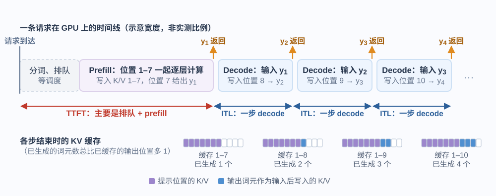
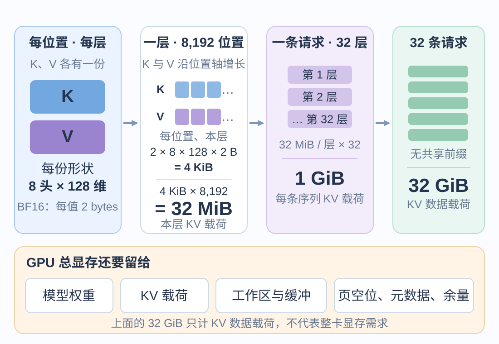
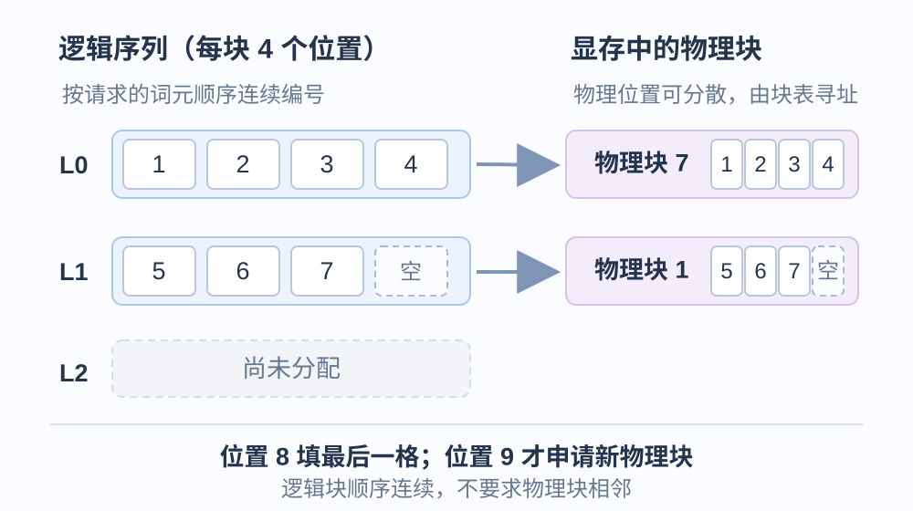
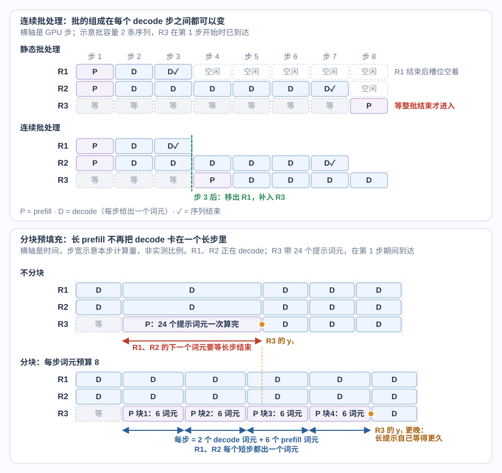

# KV 缓存怎样决定一台服务能接多少请求？

参数训练好之后，每次调用的代价落在推理上。[逐词元计算一章](next-token-computation.md)说明了一件事：生成时每层都要保留此前所有位置的 key 和 value（K/V），新位置的 query 每步都要把它们读一遍。本章回答把这件事放到一台 GPU 服务上会怎样：一条请求要占多少显存，一个缓存池能同时放下几条请求，显存够了为什么回答还是慢，以及每种调度和优化手段各自改变哪一段成本。

本章用一个假设的服务配置贯穿始终。模型有 32 层，每层存 8 个 K/V 头，头宽 128，缓存用 BF16（每个数 2 字节）。每条请求的提示加已生成内容最长 8,192 个词元。一张 GPU 放下权重和工作区后，还剩 24 GiB 可分给 KV 缓存池。高峰时有 32 条请求同时到达。这些数字是教学选择，不对应某个具体模型，也不是实测结果。

## 一条请求为什么先慢一次，再慢很多次？

一条请求进入服务后，先被分词，排队等调度器把它安排到 GPU 上。没有可复用缓存的请求接着做 prefill (预填充)：所有提示词元一起逐层计算，每层把每个位置的 K/V 存进 KV cache (键值缓存)，最后一个位置的输出给出第一个输出词元的概率分布。

之后进入 decode (增量解码)。每一步只把上一步选出的词元作为一个新位置送入模型：算出它的 query、key、value，把新 K/V 追加进各层缓存，再让新 query 读全部历史 K/V。因果掩码保证旧位置从不读取后来的位置，所以旧位置的 K/V 算一次就能一直沿用。

两个阶段的瓶颈不同。原因在于每读一次权重能做多少计算：

- **Prefill** 一次送入 `T` 个位置。每个权重矩阵从显存读出一次，要和 `T` 行输入相乘；注意力还要算 `T` 个 query 与因果掩码允许的 key 之间的所有分数。计算量大，读写相对少，通常受算力限制。
- **Decode** 每条序列每步只有 1 个新位置。各层权重仍要整份读一遍，却只乘 `B` 行（`B` 是同一步里批处理的序列数）。`B` 小时，GPU 大部分时间在等数据从显存搬过来，这就是受显存带宽限制。把更多序列放进同一批，读一次权重就能服务更多行；但每条序列的历史 K/V 各不相同，不能共享读取，长上下文和大批量下读 KV 本身又成为主要流量。

| 阶段 | 一条请求的注意力形状 | 主要成本 |
| --- | --- | --- |
| Prefill `T` 个提示词元 | 每个 query 头并行处理 `T` 个 query，与因果掩码允许的 key 算分数 | 投影和 FFN 的大矩阵乘法；配对数随 `T²` 增长 |
| 带缓存的一步 decode | 每个 query 头只有 1 个新 query，与 `C` 个已缓存 key 和当前位置 key 共 `C+1` 个 key 算分数 | 读全部权重和本序列的历史 K/V；`C` 越长读得越多 |

`C` 是这一步之前已缓存的词元数。KV 缓存省掉的是旧位置的重复前向；对普通 dense attention (稠密注意力)，新 query 仍要读全部历史，所以每步 decode 的读取量随历史长度线性增长。实际瓶颈还取决于模型、并发、长度、精度和硬件，要测。

用户看到的两个时延分别对应这两个阶段：TTFT (time to first token，首词元时延)主要由排队和 prefill 决定；ITL (inter-token latency，词元间隔)由每步 decode 决定。下图用 7 个提示词元的请求把这两段排在一条时间线上：

Prefill 从位置 7 的 logits 选出 `y₁`，它可以立即返回，但缓存仍只到位置 7；下一次 decode 才把 `y₁` 当作位置 8 的输入，写入它的 K/V 并给出 `y₂` 的分布。所以已生成的词元数总比已缓存的输出位置多 1。

## 一条请求的 KV 占多少显存？

[逐词元计算一章](next-token-computation.md)的玩具模型有 2 个头、每头 4 维，缓存 3 个位置时每层存 `2×3×2×4=48` 个数：K 和 V 两份 × 3 个位置 × 2 个头 × 每头 4 维。把这个乘积推广到真实模型，再乘层数和每个数的字节数，就是一条序列的 KV 载荷。假设每层都缓存同样形状的 K/V、所有元素字节数相同：

$$
\text{bytes}=2\cdot L\cdot T\cdot H_{kv}\cdot d_h\cdot b
$$

| 记号 | 含义 | 本章取值 |
| --- | --- | --- |
| `2` | K 和 V 各一份 | 2 |
| `L` | 层数 | 32 |
| `T` | 缓存的词元数 | 8,192 |
| `H_kv` | 实际存储的 K/V 头数（GQA 下小于 query 头数） | 8 |
| `d_h` | 每头宽度 | 128 |
| `b` | 每个元素的字节数 | 2（BF16） |

逐步代入：

- 每词元每层：`2×8×128×2 = 4,096 bytes = 4 KiB`。
- 每词元 32 层：`4 KiB×32 = 128 KiB`（131,072 bytes）。
- 一条 8,192 词元的序列：`128 KiB×8,192 = 1 GiB`。
- 32 条同长度、没有共享前缀的序列：`32 GiB`。

公式里的每个因子都对应一种压缩办法。Grouped-query attention (分组查询注意力，GQA)在模型结构上减少 `H_kv`，[逐词元计算一章](next-token-computation.md)讲了它怎样让多个 query 头共享一组 K/V。KV 量化减少 `b`。两者可以叠加。量化另带缩放参数、精度损失和内核支持条件，所以存储减半不等于吞吐翻倍。

这个公式只适用于“每层都按位置缓存逐头 K/V”的模型。滑动窗口层只保留最近若干位置；DeepSeek 的 MLA 把每个位置压成一条低维 latent，V4 预览版还按层混用压缩和窗口；Kimi Delta Attention 用一张固定大小的矩阵代替随长度增长的缓存。这些结构要逐层核算，见 [DeepSeek 怎样压缩长上下文的注意力状态](deepseek-compressed-attention.md) 和 [Kimi Delta Attention 怎样用一张固定矩阵读写历史](kimi-delta-attention-state.md)。

## 24 GiB 的缓存池能同时放下几条请求？

每条全长序列要 1 GiB，所以 24 GiB 的池最多同时容纳 `floor(24/1) = 24` 条全长序列。高峰时的 32 条请求不能同时增长到 8,192 个位置。

24 是上限，实际只会更少。公式算的是 KV 数据载荷，它只是下界：

- 分页存储时，每条序列最后一个块通常没填满（见下文 [PagedAttention](#FlashAttention%20和%20PagedAttention%20各管什么？)）。
- 块表、量化缩放参数、对齐填充都占空间。
- 张量并行会把 K/V 头分到多卡，也可能在某些卡上复制；单卡预算要按实际分片核对。
- 调度器还要留余量，否则正在增长的序列中途会因为没有新块而被抢占，被抢占的序列要么换出到 CPU，要么之后重算。

反过来，请求并不都同时处在全长。调度器按当前长度接纳序列，能多放一些，代价是后来缓存不够时要抢占。所以真正的容量是在真实长度分布和到达速率下，满足时延目标的同时在跑的请求数。显存放得下只是必要条件：即使池子够 32 条，大批量 decode 也可能让 ITL 或 p95 时延超标。

## 权重本身放不下时怎么办？

上面假设权重已经装进单卡。如果放不下，KV 的分页和压缩都帮不上忙，要先处理权重：

- **权重量化**：用更低精度存权重。先确认量化后的质量仍过任务门槛，再看目标硬件上是否真有高效内核。
- **tensor parallelism (张量并行)**：把同一层的矩阵或注意力头分给多张卡，每层都要在卡间交换或汇总结果，依赖互连带宽。
- **pipeline parallelism (流水线并行)**：把不同的层放到不同卡上，阶段之间传激活；流水线没填满时会有空转。

模型装下后，再按每张卡上剩下的权重、KV 和临时缓冲预算接纳序列，并检查 K/V 头在卡间怎样分布。

## FlashAttention 和 PagedAttention 各管什么？

这两个名字常被一起提起，管的却是不同时间尺度的显存。

**FlashAttention 管一次注意力运算内部的临时数据。** 直接实现会把完整的注意力分数矩阵写进 HBM (high-bandwidth memory，高带宽显存)再读回来做 softmax。FlashAttention 把 Q/K/V 分块搬进片上存储，在线合并各块的 softmax 统计量，从不落盘完整分数矩阵，于是减少一次运算的显存读写和临时占用。它仍然计算所有有效的 query-key 对，结果在浮点舍入上可能与直接实现略有差异。FlashAttention-4 进一步针对 Blackwell GPU 的异步矩阵乘和流水线重叠做优化；选哪个内核要看 GPU、张量形状和引擎版本。

**PagedAttention (分页注意力)管跨多个 decode 步一直存在的 KV 状态。** 每条请求的 KV 按词元顺序填进一个个逻辑块；块表把逻辑块映射到显存里不必相邻的物理块。支持分页的注意力内核按块表读取历史 K/V，服务端按需分配和回收物理块。

> [!example] 块大小为 4 时的分页
> 原论文的例子里每块放 4 个词元。7 个提示词元占逻辑块 0 和 1，分别映射到物理块 7 和物理块 1；逻辑块 1 还空一格。下一次 decode 处理位置 8 时填满这一格；处理位置 9 时才申请新的物理块。

分页的好处是缓存按实际长度增长，不必给每条请求预留一整段连续的最大长度区域，所以同样的池能驻留更多请求、组成更大的批。代价是最后一块的空位，以及块表带来的间接访问。原论文的吞吐和时延结论属于它 2023 年的工作负载和对照系统；现代引擎保留了分页思想，计算后端则按模型、GPU 和引擎版本另选，vLLM 已把最初的 CUDA 分页内核文档标为历史说明。

请求因 EOS、长度上限或取消而结束时，调度器撤销它对各块的引用。只有不再被任何请求引用的物理块才能回收。多条请求共享同一段前缀时可以引用同一批物理块；若两个分支要往同一个共享块写不同内容，用 copy-on-write (写时复制)隔开。跨请求怎样找到并复用这些共享块，是[前缀复用](prefix-reuse-and-prompt-caching.md)一章的内容。

## 哪一段没达标，该调哪一个杠杆？

先拆开测量时延落在哪一段，再选改动。每个改动都有代价，要和它一起验证。

| 观察到的限制 | 优先尝试 | 一起检查什么 |
| --- | --- | --- |
| 请求已到，GPU 还没开始算 | 分开测排队、输入组装、分词和传输 | 分词确实在关键路径上时才换 tokenizer 后端或加 CPU；词元序列和特殊词元规则必须不变 |
| 冷请求的长提示首词元慢 | 选适配当前 GPU 和模型的内核；删掉无用输入；比较长 prefill 的分块预算 | 同时记录 TTFT 和排队时间 |
| 长 prefill 让正在 decode 的请求卡顿 | chunked prefill (分块预填充)：把长 prefill 切成小块，与 decode 混合调度 | 词元预算同时影响 TTFT 和 ITL；分块后长提示本身可能等更久 |
| 重复的长提示首词元慢 | 把稳定模板和文档放在共同前缀，启用引擎前缀缓存 | 实际复用的词元数；缓存要匹配词元序列、模型和适配器，见[前缀复用](prefix-reuse-and-prompt-caching.md) |
| 活跃序列经常碰到显存上限 | 限制最大活跃长度和并发；比较支持的 KV 精度、换模型或加设备 | 实际 KV 占用、抢占和重算次数 |
| 显存不够但能容忍更慢的长请求 | CPU offload (卸载)：把部分 KV 换出到主存 | 换入换出的传输让长请求尾时延变差 |
| 短请求吞吐低，GPU 利用不足 | continuous batching (连续批处理)：每个 decode 步之间补入新请求、移出已完成请求 | 排队时间和 p95 首词元时延；批越大，单条请求可能等得越久 |
| Decode 词元间隔长 | 按输出长度和活跃数分桶测显存带宽，再比较量化或[推测解码](speculative-decoding.md) | 推测解码要测每轮平均接受的候选数、每轮目标计算、草稿成本、峰值暂存 KV 和拒绝比例 |

表中 chunked prefill 和 continuous batching 两个杠杆改的都是多条请求怎样分享同一串 GPU 步。Continuous batching 的思想来自 Orca 的迭代级调度；chunked prefill 把一个长 prefill 拆进多个步。下图用三条示意请求对比：

分块没有减少 R3 的 prefill 计算，只是把它拆成几段，与正在进行的 decode 交错：正在 decode 的请求不再被一个长步卡住，长提示自己的首词元则来得更晚。

> [!info] 实例：vLLM 的 chunked prefill（核对于 2026-11-12）
> vLLM V1 把大型 prefill 切成小块，与 decode 混合调度，并优先安排排队中的 decode。每步的词元预算决定 TTFT 与 ITL 之间的取舍，应按自己的流量测试。

## 分块之后 prefill 仍拖慢 decode，怎么办？

Prefill 和 decode 抢同一组 GPU，分块只能缓解。若仍不达标，可以评估 prefill/decode disaggregation (预填充与解码分池)：一组 worker 只做 prefill，另一组只做 decode，两边容量可以分别调整。代价是每条请求的 KV 要从 prefill worker 传到 decode worker，这段传输和排队都计入 TTFT 和吞吐。

DistServe 论文在特定工作负载、互连和 TTFT/TPOT (time per output token，每输出词元时延)目标下，优化的是 goodput：满足时延目标的请求处理速率。它的结果不能直接当作当前引擎的性能保证。vLLM 当前的分离式 prefill 仍标为实验功能，文档写明现有实现本身不提升吞吐（核对于 2026-11-25）。

## 怎样用负载测试确认容量？

纸面载荷只给出下界。容量要靠固定流量回放来确认：

1. **固定配置。** 记录模型版本、精度、GPU、引擎版本、输入和输出长度分布、并发与到达速率、前缀缓存的冷暖比例。
2. **测每条请求。** 记录 TTFT、ITL、端到端时延，再按请求算 p50 和 p95；各阶段分别算出的分位数不能相加，原因见[指标分母与分位数](../evaluation-and-release/production-traces-and-metric-denominators.md)。
3. **测服务整体。** 记录吞吐、峰值 KV 占用、抢占与重算次数，以及满足时延目标的请求数。处理了更多请求却超出交互时延目标的批次，不算解决了交互负载。

引擎自带的基准命令（如 vLLM 的 benchmark CLI）可以作为回放起点；应用侧还要加上排队、数据访问和校验等引擎之外的阶段。

## 测得的容量交给部署评估，重复前缀留给下一章

本章交出的是一组在相同引擎、精度和负载下测得的数：每条请求的 KV 占用、峰值并发、首词元时延和达标请求率。它们进入[模型选择与每成功任务成本](../evaluation-and-release/model-selection-and-unit-cost.md)的部署评估。还剩一个问题：许多请求开头完全相同，每条都从头做一次 prefill 是浪费。[重复的前缀怎样在引擎里复用，又怎样体现在 API 账单上](prefix-reuse-and-prompt-caching.md)接着回答。

> [!info]- 来源
> 本章容量数值是按列明的维度与精度复算的载荷估算，不是硬件实测。
>
> - **因果缓存、prefill 与 decode 的分工与瓶颈（“一条请求为什么先慢一次，再慢很多次？”）。** Hugging Face，[Transformers 缓存说明](https://huggingface.co/docs/transformers/main/en/cache_explanation)；Agrawal et al.，[Sarathi-Serve](https://arxiv.org/abs/2403.02310)，§§2–4。
> - **滑动窗口的可见范围与滚动缓存（“一条请求的 KV 占多少显存？”末段的对照）。** Jiang et al.，[Mistral 7B](https://arxiv.org/html/2310.06825#S2)，arXiv v1，§2，Figures 1–3。
> - **GQA 与 KV 量化（“一条请求的 KV 占多少显存？”）。** Ainslie et al.，[GQA](https://aclanthology.org/2023.emnlp-main.298/)，EMNLP 2023，§2；Liu et al.，[KIVI](https://arxiv.org/abs/2402.02750)，§3；vLLM，[KV cache 配置](https://docs.vllm.ai/en/latest/api/vllm/config/cache/)，核对于 2026-11-12。
> - **权重切分（“权重本身放不下时怎么办”）。** vLLM，[Parallelism and Scaling](https://docs.vllm.ai/en/latest/serving/parallelism_scaling/)，核对于 2026-11-12。
> - **FlashAttention 内核。** Dao et al.，[FlashAttention](https://arxiv.org/abs/2205.14135)，§3；[FlashAttention-4](https://arxiv.org/abs/2603.05451)，2026。
> - **分页缓存、引用回收与写时复制。** Kwon et al.，[PagedAttention](https://arxiv.org/html/2309.06180v1)，arXiv v1，§§4.2–4.5、§§6–7（逻辑块、物理块、共享与性能边界；块大小 4 的例子）；vLLM，[Automatic Prefix Caching 设计的 Free/Eviction 段](https://docs.vllm.ai/en/latest/design/prefix_caching/#free)；vLLM，[原 PagedAttention 内核说明](https://docs.vllm.ai/en/latest/design/paged_attention/)，已标为历史文档。核对于 2026-11-12。
> - **连续批处理的迭代级调度。** Yu et al.，[Orca](https://www.usenix.org/conference/osdi22/presentation/yu)，OSDI 2022；不表示当前引擎使用同一实现或获得相同性能。
> - **Chunked prefill。** vLLM，[Optimization: Chunked Prefill](https://docs.vllm.ai/en/latest/configuration/optimization/#chunked-prefill)，核对于 2026-11-12。
> - **Prefill/decode 分池。** Zhong et al.，[DistServe](https://arxiv.org/html/2401.09670v3)，arXiv v3，优化论文设定下的 goodput；vLLM，[Disaggregated Prefilling](https://docs.vllm.ai/en/latest/features/disagg_prefill/)，标为 experimental，说明当前实现不提升吞吐，核对于 2026-11-25。
> - **负载回放。** vLLM，[Benchmark CLI](https://docs.vllm.ai/en/latest/benchmarking/cli/)，核对于 2026-11-12。
