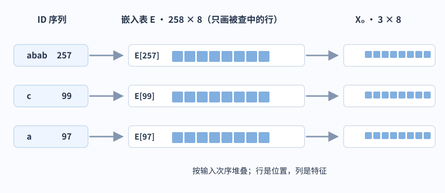
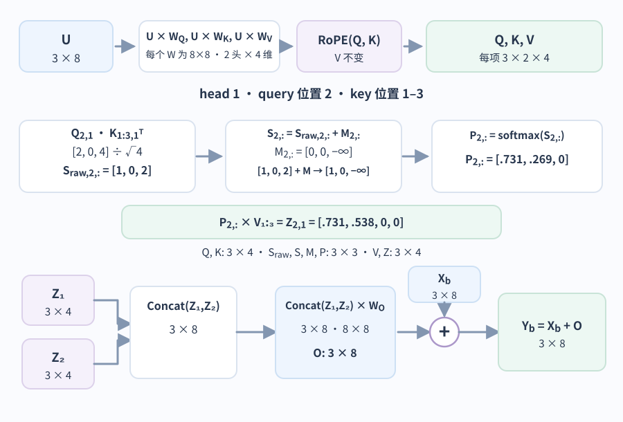
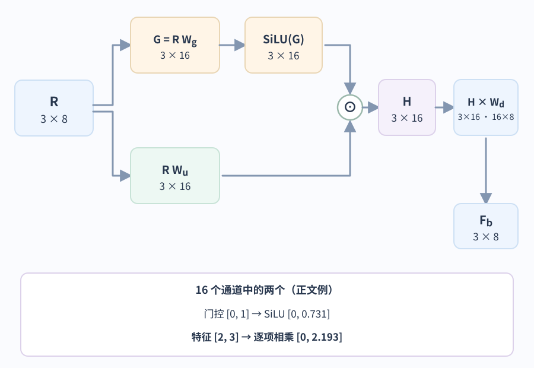
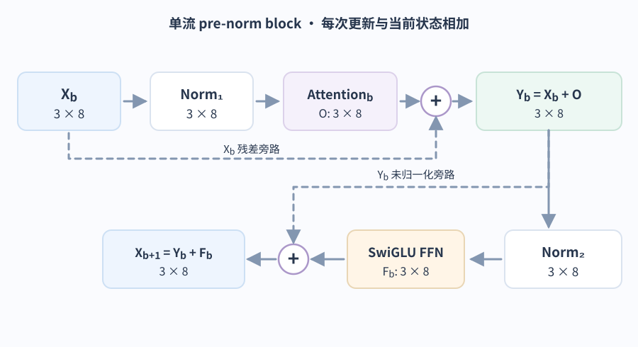
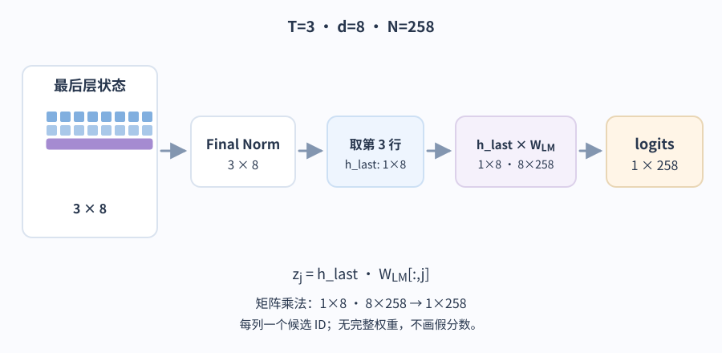
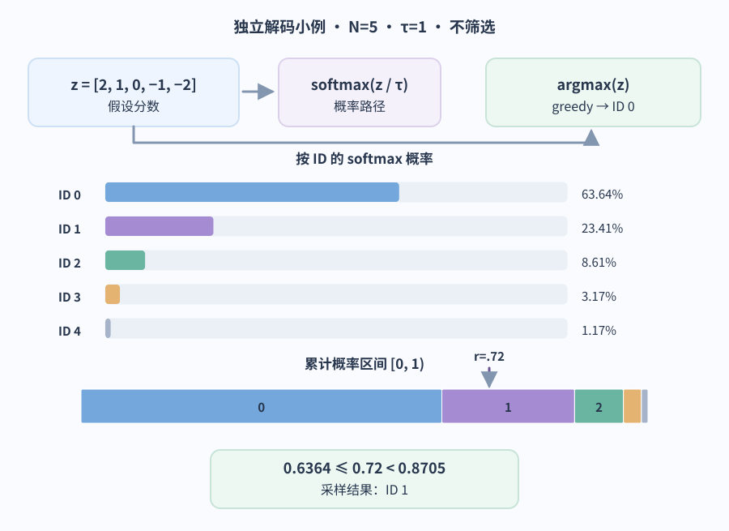
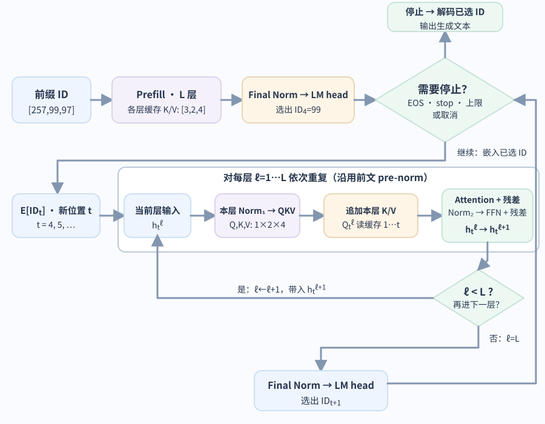

# 模型怎样把提示词算成下一个词元？

[序章](../overview/how-an-ai-answer-is-produced.md)的第二步里，应用把指令、问题和工具定义交给模型，模型生成了一段工具请求。本章打开这一步：一段文本怎样变成整数 ID，经过多层计算得到整个词表的分数，再从中选出一个词元，并把它接回下一轮。读完后你会知道哪些数字是训练好的参数、哪些只是这次运行的临时状态，这决定了后面几章讨论的代价落在哪里。

## 玩具模型和整体流程

真实请求太长，没法在纸上逐步算。本章改用一个玩具输入 `ababca`；下一章讲训练时沿用同一套配置，KV 缓存一章也从它的缓存计数出发：

| 项目 | 取值 |
| --- | --- |
| 输入文本 | `ababca` |
| tokenizer (分词器) | 字节级 BPE，词表大小 `N=258` |
| 切分结果 | 3 个 token (词元)，序列长度 `T=3` |
| 模型 | decoder-only Transformer (仅解码器 Transformer)，共 `L` 层 |
| 模型宽度 | `d=8` |
| attention head (注意力头) | 2 个，每头宽度 `d_h=4` |
| 前馈层 | SwiGLU，中间宽度 `d_ff=16` |

文中的局部数值只用来演示单个运算。并不存在一整套能把这些数字串成完整前向计算的权重，不同小节的数字也不互相推导。

整个计算可以先看成一个循环：

~~~mermaid
%%{init: {"flowchart": {"wrappingWidth": 320}}}%%
flowchart TD
    Text["输入文本 ababca"] --> Tok["分词 [257, 99, 97]"]
    Tok --> E["embedding 查表 X₀：3 × 8"]
    E --> Layers["L 层 Transformer 每层：Norm → Attention → 残差 Norm → SwiGLU → 残差"]
    Layers --> Head["最终 Norm → 取最后一行 LM head：1×8 · 8×258"]
    Head --> Select["logits → 贪心或采样 选出一个 ID"]
    Select --> Stop{"应当停止？ 结束词元、停止序列 长度上限、取消"}
    Stop -->|是| Out["把生成的 ID 解码为文本"]
    Stop -->|否| Next["把这个 ID 放到下一位置 只算新位置，复用各层 K/V"]
    Next --> Layers
~~~

## 分词器怎样把文本切成词元？

token 是某个词表里的一个条目，可以是一个字节、一个标点、半个单词、整个单词，也可以是带前导空格的一段文本。tokenizer 把文本映射为这些条目的整数 ID。ID 只是编号，数值大小没有含义。

### 字节级 BPE 怎样学出词表

byte-level byte pair encoding (字节级字节对编码，BPE) 从单个字节开始，反复把相邻且最常一起出现的片段对合并成新条目。常见实现会先用正则表达式把文本切成若干段，再在每段内部合并。

用一个玩具语料走一遍。训练片段是 `abab`、`ab` 和 `ac`：

1. 先放入 256 个单字节条目，ID 为 `0`–`255`（`a`=97，`b`=98，`c`=99）。
2. `a+b` 出现三次，最多，合并成 `ab`，ID 为 `256`。各片段变成 `[ab, ab]`、`[ab]`、`[a, c]`。
3. 现在 `ab+ab` 和 `a+c` 各出现一次。假定这个玩具的平局规则选前者，合并成 `abab`，ID 为 `257`。

词表因此是 `256 + 2 = 258` 项。编码一段没见过的新文本 `ababca` 时，按学到的合并优先级依次应用：

| 步骤 | 结果 |
| --- | --- |
| 拆成字节 | `[a, b, a, b, c, a]` |
| 应用第一条合并 `a+b` | `[ab, ab, c, a]` |
| 应用第二条合并 `ab+ab` | `[abab, c, a]` |
| 查 ID | `[257, 99, 97]` |

### 真实 tokenizer 的边界

作为对照，序章里的用户消息 `Why did build 42 fail?` 用 `tiktoken 0.12.0` 的 `cl100k_base` 单独编码，得到七个片段 `["Why", " did", " build", " ", "42", " fail", "?"]`，ID 为 `[10445, 1550, 1977, 220, 2983, 3775, 30]`。这套 ID 和玩具词表无关，不能混用。同一版本切 `The transformer architecture revolutionized NLP.` 时，`revolutionized` 被切成 `revolution` 和 `ized`，`NLP` 被切成 `N` 和 `LP`：词元边界不等于词的边界。

实际一次调用编码的不只是用户原句。应用指令、工具定义、角色标记和选中的历史消息都按模型模板排好后一起编码，都占用词元预算。估算输入长度要用已部署模型自己的 tokenizer；超出预算时该保留什么，见[每次调用的上下文预算怎样分配](../context/context-budget-and-state-layers.md)。

> [!info] 流式输出文本时：词元边界不一定是字符边界
> 一个 Unicode 字符可能占多个 UTF-8 字节，字节级词元可能把这些字节拆到两个词元里。如果把每个词元单独解码成字符串，可能得到乱码。流式输出时，解码器要暂存尚不完整的字节，等后续字节到达再输出。

BPE 只是 tokenizer 的一种；后面的 Transformer 计算只需要一串整数 ID，不依赖 ID 是怎样切出来的。

## 词元 ID 怎样变成第一层的输入？

embedding table (嵌入表) `E` 为词表里每个条目存一个学到的 vector (向量)。玩具模型里 `E` 的形状是 `N × d = 258 × 8`。ID `257`、`99`、`97` 各取出 `E` 的对应一行，按输入顺序堆起来，就得到初始 hidden state (隐藏状态) `X₀`，形状 `3 × 8`：第一行是 `abab` 的向量，第二行是 `c`，第三行是 `a`。

> [!info] 怎样读 `T × d` 这样的形状
> 行是词元位置，列是学到的特征坐标。一行就是一个 vector，即 `d` 个按顺序排列的数；一列是某个坐标在各位置上的取值。单个坐标没有“篮球”“人物”这类固定含义。批量处理多条序列时，前面再加一个批次维。

查表在数学上等于用 one-hot vector (独热向量) 乘 `E`：独热向量只在该 ID 处为 `1`，其余为 `0`，相乘恰好取出那一行。实现时直接按下标取行。同一个 ID 取出的初始行总是相同的，后面各层会按位置和上下文改变它的表示。

### pre-norm 与 RMSNorm

每层在进入 attention 和 FFN 之前，先对每一行做一次 normalization (归一化)。这种把归一化放在子层之前的安排叫 pre-norm。本章用 RMSNorm (均方根归一化)：

1. 求这一行各坐标平方的均值，加一个很小的稳定常数，开平方；
2. 每个坐标除以这个值；
3. 再逐坐标乘一个可学习的缩放值。

例如 `[3, 4]`，忽略稳定常数、缩放值取 `1`：`√((9+16)/2) ≈ 3.536`，归一化后约为 `[0.849, 1.131]`。这一步只控制数值尺度，行数和列数不变。把 `X₀` 归一化后的 `3 × 8` 矩阵记为 `U`，它就是第一层 attention 的输入。此时表示里还没有位置信息，位置要到计算 Q 和 K 时才加入。

## attention 怎样让每个位置读取前文？

attention (注意力) 决定每个位置从哪些可见位置汇集信息。本节先用普通的 multi-head attention (多头注意力，MHA)：每个 Q 头有自己的一组 K/V。

### 投影出 Q、K、V

从同一份输入 `U` 推导出三种表示：query (查询，Q) 表示“要找什么”，key (键，K) 用来和 Q 匹配打分，value (值，V) 是按分数混合的内容。这些名字描述的是它们在计算中的用途。

单个头的计算是矩阵乘法：`3 × 8` 的 `U` 乘该头 `8 × 4` 的投影矩阵，得到 `3 × 4` 的 Q；K 和 V 用各自的矩阵同样计算。两个头可以一起算：把两个头的投影并排拼成 `8 × 8` 的 `W_Q`、`W_K`、`W_V`，算出 `Q = UW_Q`、`K = UW_K`、`V = UW_V`，再沿特征轴切成两个宽度为 `4` 的头。

> [!info] 矩阵乘法在做什么
> 输出的每个坐标是输入行与权重列的 dot product (点积)。例如 `[2, 3] · [4, 5] = 2×4 + 3×5 = 23`。若权重的两列分别是 `[4, 5]` 和 `[1, −1]`，输入行 `[2, 3]` 就变成 `[23, −1]`：每一列定义输入特征的一种加权组合。`3 × 8` 乘 `8 × 4` 时，内侧的两个 `8` 对齐相乘求和，结果仍有三个位置，每个位置四个新特征。
>
> 本章用“行向量右乘权重”的记法。库的存储方向可能相反，例如 PyTorch `Linear` 按“输出特征数 × 输入特征数”存权重。

### RoPE 怎样把位置写进分数？

模型用 rotary position embedding (旋转位置编码，RoPE)：按 Q 和 K 所在的位置，把它们的坐标两两成对旋转一个角度，再计算点积。张量形状不变。

只看一对二维坐标（这里用列向量记法），位置 `i` 的 Q 与位置 `j` 的 K 旋转后的点积满足

$$
\langle R(\theta_i)q_i,\,R(\theta_j)k_j\rangle=\langle q_i,\,R(\theta_j-\theta_i)k_j\rangle .
$$

两边的旋转在点积里合成了相对角度 `θⱼ−θᵢ`，所以分数可以随两个位置的相对距离变化。高维 RoPE 对不同坐标对使用不同频率。V 不旋转。

### 因果掩码和 softmax 怎样把分数变成权重？

对一个头，依次计算：

$$
S_{raw}=\frac{QK^\top}{\sqrt{d_h}},\qquad S=S_{raw}+M,\qquad P=\operatorname{softmax}_{\text{keys}}(S),\qquad Z=PV .
$$

- `Kᵀ` 是 K 的 transpose (转置)，即行列互换。`3 × 4` 乘 `4 × 3` 得到 `3 × 3`，第 `(i, j)` 项是位置 `i` 的 Q 与位置 `j` 的 K 的点积。注意两次乘法的分工：`UW_Q` 只在每个位置内部变换特征，`QKᵀ` 才在位置之间比较。
- 除以 `√d_h` 控制分数尺度。若 Q、K 各坐标独立、均值 `0`、方差 `1`，点积是 `d_h` 个乘积之和，方差约为 `d_h`；除以 `√d_h` 后回到 `1` 左右，softmax 不会因为头变宽而过度集中到一个位置。
- causal mask (因果掩码) `M` 给每行中未来位置的分数加 `−∞`，可见位置加 `0`，使每个位置只能读自己和前文。

**手算位置 2。** 第二个位置是词元 `c`。设它旋转后的 Q 为 `[2, 0, 0, 0]`，三个位置旋转后的 K 分别为 `[1, 0, 0, 0]`、`[0, 1, 0, 0]`、`[2, 0, 0, 0]`。点积为 `[2, 0, 4]`，除以 `√4 = 2` 得 `S_raw = [1, 0, 2]`。未来的第三个位置分数最高，但加上 `M = [0, 0, −∞]` 后变成 `S = [1, 0, −∞]`。

> [!info] softmax 把一行分数变成和为 1 的权重
> 对每个分数取指数，再除以所有指数之和：$\operatorname{softmax}(s)_j=e^{s_j}/\sum_k e^{s_k}$。分数可以为负，结果都在 `0` 到 `1` 之间，且和为 `1`；`e^{−∞}=0`，所以被掩码的位置权重为 `0`，也不进入分母。

`[1, 0, −∞]` 的 softmax 为 `[e/(e+1), 1/(e+1), 0] ≈ [0.731, 0.269, 0]`。这些权重说明这个头怎样混合 V，不是“某个词为真”的概率。设前两个位置的 V 为 `(1, 0, 0, 0)` 和 `(0, 2, 0, 0)`，位置 2 的输出行是

$$
0.731\,(1,0,0,0)+0.269\,(0,2,0,0)=(0.731,\,0.538,\,0,\,0).
$$

三行一起算时，`P` 是 `3 × 3`（行是 query 位置，列是 key 位置），`V` 是 `3 × 4`，`Z = PV` 是 `3 × 4`。每个输出行都汇集了该位置能看见的信息。

### 多个头怎样合并，又怎样加回残差流？

两个头各得到一个 `3 × 4` 的 `Z₁`、`Z₂`。按列拼接后是 `3 × 8`，再乘 `8 × 8` 的输出投影 `W_O`，混合不同头的结果：

$$
O=\operatorname{Concat}(Z_1,Z_2)\,W_O\in\mathbb{R}^{3\times 8}.
$$

`O` 不是新的表示，而是一份**更新量**。residual connection (残差连接) 把它加回这一层未归一化的输入：`Y = X + O`。两者都是 `3 × 8`，逐元素相加。例如某行输入 `[1, 2]`、更新 `[0.1, −0.2]`，相加得 `[1.1, 1.8]`。这样每个子层只需在已有表示上做调整，不必重新生成全部内容。这条贯穿各层、不断被加上更新的表示叫 residual stream (残差流)。

一个头在不同层、任务和输入上的行为可能不同。某个头常常关注前一个位置，并不说明它的完整功能，它的 V、输出投影和后续层都会影响结果。要检验一个机制猜想，得改动内部表示，看输出是否随之改变。Anthropic 研究 Claude 3.5 Haiku 写押韵诗时，用近似模型画出特征间的归因图，发现模型在写第二行之前就考虑了韵脚，再用干预实验检验这条路径；近似模型只解释了部分计算，这类证据说明的是特定提示下发生了什么。

### 多个 Q 头共享 K/V 时省下什么？

用 `H_q` 表示 Q 头数，`H_kv` 表示 K/V 头数。MHA 中 `H_kv = H_q`。grouped-query attention (分组查询注意力，GQA) 让一组 Q 头共享一个 K/V 头；multi-query attention (多查询注意力，MQA) 是 `H_kv = 1` 的极端情况。

玩具模型保留两个 Q 头、只用一个 K/V 头时，`W_Q` 仍是 `8 × 8`，`W_K` 和 `W_V` 变成 `8 × 4`。两个 Q 头各自和同一份 K 打分、混合同一份 V，仍各输出宽度 `4`，所以拼接后的形状和 `W_O` 都不变。

省下的主要是缓存。生成时每层要保存此前所有位置的 K 和 V（原因见[为什么只缓存 K 和 V？](#为什么只缓存%20K%20和%20V？)）。缓存三个位置时，MHA 每层存 `2 × 3 × 2 × 4 = 48` 个数（K/V 两种 × 3 个位置 × 2 个 K/V 头 × 每头 4 维）；共享一个 K/V 头后降为 `2 × 3 × 1 × 4 = 24`。

头数结构在训练前就要定下。把一个 MHA checkpoint 直接改成 GQA 或 MQA 会改变 K/V 权重和模型行为，不是无损开关；GQA 论文评估的是先平均 K/V 权重、再继续训练的转换方法。

GQA 减少了每个位置要存的数，但没有减少位置数。上下文长到几十万词元时，还可以继续压缩每个位置的缓存，或让 query 只读一部分历史，见[DeepSeek 怎样压缩长上下文的注意力状态](deepseek-compressed-attention.md)。

## FFN 怎样加工每个位置的特征？

attention 已经把上下文信息带进每一行。feed-forward network (前馈网络，FFN) 再在每一行内部做非线性变换，也常被称为 multilayer perceptron (多层感知机，MLP)。同一层里所有位置共用一套 FFN 权重，但各行分别计算，不读其他行。如果几次线性投影之间没有非线性，它们会合并成一次线性变换；加了非线性，更新才能依赖特征的组合。

### SwiGLU 的门控

FFN 的输入是 attention 残差之后再归一化的状态，记为 `R`，形状 `3 × 8`。SwiGLU 用两张 `8 × 16` 的矩阵 `W_g`、`W_u` 分别算出门控分支和特征分支，门控分支经过 SiLU 后与特征分支逐元素相乘，最后用 `16 × 8` 的 `W_d` 投影回八维：

$$
F(R)=\big[\operatorname{SiLU}(RW_g)\odot(RW_u)\big]W_d,\qquad
\operatorname{SiLU}(x)=x\,\sigma(x),\qquad
\sigma(x)=\frac{1}{1+e^{-x}} .
$$

`σ` 是 sigmoid，取值在 `0` 和 `1` 之间。SiLU 把输入乘以这个比例，所以门控值可以为负，也可以大于 `1`，不是概率，也不是只有开和关的开关。`⊙` 是逐元素相乘，形状保持 `3 × 16`；乘 `W_d` 才是矩阵乘法，把十六个坐标重新组合成八个。中间宽度临时扩到 `16`，出 FFN 时已回到 `8`。

> [!example] 门控怎样调节两个通道
> 某一行取两个通道：门控输入 `[0, 1]`，特征值 `[2, 3]`。SiLU 把门控变成约 `[0, 0.731]`，逐元素相乘得 `[0, 2.193]`：第一个通道被关掉，第二个被缩小。这只是十六个通道中的两个，`W_d` 随后把整行十六个通道混合成八个更新量。
>
> 

门控和特征两条分支都取决于当前行，所以同一套权重能对不同上下文给出不同的更新。

Geva 等人在他们研究的模型里发现，部分 FFN 与特定文本模式相关联，并会影响输出词元。这不说明每个 FFN 都是字面意义上的事实库；模型说出一个事实，还依赖 attention、多层计算和最终的词表投影。需要最新、可核验的信息时，应用应提供外部证据，见[怎样从授权文档里找到回答依据](../context/rag-indexing-and-retrieval.md)。

### 一层的两次更新与 L 层堆叠

把 attention 和 FFN 放回同一层。用 `b` 标记第几层：

$$
Y_b=X_b+\operatorname{Attention}_b\big(\operatorname{Norm}_{b,1}(X_b)\big),\qquad
X_{b+1}=Y_b+F_b\big(\operatorname{Norm}_{b,2}(Y_b)\big).
$$

每层做两次更新、两次残差相加，输出交给下一层，共 `L` 层。各层有自己的参数；对这三个位置，层与层之间传递的始终是 `3 × 8`。

有些模型改的正是这一层里的某一块：MoE 把 FFN 换成按词元挑选的若干专家，mHC 把单条残差流扩成多条。它们分别改了什么，见[MoE、mHC 和 MTP 分别改了 Transformer 的哪一块](architecture-variants.md)。

## 哪些数字是参数，哪些是运行时状态？

到这里出现的数字分成两类，后面几乎每一章都依赖这个区分。

| | 参数 | 运行时状态 |
| --- | --- | --- |
| 本章的例子 | embedding 表 `E`；各层 RMSNorm 缩放值；`W_Q`、`W_K`、`W_V`、`W_O`；`W_g`、`W_u`、`W_d`；最终 Norm；LM head `W_LM` | 词元 ID；`X₀` 与各层 hidden state；Q、K、V；分数 `S` 与权重 `P`；门控值；logits 与概率；KV cache；已选出的 ID |
| 从哪来 | 训练学到，存成模型文件 | 每次请求按输入现算 |
| 生命周期 | 推理时只读，所有请求共享 | 随请求产生；请求结束即可丢弃（引擎可按前缀保留部分 K/V 复用） |
| 怎样改变它 | 训练或微调 | 改变输入 |

由此有三个直接推论：

- **往提示词里加证据，只改变运行时状态。** 序章第四步把日志放进第二次调用，模型还是那个模型，不需要重新训练。
- **训练改变参数，影响之后的每一次运行。** 参数怎样被训练改变，见[下一章](how-training-updates-parameters.md)。
- **参数量不能单独决定一台机器能接多少请求。** 参数所有请求共享一份，而 KV cache 每个请求各有一份，并随长度增长。

参数个数按矩阵行数乘列数计算（不计 bias）。玩具模型 MHA 且 `H_q·d_h = d` 时，每层四个 attention 投影共 `4d² = 256` 个数；三个 SwiGLU 矩阵共 `3·d·d_ff = 3 × 8 × 16 = 384` 个；两个 RMSNorm 各 `8` 个缩放值。每层合计 `656` 个。embedding 表另有 `258 × 8 = 2064` 个；LM head 若单独存储，再加 `2064` 个，若与 embedding 共享则不重复计（见下文 weight tying）。共享的权重只计一次，每层各有权重则逐层累加。

## 最后一个位置怎样变成下一个词元？

### LM head 为整个词表打分

这类模型训练时让每个位置预测紧接它的下一个词元（见[下一章](how-training-updates-parameters.md)）。生成时只需要最后一个位置：在因果 attention 下，它已经能读到整段输入。对 `[abab, c, a]`，取第三行经过全部 `L` 层和最终 Norm 后的向量 `h_last`，形状 `1 × 8`。在按模板格式化的对话里，最后一个位置往往是模板追加的 assistant 起始标记，而不是用户问题的最后一个字符。

language model head (语言模型头，LM head) 用 `8 × 258` 的矩阵 `W_LM` 把它变成 `1 × 258` 的 logits (未归一化分数)：`z = h_last W_LM`。每个词表 ID 对应一列，各得一个分数。玩具模型没有完整权重，所以这里不编造这 258 个分数。

weight tying (权重绑定) 让 `W_LM` 直接使用 embedding 表的转置，省掉一张矩阵；也有模型分别学习输入和输出的两张表。

### 温度、top-k 和 top-p 怎样改变分布？

logits 可以为负，和也不为 `1`。做 sampling (采样) 时，先用 temperature (温度) `τ > 0` 缩放 logits，再做 softmax：

$$
p_i=\frac{\exp(z_i/\tau)}{\sum_j\exp(z_j/\tau)} .
$$

为单独观察温度，假设只有两个候选 `c`（ID `99`）和 `a`（ID `97`），logits 设为 `[2, 1]`：

| 温度 | 缩放后的 logits | 概率 `[c, a]` |
| --- | --- | --- |
| `0.5` | `[4, 2]` | `[0.881, 0.119]` |
| `1` | `[2, 1]` | `[0.731, 0.269]` |
| `2` | `[1, 0.5]` | `[0.622, 0.378]` |

温度越低，概率越集中到高分候选；越高，低分候选越有机会被选中。这是下一个词元的采样概率，不是回答在事实上正确的把握。

另外两种常见控制先筛掉一部分候选，再在剩下的候选上重新归一化：

- **top-k**：只保留分数最高的 `k` 个候选。
- **top-p**（nucleus sampling，核采样）：按概率从高到低累加，保留累计概率首次达到阈值 `p` 的最短前缀。例如概率 `[0.50, 0.30, 0.15, 0.05]`、`p = 0.75`：累计到第二项是 `0.80`，保留前两项，归一化为 `[0.50, 0.30] / 0.80 = [0.625, 0.375]`。

常见流水线先用温度改 logits，再做筛选；具体顺序和支持哪些参数由模型和 API 决定。

### 贪心与采样怎样选出一个 ID？

decoding (解码) 决定怎样从分布里选出一个 ID。换一个可以画出完整分布的独立小例：词表 `N = 5`，ID `0`–`4`，logits `[2, 1, 0, −1, −2]`，温度 `1`，不筛选。softmax 后概率约为 `[0.6364, 0.2341, 0.0861, 0.0317, 0.0117]`。

- **采样**：把 `[0, 1)` 按这五个概率依次分段，均匀抽一个数，落在哪段就选哪个 ID。抽到 `r = 0.72` 时，它落在 `[0.6364, 0.8705)`，选中 ID `1`。概率大的候选更容易被抽中，但不保证每次都是它。真实服务的随机数实现可以不同，这里只说明“按概率选”的含义。
- **greedy decoding (贪心解码)**：直接取分数最高的 ID `0`。softmax 不改变排序，所以贪心可以直接对 logits 取最大值，不必先算概率。它是独立的 argmax 路径，不是把 `τ = 0` 代入上面的公式（公式要求 `τ > 0`）。某个 API 的“温度 0”是否可用、映射成什么，要查该接口的说明。

## 选出的 ID 怎样接回下一轮？

### 先判停，再续算

第一次把整段输入送过所有层叫 prefill (预填充)。假设末位置选出了 `c`（ID `99`），序列就变成 `[257, 99, 97, 99]`；生成的文本目前只有 `c`，输入 `ababca` 仍在上下文里。

调用方先检查这个 ID 和调用状态，再决定是否继续。生成在以下任一情况结束：

- 模型输出了结束词元；
- 应用匹配到停止序列；
- 达到长度上限；
- 调用被取消。

这几种结束原因含义不同。长度上限可能截断一段没写完的回答，或者一个工具请求的参数，所以应用要保留结束原因：截断的回答要提示不完整，截断的工具参数不能当作可执行的调用。正常结束后，用 tokenizer 自带的解码接口把生成的 ID 变回文本；特殊词元按模型或 API 的约定解释。

如果不停止，就进入 decode (增量解码)：把 `c` 嵌入成位置 4 的一行 `1 × 8`，从第一层开始只为这一个新位置计算，预测位置 5。之后每选出一个 ID，都按“先判停、再续算”的顺序重复。

### 为什么只缓存 K 和 V？

在本章这种每层都用因果注意力的模型里，只要前缀和推理配置不变，后面追加的位置就不会改变前面位置的 hidden state：因果掩码让旧位置看不见新位置。所以旧位置的计算结果可以复用。

新位置要用到旧位置的什么？在第 `l` 层，新位置的输入 $h_t^l$ 经过 Norm 算出新的 Q、K、V；它的 Q 要和位置 `1…t` 的 K 打分，再混合这些位置的 V。旧位置的 Q 在它们各自当初的计算里已经用完，新 query 不再需要它们。因此 KV cache (键值缓存) 只为每层保存此前所有位置的 K 和 V：

1. 新 ID 查表得到第 1 层输入 $h_t^1$；
2. 每一层：Norm → 算新位置的 Q、K、V → 把新的 K、V 追加到**本层**缓存 → 新 Q 读位置 `1…t` 的 K/V → 残差 → Norm → FFN → 残差，得到 $h_t^{l+1}$ 交给下一层；
3. 第 `L` 层结束后，做最终 Norm 和 LM head，选出下一个 ID。

各层的输入和投影权重都不同，所以每层有自己独立的缓存。

### 计算量和缓存怎样随长度增长？

- **prefill 或整段训练**：dense attention 要为掩码允许的每一对 query/key 打分，配对数随 `T²` 增长。
- **decode 的每一步**：只有一个新 query，它和长度为 `T` 的缓存逐项打分，单步工作量随 `T` 线性增长。
- **缓存大小**：全量 attention 下，每多一个位置，每层就多存一份 K/V，输出越长缓存越大。sliding window (滑动窗口) 层只读最近 `W` 个位置（例如 Mistral 7B 用固定大小的滚动缓存覆盖更早的条目），缓存到窗口长度后不再增长。

实际时延还取决于计算内核、其他层和硬件。有些层甚至换了历史的存储形式，例如 Kimi Delta Attention 每个头用一张固定大小的矩阵记录历史，见[Kimi Delta Attention 怎样用一张固定矩阵读写历史](kimi-delta-attention-state.md)。

## 应用该怎样选择解码设置？

从已部署的模型和 endpoint (端点) 入手：先确认它支持哪些控制项、哪些组合可用，用支持的默认值建立基线。不存在对所有模型和任务都最好的温度。

- **需要稳定的工具参数和证据引用时**，例如序章的 CI 诊断助手多次运行给出不必要的不同参数，可以试一个受支持的较低温度设置。但较低设置也可能稳定地偏向错误操作，结果稳定不等于结果正确。
- **需要多个候选供后续核验时**，较高的多样性可能有用，代价是更多无效候选和更多核验工作。多样性有没有用，取决于候选生成和验证合起来的效果。
- **温度不能弥补证据。** 调低温度不会让回答更可能正确，调高温度也不会让没有依据的说法变得可以接受。

做比较时，固定模型版本、指令、工具和题目集，只改解码设置；每个设置重复完整运行，同时衡量工具选择和参数是否正确、解释是否有依据、故障处理是否恰当，以及成本和时延。题目要覆盖常见失败、日志缺失、权限失败和带误导文字的日志。用一组题调设置，另一组独立的题验收，方法见[候选比基线好，是真改善还是抽样波动](../evaluation-and-release/holdout-acceptance-and-paired-statistics.md)。

> [!info] 实例：托管 API 的采样参数会随版本变化（核对日期 2026-11-11）
> OpenAI Responses 接口的参数文档和 GPT-6 参数兼容说明显示，可用的采样参数随 endpoint、模型和推理配置而变；Claude API 的模型弃用与参数迁移说明记录，其 2026-10-21 API version 移除了 temperature、top_p 和 top_k。因此“温度设为 0”不是跨接口通用的行为，接入前要查对应版本的契约。

## 参数从哪来，缓存占多少内存？

本章交出两样东西：一次前向计算的完整路径，以及“参数 vs 运行时状态”的划分。它们分别引出主线一后面的问题。

- 本章一直在使用 `E`、`W_Q`、`W_LM` 这些已经训练好的参数。它们怎样从语料里学出来，见[训练怎样让这些参数变得更会预测](how-training-updates-parameters.md)。
- 运行时状态里最占内存的是 KV cache。它和请求长度、并发数一起，决定一台服务能同时接多少请求，见[KV 缓存怎样决定一台服务能接多少请求](kv-cache-and-serving-capacity.md)。
- 多个请求共享同一段开头时，这段前缀的 K/V 可以不重算，这也体现在 API 账单上，见[重复的前缀怎样复用](prefix-reuse-and-prompt-caching.md)。

> [!info]- 来源
> 文中 `ababca`、小矩阵、位置 2 的 attention 数值、门控数值、温度与 `N=5` 采样例都是教学设定，概率与形状按正文公式手算。
>
> - **BPE 与真实 tokenizer 对照（分词器怎样把文本切成词元？）。** [Sennrich et al., ACL 2016, §3.2](https://aclanthology.org/P16-1162/) 支持按频率合并相邻子词对；[OpenAI tiktoken 0.12.0 educational implementation](https://github.com/openai/tiktoken/blob/0.12.0/tiktoken/_educational.py) 说明字节级合并实现。英文对照在本机 `tiktoken 0.12.0`、`cl100k_base` 上复现：原句得到 `[10445, 1550, 1977, 220, 2983, 3775, 30]`；边界样例 `The transformer architecture revolutionized NLP.` 得到 `[791, 43678, 18112, 14110, 1534, 452, 12852, 13]`。
> - **因果前向、Attention、多头拼接、FFN 与词表投影。** [Attention Is All You Need, v7, §§3.1–3.5、§5.1](https://arxiv.org/html/1706.03762v7#S3) 支持未来位置掩码、scaled dot-product、多头拼接后输出投影、逐位置 FFN 和线性投影后 softmax。原论文是 encoder–decoder、post-norm；本章另选 decoder-only、pre-norm、RoPE 与 SwiGLU 作为教学组合。
> - **RoPE 与 RMSNorm。** [RoFormer, v5, §§3.2.1–3.2.2](https://arxiv.org/html/2104.09864v5#S3.SS2) 给出旋转位置编码，点积恒等式对应 §3.2.1 式 (12)–(13)。[Root Mean Square Layer Normalization, v1, §4](https://arxiv.org/html/1910.07467#S4) 支持 RMSNorm；`[3,4] → [0.849,1.131]` 按单位缩放、忽略 epsilon 手算。
> - **pre-norm、权重布局与 bias。** [The Llama 3 Herd of Models, v3, §3.2](https://arxiv.org/html/2407.21783v3#S3.SS2) 记录 RoPE、SwiGLU、GQA 的现代 decoder-only 配置，[Meta Llama 3 参考实现](https://github.com/meta-llama/llama-models/blob/main/models/llama3/model.py)给出实现路径；二者作对照，不代表本章小维度配置。[PyTorch 2.10 `Linear`](https://docs.pytorch.org/docs/2.10/generated/torch.nn.Linear.html) 说明权重按 `out_features × in_features` 存储、bias 独立可选。
> - **attention 头的解释边界（多个头怎样合并）。** Anthropic [研究导读](https://www.anthropic.com/research/tracing-thoughts-language-model)、[Claude 3.5 Haiku 个案](https://transformer-circuits.pub/2025/attribution-graphs/biology.html)与[归因方法及其限制](https://transformer-circuits.pub/2025/attribution-graphs/methods.html#limitations)（2025-03-27）说明韵脚规划的观察、干预和近似模型的覆盖边界；[内部工作空间实验](https://www.anthropic.com/research/global-workspace)（2026-07-06）也通过替换表示检验韵脚对整行的影响。
> - **GQA、滑动窗口与 KV cache。** [GQA, EMNLP 2023, §2](https://aclanthology.org/2023.emnlp-main.298/) 说明多个 Q 头共享较少 K/V 头，以及由 MHA checkpoint 继续训练转换的条件；[Mistral 7B, v1, §2、Figures 1–3](https://arxiv.org/html/2310.06825v1#S2) 支持窗口 `W` 的可见范围与固定长度滚动缓存；[Transformers “How caching works”（main docs，核对 2026-11-11）](https://huggingface.co/docs/transformers/main/en/cache_explanation) 说明因果前缀的逐层 K/V 复用与新 query 追加缓存。
> - **固定矩阵状态（计算量和缓存怎样随长度增长？）。** [Kimi Linear, arXiv v2, §3](https://arxiv.org/html/2510.26692v2) 给出每个 KDA 头的矩阵状态更新。
> - **SwiGLU 与 FFN 的解释范围。** [GLU Variants Improve Transformer, v1, §2](https://arxiv.org/html/2002.05202#S2) 给出门控逐元素乘法与第三个降维投影；[Geva et al., EMNLP 2021](https://aclanthology.org/2021.emnlp-main.446/) 分析所研究 FFN 中的文本模式与输出影响，不能推广为每个 FFN 都是事实库。
> - **解码策略与 API 边界。** [The Curious Case of Neural Text Degeneration, v2, §3](https://arxiv.org/abs/1904.09751v2) 支持 top-p 的最小累计概率集合定义；[Transformers Generation strategies（核对 2026-11-11）](https://huggingface.co/docs/transformers/generation_strategies#basic-decoding-methods) 区分 greedy 与按分布采样。[OpenAI Responses 创建接口](https://developers.openai.com/api/reference/resources/responses/methods/create)、[GPT-6 参数兼容说明](https://developers.openai.com/api/docs/guides/latest-model?model=gpt-6-astra) 与 [Claude 模型弃用与参数迁移说明](https://platform.claude.com/docs/en/about-claude/model-deprecations) 支持“实例：托管 API 的采样参数”callout。
> - **对话模板与生成起始标记（LM head 为整个词表打分）。** [Transformers chat templates，`add_generation_prompt`](https://huggingface.co/docs/transformers/chat_templating#add_generation_prompt) 说明模板会在末尾追加 assistant 起始标记。
>
> 相关论文见 [AI 好文集](../../review/ai-literature-index.md)。
