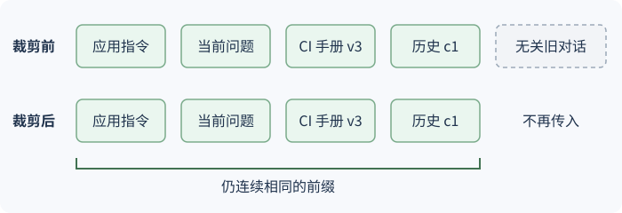
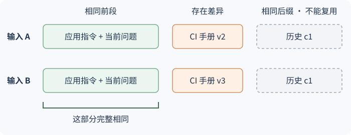

# 重复的前缀怎样在引擎里复用，又怎样体现在 API 账单上？

[KV 缓存一章](kv-cache-and-serving-capacity.md)说明了每条请求都要先做一次 prefill，把所有提示词元的 K/V 算出来存进缓存。可是很多请求的开头完全相同：同一段系统指令、同一份工具 schema、同一篇参考文档。本章回答这些重复的开头怎样只算一次：推理引擎怎样找到并复用它们的 K/V，托管 API 又怎样把同一件事做成 prompt cache 并单独计价。最后用一组请求逐项算出缓存到底省了多少钱。

引擎侧和 API 侧是同一个机制的两面。前者决定能不能少算，后者决定能不能少付；两者都只跳过重复的计算，不跳过本次请求的生成，也不改变模型这一轮看见什么。

## 前缀为什么能复用，又为什么只能是前缀？

在因果模型里，位置 `t` 的 K/V 只取决于三样东西：位置 1 到 `t` 的词元 ID、模型权重（含适配器），以及影响计算的推理配置。它不读 `t` 之后的任何内容。所以两条请求只要前 `t` 个词元 ID 完全相同、模型和配置也相同，它们在位置 1 到 `t` 上的 K/V 就完全相同，后一条可以直接拿前一条的结果。

一旦在某个位置出现第一个不同的词元，从这里开始的每个位置都读到了不同的历史，K/V 全都不同。即使后面有一大段文字逐字相同，也不能复用：它们所在的位置变了，看到的前文也变了，RoPE 位置编码和注意力结果都跟着变。因此能复用的只有“从开头连续相同”的那一段。

这带来一条简单的工程规则：**稳定的内容放前面，变化的内容放后面。** 系统指令、工具 schema、长期不变的文档在前；用户问题、本轮数据、时间戳在后。若 schema 由遍历顺序不固定的 map 生成，先把序列化顺序固定下来，否则每次请求的前缀都不一样。

## 引擎按什么粒度找到可复用的前缀？

引擎不是逐词元比较，而是按块比较，这和[分页存储](kv-cache-and-serving-capacity.md)的块是同一个单位。

> [!example] 块大小为 4 时能复用多少？
> 请求 A 已缓存 10 个词元。请求 B 的前 7 个词元与 A 相同，第 8 个不同。
>
> - 词元 1–4 组成的第一块完全相同，可以复用。
> - 词元 5–8 组成的第二块在第 8 个位置不同，整块不能复用。
>
> 所以 B 实际复用 4 个词元的 K/V，从位置 5 开始重新 prefill，而不是从位置 8 开始。共同前缀 7 个词元，被向下对齐到块边界 4。

两种常见实现都是这个结果，只是组织方式不同：

- **vLLM 的 Automatic Prefix Caching** 给每个填满的块算一个哈希。哈希包含父块的哈希和本块的词元 ID，所以相同的哈希意味着从开头到本块都相同。LoRA 适配器 ID、多模态输入的身份和 `cache_salt` 也作为额外键进入哈希，只有这些都一致才算命中。
- **SGLang 的 RadixCache** 把已缓存的序列组织成一棵按词元 ID 分叉的前缀树，遇到第一个不同的词元就停，再把匹配长度向下对齐到 `page_size`。`extra_key` 和 `cache_salt` 划分缓存命名空间。

块被引用期间不会回收。请求结束后，引用数归零的块在 vLLM V1 里进入空闲队列，但暂时保留前缀身份：新请求如果匹配到它，可以直接拿回来用；没人用就在需要空间时被覆盖。多条请求同时共享一段前缀时引用同一批物理块，分支要写入不同内容时用写时复制隔开。

## 多租户共享缓存会泄露什么？

共享前缀缓存会带来一个 timing side channel (时序侧信道)。命中缓存的请求首词元返回得更快。攻击者可以发送一个猜测的前缀，测量首词元时延：如果明显变快，就说明有别人刚发过这段前缀。逐段猜下去，可能拼出另一个租户的提示内容。

vLLM 的对策是 `cache_salt`：服务端为每个租户配置一个独立的、不可预测的秘密值，它进入第一块的哈希，于是不同 salt 的请求永远不会共享块。这个 salt 必须保密，不能直接用公开的账号 ID；攻击者一旦猜到或拿到另一租户的 salt，仍能探测它的命中情况。vLLM 也明确说明 `cache_salt` 不是租户隔离边界；需要严格隔离时，要在部署架构层面分开。

## 混合架构的前缀边界由什么决定？

上面的规则假设每层都按位置缓存 K/V，任何块边界都能恢复完整状态。混合架构不是这样：

- **线性注意力层保存的是一张固定大小的状态矩阵**（例如 [Kimi Delta Attention](kimi-delta-attention-state.md)），它在每个位置都被覆盖更新，过去某个位置的状态不会自动留下。要从某个前缀边界继续，必须恰好在该边界保存过状态快照。
- **压缩或窗口层**（例如 DeepSeek-V4 预览版的 CSA、HCA 和局部窗口）在前缀命中后还要恢复未完成的压缩尾块和最近窗口，见 [DeepSeek 怎样压缩长上下文的注意力状态](deepseek-compressed-attention.md)。

所以混合模型能复用到哪里，取决于状态快照存在哪些边界，而不只是词元是否相同。

> [!example] Kimi K3 报告里的前缀边界
> 报告的示例用 512 词元作为哈希单位，6,144 词元作为物理页，并且只在稀疏的边界保存 KDA 状态检查点。两条请求共同前缀为 2,800 词元时，该例只能复用到 2,560（512 的 5 倍）。
>
> vLLM 的 K3 preview 把物理 KDA 状态块大小和前缀匹配粒度分开，允许在大物理块内部的细粒度边界注册有效状态；当前 K3 recipe 设置 `--prefix-match-unit=128`。若 2,688（128 的 21 倍）这个边界上确有 KDA 状态，按该粒度最多可复用到 2,688。这是另一个实现，实际命中仍要确认对应边界的状态可用。

## API 的 prompt cache 承诺了什么？

托管 API 把同一个机制包装成 prompt cache (提示缓存)：服务端保存匹配前缀的 KV 状态，后续请求命中时跳过这段 prefill，并按较低的“缓存读取”单价计费。它复用的是计算状态，不是上一次的回答；模型仍为本次请求生成全新的输出。

一次请求要命中，需要同时满足三个条件：

1. 当前模型和端点支持缓存。
2. 前缀达到该模型的最小可缓存长度。
3. 从请求开头到缓存断点（breakpoint）为止，渲染后的输入与已缓存的内容逐字相同，相关请求配置也相同。系统指令、消息顺序、工具定义及其序列化、结构化输出 schema、模型，任何一项在断点之前变化，可复用的前缀就到变化处为止。

另外几项常被误解：

- **缓存键只影响分组和路由，不改变内容。** OpenAI 的 `prompt_cache_key` 帮助把相关请求路由到同一缓存，或把用量按客户分组；前缀相同而键不同的请求，不应指望彼此复用。任何缓存键都不能代替租户授权。
- **TTL 保证的是计价资格。** 期限内匹配的前缀有资格按缓存读取价计费；它不保证每次都真的复用了驻留的 KV，也不保证时延下降，到期也不是强制删除的时刻。
- **写入有成本。** 首次写入缓存通常比普通输入更贵。写进去却再也没人读的前缀，比不缓存还费钱。

TTL 要按复用间隔选。几分钟内反复使用的短会话，短 TTL 就够；复用间隔更长的共享规则，延长 TTL 能减少重新冷写，但每次写入更贵。具体字段和倍率见文末[实例小节](#实例：OpenAI%20与%20Anthropic%20的缓存字段)。

## 删减输入、续接服务端会话、前缀缓存和 KV 缓存各改变什么？

这四种操作常被统称为“省上下文”，改变的却是不同的东西。只有第一种改变模型这一轮看见什么；后三种都不改变。

| 操作 | 发送给服务的内容 | 模型本轮可见内容 | 主要改变 |
| --- | --- | --- | --- |
| 删减输入 | 应用删去不需要的片段后提交 | 不含被删片段；应用仍可保留原记录 | 传输量、计算量，以及本轮可用的证据 |
| 续接服务端会话 | 按服务契约只提交新增消息和会话 ID 或前次响应 ID | 服务端可能重建完整历史，模型仍看见全部 | 重复上传和请求处理；不替代应用自己的持久状态 |
| 前缀缓存 / prompt cache | 照常提交完整请求 | 不因缓存而删减 | 若前缀符合条件，跳过这段 prefill |
| KV 缓存 | 照常提交请求；缓存由推理服务在生成过程中使用 | 由本次输入决定 | 同一次生成内，每步 decode 不必重算旧位置 |

删减和缓存会互相影响，因为删减发生在哪个位置决定共同前缀还剩多少。下面两张图用主线二 CI 诊断助手的输入作例子，片段依次是应用指令、当前问题、手册和历史工具结果 `c1`。两次比较的请求问的是同一个问题，所以问题在前也不影响结论。

先看**只删末尾的无关对话**。裁剪后，前面四段仍与裁剪前逐字相同，整段仍是共同前缀，缓存照样命中。

再看**中间的手册换了版本**。即使后面的 `c1` 没变，共同前缀也在手册里第一个不同的词元处结束，`c1` 只是相同的后缀，不能复用。图按消息片段分组；手册内部的具体分界取决于服务怎样序列化和分词，不是“整块消息全有或全无”。

删减和摘要会改变模型看见的信息：输入变短可能降低总成本，也可能缩短可复用的前缀，还可能删掉回答需要的证据。哪种更划算没有通用比例，要按目标模型和任务比较质量、实际命中和每成功任务成本。删减和摘要怎样影响回答，见[上下文预算与状态分层](../context/context-budget-and-state-layers.md)。

续接服务端会话省下的是上传，不是计算。设每条用户消息 `Uᵢ` 和回复 `Aᵢ` 都是一个等长块，忽略系统提示、工具和协议字段：

| 轮次 | 每轮完整重发 | 续接服务端会话 |
| --- | --- | --- |
| 1 | `U₁`：1 块 | `U₁`：1 块，创建会话 |
| 2 | `U₁ A₁ U₂`：3 块 | `U₂`：1 块，引用前一响应 ID |
| 3 | `U₁ A₁ U₂ A₂ U₃`：5 块 | `U₃`：1 块，引用前一响应 ID |
| 合计上传 | **9 块** | **3 块** |

两种方式下，三次模型调用处理的都是 1、3、5 块的完整历史，模型的输入量相同。这只是上传量的教学算例，不代表字节数、时延或费用的比例。服务端会话也不意味着复用了上一轮的 KV；要省 prefill，仍要另外配置 prompt cache。

KV 缓存和 prompt cache 都不承担任务状态：它们会过期、会被淘汰，命中与否也不由应用控制。哪些事实必须由应用自己持久保存，见[运行身份与权威状态](../runs/run-identity-and-authoritative-state.md)。

## 怎样判断缓存真的生效？

先固定一个可比的请求集合和统计窗口：同一模型、端点、缓存配置，已完成且前缀满足缓存门槛的请求。不要把所有 API 请求都塞进分母。然后分开看两个比例：

- **请求命中率** = 有缓存读取的请求数 ÷ 集合中的请求数。
- **缓存词元占比** = 缓存读取的输入词元总数 ÷ 输入词元总数。输出词元不在分母里。

这两个数的分母不同，可以差得很远：每个请求都命中、但每次都带一长段动态后缀时，命中率很高，词元占比却不高。省多少钱要按第三个口径算：普通输入、缓存读取、缓存写入三类词元分别乘各自单价再求和。超时或被限流（如 HTTP 429）而没拿到用量的尝试要单列，按账单核对，不能悄悄算成未命中，也不能从成本里消失。

排查缓存问题可以按四步走：

1. **先比原始用量。** 按模型、端点、提示词版本、工具 schema 版本、结构化输出版本、缓存键和 TTL 分组，对照输入词元、缓存读取词元、写入词元、TTFT 和完整任务时延。trace 里记版本和哈希，不存敏感的提示正文。
2. **命中突然变低时，查前缀和路由。** 比较序列化后稳定前缀的哈希和断点位置；检查工具顺序是否稳定、动态内容是否跑到了前面、前缀是否达到最小长度、缓存键是否被意外改变。
3. **命中率高但成本几乎不变时，查分母和费用。** 可能命中的只是很短一段；动态后缀或输出占了大头；写入比例高或 TTL 费率高；写入被重复计入；失败重试被摊到同一个成功任务上。
4. **缓存词元上升但 TTFT 没降时，看端到端 trace。** 缓存只减少前缀的 prefill。首词元时延还受网络、排队、剩余动态输入和推理负载影响。要在同一请求分布上比较冷、暖缓存的 p50 和 p95，不能从词元命中直接推出用户更快。

## 缓存到底省了多少钱？

下面用一组请求从头算到尾。价格是便于手算的**教学比例**，不是任何模型的报价：普通输入每百万词元 1 美元，缓存读取按普通价的 0.10 倍，缓存写入按普通价的 1.25 倍，输出每百万词元 4 美元。

工作负载：100 次请求，每次输入 1,200 个词元，其中固定前缀 1,024（指令和工具 schema），动态后缀 176；每次输出 200 个词元。缓存断点只设在固定前缀末尾，后缀按普通价计费，不产生写入。

**输出费用在四种情况下都一样**：`100×200×4 ÷ 1,000,000 = $0.08`。缓存碰不到它。

**输入费用随缓存的组织方式变化：**

| 工作负载 | 写入 / 读取 / 普通输入词元 | 请求命中率 | 缓存词元占比 | 输入费用 | 合计 |
| --- | ---: | ---: | ---: | ---: | ---: |
| 不用缓存（对照，不进命中率分母） | 0 / 0 / 120,000 | — | 0% | $0.120000 | $0.200000 |
| 一个热点：第 1 次冷写，后 99 次读 | 1,024 / 101,376 / 17,600 | 99% | 84.48% | $0.029018 | $0.109018 |
| 十个热点：每组 1 次冷写、9 次读 | 10,240 / 92,160 / 17,600 | 90% | 76.8% | $0.039616 | $0.119616 |
| 一百个前缀各写一次，从未再读 | 102,400 / 0 / 17,600 | 0% | 0% | $0.145600 | $0.225600 |

逐项核对第二行：

- 写入：`1,024×1.25 = 1,280`（以“普通价词元”计）。
- 读取：`99×1,024 = 101,376` 个词元，`×0.10 = 10,137.6`。
- 普通输入：`100×176 = 17,600`。
- 输入费用：`(1,280 + 10,137.6 + 17,600) ÷ 1,000,000 = $0.0290176`。
- 缓存词元占比：`101,376 ÷ 120,000 = 84.48%`，比 99% 的命中率低，因为每次还有 176 个动态词元。

从这张表能读出四件事：

1. **输入省了 76%，总账只省 45%。** 一个热点时输入从 $0.12 降到 $0.029，但输出的 $0.08 一分没少，合计从 $0.20 降到 $0.109。输出占比越大，缓存的效果越小。
2. **前缀被拆散，省的就少。** 同样 100 次请求，分成十个热点后每组都要冷写一次，命中率降到 90%，费用升到 $0.040。如果每个用户都把自己的动态值放在稳定前缀之前，或者每次请求的工具顺序不同，一个热点就会碎成许多只写不读的组。
3. **只写不读比不缓存更贵。** 单次冷写的输入费用是 `(176 + 1,024×1.25) ÷ 1,000,000 = $0.001456`，高于不缓存的 $0.0012。最后一行因此比对照组还贵。
4. **冷启动的写入费不能从账上抹掉。** 若统计窗口开始前缓存已经是暖的，这 100 次全是读取，输入费用是 `(102,400×0.10 + 17,600) ÷ 1,000,000 = $0.02784`；但那次冷写只是发生在窗口之外，仍属于投入成本。

**Response cache (响应缓存)是另一回事。** 它在应用层直接复用上一次的整份回答，完全跳过模型调用。假设上面一个热点的情形里，有 40 次请求经核对确实等价：同一租户和权限、同一数据版本、同一问题、同一提示词版本和输出格式。这 40 次不再调用模型；剩下 60 次照常走 prompt cache（1 次冷写、59 次读）：

- 输入：`(1,280 + 59×1,024×0.10 + 60×176) ÷ 1,000,000 = (1,280 + 6,041.6 + 10,560) ÷ 1,000,000 = $0.0178816`。
- 输出：`60×200×4 ÷ 1,000,000 = $0.048`。
- 合计约 $0.0659，还没算响应缓存自身的存储和查找成本。

响应缓存省得多，风险也大：只要数据刷新了，旧回答就不再是有效命中。semantic cache (语义缓存)按向量相似度判断“等价”更危险，美国和欧盟的退款政策问题向量很近，正确答案却可能不同。相似度本身不能证明回答可以共享。

缓存只是推理优化。是否采用，要在同一组请求上同时比较三件事：没有把某个用户或租户的专属内容错误共享；质量门槛不变；每成功任务的完整成本下降。完整成本怎样算，见[模型选择与每成功任务成本](../evaluation-and-release/model-selection-and-unit-cost.md)。

## 实例：OpenAI 与 Anthropic 的缓存字段

以下字段和倍率会随模型和 API 版本变化，接入前按当时的文档重算。

> [!info] OpenAI Responses API（核对于 2026-11-26）
> - **门槛与倍率。** GPT-5.6 及更新模型最小可缓存前缀为 1,024 个词元（OpenAI 隐藏系统内容不计入）；更早模型的门槛随请求设置而变。默认 30 分钟寿命的写入为普通输入价的 1.25 倍，可选 12 小时寿命、写入 2.5 倍；读取在多数模型上为 0.1 倍，部分模型 0.05 倍。写入价不是附加费：每个输入词元只按普通、读取或写入三种单价之一计费。
> - **断点。** `prompt_cache_options.mode` 选 `implicit`（服务自动在最新的合格消息末尾放断点）或 `explicit`（只用开发者在内容块上标记的 `prompt_cache_breakpoint: {"mode": "explicit"}`）。explicit 模式下不设断点就既不读也不写缓存；最后一个断点之后的内容按普通价计费且不写入。每个请求最多产生 4 次缓存写入。若保留 implicit 又加显式断点，自动断点仍然生效，可能覆盖到动态内容，费用构成随之变化。
> - **TTL。** 请求级 `prompt_cache_options.ttl` 可设 `"30m"` 或 `"12h"`，单个断点可覆盖。最短寿命决定的是读取计价资格，不保证复用驻留的 KV 或降低时延。
> - **缓存键与隔离。** GPT-5.6 及更新模型自动路由，`prompt_cache_key` 可选，用于按客户、用户或 workspace 分开缓存复用和用量；更早模型用稳定的键来优化路由命中。缓存不跨组织共享，也不跨区域处理边界复用。
> - **用量拆分。** `usage.input_tokens` 包含全部三类输入。普通输入 = `input_tokens − input_tokens_details.cached_tokens − input_tokens_details.cache_write_tokens`。写入再按寿命拆成 `cache_write_tokens_details.ttl_30m_tokens` 和 `ttl_12h_tokens`，二者互斥、加起来等于 `cache_write_tokens`，应分别计价，不要重复加回总量。`cached_tokens` 向下取整到 128 的倍数。缓存词元占比 = `cached_tokens ÷ input_tokens`。

> [!info] Anthropic Messages API（核对于 2026-11-26）
> - **开启方式。** 在请求顶层加一个 `cache_control` 字段为 automatic caching，断点自动放在最后一个可缓存块并随对话前移；也可把 `cache_control` 直接放在内容块上作为显式断点。缓存覆盖的前缀按 `tools`、`system`、`messages` 的顺序，到标记块为止，要求逐字相同。
> - **查找范围。** 每个断点最多向前检查 20 个位置，只能找到先前请求在它们自己的断点处写下的条目；它不会把断点后面稳定的内容自动缓存起来。断点放在每次都变化的块上，就会每次只写不读。
> - **门槛与倍率。** 最小可缓存长度按模型从 512 到 4,096 词元不等，低于门槛时不报错、直接不缓存。默认寿命 5 分钟，每次使用免费续期，从读写它的请求开始时计时；可选 1 小时寿命。5 分钟写入为普通输入价的 1.25 倍，1 小时写入为 2 倍，读取为 0.1 倍。
> - **用量拆分。** `cache_read_input_tokens` 是读取，`cache_creation_input_tokens` 是写入（可再按寿命拆为 `ephemeral_5m_input_tokens`、`ephemeral_1h_input_tokens`），`input_tokens` **只计最后一个断点之后**的词元。总输入 = 三者之和。所以缓存词元占比 = `cache_read_input_tokens ÷ (cache_read_input_tokens + cache_creation_input_tokens + input_tokens)`；直接套 OpenAI 的公式会算错。
> - **隔离。** 不同组织从不共享缓存；在 Claude API 等平台上 workspace 之间也隔离。

> [!info] Anthropic Message Threads（beta，核对于 2026-11-25）
> Message Threads 是“续接服务端会话”的一个实例：创建 thread 时发送完整对话，之后每轮只发新消息并引用上一轮的 response ID，由服务端重建完整输入。按 Anthropic 的说明，模型仍读取完整历史，token 用量和计费不因 thread 本身改变，也不意味着复用了推理 KV；要省 prefill，仍要另外配置 prompt caching。发布文章报告 Claude Code 在 500k–1M 词元请求上 TTFT 中位数改善约 35%，但没有给出足以外推的基准细节。thread 的过期期限、续接规则，以及失效后怎样用应用自己的记录重新提交，见[上下文预算与状态分层](../context/context-budget-and-state-layers.md)的实例。

## 缓存只省计算，模型该看见什么仍由应用决定

本章交出两样东西。一是一条排布规则：稳定内容在前、变化内容在后，序列化顺序固定，租户之间不共享可探测的前缀。二是一套核算口径：命中率、缓存词元占比、三类输入分别计价，并最终落到每成功任务成本。

所有缓存机制都只决定能不能少算一些重复的前缀。它们不删减、也不补充模型这一轮看见的内容；回答对不对，取决于输入里放了什么。主线一到此讲完了模型怎样计算以及代价落在哪里。下一个问题是[模型这次能看见什么，提示词该怎样写成可验收的契约](../context/model-input-and-prompt-contract.md)。

> [!info]- 来源
> 本章的块对齐例子、Kimi K3 的 128 粒度推算、缓存费用表和响应缓存演算都按文中列明的教学输入手算，不是任何供应商报价或实测。
>
> - **前缀缓存的块哈希、额外键与回收（“引擎按什么粒度找到可复用的前缀？”）。** vLLM，[Automatic Prefix Caching](https://docs.vllm.ai/en/latest/features/automatic_prefix_caching/)，说明相同前缀复用缓存并减少 prefill；vLLM 快照 `c64134cbc4f67f6ce348050d877d5d5475d79a75` 的[前缀块哈希设计](https://github.com/vllm-project/vllm/blob/c64134cbc4f67f6ce348050d877d5d5475d79a75/docs/design/prefix_caching.md)，列出 LoRA ID 与多模态输入身份作为额外哈希；[当前设计文档的 Free/Eviction 段](https://docs.vllm.ai/en/latest/design/prefix_caching/#free)，说明引用归零的块进入空闲队列并保留前缀身份。核对于 2026-11-12。
> - **SGLang RadixCache。** Zheng et al.，[SGLang](https://arxiv.org/html/2312.07104v2)，arXiv v2，RadixAttention 的前缀复用设计；[`radix_cache.py`](https://github.com/sgl-project/sglang/blob/0ebfaa356c7b93616d2d746655c67cf22b583de7/python/sglang/srt/mem_cache/radix_cache.py)，按 token ID 比较、按 `page_size` 对齐，以及 `extra_key`、`cache_salt` 的命名空间检查（核对于 2026-11-25）。
> - **`cache_salt` 与时序侧信道（“多租户共享缓存会泄露什么？”）。** vLLM，[Security](https://docs.vllm.ai/en/latest/usage/security/)，说明 `cache_salt` 的用途和它不构成多租户隔离边界，核对于 2026-11-12。
> - **Kimi K3 的 KDA 状态与前缀边界（“混合架构的前缀边界由什么决定？”）。** [Kimi K3 Technical Report](https://arxiv.org/html/2607.24653v2)，v2，§5.4.1，512 词元哈希单位、6,144 词元物理页、稀疏 KDA 检查点与 2,800→2,560 的示例；vLLM，[Kimi K3 preview](https://vllm.ai/blog/2026-07-22-kimi-k3-preview)，物理状态块与匹配粒度分离；[K3 recipe](https://github.com/vllm-project/recipes/blob/b5c6ea1963af780b78eee83e3902287fc8009960/models/moonshotai/Kimi-K3.yaml#L501-L516)，`--prefix-match-unit=128`（核对于 2026-11-25）。
> - **OpenAI prompt caching（“API 的 prompt cache 承诺了什么？”“怎样判断缓存真的生效？”与 OpenAI 实例）。** OpenAI，[Prompt caching](https://developers.openai.com/api/docs/guides/prompt-caching)，2026-11-12 初核、2026-11-26 复核：“What is the prompt cache?”（缓存存 KV 张量，不复用答案）、“How caching works”与 GPT-5.6 and later（1,024 门槛、1.25×/2.5× 写入、0.1×/0.05× 读取、写入价非附加费）、“Choose a caching mode”（explicit/implicit、最多 4 次写入）、“Cache lifetime”（期限决定计价资格，不保证复用或降低时延）、缓存不跨组织与区域、“Prompt cache keys”、“Summary of model differences”、“Monitor cache performance”（`cached_tokens`、`cache_write_tokens`、`ttl_30m_tokens`/`ttl_12h_tokens` 拆分，`cached_tokens` 向下取整到 128 的倍数）。
> - **Anthropic prompt caching（Anthropic 实例）。** Anthropic，[Prompt caching](https://platform.claude.com/docs/en/build-with-claude/prompt-caching)，核对于 2026-11-26：automatic 与 explicit 断点、`tools`→`system`→`messages` 顺序、20 个位置的查找窗口、各模型最小长度（512–4,096）、5 分钟默认寿命与续期计时、1.25×/2×/0.1× 倍率、`cache_read_input_tokens`/`cache_creation_input_tokens`/`input_tokens` 的拆分与“`input_tokens` 只计最后断点之后”、组织与 workspace 隔离。
> - **Message Threads（四种操作表中的“续接服务端会话”与 Threads 实例）。** Anthropic，[Message Threads 发布文章](https://claude.com/resources/articles/message-threads)，2026-11-02，约 35% TTFT 中位数改善仅针对 Claude Code 的 500k–1M 词元请求；[API 文档](https://platform.claude.com/docs/en/build-with-claude/message-threads)，beta header `message-threads-2026-08-12`，核对于 2026-11-25，“How message threads work”：服务端重建完整输入、线程本身不减少 token 用量。三轮 9 对 3 块是忽略固定字段的教学上传量。
