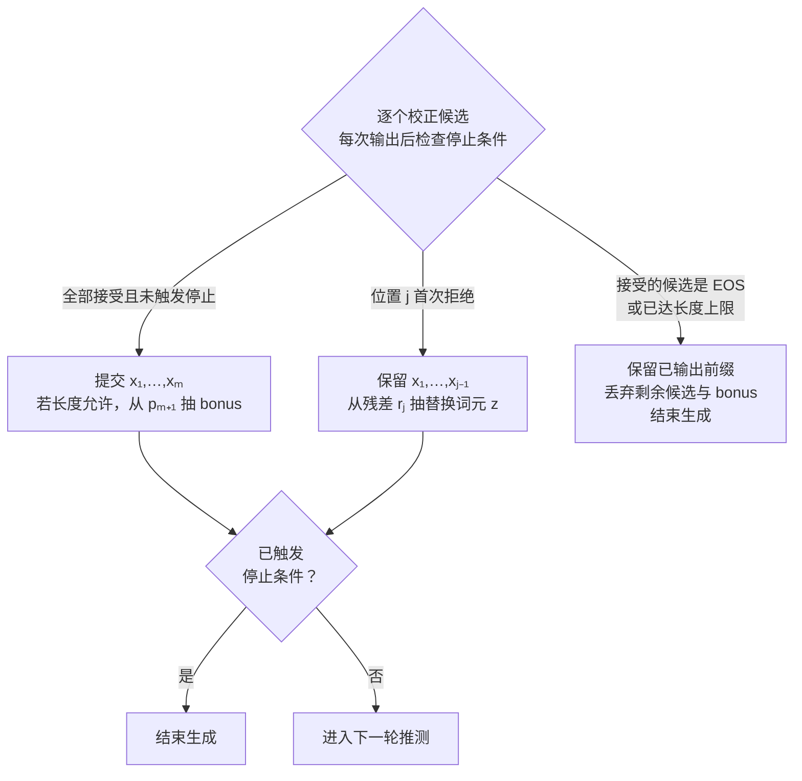
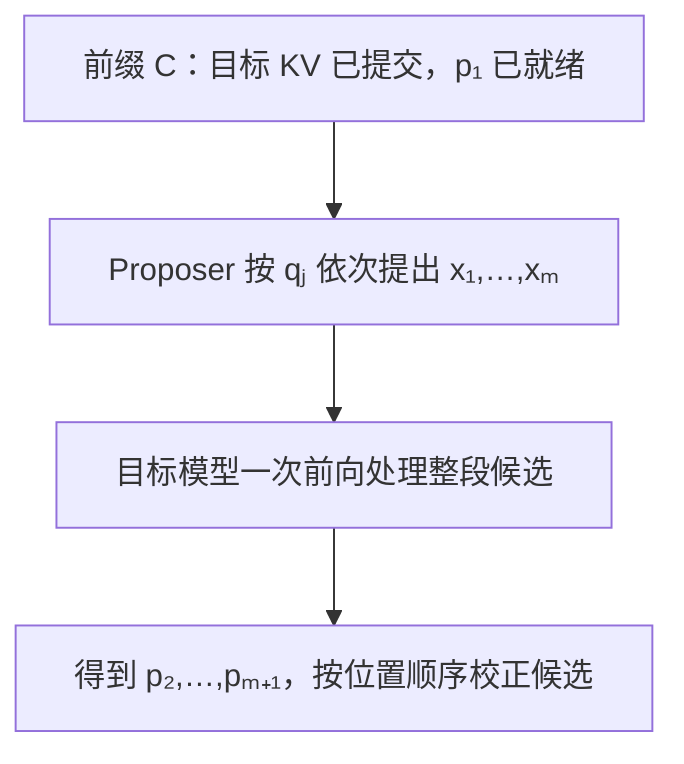
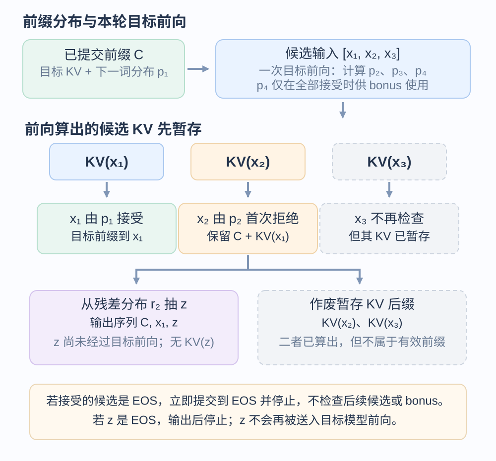

# 推测解码怎样加速又不改变输出分布？

[KV 缓存一章](kv-cache-and-serving-capacity.md)说明了 decode 为什么慢：每生成一个词元都要跑一次完整的目标模型前向，批量小时大部分时间花在从显存读权重上，而这些步骤只能一个接一个串行。Speculative decoding (推测解码)的思路是让一个便宜的 proposer (提议器)先猜出后面几个词元，再让目标模型用一次前向把它们一起检查完。

本章回答三件事：怎样接受或拒绝猜测，才能保证输出的概率分布和只用目标模型采样完全一样；一次前向怎样检查一整段候选，拒绝后缓存怎样回退；以及加速到底取决于什么，论文里的数字该怎样读。读者需要知道[模型怎样用 logits 和采样选出下一个词元](next-token-computation.md)，以及 KV 缓存一章的载荷公式。

## 推测解码对输出做了什么承诺？

先固定记号。已经处理并缓存的前缀记为 `C`。Proposer 依次提出候选 `x₁, x₂, …, x_m`，提出 `x_j` 时用的分布记为 `q_j`。目标模型在“`C` 加上已接受的 `x₁…x_{j−1}`”之后对下一个位置给出的分布记为 `p_j`。Proposer 可以是一个小的 draft model (草稿模型)，也可以是挂在目标模型上的附加模块（见下文 MTP）。

推测解码的契约是：**只要 `p_j` 是目标模型在实际采样设置（温度、top-k/top-p 等过滤）下的分布，输出序列的分布就与直接从目标模型逐个采样完全相同。** Proposer 猜得好坏只影响速度，不影响输出。

它不承诺更快。猜错了，目标模型为错误候选做的计算就白费了；proposer 自己也要花时间。

## 一个候选怎样接受或替换，才不改变分布？

从 `q_j` 抽到候选 `x` 时必有 `q_j(x) > 0`。以如下概率接受它：

$$
a_j(x)=\min\!\left(1,\ \frac{p_j(x)}{q_j(x)}\right)
$$

直观地说：目标模型认为这个词比草稿认为的更可能（`p ≥ q`），就一定接受；草稿高估了它（`p < q`），就按比例打折接受。

若拒绝，就从 residual distribution (残差分布)里重新抽一个替换词元：

$$
r_j(y)=\frac{[p_j(y)-q_j(y)]_+}{\sum_z[p_j(z)-q_j(z)]_+},
\qquad [u]_+=\max(0,u)
$$

残差只在草稿低估了的词上有质量，正好补上接受环节欠下的那部分。

**为什么加起来恰好是 `p_j`？** 对任意词 `y`，最终输出 `y` 有两条路：

- **草稿提出 `y` 并被接受。** 概率是 `q_j(y)·a_j(y) = min(p_j(y), q_j(y))`。若 `q_j(y) = 0`，草稿不会提出它，这一项是 0，也等于 `min(p_j(y), 0)`。
- **草稿提出某个词被拒绝，然后残差抽到 `y`。** 总拒绝概率是

$$
P(\text{reject})=\sum_{z:\,q_j(z)>0} q_j(z)\bigl(1-a_j(z)\bigr)
=1-\sum_z\min\bigl(p_j(z),q_j(z)\bigr)
=\sum_z[p_j(z)-q_j(z)]_+
$$

  所以这条路的概率是 `P(reject)·r_j(y) = [p_j(y) − q_j(y)]₊`。

两项相加：`min(p, q) + [p − q]₊ = p`。若残差的分母为零，说明 `p_j = q_j`，候选永远不会被拒绝，残差分支不会被用到。

顺带得到一个有用的量：一个候选被接受的概率是 `α = Σ_z min(p_j(z), q_j(z))`。草稿和目标越接近，`α` 越接近 1。

> [!example] 三个词的词表：把所有情形加总
> 设词表只有 `{A, B, C}`，没有 EOS。草稿分布 `q = (0.6, 0.3, 0.1)`，目标分布 `p = (0.3, 0.4, 0.3)`。
>
> 未归一化残差 `[p − q]₊ = (0, 0.1, 0.2)`，总和 0.3，所以替换分布 `r = (0, 1/3, 2/3)`。
>
> | 草稿提出 | 提出概率 | 接受概率 | 贡献给 A / B / C |
> | --- | ---: | ---: | --- |
> | A | 0.6 | `min(1, 0.3/0.6) = 0.5` | 接受：A 得 `0.6×0.5 = 0.3`；拒绝 0.3，按 `r` 分给 B `0.1`、C `0.2` |
> | B | 0.3 | `min(1, 0.4/0.3) = 1` | B 得 0.3 |
> | C | 0.1 | `min(1, 0.3/0.1) = 1` | C 得 0.1 |
> | **合计** | | | **A 0.3，B 0.4，C 0.3 = `p`** |
>
> 接受率 `α = 0.3 + 0.3 + 0.1 = 0.7`，拒绝率 0.3，正好等于残差总和。
>
> 注意不能只看一行：仅以“草稿提出了 A”为条件，输出是 A 的概率 0.5、B 1/6、C 1/3，这本身不是 `p`。只有把所有可能的提议加总，才回到目标分布。

## 一串候选怎样逐个验证，何时停下？

候选之间是串行依赖的：`x₂` 是在假设 `x₁` 成立时提出的。所以按位置顺序验证，在第一次拒绝处停下：

1. 依次用 `p₁, p₂, …` 校正 `x₁, x₂, …`。
2. 若 `x_j` 被拒，保留 `x₁…x_{j−1}`，从 `r_j` 抽一个替换词元，丢弃 `x_j` 及之后所有依赖它的候选。
3. 若全部 `m` 个候选都被接受，再从目标的下一位置分布 `p_{m+1}` 抽一个 bonus token (额外词元)。

停止条件在每输出一个词元后都要检查：被接受的候选是 EOS、替换词元是 EOS、bonus 是 EOS，或者达到长度上限，都立即结束本次生成，不再验证后续候选，也不抽 bonus。

Greedy decoding (贪心解码)下有一个更简单的变体：候选等于目标的 argmax 就接受，否则换成目标的 argmax。它是确定性规则，不是上面的随机接受与残差校正，但同样保证输出与目标模型单独贪心解码一致。

## 目标模型怎样一次前向算出所有校验分布？

校验 `x_j` 需要 `p_j`，而 `p_j` 是目标模型读完 `C, x₁, …, x_{j−1}` 后的输出。这些都可以在同一次前向里得到：

- `p₁` 来自前缀 `C` 最后一个位置，上一轮已经算好。
- 把整段候选 `[x₁, …, x_m]` 作为 `m` 个新位置一起送进目标模型。因果掩码让第 `j` 个候选位置只读 `C`、前面的候选和它自己。
- 于是第 `j` 个候选位置的输出就是 `p_{j+1}`。一次前向得到 `p₂, …, p_{m+1}`；其中 `p_{m+1}` 只在全部接受时供 bonus 使用。

这里的“并行”指多个候选位置在同一次前向里一起计算，和 prefill 一次处理多个提示词元是同一回事。目标模型仍为每个候选位置执行完整的各层 attention、FFN 和输出头，层与层之间仍按顺序算。省掉的是 `m` 次串行前向之间的等待：decode 受带宽限制时，一次读权重多乘几行几乎不加时间。

## 拒绝之后，哪些 KV 还有效？

目标前向在算 `p₂…p_{m+1}` 的同时，也为每个候选位置算出了 K/V。这些 K/V 只是暂存的：只有被接受的候选才属于有效前缀。

> [!example] 第一次拒绝发生在 `x₂`
> 已提交前缀 `C`，proposer 提出 `[x₁, x₂, x₃]`。目标前向为这三个位置算出了 `p₂, p₃, p₄` 和三份暂存 K/V。
>
> - `x₁` 由 `p₁` 接受；`x₂` 由 `p₂` 首次拒绝，从 `r₂` 抽到替换词元 `z`。`x₃` 不再检查。
> - 输出序列变成 `C, x₁, z`。
> - 目标 KV 保留 `C` 和 `x₁` 的状态。`x₂`、`x₃` 的 K/V 已经算出，但不属于有效前缀，要从逻辑缓存长度上回退或标记无效。
> - `z` 已经输出，但它没有经过目标模型前向，所以还没有 K/V。如果还要继续生成，下一轮把 `z` 和新候选一起送进目标前向，不需要单独多跑一次。
> - 若三个候选全被接受，提交到 `x₃` 的 KV；bonus 同样还没有 K/V。
>
> 底层物理块不一定立刻释放，但逻辑长度和下次读取的边界必须只覆盖有效前缀。Proposer 自己的缓存怎样回退，取决于引擎实现。

由此可以估出推测解码额外占用的显存。一轮最多提议 `m` 个候选时，每条序列在目标侧最多要为 `m` 个位置暂存 K/V；如果本轮还要处理上一轮留下的替换词元或 bonus，再加一个位置。用 [KV 缓存一章](kv-cache-and-serving-capacity.md)的配置（每词元 128 KiB），`m = 3` 时：

- 只算草稿位置：`3×128 KiB = 384 KiB` 每序列。
- 加上待处理的上一轮输出：`4×128 KiB = 512 KiB` 每序列。
- 32 条序列同时验证：约 `32×512 KiB = 16 MiB`。

换成 DeepSeek-V3 的 MLA 缓存，每词元载荷按 [DeepSeek 压缩注意力一章](deepseek-compressed-attention.md)核算为 70,272 字节，同样 `m = 3` 时上界为 `3×70,272 = 210,816` 字节（约 206 KiB），加一个待处理位置为 `4×70,272 = 281,088` 字节。

这些只是目标侧的 KV 数据载荷。峰值还要加 proposer 的状态、工作区、块尾空位和同批其他请求。容量不足时，要测引擎怎样应对：降低草稿长度、推迟请求还是回收缓存。按层混用压缩和窗口的模型，拒绝后要回退的不只是 K/V，还有压缩器尾块和窗口状态，见 [DeepSeek 压缩注意力一章](deepseek-compressed-attention.md)。

## 每轮能产出几个词元，什么时候值得？

每轮推测产出的词元数是“被接受的前缀长度 + 1”：这个 1 是拒绝时的替换词元，或全部接受时的 bonus。若暂不考虑 EOS 和长度上限，期望为

$$
1+P(x_1\text{ 接受})+P(x_1,x_2\text{ 都接受})+\dots+P(x_1,\dots,x_m\text{ 都接受})
$$

遇到停止事件时，后续候选和 bonus 不再产生，实际期望要按这些事件截断。

Leviathan 等人的分析做了一个简化：假设每个位置的接受率都是同一个 `α`、彼此独立。这时期望变成等比数列求和：

$$
E[\text{每轮词元数}]=\sum_{k=0}^{m}\alpha^k=\frac{1-\alpha^{m+1}}{1-\alpha}
$$

论文再设 proposer 跑一步的时间是目标模型的 `c` 倍，并假设目标模型同时处理 `m+1` 个位置不比处理一个更慢，得到期望墙钟加速比

$$
\frac{1-\alpha^{m+1}}{(1-\alpha)(m\,c+1)}
$$

> [!example] 用三词表的 `α = 0.7` 选草稿长度
> 沿用上面算出的 `α = 0.7`，取 `c = 0.05`：
>
> | 草稿长度 `m` | 每轮期望词元数 | 每轮相对成本 `m·c + 1` | 期望加速比 |
> | ---: | ---: | ---: | ---: |
> | 1 | 1.700 | 1.05 | 1.62× |
> | 3 | 2.533 | 1.15 | 2.20× |
> | 5 | 2.941 | 1.25 | 2.35× |
> | 8 | 3.199 | 1.40 | 2.28× |
>
> 草稿越长，后面的候选越难全部被接受（`0.7⁵ ≈ 0.17`），新增词元越来越少，proposer 的成本却线性增加，所以加速比先升后降。这里的数是在论文的理想假设下算出的；真实服务中，大批量时目标前向多处理几个位置并不免费，接受率也随位置和内容变化。

所以较长的草稿只在三件事同时成立时有用：前几个候选连续被接受的概率足够高；目标模型多处理几个位置的成本足够低（通常是低批量、受带宽限制时）；额外的暂存 KV 放得下。高并发、本来就受算力限制的服务，推测解码的收益可能很小甚至为负。

## MTP 模块怎样充当 proposer？

Multi-token prediction (多词元预测，MTP)原本是一种训练目标：在下一个词元之外，再让一个附加模块预测更远的词元，见 [MoE、mHC 和 MTP 分别改了 Transformer 的哪一块](architecture-variants.md)。训练好的 MTP 模块在推理时可以丢掉，也可以留下来当 proposer。

以 DeepSeek-V3 为例，它的 MTP 深度 `D = 1`，即一个附加预测模块。用作 proposer 时，一轮的分工是：

1. 目标模型在前缀末位置给出 `p₁`，从中按目标分布抽出 `x₁`。`x₁` 本来就服从目标分布，不需要校正。
2. MTP 模块接收末位置的 hidden state (隐藏状态)和 `x₁` 的 embedding，给出草稿分布 `q₂(·|C, x₁)`，提出 `x₂`。
3. 目标模型一次前向处理 `[x₁, x₂]`：`x₁` 位置的输出是 `p₂`，用来校正 `x₂`；`x₂` 位置的输出是 `p₃`，在接受时供 bonus 使用。

每次目标前向因此产出 `1 + P(x₂ 接受)` 个词元：接受时输出 `x₂` 和 bonus，拒绝时输出一个替换词元。这个 bonus 或替换词元就是下一轮的 `x₁`。

**训练深度不等于草稿长度。** `D = 1` 只说明训练时有一个预测模块，不限制推理时提几个候选。引擎可以把同一个模块递归使用：拿上一步 MTP 的输出状态和刚提出的候选，再提下一个。这样一个模块也能提出多个候选，但越往后，模块面对的输入越偏离它训练时见过的情形，连续接受的概率、目标计算、时延和暂存 KV 都要在目标引擎上实测。

> [!info] 实例：checkpoint 与 vLLM 的 MTP 路径（核对于 2026-11-25）
> DeepSeek-V3 官方 checkpoint 的 `config.json` 中 `num_nextn_predict_layers=1`，对应报告中的 `D = 1`。vLLM 当前的 DeepSeek MTP 实现在后续推测步继续使用前一步的隐藏状态，并按 `spec_step_idx % num_mtp_layers` 选择模块，所以一个模块可以循环提出多个候选。模型带有 MTP 权重，不表示任一引擎都支持或默认启用这条路径；接口、版本和草稿长度要按引擎确认。

## 论文里的加速数字该怎样读？

DeepSeek-V3 报告在其生成主题的评估中给出两个数：第二个词元的接受率为 85%–90%，解码 TPS (tokens per second，每秒词元数)约为原来的 1.8 倍。

按上一节的分工，每次目标前向产出 `1 + 0.85 = 1.85` 到 `1 + 0.90 = 1.90` 个词元。报告的 1.8× 略低于这个数，但报告没有拆分 MTP 模块的耗时、验证开销、batch 大小、硬件和采样设置，无法从中复算差距来自哪里。所以这两个数只说明在报告的设定下 MTP 推测有效，不能当作其他服务配置的加速承诺。

读任何推测解码的加速数字，都要问清四件事：接受率是在什么任务和采样设置下测的；加速比是单请求时延还是整体吞吐；批量多大、硬件是什么；proposer 的成本有没有算进去。自己部署时直接测：每轮平均接受的候选数、每轮目标计算量、proposer 成本、峰值暂存 KV 和拒绝比例，并在同一负载下对比开启与关闭时的 ITL 和吞吐。

## 推测解码只是 decode 慢时的一个杠杆

本章交出的是推测解码的完整账：输出分布由接受与残差规则保证，与 proposer 无关；速度由接受率、proposer 成本和目标前向多处理几个位置的代价共同决定；代价是额外的暂存 KV 和拒绝后的回退。它是 [KV 缓存一章的调优表](kv-cache-and-serving-capacity.md)中“decode 词元间隔长”那一行的一个选项，要和量化、限制并发等其他杠杆一起，用同一套负载测试比较。

> [!info]- 来源
> 三词表例子、草稿长度表和暂存 KV 上界均按文中列明的教学输入手算，不是实测。
>
> - **接受概率、残差替换与目标分布不变（“一个候选怎样接受或替换”“一串候选怎样逐个验证”）。** Leviathan, Kalman & Matias，[Fast Inference from Transformers via Speculative Decoding](https://proceedings.mlr.press/v202/leviathan23a.html)，ICML 2023（[arXiv v2](https://arxiv.org/abs/2211.17192v2)），§§2.1–2.3。
> - **接受率 `α = E[Σ min(p, q)]`、每轮期望词元数与墙钟加速比（“每轮能产出几个词元”）。** 同上，§3.1 Equation (1)（i.i.d. 接受假设下的期望词元数）、§3.2 Corollary 3.6、§3.3 Theorem 3.8（加速比，假设 `γ+1` 个目标位置并行处理不增加墙钟时间；`c` 为 proposer 与目标单步时间比）。
> - **DeepSeek-V3 的 MTP 结构与推测解码结果（“MTP 模块怎样充当 proposer”“论文里的加速数字”）。** DeepSeek-AI，[DeepSeek-V3 Technical Report](https://arxiv.org/html/2412.19437v2#S2.SS2)，arXiv v2，§2.2（MTP 模块）、§5.4.3（第二词元接受率 85%–90%、1.8× TPS）。
> - **MTP 深度与引擎实现。** DeepSeek-V3 官方 checkpoint [`config.json`](https://huggingface.co/deepseek-ai/DeepSeek-V3/blob/e815299b0bcbac849fa540c768ef21845365c9eb/config.json#L244-L251)，`num_nextn_predict_layers=1`；vLLM，[MTP 推测解码文档](https://docs.vllm.ai/en/latest/features/speculative_decoding/mtp/)与 [`deepseek_mtp.py`](https://github.com/vllm-project/vllm/blob/0085facc58dedeef757aca3f51d6508e2ef9b148/vllm/model_executor/models/deepseek_mtp.py#L191-L228)，按 `spec_step_idx % num_mtp_layers` 循环复用模块并递推前一步状态（核对于 2026-11-25）。
