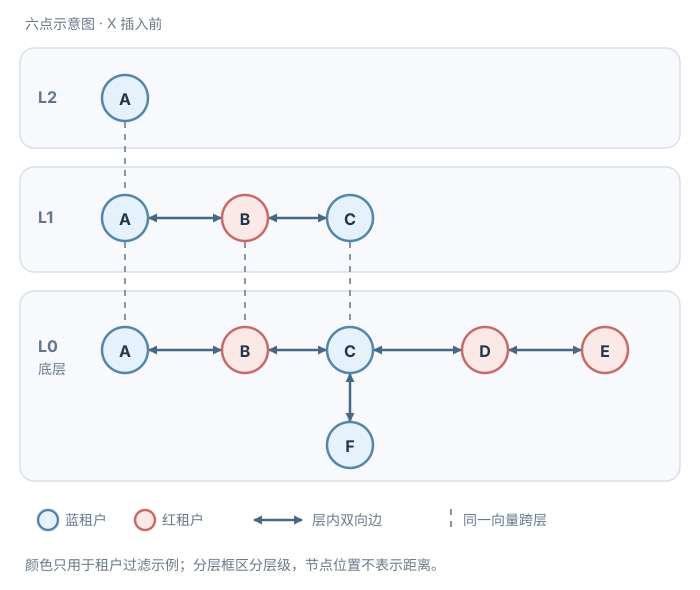

# HNSW 怎样逐层找近邻，怎样知道搜索得够不够？

HNSW（Hierarchical Navigable Small World，分层可导航小世界）是一种近似最近邻索引。它把向量连成多层邻接图：高层较稀疏，帮助快速跨过远距离；底层较密，帮助在局部细找。查询从最高层入口开始，在高层贪心地找下一层入口，在底层保留多个候选继续搜索。

“找到得够不够”要分清两件事：搜索在已探索的图区域里何时停止，以及结果对真实全局最近邻有多完整。HNSW 的停止条件只说明当前候选集没有值得继续扩展的节点；它不证明没有尚未探索的捷径，也不保证返回全局真正的最近邻。准确率要用同一数据集和同一查询上的精确搜索作参照，测召回率（recall）。

下面按原论文算法，用一个二维小图手算入图和查询过程。它展示算法状态，不代表任意数据都形成同样的边；后文再对照 pgvector 0.8.7 的参数与实现，二者的选邻居上限和剪枝选项并不完全相同。

## 先固定向量、距离和图

令查询点 `q=(0,0)`，所有距离都用欧氏距离。索引里有六个点：

| 点 | 坐标 | 到 q 的距离 | 最高层 | 颜色（仅用于后文租户过滤演示） |
|---|---:|---:|---:|---|
| A | (6, 0) | 6 | 2 | 蓝 |
| B | (3, 0) | 3 | 1 | 红 |
| C | (1, 0) | 1 | 1 | 蓝 |
| D | (0, 2) | 2 | 0 | 红 |
| E | (0, 4) | 4 | 0 | 红 |
| F | (0, 0.5) | 0.5 | 0 | 蓝 |

为方便复演，先假定这个玩具图的初始边都可双向遍历：L2 只有 A；L1 是 `A—B—C`；L0 有 `A—B—C—D—E`，并有 `C—F`。红色表示红租户、蓝色表示蓝租户，之后模拟共享图搜索再按租户过滤。图中同名节点代表同一向量在不同层出现；分层框区分层级，节点的位置不表示距离。高层节点也存在于其下方各层，但各层邻边独立选择；这里重复的 A—B—C 只是手算设置，高层某条边不必在底层重现。

实际图由插入顺序、随机层级、候选搜索和邻居筛选共同形成。它不一定像这张小图一样对称，也不一定每层都是一条链。

## 节点怎样选层、怎样插入

每个新向量插入时，先抽一个最高层。论文算法的随机最高层为 `floor(-ln(U) × mL)`，其中 `U` 在 0 与 1 之间均匀抽取，`mL` 是层级衰减参数；论文建议的一个简单取值是 `mL=1/ln(M)`。单个节点进入第 `h` 层及以上的概率为 `exp(-h/mL)`；采用该取值时，含 `N` 个节点的图在第 `h` 层的节点数期望为 `N/M^h`，因此整个图的最高层通常在 `log_M(N)` 附近。随机抽层只给节点一个起始高度，不代表它在该层的边已连好，也不保证每批数据的最高层恰好落在期望值上。

插入可分成四步：

1. 从当前入口点开始，在新节点最高层以上的层逐层贪心下降。每一步只移动到距离新节点更近的邻居；这些层用窄搜索快速接近。
2. 到达新节点能进入的最高层后，从该层向底层逐层做较宽的局部搜索，用搜索到的节点组成邻居候选。上层用 `ef=1`，每次只带最近入口点；新节点所在层及其下层用 `efConstruction` 控制候选集合 W 的宽度。上一层的整个 W 会作为下一层搜索的多入口，因此构建搜索会把多个有希望的点带到底层，而不是每层都从单一最近点重新开始。
3. 在每一层从候选中选择至多 `M` 个邻居，加入新节点的边，并把反向边也接回原节点。
4. 加入反向边后，如果原节点的连接数超过该层容量，才在原节点周围重新筛邻居。新边加入后，旧边可能被剪掉；因此最终图可出现 `A→B` 仍在而 `B→A` 已被移除的非对称边。若新节点层数超过旧入口，更新入口。

### 手算一次邻居选择与剪边

继续沿用上图，再插入 `X=(3.4,0)`。为固定例子，假设本次随机最高层为 1；当前图最高为 L2，旧入口是 A，`efConstruction=4`。在 L2 以 `ef=1` 搜索后，`W={A}`，再把最近点 A 作为 L1 入口。L1 的宽搜索从 A 沿 `A—B—C` 找到 `W={B,C,A}`；按 X 的距离为 B(0.4)、C(2.4)、A(2.6)，这组跨层候选 W 再作为 L0 搜索的入口。L0 搜索可发现 F(约 3.437)，最终候选为 `W={B,C,A,F}`；D(约 3.945) 比 F 更远，最后没有留在 W 中。设新节点每层从候选中最多选择 `M=2` 个邻居；本例的上层连接容量为 2，底层容量另按 `Mmax0=2M=4` 设置。

本例不启用扩展邻居候选或回填已剪候选的可选步骤，单独观察论文 Algorithm 4 的多样化选择规则。它不只是取最近的两个：按候选与 X 的距离由近到远检查候选 `c`；只有当对已有每个邻居 `e` 都有 `d(c,e) > d(X,c)` 时才接受 `c`。这里是严格大于：候选到已选邻居必须比候选到 X 更远，等距时不接受。若 `c` 更靠近一个已选邻居，而不是 X，就认为它可能代表重复方向，先跳过。

- B 距 X 为 0.4，先选入。
- C 距 X 为 2.4，但 `d(C,B)=2 < 2.4`，被跳过；它比 X 更靠近已选邻居 B。
- A 距 X 为 2.6，而 `d(A,B)=3`，满足严格条件 `3 > 2.6`，选入。

因此简单的最近邻前 M 名会选 B、C；多样化启发式则选 B、A，放弃与 B 挤在同一方向的 C。这个小例子展示规则差异，不证明启发式对每种数据都优于最近邻选择。

同样的多样化选择在 L0 从 `{B,C,A,F}` 中也选 B、A。新节点加上双向边后，B 在 L1 的原有邻居为 A、C，再加 X 后有三条边，超过上层容量 2，因而只重筛 B。以 B 为中心，X、C、A 到 B 的距离依次为 0.4、2、3。先保留 X；C 到 B 为 2，而到 X 为 2.4，满足严格条件 `2.4 > 2`，所以也保留 C；新邻居已达容量 2，算法结束，不再检查 A。B 的上层出邻居改为 X、C，删除 `B→A`。A 自己新增 X 后只有 B、X 两条边，正好达到容量而未超限，所以不触发重筛，原有 `A→B` 保留。B 在底层的旧邻居 A、C 加上 X 后共有三条边；底层容量为 4，未超限。以下只列出被影响的 L1 出邻居（一个节点指向谁）：

| 节点 | 插入前的 L1 出邻居 | 插入后的 L1 出邻居 |
|---|---|---|
| A | B | B、X |
| B | A、C | X、C |
| C | B | B |
| X | — | A、B |

此状态保留了 `A→B`，但已经没有 `B→A`。图结构变化由邻居列表体现，不要把它还原成“每条边永远双向”的假设。

此例为新节点每层从候选中至多选 `M=2` 个邻居；现有节点上层容量为 `Mmax=2`，底层容量另设 `Mmax0=2M=4`。一些实现会给底层较高容量：原论文算法使用单独的 `Mmax0`，实验中观察到 `Mmax0=2M` 是一个效果不错的设置；pgvector 0.8.7 的代码中底层最多 `2m` 条连接、上层最多 `m` 条，而且新节点选邻居也直接使用各层的这个上限，并会在未选满时回填被剪候选。因此上面的 `M=2` 手算和不回填设置用于解释论文机制，不能照搬为 pgvector 的逐步执行结果。

邻居启发式试图让边指向不同方向，保留跨区域导航的机会。它是构图策略，不是正确性证明；连边稀疏、数据分布变化或过滤选择性高时，查询仍可能错过近邻。

## 查询如何在图上扩展候选

查询从最高层入口开始。高层贪心搜索通常只记住当前最近节点：只要邻居比当前点更靠近查询，就移动过去，直到当前点没有更近的可走邻居，然后下沉一层。上层目的是迅速找到好的底层起点，并不试图列出所有近邻。

到第 0 层后，搜索维护两个集合：

- 候选队列 `C`：按查询距离从近到远取下一个要扩展的节点。
- 当前结果集合 `W`：最多放 `efSearch` 个已发现的最佳节点；它是结果池，不是候选队列的容量。请求 top-k 且至少有 k 个可见对象时，需令 `efSearch ≥ k`；本例取 `k=efSearch=3`。可见对象少于 k 时的召回分母见下一节。

实现通常分别用 min-heap（最小堆）维护 `C`、max-heap（最大堆）维护 `W`：前者快速取最近待扩展点，后者快速找到应淘汰的最远结果。还用 visited 集合避免重复检查同一节点。

每次从 `C` 取出最近候选 `c`。若它比 `W` 中最远的点还远，就停止。否则逐个检查 `c` 的未访问邻居 `e` 并标记为已访问；只有当 `W` 未满或 `d(e,q)` 小于 `W` 中最远距离时，才把 `e` 同时加入 `C` 和 `W`，并在 `W` 超量时踢掉最远者。不满足条件的邻居已访问，但既不进入 `C` 也不进入 `W`。被踢出 `W` 的节点仍可能留在 `C` 继续探索。`C` 为空时也会停止。停止只针对当前发现边界：它不是“已经看过图中所有点”，也不是全局最近邻证书。

### 查询队列逐步变化

以下查询回到插入 X 之前的初始六节点图；X 及刚才新增的边均不参与查询。假设上层搜索从 A 出发，在 L2 停在 A，在 L1 沿 `A→B→C` 走到 C；因此 L0 从 C 开始。令 `efSearch=3`，并固定 C 的邻边处理顺序为 B、D、F，以便复演“节点先入候选队列、后被 W 驱逐”的状态。把候选队列写成近点在左、远点在右，`W` 写成远点在左、近点在右：

| 步 | 动作 | 候选队列 C | 结果集合 W |
|---|---|---|---|
| 0 | 从 C 开始 | `[C(1)]` | `[C(1)]` |
| 1 | 依次检查 B(3)、D(2)、F(0.5)：W 未满时先收下 B、D；F 更近，进入 C 和 W 并把 B 从 W 踢出 | `[F(0.5), D(2), B(3)]` | `[D(2), C(1), F(0.5)]` |
| 2 | 展开 F；它的邻居 C 已访问 | `[D(2), B(3)]` | `[D(2), C(1), F(0.5)]` |
| 3 | 展开 D；E(4) 已标记为访问，但 W 已满且 E 比当前最远的 D(2) 更远，因此不进入 C 或 W | `[B(3)]` | `[D(2), C(1), F(0.5)]` |
| 4 | 弹出 C 中最近的 B(3)；它比 W 最远的 D(2) 更远，触发停止，不扩展 B | `[]` | `[D(2), C(1), F(0.5)]` |

返回时按距离升序排列 W：F(0.5)、C(1)、D(2)。B 先进入过 W，后来被 F 挤出，但仍留在 C；弹出 B 时，C 中已经没有更近的候选，而 B 比 W 最远点 D 还远，因此停止。在另一些图上，B 的邻居可能通向尚未发现的近点；停止条件只检查当前候选边界，不代表路径之外的点都已排除。

## 近似如何量出来

在同一份合法、可见的数据集合上穷举距离，得到精确 top-k 集合 `T_k(q)`；再测 HNSW 返回的集合 `A_k(q)`。当可见对象至少有 k 个时，常用计算为：

`Recall@k = |A_k(q) ∩ T_k(q)| / k`

距离相同的点在精确集合与近似返回集合里都按稳定唯一 ID 排序打破平局，以固定 top-k 口径。令合法可见对象数为 `n`、`k'=min(k,n)`，当 `n>0` 时用 `|A_{k'}(q) ∩ T_{k'}(q)| / k'` 计算索引召回率；如果 ANN 过滤后返回少于 `k'` 个，分母仍为 `k'`，缺失结果计为漏召回。当 `n=0` 时召回率无定义，单独报告空的合法集合。该指标衡量 ANN（Approximate Nearest Neighbor，近似最近邻）漏掉了多少本应靠前的向量。若图上不带过滤条件，`n≥3` 且 `k=3` 时本例 `T_3={F,C,D}`，`efSearch=3` 得到 `A_3={F,C,D}`，召回率为 3/3。这个巧合只说明固定小图的这次手算结果，不说明 efSearch=3 一般足够。

过滤会改变问题。假设查询限定 `tenant_id=red`。计算精确参照时，先把数据限制在红租户的合法集合，再按距离排序：红色精确前两名是 D(2)、B(3)，所以 `T_2^red={D,B}`。下表在可信检索层内部模拟共享图搜索后按租户筛 `W`；这些未授权候选不能发送到外部重排服务或模型：

| efSearch | 图搜索结果 W（距离升序） | 过滤后 | 对精确红色 top-2 的 Recall@2 |
|---:|---|---|---:|
| 3 | F, C, D | D | 1/2 |
| 4 | F, C, D, B | D, B | 2/2 |

这正是过滤后结果不足的来源之一：近似扫描先找到的有限候选可能大多不符合过滤条件。即便提高 efSearch，本例的完整结果也只是图和参数固定后的观察。

这里的索引召回率只量“近似结果与精确向量近邻有多一致”。如果精确搜索本身也找不到人工标注的证据，先检查分块、embedding 与距离契约；若精确搜索的证据召回高而近似结果低，再调整图和扫描参数。调大 `efSearch` 不能修复不合适的向量表示。证据召回的分母与多证据问题见 [RAG 评估](rag-architecture-and-implementation.md#评估离线证据、线上行为与回答质量)。

## 参数影响哪一段工作

参数名会因库而不同。下表把 HNSW 概念与 pgvector 0.8.7 的名称对应起来；这些版本默认值是起点，不是通用最佳值。

| 参数阶段 | 参数与作用、增大后的常见权衡 |
|---|---|
| 连边规模 | 论文的 `M` 控制新点每层选择的邻居数，已有节点容量另用 `Mmax/Mmax0`。pgvector 的 `m` 对应规模参数，但其新点和已有点均采用上层 `m`、底层 `2m` 的上限。增大后通常图更密、存储和距离计算更多；召回收益需实测。 |
| 构建宽度 | `efConstruction`（pgvector 的 `ef_construction`）控制构建/插入时收集多少候选再选邻居。增大后建图更慢、插入开销更大；通常有机会形成更好的导航边，后续召回可能提高。 |
| 查询宽度 | `efSearch`（pgvector 的 `ef_search`）控制每次查询的底层结果集合 `W` 容量；候选队列 `C` 没有这个硬容量。增大后查询工作和延迟增加，通常有机会提高召回；结果仍可能漏掉全局近邻。 |

pgvector 0.8.7 对应的名称分别是 `m`、`ef_construction`、`ef_search`。README 默认值为 `m=16`、`ef_construction=64`、`ef_search=40`；该版本源码将三者范围分别限定为 2–100、4–1000、1–1000，并要求建图候选数至少为 `2*m`。其他向量库、pgvector 其他版本和不同资源约束可能不同。调参应在固定数据快照、查询集、过滤条件和可见范围上同时看召回、95 百分位（P95）延迟、内存、索引大小、构建与写入成本，而不是只看单次查询。

## 过滤、权限与删除

查询前先确定调用者的授权和版本范围。在 pgvector 0.8.7 中，共享近似索引的内部图扫描可能先遍历候选，随后才应用 SQL `WHERE` 条件。这描述的是索引内部顺序；未经授权的候选不得离开可信检索边界。可信数据访问层必须在候选返回应用或送往外部服务前执行授权校验。过滤值很稀少时，扫描到的候选可能大部分被丢弃。例如 README 说明：当条件约命中 10% 行且 `ef_search=40` 时，平均只剩约 4 条符合条件的行。此比例来自其说明场景，不是每个库或每个查询都相同。

对少数离散过滤值，可考虑部分索引；对很多类别值，可考虑按过滤字段分区。pgvector 0.8.0 起支持 iterative scans（迭代扫描），可在初次近似扫描后继续扫描，直到得到足够行数或达到扫描上限；`strict_order` 保持距离排序，`relaxed_order` 允许结果略微偏序，以换取更好的召回。要更改扫描参数，需按当前部署版本查看文档。共享索引中过滤后候选不足，会影响每个租户的召回与延迟；SQL 条件会筛选结果，但不能单独提供强租户隔离。独立分区或索引用于物理划分，数据访问层仍须执行租户授权；无法在可信边界内完成过滤时，不应把共享图的候选送出。

删除也要区分“撤销可见性”和“清理索引空间”。在 pgvector 0.8.7 的常规路径中，`DELETE` 会产生死元组；HNSW 的 `VACUUM` 会清理旧 heap TID（堆表行地址）并修复图，可能耗时。README 提到先 `REINDEX INDEX CONCURRENTLY` 再 `VACUUM` 可加快这类维护。维护完成前，死元组和过滤条件也可能让结果数不足；迭代扫描有时能补足可见结果，但不能替代正确的删除维护。

内容权限撤销必须由权威 access control list（访问控制列表，ACL）决定：查询前确定当前权限与版本范围；共享图内部可能先遍历再筛选，但可信检索层必须在候选离开权限边界前应用授权。还要在把候选送到外部重排模型或生成模型之前再次确认权限和版本。物理分区或独立索引可缩小数据范围，不能替代数据访问层的租户授权。不能等向量索引清理后才停止暴露。向量库的 VACUUM/重建描述的是 pgvector 0.8.7 的实现行为，不是所有 HNSW 服务的删除或擦除保证；敏感数据还需核对服务商的缓存、备份、保留与清除承诺。

## 怎样做一次可信的质量检查

1. 固定数据、向量模型版本、距离度量、查询文本、过滤条件和 ACL 快照；精确结果与 HNSW 结果必须在相同可见集合内比较。
2. 先报告 `Recall@k` 和过滤后的有效结果数，再报告延迟、构建时间、索引体积、内存及更新成本。需要足量结果时，单独测过滤后的 Recall@k，别只汇报未过滤结果。
3. 覆盖稀有过滤值、长尾查询、重复向量、刚删除/刚撤权文档，以及索引重建或版本切换后的查询。抽样核查结果是否来自当前有效版本。
4. 小幅调整 `M`、`efConstruction`、`efSearch` 或过滤扫描上限，再用相同查询集重测。若要提高召回，成本可能出现在索引构建、每次查询、内存和过滤选择性上；把这些指标放在同一张结果表里作决策。

用途也决定错误代价。CI 手册检索漏掉断言失败条款，可能导致错误建议；近重复文本去重则要用相似度阈值与进一步核验判断重复对，漏检会留下重复，误报会错误合并不同内容。两者不能直接共用一个 top-k 召回门槛。

## 接下来怎样接到 RAG

HNSW 解决“从向量图里较快找到一批候选”的问题，不负责判断文档版本是否当前、调用者是否有权查看、段落能否支持答案或引用是否准确。RAG 流程应在索引召回前确定权威版本与可见范围，在重排和生成前再核验权限，并把 ANN 召回率与证据召回率、答案支持率分开评估。完整流程见 [RAG 架构与实现](rag-architecture-and-implementation.md)。搜索延迟和缓存收益可继续放进[每个成功任务的时延与成本](../systems/ai-latency-and-cost-optimization.md)比较；生成向量的请求还受[模型调用配额与截止时间](../systems/bounded-model-api-calls.md)约束。

> [!info]- 来源与实现边界
> - Malkov & Yashunin, [Efficient and robust approximate nearest neighbor search using Hierarchical Navigable Small World graphs](https://arxiv.org/pdf/1603.09320v4), arXiv v4（2018-08-14） §3、§4.1 与 Algorithms 1–5：Algorithm 1 说明插入时跨层搜索与把上一层候选继续带往下层；Algorithm 2 说明候选队列、结果集合和停止条件；Algorithm 4 给出多样化邻居启发式；Algorithm 5 是分层查询；§4.1 的 `mL=1/ln(M)` 与 `Mmax0=2M` 是论文评测中的参数建议，不是所有实现的保证。
> - pgvector [0.8.7 README：HNSW](https://github.com/pgvector/pgvector/blob/v0.8.7/README.md#hnsw)：特定版本的参数、过滤条件与 iterative scans、维护建议。
> - pgvector 0.8.7 实现：[hnsw.h 参数范围](https://github.com/pgvector/pgvector/blob/v0.8.7/src/hnsw.h#L53-L62)、[底层与上层连接容量](https://github.com/pgvector/pgvector/blob/v0.8.7/src/hnsw.h#L126-L130)、[hnswutils.c 随机层级](https://github.com/pgvector/pgvector/blob/v0.8.7/src/hnswutils.c#L245-L255)、[建图候选数的组合约束](https://github.com/pgvector/pgvector/blob/v0.8.7/src/hnswbuild.c#L716-L719) 和 [hnswvacuum.c 删除维护](https://github.com/pgvector/pgvector/blob/v0.8.7/src/hnswvacuum.c#L779-L794)。
> - pgvector 0.8.7 [新点按层容量选择邻居](https://github.com/pgvector/pgvector/blob/v0.8.7/src/hnswutils.c#L1322-L1357)及[回填被剪候选](https://github.com/pgvector/pgvector/blob/v0.8.7/src/hnswutils.c#L1154-L1156)：用于区分本章论文手算与具体库的执行行为。
