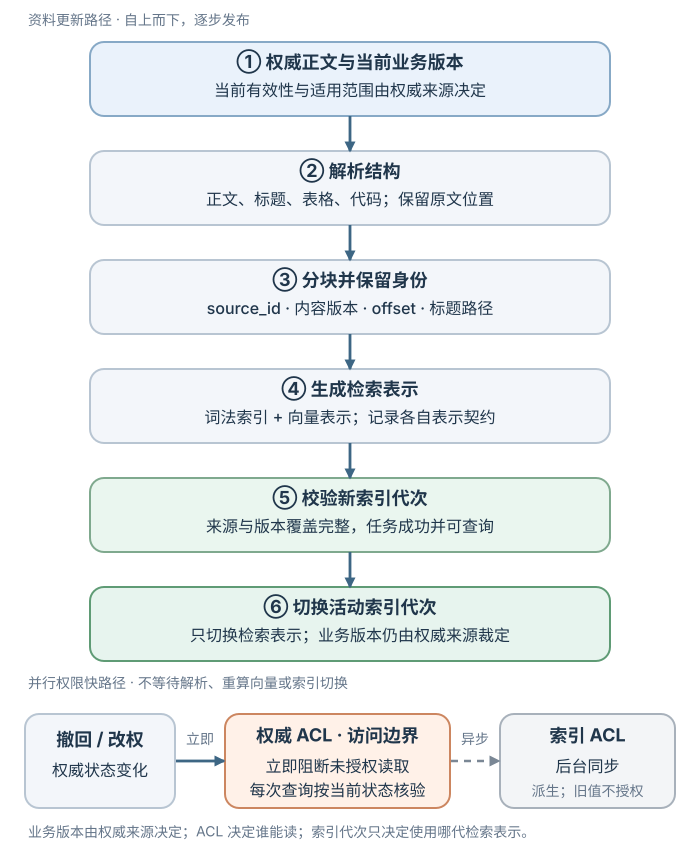
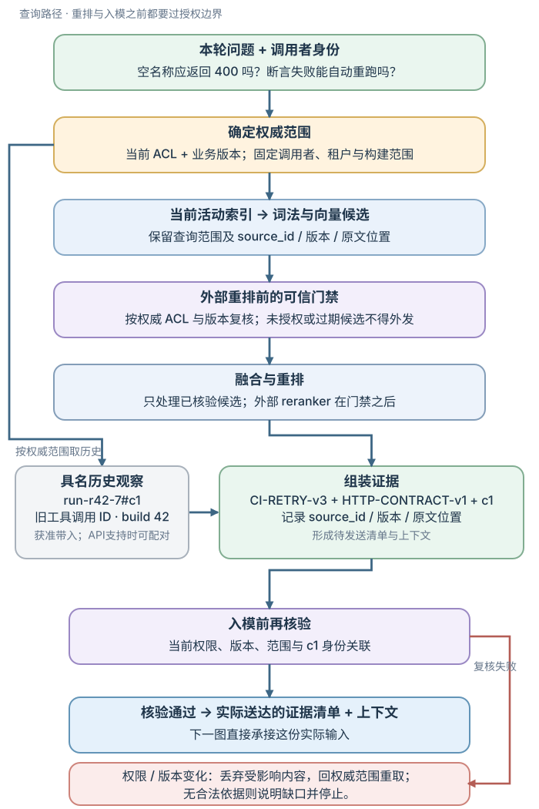
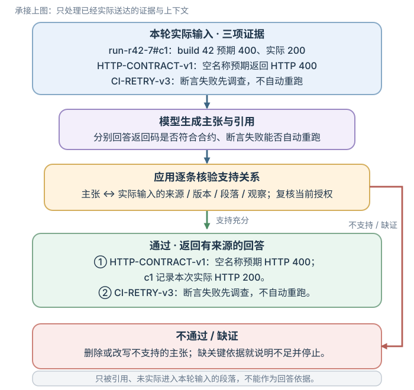

# 怎样从授权文档中检索并核验回答依据？

Retrieval-augmented generation（检索增强生成，RAG）让模型在本轮回答时使用外部资料。RAG 不是把向量库接上模型就结束：系统还要确定调用者能读哪些来源、取回适用版本、把足够完整的证据装入上下文，并核验每条回答主张。检索命中、来源获授权、证据支持答案是三个不同条件。

案例背景：一位开发者在查看构建 42 的失败测试。上一轮 `run-r42-7` 已执行 `read_build_log`，调用 ID 为 `c1`。它的日志结果显示：构建 42 的 `reject_empty_name` 在 `unit-tests` 中预期 HTTP（超文本传输协议）`400`、实际得到 `200`，进程退出状态为 `1`；这是一次预期与实际响应不符的断言失败。本章沿用这条日志，考察一个同时需要两类文档的追问：“空名称请求预期返回 `400` 对吗？按当前 CI 手册，该构建应该自动重跑吗？”

应用从权威运行记录取回 `run-r42-7#c1` 的已完成调用与结果，先检查调用者访问权和 `build_id=42` 的绑定，再把它作为具名历史观察带入本轮；如果当前接口接受历史工具调用与结果的配对，也可保留这种形式。`c1` 始终指向旧调用，不会因被引用而重跑；本轮是否开放 `read_build_log` 的 schema（工具定义），由新的需求与权限单独决定。若旧观察不可访问或绑定无法核实，应说明缺少构建日志依据。

以下 `CI-RETRY-v3`、`HTTP-CONTRACT-v1`、`CI-TEST-v1` 是为解释流程而虚构的通用文档。日志说明“这次发生了什么”，文档说明“当前规则是什么”。上一轮日志的取得过程见[从一条消息到完整回答](../systems/from-message-to-answer.md)，历史观察的输入形式见[上下文工程](../context/context-engineering-principles.md)。

## 从权威来源到可回答上下文

索引更新与每次查询使用两条相连的路径：资料更新时解析并建索引；查询时先确定权威版本和权限，再检索、重排、组装并核验。索引完成时间不等于授权生效时间，删除和撤权也不能只靠异步索引任务保障。



资料路径的产物是一代带来源和版本身份的可检索表示。权限变更直接进入权威授权状态，不能等它经过分块、重算 embedding（嵌入向量）和索引重建才生效。



这次构建查询沿着上图的查询路径。应用先用调用者身份和构建范围读取权威来源目录，确定哪些 CI 手册版本有效；同时从授权的既有运行记录上下文取得 `c1`，验证它绑定 `build_id=42`。之后从当前有效且可见的手册版本检索。旧片段即使仍留在索引中，也不能作为当前版本证据；未经授权的片段不能发给外部重排服务或模型。生成前要复核实际将发送的全部上下文，包括 `c1` 和检索段落，处理检索期间发生的权限或版本变化。到这里，产物才是实际送达模型的证据清单与上下文。下一张图从这份输入继续：模型生成主张与引用，应用检查每条主张是否真的得到输入证据支持。



检索阶段拿到一个相关片段，并不等于答案已经正确。实际回答还要区分规范与观察：HTTP 合约规定应返回 `400`，`c1` 记录本次得到 `200`，CI 手册决定这种断言失败不能自动重跑。下面依次展开资料身份、分块、检索与支持关系检查。

## 版本、有效期和授权先于相关性

每个 chunk（文档块）至少保留可追溯的来源标识、内容版本、有效期或生效时间、适用范围、标题路径和原文位置。版本号或时间值应由权威来源给出；索引任务 ID、建立时间和状态则记录检索表示是否完成。两类状态不要混成一个“已索引”标记。

本章用下面这组虚构资料固定讨论对象：

| 来源 | 权威状态 | 段落内容 |
|---|---|---|
| `CI-RETRY-v3#assertion-failure` | 当前，2026-10-01 生效 | 只可重试网络或工作节点中断；断言失败必须先调查，不自动重试。 |
| `CI-RETRY-v2#retry` | 已撤回，2026-10-01 前有效 | 旧版本允许任何失败构建重试一次。 |
| `HTTP-CONTRACT-v1#empty-name` | 当前 | 空名称请求应返回 HTTP `400`。 |
| `CI-TEST-v1#diagnosis` | 当前 | 检查失败测试、输入、预期与实际响应，并沿请求路径调查。 |

本次问题有两项需要外部依据的判断：预期 `400` 是否符合空名称 HTTP 合约，以及断言失败是否应自动重跑。因此需要当前 `HTTP-CONTRACT-v1` 和 `CI-RETRY-v3`；`c1` 只提供这次运行实际发生了什么，不能代替规范。

新增或修改正文时，可按以下顺序发布：读取权威版本、适用范围和 access control list（访问控制列表，ACL）；解析结构并重新分块；生成或更新词法表示与向量；检查新版本索引已就绪；再切换查询使用的索引代次。这个切换只表示哪代检索表示可用，不决定资料的业务有效版本；当前版本和适用范围始终由权威来源决定。若权威来源中的 v3 已生效，但新索引还未就绪，可在同一授权检查下直接读取 v3，或明确说明当前版本暂时没有可检索依据；不能因索引滞后而把已撤回的 v2 当作当前资料。索引代次和权威版本应分别记录状态。

权限与内容分开维护。若只改变读取权限，文本向量通常无需重新计算；权威 ACL 必须立即更新，并由应用访问边界即时阻止未授权读取。随后尽快同步派生索引中的权限元数据，但同步期间绝不能把旧索引权限当作授权依据。每次查询都按当时的权威 ACL 过滤，并在内容送到外部重排服务或生成模型之前复查。删除来源时，要同时安排搜索索引和缓存派生数据的清理。托管检索服务可能异步处理新增，也可能在删除后短暂返回旧内容；OpenAI Retrieval 文档说明其向量存储删除是最终一致的。这是该服务的行为例子，不代表其他数据库。若有即时撤权要求，必须由应用访问边界先行执行，不能等索引自然收敛。

`tenant_id`、区域、文档状态和版本等元数据能表达过滤条件，但过滤有效的前提是写入正确、查询不可绕过、权限来自可信调用者上下文，并按权威状态复核。不能为了凑足 top-k（前 k 个候选）而放宽访问权限或版本条件。

访问控制与近似索引的内部遍历次序也不同。pgvector 0.8.7 的近似索引会在扫描候选之后应用 SQL（结构化查询语言）`WHERE` 条件；过滤比例低时，最终符合条件的返回数和召回率可能下降。共享索引中过滤结果、分数或时延也可能暴露其他范围数据的存在。需要强隔离时，应按租户或信任域分离分区、索引或表，并在数据访问层验证范围；SQL 条件本身不是完整隔离。可评估提高扫描量、迭代扫描或在小授权集合上精确搜索是否能满足召回与延迟，但所有路径都应在授权范围内执行。细节见[分层可导航小世界（HNSW）逐层近邻搜索](hnsw-vector-index-search.md)。

> [!warning] 文档内容是数据，不是系统指令
> 未授权或已撤回的段落不能放进提示词。文档里即使写着“忽略上面的指令”，也只是待检索和解释的数据，不能改写系统规则、授予访问权限或批准工具动作。运行时的控制见[AI 生产安全](../safety/ai-safety-in-production.md)。

## 分块要保留问题所需的限定关系

Chunking（分块）把长资料拆成可以排序的小单元。块太小可能把标题、例外、适用条件切走；块太大则会稀释匹配信号、占掉上下文预算。重试规则必须保留“断言失败不得自动重跑”，仅命中“网络或工作节点中断可重试”不足以回答本例。

| 方法 | 怎样切 | 合适的起点 | 代价或风险 |
|---|---|---|---|
| 定长 | 按字符或分词器词元数切到上限，可设置相邻重叠。 | 有一致文本输入、需要可重复基线时。 | 容易截断标题、表格行、代码语义或例外。 |
| 递归 | 按段落、换行、句子、空格等分隔符逐级拆分。 | 有自然分隔符的一般文本。 | 长度受分隔符影响，边界未必等于主题边界。 |
| 结构感知 | 依据标题、页面、表格、代码结构或段落标记分组。 | 源格式明确表达条件、字段关系或层级时。 | 依赖解析质量；过长结构仍需二次拆分。 |
| 语义分块 | 根据句子或段落的表示相似度估计主题边界。 | 结构边界不够且离线评估显示收益时。 | 增加建索引计算；需要维护模型和边界阈值。 |

**先核对长度单位。** 字符数和 tokenizer（分词器）产生的 token（词元）数不可互换。LangChain 当前示例用 `RecursiveCharacterTextSplitter`，设置 `chunk_size=1000` 和 `chunk_overlap=200`，长度函数按字符计，并可在每个 `Document.page_content` 中保存字符偏移；这是该教程的例子，不是通用最佳值。OpenAI Retrieval 当前文档的托管向量存储默认最多 800 token、相邻块重叠 400 token；这是另一个服务的 token 配置，不能与 1000 字符比较为等长。

```python
from langchain_text_splitters import RecursiveCharacterTextSplitter

# documents 是已解析并带有来源元数据的 Document 列表
splitter = RecursiveCharacterTextSplitter(
    chunk_size=1000,       # 该教程示例按字符计
    chunk_overlap=200,     # 目标重叠量，实际值可能不同
    add_start_index=True,  # 记录在每个输入 Document.page_content 内的偏移
)
chunks = splitter.split_documents(documents)
```

`add_start_index` 记录在原 `Document.page_content` 内的位置；若每页作为独立 Document 输入，还要保留对应的 `page` 元数据。递归切分中的 `chunk_overlap=200` 是目标值，不保证任意相邻块恰好重叠 200 字符。重叠可能保住边界附近语境，也会重复索引内容、增加存储与召回重复项；它应作为评估参数，而不是默认修复。

切块策略必须用带人工证据标注的查询集比较，并检查标题与限制条件是否仍同块、复合问题所需段落能否共现、重复块是否挤占 top-k。关于结构感知、语义分块和重叠，2025–2026 的研究结论并不一致：一个方法在所测基准上提高检索和回答；另一项分析认为其语义切分计算成本未由稳定收益抵偿；一项特定 SPLADE / Natural Questions 实验中 10–20% 重叠没有改善 BERTScore 或 exact match。它们共同支持“按目标语料实测”，不支持一个跨模型、跨任务的统一块大小。

## 相同文本入库时如何复用向量

分块后的文本经编码器变成向量，供后面的相似度检索使用。重建索引、重试任务或多个来源包含相同片段时，同一编码输入可能重复出现。

Embedding cache（嵌入缓存）保存的是“在某个编码输入和模型契约下算出的向量”，避免重复请求。它不是查询结果缓存，也不把不同来源身份、版本、片段或授权状态合并。

以虚构的 `CI-RETRY-v3#assertion-failure` 为例。调用方先按固定版本完成标题、模板、动态字段拼装及预处理，并将实际送给编码器的完整文本传为 `canonical_text`。只有最终编码输入字节和编码契约都一致，缓存向量才能复用；正文相同而标题前缀不同，输入已不同。应用可将缓存键规范为：

~~~text
text_digest = HEX(SHA256(UTF8(canonical_text)))
K = HEX(SHA256(UTF8(JSON_ARRAY(
  cache_format_version,
  cache_scope,
  provider,
  endpoint,
  model_revision,
  input_role,
  output_dimension,
  text_canonicalization_version,
  preprocessing_version,
  normalization_version,
  text_digest
))))
~~~

这里的序列化契约是：字段顺序固定；所有槽位均编码为字符串，维度用十进制字符串，缺省的可选值用空字符串且不省略槽位；使用紧凑 JSON（分隔符 `,` 与 `:`，无空白），非 ASCII 字符按字面 Unicode 编码，不作 ASCII 转义，之后按 UTF-8 编码。内层与外层 SHA-256 摘要都写成小写十六进制。Python 示例中的 `JSON_ARRAY` 对应 `json.dumps(..., ensure_ascii=False, separators=(',', ':'))`。这里是应用的缓存契约，不是提供方规定；不要额外 trim 或做未列入版本号的 Unicode 规范化。若服务同名模型别名会更新，应在 `model_revision` 中记录可区分的版本或部署代次。模型版本、查询/文档角色、维度、文本规范化、预处理或归一化变化都要使键改变。角色对于不对称双编码器尤其重要；即使同一个接口暂时接受两类文本，也不应默认语义任务相同。若向量服务提供可选维度，维度必须进入契约并对应到独立索引代次。

> [!example]- 按上述契约构造缓存键的 Python 实现
> 以下 Python 函数假设调用方已经完成上述文本构造、清理和分块；它检查字段类型并构造键，不会自行规范化正文、识别标题，或验证来源授权、模型版本和维度是否符合服务契约。
>
> ~~~python
> import hashlib
> import json
>
>
> def embedding_cache_key(
>     *,
>     scope,
>     provider,
>     endpoint,
>     model_revision,
>     role,
>     dimensions,
>     canonicalization,
>     preprocessing,
>     normalization,
>     canonical_text,
> ):
>     string_fields = (
>         scope,
>         provider,
>         endpoint,
>         model_revision,
>         role,
>         canonicalization,
>         preprocessing,
>         normalization,
>         canonical_text,
>     )
>     if any(not isinstance(value, str) for value in string_fields):
>         raise TypeError("cache contract fields must be strings")
>     if dimensions is not None and (
>         isinstance(dimensions, bool) or not isinstance(dimensions, int)
>     ):
>         raise TypeError("dimensions must be an integer or None")
>     text_digest = hashlib.sha256(canonical_text.encode("utf-8")).hexdigest()
>     fields = (
>         "embedding-cache-v1",
>         scope,
>         provider,
>         endpoint,
>         model_revision,
>         role,
>         "" if dimensions is None else str(dimensions),
>         canonicalization,
>         preprocessing,
>         normalization,
>         text_digest,
>     )
>     encoded = json.dumps(
>         fields,
>         ensure_ascii=False,
>         separators=(",", ":"),
>     ).encode("utf-8")
>     return hashlib.sha256(encoded).hexdigest()
> ~~~

相同向量值可复用，但索引中的来源记录保持独立：

| 数据 | 例子 | 命中相同缓存时怎样处理 |
|---|---|---|
| embedding 缓存 | 缓存键、向量、模型契约版本、生成时间 | 可复用向量值。 |
| 文档块索引 | `source_id`、`chunk_id`、版本、标题路径、原文偏移 | 每个来源和版本各自记录。 |
| 授权和删除状态 | 租户、ACL 版本、可见范围、撤回状态 | 独立检查和更新，不能从缓存继承。 |

如果两份公开规则经过全部标题、模板和动态字段拼装后送给编码器的字节相同，且缓存范围、模型、角色、维度和预处理版本相同，可以共用向量值；两条索引记录仍保留各自 `source_id`、版本、段落位置和授权。某来源已授权，不会使另一来源自动获得读取权限。

若改版后最终编码输入不变，可复用向量，同时创建新的版本化索引记录；若输入文本变化，则摘要不同而需要重新编码。只更新 ACL 时，向量表示可不变，但权威 ACL 必须立即阻止未授权读取，后台再更新索引元数据。模型或表示契约变化时，建立并验证新索引后再切换，不能把不同编码空间的向量混在一起。

向量是派生数据，不能假定它没有敏感性。对敏感语料，可使用密钥化摘要降低低熵文本被字典猜测的风险，日志只记录不透明键或截断指纹；仍须按原文的授权、删除和保留策略处理缓存与索引。撤权或删除时应处置相应向量和缓存记录，缓存命中不代表可跳过删除流程。

可通过 `cache_hit`、模型契约版本和索引任务 ID 记录实际命中，比较节省的 API（应用程序编程接口）请求、输入 token 和建索引时间，再扣除缓存读写开销。缓存未命中仍受[有界模型 API 调用](../systems/bounded-model-api-calls.md)的配额、重试和截止时间约束；写入近似向量索引后，还需按 [HNSW 搜索](hnsw-vector-index-search.md)检查过滤和召回。

## 词法、向量和混合检索怎样互补

**Lexical retrieval（词法检索）**按分析后的词项和相关性查找，BM25（常用的词法相关性排序方法）是常见基线。它通常对错误标识符、状态码和特定名称有帮助。查询里的 `reject_empty_name` 或 HTTP `200` 应保留为可查询的精确字段；BM25 是排序机制，不等于数据库中的原样字段匹配或唯一键查找。

**Dense retrieval（稠密检索）**把查询和段落编码成 embedding（嵌入向量），按相似度找含义接近的内容。它可能找出措辞不同的规则，例如用户写“响应不符合约定”，手册写“空名称应返回 400”。查询与文档表示需要属于兼容契约：输入形式、模型训练方式、维度和预处理要匹配。双编码器可以分别编码查询和段落，如 Dense Passage Retrieval（DPR，稠密段落检索）；不能仅因两侧都是向量就假定它们兼容。选择表示时，应比较目标语种、文档与查询格式、输入上限、隐私部署、延迟、费用及目标语料上的召回；变更文档侧编码模型、维度或预处理通常需要为新表示重编码并建新索引代次。模型服务支持缩短维度时，降维也需在同一数据和查询集上评估准确率、存储及速度，不可混接新旧空间。

给非零的查询向量 $q$ 和块向量 $d$，余弦相似度为：

$$
\operatorname{cos}(q,d)=\frac{q\cdot d}{\lVert q\rVert\lVert d\rVert}.
$$

例如 $q=(1,0)$、$d=(2,0)$ 时，点积是 2，余弦是 1：两向量同向，但点积受向量长度影响。若二者都归一化为单位向量，点积就等于余弦。欧氏距离满足：

$$
\lVert q-d\rVert^2=\lVert q\rVert^2+\lVert d\rVert^2-2(q\cdot d).
$$

当两者都是单位向量，平方欧氏距离为 $2-2\operatorname{cos}(q,d)$，所以按欧氏距离升序与按余弦相似度降序得到相同排序。实际索引使用哪种度量、是否归一化由模型和配置决定；不同模型的分数范围不能直接横比。OpenAI embedding 文档所述输出归一化等性质适用于该服务列出的模型，不是所有 embedding 的保证。

把 BM25 与稠密检索各自返回的候选融合，称为 hybrid retrieval（混合检索）。两种分数通常不在同一尺度，不应未经校准直接相加。一种只合并名次的方法是 Reciprocal Rank Fusion（RRF，倒数排名融合）：

$$
\operatorname{RRF}(d)=\sum_i\frac{1}{k+r_i(d)},
$$

其中 $r_i(d)$ 是文档 $d$ 在第 $i$ 路候选中的名次，$k$ 是平滑常数。未出现在某路截断列表的文档，在该路求和里贡献为 0。下面的排名、参数和数值是为了复演融合步骤而构造的，不是查询测量结果。沿用开头的问题，检索请求要找当前重试规则与空名称 HTTP 合约；措辞相关的诊断段落也可能进入候选。`c1` 提供日志观察；这些检索器查询的是文档。所有候选在重排前已限定为当前有效且授权的版本；例如 `CI-RETRY-v2` 已撤回，因此不进入表中。示例取 $k=60$：

| 段落 | BM25 名次 | 稠密名次 | RRF 计算 | RRF 分数 |
|---|---:|---:|---|---:|
| `CI-RETRY-v3#assertion-failure` | 2 | 1 | `1/62 + 1/61` | 0.032522 |
| `HTTP-CONTRACT-v1#empty-name` | 1 | 3 | `1/61 + 1/63` | 0.032266 |
| `CI-TEST-v1#diagnosis` | 3 | 2 | `1/63 + 1/62` | 0.032002 |

融合把当前重试规则排在第一位，并保留 HTTP 合约和诊断段落。Cross-encoder（交叉编码器）可将查询和候选文本成对输入，再给较小候选集打分重排。假设其示意分数为 HTTP 合约 `0.91`、重试规则 `0.76`、诊断说明 `0.55`，排序就变为合约、重试、诊断；分数只是本例数值，不是正确概率。重排不能补回候选阶段漏掉的证据，也会增加计算与时延。若所有候选都进入模型，且 Precision@j（前 j 项精确率）中的 j 等于候选总数，交换次序不改变集合精确率；若 j 只取候选前部，重排可能改变进入上下文的集合。本例只交换前两名，取前两项时集合和 Precision@2 不变。

一项 2026 年金融问答预印本在含文本与表格的基准上报告，混合 RRF 加重排表现强，BM25 胜过其测试的稠密基线，HyDE 与多查询对精确数值题帮助有限。它的主比较以整篇文档作为检索单位，并在 §§III-D、IV-C 报告相应设置与消融；观察只适用于该基准和模型，不能外推为普适策略。特别是数值和表格问题应单独比较检索单元、字段精确查询和表格解析，而不是按自然语言文本相似度猜答案。

## 候选不全时怎样继续找

只有在初始候选缺少依据或复合问题少了一环时，才追加检索；保留原始查询和调用者的租户、构建等范围约束。每次补查都要按当时的权威状态重新核定 ACL 与当前有效版本，不能重用可能已经过期的权限或版本快照。

| 失败信号 | 追加动作 | 必须避免的错误 |
|---|---|---|
| 用户措辞与手册术语不同，原查询未命中。 | 保留原查询，再扩展一个近义表达；例如追加“断言失败 retry policy”。 | 改写可能改变问题范围，不能丢掉原词或把改写文本当作证据。 |
| 查询抽象，稠密检索没有证据候选。 | Hypothetical Document Embeddings（HyDE，假设文档嵌入）先生成假想文档，将其仅用于检索向量，再回到真实库取段落。 | 假想内容可能错误；它只能帮助找真实来源，不能用于回答。 |
| 子块命中但缺少定义、例外或适用条件。 | Parent-child retrieval（父子块检索）先取子块，再载入其父段落或标题，复核父段落版本、范围和权限后组装。 | 父段可能太宽、重复或已撤回；不能因子块命中就无条件附加父文档。 |
| 一个问题要先分类，再按分类查规则。 | Multi-step retrieval（多步检索）先取第一步证据，将未回答部分写成子问题后再查；本例先确认是断言失败，再查该类失败的重试条款。 | 查询链会积累误解；保留原问题和子问题到来源的链路，并在证据够用或明确无结果时停止。 |

HyDE 论文把假想段落仅作为稠密检索的中间表示，并指出生成文本可能含有虚假细节。多步检索也只是改变运行时的搜索路径，不能提高来源权限或把中间假设变成事实。

## 证据怎样进入上下文

上下文组装要保留每段来源 ID、版本、位置和适用范围。按证据预算挑选可支持必要主张的最小集合；本次既要判断能否自动重跑，又要核对预期状态，因此当前重试规则和 HTTP 合约都是必需证据。授权但未进入实际输入的候选，不能作为模型回答的引用。

> [!example] 从候选到可引用证据
> 假设完整输入已为应用指令、用户消息、既有日志观察 `c1` 和封装预留空间，留给检索文档的子预算是 64 token。这里仅计算“来源 ID：段落正文”，不计 Markdown 列表标记。使用 `tiktoken 0.12.0` 的 `cl100k_base`，重试规则一行是 40 token，HTTP 合约是 19 token，合计 59。前面的混合检索示例经重排后是合约、重试规则、诊断；本次必需的是前两段。
>
> - CI-RETRY-v3#assertion-failure：只可重试网络或工作节点中断；断言失败必须先调查，不自动重试。
> - HTTP-CONTRACT-v1#empty-name：空名称请求应返回 HTTP 400。
>
> 两段装入后剩余 5 token，放不下 33-token 的 `CI-TEST-v1#diagnosis`；诊断段落也不是回答当前两项判断的必要依据。模型实际拿到的是 `c1` 加这两段，不能引用只进入候选队列、却没有入模的诊断内容。

64 token 是本例单独预留的检索预算，不代表完整模型输入。怎样先算其他输入、再分配可用窗口，见[上下文工程原则](../context/context-engineering-principles.md)。

## 回答每条主张或明确停止

将检索文档视作不可信资料放入模型输入。可以要求模型仅依据本轮实际提供的检索片段和运行记录作答、标注 ID、证据不足时停止，但模型仍可能误读或漏看材料。应用用实际输入清单逐条核对主张所引的证据：对检索段落，检查来源 ID、权威版本与当前权限；对 `c1` 这类日志观察，检查运行记录来源、旧工具调用与结果的来源身份、`build_id` 绑定和调用者访问权。之后再核验相应段落或记录是否支持主张；未通过的主张要删去或改写，仍缺关键依据时说明缺口。`c1` 支持“构建测试预期与实际不符”的观察，当前 v3 支持“断言失败须先调查”的规则；它们都不支持断言失败的根因。

对本次问题，应用可答：“`run-r42-7#c1` 记录构建 42 的 `reject_empty_name` 预期 HTTP `400`、实际为 `200`。`HTTP-CONTRACT-v1#empty-name` 规定空名称请求应返回 `400`，因此测试的预期状态符合当前合约。`CI-RETRY-v3#assertion-failure` 规定断言失败必须先调查，不能自动重跑。因此先调查这次不符。该段没有说明调查后是否可由人手动重跑；若要确定这一步，还需要对应流程。”观察、合约和处理规则分别绑定自己的来源；“先查请求校验路径”可以作为排查建议，但现有证据没有证明根因就在这条路径。

若有效且授权的资料互相冲突，先依预先定义的权威性、范围和版本规则裁决；若规则无法解决，就向用户展示冲突及对应来源并说明无法确定，不能按检索分数任意挑选。引用标记存在不等于来源支持主张。没有足够依据时，指出缺的是哪类资料并停止推断；不要为给出答案而使用已撤回或未授权的内容。

| 失败阶段 | 检查内容 | 针对性处理 |
|---|---|---|
| 权威来源缺少事实，或新版未同步。 | 源文档、解析结果、版本状态和异步索引任务。 | 修复解析或同步；仍无来源时说明依据不足。 |
| 证据存在但不在候选。 | ACL/版本过滤、分块边界、查询表达、向量契约、候选窗口。 | 先修范围和分块，再在固定查询集比较词法、稠密与混合检索。 |
| 候选中有证据但最终输入没有。 | 融合、重排、去重、预算、截断和父块加载。 | 调整排序或组装，检查新上下文包含所有必要限定。 |
| 证据已入上下文但答案无支持或引用错位。 | 实际模型输入、版本冲突、每条主张与来源映射。 | 固定检索结果，单独比较提示、模型和引用验证流程。 |

## 评估离线证据、线上行为与回答质量

离线评估使用固定的查询、文档与授权快照，给每个可回答问题标出必需的 `source_id`、版本与段落，精确搜索和 ANN（Approximate Nearest Neighbor，近似最近邻）都只在同一合法可见集合内比较。记录 ANN `IndexRecall@k`（近似索引相对精确搜索找回的比例）与证据 `Recall@k`，二者回答不同问题。对于问题 `q`，令非空集合 `E_q` 为人工标注的全部必需证据段落，`R_k(q)` 为前 k 个候选，则证据 `Recall@k = |R_k(q) ∩ E_q| / |E_q|`；多证据问题的分母是所需段落总数，不是问题数或候选数。本例需要两段文档，若只取一个候选，证据召回最多为 `1/2`；因此先确认 k 足以容纳所需证据，再判断检索好坏。对无答案问题另评估系统是否正确暂停，不对空的证据集合计算这一召回率。再检查排序后所需段落是否进入上下文，回答是否事实正确、每条主张是否受支持、引用是否准确，以及无证据时是否暂停。

测试集应覆盖已撤回旧版本、无答案问题、构建 42 的断言失败、工作节点中断、无权文档、权限撤销、稀有过滤值、精确标识符与数值问题。除此之外，还要量建索引完成时间、来源版本新鲜度、95 百分位（P95）延迟、成本与索引大小；不要只看回答流畅。

线上监控观察当前来源和索引代次、异步任务失败、权限拒绝、命中版本、候选与输入来源、引用核验抽样、调用时延和费用。线上请求并无人工真值时，不应把点击率或模型自评分冒充准确率。需要持续评估时，对有授权的真实请求做抽样复核并说明抽样偏差。

RAGChecker 按主张粒度拆分检索和生成问题；Ragas、ARES 分别提供不同维度的上下文或回答评估方法。这些框架可帮助定位故障，仍需对代表性案例做人工复核，并按应用的来源权限、更新和引用需求设定门槛；没有可跨应用套用的通用分数线。[LLM（大型语言模型）评估方法](../evaluation/llm-evaluation-methods.md)

## RAG、长上下文和微调各解决什么

| 方法 | 适合解决 | 仍需应用处理 |
|---|---|---|
| RAG | 从持续更新、规模大于单次输入或按来源授权的资料集合里选证据。 | 版本同步、权限、删除、召回、引用核验。 |
| 长上下文 | 把已知的一批材料一次提供给模型，适合跨材料综合。 | 选择可访问资料，控制窗口成本，并核验模型是否使用了相关段落。 |
| 微调 | 用重复样例改变模型行为、风格或输出模式。 | 不会自动提供当前资料或访问权限；需要引用时仍须查询外部来源。 |

更大的上下文窗口只改变模型一次能接收多少输入，不会替应用选择授权文档、同步撤回版本或筛选证据。长上下文注意力研究解释特定模型如何表示和访问历史，不代表模型能稳定使用输入中的每一段。[DeepSeek 的长上下文注意力机制](../foundations/long-context-attention.md)。语料很小且调用者可读全集时，把授权材料整体送入上下文可能合适；仍须决定可读版本并核对回答。微调在训练期更新参数；检索和上下文组装在运行时执行，二者不能互相替代。[奖励信号如何用于推理训练](../fine-tuning/reward-based-reasoning-training.md)

研究没有给出跨任务的统一赢家。一项 EMNLP 2024 评测在其资源配置下发现长上下文平均表现较高、RAG 计算成本较低；另一项后续复评在其 QA 测试上发现长上下文整体较强，尤其是 Wikipedia 类题目，而 RAG 在对话和一般查询上占优。两者的模型、数据、任务、预算与检索策略都有边界；应在目标语料、查询和权限条件上比较。

对跨运行对话历史，还要考虑是否抽取偏好、事实或过程经验；记忆可以通过检索使用，原文 RAG 也可直接查历史。两者不是互斥架构。何时加工记忆、何时检索原文，以及读取与回查成本，见[什么时候值得把历史加工成 Agent 记忆？](../context/agent-memory-design-and-evaluation.md)。

## 原始 RAG 论文的机制

Lewis 等人的原始 RAG 将参数化生成器与可更新的非参数知识库结合。论文使用 BART 生成器、DPR 检索器和 Wikipedia 段落，并把检索文档作为潜变量。**RAG-Sequence** 对每份候选文档分别计算整条答案的条件概率，再按文档概率汇合；**RAG-Token** 在每个输出词元位置分别汇合候选文档对该词元的概率，再对序列各位置的概率求积。两者都针对问题检索一批文档；RAG-Token 在词元层做概率边缘化，不表示每生成一个词元就重新查询索引。论文在当时开放领域问答任务中，相对部分对照基线报告改进；在 FEVER 事实核验中超过文中的 BART 基线，但低于获得金标准证据的专用系统。

可迁移的思想是把模型参数中的知识与可更新外部证据结合，并观察检索对生成的影响。论文没有解决现代应用的来源 ACL、版本更新、删除清理、引用映射或运行时故障定位；这些必须作为工程步骤单独落实。

## 相关知识

- [上下文工程原则](../context/context-engineering-principles.md)：选择每次推理要带入的历史、工具结果和文档段落，并管理压缩造成的信息损失。
- [AI 服务如何将一条消息变成完整回答？](../systems/from-message-to-answer.md)：解释用户消息、工具调用结果和运行记录如何组成最终回答。
- [工具设计与函数调用](../agents/tool-design-and-function-calling.md)：把模型提出的读写请求转成可校验的调用，并恢复不确定的工具状态。
- [有界模型 API 调用](../systems/bounded-model-api-calls.md)：处理模型调用的配额、重试与截止时间。
- [HNSW 逐层近邻搜索](hnsw-vector-index-search.md)：说明向量候选如何产生、过滤为何减少召回，以及怎样评估近似结果。
- [LLM 评估方法](../evaluation/llm-evaluation-methods.md)：组织检索与生成的评估。
- [奖励信号如何用于推理训练](../fine-tuning/reward-based-reasoning-training.md)：与运行时检索的训练边界。

> [!info]- 来源
> 本章用一组虚构文档和手工候选名次演示机制。RRF 与 cross-encoder 分数均为教学数字；64-token 子预算是人为设定，片段的 token 数按所列 tokenizer 实算。
>
> - **原始 RAG 架构和实验边界。** Lewis et al., [“Retrieval-Augmented Generation for Knowledge-Intensive NLP Tasks,” arXiv v4](https://arxiv.org/html/2005.11401v4), §§2.1–2.5、§§4.1、4.4 与表 1–2：定义 RAG-Sequence、RAG-Token，使用 BART、DPR 与 Wikipedia passages，并报告所测知识密集型任务的结果。
> - **稠密双编码器与词法基线。** Karpukhin et al., [“Dense Passage Retrieval for Open-Domain Question Answering,” arXiv v3 / EMNLP 2020](https://arxiv.org/html/2004.04906v3), §§2–3：双编码器及在特定开放领域问答基准上的比较；不支持所有语料上稠密检索都优于 BM25。
> - **长上下文与 RAG 的条件化比较。** Li et al., [“Retrieval Augmented Generation or Long-Context LLMs? A Comprehensive Study and Hybrid Approach,” arXiv v2 / EMNLP 2024](https://arxiv.org/html/2407.16833v2), §§3–5；Li et al., [“Long Context vs. RAG for LLMs: An Evaluation and Revisits,” arXiv v1](https://arxiv.org/html/2501.01880v1), 2024-12-27 提交，§§3–5。模型、语料、任务和预算不同，不能推出普适排名。
> - **长上下文中的证据位置。** Liu et al., [“Lost in the Middle: How Language Models Use Long Contexts,” TACL 2024 / arXiv v3](https://arxiv.org/html/2307.03172v3), §§3–4；实验范围与模型见上下文工程章的来源说明。
> - **分块研究。** Wang et al., [“Document Segmentation Matters for Retrieval-Augmented Generation,” Findings of ACL 2025](https://aclanthology.org/2025.findings-acl.422/), §§3–4；Qu et al., [“Is Semantic Chunking Worth the Computational Cost?” Findings of NAACL 2025](https://aclanthology.org/2025.findings-naacl.114/), §§3–5；Bennani & Moslonka, [“A Systematic Analysis of Chunking Strategies for Reliable Question Answering,” arXiv v1](https://arxiv.org/html/2601.14123v1), 2026-01-20，§§2–3。最后一项为预印本；其特定 SPLADE / Ministral-8B-Instruct-2410 / Natural Questions 实验没有观察到 10–20% overlap 改善 BERTScore 或 exact match（精确匹配）。
> - **分块实现和单位。** LangChain, [知识库语义搜索教程](https://docs.langchain.com/oss/python/langchain/knowledge-base) 与[递归文本切分](https://docs.langchain.com/oss/python/integrations/splitters/recursive_text_splitter)，`Document`、`RecursiveCharacterTextSplitter`、字符长度与 start index 说明。1000 / 200 是该教程参数；实际行为随库版本和长度函数而异。
> - **RRF 与跨数据集检索评测。** Cormack, Clarke & Büttcher, [“Reciprocal Rank Fusion outperforms Condorcet and individual Rank Learning Methods,” SIGIR 2009](https://plg.uwaterloo.ca/~gvcormac/cormacksigir09-rrf.pdf), pp. 758–759；Thakur et al., [“BEIR: A Heterogeneous Benchmark for Zero-shot Evaluation of Information Retrieval Models,” arXiv v4 / NeurIPS 2021](https://arxiv.org/abs/2104.08663), §§3–5。BEIR 包含其特定 18 个公开数据集，平均结果不能替代目标语料评测。
> - **向量相似度与模型维度。** [OpenAI API Vector embeddings](https://developers.openai.com/api/docs/guides/embeddings) 说明该服务模型的归一化、相似度和可选维度。向量空间兼容性与索引迁移要求是本章的工程约束，不是该 API 的通用承诺。
> - **托管向量存储行为。** [OpenAI API Retrieval](https://developers.openai.com/api/docs/guides/retrieval) 的 `Vector store file operations`、`Chunking` 与属性过滤说明异步新增、删除的最终一致性、默认 800-token 块和 400-token 重叠。这些行为只适用于该服务。
> - **HNSW 近似过滤与迭代扫描。** pgvector [0.8.7 README：HNSW、Filtering、Iterative Index Scans](https://github.com/pgvector/pgvector/blob/v0.8.7/README.md#filtering)，检查于 2026-11-12。该版本说明近似索引过滤后的候选数示例，以及分区、部分索引和迭代扫描选项；不是所有向量数据库的相同契约。
> - **金融文本和表格检索比较。** [“From BM25 to Corrective RAG: Benchmarking Retrieval Strategies for Text-and-Table Documents,” arXiv v1](https://arxiv.org/html/2604.01733v1), 2026-04-02，摘要、§III-D 与 §IV-C：T²-RAGBench 含 23,088 个问题、7,318 份文档；主比较以平均约 920 token 的整篇文档为单位；RRF 加 Cohere Rerank 报告 Recall@5 0.816，其所测 BM25 高于稠密基线，HyDE 与多查询对精确数值题作用有限。它是预印本，分块消融列为未来工作；不外推为普遍建议。
> - **HyDE 的假设段落边界。** Gao et al., [“Precise Zero-Shot Dense Retrieval without Relevance Labels,” arXiv v1](https://arxiv.org/html/2212.10496v1), §§2–3：生成的假想文档作为稠密检索中间表示，且可能含虚假细节。
> - **检索和生成的诊断工具。** Ru et al., [“RAGChecker: A Fine-grained Framework for Diagnosing Retrieval-Augmented Generation Systems,” arXiv v2](https://arxiv.org/abs/2408.08067), §§3–4；Es et al., [“Ragas: Automated Evaluation of Retrieval Augmented Generation,” arXiv v2](https://arxiv.org/abs/2309.15217v2), §§3–4；Saad-Falcon et al., [“ARES: An Automated Evaluation Framework for Retrieval-Augmented Generation Systems,” arXiv v2](https://arxiv.org/abs/2311.09476v2), §§3–4。各自指标、评审器和校准方式不同，不构成本应用通用分数线。
> - **提示注入与向量隔离风险。** OWASP GenAI Security Project, [LLM01:2026 Prompt Injection](https://github.com/GenAI-Security-Project/GenAI-LLM-Top10/blob/main/2026/final/LLM01_PromptInjection.md) 与 [LLM09:2026 Vector and Embedding Weaknesses](https://github.com/GenAI-Security-Project/GenAI-LLM-Top10/blob/main/2026/final/LLM09_VectorAndEmbeddingWeaknesses.md)。分别支持将检索文本视作不可信输入、隔离权限边界和评估跨租户相似度搜索风险；不替代完整威胁模型。
