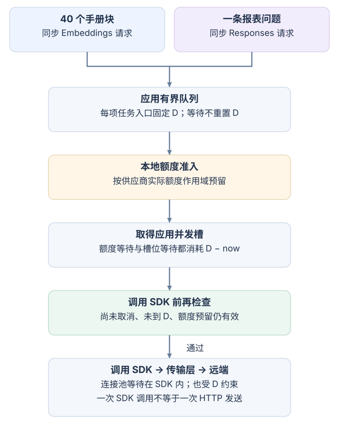
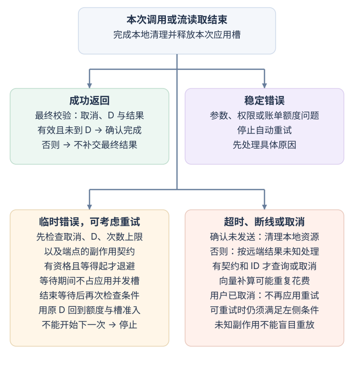

# 怎样让一次模型 API 调用在限额、失败和截止时间内有界？

退款助手的运行处在 `running` 时，读订单之后要调用模型理解客户请求、起草方案说明。每一次模型调用都可能先在应用队列里等，再等供应商额度、并发槽和连接；请求发出后，即使 SDK 报告超时，服务端也可能已经处理了它。本章回答：怎样让这样一次调用在截止时间内结束、不悄悄放大发送次数，并在本地停止等待后正确对待远端状态。结论是三件事：所有等待共用一个按单调时钟计算的绝对截止时间；重试只由一处负责；本地超时或取消之后，按端点契约把远端当作“结果未知”来处理。

## 两类工作怎样争用同一条调用链？

边界问题在两类工作同时争用资源时最清楚，所以本章不用退款案例，改用一个更小的例子：一组公开的合成 CI（持续集成）手册。后台索引任务要为 40 个手册块生成向量，报表页面同时收到一条用户问题，必须在截止时间前回答。在 OpenAI 上，向量用同步的 Embeddings API 生成，报表回答用 Responses API。

两类工作可以共用本地的队列、并发槽和连接池；只有被供应商归入同一个模型、项目或组织的额度作用域时，它们才争用同一份供应商配额。索引若改用 Batch API，就是另一种异步作业接口，有自己的状态和限额。文中的端点字段、错误码和 SDK 行为以 OpenAI 官方文档和 Python SDK `v3.49.0` 为例（核对于 2026-11-12），集中放在后面的实例小节；换供应商、端点或 SDK 版本时，计量、重定向、重试与取消契约都要重新确认。

## 一次尝试要过哪几道边界？

报表问题进入系统时，先记下 absolute deadline（绝对截止时间）`D`。`D` 用事件循环的 monotonic clock（单调时钟）表示，不会因为系统日历时间被校正而倒退。之后每个阶段能用的时间都是剩余量 `D - now`。

图中两种调用都是同步的：结果或流式内容都由这条 HTTP 请求本身返回。Python 异步客户端只是让应用在等待时不阻塞，不会把调用变成后台作业。图里的“额度准入”是本地协调器按供应商的时间窗做预留，不是先向供应商发一条申请。任一阶段被取消或用完剩余时间，就结束本次尝试，并清理已经取得的资源。

四道边界保护不同的资源，不能互相替代：

| 边界 | 限制对象 | 本例中怎样使用 |
|---|---|---|
| 有界队列 | 尚未启动的工作数和内存 | 队列满时拒绝，或向上游施加 backpressure（背压）。优先级只改变仍在排队的次序，抢不回已被离线工作占用的槽或配额。 |
| 供应商额度 | 一个时间窗内允许的请求数与词元估算量 | Embeddings 与 Responses 是不同端点；是否共享 RPM（每分钟请求数）或 TPM（每分钟词元数）额度，要按当前项目、模型和限额组核对。 |
| 应用并发槽 | 应用当前持有的在途调用数 | 两类工作可共享总量，也可给在线问题预留槽。重试退避时释放槽，下一次发送重新申请。 |
| HTTP 连接池 | 可同时取得的连接与连接复用 | 长期复用一个异步客户端能保留 keep-alive 连接。池满时的等待也消耗 `D - now`；池大小不等于 RPM、TPM 或并发策略。 |

在本例的 OpenAI Python SDK 中，连接池属于 SDK 底层的 HTTP 传输层：取连接的等待发生在 SDK 调用内部，而不是应用在调用 SDK 之前另外借出一条连接。

流式响应还有两点要注意。第一，内容可以在读取过程中逐段校验和交付，每段交付前确认未取消、未到 `D`；最终结果或完成标记要再检查一次，途中取消或超时就把已显示的部分标为中断。第二，应用并发槽要一直占用到流读完或流关闭后的本地清理结束。关闭本地流能释放本地资源，却不能说明服务端的并发已经减少。

多个 worker 共用一个供应商额度作用域时，各进程独立计数保证不了总量，要在共享协调层原子准入，或用集中调度器。粗略估算容量时，4 个槽、平均在途 0.5 秒，持续吞吐约 `4 / 0.5 = 8` 次/秒；真实上限还受尾延迟、突发流量和 RPM/TPM 限制，不能只按平均值配置。

### 把速率额度换算成可复算的上限

额度换算的关键是先弄清供应商怎样估算一次请求的词元数。OpenAI 的 Rate limits 指南对适用 `max_tokens` 的文本请求给了一种估法：输入按请求字符数估算，速率计算取输入估值与输出上限 `max_tokens` 中的较大者。

设一个按这条规则计量的教学端点每分钟允许 60 个请求、12,000 个词元，报表输入估算为 900，输出上限为 300。每次按 `max(900, 300) = 900` 预留，TPM 的固定分钟上限是 `⌊12,000 / 900⌋ = 13` 次；RPM 允许 60 次，两者取小，仍是 13 次。若另一供应商按输入加输出上限计量，同样的数字就是 `900 + 300 = 1,200` 词元/次，上限变成 `⌊12,000 / 1,200⌋ = 10` 次/分钟。两个答案来自不同的计量规则，不能混用。

这条规则不能仅凭字段名推广：Responses 请求用的是 `max_output_tokens`，实际限额、共享范围、估算方式和时间窗要查目标项目的当前文档与响应头。失败的请求也可能计入每分钟额度，所以每次重试都按一次新请求准入。返回的 usage（实际用量）也不是剩余 RPM/TPM 的余额；只有供应商明示计量契约允许时，才按已用量调整本地预留。

### 预留额度之后，发送前还要检查什么？

应用若先预留额度、再等并发槽，拿到槽后调用 SDK 前要再查一次：是否已取消、是否已过 `D`、预留是否仍有效。这就是图里的“发送前检查”。

这次检查只发生在 SDK 方法入口，不等于检查了每条 HTTP 请求实际发出时的额度窗口：连接池等待在它之后，SDK 内部重试和重定向也在它之后。即使只有一次发送，也可能在池等待期间跨过预留的时间窗。要做到逐条发送准入，闸门必须放在池等待之后、能观察并阻止每次实际传输的位置。请求确定没有发出时，本地协调器支持的话才归还预留；无法确定是否发出时，不要用账单 usage 或客户端的块 ID 去猜供应商的额度状态。

## 怎样让所有等待共用一个截止时间？

在报表请求的入口创建 `D`，然后把这个绝对值沿着队列、额度等待、并发槽、连接池、网络调用、退避、解析和交付一路传下去。每个等待阶段用 `D - loop.time()` 算剩余时间；不能在出队或每次重试时重新加 30 秒，否则总等待会随重试次数增长。

SDK 自己的阶段超时是另一份契约。传输层通常分别限制建连（connect）、等待响应或请求体的下一个数据块（read/write）和从池中取连接（pool）。它们限制的是单个阶段，不是整项业务的等待；应用队列和退避更是在它们之外。所以 SDK 默认超时再大，也替代不了应用的 `D`。

Python 3.11 可以用 `asyncio.timeout_at()` 按单调时钟的绝对时点限制当前任务中的等待。它不像 `asyncio.wait_for()` 那样为被等待的协程另包一个 Task；直接 `await` 也让外部取消与请求完成的边界更清楚。不过取消是协作式的：底层若接住取消去做清理，调用方仍可能在 `D` 之后才恢复执行。因此返回前还要再核对一次是否已超时，迟到的内容不能算按时交付。如果界面必须在 `D` 准时结束等待，外层等待方就要能在 `D` 独立返回，被追踪的工作方继续完成本地清理，并禁止迟到交付。

任何本地 timeout 都不能证明服务端已经停止。远端对账有自己的生命周期，不会延长这一次用户等待。

## 哪些错误值得重试？

错误先分类，再决定恢复方式：

| 错误类别 | 对本次调用的处理 |
|---|---|
| 临时限流：请求数或词元速率暂时超限、流量爬升过快 | 等额度窗口恢复，按下面的判断顺序决定是否重新准入 |
| 服务端临时过载 | 按下面的判断顺序决定是否重试 |
| 账户或用量限制：余额耗尽、花费上限 | 原样重发不会恢复额度，停止自动重试，交给账户处理 |
| 稳定错误：格式、认证、权限 | 先修正输入、凭据或权限；原样重发不会改变原因 |
| 连接错误、超时、其他 5xx | 请求可能没出网，也可能已到服务端而响应丢失；按端点的副作用、可查询状态和幂等契约决定能否重放 |

各行最后都落到同一个判断顺序。先依次检查：是否已取消、是否已过 `D`、是否达到应用配置的尝试上限（若另有逐次发送的预算也一并检查）、端点的副作用是否允许重试；任何一项不允许就停止。仍有资格时，才遵循有效的 `Retry-After`（服务端要求的最早等待时间）；它缺失或无效时，用有上限的 exponential backoff（指数退避）并加随机 jitter（抖动）。等待前要确认剩余时间够等完退避并开始下一次尝试，不够就退出；够开始也不保证下一次能在 `D` 前完成。等待结束后，再检查一次取消和 `D`，然后重新经过额度和并发槽准入。

## 重试为什么只能由一处负责？

一次调用里有三个容易混淆的计数。application attempt（应用尝试）是应用代码调用一次 SDK；SDK 内部可能还有自己的重试；真正的 HTTP 发送数则要看网络上发生了几次请求。

层层重试会相乘。若应用最多调用 SDK 3 次，SDK 每次又最多走 3 轮请求流程（首次加两次内部重试），就最多是 `3 × 3 = 9` 轮请求流程。这还不是网络发送的严格上限：一轮流程可能因重定向发出多条 HTTP 请求；反过来，DNS 或取连接在发送前就失败时，一条请求都没有。只有额外假设每轮至多发送一次、且没有重定向或其他传输层重发，才能把 9 当成发送上限。

重试层叠会同时放大等待时间、重复成本和额度消耗，所以最好只保留一个重试所有者：要么关闭 SDK 自动重试由应用统一负责，要么只用 SDK 的重试并让应用不再叠加。若要按错误码精细决定（例如账户额度类 429 应停止），通常由应用负责更合适，因为 SDK 未必区分这些错误码。要对每条实际发送做 RPM/TPM 准入，计数和闸门就必须覆盖内部重试和重定向的发送位置；只预留一个保守的总次数，保证不了正确的时间窗额度。

SDK 能安全地重发请求体，也不代表业务行为天然幂等。模型调用本身通常只是花钱和占额度，但若端点会创建作业、触发外部工具或写入数据，就要按它明确支持的幂等键和状态查询契约处理，不能把 SDK 重试配置当成业务保证。退款这样的外部写入怎样处理结果未知，见[退款请求超时后，怎样查清结果而不重复扣款](external-writes-and-reconciliation.md)。

下图接着前一张图：本次非流式调用或流读取结束、完成本地清理后，释放本次的槽，再确定最终结果或中断状态；流中已交付的片段不会重发。只有这次 SDK 调用的所有内部请求都确认没有发出时，失败才只做本地收尾；前面某轮已发出或无法确认时，不能用最后一轮的池超时推断远端没有处理。

## 用例：一条报表问题遇到两秒 Retry-After

把判断顺序放到报表问题上。这条在线问题在入口获得 150ms 的总预算，排队和第一次请求已用掉 100ms；收到一个临时 429 时，距 `D` 只剩 50ms，响应头给出 `Retry-After: 2`。这次请求确实已经发出，而服务端要求至少等两秒，超过了截止时间。调度器不等这两秒，也不发第二次请求；它把这次用户等待结束为“暂未完成”，记录请求状态供产品按需提示。后台的 40 个向量块可以继续排队或延迟到 Batch，但每次同步尝试仍按 Embeddings 端点自己的额度重新准入。

再看一条同步 embedding 请求在发送后读超时。应用先查本地 `chunk_id` 是否已写入结果；本地没有，只说明应用没有持久化它，并不能向供应商查回那次同步响应。业务可以选择之后重算这个纯向量输入来补齐索引，同时接受可能重复计费；但不能把它记成“远端确定失败”。

下列轨迹由文末假客户端复算。`Retry-After` 那一行直接从 50ms 剩余预算开始，不模拟前面的 100ms。每次 `create` 只算一次模拟客户端调用，不模拟真实 HTTP 或 SDK 内部重试：

| 轨迹 | 模拟调用数 | 应用结果 |
|---|---:|---|
| 临时 429 后成功，最多允许三次 | 2 | 第二次返回 |
| 连续 503，最多允许三次 | 3 | 不启动第四次 |
| `Retry-After=2s`，距 `D` 只剩 `0.05s` | 1 | 等不起退避，不启动下一次 |
| 请求开始后调用方取消 | 1 | 传播取消，不启动下一次 |
| 总预算 `10ms`，底层收到取消后再清理 `40ms` | 1 | 约 `50ms` 才交回本地控制权；拒收迟到结果 |

最后一行说明协作式取消不是硬实时中断：界面在 `D` 停止等待，与本地清理结束，是两个不同的时点。

## 取消或断线后，远端处于什么状态？

发送之前取消的任务可以直接从队列移除；若只预留了本地额度，确认未发送时按协调器规则归还。发送之后，本地取消只能阻止后续的应用重试，远端状态要按端点契约判断。断开同步连接、取消本地 Task、请求后台作业取消，是三个不同的动作；查询结果、请求取消、重放请求，又是三个不同的操作，任何一个都不能代替另一个。

能不能查、能不能取消，取决于应用是否持有远端分配的标识。没有收到响应 ID，就不能凭本地请求 ID 查询远端工作；同步 embedding 没有用客户端 `chunk_id` 调回旧结果的接口，本地缓存只是应用自己的记录。已经向用户显示了部分内容的同步流断了，就把这部分标为中断，不能把一次新的完整生成直接拼到旧文本后面；只有端点提供续流契约，并且应用持久化了最后处理的事件位置，才能接着读。

排障日志适合记录：逻辑任务 ID、应用尝试数、可观测的 SDK 与传输发送数、是否收到请求 ID 或作业 ID、首段用户可见内容的时间、终态和状态查询结果。流里的连接、创建或心跳事件不是用户已经看到的内容。不要为了记住“交付了什么”把原始输出正文写进日志。usage 可用于账单和成本统计，但不等于额度余额；与索引写入有关的 `chunk_id` 和文档版本留在应用自己的结果映射里。

## 实例：OpenAI API 与 Python SDK `v3.49.0`

本节把上文的机制对应到 OpenAI 的具体字段，核对于 2026-11-12。

### 错误码怎样对应到分类

OpenAI 文档把 429 `rate_limit_error` / `slow_down` 定义为流量增加过快，把 503 `service_unavailable_error` / `server_is_overloaded` 定义为模型暂时过载。JSON 里的 `error.type` 和 `error.code` 要分开读：

| OpenAI 响应 | 对应上文的类别 |
|---|---|
| HTTP 429；普通请求数或词元速率暂时超限 | 临时限流 |
| HTTP 429；`error.type=rate_limit_error`；`error.code=slow_down` | 临时限流；可能发生在 RPM/TPM 数字以内 |
| HTTP 503；`error.type=service_unavailable_error`；`error.code=server_is_overloaded` | 服务端临时过载 |
| HTTP 429；`error.code` 如 `credit_balance_exhausted`、`organization_spend_limit_exceeded`、`project_spend_limit_exceeded`、`organization_usage_limit_exceeded` | 账户或用量限制，停止自动重试；实际 `error.type` 以响应体为准 |
| HTTP 400、401、403 等 | 稳定错误 |

### SDK 的阶段超时与内部重试

OpenAI Python SDK `v3.49.0`（2026-11-10 发布）的默认超时对象是 `httpx2.Timeout(600, connect=5.0)`，默认 `max_retries=2`。600 秒不是整项业务等待的上限：connect 限制建连，read/write 限制等待下一个数据块，pool 限制取连接。SDK 提供的默认客户端类还设置了连接池上限和 `follow_redirects=True`；若传入自己创建的 HTTPX2 客户端，要核实它自己的配置。

该版本按响应状态和 `x-should-retry` 头决定是否重试，还会检查请求体能否安全重发并参考 `Retry-After`。没有 `x-should-retry: false` 覆盖时，它会重试连接错误、SDK 捕获的传输超时、HTTP 408、409、429 和 5xx，但不替应用解释 429 的 `error.code`，所以账户额度类 429 也可能触发内部重试。服务端要求的等待超过 120 秒时，SDK 跳过重试。`max_retries=2` 意味着最多三轮请求流程，加上默认跟随重定向，这正是上文 `3 × 3 = 9` 只是“轮次”而非发送上限的原因。

### 离线向量任务何时改用 Batch？

普通 Embeddings 是同步创建接口：`POST /v1/embeddings` 接收一个或多个输入并返回向量。合并输入能减少请求数，但不减少这些输入消耗的词元，仍要按目标模型的单条和整批输入上限切批。

Batch API 适合 40 个可延后的索引输入。它的 JSONL 文件每行是一项端点请求，各带唯一的 `custom_id`；一行 Embeddings 请求可以含多个输入。提交后先保存返回的 `batch_id`，再查询作业状态；完成后用 `output_file_id` 下载成功结果，用 `error_file_id` 检查失败行。`custom_id` 属于一行请求，不会给行内每个输入单独分配身份：若请求行 `ci-part-a` 的输入依次是 `chunk-17`、`chunk-18`，返回 `response.body.data[].index=0` 的向量属于 `chunk-17`，`index=1` 属于 `chunk-18`；输出行的排列顺序不决定块的身份。

Batch 有独立于同步端点的速率池和待处理词元限制，官方完成窗口为 24 小时，所以它能吸收离线积压，却替不了一条短时限的报表回答。如果创建 Batch 的响应丢了，作业仍可能存在；没有 `batch_id` 就不能按 ID 查询或取消。应用可以在提交前保存上传的 `input_file_id` 与任务标记，把标记写进 Batch 的 `metadata`，之后列举作业按文件和标记对账。这些字段不是供应商承诺的唯一键或幂等键，暂时没找到也不证明没创建；确认之前不要盲目补交整个批次。取消要用 `batch_id` 调用取消端点，状态可能停在 `cancelling` 最多 10 分钟，等在途请求结束才变成 `cancelled`；已完成的行仍要从输出和错误文件核对。

### Responses 的读取、取消与续流

只要已知 `response_id`，且该 Response 按项目设置仍被保留，就可以用读取端点查询，包括被保留的同步 Response；读取不要求 `background=true`。同步响应通过终止连接来取消；只有 `background=true` 的后台 Response 适用 `/v1/responses/{response_id}/cancel`，它在 `queued` 或 `in_progress` 时可继续轮询。用户等待到期时，若已知 ID，仍可只读查询状态；是否完成、是否计费要依据端点状态和计量资料核对。

后台 Responses 还提供断点续流，但创建时须同时设置 `background=true, stream=true`。文档提醒后台模式的首词元时延可能高于同步响应，轮询和续流也依赖项目的存储设置，response ID 不是永久保存的保证。创建流的 `response.created` 事件携带 `event.response.id`；应用持久化这个 ID，并逐步保存最后处理过的事件 `sequence_number`（keepalive 事件不推进游标）。断线后用 `stream=true&starting_after=<最后处理序号>` 继续读。交付层也要持久化自己已呈现到哪个事件，避免恢复时重复显示。普通同步响应没有这个续流契约。

## 可选：用假客户端复算应用尝试和截止边界

> [!example]- 完整可运行的异步假客户端（CPython 3.11.13 实跑）
> 代码只演示应用级的有限尝试、固定绝对截止、单次调用上限、迟到拒收和取消传播；没有实现真实 HTTP、队列、RPM/TPM 准入、连接池或 SDK 内部重试。单次传输超时时，它保守地返回 `OutcomeUnknown` 并停止，不实现按端点契约安全重放的分支。传输适配器要先把有效的 `Retry-After` 规范化成非负秒数，缺失或无效时传 `None`；代码不解析 HTTP 日期格式。
>
> ~~~python
> import asyncio
> import random
>
>
> class ApiError(Exception):
>     def __init__(self, status, error_type, code, *,
>                  retry_after_s=None, retryable=False):
>         super().__init__(f"{status} {error_type} {code}")
>         self.status = status
>         self.error_type = error_type
>         self.code = code
>         self.retry_after_s = retry_after_s
>         self.retryable = retryable
>
>
> class DeadlineExceeded(Exception):
>     pass
>
>
> class OutcomeUnknown(Exception):
>     pass
>
>
> class LateResponse(Exception):
>     pass
>
>
> class FakeAPI:
>     """调用计数是模拟的客户端调用数，不是真实 HTTP 数。"""
>     def __init__(self, outcomes):
>         self.outcomes = list(outcomes)
>         self.simulated_calls = 0
>
>     async def create(self, payload):
>         self.simulated_calls += 1
>         await asyncio.sleep(0)
>         if not self.outcomes:
>             raise AssertionError("假客户端没有预设响应")
>         outcome = self.outcomes.pop(0)
>         if isinstance(outcome, BaseException):
>             raise outcome
>         return outcome
>
>
> class SlowCleanupAPI:
>     """模拟时限取消后仍需 40ms 本地清理才返回的客户端。"""
>     def __init__(self):
>         self.simulated_calls = 0
>
>     async def create(self, payload):
>         self.simulated_calls += 1
>         try:
>             await asyncio.sleep(10)
>         except asyncio.CancelledError:
>             await asyncio.sleep(0.04)
>             return {"late": True}
>
>
> def reject_external_cancel(task, timeout_scope=None):
>     """区分调用方取消与当前 timeout_at 自己发出的那一次取消。"""
>     own_timeout_cancel = int(
>         timeout_scope is not None and timeout_scope.expired()
>     )
>     if task.cancelling() > own_timeout_cancel:
>         raise asyncio.CancelledError
>
>
> def ensure_may_send(deadline, *, loop, task):
>     """应用级检查；SDK 内逐 HTTP 发送须由传输层另行准入。"""
>     reject_external_cancel(task)
>     if loop.time() >= deadline:
>         raise DeadlineExceeded("D 已到，尚未发送")
>
>
> async def bounded_call(
>     client,
>     payload,
>     *,
>     deadline,
>     max_attempts,
>     attempt_timeout_s,
>     base_delay_s=0.05,
>     max_delay_s=1.0,
>     jitter_s=0.02,
>     rng=None,
> ):
>     if max_attempts < 1:
>         raise ValueError("max_attempts 必须至少为 1")
>     if attempt_timeout_s <= 0 or jitter_s < 0:
>         raise ValueError("时限须为正数，抖动不得为负数")
>
>     rng = rng or random.Random()
>     loop = asyncio.get_running_loop()
>     task = asyncio.current_task()
>     if task is None:
>         raise RuntimeError("需要在 asyncio Task 中运行")
>
>     for attempt in range(1, max_attempts + 1):
>         ensure_may_send(deadline, loop=loop, task=task)
>         now = loop.time()
>         attempt_deadline = min(deadline, now + attempt_timeout_s)
>         if now >= attempt_deadline:
>             raise DeadlineExceeded("D 已到，未开始下一次尝试")
>
>         timeout_scope = asyncio.timeout_at(attempt_deadline)
>         try:
>             async with timeout_scope:
>                 # 这是 SDK 方法入口 gate；内部重试/重定向须由传输层逐条准入。
>                 ensure_may_send(deadline, loop=loop, task=task)
>                 if loop.time() >= attempt_deadline:
>                     raise DeadlineExceeded("尝试时限已到，尚未发送")
>                 response = await client.create(payload)
>                 reject_external_cancel(task, timeout_scope)
>                 if (timeout_scope.expired()
>                         or loop.time() >= attempt_deadline):
>                     raise LateResponse("底层清理后返回迟到结果")
>                 return response
>         except asyncio.CancelledError:
>             # 外部取消在同一 Task 中传播，不启动后续尝试。
>             raise
>         except ApiError as exc:
>             # timeout_at.__aexit__ 已撤销自身取消，只检查外部取消。
>             reject_external_cancel(task)
>             if (timeout_scope.expired()
>                     or loop.time() >= attempt_deadline):
>                 raise LateResponse("超时后的错误不进入重试") from exc
>             if not exc.retryable or attempt == max_attempts:
>                 raise
>
>             remaining = deadline - loop.time()
>             if exc.retry_after_s is not None:
>                 # 该值已由适配器解析；负数归零，再加小抖动。
>                 delay = max(0.0, exc.retry_after_s)
>                 delay += rng.uniform(0.0, jitter_s)
>             else:
>                 backoff = min(
>                     max_delay_s,
>                     base_delay_s * (2 ** (attempt - 1)),
>                 )
>                 delay = backoff + rng.uniform(0.0, jitter_s)
>
>             if delay >= remaining:
>                 raise DeadlineExceeded(
>                     "剩余时间不足以等完退避后开始下一次尝试"
>                 ) from exc
>             await asyncio.sleep(delay)
>         except TimeoutError as exc:
>             # timeout_at.__aexit__ 已撤销自身取消，只检查外部取消。
>             reject_external_cancel(task)
>             # 本地请求可能已发出；超时不能证明远端未执行。
>             raise OutcomeUnknown("请求等待超时；远端结果未知") from exc
>
>     raise AssertionError("循环只会返回或抛出异常")
>
>
> def deadline_after(seconds):
>     return asyncio.get_running_loop().time() + seconds
>
>
> async def demo():
>     success_api = FakeAPI([
>         ApiError(
>             429, "rate_limit_error", "slow_down",
>             retry_after_s=0.001, retryable=True,
>         ),
>         {"chunk_id": "handbook-17", "embedding": [0.2, -0.1]},
>     ])
>     # 真实应用应在入队时创建 D；这里用很短的等待代表排队时间。
>     success_deadline = deadline_after(1.0)
>     await asyncio.sleep(0.001)
>     result = await bounded_call(
>         success_api,
>         {"text": "synthetic public CI rule"},
>         deadline=success_deadline,
>         max_attempts=3,
>         attempt_timeout_s=0.5,
>         jitter_s=0,
>     )
>     print("recovered:", result,
>           "模拟客户端调用:", success_api.simulated_calls)
>
>     failed_api = FakeAPI([
>         ApiError(503, "service_unavailable_error",
>                  "server_is_overloaded", retryable=True),
>         ApiError(503, "service_unavailable_error",
>                  "server_is_overloaded", retryable=True),
>         ApiError(503, "service_unavailable_error",
>                  "server_is_overloaded", retryable=True),
>     ])
>     try:
>         await bounded_call(
>             failed_api, {"text": "synthetic public CI rule"},
>             deadline=deadline_after(1.0), max_attempts=3,
>             attempt_timeout_s=0.5, base_delay_s=0.001,
>             max_delay_s=0.01, jitter_s=0,
>         )
>     except ApiError as exc:
>         print("failed:", exc,
>               "模拟客户端调用:", failed_api.simulated_calls)
>
>     retry_after_api = FakeAPI([
>         ApiError(429, "rate_limit_error", "slow_down",
>                  retry_after_s=2, retryable=True),
>     ])
>     try:
>         await bounded_call(
>             retry_after_api, {}, deadline=deadline_after(0.05),
>             max_attempts=3, attempt_timeout_s=0.5, jitter_s=0,
>         )
>     except DeadlineExceeded as exc:
>         print("retry-after:", type(exc).__name__,
>               "模拟客户端调用:", retry_after_api.simulated_calls)
>
>     class SlowAPI:
>         def __init__(self):
>             self.simulated_calls = 0
>             self.started = asyncio.Event()
>
>         async def create(self, payload):
>             self.simulated_calls += 1
>             self.started.set()
>             await asyncio.sleep(10)
>
>     slow_api = SlowAPI()
>     slow_deadline = deadline_after(1.0)
>     task = asyncio.create_task(
>         bounded_call(
>             slow_api, {}, deadline=slow_deadline,
>             max_attempts=3, attempt_timeout_s=0.5,
>         )
>     )
>     await slow_api.started.wait()
>     task.cancel()
>     try:
>         await task
>     except asyncio.CancelledError:
>         print("cancelled locally; simulated calls:",
>               slow_api.simulated_calls)
>
>     late_api = SlowCleanupAPI()
>     late_deadline = deadline_after(0.01)
>     started_at = asyncio.get_running_loop().time()
>     try:
>         await bounded_call(
>             late_api, {}, deadline=late_deadline,
>             max_attempts=3, attempt_timeout_s=0.5,
>         )
>     except LateResponse as exc:
>         elapsed_ms = (
>             asyncio.get_running_loop().time() - started_at
>         ) * 1000
>         print("late result rejected:", type(exc).__name__,
>               "local wait ms:", round(elapsed_ms),
>               "模拟客户端调用:", late_api.simulated_calls)
>
>
> if __name__ == "__main__":
>     asyncio.run(demo())
> ~~~
>
> 实跑输出与上文轨迹表一致：`recovered` 模拟调用 2 次；`failed` 3 次；`retry-after` 抛出 `DeadlineExceeded`、1 次；`cancelled locally` 1 次；`late result rejected` 本地等待约 52ms、1 次（毫秒数随调度略有波动）。`deadline_after()` 在示例中于模拟排队之前运行；生产中同样应在业务入口创建 `D`，并把原值传过每个等待层。

## 模型调用有界之后，运行本身还要被可靠领取

本章让单次模型调用有了边界：一个绝对截止时间贯穿所有等待，重试只归一处，本地停止等待后把远端当作未知、按端点契约查询或取消。回到退款助手，这些调用都发生在某个 attempt 持有 lease 的 `running` 状态里；调用超时只结束这一步，不改变运行的权威状态。下一个问题是运行本身：客户的提交怎样变成一个一定会被执行、又只被一个 attempt 推进的运行，见[请求受理后，怎样保证任务最终被执行且不被两个 worker 同时推进](accepting-queuing-and-claiming-runs.md)。40 个手册块怎样进入检索索引，见[怎样从授权文档里找到回答依据](../context/rag-indexing-and-retrieval.md)；把每次真实尝试和失败成本计入成功任务的成本，见[月报助手该选哪个模型，每份成功报告要花多少钱](../evaluation-and-release/model-selection-and-unit-cost.md)。

> [!info]- 来源
> - **同步向量与报表端点**（“两类工作怎样争用同一条调用链”）。OpenAI，[Create embeddings](https://developers.openai.com/api/reference/resources/embeddings/methods/create) 与 [Create a model response](https://developers.openai.com/api/reference/resources/responses/methods/create)，在线 API 参考，核对于 2026-11-12；核实 `POST /embeddings` 与 `POST /responses` 的创建接口和请求参数。没有按应用自定义 `chunk_id` 读取同步结果的接口。
> - **RPM/TPM、限额作用域、`Retry-After`、退避与预留估算**（“把速率额度换算成可复算的上限”“哪些错误值得重试”）。OpenAI，[Rate limits](https://developers.openai.com/api/docs/guides/rate-limits)，核对于 2026-11-12，“How do these rate limits work?”“Rate limits in headers”“Retrying with exponential backoff”“Reduce the `max_tokens` to match the size of your completions”。限额可按模型、项目和组织生效，失败请求可能计入每分钟额度，适用 `max_tokens` 的估算取输入估值和输出上限中的较大者；本文没有据此推断 `max_output_tokens` 在所有 Responses 调用中的计量。
> - **429 与 503 的字段及账户额度错误**（“实例：错误码怎样对应到分类”）。OpenAI，[Error codes](https://developers.openai.com/api/docs/guides/error-codes) 与上述 Rate limits，核对于 2026-11-12。
> - **SDK `v3.49.0` 的超时、重试、请求体与默认 HTTP 客户端**（“实例：SDK 的阶段超时与内部重试”“重试为什么只能由一处负责”）。OpenAI Python SDK [release `v3.49.0`](https://github.com/openai/openai-python/releases/tag/v3.49.0)（2026-11-10）、[`v3.49.0` README](https://github.com/openai/openai-python/blob/v3.49.0/README.md)、[`_constants.py`](https://github.com/openai/openai-python/blob/v3.49.0/src/openai/_constants.py)、[`_base_client.py`](https://github.com/openai/openai-python/blob/v3.49.0/src/openai/_base_client.py)、[HTTPX2 migration notes](https://github.com/openai/openai-python/blob/v3.49.0/httpx2.md)。源码常量为默认 `Timeout(600, connect=5.0)`、`max_retries=2`、`MAX_RETRY_AFTER_DELAY=120`；默认 HTTPX2 客户端跟随重定向；重试判断检查状态、`x-should-retry`、可重发请求体和 `Retry-After`。
> - **HTTPX2 的阶段超时与连接池**（“怎样让所有等待共用一个截止时间”“一次尝试要过哪几道边界”）。Pydantic，[Timeouts](https://pydantic.dev/docs/httpx2/advanced/timeouts/)、[connection pool limits](https://pydantic.dev/docs/httpx2/httpcore2/connection-pools/)、[async client](https://pydantic.dev/docs/httpx2/guides/async/)，核对于 2026-11-12；pool、connect、read、write 分别配置，read/write 是等待下一个数据块的时限。
> - **`asyncio` 的绝对超时与协作式取消**（“怎样让所有等待共用一个截止时间”、假客户端）。Python 3.11 [asyncio `timeout_at`](https://docs.python.org/3.11/library/asyncio-task.html#asyncio.timeout_at)；`wait_for` 会等待子任务实际取消，总等待可能超过时限。取消竞态参考 CPython [#86296](https://github.com/python/cpython/issues/86296) 与 [Python 3.11.18 `asyncio/tasks.py`](https://github.com/python/cpython/blob/v3.11.18/Lib/asyncio/tasks.py#L438)。示例在 CPython 3.11.13 实跑。
> - **Batch 作业、结果映射与取消**（“实例：离线向量任务何时改用 Batch”）。OpenAI，[Batch API](https://developers.openai.com/api/docs/guides/batch)、[Cancel batch](https://developers.openai.com/api/reference/resources/batches/methods/cancel)，核对于 2026-11-12；JSONL 每行一个请求，`custom_id` 标识请求行，输出行的 `response.body.data[].index` 是请求内的输入位置；Batch 有独立限额、24 小时完成窗口，取消后可处于 `cancelling` 最多 10 分钟。
> - **Batch 创建响应丢失后的对账线索**（同上）。OpenAI，[Create Batch](https://developers.openai.com/api/reference/resources/batches/methods/create) 与 [List Batches](https://developers.openai.com/api/reference/resources/batches/methods/list)，核对于 2026-11-12；创建接受 `input_file_id` 与 `metadata`，列表返回这些字段。用它们匹配应用任务是本文的对账设计，不是 API 的去重承诺。
> - **Responses 的读取、后台取消与续流**（“实例：Responses 的读取、取消与续流”）。OpenAI，[Background mode](https://developers.openai.com/api/docs/guides/background)、[Retrieve response](https://developers.openai.com/api/reference/resources/responses/methods/retrieve)、[Cancel response](https://developers.openai.com/api/reference/resources/responses/methods/cancel)、[Conversation state](https://developers.openai.com/api/docs/guides/conversation-state)，核对于 2026-11-12；读取已保留的 Response 不限后台模式，后台取消端点只适用于 `background=true`，`background=true, stream=true` 可按事件序号续流，keepalive 不推进游标，保留取决于项目存储设置。
> - **`Retry-After` 字段**（“哪些错误值得重试”）。IETF，[RFC 9110 §10.2.3](https://www.rfc-editor.org/rfc/rfc9110.html#section-10.2.3)，2022；定义服务端给出的最早等待时间。
