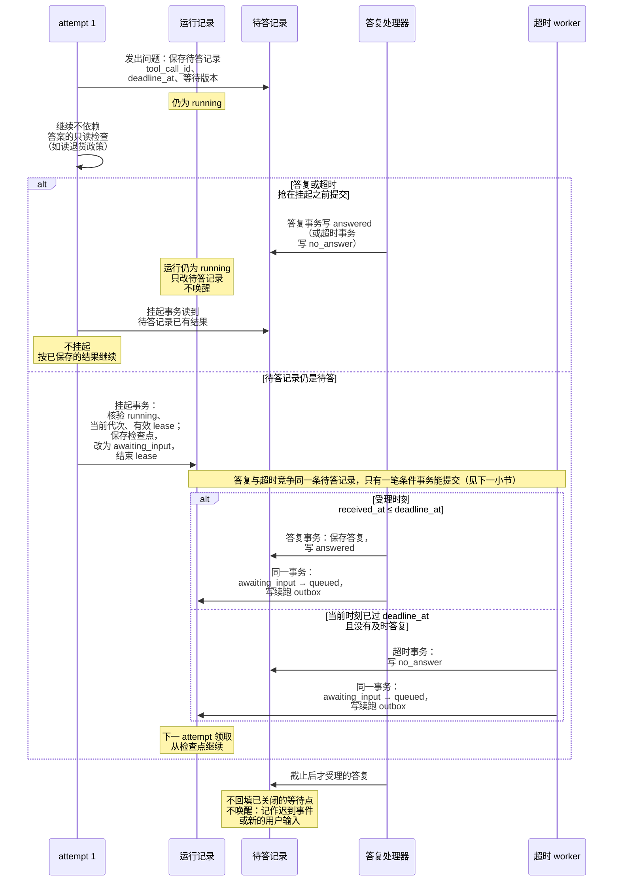

# 用户断线、取消或要回答一个问题时，同一次运行怎样继续？

前几章默认客户一直在线、不改主意，也不需要回答任何问题。现实中，客户会在等待时关掉页面，会在退款途中点“取消”，助手也可能需要先问客户一句才能拟方案。本章沿用[一次 AI 运行断线或崩溃后，凭什么恢复](run-identity-and-authoritative-state.md)的退款案例，回答这三件事怎样进入同一个 `run-o73-1`：断线只结束交付，取消是一组有条件的状态转移，用户答复是带截止时间的新观察。取消的语义以本章为准。

## 断线结束了什么，没结束什么？

断线只结束这一次交付，不改变运行事实。浏览器关掉时，`run-o73-1` 可能仍在 `running`、`awaiting_input`、`awaiting_approval` 或 `effect_unknown`，worker 照常推进或等待；断线既不等于取消，也不应该让服务新建一个运行。

同一个运行状态可以用三种方式交给客户端，区别只在客户端怎样等待和读取结果：

| 交付方式 | 客户端收到什么 | 要守住的边界 |
|---|---|---|
| 直接响应 | 请求一直等到最终答复 | 设置期限；连接超时后仍去查同一个运行 |
| 临时流 | 先收到文本或进度，最后才有终态 | 运行记录到达终态之前，流里的内容都是临时的 |
| 排队或后台 | `202` 和 `runId`，之后查询状态或事件 | `202` 不是完成；消息重投时仍按运行记录和 lease 恢复 |

退款要等客户确认、还可能等提供方处理，适合第三种。

## 重连后怎样回到同一个运行？

客户重新打开页面，用 `GET /runs/run-o73-1` 读取权威状态。服务按当前状态返回：处于 `awaiting_input` 时，展示原来那个待答问题；处于 `awaiting_approval` 时，继续展示原来那个 `Q-204`；处于 `effect_unknown` 或 `provider_pending` 时，显示“退款结果正在核对”；已经 `completed`、`rejected`、`failed` 或 `canceled` 时，直接返回保存好的答复或错误，不重跑模型。查询、续读和确认都要重新检查调用者此刻对这个运行和订单的读取权限：`runId` 只是定位符，不是凭据。这些路径和字段是本例应用的约定。

界面上的进度靠事件流补齐。假设浏览器断线前已连续处理到第 10 条事件，退款卡片显示“退款结果待核对”。只要服务端还保留后续事件，客户端就用 `GET /runs/run-o73-1/events?after=10` 续读：第 11 条把核实过的 `re_demo_204` 填进原卡片，第 12、13 条补齐答复并标记完成。若界面状态已丢失或游标失效，就用完整界面快照及其配套序号恢复，或从仍保留的完整事件历史重建。快照和游标必须取自同一个日志位置，传输层记下的 `Last-Event-ID` 也只是解析位置、不是业务确认，这两条协议规则见[服务端要持续推送更新时，怎样选通道，断线后又怎样接上？](../../engineering-foundations/services/real-time-channels-and-resume.md#快照和订阅怎样衔接在同一日志位置)。前端怎样应用重放的事件而不重复显示消息和卡片，见[聊天界面怎样重放事件而不重复消息或工具卡](../../frontend/ui-state/streaming-ai-chat.md#怎样应用重放事件而不重复消息或工具卡？)。

## 连受理回执都丢了，怎样找回运行？

如果客户提交后连 `202` 都没收到，客户端手里就没有 `runId`。这时要靠受理时的去重契约：服务若提供按键查询，就在原调用者和订单范围内用原键 `cli-o73-1` 查询；也可以用原键重试完全相同的 `POST /runs`，服务会返回原来的 `run-o73-1`。同键提交不同内容会得到冲突；换一个新键，则可能创建第二个运行。绑定规则见[请求受理后，怎样保证任务最终被执行且不被两个 worker 同时推进](accepting-queuing-and-claiming-runs.md)。

## 取消请求怎样按运行进度处理？

取消由一个单独鉴权的请求触发，而不是由断线推断。它不是一个开关，而是一组条件状态转移：取消与领取、与成功提交落在同一行运行记录上，由条件事务和提交顺序选出唯一胜者，这条通用规则见[任务失败、被取消或 worker 失联后，怎样收尾而不重复也不留孤儿？](../../engineering-foundations/services/job-retries-cancellation-and-cleanup.md#取消和领取同时发生，谁赢？)。运行多出的分界线只有一条：**操作账本里有没有发送意图**。

| 收到取消时的状态 | 处理 |
|---|---|
| `accepted`、`queued`、`running`、`awaiting_input`、`awaiting_approval`，且没有发送意图 | 条件事务直接写 `canceled`，同一事务关闭仍待答的问题；之后到达的答复只记作迟到事件。旧 worker 之后的任何发送闸门都会因“已取消”而失败 |
| `effect_in_flight` 或 `effect_unknown`（已有发送意图） | 写 `cancel_requested`，结束旧 lease，写只读对账唤醒；保留原键、参数和全部意图；不再发起新动作或重放 |
| `provider_pending`（已找到退款对象） | 退款对象已经存在，本地取消撤不回它；停止其余步骤，继续读取它的终态，按实际结果记录。只有对象仍处在提供方允许取消的状态时，才可以按政策对同一个退款 ID 请求提供方取消：这是一次新的外部写入，要当前写授权并经发送闸门登记，结果仍以读回的对象为准（读到 `canceled` 按[提供方状态映射](external-writes-and-reconciliation.md#提供方状态怎样映射回运行？)记 `failed` 并附原因）；不能换成新建或撤销另一笔退款 |
| 已在终态，或重复的取消请求 | 返回运行记录里已有的结果或已存的取消决定 |

为什么“没有意图”就能直接取消？因为发送前必须先在同一笔条件事务里登记意图，而这笔事务与取消事务串行化。取消先提交，闸门就不会再放行；所以一个没有意图的 `canceled` 运行，不可能已经发出退款请求。反过来，旧 attempt 一旦登记过意图，即使请求可能还没发出，也可能在之后到达提供方。

`cancel_requested` 之后，对账有两种结局：

- **找到并核实了退款对象**：记录真实结果（`succeeded` 记 `completed`；`failed` 或 `canceled` 记 `failed` 并附提供方原因；仍在 `pending` 就继续读到终态为止），并说明后续步骤已停止。不要声称退款一定发生在取消之前。
- **确认没有退款对象**：必须同时满足四件事，才能写 `canceled`：对账证实目标账户上没有与 `R-204` 关联的退款；每个已登记的意图都已不可能再发送，或提供方确定不会提交它；没有已受理但仍可能提交的请求；接收方会拒绝所有可能迟到的请求。

> [!example] 实例：Stripe 退款何时能经 API 取消
> 按 Stripe 官方文档核对于 2026-11-26：只有 `requires_action` 的退款（需要客户补充收款信息的支付方式才会进入这个状态）能经 `POST /v1/refunds/{id}/cancel` 取消，成功后对象变为 `canceled`，`failure_reason` 为 `merchant_request`；其他状态的退款 API 不能取消，调用会报错。部分卡退款只能在创建后的短时间内从 Dashboard 取消，API 不支持。所以 `provider_pending` 中读到 `pending` 的卡退款，应用通常只能读到终态；读到 `requires_action` 时才有 API 取消这条路。

单纯“查无记录”不够。登记过意图的旧 worker 可能还没发送，原请求可能还在路上，也可能已被受理但尚未提交。四件事里任何一件无法确认，就保留 `cancel_requested` 和未知的副作用记录，继续只读对账或交人工。只读对账和记录确认结果不需要当前的写入授权，但写回仍要由当前对账 attempt 持有更新权，详见[退款请求超时后，怎样查清结果而不重复扣款](external-writes-and-reconciliation.md)中的授权表。

## 助手需要问客户一句时，运行怎样等待？

设 attempt 1 读完订单后发现 `O-73` 里有两件商品，客户只说“坏了的那件”。助手需要问清是哪一件，才能确定退款金额。它可以先发出一个异步问题，继续做不依赖答案的只读检查（例如读取退货政策），做完之后再挂起等待。挂起沿用 `awaiting_approval` 的模式：等待期间运行不占执行 lease，只能由针对这条待答记录的事务唤醒。

下图按时间顺序画出提问、挂起和唤醒，以及答复或超时抢在挂起之前提交时的分支：

扫描器不处理 `awaiting_input`，因为它本来就没有 lease；到期由按 `deadline_at` 调度的超时 worker 推进。待答记录保存这些内容：

| 状态或事件 | 应用持久化的内容 | 运行怎样继续 |
|---|---|---|
| 发出问题 | `runId`、这次提问的 `tool_call_id`、发送时间、绝对截止时刻 `deadline_at`、待答状态、等待版本 | 仍为 `running`，挂起前只做不依赖答案的步骤；提问不等于批准 |
| 截止前收到答复 | 原 `runId`、匹配的 `tool_call_id`、答复内容、受理时刻 `received_at`、去重标记 | 下一 attempt 把答复当作同一运行的新观察，用它拟方案 |
| 到期仍无答复 | 原 `runId`、`tool_call_id`、截止时刻、终态 `no_answer` | 下一 attempt 走预先定义的安全分支：结束，或继续不依赖答案的步骤；沉默不是同意 |
| 截止后才收到答复 | 原 `tool_call_id`、受理时刻、已过期状态 | 不唤醒运行；记作迟到事件，或转成一条新的用户输入 |

待答记录有自己的状态：待答、`answered`（及时答复）、`no_answer`（到期无答复）。它们与运行记录的 `status` 分开保存：运行的 `awaiting_input` 只说明运行在等某条待答记录，待答记录的状态说明那个问题本身有没有答复。

### 答复与超时谁先提交？

时间由应用裁定。客户说的“今晚 8 点前回复”要先解析成带时区的绝对时刻并持久化。答复处理器和超时 worker 竞争同一条待答记录，两者都先取得运行记录和这条待答记录的更新权（按同一顺序加锁），再读取同一个时钟，本例用数据库的实际时间；为什么必须在取锁之后读、为什么不能用各进程的本地时间，与 lease 判断同理，见[怎样保证一个任务同一时刻只由一个 worker 推进？](../../engineering-foundations/services/job-claims-leases-and-fencing.md#租约要用数据库的时钟判断)。

两笔事务都核对原 `runId`、`tool_call_id`、等待版本和待答状态。答复事务把读到的时刻记作 `received_at`，要求 `received_at ≤ deadline_at`，保存答复和 `answered`；超时事务要求当前时刻晚于 `deadline_at` 且没有已保存的及时答复，写入 `no_answer`。运行是否在同一事务里改回 `queued` 并写续跑 outbox，取决于它是否已经挂起在 `awaiting_input`，见上图。

同一条记录上的两笔条件事务只有一笔能提交。本例以应用受理时间为准：即使网络包先到，截止后才被受理的答复仍算迟到。答复以事务提交为“已受理”的边界；失败就按同一个答复事件标识重试，已提交的重复答复返回原结果。恢复后的 worker 按运行、调用和等待版本核验重复的唤醒。

> [!info] 实例：时间提醒与异步用户输入
> OpenAI 在 2026-11-20 的文章中展示了 time awareness (时间感知) 提醒和异步用户输入工具：向模型注入当前时刻和剩余期限，让它在等待时继续工作，再把用户答复关联回对应的调用。接入文中的 Agents API 时，把应用的待答记录与服务端的 session、turn 和 call ID 绑定，每个仍挂起的调用只提交一份结果；若运行先终结，就关闭等待。时间提醒只是给模型看的信息，答复是否及时仍由应用依据持久状态裁定。

### 答复会不会改变已经确认的内容？

异步澄清和外部写入使用不同的状态。客户的答复只是一条观察，它只有在明确满足审批契约时，才可能推进确认；不能因为它晚到，就授权一次新写入。

若这条答复，或客户之后发来的新输入，改变了退款金额或商品，要看写入走到了哪一步：

- `R-204` 还没有任何发送意图：作废 `Q-204`，按新答复生成新方案，重新请客户确认。
- 已经登记了发送意图，或运行处于 `effect_unknown`：新答复不会撤销远端动作，也不允许换键重试。运行仍按原 `R-204` 查询、对账或交给人工；查清之后若还需要调整，是一个需要单独确认的新动作。

## 断线、取消和答复都落回同一份运行记录

断线只结束交付，客户凭 `runId` 或原幂等键回到同一个运行，按事件游标补齐界面；取消按有没有发送意图分成直接 `canceled` 和 `cancel_requested` 两条路，“查无记录”不足以结束后者；异步提问期间运行挂起在 `awaiting_input`、不占 lease，答复与超时用绝对截止时间和条件事务裁定先后，改动已确认的内容就要重新确认，写入一旦开始就只能先对账。三件事都没有绕开运行记录和操作账本。用 LangGraph 一类框架实现这些暂停与恢复时，框架记住了什么、没记住什么，见[LangGraph 能恢复什么，又不替应用记住什么](langgraph-recovery-boundaries.md)；如果中途失效的是商户的授权而不是客户的意愿，见[用户撤权或令牌失效后，进行中的写入怎样安全恢复](revocation-and-reauthorization.md)。

到这里，主线四回答了“动作执行到一半出事，怎样既不丢结果也不重复”：权威状态在应用的运行记录和操作账本里，执行权靠条件领取和代次约束，外部写入结果未知时先只读对账。前四条主线讲的都是一个版本怎样运行；它的回答到底好不好、改出的新版本凭什么留下，是主线五从[“回答得好”怎样写成可检查的任务契约](../evaluation-and-release/task-contracts-and-quality-dimensions.md)开始回答的问题。

> [!info]- 来源
>
> - **`202 Accepted` 不表示完成**（“断线结束了什么，没结束什么”交付方式表）。IETF，[RFC 9110: HTTP Semantics](https://www.rfc-editor.org/rfc/rfc9110.html)，2022，§15.3.3，核对日期 2026-11-06。
> - **只有 `requires_action` 的退款能经 API 取消；部分卡退款只能短时间内从 Dashboard 取消**（“取消请求怎样按运行进度处理”、“实例：Stripe 退款何时能经 API 取消”）。Stripe，[Cancel a refund](https://docs.stripe.com/api/refunds/cancel) 与 [Refunds](https://docs.stripe.com/refunds)，“Cancel a refund”，核对日期 2026-11-26。
> - **时间提醒与异步用户答复**（“实例：时间提醒与异步用户输入”）。OpenAI，[“Time awareness and async input for personal agents”](https://developers.openai.com/blog/time-awareness-and-async-input-for-personal-agents)，2026-11-20。文章以 Agents API 实验说明注入时间提醒、异步等待用户答复并关联回原调用；运行标识、绝对截止时刻、迟到处理和外部动作状态由应用负责。
