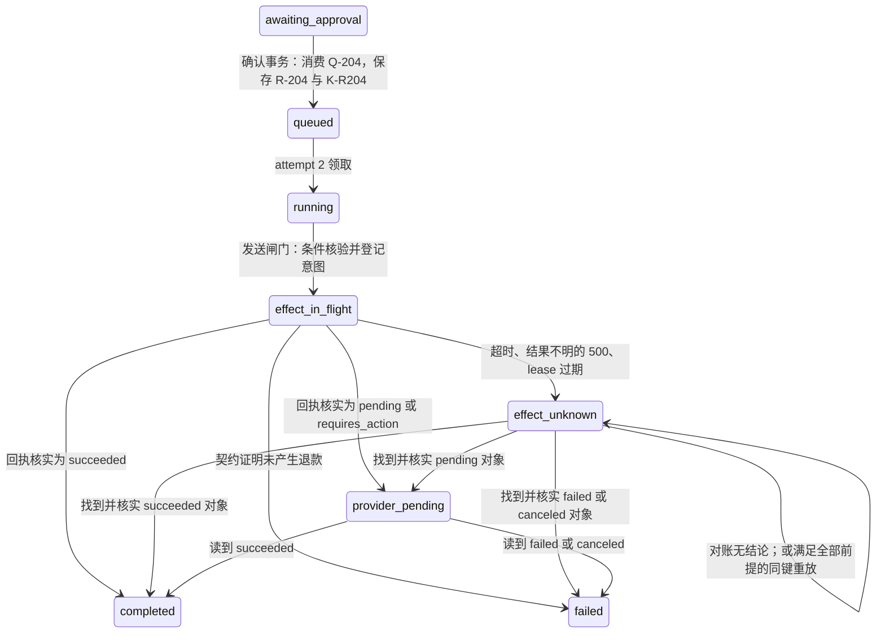
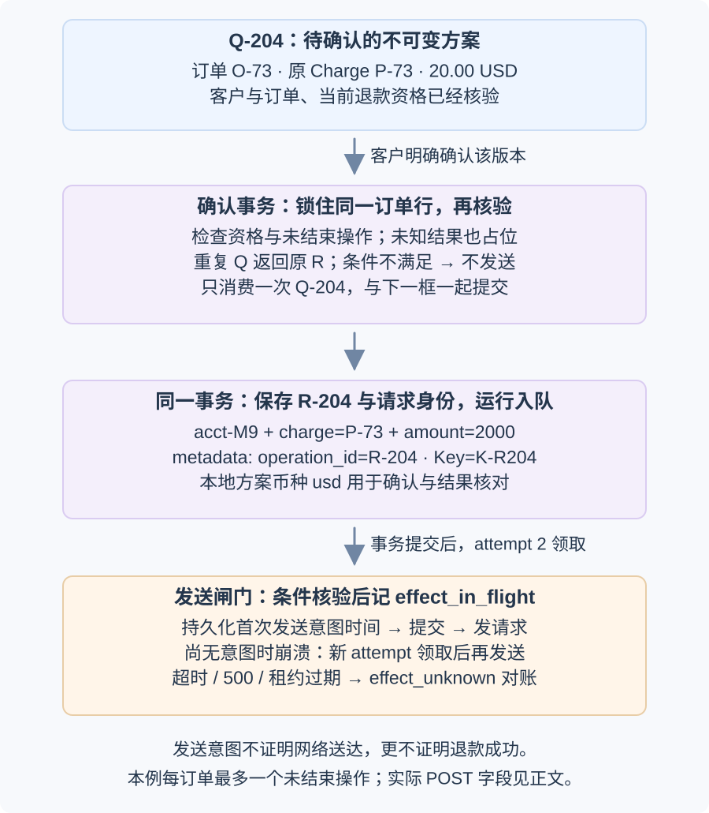
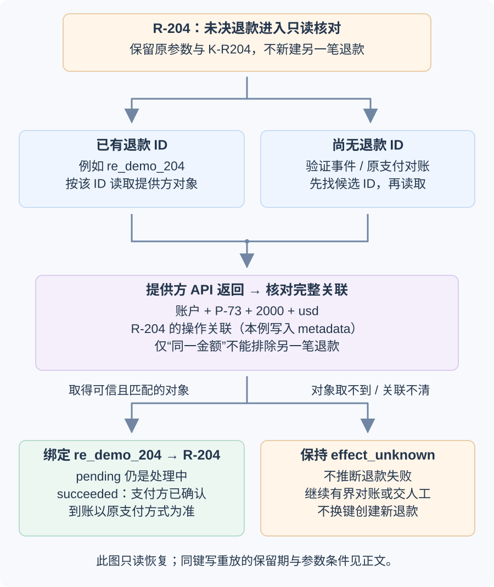

# 退款请求超时后，怎样查清结果而不重复扣款？

客户确认方案 `Q-204` 之后，`run-o73-1` 回到 `queued`，attempt 2 将把它变成一次真正的退款请求。请求发出后若迟迟没有回执，应用面对的是一个已经发生或尚未发生、却暂时看不见的事实。本章沿用[一次 AI 运行断线或崩溃后，凭什么恢复](run-identity-and-authoritative-state.md)的退款案例和状态名，回答：从确认到最终结果，外部写入要经过哪些状态和条件，超时后怎样只读查清结果，什么情况下才允许用同一个键重发。这是全书外部写入状态机的唯一权威位置，其他章节只引用它。

## 为什么超时不等于退款失败？

attempt 2 发出 `POST /v1/refunds` 后读超时，此时有三种可能：请求根本没送到；请求已送到、退款已创建，只是响应丢了；提供方还在处理。返回结果不明的 `500` 也一样。

两种常见的反应都会出错。把运行记成“退款失败”，客户会被告知没退款，可能再次申请，结果拿到两笔退款，商户被重复扣款；新建一个操作 `R-205` 换个键再试，若第一次其实成功了，同样是两笔退款。正确的做法是：保留原操作 `R-204`、原请求参数、原幂等键 `K-R204` 和已登记的发送意图，把运行转入 `effect_unknown`，然后只读查清。

下图是本章讲的外部写入阶段，状态名与总图一致：

已有发送意图时收到取消，运行转入 `cancel_requested`，同样只能只读对账；取消的完整规则见[用户断线、取消或要回答一个问题时，同一次运行怎样继续](disconnect-cancel-and-user-input.md)。

## 确认怎样绑定一份不可变方案？

attempt 1 已经核验了客户与订单归属，读取了当前政策和可退金额，生成不可变方案 `Q-204`：订单 `O-73`、原支付 `P-73`、金额 `20.00 USD`。确认只对这个版本有效；金额或目标一变，就要生成新版本、重新确认。

确认事务按订单锁住同一条操作记录，再检查资格以及是否已有未结束的退款操作。本例规定每张订单最多一个未结束的退款操作，所以所有确认入口都要遵守这把锁：两个不同的方案不能同时通过“没有其他退款”的检查。处于 `effect_unknown` 的操作仍占着这个名额，因为它可能已经退了款。经当前身份与方案核验的重复确认，直接返回原来的 `R-204`，不再占用名额。本例不覆盖同一订单并发多笔部分退款时的额度预留设计。

同一事务里，应用只消费一次 `Q-204`，并保存退款操作记录：

- 退款操作 ID `R-204`；
- 方案摘要 `plan_digest`；
- 提供方账户范围 `acct-M9`，之后不因重试而切换；
- 完整请求参数；
- 提供方幂等键 `K-R204`；
- 发送意图列表，此时为空。

运行同时改回 `queued` 并写 outbox 唤醒。确认的消费和操作记录的保存一起提交，保存失败时消费也回滚，不会出现“确认已用掉，却找不到退款操作”的中间状态。提供方仍会检查真实的剩余可退金额，本地的资格检查替代不了它。

> [!example] `R-204` 的方案字段怎样变成一次请求？
> 本地方案保存币种 `usd`，用于确认和后续核对。USD 的 `20.00` 是 `2000` 美分，因为接口金额用最小货币单位。本例向 `POST /v1/refunds` 发送 `charge=P-73`、`amount=2000`、`metadata[operation_id]=R-204`，请求头带 `Idempotency-Key: K-R204`；`P-73` 在真实请求中换成所保存的 Charge ID。
>
> 把 `R-204` 写进 metadata，是为了以后收到退款对象时能认回本方操作，再核对原支付、金额和币种。订单号不能充当操作 ID：同一订单可以先后发生多笔独立的部分退款，每笔都有自己的方案和操作。

## 发送前，闸门要核验什么？

attempt 2 领取运行后，重新读取 `Q-204`、确认记录和 `R-204`。真正发请求之前，它要通过发送闸门。首次发送和后文的同键重放共用这一道闸门：在数据库事务中取得运行记录的更新权，读取数据库实际时间，然后核验：

1. 运行处在预期状态：首次发送为 `running`，重放为 `effect_unknown`；
2. 当前 attempt 是自己，lease 尚未过期；
3. 将要发出的完整参数，其摘要仍等于客户确认的 `plan_digest`，确认仍有效；
4. grant `g-58` 此刻仍有退款写权限；
5. 运行没有被取消。

全部成立时，同一事务把这一次的发送意图写进 `R-204`（代次、`K-R204`、参数摘要、所用的 `grantRef`、意图时间；首次意图时间只记一次），并把运行改为 `effect_in_flight`。事务提交之后，才调用提供方。

这道闸门与取消事务串行化：取消先提交，就不能再登记意图；意图先提交，请求就可能尚未发出、正在路上或已被受理。意图只准许请求继续，不证明请求送达，更不证明退款成功。

闸门约束的只是本地状态，远端无法用代次拒绝旧 worker 的请求。旧 worker 若在提交意图后暂停，即使 lease 已过期、运行已转入 `effect_unknown`，它醒来后仍可能把请求发出去。这就是后文重放条件要求“旧发送者必须停下”的原因。SDK 的自动重试也是一次真正的发送：对这类写请求，要么关闭 SDK 内部重试，要么让每次重试都经过同一道闸门；重试层叠怎样放大发送次数，见[怎样让一次模型 API 调用在限额、失败和截止时间内有界](bounded-model-api-calls.md)。

## 回执回来时，谁能写回结果？

收到响应时，只有仍持有当前代次和有效 lease 的 attempt 能写回。它在一笔条件事务里复核状态与代次，然后同时保存三样东西：核实过的退款对象（按下文“只读对账”的标准核对账户、原支付、金额、币种和 `R-204` 关联）、映射后的运行状态，以及给客户的最终答复。回执为 `succeeded` 就直接 `completed`，不必等扫描或额外查询。

条件失败的旧 worker 不能直接完成运行，它把响应交给持有当前 lease 的恢复流程，由后者核对后条件写回。

明确的失败响应也要谨慎对待。只有提供方的响应契约能证明这次请求没有产生退款时，当前 attempt 才能把运行记为 `failed`；响应证明不了这一点，就按结果未知处理。

## 什么情况进入 `effect_unknown`？

三种情况：读超时或断连、结果不明的 `500`、持有 `effect_in_flight` 的 attempt 失联直到 lease 过期。进入的路径有两条：

- **attempt 仍在、只是等超时了。** 只有它仍持有当前代次和有效 lease、状态仍是 `effect_in_flight` 时，才能在一笔条件事务里把状态转为 `effect_unknown`、写对账 outbox，并结束自己的 lease。条件检查失败，它就什么也不写，等扫描器接手。
- **attempt 已经消失。** lease 过期后，扫描器保留原键、参数摘要和全部发送意图，把 `effect_in_flight` 条件转为 `effect_unknown` 并写对账 outbox，见[请求受理后，怎样保证任务最终被执行且不被两个 worker 同时推进](accepting-queuing-and-claiming-runs.md)中的扫描器分流。

本例走第一条：attempt 2 读超时，自己把运行转入 `effect_unknown`。之后的处理有三条铁律：不把它写成失败；不新建 `R-205`；不清除原操作记录。它继续占用订单 `O-73` 的未结束名额。

反过来，如果撤权或刷新失败发生在登记发送意图之前，当前 worker 明确停下，又没有更早的未结清 attempt，那么停止写入本身不构成 `effect_unknown`，见[用户撤权或令牌失效后，进行中的写入怎样安全恢复](revocation-and-reauthorization.md)。

## 只读对账怎样找到那笔退款？

对账 worker 领取 attempt 3，按原账户范围、原操作和原参数只读查询。查找路径取决于手上有什么：

- **已知提供方退款 ID**（例如某次响应已经带回 `re_demo_204`）：按 ID 读取退款对象。
- **还不知道 ID**：先从经过签名验证的事件里找候选，或在同一提供方账户下按原支付 `P-73` 列出退款记录，再逐个按 ID 读取。

幂等键一般不提供“按键查询”的能力：Stripe 的读取接口按退款 ID 查，不按 `K-R204` 查。“能否安全重放”和“凭什么找回结果”要分别核验。

无论对象来自正常的创建响应还是事后查询，都要过同一套核对：账户范围是 `acct-M9`、原支付是 `P-73`、金额是 `2000`、币种是 `usd`，并且 metadata 里的 `operation_id` 是 `R-204`。只有全部相符，才把 `re_demo_204` 绑定到 `R-204`。只看金额不够：同一笔支付可能有两次同额退款。关联不清、查询失败或超时，都保持 `effect_unknown`，安排下一次有界对账或交给人工。

## 提供方状态怎样映射回运行？

取得可信对象后，按它的**当前状态**更新运行：

| 提供方确认的状态 | 运行状态 | 客户能看到的结果 |
|---|---|---|
| `pending` | `provider_pending` | 已经知道是哪一笔退款，但还不能报告完成 |
| `requires_action` | `provider_pending` | 有适用的 `next_action` 时展示后续处理，否则交人工核对；不重新创建退款 |
| `succeeded` | `completed` | “支付方已确认退款，到账时间以原支付方式为准”；重复通知不能再产生一次记账或通知 |
| `failed` 或 `canceled` | `failed`，附提供方原因 | 说明退款未成功及原因，按政策处理后续；不与“查不到结论”混为一谈 |
| 没有可核实的对象或状态 | 保持 `effect_unknown` | 继续有界对账或交人工；不因重试次数用完就推断资金没动 |

本例中，超时后收到一条与 `R-204` 关联的事件；attempt 3 读取 `re_demo_204`，状态为 `pending`，运行由 `effect_unknown` 进入 `provider_pending`。稍后再次读取为 `succeeded`，当前持有者在同一事务里保存对象、最终答复和 `completed`。客户重连后读到的就是这条保存好的答复，见[用户断线、取消或要回答一个问题时，同一次运行怎样继续](disconnect-cancel-and-user-input.md)。

## webhook 事件怎样安全地推进状态？

提供方的 webhook（事件回调）可能重复，也可能乱序到达。入口先用原始请求体验证签名，再按事件 ID 去重。验签后的事件仍只是对账的入口：应用要用提供方 API 读取对象，按上一节的标准核对后，才更新状态。

业务更新要以操作的当前状态作条件：一条迟到的旧 `pending` 事件不能把已确认的 `completed` 覆盖回去。但“避免回退”不能实现成“忽略后续事实”：如果之后从提供方读到真实的状态变化，就把它作为一项新的异常送入对账，并保留状态历史。

确认退款后若还要发通知、记账，就把状态变更和待执行的通知一起持久化（outbox），按操作身份 `R-204` 去重。“只处理一次”不能靠内存里的标记。webhook 接收方怎样验签、去重和应答，见[Webhook 接收方如何验证并可靠受理](../../engineering-foundations/reliability/webhook-delivery-and-verification.md)。

## 查询、重放和披露结果各要什么授权？

结果未知时，应用可能要做三件事，每件事要当场核验的授权不同：

| 操作 | 当前必须满足的条件 | 结果与边界 |
|---|---|---|
| 只读对账并记录已确认的结果 | 对账身份当前有权读取原账户中的这笔退款；写回运行记录仍须由当前 attempt 在正确分支持有更新权 | 能记录已经发生的事实，即使客户确认已过期、退款写权限已撤销；在 `cancel_requested` 中只准当前对账持有者写回 |
| 重放原写请求 | 运行处在 `effect_unknown`，当前 attempt 与 lease 有效，确认仍覆盖原完整参数，写权限有效，未取消，并满足下一节的全部重放前提 | 先从不可变引用读回原参数、核对摘要，再经发送闸门登记本次意图，提交后才用原键原参发送；请求失败或超时仍是未知 |
| 向客户展示结果 | 调用者当前有权读取这个运行和这笔退款 | `runId` 只是定位符；鉴权通过后返回已保存的终态答复，不重跑模型 |

## 同键重放要满足哪些前提？

只有 `effect_unknown` 才考虑重放。重放的意思是：用原键 `K-R204`、原参数，再发一次同一个请求，指望接收方认出它是同一次写入。这要同时满足下面几条，缺一条都可能造成第二笔退款：

1. **接收方契约。** 接收方在同一账户范围内把幂等键与请求参数原子绑定：同键同参返回同一个结果，同键不同参拒绝，业务效果与去重结果一致。
2. **去重窗口覆盖所有可能到达的请求。** 去重保护要覆盖原请求、每一次重放、处理中的请求，以及所有仍可能晚到的请求；或者由接收方明确拒绝窗口之外的提交。只在发送前看一眼“键还没过期”不够。
3. **闸门条件与首次发送相同。** 确认仍有效、写权限仍在、当前 attempt 与 lease 有效、未取消，并在同一笔条件事务里登记这次的发送意图。新的意图不会清除已有的未知结果；结果一旦确认，就不再重放。
4. **旧发送者都已停下或必然落在窗口内。** 发送端要能约束暂停后恢复的旧 worker、SDK 内部重试和传输延迟。单查一次数据库或发一个取消信号，证明不了已在途的请求会按时停止。

第 2 条最容易被忽视，看一个时序例子。设接收方的去重记录保留 10 个时间单位：

| 时刻 | 事件 |
|---|---|
| `t=0` | 原请求发出，卡在网络里 |
| `t=3` | 应用超时后同键重放；接收方没见过这个键，创建了一笔退款，去重记录从此保留到 `t=13` |
| `t=13` | 去重记录过期 |
| `t=14` | 原请求终于到达；接收方已不记得这个键，又创建了一笔退款 |

重放本身符合契约，去重窗口却没有覆盖晚到的原请求。所以，暂时“查无记录”也不能证明旧请求以后不会提交。

即使所有前提都在，重放也可能一直拿回缓存的同一个 `500`，这不算查清了结果，仍要对账。

### 实例：Stripe API v1 的同键窗口

以下按 Stripe 官方文档核对于 2026-11-12。Stripe API v1 在端点开始执行后，保存同一个键的响应，包括 `500`；重放要求参数一致。键至少保留 24 小时，被清理后再用同一个键，可能被当成新请求。

本例因此用本地持久化的首次发送意图时间作保守起点，不因重试重新计时。首次发送、恢复接管和 SDK 自动重试都经过同一道发送边界：每次真正发出 POST 前，重查操作仍允许写入，并核验仍在保守的 24 小时窗口内，调度、退避和网络传输的耗时都要从余量里扣除；通过后才按原键原参有界发送。已经得到可信结论、窗口将尽或时间不明时，一律转为只读核对，不能拿旧的发送许可继续写。

举例：首个发送者登记意图后暂停；恢复器在第 1 小时已经查清并完成了退款；旧发送者在第 26 小时恢复，它必须停止，而不是继续它之前那次 POST。此时键可能已被清理，这次 POST 就可能被当成一笔新退款。

API v2 的失败重试语义不同，不能把 v1 的规则推广到所有 Stripe API，更不能推广到其他提供方。

## 保证不了安全重放时怎样收尾？

任何一条重放前提不成立，就停止自动写重试：保留 `R-204`、原参数和全部发送意图，只读对账或交给人工，不靠换键解决未知。每一轮对账查不出结论时，确认消息之前必须持久安排下一次只读处理，或指定一位人工责任人；转人工的项目永远不自动重放。重试次数用完，也不能推断资金没动。

上线前的评估要覆盖常见意图、资格边界、重复请求、超时后结果未知、政策冲突、工具失败和人工升级。生产可观测性要把每次状态迁移与 `runId`、`R-204`、提供方退款 ID 关联起来，但不要在通用日志里复制个人信息或支付正文；指标怎样定分母，见[上线后，怎样从一条错误建议找回可修复的证据](../evaluation-and-release/production-traces-and-metric-denominators.md)。

## 查清结果之后，运行才能告诉客户

外部写入的完整路径到这里闭合：确认绑定不可变方案，并原子保存操作、参数和幂等键；发送闸门先登记意图再发请求；回执丢失就进入 `effect_unknown`，只读找回并核实退款对象，再把提供方状态映射回运行；同键重放只在接收方契约、去重窗口和发送端约束同时成立时才允许，否则转人工。部署回滚只能恢复平台管理的版本，撤不回这里已经发生的退款，见[候选版本从离线通过到全量，要经过哪些关，回滚又撤得回什么](../evaluation-and-release/deployment-rollout-and-rollback.md)。

这条路径默认客户一直在线、没有改主意。客户断线后怎样找回同一个运行、中途想取消怎么办、助手要向客户问一个问题时运行怎样等待，见[用户断线、取消或要回答一个问题时，同一次运行怎样继续](disconnect-cancel-and-user-input.md)。用框架实现这套流程时框架能替你记住什么，见[LangGraph 能恢复什么，又不替应用记住什么](langgraph-recovery-boundaries.md)；商户在写入途中撤销 `g-58` 的处理，见[用户撤权或令牌失效后，进行中的写入怎样安全恢复](revocation-and-reauthorization.md)。

> [!info]- 来源
>
> 案例中的方案、操作、键、金额和账户是合成设定；下列资料支撑对应机制。
>
> - **同键响应、参数一致与 24 小时保留；v1 与 v2 的差异**（“实例：Stripe API v1 的同键窗口”）。Stripe，[Idempotent requests](https://docs.stripe.com/api/idempotent_requests)，核对日期 2026-11-12。
> - **网络错误与 500 后的重试、`500` 可能已有副作用、保留期内同键重放返回缓存错误**（“为什么超时不等于退款失败”“同键重放要满足哪些前提”）。Stripe，[Advanced error handling](https://docs.stripe.com/error-low-level)，“Network errors”“Server errors”“POST requests”，核对日期 2026-11-12。确认事务、按订单串行化和发送闸门是本例的应用设计。
> - **创建退款、多次部分退款与 metadata**（“确认怎样绑定一份不可变方案”）。Stripe，[Create a refund](https://docs.stripe.com/api/refunds/create)，核对日期 2026-11-12。
> - **按退款 ID 读取；支持幂等键不等于可按键查询**（“只读对账怎样找到那笔退款”）。Stripe，[Retrieve a refund](https://docs.stripe.com/api/refunds/retrieve)，核对日期 2026-11-12。
> - **按原支付列出候选退款**（同上）。Stripe，[List all refunds](https://docs.stripe.com/api/refunds/list)，核对日期 2026-11-12。
> - **退款对象的唯一 ID 与状态 pending、requires_action、succeeded、failed、canceled；金额用最小货币单位**（“提供方状态怎样映射回运行”、请求字段例）。Stripe，[Refund object](https://docs.stripe.com/api/refunds/object)，核对日期 2026-11-12。存在对象不等于最终成功。
> - **支付方处理状态与客户实际到账的区别**（映射表中 `succeeded` 一行的措辞）。Stripe，[Refunds](https://docs.stripe.com/refunds)，退款跟踪与失败说明，核对日期 2026-11-12。
> - **webhook 验签、重复与乱序**（“webhook 事件怎样安全地推进状态”）。Stripe，[Webhooks](https://docs.stripe.com/webhooks)，“Verify webhook signatures”“Event ordering”“Handle duplicate events”，核对日期 2026-11-12。条件状态更新与通知去重是应用设计，不是事件投递保证。
