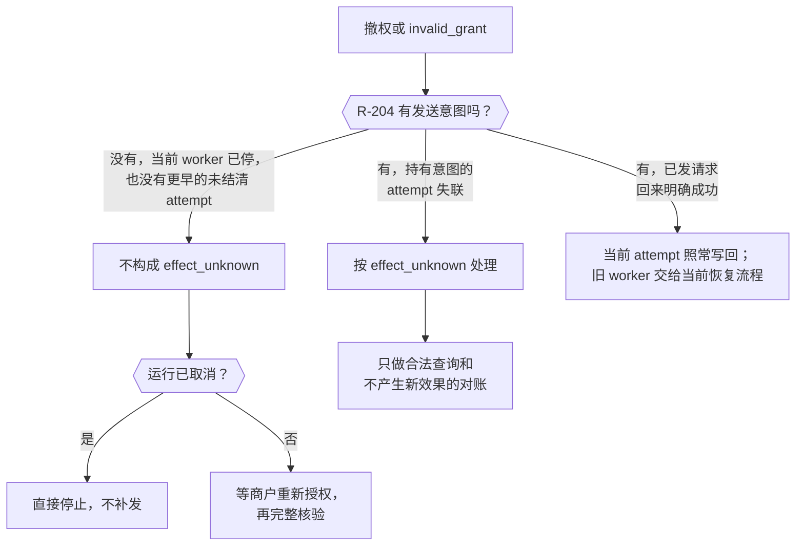

# 用户撤权或令牌失效后，进行中的写入怎样安全恢复？

退款助手代表商户 `M-9` 写入支付账户 `acct-M9`，凭的是 grant `g-58`。如果商户在退款途中断开授权，或者刷新令牌时提供方返回 `invalid_grant`，正在进行的 `R-204` 该怎么办？本章沿用[一次 AI 运行断线或崩溃后，凭什么恢复](run-identity-and-authoritative-state.md)的退款案例，回答撤权后运行时先做什么、按写入进度分成哪几支、令牌撤销到底意味着什么，以及重新授权之后要满足哪些条件才能恢复写入。外部写入状态机、`effect_unknown` 和同键重放的前提以[退款请求超时后，怎样查清结果而不重复扣款](external-writes-and-reconciliation.md)为准，这里只讲授权变化带来的分支。

## 撤权信号到达时，运行时先做什么？

撤权信号有三种来源：商户在提供方那里主动撤销授权；应用收到提供方的撤权通知；刷新令牌时授权服务器返回 `invalid_grant` 或其他不可恢复的错误。无论哪种，运行时立刻做四件事：

1. 把 `g-58` 标为不可写，清除或撤销它在秘密存储里的凭据引用；
2. 让绑定 `g-58` 的确认记录失效（本例的确认记录记着 `grantRef=g-58`）；方案 `Q-204` 的内容本身不变，以后可以在新 grant 下重新确认；
3. 阻止所有尚未登记发送意图的写入：发送闸门核验“grant 当前可写”时会失败；
4. 不回退到应用的登录会话、其他商户的令牌或任何别的凭据。

grant、审批和登录会话为什么是三种不同的记录，见[模型提出 `create_issue` 后，应用要过哪几道关才能放行](../actions/authorization-gates-for-actions.md)。

## 写入走到哪一步，决定走哪一支

接下来的处理只取决于一个问题：撤权时，`R-204` 有没有已登记的发送意图。

- **没有发送意图。** 当前 worker 已明确停止，也没有更早的未结清 attempt，那就不存在要核对的远端副作用，运行不进入 `effect_unknown`。运行未取消时，等待商户重新授权并重新核验；运行已取消时直接停止。重新授权之后，也不能按原键“补发”一个从来没发出过的效果来收尾一个已取消的运行。
- **有发送意图，持有它的 attempt 失联。** 不能据此推断请求没发出，按 `effect_unknown` 恢复。撤权期间只允许合法的查询和不会产生新效果的对账。恢复器不为已取消的运行发起新写入。
- **有发送意图，已发出的请求回来明确成功。** 撤权不改变已经发生的事实：只要当前 attempt 仍持有有效 lease，就照常核实退款对象并写回；失去资格的旧 worker 把回执交给持有当前 lease 的恢复流程，由后者核对写回。只有响应缺失或无法判定时，才保持未知。

本例设想的时间点是：attempt 2 登记意图并发出请求后，还没收到回执，商户就断开了授权。这落在第二支，运行进入 `effect_unknown`。

## 撤销令牌意味着什么，不意味着什么？

撤权不会让所有令牌立刻失效。RFC 7009 的撤销响应 `200` 不证明令牌撤销前有效，撤销 Refresh Token 也不等于撤销已经签发的 JWT Access Token：资源服务器是否立即拒绝它，取决于怎样验证令牌、怎样获知撤销。这些撤销语义见[请求怎样带上可信的身份，浏览器又替服务守住哪些边界？](../../engineering-foundations/services/sessions-and-browser-boundaries.md#调用、刷新与三种撤销)。

所以，撤权不会取消已经在网络上的请求。“商户已撤权”不能代替对账，Agent 也不能用一句“已取消”收尾。

## 撤权之后，还能查那笔退款吗？

只读对账需要一份**合法且仍有效**的读取能力。它可能来自另一份已授权的只读 grant、提供方给接收方的状态查询能力，或其他合法的审计接口。

- **没有任何合法读取能力**（例如 `g-58` 是唯一的授权，刚被撤销）：运行必须保持 `effect_unknown`。不能用已撤销的令牌继续查，也不能为了“确认一下”而偷偷申请新的 scope。
- **有合法读取能力，查到并核实了退款对象**：由当前对账 attempt 把提供方退款 ID 写回 `R-204`，按[提供方状态映射表](external-writes-and-reconciliation.md)更新运行。
- **查询出错、超时或结果无法判定**：保持 `effect_unknown`。
- **查询成功且权威地没有结果**：还要继续判断旧 attempt 是否可能晚发、接收方是否可能延迟提交。任何一种无法排除，结论仍是未知。

只读 scope 能支持对账，但不能支持重放。有些提供方的写 scope 同时包含读取能力，有些不包含；要按实际授予的 scope 判断，不能凭产品名称推断。

## 重新授权得到的是一份新 grant

商户重新连接后，应用得到的是一份新 grant，例如 `g-59`。它必须对应同一个支付账户 `acct-M9`；账户变了，就不是同一个写入目标。旧令牌和旧确认都不会自动恢复有效。本例的确认记录绑定了执行时使用的 `g-58`，而主线三规定，审批人资格或 grant 的 scope 一变，原批准即失效；换成 `g-59` 就属于这种变化。所以客户 `cust-55` 要对**同一份**方案 `Q-204`（同一个 `plan_digest`）重新确认。新确认记录指向 `g-59`，仍挂在原操作 `R-204` 上：它不会再消费一次 `Q-204`，也不新建操作或幂等键。

拿到 `g-59` 后，先用它允许的读取能力查找与 `R-204` 关联的退款。查不到时，仍要同时排除旧 attempt 晚发和接收方延迟提交，才能记下“权威确认无副作用”。

## 恢复写入要过哪些门槛？

撤权之后要重新写入，只有两种起点：运行仍处于 `effect_unknown`，按同键重放的前提受控重放；或者已经权威确认没有远端副作用，恢复原来的写入。两种情况都要同时满足：

1. 运行仍处于活动状态，没有被取消；
2. 当前 grant（本例为 `g-59`）对 `acct-M9` 有退款写权限；
3. 客户已在当前 grant 下重新确认同一份 `Q-204`；
4. 没有未结清的、或仍可能晚发的旧 attempt；
5. 接收方对同键同参的去重保证仍在有效窗口内；
6. 只重放原键 `K-R204` 和原参数，并像首次发送一样经过发送闸门、原子登记新的发送意图。

任何一条不成立，就停止写入，保留原操作键、请求摘要和取消状态，继续合法的只读对账，或请商户与管理员人工核查。原键不能配不同的参数：若要改金额或目标，先把 `R-204` 彻底结清，再建立新的方案、确认、操作 ID 和幂等键。

## 授权会变，写入的恢复规则不变

撤权或令牌失效时，运行时先让 grant 不可写、让依赖它的确认失效、阻止未发送的写入；之后只看发送意图是否已登记：没有意图就等重新授权，有意图就按 `effect_unknown` 只读对账，已经回来的成功照常写回。令牌撤销不会撤回在途请求；撤权后能否对账，取决于是否还有合法的读取能力；重新授权得到的是新 grant，旧确认不会复活，恢复写入要在新 grant 下重新确认同一份方案，并满足同键重放的全部前提。回到主线，客户断线、取消或需要回答问题时同一运行怎样继续，见[用户断线、取消或要回答一个问题时，同一次运行怎样继续](disconnect-cancel-and-user-input.md)。

> [!info]- 来源
>
> 授权原则于 2026-11-12 对照 RFC 与 provider 官方文档复核；令牌期限和撤销传播随 provider 而异。
>
> - **令牌撤销接口，以及对同一 grant 下其他令牌的可能影响**（“撤销令牌意味着什么，不意味着什么”）。IETF，[RFC 7009: OAuth 2.0 Token Revocation](https://www.rfc-editor.org/rfc/rfc7009.html)，2013-08，§§2–2.2。规范没有让调用方据此推断任意资源服务器已同步停止接受所有自包含访问令牌。
> - **刷新令牌的发送方约束或轮换、受众限制**（“撤权信号到达时，运行时先做什么”中刷新失败的来源）。IETF，[RFC 9700: Best Current Practice for OAuth 2.0 Security](https://www.rfc-editor.org/rfc/rfc9700.html)，2025-01，§§2.1.1、4.14。
> - **provider 特定的 `invalid_grant` 与令牌撤销示例**（同上）。Google for Developers，[Using OAuth 2.0 for Web Server Applications](https://developers.google.com/identity/protocols/oauth2/web-server)，“Refreshing an access token”“Token revocation”及 `invalid_grant` 说明。这是 Google 特定行为，不外推到其他授权服务器。
