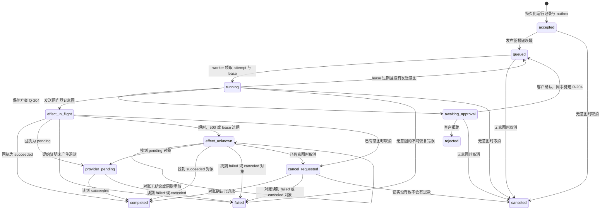

# 一次 AI 运行断线或崩溃后，凭什么恢复？

主线三结束时，应用放行了一个写动作，并留下几件持久记录：用户批准的那一份精确草稿及其摘要、审批记录、执行时要用的 grant 引用，以及发送前登记的发送意图。本章从这些记录出发回答：浏览器断线、worker 崩溃或远端迟迟不回话之后，应用凭什么判断运行到了哪一步、外部动作有没有发生。本章还给出主线四共用的退款案例、状态机总图和标识符词汇表，后续各章都从这里取状态名和标识符。

## 退款助手的一笔退款停在了哪里？

主线四用一个合成的退款助手做贯穿案例，下面的标识符、金额和账户都是教学设定。客户 `cust-55` 在聊天窗口里说：“订单 `O-73` 的商品坏了，请退款。”这笔订单由已成功扣款的原支付 `P-73` 付款，可退金额是 `20.00 USD`。退款助手是商户 `M-9` 接入的第三方客服应用：商户通过 OAuth 把支付账户 `acct-M9` 的退款写权限委托给它，应用保存的 grant 引用是 `g-58`。具体的支付接口以 Stripe API v1 的 `POST /v1/refunds` 为例（核对于 2026-11-12）；`P-73` 是 Charge 的教学别名，真实请求要换成提供方的 `ch_...` ID。

服务为这次请求建立运行 `run-o73-1`。在第一次执行中，模型先发起工具调用 `call-r1` 读取订单与退款资格，得知 `P-73` 已扣款成功、仍可退 `2000` 美分；接着模型发起 `call-r2`，提议“为 `O-73` 退款 `20.00 USD`”。这只是一个请求：应用用自己的代码重新核验客户、订单归属和当前政策，生成不可变的退款方案 `Q-204`，展示给客户。客户确认了 `Q-204`。确认事务同时保存退款操作 `R-204`：它记着完整请求参数和发给提供方的幂等键 `K-R204`。

随后，第二次执行通过了发送前的全部检查，在操作记录里登记了发送意图，然后向提供方发出退款请求。请求发出后迟迟没有回执，HTTP 客户端报告读超时；几乎同时，客户的浏览器也断线了。

此刻没人能凭记忆回答“退款到底发生了没有”。能依靠的是主线三放行时留下的四类记录。主线三的建单案例里，批准草稿的人和授予 grant 的人是同一个用户；退款案例把这两件事分给两方：客户 `cust-55` 确认方案内容，商户 `M-9` 提供写权限。字段名也随案例换了：主线三的 `payload_digest` 在这里叫 `plan_digest`，“远端操作键”就是提供方幂等键 `K-R204`。

| 主线三的交接记录 | 在退款案例中 | 恢复时用来回答 |
|---|---|---|
| 获批草稿（不可变待审版本） | 方案 `Q-204`：`runId=run-o73-1`、提出它的 `tool_call_id=call-r2`、订单 `O-73`、原支付 `P-73`、金额 `2000`、币种 `usd`、证据引用 `call-r1`，以及覆盖这些字段的 `plan_digest` | 将要发出的究竟是哪一份内容 |
| 审批记录 | 确认编号、确认人 `cust-55`、确认时间、决定、所针对的 `plan_digest`；本例还记下执行时使用的 `grantRef=g-58`。按主线三“资格变了批准即失效”的规则，`g-58` 被撤销或换成新 grant，这次确认就失效，见[撤权与重新授权](revocation-and-reauthorization.md) | 这份内容是否被有资格的人确认过，现在是否仍有效 |
| grant 引用 | `grantRef=g-58`：商户 `M-9` 对支付账户 `acct-M9` 的委托，记着目标资源（支付 API）、实际授予的退款写 scope、秘密引用的版本；令牌在加密秘密存储里，记录只存引用 | 现在是否仍有权代表商户写入或读取对账 |
| 发送意图 | 记在退款操作 `R-204` 上：`runId`、`tool_call_id=call-r2`、发送时的 attempt（本例为 2）、`K-R204`、`plan_digest`、`grantRef=g-58`、首次意图时间 | 请求是否可能已经发出，用哪个键去查或去重 |

审批为什么要绑定精确内容、grant 为什么不等于审批，属于主线三[模型提出 `create_issue` 后，应用要过哪几道关才能放行](../actions/authorization-gates-for-actions.md)。本主线只读这些记录，不重新论证它们。

## 谁持有运行的权威状态？

答案是应用自己。一次运行会经过很多参与者：客户端到服务的 HTTP 请求、推送进度的事件流、执行步骤的 worker（工作进程）、唤醒 worker 的队列消息、模型的上下文，以及供应商侧的会话或线程。它们都可能单独消失，而且消失本身不说明任何事：

- 浏览器断线，不说明运行停止了，也不说明客户想取消；
- worker 崩溃，不说明它登记意图后的请求没有发出；
- HTTP 客户端读超时，不说明提供方没有创建退款；
- 队列消息被重投，不说明任务需要从头再做一遍。

所以，能回答“任务到哪一步、外部动作发生了什么”的，只能是应用在自己的数据库里用条件事务提交的记录。恢复的顺序也随之固定：先读持久状态，再按外部接口的契约去查询、去重或对账。不要让一轮新的模型生成来决定“要不要再退一次”：重新调用模型可能给出不同的输出，而外部结果是一个已经发生或尚未发生的事实，只能查。

## 运行、工具调用和执行各用什么身份？

恢复时要分清三层身份，它们回答不同的问题，不能互相代替：

- **`runId`（运行标识）** 标识一次逻辑任务。本例是 `run-o73-1`：从受理到最终答复，无论中间换了几个 worker、客户断线几次，都是这一个运行。客户端重连、查询结果、提交取消都用它定位。
- **`tool_call_id`（工具调用 ID）** 把模型的一个工具请求和它的结果配对。`call-r1` 配对订单读取与返回的资格信息，`call-r2` 配对退款提议与“已生成待确认方案 `Q-204`”这个结果。它只在模型对话里有意义，不是外部系统的去重键；配对规则见[模型“调用工具”时实际发生了什么](../actions/tool-calls-are-requests.md)。
- **`attempt`（执行代次）** 标识 worker 取得租约后的一次执行。本例中 attempt 1 读订单并生成方案，attempt 2 负责发送，之后接手对账的是 attempt 3。代次只增不减，每一次推进本地状态都要核验“当前代次仍是我、我的 lease（租约）尚未过期”，所以它同时充当 fencing token（栅栏令牌）：被新代次取代的旧 worker 即使还活着，也写不进运行记录。它约束不了的是远端：旧 worker 若在登记发送意图后暂停，醒来后仍可能把请求发出去。

这三层之外，还有两组标识符会在后面出现。客户端提交请求时带的 `Idempotency-Key` 只用来让重复提交找回同一个 `runId`，见[请求受理后，怎样保证任务最终被执行且不被两个 worker 同时推进](accepting-queuing-and-claiming-runs.md)；退款操作 `R-204` 和发给提供方的 `K-R204` 标识外部写入本身，见[退款请求超时后，怎样查清结果而不重复扣款](external-writes-and-reconciliation.md)。完整对照在本章末的词汇表。

## 哪些记录能证明运行到了哪一步？

恢复时会碰到六类记录或通道。它们看起来都“记得”这次运行，能证明的事情却很不一样：

| 记录或通道 | 本例中的内容 | 能证明什么 | 不能证明什么 |
|---|---|---|---|
| 运行记录 | `run-o73-1`、调用者 `cust-55`、订单范围 `O-73`、当前状态、当前 attempt 与 lease 期限、截止时间、终态答复或错误 | 这次逻辑任务现在处于哪个状态、谁有权推进 | 外部退款是否已创建 |
| 检查点 | 已完成的步骤、`call-r1` 的订单与资格观察、`call-r2` 的提议、`Q-204` 引用与确认记录 | 哪些观察和决策已经记录，下一步从哪里继续 | 记录之后发生的远端动作 |
| 副作用记录（操作账本） | `R-204`、`plan_digest`、账户范围、完整请求参数、`K-R204`、每次发送意图、提供方退款 ID 与状态 | 外部动作是否已发起、已确认，或仍结果未知 | 意图之后请求是否真的送达 |
| 交付连接：HTTP 响应、事件流、WebSocket | `202` 受理回执、“正在处理退款”之类的进度事件 | 这一次交付送到了哪里 | 断线不改变运行事实 |
| 模型上下文与 KV cache / prompt cache | 本轮对话、可复用的前缀计算 | 能减少重复计算 | 审批、运行状态或外部结果 |
| 队列消息 | “`run-o73-1` 可以被处理”的唤醒信号 | 有一项工作等着领取 | 可能被重投，不是状态的权威记录 |

前三类由应用在条件事务里写入，是恢复的依据；后三类只是让工作发生或让人看到工作的通道。主线三交来的记录分别落在这里：获批草稿和审批记录在检查点里，grant 引用在单独的授权记录里，发送意图在操作账本里。

## 检查点和推理缓存各恢复什么？

检查点保存的是应用已经知道的事实：工具调用 ID、工具返回的结果、确认过的方案、外部结果标识和下一步骤。模型上下文里的文字、模型回复 ID、前缀缓存和推理引擎的 KV cache 都只复用计算，代替不了这些事实。以 OpenAI 的 prompt caching 为例，缓存按模型与配置过期，也不保证每次命中；它省的是重复前缀的计算，不是运行账本。前缀缓存在引擎和账单上怎样起作用，见[重复的前缀怎样在引擎里复用，又怎样体现在 API 账单上](../model/prefix-reuse-and-prompt-caching.md)。

供应商的服务端线程也是同样的定位。以 Anthropic 当前处于 beta 的 Message Threads 为例：后续请求引用上一条回复的 ID，服务端就能重建完整输入，省去重复上传历史；但线程只尽力短期保留，也不能分支或修改旧消息。应用仍要自己保存完整消息历史、`runId`、检查点和操作账本，线程过期时才能重建请求。哪些状态必须留在应用里，见[每次调用的上下文预算该怎样分配，哪些状态必须留在应用里](../context/context-budget-and-state-layers.md)。

从检查点重建运行时若要再次调用模型，输出可能和上次不同，还会再产生费用。如果某个外部动作结果未知，必须先对账，不能让新一轮生成去决定是否重做。

## 事件历史能恢复什么？

更复杂的编排可以使用保存事件历史的工作流运行时。以 Temporal 为例，它把工作流发出的命令和活动返回的结果记成 event history（事件历史），worker 崩溃后按历史重放，重建编排状态。这能恢复应用的工作流，但有两件事它不做：它不会让模型调用变得确定，也不会替你判断一个历史里没有记下结果的远端写入有没有提交。用了这类运行时，仍要为每个外部写入定义操作记录，以及幂等或对账契约。

持久化的关键不在于用哪种技术。运行表、操作记录加持久队列就能完成本主线的全部职责；要检验的是：进程、连接或 worker 消失后，系统仍能回答“任务到哪一步、外部动作发生了什么”。

## 退款运行会经过哪些状态？

下图是 `run-o73-1` 的状态机总图，全主线共用这套状态名。图中一个状态就是运行记录里 `status` 字段的一个值；状态之间的每次转移都由一笔条件事务完成，事务先核验预期状态，有执行者时还要核验当前 attempt 与 lease。

| 状态 | 含义 | 谁能推进它 | 详见 |
|---|---|---|---|
| `accepted` | 运行记录和 outbox 事件已在同一事务写入，唤醒尚未投递 | outbox 发布器 | [受理与领取](accepting-queuing-and-claiming-runs.md) |
| `queued` | 等待 worker 领取，没有有效 lease | 收到唤醒的 worker，条件领取下一 attempt | 同上 |
| `running` | 某个 attempt 持有有效 lease，执行读订单、调模型、拟方案等不产生外部写入的步骤 | 当前 attempt；lease 过期后由扫描器放回 `queued` | 同上；模型调用的边界见[有界的模型 API 调用](bounded-model-api-calls.md) |
| `awaiting_approval` | 不可变方案 `Q-204` 已保存，等客户确认；期间没有执行 lease | 只消费当前待审版本的确认、拒绝或取消事务 | [外部写入与对账](external-writes-and-reconciliation.md) |
| `effect_in_flight` | 当前 attempt 已登记发送意图，请求可能正在发送或处理 | 当前 attempt 写回回执；lease 过期后由扫描器转 `effect_unknown` | 同上 |
| `effect_unknown` | 已登记意图，但没有可判定的结果 | 对账 worker；满足全部前提时才可同键重放 | 同上 |
| `provider_pending` | 已找到并核实提供方的退款对象，它仍是 `pending` 或 `requires_action` | 读取提供方对象的 worker 或已验签事件 | 同上 |
| `cancel_requested` | 已有发送意图时收到取消；停止新动作，只读对账 | 对账 worker | [断线、取消与用户输入](disconnect-cancel-and-user-input.md) |
| `completed` | 终态：提供方确认退款 `succeeded`，答复已保存 | 不再变化 | — |
| `rejected` | 终态：客户拒绝方案，未产生发送意图 | 不再变化 | — |
| `canceled` | 终态：证实没有退款，也不会再有退款被提交 | 不再变化 | 取消的完整条件见[断线、取消与用户输入](disconnect-cancel-and-user-input.md) |
| `failed` | 终态：确定没有未知外部效果的失败，例如无意图的不可恢复错误，或提供方明确返回 `failed`、`canceled` | 不再变化 | — |

本主线跟踪的是其中一条路径：

1. 客户提交请求，`run-o73-1` 进入 `accepted`，发布器投递唤醒后进入 `queued`。
2. attempt 1 领取后进入 `running`，经 `call-r1`、`call-r2` 生成 `Q-204`，进入 `awaiting_approval` 并结束 lease。
3. 客户确认 `Q-204`，同一事务保存 `R-204` 与 `K-R204`，运行回到 `queued`。
4. attempt 2 领取并通过发送闸门，登记意图后进入 `effect_in_flight`，发出退款请求。
5. 请求读超时，attempt 2 用一笔条件事务把运行转为 `effect_unknown`。
6. attempt 3 只读对账，找到并核实退款对象 `re_demo_204`，状态为 `pending`，运行进入 `provider_pending`。
7. 稍后读到 `succeeded`，运行进入 `completed`，客户重连后读到保存的答复。

第 1–2 步的受理、领取和崩溃恢复见[受理与领取](accepting-queuing-and-claiming-runs.md)；第 3–7 步的写入、对账和重放条件见[外部写入与对账](external-writes-and-reconciliation.md)；断线、取消和中途向客户提问见[断线、取消与用户输入](disconnect-cancel-and-user-input.md)；商户在第 4–6 步之间撤销 `g-58` 的情形见[撤权与重新授权](revocation-and-reauthorization.md)。

## 本主线用到哪些标识符？

| 标识符 | 本例取值 | 由谁生成 | 标识什么 | 不能拿来做什么 |
|---|---|---|---|---|
| 客户端 `Idempotency-Key` | `cli-o73-1` | 客户端 | 一次“发起退款运行”的提交；与调用者、订单范围和请求摘要绑定 | 不是发给支付提供方的键 |
| `request_digest` | 规范化请求的摘要 | 服务端 | 原始请求的内容 | 不能代替方案摘要 |
| `runId` | `run-o73-1` | 服务端 | 一次逻辑任务 | 不是 OAuth 凭据，也不是授权依据 |
| `tool_call_id` | `call-r1`、`call-r2` | 模型 API | 一个工具请求与它的结果 | 不是外部去重键 |
| `attempt` 与 lease | 1、2、3，各带期限 | 数据库条件领取 | 谁此刻有权推进本地状态 | 阻止不了旧进程向远端发请求 |
| 方案 `Q-204` 与 `plan_digest` | `O-73`、`P-73`、`2000`、`usd` 的摘要 | 应用 | 客户确认的那一份不可变方案 | 摘要只用于比对，不能还原内容，也不单独证明有人确认过 |
| `grantRef` | `g-58` | 应用（OAuth 绑定后） | 商户对 `acct-M9` 退款权限的委托 | 不批准任何一笔具体退款 |
| 退款操作 ID | `R-204` | 应用 | 一次外部写入及其全部发送意图 | 订单号不能代替它：同一订单可有多笔部分退款 |
| 提供方幂等键 | `K-R204` | 应用，随请求头发出 | 让提供方识别同一次写入 | 是否去重、保留多久由提供方契约决定；不保证能按键查询 |
| 提供方退款 ID | `re_demo_204` | 支付提供方 | 提供方那一侧的退款对象 | 只有核实账户、原支付、金额、币种和操作关联后，才能绑定到 `R-204` |
| 事件序号 | `seq=10`、`11`… | 服务端 | 交付给客户端的事件位置 | 只在服务端仍保留事件时能续读 |

## 恢复靠应用持有的记录，接着要让每一步有界并只被一个执行者推进

本章确立了主线四的基础：应用自己持有运行记录、检查点和操作账本，连接、流、worker、队列消息和模型缓存都只是参与者；`runId`、`tool_call_id` 和 `attempt` 各管一层；状态机总图和词汇表是后续各章的共同语言。运行处在 `running` 时，每一次模型调用本身也要有界，否则一个卡住的请求会拖住整个运行，这是下一章[怎样让一次模型 API 调用在限额、失败和截止时间内有界](bounded-model-api-calls.md)的问题。之后，[请求受理后，怎样保证任务最终被执行且不被两个 worker 同时推进](accepting-queuing-and-claiming-runs.md)从第 1 步开始，把一次提交变成只被一个 attempt 推进的运行。

> [!info]- 来源
>
> - **事件历史重建工作流状态，但不判定未记录的远端副作用**（“事件历史能恢复什么”）。Temporal，[Event History](https://docs.temporal.io/encyclopedia/event-history)，核对日期 2026-11-06；说明工作流命令和活动结果怎样记录、worker 崩溃后怎样重放。它是运行时实现例。
> - **prompt cache 只复用匹配前缀的计算，按模型与配置过期且不保证命中**（“检查点和推理缓存各恢复什么”）。OpenAI，[Prompt caching](https://developers.openai.com/api/docs/guides/prompt-caching)，核对日期 2026-11-06，“What is the prompt cache?”“Cache lifetime”及常见问题。运行身份、操作账本和审批记录是本文的应用架构扩展。
> - **服务端线程只重建输入、短期保留、不能分支**（同上）。Anthropic，[Message Threads API 文档](https://platform.claude.com/docs/en/build-with-claude/message-threads)，核对日期 2026-11-12，“How message threads work”“Recover when a thread can’t be continued”；当前为 beta。
> - **退款案例的接口与对象**（“退款助手的一笔退款停在了哪里”、词汇表）。Stripe，[Create a refund](https://docs.stripe.com/api/refunds/create)（同一 Charge 可多次部分退款，支持 metadata）与 [Refund object](https://docs.stripe.com/api/refunds/object)（退款对象有唯一 ID，状态含 pending、requires_action、succeeded、failed、canceled；金额用最小货币单位），核对日期 2026-11-12。案例中的商户、grant、标识符与金额都是合成设定。
