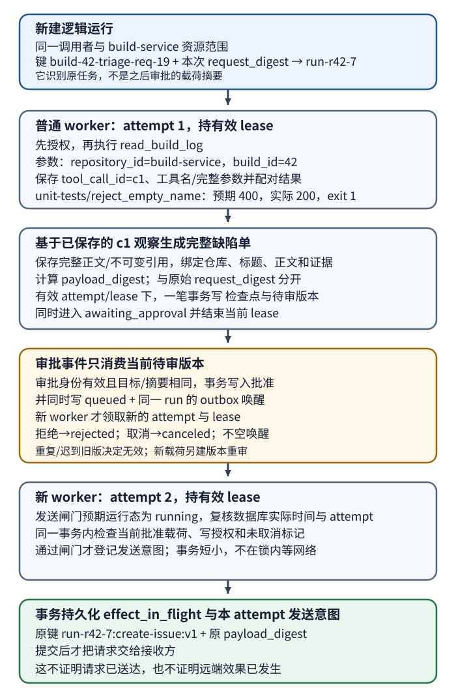
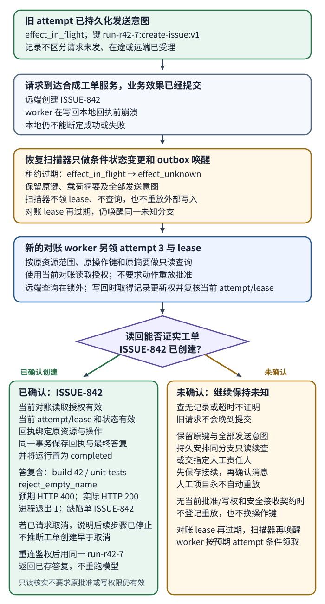

# AI 运行怎样在断线或工作进程崩溃后恢复，并避免副作用重复？

把一次逻辑任务的身份、权威状态和外部副作用保存在应用侧。HTTP（Hypertext Transfer Protocol，超文本传输协议）请求、事件流和 worker（工作进程）都只是完成或交付运行的参与者；任何一个断开，都不能单独证明运行已经停止，也不能证明一次写入没有生效。恢复时先读持久状态，再按操作契约查询、去重或对账。

本篇以[一条构建失败消息](from-message-to-answer.md)的合成 build 42 证据为起点，但新建运行 `run-r42-7`，不续接任何结果未知的旧运行。为走完长运行，案例增加请求“解释失败并准备缺陷单；提交前让我审核。”本次重新执行的 `read_build_log` 与 `c1` 的证据关联会在后文走一遍；新增的 `create_issue` 是本例应用工具，不是上游章节已有的接口。

## 运行身份、持久状态和交付连接分别负责什么？

每个逻辑任务使用稳定的 run ID（运行标识，字段名 `runId`）。客户端提交 idempotency key（幂等键）时，服务端将调用者、资源范围、键值和规范化请求摘要绑定：同一作用域、同一键且同一摘要的重试返回原有运行；同键但不同摘要应返回冲突，不能借用旧运行，也不能新建第二个动作。`runId` 标识逻辑任务，`tool_call_id`（工具调用 ID）关联模型请求与工具结果，worker attempt（工作进程执行尝试）标识一次获租执行；它们不能相互代替。

| 记录或通道 | 在本例中的内容 | 能证明什么 |
|---|---|---|
| 运行记录 | `runId`、调用者和 `repository_id=build-service` 范围、当前状态、任务版本、截止时间、终态结果或错误 | 这次逻辑任务现在处于什么状态 |
| 检查点 | 最近已持久化的步骤、工具调用 ID、证据引用、经批准动作的摘要 | 哪些观察与决策已经记录，可从哪里继续 |
| 副作用记录 | 稳定操作键、目标资源、请求摘要、执行状态、外部工单 ID | 某个外部动作是否已发起、已确认或仍结果未知 |
| 请求响应、临时流或 WebSocket（网页套接字）连接 | 这一次提交响应或进度事件 | 只说明本次交付；断线不改变运行事实 |
| model context（模型上下文）或 KV cache（键值缓存）/prompt cache（提示缓存） | 当前推理使用的对话和可重用计算 | 可能减少重复输入处理；不证明应用状态、审批或外部动作结果 |
| 队列消息 | 某个运行可以被 worker 处理的唤醒信号 | 可被重投；不是运行状态的权威记录 |

供应商消息 thread 也是交付/续接机制，不是应用的权威运行记录。以 Anthropic 当前 beta 的 Message Threads 为例，服务端可根据上一条 response ID 重建完整模型输入并减少后续历史的重复上传；它有短期保留期，应用仍需保存完整消息历史和自己的 `runId`、检查点与副作用状态，以便过期、修改或分支后重建请求。传输优化和当前 beta 限制见[AI 时延与成本优化](ai-latency-and-cost-optimization.md)。

## 接受请求后怎样保证最终入队？

初始提交可能已成功写入运行记录，但响应尚未送到客户端；如果运行记录和队列发送不是一个原子动作，也可能在两者之间崩溃。常见做法是在同一数据库事务中写入运行记录和待发布的 outbox（事务发件箱）事件。发布器先持久化 `accepted` 到 `queued` 的状态变化，保留待发送事件，再投递队列消息；若在投递前崩溃，发布器仍能找到事件并重试，若投递后、标记已发送前崩溃，重复消息会唤醒同一个 `queued` 运行，由条件领取消重。这样 worker 收到消息时不会遇到尚未入队的 `accepted` 状态。若运行记录和 outbox 记录无法参加同一事务，就需要等价的可恢复入队协议与扫描修复任务。

本例只在请求摘要与运行记录、outbox 事件持久化后返回 `202 Accepted`。同一调用者在 `repository_id=build-service` 的 build 42 范围内用原键重试相同请求，会找到相同的 `runId`；若改了问题或目标，服务返回冲突。RFC 9110 中的 `202` 只表示请求已接受处理，业务的去重和队列恢复仍由应用实现。

## worker 崩溃后怎样让新尝试接手？

队列消息只是唤醒运行。worker 用条件更新原子领取 `queued`，在持久记录中取得有期限的 lease（租约）和单调递增的 attempt/fencing token（尝试代次／栅栏令牌）。每次本地状态推进都先锁定运行记录，再用数据库实际时钟核验预期状态、当前 attempt、未过期 lease 和未取消标记。PostgreSQL 14.24 的复放显示，直接执行 `UPDATE ... WHERE lease_until > clock_timestamp()` 即使等待行锁后仍可能推进已过期租约；锁定该行后再读取 `clock_timestamp()`，才是在取得更新权时检查租约。事务必须短小，不在锁内等待模型或网络。lease 不会杀死旧进程或撤回远端请求；如果本地条件不再成立，旧 attempt 不能继续写运行记录。扫描器只落持久状态与 outbox，不能替 worker 领取下一代；收到唤醒的 worker 才能按当前状态和 attempt 条件原子领取新 lease。若原 attempt 在有效期内先提交，后续扫描读到该状态；若扫描与唤醒之后新 worker 先领取，旧 attempt 会因代次不符而失效。取消、审批和恢复都各有条件事务；`cancel_requested` 下只有当前对账 attempt 能写回已确认的只读结果。

完成本次消息代表的步骤或写下暂停状态后，先持久化检查点再确认消息；若确认前崩溃，重投会从检查点恢复。确认后崩溃时，扫描器按持久状态分流，不把所有过期运行都放回普通 `queued`：只有 `running` 且操作账本确认没有任何发送意图的运行，才条件地改为 `queued` 并写普通 outbox；执行 worker 收到后原子领取下一 attempt。过期的 `effect_in_flight` 则由扫描器保留原操作键、载荷摘要和全部发送意图，条件转成 `effect_unknown` 并写对账 outbox。扫描器不增 attempt、不领 lease。

对账 worker 消息重投时，worker 只有在运行仍是该 `effect_unknown` 分支（若已取消则仍是 `cancel_requested`）、消息预期 attempt 相符且数据库实际时钟确认现有对账 lease 已过期或为空时，才能原子领取下一 attempt 和新 lease；并发或重复消息只有一个能领取。若对账 attempt 再次过期，扫描器在同一条件下保持原分支，写新的持久对账唤醒；下一 worker 沿用原键和全部发送意图。扫描器仍不领取执行租约。`awaiting_approval` 只由绑定当前待审版本的审批事务唤醒。对账没有结论时，确认消息前必须持久安排下一次只读处理或指定人工责任人；人工项目永不自动重放。

运行表、操作记录和持久队列可以完成这些职责。更复杂的编排也可选保存事件历史的工作流运行时；持久化的关键不是技术名词，而是进程、连接或 worker 消失后仍能回答“任务到哪一步、外部动作发生了什么”。

## 同一运行怎样跨审批和外部写入恢复？

本例从一个新建的合成运行 `run-r42-7` 开始，不续接任何结果未知的旧运行。客户端以 `build-42-triage-req-19` 提交“解释失败并准备缺陷单；提交前让我审核”，服务把调用者、`repository_id=build-service`、幂等键和本次提交摘要绑定到同一个 `runId`。这个 request digest（原始请求摘要，`request_digest`）只识别原始任务；之后审核的完整缺陷单另有 payload digest（动作载荷摘要，`payload_digest`），二者不能互相代替。

普通 worker 持有 attempt 1 和有效 lease 时，应用本次执行 `read_build_log(repository_id="build-service", build_id=42)`。主机先检查调用者对该仓库中 build 42 的读取权限，再执行工具，并把模型给出的 `tool_call_id=c1`、工具名、完整参数与匹配的返回值一起保存：`unit-tests` 中 `reject_empty_name` 预期 HTTP `400`、实际 `200`，进程退出状态 `1`。只有这组证据关联持久化后，应用才把它交回模型。模型据此生成缺陷单完整草稿；应用保存正文或不可变引用，并为仓库、标题、正文和证据等全部获批字段计算 `payload_digest`。

### 从请求到可发送意图



模型生成草稿后，当前仍有效的 attempt 在一笔条件事务中核验 `running` 状态、attempt 和 lease，再一并保存包含 `payload_digest` 与目标的不可变待审版本、检查点、`awaiting_approval`，并结束这次普通 worker lease。事务失败就没有审批等待项；审批期间没有执行 lease。客户端和审批人始终看到同一个 `run-r42-7` 待审版本。

审批决定只消费仍处于 `awaiting_approval` 的当前版本：目标和摘要相符且审批人当前有权批准时，同一事务写入批准决定、`queued` 和同 `runId` 的 outbox 唤醒。拒绝写为 `rejected` 且不排队；取消写为 `canceled` 且不排队；过期、重复或针对旧摘要的审批不能重新入队。载荷变化需另建待审版本并重新审批。

批准后，新 worker 领取 attempt 2 和 lease，重新读取原始草稿、目标与批准版本。首次发送和后文的同键重放共用一个发送意图闸门：在数据库事务中取得运行记录更新权后，按上一节方法读取实际时钟，并检查预期状态（首次为 `running`、重放为 `effect_unknown`）、当前 attempt 与有效 lease、完整载荷仍符合当前批准、当前写权限有效且没有取消。事务还须把这一次 attempt 的发送意图和稳定操作键 `run-r42-7:create-issue:v1`、原始载荷摘要一并持久化；提交后才能调用工单服务。这个闸门与取消事务串行化：取消先提交就不能登记新意图，意图先提交则请求仍可能尚未发出、在途或已受理。意图只准许请求继续，不证明请求已送达或工单已创建。

下表列出各分支由谁推进：

| 持久化事实 | 条件变更与持有者交接 | 边界 |
|---|---|---|
| `awaiting_approval` 收到决定 | 只消费当前待审版本；批准后同事务写 `queued` 与 outbox，worker 再领新 attempt | 拒绝为 `rejected`，取消为 `canceled`；迟到/重复/旧版本审批不入队 |
| lease 过期的 `running`，没有发送意图 | 扫描器条件改为 `queued` 并写普通 outbox；worker 原子领取下一 attempt | 只有此分支能普通续跑；无可恢复的普通错误记 `failed` |
| lease 过期的 `effect_in_flight` | 扫描器保留原键、摘要和全部意图，改为 `effect_unknown` 并写对账 outbox；worker 另领新 attempt | 扫描器不领取 attempt 或 lease |
| `effect_unknown` 或 `cancel_requested` 中，对账 lease 再次过期 | 扫描器取得记录更新权并核验当前 attempt/实际时钟后，保持原分支、写新对账 outbox；worker 仅在分支与预期 attempt 相符且无有效 lease 时原子领取下一 attempt 和新 lease | 重复消息只有一条能成功领取；同键、旧载荷和所有发送意图不变 |
| 当前普通 attempt 收到远端成功回执 | 在有效 attempt 持有下，同一事务把绑定原资源/操作的回执、最终答复和 `completed` 写入 | 直接完成，不必等扫描或额外查询 |
| 没有未知外部效果的不可恢复错误 | 保存错误并把运行记为 `failed` | 有结果未知的发送意图时不能把未知伪装为普通失败 |
| 取消时没有发送意图，或收到重复终态取消 | 无意图时条件写 `canceled`；已终态时返回运行记录里的既有结果 | 发送前必须先持久化意图，所以无意图的 `canceled` 不可能已有本例工单 |
| 取消时已有任一发送意图 | 写 `cancel_requested`、结束旧 lease 并发只读唤醒；重复取消沿用已存决定 | 旧 attempt 已登记的意图即使尚未发送仍可能到达；未知时不重放，也不清记录 |

扫描器只做条件状态变更与 outbox 写入，不查远端、不领取执行 lease，也不增加 attempt。对账 worker 消息重复投递时，只有持有当前分支、预期 attempt 相符且不存在有效 lease 的消费者能原子取得下一代。若 attempt 3 在查询后或登记重放意图后再次崩溃，租约过期后扫描器仍按 `effect_unknown` 或 `cancel_requested` 分支写持久唤醒，attempt 4 才能领取；每轮都沿用原操作键和累计发送意图。若没有查询结论，当前 worker 在确认消息前持久安排下一次只读处理，或交给指定人工责任人；人工项目永不自动重放。

### 远端提交后丢失回执，谁能恢复结果？



图中的崩溃情形是：请求到达服务并创建 `ISSUE-842`，worker 在写回回执前消失。扫描器将过期 `effect_in_flight` 条件转成 `effect_unknown` 并发只读唤醒；新的对账 worker 才领取 attempt 3 和 lease，再按原资源范围、操作键与摘要查询。活 worker 若等待远端时超时，只有在仍持当前有效 attempt/lease、预期状态仍为 `effect_in_flight` 时，才能在同一条件事务里转成 `effect_unknown`、写只读 outbox 并结束 lease；若 gate 检查失败，它不再写，等扫描器依到期分支接手。

查询授权、写入重放授权和向客户端披露结果是三次不同判断：

| 操作 | 当前必须满足的授权 | 结果与边界 |
|---|---|---|
| 只读对账与记录已确认结果 | 当前对账身份有权读原资源/操作；记录写回仍须由当前 attempt 在正确分支持有更新权 | 可记录已发生的事实，即使原动作批准已过期或原写权限已撤销；在 `cancel_requested` 中只准当前对账持有者写回 |
| 重放原写请求 | 当前批准仍覆盖原完整载荷/目标，写权限有效；预期状态是 `effect_unknown`，当前 attempt/lease 有效且未取消 | 先从不可变引用读回原载荷并核对摘要，再经共用发送闸门原子登记本次意图；提交后才用原键/摘要发送。请求失败或超时仍是未知 |
| 向调用者展示结果 | 调用者当前有权读该资源与运行结果 | `runId` 只是定位符；通过当前鉴权后，用同一 `runId` 返回已存终态答复，不重跑模型 |

接收方必须按同一资源范围原子绑定操作键和摘要，使业务效果与可恢复去重结果一致；同键异摘要应拒绝。相同键也不够：有限 TTL（time to live，保留期限）可能漏掉晚到的原请求。接收方在 `t=3` 接受同键重放并创建 `ISSUE-842`，去重记录于 `t=13` 过期，而更早发出的原请求在 `t=14` 才到达，便可能再建 `ISSUE-843`。保证必须覆盖原请求、重放、处理中和所有仍可能晚到的请求，或明确拒绝保证区间外的提交；只在发送前检查 TTL 不够。临时查无记录也不能证明旧请求以后不会提交。

无论当前 worker 正常收到成功回执，还是对账 worker 查证已建单，持有者都在取得记录更新权后复核状态与 attempt；同一事务把绑定原资源/操作的回执、最终答复和 `completed` 一起保存。答复引用本次 `c1` 的失败事实和工单 `ISSUE-842`。若运行已在 `cancel_requested`，只记录已发生结果并说明后续步骤已停止，不声称工单一定在取消前创建；不再产生新动作。

有发送意图的运行只有在对账证实目标上没有已创建的工单、每个意图都已不可再发送或远端确定不会提交、没有已受理且仍可能提交的请求，并且接收方会拒绝所有可能迟到的请求后，才可最终标为 `canceled`。单纯查无记录不够。条件不足时保留 `cancel_requested` 与未知副作用记录，继续只读对账或人工处理。客户端重连后按当前资源权限用同一 `run-r42-7` 读取该终态答复；再次提交取消或读请求时返回已存结果，不重跑模型或外部动作。

## 客户端断线后怎样查询同一次运行？

直接响应、临时流和排队任务可以共享同一个运行状态，只是客户端等待和读取结果的方式不同。短任务可让一个请求等待结果；需要显示进度时，把流事件标作临时信息，直到终态记录写入；超过连接时限的工作可以返回 `runId`，让客户端查询或重连。事件游标只有在服务端保留对应事件时才能补齐空档。不要把一个流的断开等同于任务取消。

| 交付方式 | 调用方收到什么 | 需要守住的边界 |
|---|---|---|
| 直接响应 | 请求等待最终答复 | 设置期限；连接超时后仍查同一运行状态 |
| 临时流 | 先收到文本或进度，最终再有终态 | 流文本在运行记录到达终态前仍属临时内容 |
| 排队或后台 | `202` 与 `runId`，之后查询状态或事件 | `202` 不是完成；消息重投时仍按运行记录和租约恢复 |

例如，合成接口可以让 `POST /runs` 接受问题和 `Idempotency-Key`，持久化后返回 `202 {"runId":"run-r42-7","status":"accepted"}`；客户端用 `GET /runs/run-r42-7` 查询权威状态，用 `GET /runs/run-r42-7/events?after=12` 续读服务器仍保留的事件。短任务可以在同一 `runId` 上等待直接答复，流模式则把进度作为临时事件。状态查询、事件续读和审批入口每次都按当前调用者与资源范围授权；`runId` 只定位运行，不是访问凭据。路径与字段是本例的应用契约，并非 HTTP 规范要求。重连看到 `awaiting_approval` 时继续展示同一待审版本；看到 `completed`、`rejected`、`failed` 或 `canceled` 时，只返回该 `runId` 已存的终态答复或错误，不重跑模型或工具。

初始 `POST /runs` 可能已经创建运行，只是响应未到客户端。客户端应在服务支持时用同一调用者与资源范围查询幂等键，或用该键重试完全相同的请求；不能改写请求后复用键，也不能换新键盲目重提。HTTP 规范只把方法语义定义为幂等或非幂等；业务应用需为 `POST` 另设明确的去重契约。流事件只能在服务保留相应游标时补齐，断线后应先查运行记录。

## 取消请求与断线有什么不同？

本例中，持久运行的取消由独立鉴权请求触发；浏览器断线只结束交付。对没有发送意图的 `accepted`、`queued`、`running` 或 `awaiting_approval`，条件事务可以直接标记 `canceled`；若已有意图，则写入 `cancel_requested` 并登记只读对账唤醒，保留原键和结果状态。只有对账证实目标上没有已创建的工单、每个已登记意图都已不可再发送或确定不会提交、没有已受理且仍可能提交的请求，并且接收方会拒绝可能迟到的请求后，才标记 `canceled`。已终态收到取消时返回已存结果；确认已创建就记录 `completed` 并停止后续步骤，未知时继续只读对账或人工处理。

## 检查点与模型推理缓存分别恢复什么？

检查点保存的是应用已经知道的事实：工具调用 ID、工具返回的结果、批准过的动作、外部结果标识和下一步骤。模型上下文中的文字、模型回复 ID、前缀缓存或推理引擎的 KV cache 都不构成这些事实的替代品。OpenAI 当前 prompt-caching 文档说明，前缀缓存按模型配置过期且不保证每次命中；这类缓存只复用计算状态，不是运行账本。若运行重建时需要再次调用模型，输出可能不同且再次产生费用；若某个外部动作尚有未知结果，应先对账，不让新一轮模型生成决定是否重做。

## 事件历史能恢复什么？

> [!info] 工作流事件回放的适用范围
> Temporal 的 event history（事件历史）示例把运行时已记录的活动结果用于重建编排状态。该功能可以恢复应用工作流，但不让模型调用变得确定，也不自动判定一个尚未记录的远端副作用是否提交。采用同类运行时，仍要为活动结果和外部写操作定义持久记录与幂等或对账契约。

运行契约承接[应用如何执行模型的工具请求](../agents/tool-design-and-function-calling.md)，并与[生产 AI 如何阻止不可信内容触发越权动作](../safety/ai-safety-in-production.md)中的审批和停止边界配合。队列确认和重试结果的底层语义见[API 交付如何确认结果并限制重试](../../engineering-foundations/reliability/api-reliability-and-async-delivery.md)与[队列消息在何时才算被确认](../../engineering-foundations/reliability/queue-delivery-and-acknowledgement.md)。

## LangGraph 怎样恢复图步骤而不替应用记副作用？

LangGraph 可以把运行过程表示成有状态的节点图。它的 `thread_id`（图线程标识）指向一串图检查点；它不是本应用的 `runId`，即使应用为每个运行建立一对一映射，也应分别保存两者。checkpointer（检查点保存器）恢复图状态和已完成的图步骤；state（图状态）包含本例的 `c1` 观察、缺陷单提案、审核结论，以及节点成功返回后归并的外部回执副本。应用运行账本另行持有权威的审批、`run-r42-7:create-issue:v1` 操作键、请求摘要和远端结果。图检查点不证明工单是否已创建，也不能代替这个副作用账本；示例中的 `journal` 仅在内存里模拟该应用账本。

示例把审核结果作为图内观察用于分支；生产应用还需在运行账本中持久化审核者身份、获批草稿摘要和决定，并在继续写操作前重新检查授权。这条账本和图状态承担不同职责。

无密钥示例使用 LangGraph Python `1.2.20` 的 `StateGraph`、`InMemorySaver` 和 `interrupt()`。`observations` 的 reducer（归并函数）用 `operator.add` 将成功节点返回的新条目追加到已有列表。示例载荷为便于阅读只含仓库、标题和证据；生产请求还要绑定完整草稿正文，摘要覆盖实际获批的全部字段。动作载荷和摘要在暂停前固定，稳定操作键为 `run-r42-7:create-issue:v1`；示例没有在审批后修改内容。原版本尚未登记发送意图时，可以修改草稿、重新审批并使用新的操作版本；一旦登记了发送意图，就先保留原键和载荷对账。结果未知时不能换键发起新建；若已确认创建，应把修改既有工单作为单独审批的动作。fake remote（模拟接收服务）明确模拟按稳定操作键去重：同键同摘要返回同一工单 ID，同键不同摘要拒绝；它还假定去重记录至少保留到本例的重试完成。实际服务只有提供并兑现这一契约时，才有相同结果。

表中的三次观察对应已复放的 LangGraph Python `1.2.20` 示例（Python `3.11.13`）。`InMemorySaver`、`journal` 和模拟接收端都在同一进程；第三行的 `graph.invoke(None, config)` 使用同一个 `thread_id` 继续检查点并重跑失败的写节点，不代表新进程重启或生产对账。只有节点成功返回的增量才进入 reducer：暂停和异常没有回执增量。

| 同一进程中的阶段 | 节点与副作用变化 | 累计：审批节点 / 写节点 / 远端请求 / 新建工单 | `observations` reducer 的本次增量 |
|---|---|---|---|
| 初次 `graph.invoke(...)` 暂停 | `prepare` 保存 `c1` 与提案；`approve` 触发 `interrupt()` | `1 / 0 / 0 / 0` | 追加 `[c1 证据, 提案]`；中断无增量 |
| `Command(resume=...)` 后模拟崩溃 | `approve` 从节点开头重跑并返回批准；远端创建 `ISSUE-842` 后，写节点在返回回执前抛异常 | `2 / 1 / 1 / 1` | 追加 `[审批]`；写节点异常无回执增量 |
| 同一 `thread_id` 执行 `graph.invoke(None, config)` | 失败的写节点再发同键同摘要请求；模拟服务返回原 ID，账本记完成 | `2 / 2 / 2 / 1` | 追加 `[ISSUE-842 回执]`，没有重复追加 |

> [!example]- 可运行代码：LangGraph Python 1.2.20（无密钥）
>
> ```python
> from hashlib import sha256
> from importlib.metadata import version
> import json
> from operator import add
> from typing import Annotated, Any, TypedDict
> from langgraph.checkpoint.memory import InMemorySaver
> from langgraph.graph import END, START, StateGraph
> from langgraph.types import Command, interrupt
>
> run_id, thread_id = "run-r42-7", "lg-thread-run-r42-7"
> key = f"{run_id}:create-issue:v1"
> payload = {"repository_id": "build-service", "title": "reject_empty_name accepted HTTP 200",
>            "evidence": "build 42 / c1: expected 400, actual 200, exit 1"}
> digest = sha256(json.dumps(payload, sort_keys=True).encode()).hexdigest()
>
> class State(TypedDict):
>     observations: Annotated[list[dict[str, Any]], add]
>
> class FakeRemote:
>     def __init__(self): self.requests, self.created = 0, {}
>     def create_issue(self, op_key, body_digest):
>         self.requests += 1
>         if op_key in self.created:
>             old_digest, issue_id = self.created[op_key]
>             if old_digest != body_digest: raise ValueError("same key, different request")
>             return issue_id
>         self.created[op_key] = (body_digest, "ISSUE-842")
>         return "ISSUE-842"
>
> remote, journal = FakeRemote(), {}
> stats, crash_once = {"approval_node": 0, "side_effect_node": 0}, [True]
>
> def prepare(_):
>     return {"observations": [
>         {"kind": "evidence", "source_call_id": "c1", "test": "reject_empty_name",
>          "expected": "HTTP 400", "actual": "HTTP 200", "exit_status": 1},
>         {"kind": "action_proposal", "run_id": run_id, "action": "create_issue",
>          "payload": payload, "operation_key": key}]}
>
> def approve(state):
>     stats["approval_node"] += 1
>     proposal = next(x for x in state["observations"] if x["kind"] == "action_proposal")
>     answer = interrupt({"run_id": run_id, "action": proposal["action"],
>                         "payload": proposal["payload"], "operation_key": key})
>     return {"observations": [{"kind": "approval", "decision": answer["decision"]}]}
>
> def route(state):
>     decision = next(x for x in reversed(state["observations"]) if x["kind"] == "approval")["decision"]
>     return "create_issue" if decision == "approve" else END
>
> def create_issue(_):
>     stats["side_effect_node"] += 1
>     journal.setdefault(key, {"digest": digest, "status": "effect_in_flight"})
>     if journal[key]["digest"] != digest: raise ValueError("same key, different request")
>     issue_id = remote.create_issue(key, digest)
>     if crash_once[0]:
>         crash_once[0] = False
>         raise RuntimeError("simulated crash after remote commit")
>     journal[key] = {"digest": digest, "status": "completed", "external_id": issue_id}
>     return {"observations": [{"kind": "external_receipt", "operation_key": key,
>                               "external_id": issue_id}]}
>
> builder = StateGraph(State)
> builder.add_node("prepare", prepare).add_node("approve", approve).add_node("create_issue", create_issue)
> builder.add_edge(START, "prepare").add_edge("prepare", "approve")
> builder.add_conditional_edges("approve", route, {"create_issue": "create_issue", END: END})
> builder.add_edge("create_issue", END)
> graph = builder.compile(checkpointer=InMemorySaver())
> config = {"configurable": {"thread_id": thread_id}}
> paused = graph.invoke({"observations": []}, config)
> print(f"langgraph_version={version('langgraph')} run_id={run_id} thread_id={thread_id}")
> print(f"interrupt_pauses={len(paused.get('__interrupt__', []))} approval_node_runs_after_pause={stats['approval_node']}")
> try:
>     graph.invoke(Command(resume={"decision": "approve"}), config)
> except RuntimeError as error:
>     print(f"simulated_failure={error}")
> final = graph.invoke(None, config)
> print(f"approval_node_runs_total={stats['approval_node']} side_effect_node_runs={stats['side_effect_node']}")
> print(f"remote_requests={remote.requests} remote_created_issues={len(remote.created)}")
> print(f"operation_journal={journal[key]}")
> print(f"reducer_observations={final['observations']}")
> ```

运行计数解释了为何两次远端请求只产生一个工单：只有示例接收服务提供并兑现“同一操作键、同一摘要返回同一结果”的去重契约，才会得到 `2` 次请求、`1` 个新建工单。把写入移到中断之后，避免审批节点从头重跑时就执行远端写入；它没有消除远端提交后、本地检查点前的崩溃窗口，也没有产生 exactly-once（恰好一次）保证。若接收方不提供去重或查询契约，第二次请求可能重复建单，或最终结果仍未知。示例不实现取消竞争；生产运行须按上方状态机，在首次发送和同键重放前都用条件事务核验预期状态、当前 attempt、有效 lease、批准载荷、权限和未取消标记，并原子登记这次发送意图。取消先提交时禁止发送，意图先提交时按可能在途处理。取消后的未知副作用只允许查询或人工对账。

这段代码的 `InMemorySaver` 和两个模拟存储都只在同一进程内保留状态；捕获异常后再次调用是故障路径演示，不是跨进程重启演示。LangGraph 官方文档将 `InMemorySaver` 定位为内存实现；部署时应使用持久化 checkpointer，例如数据库支持的 `PostgresSaver`，并单独保留应用运行记录、审批和副作用账本。持久化 LangGraph 状态仍不会让远端 API 和本地数据库共享事务。

LangChain 的 Agent middleware（智能体中间件）属于常规模型—工具循环内部的生命周期钩子：`langchain.agents.create_agent(...)` 接收 `langchain.agents.middleware` 中的 middleware，围绕模型调用或工具步骤做记录、转换、限流、guardrail（行为约束）或受控重试；它本身不是另一套持久化运行时，底层 Agent 图由 LangGraph 执行。若想声明跨工具步骤、条件分支、人审和恢复边界，可直接用 `langgraph.graph.StateGraph`。Deep Agents 则是更高层的 agent harness（智能体执行框架）：从 `deepagents` 包导入的 `create_deep_agent(...)` 将计划、虚拟文件系统上下文、子智能体和长期记忆等预制能力组合起来，并建立在 LangChain 与 LangGraph 之上。想要常见 Agent loop（智能体循环）的局部钩子时选 middleware；任务符合这些预制能力时选 Deep Agents；需要由应用精确定义本例审批、运行账本与副作用对账时，显式图更直接。三个名称属于不同包和层，不应把 `create_deep_agent` 当作 `StateGraph` 节点 API，也不要把 middleware 当作图检查点。

> [!info]- 来源
> - **HTTP 重试与异步接收的协议边界：** IETF，[RFC 9110: HTTP Semantics](https://www.rfc-editor.org/rfc/rfc9110.html)，2022，§9.2.2（幂等方法与失败后重试）及 §15.3.3（`202 Accepted` 只表示接收处理，不表示完成）；核对日期：2026-11-06。本文额外的 `POST` 幂等键是应用契约，不是该 RFC 自动提供的保证。
> - **事件历史重建运行状态：** Temporal，[Event History](https://docs.temporal.io/encyclopedia/event-history)，核对日期：2026-11-06；说明工作流命令和活动结果如何记录、worker 崩溃后如何重放。它是运行时实现例，不能证明外部系统未记录的副作用状态。
> - **运行态与人审恢复：** OpenAI，[Running agents](https://developers.openai.com/api/docs/guides/agents/running-agents) 与 [Guardrails and human review](https://developers.openai.com/api/docs/guides/agents/guardrails-approvals)，核对日期：2026-11-06；当前 Agents SDK 文档说明运行循环、可保存会话状态、暂停审批并恢复同一 run 的做法。具体 API 属于该 SDK。
> - **模型上下文缓存的服务边界：** OpenAI，[Prompt caching](https://developers.openai.com/api/docs/guides/prompt-caching)，核对日期：2026-11-06，“What is the prompt cache?”“Cache lifetime”和常见问题；说明可重用的是匹配前缀的 KV 张量，缓存按模型/配置过期且不能保证每次复用。Anthropic，[Effective context engineering for AI agents](https://www.anthropic.com/engineering/effective-context-engineering-for-ai-agents)，2025-09-29，“Compaction”“Structured note-taking”；讨论上下文整理与外部笔记。运行身份、外部动作和审批账本是本文的应用架构扩展。
> - **LangGraph 图状态、中断、恢复与持久化：** LangGraph Python [1.2.20](https://pypi.org/project/langgraph/1.2.20/)；示例运行条件为 Python 3.11.13 与 LangGraph 1.2.20。[Define and update state](https://docs.langchain.com/oss/python/langgraph/graph-api-state) 的 State / Reducers、[Interrupts](https://docs.langchain.com/oss/python/langgraph/interrupts) 的 Rules of interrupts / Side effects called before interrupt must be idempotent、[Persistence](https://docs.langchain.com/oss/python/langgraph/persistence) 的 Checkpointer vs. store 与内存 saver 限制。模拟的远端去重与应用账本是本文明确声明的假设。
> - **PostgreSQL 行锁与时钟：** PostgreSQL 14 官方 [Date/Time Functions](https://www.postgresql.org/docs/14/functions-datetime.html) 区分事务起始时的 `CURRENT_TIMESTAMP` 与调用时读取实际时间的 `clock_timestamp()`；[Explicit Locking](https://www.postgresql.org/docs/14/explicit-locking.html) 说明竞争事务可能等待行锁。本文的取锁后复核与行锁时序也在 PostgreSQL 14.24 上复放；这是本例持久状态事务的实现依据，不是远端副作用保证。
> - **middleware 和 Deep Agents 的层次与 factory 所属包：** LangChain，[Middleware overview](https://docs.langchain.com/oss/python/langchain/middleware/overview) 的 Agent loop / Use middleware inside a LangGraph workflow；Deep Agents，[Overview](https://docs.langchain.com/oss/python/deepagents/overview) 及 [Quickstart](https://docs.langchain.com/oss/python/deepagents/quickstart)，截至 2026-11-09 检查；`create_agent` 是 LangChain agent API，`from deepagents import create_deep_agent` 属于 Deep Agents SDK。
