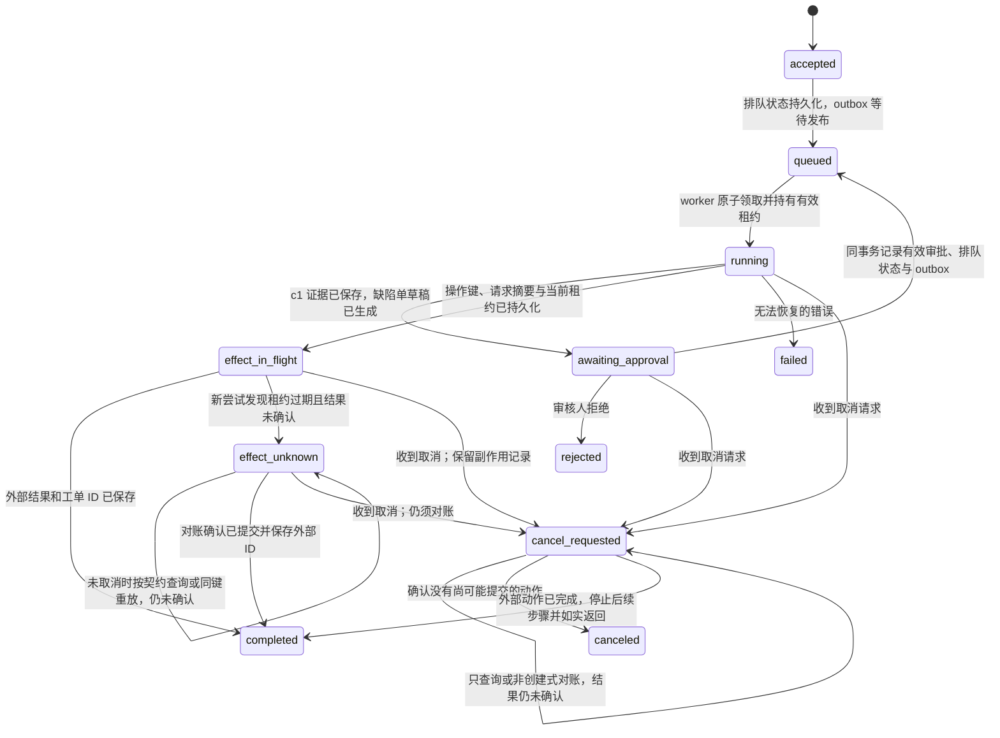

# AI 运行怎样在断线或工作进程崩溃后恢复，并避免副作用重复？

把一次逻辑任务的身份、权威状态和外部副作用保存在应用侧。HTTP（Hypertext Transfer Protocol，超文本传输协议）请求、事件流和 worker（工作进程）都只是完成或交付运行的参与者；任何一个断开，都不能单独证明运行已经停止，也不能证明一次写入没有生效。恢复时先读持久状态，再按操作契约查询、去重或对账。

本篇沿用[一条构建失败消息](from-message-to-answer.md)：开发者问 build 42 为什么失败。工具请求的 `tool_call_id` 为 `c1`；应用执行 `read_build_log` 后，将匹配的结果关联到 `c1`，其中 `unit-tests` 的 `reject_empty_name` 预期返回 HTTP `400`、实际返回 `200`，进程退出状态为 `1`。为走完长运行，合成案例增加一个请求：“解释失败并准备缺陷单；提交前让我审核。”新增的 `create_issue` 是本例的应用工具，不是上游章节已经存在的接口。

## 运行身份、持久状态和交付连接分别负责什么？

每个逻辑任务使用稳定的 run ID（运行标识，字段名 `runId`）。客户端提交 idempotency key（幂等键）时，服务端将调用者、资源范围、键值和规范化请求摘要绑定：同一作用域和摘要的重试返回原有运行；同键但不同摘要应返回冲突，不能借用旧运行，也不能新建第二个动作。`runId` 标识逻辑任务，`tool_call_id`（工具调用 ID）关联模型请求与工具结果，worker attempt（工作进程执行尝试）标识一次获租执行；它们不能相互代替。

| 记录或通道 | 在本例中的内容 | 能证明什么 |
|---|---|---|
| 运行记录 | `runId`、调用者和 `repository_id=build-service` 范围、当前状态、任务版本、截止时间、终态结果或错误 | 这次逻辑任务现在处于什么状态 |
| 检查点 | 最近已持久化的步骤、工具调用 ID、证据引用、经批准动作的摘要 | 哪些观察与决策已经记录，可从哪里继续 |
| 副作用记录 | 稳定操作键、目标资源、请求摘要、执行状态、外部工单 ID | 某个外部动作是否已发起、已确认或仍结果未知 |
| 请求响应、临时流或 WebSocket（网页套接字）连接 | 这一次提交响应或进度事件 | 只说明本次交付；断线不改变运行事实 |
| model context（模型上下文）或 KV cache（键值缓存）/prompt cache（提示缓存） | 当前推理使用的对话和可重用计算 | 可能减少重复输入处理；不证明应用状态、审批或外部动作结果 |
| 队列消息 | 某个运行可以被 worker 处理的唤醒信号 | 可被重投；不是运行状态的权威记录 |

## 接受请求后怎样保证最终入队？

初始提交可能已成功写入运行记录，但响应尚未送到客户端；如果运行记录和队列发送不是一个原子动作，也可能在两者之间崩溃。常见做法是在同一数据库事务中写入运行记录和待发布的 outbox（事务发件箱）事件。发布器先持久化 `accepted` 到 `queued` 的状态变化，保留待发送事件，再投递队列消息；若在投递前崩溃，发布器仍能找到事件并重试，若投递后、标记已发送前崩溃，重复消息会唤醒同一个 `queued` 运行，由条件领取消重。这样 worker 收到消息时不会遇到尚未入队的 `accepted` 状态。若运行记录和 outbox 记录无法参加同一事务，就需要等价的可恢复入队协议与扫描修复任务。

本例只在请求摘要与运行记录、outbox 事件持久化后返回 `202 Accepted`。同一调用者在同一 build 42 范围内用原键重试相同请求，会找到相同的 `runId`；若改了问题或目标，服务返回冲突。RFC 9110 中的 `202` 只表示请求已接受处理，业务的去重和队列恢复仍由应用实现。

## worker 崩溃后怎样让新尝试接手？

队列消息只是唤醒运行。worker 用条件更新原子领取 `queued` 状态，并在持久记录中取得有期限的 lease（租约）和单调递增的 attempt/fencing token（尝试代次／栅栏令牌）。租约到期只允许恢复器尝试接管，不会自行撤销旧尝试的写入资格；恢复器提交领取下一代的条件更新后，每次检查点写入才会因代次不符而拒绝旧尝试。条件推进还须比较期望状态和取消标记：若扫描器先将运行改回 `queued`，旧 worker 即使代次尚未增加，也会因状态不符而无法继续写入。若旧写入先于接管事务提交，恢复器应读到该状态再继续；若接管先提交，旧尝试的写入被拒绝。栅栏只保护本地状态，不会取消已发出的远端请求。完成本次消息代表的步骤或写下暂停状态后，先持久化检查点再确认消息；若确认前崩溃，重投会从检查点恢复；若确认后崩溃且运行仍需推进，恢复扫描器必须能找到过期的非终态运行，以条件事务重新排队并写入新的 outbox 事件；仅保存状态不会自动唤醒 worker。等待审批的运行由审批事件唤醒，结果未知的操作由对账调度器接续。

运行表、操作记录和持久队列可以完成这些职责。更复杂的编排也可选保存事件历史的工作流运行时；持久化的关键不是技术名词，而是进程、连接或 worker 消失后仍能回答“任务到哪一步、外部动作发生了什么”。

## 同一运行怎样跨审批和外部写入恢复？

`effect_in_flight` 不是死掉的 worker 写出的结论，而是在调用远端之前由当前有效尝试持久化的状态，包含操作键、精确请求摘要与租约代次。租约过期后，新尝试发现该操作没有记录终态，才把它转为 `effect_unknown` 并对账。审批通过时，应用以条件事务核验仍在等待同一动作摘要，将有效审批、`queued` 状态及针对同一 `runId` 的 outbox 恢复事件一起提交；重复或迟到的审批事件不能重新排队一个已经继续或取消的运行。领取该事件的 worker 必须取得新的 attempt 代次和 lease，重新读取草稿摘要、审批记录与当前授权，然后才能进入 `effect_in_flight`。若审批人拒绝，应用将运行记为 `rejected`；若草稿摘要或权限在等待期间变化，原审批失效，更新后需重新审核。未取消且处于 `effect_unknown` 时，查询或契约允许的同键重放都不能凭发起动作本身清除未知状态；只有确认远端结果后才转为完成，确认旧请求不会再提交后才可取消。取消请求不删除副作用记录、操作键或摘要，也不能退回允许写入重放的普通未知状态。同键写入只防重复：若旧请求从未到达接收方，重放可能首次创建工单，所以取消后只允许查询或接收方保证不会创建新效果的对账操作。

`accepted`、`queued`、`running`、`awaiting_approval`、`effect_in_flight`、`effect_unknown` 与 `cancel_requested` 都表示仍有后续处理或对账；`completed`、`failed`、`rejected`、`canceled` 是终态。具体存储可将运行状态与单个副作用状态分别建模，但外部效果必须能关联回唯一的 `runId` 和操作键。

> [!example] 从重复提交到恢复 `run-r42-7`
> 1. 浏览器在调用者、build 42 范围内以幂等键 `build-42-triage-req-19` 提交“解释失败并准备缺陷单”。服务端计算请求摘要，并在一个持久事务中写入 `run-r42-7` 与 outbox 事件，返回 `202` 和 `runId`。同键重试且摘要相同会得到该运行；若把同一键用于不同问题或目标，服务端返回冲突。HTTP 的 `202 Accepted` 只表示请求已收下，不代表任务已完成。
> 2. 若进程恰在事务提交后、队列发布前崩溃，outbox 发布器稍后仍能找到待发送事件。若发布器发布后、标记前崩溃，它可能再次发布同一事件。worker 通过条件更新原子领取 `queued` 运行，写入带过期时间的租约与递增 attempt/fencing token；同一时刻只有已提交的当前代次能更新运行检查点。租约到期后，如果旧写入先于接管事务提交，恢复器必须读入这个最新状态；如果接管事务先提交，之后旧代次的状态更新会失败。队列消息只唤醒运行，数据库中的当前代次决定哪一次尝试可以继续。
> 3. worker 调用模型后，模型提出读取 `read_build_log` 的请求。应用核验调用者可读 build 42 后才执行工具；`c1` 是这次工具调用的 ID，结果关联到该 ID，包含失败步骤、测试名、预期/实际值和退出状态。应用先持久化这些证据及其来源，再继续模型调用。完成本次唤醒代表的步骤或暂停点后，应用先保存对应检查点，再确认队列消息；若确认前崩溃，重投消息会从该检查点恢复，若确认后崩溃且尚未到暂停点或终态，过期运行扫描器以条件事务重新排队并登记 outbox，才能从持久检查点继续。
> 4. 模型生成解释和缺陷单草稿。应用保存 `repository_id=build-service`、标题、正文、证据摘要和 `payload_hash`，把运行置于 `awaiting_approval`。此时尚未创建工单。
> 5. 浏览器在审批事件到达前断线。重连后以 `run-r42-7` 查询，看到仍在等待审批；不重新创建任务，也不把部分流文本当作终态。审核人看到的预览绑定到 `repository_id`、标题、正文和证据摘要。审批返回时，应用检查该摘要仍相同、审批人仍有权限、目标仓库状态仍有效，并以条件事务一起提交审批决定、`queued` 状态和唤醒同一 `runId` 的 outbox 恢复事件。
> 6. worker 收到审批恢复事件后，先通过条件事务领取 `run-r42-7` 的新 attempt 代次和 lease，再回读草稿摘要、审批记录与当前授权。核对通过后，它把 `create_issue` 的操作键 `run-r42-7:create-issue:v1`、完整请求摘要和副作用状态 `effect_in_flight` 持久化，进入该状态的条件更新同时核对当前 attempt、期望状态与取消标记，并重新核验写授权。若取消先提交，这次推进失败；若写入意图先提交，后来取消必须按请求可能已经发出处理，本地栅栏不能撤回网络请求。然后才提交给工单服务。假设服务创建了 `ISSUE-842`，worker 却在写回 ID 前崩溃；它无法自行更新运行。租约过期后，新 worker 通过条件事务提交下一 attempt，读到尚无结果的 `effect_in_flight` 并转为 `effect_unknown`，不会再生成一份草稿或使用新操作键。栅栏只拒绝接管提交后的旧代次写入；先前已发出的远端请求仍需按操作键对账。
> 7. 恢复 worker 先向接收服务查询同一操作键；副作用记录保持 `effect_unknown` 并保留原键和请求摘要。只有运行未被取消，且接收服务支持绑定相同请求摘要的幂等写入，且当前键仍在接收方保证的去重保留窗口内，应用重新核验当前写授权与取消状态后，才可以用同一键重放；超时或仍在处理时继续保持未知，不能把一次重放当作已确认。若只能查询，查无记录仍不证明原请求没有在途或延迟提交，应继续等待、按服务契约查询，不能改键重发。若去重窗口已经结束，不能仅因键相同就重放写入，应改用查询或人工对账。确认已有 `ISSUE-842` 后，写回副作用记录与最终答复，再标记 `completed`。
> 8. 如果接收服务既不支持按键去重，也不能按键查询，就暂停自动重试并人工对账。盲目重发可能创建第二张工单；若用户同时要求取消，运行保持 `cancel_requested`，并保留副作用的 `effect_unknown` 账目；只做不会新建工单的对账，直到确认原请求不会再提交。

| 重连时持久状态 | 恢复动作 | 不安全的推断 |
|---|---|---|
| `running`，最后检查点是 `c1` 的已存结果 | 恢复必要上下文，继续处理已持久化的观察 | 认为旧流没有到达客户端，所以可新建一份 run |
| `awaiting_approval`，动作摘要未变 | 继续展示同一审批项；获批后重新检查权限和目标状态 | 把之前对别的动作或旧版本的审批复用到新草稿 |
| `effect_in_flight`，操作键和请求摘要已保存，原租约过期 | 新 worker 先认领并标记结果未知，再查询；只有未取消时才考虑契约允许的同键写入重放 | 因本地没存到外部 ID 就当作远端没有提交，或用新操作键再写一次 |
| `effect_unknown`，接收方暂时查无结果 | 保持未知；未取消且当前授权、同键同请求与有效去重窗口条件满足时才按契约重放，否则只查询、等待或人工对账 | 把“查询无记录”视为足以证明旧请求永远不会提交 |
| `cancel_requested`，副作用仍为 `effect_in_flight` 或 `effect_unknown` | 停止新动作，但保留原键和摘要，继续对账 | 清除副作用记录或直接标为 `canceled` |
| `completed`，结果已持久化 | 返回已存结果；可以另行重放仍被保留的进度事件 | 再跑模型或工具以“补回”丢失的响应 |

## 客户端断线后怎样查询同一次运行？

直接响应、临时流和排队任务可以共享同一个运行状态，只是客户端等待和读取结果的方式不同。短任务可让一个请求等待结果；需要显示进度时，把流事件标作临时信息，直到终态记录写入；超过连接时限的工作可以返回 `runId`，让客户端查询或重连。事件游标只有在服务端保留对应事件时才能补齐空档。不要把一个流的断开等同于任务取消。

| 交付方式 | 调用方收到什么 | 需要守住的边界 |
|---|---|---|
| 直接响应 | 请求等待最终答复 | 设置期限；连接超时后仍查同一运行状态 |
| 临时流 | 先收到文本或进度，最终再有终态 | 流文本在运行记录到达终态前仍属临时内容 |
| 排队或后台 | `202` 与 `runId`，之后查询状态或事件 | `202` 不是完成；消息重投时仍按运行记录和租约恢复 |

例如，合成接口可以让 `POST /runs` 接受问题和 `Idempotency-Key`，持久化后返回 `202 {"runId":"run-r42-7","status":"accepted"}`；客户端用 `GET /runs/run-r42-7` 查询权威状态，用 `GET /runs/run-r42-7/events?after=12` 续读服务器仍保留的事件。短任务可以在同一 `runId` 上等待直接答复，流模式则把进度作为临时事件。状态查询、事件续读和审批入口每次都按当前调用者与资源范围授权；`runId` 只定位运行，不是访问凭据。路径与字段是本例的应用契约，并非 HTTP 规范要求。

初始 `POST /runs` 可能已经创建运行，只是响应未到客户端。客户端应在服务支持时用同一调用者与资源范围查询幂等键，或用该键重试完全相同的请求；不能改写请求后复用键，也不能换新键盲目重提。HTTP 规范只把方法语义定义为幂等或非幂等；业务应用需为 `POST` 另设明确的去重契约。流事件只能在服务保留相应游标时补齐，断线后应先查运行记录。

## 取消请求与断线有什么不同？

客户端断开响应连接只结束这次交付，不取消服务端运行。用户发出的取消则是需要鉴权、持久记录并由 worker 在安全点执行的独立请求。应用可以把运行改为 `cancel_requested`，等待 worker 停止后续推理和新工具调用；若外部副作用处于 `effect_in_flight` 或 `effect_unknown`，仍保留操作键、请求摘要与副作用记录，并继续查询或按接收方契约进行不会创建新效果的对账。运行保留取消标记；不得因进入未知结果处理就重新允许写入重放。只有确认远端没有执行且原请求不会再提交，才可标为 `canceled`；确认已成功则保存外部结果、停止后续步骤并如实完成。若远端始终无法给出结论，运行继续待人工对账，不能用取消清除未知结果。

## 检查点与模型推理缓存分别恢复什么？

检查点保存的是应用已经知道的事实：工具调用 ID、工具返回的结果、批准过的动作、外部结果标识和下一步骤。模型上下文中的文字、模型回复 ID、前缀缓存或推理引擎的 KV cache 都不构成这些事实的替代品。OpenAI 当前 prompt-caching 文档说明，前缀缓存按模型配置过期且不保证每次命中；这类缓存只复用计算状态，不是运行账本。若运行重建时需要再次调用模型，输出可能不同且再次产生费用；若某个外部动作尚有未知结果，应先对账，不让新一轮模型生成决定是否重做。

## 事件历史能恢复什么？

> [!info] 工作流事件回放的适用范围
> Temporal 的 event history（事件历史）示例把运行时已记录的活动结果用于重建编排状态。该功能可以恢复应用工作流，但不让模型调用变得确定，也不自动判定一个尚未记录的远端副作用是否提交。采用同类运行时，仍要为活动结果和外部写操作定义持久记录与幂等或对账契约。

运行契约承接[应用如何执行模型的工具请求](../agents/tool-design-and-function-calling.md)，并与[生产 AI 如何阻止不可信内容触发越权动作](../safety/ai-safety-in-production.md)中的审批和停止边界配合。队列确认和重试结果的底层语义见[API 交付如何确认结果并限制重试](../../engineering-foundations/reliability/api-reliability-and-async-delivery.md)与[队列消息在何时才算被确认](../../engineering-foundations/reliability/queue-delivery-and-acknowledgement.md)。

> [!info]- 来源
> - **HTTP 重试与异步接收的协议边界：** IETF，[RFC 9110: HTTP Semantics](https://www.rfc-editor.org/rfc/rfc9110.html)，2022，§9.2.2（幂等方法与失败后重试）及 §15.3.3（`202 Accepted` 只表示接收处理，不表示完成）；核对日期：2026-11-06。本文额外的 `POST` 幂等键是应用契约，不是该 RFC 自动提供的保证。
> - **事件历史重建运行状态：** Temporal，[Event History](https://docs.temporal.io/encyclopedia/event-history)，核对日期：2026-11-06；说明工作流命令和活动结果如何记录、worker 崩溃后如何重放。它是运行时实现例，不能证明外部系统未记录的副作用状态。
> - **运行态与人审恢复：** OpenAI，[Running agents](https://developers.openai.com/api/docs/guides/agents/running-agents) 与 [Guardrails and human review](https://developers.openai.com/api/docs/guides/agents/guardrails-approvals)，核对日期：2026-11-06；当前 Agents SDK 文档说明运行循环、可保存会话状态、暂停审批并恢复同一 run 的做法。具体 API 属于该 SDK。
> - **模型上下文缓存的服务边界：** OpenAI，[Prompt caching](https://developers.openai.com/api/docs/guides/prompt-caching)，核对日期：2026-11-06，“What is the prompt cache?”“Cache lifetime”和常见问题；说明可重用的是匹配前缀的 KV 张量，缓存按模型/配置过期且不能保证每次复用。Anthropic，[Effective context engineering for AI agents](https://www.anthropic.com/engineering/effective-context-engineering-for-ai-agents)，2025-09-29，“Compaction”“Structured note-taking”；讨论上下文整理与外部笔记。运行身份、外部动作和审批账本是本文的应用架构扩展。
