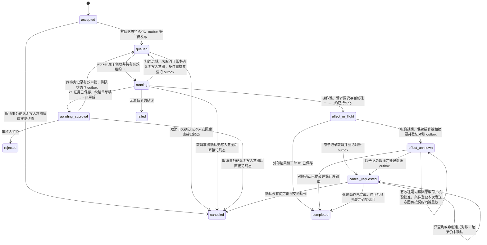
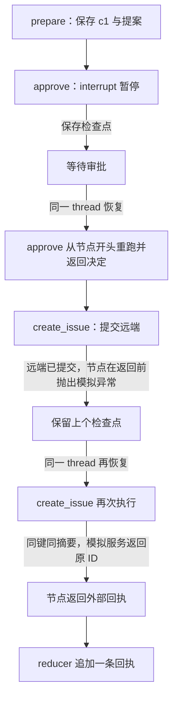

# AI 运行怎样在断线或工作进程崩溃后恢复，并避免副作用重复？

把一次逻辑任务的身份、权威状态和外部副作用保存在应用侧。HTTP（Hypertext Transfer Protocol，超文本传输协议）请求、事件流和 worker（工作进程）都只是完成或交付运行的参与者；任何一个断开，都不能单独证明运行已经停止，也不能证明一次写入没有生效。恢复时先读持久状态，再按操作契约查询、去重或对账。

本篇沿用[一条构建失败消息](from-message-to-answer.md)：开发者问 build 42 为什么失败。工具请求的 `tool_call_id` 为 `c1`；应用执行 `read_build_log` 后，将匹配的结果关联到 `c1`，其中 `unit-tests` 的 `reject_empty_name` 预期返回 HTTP `400`、实际返回 `200`，进程退出状态为 `1`。为走完长运行，合成案例增加一个请求：“解释失败并准备缺陷单；提交前让我审核。”新增的 `create_issue` 是本例的应用工具，不是上游章节已经存在的接口。

## 运行身份、持久状态和交付连接分别负责什么？

每个逻辑任务使用稳定的 run ID（运行标识，字段名 `runId`）。客户端提交 idempotency key（幂等键）时，服务端将调用者、资源范围、键值和规范化请求摘要绑定：同一作用域、同一键且同一摘要的重试返回原有运行；同键但不同摘要应返回冲突，不能借用旧运行，也不能新建第二个动作。`runId` 标识逻辑任务，`tool_call_id`（工具调用 ID）关联模型请求与工具结果，worker attempt（工作进程执行尝试）标识一次获租执行；它们不能相互代替。

| 记录或通道 | 在本例中的内容 | 能证明什么 |
|---|---|---|
| 运行记录 | `runId`、调用者和 `repository_id=build-service` 范围、当前状态、任务版本、截止时间、终态结果或错误 | 这次逻辑任务现在处于什么状态 |
| 检查点 | 最近已持久化的步骤、工具调用 ID、证据引用、经批准动作的摘要 | 哪些观察与决策已经记录，可从哪里继续 |
| 副作用记录 | 稳定操作键、目标资源、请求摘要、执行状态、外部工单 ID | 某个外部动作是否已发起、已确认或仍结果未知 |
| 请求响应、临时流或 WebSocket（网页套接字）连接 | 这一次提交响应或进度事件 | 只说明本次交付；断线不改变运行事实 |
| model context（模型上下文）或 KV cache（键值缓存）/prompt cache（提示缓存） | 当前推理使用的对话和可重用计算 | 可能减少重复输入处理；不证明应用状态、审批或外部动作结果 |
| 队列消息 | 某个运行可以被 worker 处理的唤醒信号 | 可被重投；不是运行状态的权威记录 |

## 接受请求后怎样保证最终入队？

初始提交可能已成功写入运行记录，但响应尚未送到客户端；如果运行记录和队列发送不是一个原子动作，也可能在两者之间崩溃。常见做法是在同一数据库事务中写入运行记录和待发布的 outbox（事务发件箱）事件。发布器先持久化 `accepted` 到 `queued` 的状态变化，保留待发送事件，再投递队列消息；若在投递前崩溃，发布器仍能找到事件并重试，若投递后、标记已发送前崩溃，重复消息会唤醒同一个 `queued` 运行，由条件领取消重。这样 worker 收到消息时不会遇到尚未入队的 `accepted` 状态。若运行记录和 outbox 记录无法参加同一事务，就需要等价的可恢复入队协议与扫描修复任务。

本例只在请求摘要与运行记录、outbox 事件持久化后返回 `202 Accepted`。同一调用者在同一 build 42 范围内用原键重试相同请求，会找到相同的 `runId`；若改了问题或目标，服务返回冲突。RFC 9110 中的 `202` 只表示请求已接受处理，业务的去重和队列恢复仍由应用实现。

## worker 崩溃后怎样让新尝试接手？

队列消息只是唤醒运行。worker 用条件更新原子领取 `queued` 状态，并在持久记录中取得有期限的 lease（租约）和单调递增的 attempt/fencing token（尝试代次／栅栏令牌）。每次 worker 的本地状态更新或发送意图事务取得运行记录的更新权并判定条件时，都须满足预期状态、当前 attempt、`lease_until` 晚于数据库当前时钟且尚未取消。租约过期会让随后作出的本地条件推进失败，即使恢复器还没领取下一代；它不会杀死旧进程，也不能撤回已经发出的远端请求。旧尝试若在有效租期内通过条件并先于接管提交，恢复器读到该已提交状态；恢复器若先领取下一代，旧 attempt 也会因代次不符而被拒绝。取消、审批和恢复器自己的状态转换使用各自的条件事务；`cancel_requested` 下的对账结果也可在匹配该分支状态并持有当前对账 attempt/lease 后写回 `completed`。

完成本次消息代表的步骤或写下暂停状态后，先持久化检查点再确认消息；若确认前崩溃，重投会从检查点恢复。确认后崩溃时，恢复扫描器不能把所有过期非终态一律排回普通 `queued`：只有当前状态为 `running`、尚未取消且操作账本确认无写入意图的运行，才能以条件事务排队并写入新的 outbox 事件；新 worker 领取时取得下一 attempt。若状态已是 `effect_in_flight`，恢复器保留原操作键和请求摘要，条件转为 `effect_unknown` 并登记对账 outbox；已发送或可能在途的请求只能走对账，不能当作普通步骤重放。`awaiting_approval` 由审批事件唤醒；结果未知的操作由对账事件或调度器接续。单纯持久化状态不会自动唤醒任何处理者。

运行表、操作记录和持久队列可以完成这些职责。更复杂的编排也可选保存事件历史的工作流运行时；持久化的关键不是技术名词，而是进程、连接或 worker 消失后仍能回答“任务到哪一步、外部动作发生了什么”。

## 同一运行怎样跨审批和外部写入恢复？




`effect_in_flight` 是当前有效尝试在调用远端前持久化的发送意图，含操作键、请求摘要与租约代次。租约过期且结果未记录时，恢复器保留这些字段，将状态转为 `effect_unknown` 并登记对账 outbox；新 worker 先对账，不回到普通草稿步骤。相反，只有未取消且操作账本确认还没有写入意图的过期 `running` 才能重排到 `queued`。

审批通过时，应用以条件事务核验仍在等待同一动作摘要，将有效审批、`queued` 状态及针对同一 `runId` 的 outbox 恢复事件一起提交；重复或迟到的审批事件不能重新排队一个已经继续或取消的运行。领取该事件的 worker 必须取得新的 attempt 代次和 lease，重新读取已保存的原始草稿或不可变引用、审批记录与当前授权，再比对摘要；摘要只能校验载荷，不能还原正文。若审批人拒绝，应用将运行记为 `rejected`；若草稿摘要或权限在等待期间变化，原审批失效，更新后需重新审核。对尚无写入意图的 `accepted`、`queued`、`running` 和 `awaiting_approval`，取消事务可直接写入终态 `canceled`；即使旧 worker 仍在计算，它后续的状态更新也会因运行已终结而失败。

`effect_unknown` 的查询不会发起新写入。若服务契约允许同键重放且去重窗口有效，对账 worker 先从应用账本读回已批准的完整原始载荷或不可变引用，核验其摘要与当前批准仍有效，再查询同一操作键。重放前还须像首次发送一样，在事务取得记录更新权时核验当前 attempt、`lease_until` 晚于数据库当前时钟、预期状态 `effect_unknown`、原请求摘要、当前批准、写授权和未取消状态，并登记这次发送意图。这项事务与取消事务互斥：取消先提交就禁止重放；发送意图先提交则按可能在途的请求继续对账。不能只读取“未取消”再裸发，也不能只凭相同摘要跳过当前批准检查。旧请求可能尚未到达接收方，因此同键去重不等于取消后的安全重放。已有写入意图时，取消标记与对账 outbox 一起提交；只允许查询或不会创建新效果的对账，直到确认结果。发起重放也不清除未知状态；只有确认远端结果后才转为完成。

> [!example] 从重复提交到恢复 `run-r42-7`
> 1. 浏览器在调用者、build 42 范围内以幂等键 `build-42-triage-req-19` 提交“解释失败并准备缺陷单”。服务端计算请求摘要，并在一个持久事务中写入 `run-r42-7` 与 outbox 事件，返回 `202` 和 `runId`。同一键重试且摘要相同会得到该运行；若把同一键用于不同问题或目标，服务端返回冲突。HTTP 的 `202 Accepted` 只表示请求已收下，不代表任务已完成。
> 2. 若进程恰在事务提交后、队列发布前崩溃，outbox 发布器稍后仍能找到待发送事件。若发布器发布后、标记前崩溃，它可能再次发布同一事件。worker 通过条件更新原子领取 `queued` 运行，写入带过期时间的租约与递增 attempt/fencing token。每次 worker 本地推进都要求预期状态、当前 attempt、`lease_until` 晚于数据库当前时钟且尚未取消；只有旧写入在有效租期内通过条件、并且先于接管提交，恢复器才会读到该状态。若租约先到期，本地新推进立即失败；若接管先领取下一代，旧 attempt 也会因代次不符而失败。队列消息只唤醒运行，数据库状态和有效 attempt/lease 决定哪次尝试能写入。
> 3. worker 调用模型后，模型提出读取 `read_build_log` 的请求。应用核验调用者可读 build 42 后才执行工具；`c1` 是这次工具调用的 ID，结果关联到该 ID，包含失败步骤、测试名、预期/实际值和退出状态。应用先持久化这些证据及其来源，再继续模型调用。完成本次唤醒代表的步骤或暂停点后，应用先保存对应检查点，再确认队列消息；若确认前崩溃，重投消息会从该检查点恢复；若确认后崩溃且状态仍是 `running`，只有操作账本确认无写入意图时，扫描器才以条件事务重新排队并登记 outbox。若写入意图已存在，则转入 `effect_unknown` 对账路径。
> 4. 模型生成解释和缺陷单草稿。应用保存 `repository_id=build-service`、标题、正文、证据摘要和 `payload_hash`，把运行置于 `awaiting_approval`。此时尚未创建工单；生产记录保留原始正文或不可变引用，摘要只用于比对，不能还原载荷。
> 5. 浏览器在审批事件到达前断线。重连后以 `run-r42-7` 查询权威状态，后台 worker 仍由持久化队列或审批事件独立唤醒；客户端只读状态，不负责继续任务，也不把部分流文本当作终态。审核人看到的预览绑定到 `repository_id`、标题、正文和证据摘要。审批返回时，应用检查该摘要仍相同、审批人仍有权限、目标仓库状态仍有效，并以条件事务一起提交审批决定、`queued` 状态和唤醒同一 `runId` 的 outbox 恢复事件。若等待审批时用户取消，本例在一个事务中确认无写入意图并直接标记 `canceled`；不等待没有活跃 worker 的安全点。
> 6. worker 收到审批恢复事件后，先通过条件事务领取 `run-r42-7` 的新 attempt 代次和 lease，再读取草稿的原文或不可变引用、审批记录与当前授权，核对保存的请求摘要。核对通过后，它把 `create_issue` 的操作键 `run-r42-7:create-issue:v1`、完整请求摘要和副作用状态 `effect_in_flight` 持久化；这次发送意图事务在取得记录更新权时，还要同时核对预期状态、当前 attempt、`lease_until` 晚于数据库当前时钟、审批仍有效且获批摘要相符、写授权与未取消标记。若取消先提交，这次推进失败；若写入意图先提交，后来取消必须按请求可能已经发出处理，本地栅栏不能撤回网络请求。然后才提交给工单服务。假设服务创建了 `ISSUE-842`，worker 却在写回 ID 前崩溃；它无法自行更新运行。租约过期后，新 worker 通过条件事务提交下一 attempt，保留原操作键与请求摘要，将状态转为 `effect_unknown` 并登记对账 outbox，不会重做普通草稿步骤或使用新操作键。
> 7. 对账 worker 从应用账本读回已批准的完整原始载荷或不可变引用，并核验当前批准仍有效、载荷摘要相同；摘要只用于比对，不还原正文。它再查询同一操作键，副作用记录保持 `effect_unknown`。若接收服务支持绑定相同请求摘要的幂等写入，且当前键仍在去重保留窗口内，写入前还须用条件事务核验当前 `effect_unknown` 状态、对账 worker 的 attempt 与有效 lease、当前批准摘要和写授权，并确认未取消后原子登记本次发送意图。该事务与取消事务互斥：取消先提交则禁止重放；发送意图先提交则按可能在途继续对账。只读取“未取消”后再发送不安全。超时或仍在处理时保持未知，不能把一次重放当作已确认。若只能查询，查无记录仍不证明原请求没有在途或延迟提交，应继续等待或人工对账，不能改键重发；去重窗口结束后也不能仅因键相同就重放。确认已有 `ISSUE-842` 后，写回副作用记录与最终答复，再标记 `completed`。
> 8. 如果接收服务既不支持按键去重，也不能按键查询，就暂停自动重试并人工对账。盲目重发可能创建第二张工单；若用户同时要求取消，运行保持 `cancel_requested`，并保留副作用的 `effect_unknown` 账目；只做不会新建工单的对账，直到确认原请求不会再提交。

| 重连时持久状态 | 恢复动作 | 不安全的推断 |
|---|---|---|
| `running`，最后检查点是 `c1` 的已存结果 | 恢复必要上下文，继续处理已持久化的观察 | 认为旧流没有到达客户端，所以可新建一份 run |
| `awaiting_approval`，动作摘要未变 | 继续展示同一审批项；取消时以条件事务确认无写入意图并记为 `canceled`，获批后重新检查权限和目标状态 | 把之前对别的动作或旧版本的审批复用到新草稿 |
| `effect_in_flight`，操作键和请求摘要已保存，原租约过期 | 新 worker 领取下一代后将其转入 `effect_unknown` 并登记对账；查询后才判断契约允许的下一步 | 把它当作普通 `running` 步骤重排，或用新操作键再写一次 |
| `effect_unknown`，接收方暂时查无结果 | 读回原始批准载荷，核验摘要与当前批准；写前以条件事务核验状态、对账 attempt、有效 lease、权限与未取消状态并登记发送意图，满足后才按契约重放，否则只查询、等待或人工对账 | 把“查询无记录”视为足以证明旧请求永远不会提交 |
| `cancel_requested`，副作用仍为 `effect_in_flight` 或 `effect_unknown` | 停止新动作，但保留原键和摘要，继续对账 | 清除副作用记录或直接标为 `canceled` |
| `completed`，结果已持久化 | 返回已存结果；可以另行重放仍被保留的进度事件 | 再跑模型或工具以“补回”丢失的响应 |

## 客户端断线后怎样查询同一次运行？

直接响应、临时流和排队任务可以共享同一个运行状态，只是客户端等待和读取结果的方式不同。短任务可让一个请求等待结果；需要显示进度时，把流事件标作临时信息，直到终态记录写入；超过连接时限的工作可以返回 `runId`，让客户端查询或重连。事件游标只有在服务端保留对应事件时才能补齐空档。不要把一个流的断开等同于任务取消。

| 交付方式 | 调用方收到什么 | 需要守住的边界 |
|---|---|---|
| 直接响应 | 请求等待最终答复 | 设置期限；连接超时后仍查同一运行状态 |
| 临时流 | 先收到文本或进度，最终再有终态 | 流文本在运行记录到达终态前仍属临时内容 |
| 排队或后台 | `202` 与 `runId`，之后查询状态或事件 | `202` 不是完成；消息重投时仍按运行记录和租约恢复 |

例如，合成接口可以让 `POST /runs` 接受问题和 `Idempotency-Key`，持久化后返回 `202 {"runId":"run-r42-7","status":"accepted"}`；客户端用 `GET /runs/run-r42-7` 查询权威状态，用 `GET /runs/run-r42-7/events?after=12` 续读服务器仍保留的事件。短任务可以在同一 `runId` 上等待直接答复，流模式则把进度作为临时事件。状态查询、事件续读和审批入口每次都按当前调用者与资源范围授权；`runId` 只定位运行，不是访问凭据。路径与字段是本例的应用契约，并非 HTTP 规范要求。

初始 `POST /runs` 可能已经创建运行，只是响应未到客户端。客户端应在服务支持时用同一调用者与资源范围查询幂等键，或用该键重试完全相同的请求；不能改写请求后复用键，也不能换新键盲目重提。HTTP 规范只把方法语义定义为幂等或非幂等；业务应用需为 `POST` 另设明确的去重契约。流事件只能在服务保留相应游标时补齐，断线后应先查运行记录。

## 取消请求与断线有什么不同？

客户端断开响应连接只结束这次交付，不取消服务端运行。用户发出的取消是需要鉴权、持久记录并按运行状态推进的独立请求：对 `accepted`、`queued`、`running`、`awaiting_approval` 这些尚无写入意图的状态，条件事务可直接标记 `canceled`，旧 worker 随后的状态写入会失败；若写入意图已存在，则同一事务记录 `cancel_requested` 并登记对账唤醒。取消不能删除操作键、摘要或结果未知记录，也不能因进入对账就重新允许写入重放。只有确认远端没有执行且原请求不会再提交，才可标为 `canceled`；确认已成功则保存外部结果、停止后续步骤并如实完成。若远端始终无法给出结论，运行继续待人工对账。

## 检查点与模型推理缓存分别恢复什么？

检查点保存的是应用已经知道的事实：工具调用 ID、工具返回的结果、批准过的动作、外部结果标识和下一步骤。模型上下文中的文字、模型回复 ID、前缀缓存或推理引擎的 KV cache 都不构成这些事实的替代品。OpenAI 当前 prompt-caching 文档说明，前缀缓存按模型配置过期且不保证每次命中；这类缓存只复用计算状态，不是运行账本。若运行重建时需要再次调用模型，输出可能不同且再次产生费用；若某个外部动作尚有未知结果，应先对账，不让新一轮模型生成决定是否重做。

## 事件历史能恢复什么？

> [!info] 工作流事件回放的适用范围
> Temporal 的 event history（事件历史）示例把运行时已记录的活动结果用于重建编排状态。该功能可以恢复应用工作流，但不让模型调用变得确定，也不自动判定一个尚未记录的远端副作用是否提交。采用同类运行时，仍要为活动结果和外部写操作定义持久记录与幂等或对账契约。

运行契约承接[应用如何执行模型的工具请求](../agents/tool-design-and-function-calling.md)，并与[生产 AI 如何阻止不可信内容触发越权动作](../safety/ai-safety-in-production.md)中的审批和停止边界配合。队列确认和重试结果的底层语义见[API 交付如何确认结果并限制重试](../../engineering-foundations/reliability/api-reliability-and-async-delivery.md)与[队列消息在何时才算被确认](../../engineering-foundations/reliability/queue-delivery-and-acknowledgement.md)。

## LangGraph 怎样恢复图步骤而不替应用记副作用？

LangGraph 可以把运行过程表示成有状态的节点图。它的 `thread_id`（图线程标识）指向一串图检查点；它不是本应用的 `runId`，即使应用为每个运行建立一对一映射，也应分别保存两者。checkpointer（检查点保存器）恢复图状态和已完成的图步骤；state（图状态）包含本例的 `c1` 观察、缺陷单提案、审核结论，以及节点成功返回后归并的外部回执副本。应用运行账本另行持有权威的审批、`run-r42-7:create-issue:v1` 操作键、请求摘要和远端结果。图检查点不证明工单是否已创建，也不能代替这个副作用账本；示例中的 `journal` 仅在内存里模拟该应用账本。

示例把审核结果作为图内观察用于分支；生产应用还需在运行账本中持久化审核者身份、获批草稿摘要和决定，并在继续写操作前重新检查授权。这条账本和图状态承担不同职责。

无密钥示例使用 LangGraph Python `1.2.20` 的 `StateGraph`、`InMemorySaver` 和 `interrupt()`。`observations` 的 reducer（归并函数）用 `operator.add` 将成功节点返回的新条目追加到已有列表。示例载荷为便于阅读只含仓库、标题和证据；生产请求还要绑定完整草稿正文，摘要覆盖实际获批的全部字段。动作载荷和摘要在暂停前固定，稳定操作键为 `run-r42-7:create-issue:v1`；示例没有在审批后修改内容。若要改动已批准载荷，生产应用应重新审批并使用新的操作版本。fake remote（模拟接收服务）明确模拟按稳定操作键去重：同键同摘要返回同一工单 ID，同键不同摘要拒绝；它还假定去重记录至少保留到本例的重试完成。实际服务只有提供并兑现这一契约时，才有相同结果。



| 阶段 | 图与账本状态 | 累计计数：审批节点 / 写节点 / 远端请求 / 新建工单 |
|---|---|---|
| `prepare` 后进入审批中断 | 检查点含 `c1` 和提案；尚无审核结论 | `1 / 0 / 0 / 0`；暂停 `1` 次 |
| 批准后恢复并提交 | 审批节点从头执行并返回决定；远端创建 `ISSUE-842` 后，写节点在返回回执前抛出模拟异常；本地图状态仍无回执，账本仍标记处理中 | `2 / 1 / 1 / 1` |
| 同一 thread 恢复失败节点 | 写节点用同一操作键和摘要再请求；模拟接收服务识别重复请求并返回 `ISSUE-842`，账本记完成，图状态归并一条回执 | `2 / 2 / 2 / 1` |

`observations` 的归并可手推如下。只有节点成功返回时，图才会把它的新增条目交给 reducer；`interrupt()` 暂停和节点抛出异常都不提交本次新增内容。

| 时点 | 归并前列表 | 节点新增 | 归并后列表 |
|---|---|---|---|
| 初始 | `[]` | — | `[]` |
| `prepare` 返回 | `[]` | `[c1 证据, 提案]` | `[c1 证据, 提案]` |
| `approve` 首次触发中断 | `[c1 证据, 提案]` | 无返回值 | `[c1 证据, 提案]` |
| 同一 thread 恢复，审批返回 | `[c1 证据, 提案]` | `[审批]` | `[c1 证据, 提案, 审批]` |
| 远端已提交但节点抛出模拟异常 | `[c1 证据, 提案, 审批]` | 无返回值 | `[c1 证据, 提案, 审批]` |
| 写节点重跑并成功返回 | `[c1 证据, 提案, 审批]` | `[ISSUE-842 回执]` | `[c1 证据, 提案, 审批, ISSUE-842 回执]` |

> [!example]- 可运行代码：LangGraph Python 1.2.20（无密钥）
>
> ```python
> from hashlib import sha256
> from importlib.metadata import version
> import json
> from operator import add
> from typing import Annotated, Any, TypedDict
> from langgraph.checkpoint.memory import InMemorySaver
> from langgraph.graph import END, START, StateGraph
> from langgraph.types import Command, interrupt
>
> run_id, thread_id = "run-r42-7", "lg-thread-run-r42-7"
> key = f"{run_id}:create-issue:v1"
> payload = {"repository_id": "build-service", "title": "reject_empty_name accepted HTTP 200",
>            "evidence": "build 42 / c1: expected 400, actual 200, exit 1"}
> digest = sha256(json.dumps(payload, sort_keys=True).encode()).hexdigest()
>
> class State(TypedDict):
>     observations: Annotated[list[dict[str, Any]], add]
>
> class FakeRemote:
>     def __init__(self): self.requests, self.created = 0, {}
>     def create_issue(self, op_key, body_digest):
>         self.requests += 1
>         if op_key in self.created:
>             old_digest, issue_id = self.created[op_key]
>             if old_digest != body_digest: raise ValueError("same key, different request")
>             return issue_id
>         self.created[op_key] = (body_digest, "ISSUE-842")
>         return "ISSUE-842"
>
> remote, journal = FakeRemote(), {}
> stats, crash_once = {"approval_node": 0, "side_effect_node": 0}, [True]
>
> def prepare(_):
>     return {"observations": [
>         {"kind": "evidence", "source_call_id": "c1", "test": "reject_empty_name",
>          "expected": "HTTP 400", "actual": "HTTP 200", "exit_status": 1},
>         {"kind": "action_proposal", "run_id": run_id, "action": "create_issue",
>          "payload": payload, "operation_key": key}]}
>
> def approve(state):
>     stats["approval_node"] += 1
>     proposal = next(x for x in state["observations"] if x["kind"] == "action_proposal")
>     answer = interrupt({"run_id": run_id, "action": proposal["action"],
>                         "payload": proposal["payload"], "operation_key": key})
>     return {"observations": [{"kind": "approval", "decision": answer["decision"]}]}
>
> def route(state):
>     decision = next(x for x in reversed(state["observations"]) if x["kind"] == "approval")["decision"]
>     return "create_issue" if decision == "approve" else END
>
> def create_issue(_):
>     stats["side_effect_node"] += 1
>     journal.setdefault(key, {"digest": digest, "status": "effect_in_flight"})
>     if journal[key]["digest"] != digest: raise ValueError("same key, different request")
>     issue_id = remote.create_issue(key, digest)
>     if crash_once[0]:
>         crash_once[0] = False
>         raise RuntimeError("simulated crash after remote commit")
>     journal[key] = {"digest": digest, "status": "completed", "external_id": issue_id}
>     return {"observations": [{"kind": "external_receipt", "operation_key": key,
>                               "external_id": issue_id}]}
>
> builder = StateGraph(State)
> builder.add_node("prepare", prepare).add_node("approve", approve).add_node("create_issue", create_issue)
> builder.add_edge(START, "prepare").add_edge("prepare", "approve")
> builder.add_conditional_edges("approve", route, {"create_issue": "create_issue", END: END})
> builder.add_edge("create_issue", END)
> graph = builder.compile(checkpointer=InMemorySaver())
> config = {"configurable": {"thread_id": thread_id}}
> paused = graph.invoke({"observations": []}, config)
> print(f"langgraph_version={version('langgraph')} run_id={run_id} thread_id={thread_id}")
> print(f"interrupt_pauses={len(paused.get('__interrupt__', []))} approval_node_runs_after_pause={stats['approval_node']}")
> try:
>     graph.invoke(Command(resume={"decision": "approve"}), config)
> except RuntimeError as error:
>     print(f"simulated_failure={error}")
> final = graph.invoke(None, config)
> print(f"approval_node_runs_total={stats['approval_node']} side_effect_node_runs={stats['side_effect_node']}")
> print(f"remote_requests={remote.requests} remote_created_issues={len(remote.created)}")
> print(f"operation_journal={journal[key]}")
> print(f"reducer_observations={final['observations']}")
> ```

运行计数解释了为何两次远端请求只产生一个工单：只有示例接收服务提供并兑现“同一操作键、同一摘要返回同一结果”的去重契约，才会得到 `2` 次请求、`1` 个新建工单。把写入移到中断之后，避免审批节点从头重跑时就执行远端写入；它没有消除远端提交后、本地检查点前的崩溃窗口，也没有产生 exactly-once（恰好一次）保证。若接收方不提供去重或查询契约，第二次请求可能重复建单，或最终结果仍未知。示例不实现取消竞争；生产运行须按上方状态机，在首次发送和同键重放前都用条件事务核验预期状态、当前 attempt、有效 lease、批准载荷、权限和未取消标记，并原子登记这次发送意图。取消先提交时禁止发送，意图先提交时按可能在途处理。取消后的未知副作用只允许查询或人工对账。

这段代码的 `InMemorySaver` 和两个模拟存储都只在同一进程内保留状态；捕获异常后再次调用是故障路径演示，不是跨进程重启演示。LangGraph 官方文档将 `InMemorySaver` 定位为内存实现；部署时应使用持久化 checkpointer，例如数据库支持的 `PostgresSaver`，并单独保留应用运行记录、审批和副作用账本。持久化 LangGraph 状态仍不会让远端 API 和本地数据库共享事务。

LangChain 的 Agent middleware（智能体中间件）属于常规模型—工具循环内部的生命周期钩子：`langchain.agents.create_agent(...)` 接收 `langchain.agents.middleware` 中的 middleware，围绕模型调用或工具步骤做记录、转换、限流、guardrail（行为约束）或受控重试；它本身不是另一套持久化运行时，底层 Agent 图由 LangGraph 执行。若想声明跨工具步骤、条件分支、人审和恢复边界，可直接用 `langgraph.graph.StateGraph`。Deep Agents 则是更高层的 agent harness（智能体执行框架）：从 `deepagents` 包导入的 `create_deep_agent(...)` 将计划、虚拟文件系统上下文、子智能体和长期记忆等预制能力组合起来，并建立在 LangChain 与 LangGraph 之上。想要常见 Agent loop（智能体循环）的局部钩子时选 middleware；任务符合这些预制能力时选 Deep Agents；需要由应用精确定义本例审批、运行账本与副作用对账时，显式图更直接。三个名称属于不同包和层，不应把 `create_deep_agent` 当作 `StateGraph` 节点 API，也不要把 middleware 当作图检查点。

> [!info]- 来源
> - **HTTP 重试与异步接收的协议边界：** IETF，[RFC 9110: HTTP Semantics](https://www.rfc-editor.org/rfc/rfc9110.html)，2022，§9.2.2（幂等方法与失败后重试）及 §15.3.3（`202 Accepted` 只表示接收处理，不表示完成）；核对日期：2026-11-06。本文额外的 `POST` 幂等键是应用契约，不是该 RFC 自动提供的保证。
> - **事件历史重建运行状态：** Temporal，[Event History](https://docs.temporal.io/encyclopedia/event-history)，核对日期：2026-11-06；说明工作流命令和活动结果如何记录、worker 崩溃后如何重放。它是运行时实现例，不能证明外部系统未记录的副作用状态。
> - **运行态与人审恢复：** OpenAI，[Running agents](https://developers.openai.com/api/docs/guides/agents/running-agents) 与 [Guardrails and human review](https://developers.openai.com/api/docs/guides/agents/guardrails-approvals)，核对日期：2026-11-06；当前 Agents SDK 文档说明运行循环、可保存会话状态、暂停审批并恢复同一 run 的做法。具体 API 属于该 SDK。
> - **模型上下文缓存的服务边界：** OpenAI，[Prompt caching](https://developers.openai.com/api/docs/guides/prompt-caching)，核对日期：2026-11-06，“What is the prompt cache?”“Cache lifetime”和常见问题；说明可重用的是匹配前缀的 KV 张量，缓存按模型/配置过期且不能保证每次复用。Anthropic，[Effective context engineering for AI agents](https://www.anthropic.com/engineering/effective-context-engineering-for-ai-agents)，2025-09-29，“Compaction”“Structured note-taking”；讨论上下文整理与外部笔记。运行身份、外部动作和审批账本是本文的应用架构扩展。
> - **LangGraph 图状态、中断、恢复与持久化：** LangGraph Python [1.2.20](https://pypi.org/project/langgraph/1.2.20/)；示例运行条件为 Python 3.11.13 与 LangGraph 1.2.20。[Define and update state](https://docs.langchain.com/oss/python/langgraph/graph-api-state) 的 State / Reducers、[Interrupts](https://docs.langchain.com/oss/python/langgraph/interrupts) 的 Rules of interrupts / Side effects called before interrupt must be idempotent、[Persistence](https://docs.langchain.com/oss/python/langgraph/persistence) 的 Checkpointer vs. store 与内存 saver 限制。模拟的远端去重与应用账本是本文明确声明的假设。
> - **middleware 和 Deep Agents 的层次与 factory 所属包：** LangChain，[Middleware overview](https://docs.langchain.com/oss/python/langchain/middleware/overview) 的 Agent loop / Use middleware inside a LangGraph workflow；Deep Agents，[Overview](https://docs.langchain.com/oss/python/deepagents/overview) 及 [Quickstart](https://docs.langchain.com/oss/python/deepagents/quickstart)，截至 2026-11-09 检查；`create_agent` 是 LangChain agent API，`from deepagents import create_deep_agent` 属于 Deep Agents SDK。
