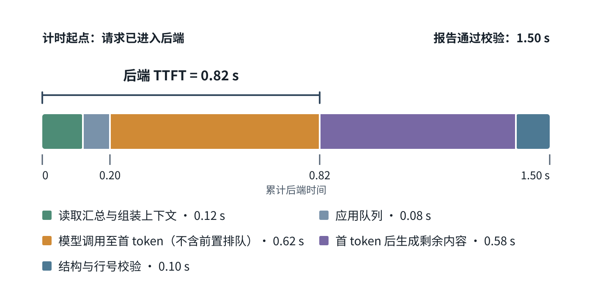

# 如何测量并降低 AI 应用的时延与成本，同时守住任务质量？

先记录一份完整任务从进入应用到得到有效结果的时间、每个阶段的资源和最终任务结果，再针对已定位的瓶颈一次改变一个因素。time to first token（首 token 时延，TTFT）、完整响应、吞吐量和每份成功任务成本回答不同问题；更快吐出部分文本不一定减少总工作，较便宜的模型若增加重试或人工复核也未必省钱。

本篇承接[模型选择与任务契约](../foundations/model-selection-and-ecosystem.md)的候选、通过门槛和流量目标，建立同一口径的时延/成本测量账本；[部署方式与回滚](ai-deployment-patterns.md)据此判断托管、自托管、端侧或混合运行能否满足条件。

月报助手承接候选甲的合成筛选结果；月目标为 10,000 份验收成功报告。候选筛选表中的模型 API 直接费按每份成功报告 \$0.007 估算，这是筛选假设，不是实测价格，也不是完整成本；常规负载时延同样是独立假设。实际请求/重试数、月末并发和全成本仍待测。本篇的单条 trace 与缓存算例仅演示计算，不作为甲的实测结果。

## 先把月报助手的端到端时延拆开

对虚构月报助手，每次报告包括：读取已授权汇总、排队、组装上下文、调用模型、校验结构和行号、返回完成结果。客户端还要计入网络与自身处理。若只看模型的生成速度，就会漏掉排队、数据访问或应用校验。

> [!example] 一条合成追踪记录：各阶段相加与首 token
> 以下时长只是演示如何相加的一条请求，不是分布统计或实测。以请求进入后端应用为计时起点：读取与上下文组装 0.12 秒，应用排队 0.08 秒，向模型发起调用到应用收到首 token 0.62 秒（不包括前面的应用排队），首 token 后生成剩余内容 0.58 秒，schema（结构模式）和行号校验 0.10 秒。
>
> - 后端请求完成时延：0.12 + 0.08 + 0.62 + 0.58 + 0.10 = **1.50 秒**。
> - 后端首 token 时延（TTFT）：0.12 + 0.08 + 0.62 = **0.82 秒**。
> - 若用户必须等报告校验通过才能使用，0.82 秒不能替代 1.50 秒的后端完成时间；客户端实际等待还要加网络与显示处理。示例刻意假设五段串行且不重叠。真实阶段若有重叠，直接相加各段持续时间会重复计算；应以请求进入后端和结果可用的时间戳差测完成时延。

*各段宽度按示例持续时间成比例；TTFT 在应用收到首 token 时结束。*

线上要按同一运行标识记录阶段起止时间，并分别报告后端时延和客户端观测时延的中位数 p50、第 95 百分位 p95（必要时 p99），以及给定并发和输入/输出 token 长度下的完成请求吞吐（如请求/秒）、排队、超时、重试与每份成功任务成本。若只对成功请求计算时延分位数，应同时报告同一窗口全体任务的超时率、失败率与验收通过数量，避免删除难样本后得到虚假的改善。p95 是同一观察窗口中，请求级时延观测值约有 95% 不超过的分位数；先为每个请求按同一边界得到完整时延，再对这些请求值取分位数。不能把分别计算的阶段 p95 相加；若真实阶段重叠，逐段持续时间也不能直接相加，端到端结果以请求起止时间戳为准。此例从请求进入后端开始计时，漏掉此前的入站网络；用户动作到可用报告的等待还包括入站网络、后端处理、返回网络与显示，需从客户端另行打点。标出模型、提示词、检索/数据版本、服务区域、并发和 GPU（图形处理器）等相关硬件配置。尾部时延可能来自高并发排队，不能仅凭平均值定位。自托管时，推理引擎的排队、prefill（预填充）、decode（解码）和端到端指标能帮助区分服务瓶颈；应用外部链路仍需自己计入。

## 根据瓶颈选一个可检验的改动

| 观察到的瓶颈 | 可测试的改动 | 需要一起检查的代价 |
|---|---|---|
| 模型在许多请求上都慢 | 比较已通过任务门槛的较小候选、受支持的推理格式或更快硬件 | 质量变化、硬件利用、尾部时延和成本是否真的改善 |
| 排队随并发上升 | 调整准入、容量、并发与 inference batching（推理批处理）；必要时拆分交互与异步工作负载 | 批处理可提升吞吐，但等待凑批可能加长单次响应 |
| 每次输入都很长 | 减少无关历史、只取必要证据、避免把结构化数据渲染成重复长文本 | 输入删减是否漏掉报表依据；输入 token 减少不保证全部延迟同比下降 |
| 输出很长或有多轮往返 | 明确简洁格式、合并确实可合并的独立工作、并行可并行阶段 | 不能合并有先后依赖的步骤；缩短输出不能牺牲必要解释或校验 |
| 数据或应用阶段占主导 | 聚合和算术改用确定性数据库/代码路径；减少重复读取 | 应用实现也需维护正确性、权限和缓存失效逻辑 |

几种常见优化须分别解释：

- **上下文裁剪与检索：** 只传入回答需要的数据。月报的合计、变化率可以在授权后的确定性聚合阶段计算，模型再把核对过的结果转成说明。保留已有算术测试与行号引用，确认裁剪未移除依据。
- **prompt caching（提示缓存）：** 重用满足模型门槛且保持相同顺序的请求前缀计算状态，可能减少输入处理时间和费用；它不会复用上一份答案，也不替代 response cache（响应缓存）。把稳定指令、工具 schema 放在前缀，把动态报表数据放在断点之后；按缓存适用请求计算命中率，同时比较 cached_tokens / input_tokens、读写用量、TTFT 和完整任务成本，见[缓存诊断与分母](#%E5%85%88%E7%A1%AE%E8%AE%A4%20prompt%20cache%20%E5%91%BD%E4%B8%AD%E6%98%AF%E5%90%A6%E7%A8%B3%E5%AE%9A)。
- **应用响应缓存：** semantic cache（语义缓存）或整份回答缓存只有在可证明请求等价且数据仍新鲜、同租户同权限、同语言、同策略时才可重用。美国与欧盟的退款政策问题向量相近，却可能有不同正确答案；语义相似度本身不能证明回答可共享。
- **request routing（请求路由）：** 只有当低成本候选在对应任务切片上通过同一质量门槛时才路由。计入分类错误、附加延迟、回退频率和维护成本；候选筛选见[模型选择](../foundations/model-selection-and-ecosystem.md)。
- **推理批处理与异步批任务：** 支持 continuous batching（连续批处理）的服务引擎可以在生成步骤之间接纳和结束请求，改善设备利用和总体吞吐，但排队与批次策略会改变单请求尾延迟。[GPU 推理容量](llm-serving-and-kv-cache.md)解释 KV 显存与调度关系。供应商的 Batch API 则是容忍延后完成的一种异步作业接口，不等于在线推理引擎的连续批处理。
- **quantization（量化）与 distillation（知识蒸馏）：** 量化以较低精度表示权重（某些方法也处理激活），通常可降低权重存储占用；有些格式在目标硬件和内核有高效实现时，也可能减少数据搬运或加快推理。量化误差可能影响任务表现，低位宽不保证端到端更快。蒸馏用较大的教师模型为选定输入生成训练信号，训练较小学生；它可能降低部署成本，也可能丢失能力，且数据生成和评测本身有成本。两者都要在具体模型、硬件、流量和保留集上实测。
- **streaming（流式输出）：** 可能让用户更早看到部分结果，改善感知响应；若用户必须等待完整结构、引用和安全校验，它不会自动降低任务完成时间。

### 复算缓存成本，而不是只看“支持缓存”

下面保留一个简化的代数教学算例。假设 1,000 次月报调用，每次输入 1,000 token、输出 200 token；只为演算，假设未缓存输入每百万 token 2 美元、缓存输入每百万 1 美元、输出每百万 8 美元。**这些价格是虚构教学值，不是任何当前供应商的报价。** 此例把 500-token 前缀设为“符合缓存条件”，只计算 token 费，忽略写入、存储、检索、最低缓存长度、保留期限和其他费用；真实服务可能因模型、接口和配置而不接受这样的短前缀。

无缓存时，每次调用费用为：

$$
(1{,}000 \times \$2 + 200 \times \$8) / 1{,}000{,}000
= \$0.0036
$$

因此 1,000 次调用合计为 \$3.60。

若 1,000 次调用中恰有 400 次实际命中该 500-token 前缀、并按假设的缓存输入价计费，这 400 次仍须处理剩余 500 个未缓存输入 token，并生成完整的 200 个输出 token：

$$
600 \times \$0.0036
+ 400 \times
\frac{500 \times \$2 + 500 \times \$1 + 200 \times \$8}{1{,}000{,}000}
= \$2.16 + \$1.24 = \$3.40
$$

节省的 \$0.20 只来自 400 × 500 个输入 token 的价格差；模型仍为每份报告生成输出。

response cache 则是不同操作：若 400 次请求是权限、月份、数据版本、问题、提示词和格式均匹配的精确可复用命中，这些请求完全跳过模型调用，剩下 600 次调用的 token 费是 600 × \$0.0036 = \$2.16；这只是模型费用，尚未计入缓存基础设施费用。若报表数据已刷新，旧月报就不再是有效命中。语义缓存也必须单独评估正确性、授权和新鲜度。

## 先确认 prompt cache 命中是否稳定

Prompt caching（提示缓存）重用符合条件的输入前缀计算状态，不会复用上一份答案。命中依赖当前模型与端点支持缓存、前缀达到该模型门槛，而且从请求开头到缓存断点的输入与请求配置满足匹配条件。系统指令、消息次序、工具定义及序列化、结构化输出模式或模型变化，都可能改变可复用前缀。缓存键不改变提示内容：GPT-5.6 之前的 OpenAI 模型用稳定的 `prompt_cache_key` 帮助路由相关请求；GPT-5.6 及更新模型自动路由，无需靠该键优化路由；不同键仍会隔开缓存复用组，便于区分客户用量。相同前缀若使用不同键，也不能据此期待跨组复用。把稳定指令和工具 schema 放在前面，把用户问题、报表行和每轮变化的数据放在断点之后；若 schema 顺序由不稳定 map 迭代生成，先让序列化顺序确定。

诊断时固定一个可比的请求集合和统计窗口，不把所有 API 请求都塞进分母：

- **请求命中率** = 有缓存读取 Token 的已完成、缓存适用请求数 ÷ 同模型、端点和缓存配置下已完成且满足缓存门槛的请求数。
- **缓存 Token 占比** = Σ cached_tokens ÷ Σ input_tokens。该口径看缓存读取 Token 占输入的比例；输出 Token 不在分母。
- **成本**另外核算普通输入、缓存读取与缓存写入 Token；单有命中率不代表便宜。超时或 429 等未取得 usage 的尝试要单列，并按提供方账单核对，不能把它们暗中算成未命中或从“每份成功任务成本”里消失。

假设一组 100 次报表请求，每次有 1,200 个输入 Token：固定前缀 1,024 Token，动态后缀 176 Token。为使分项可以手算，此例使用支持该配置的 Responses API：设 `prompt_cache_options.mode: "explicit"`，仅在固定前缀末端的受支持内容块设置一个 `prompt_cache_breakpoint: {"mode": "explicit"}`。这样断点后的 176 个动态 Token 按普通费率处理，不产生缓存写入。只添加显式断点但保留 implicit mode，并不会关闭服务自动选择的断点；若它覆盖动态内容，成本分项就会不同。实际以模式、断点和响应 usage 一起核对。以下价格均为可手算的**教学比例**：普通输入每百万 Token 计 1 美元，缓存读按普通价的 0.10 倍，30 分钟缓存写按普通价的 1.25 倍；不是任何模型的当前报价。输出 Token 成本在各组相同，先不计入。当前 OpenAI Responses API 文档对 GPT-5.6 及更新模型写明 1,024 Token 最小可缓存前缀，30 分钟写为普通输入的 1.25 倍、12 小时写为 2.5 倍；缓存读取价依模型而异。下表仅把这类使用量字段按一个示意读价代数，不将比例推广到其他模型或供应商。关闭缓存的对照使用同一模型与输入，保留 `mode: "explicit"`，但不设置任何显式断点；按该 API 的规则，这时既不读缓存，也不产生缓存写入。

| 工作负载 | 缓存写 / 读 / 普通输入 Token | 请求命中率 | 缓存 Token 占输入 | 输入费用 |
|---|---:|---:|---:|---:|
| 关闭缓存的对照组（不在命中率分母中） | 0 / 0 / 120,000 | —（不适用） | 0% | $0.120000 |
| 一组热点：第 1 次冷写，后 99 次暖读 | 1,024 / 101,376 / 17,600 | 99% | 84.48% | $0.029018 |
| 十组热点：每组 1 次冷写、9 次暖读 | 10,240 / 92,160 / 17,600 | 90% | 76.8% | $0.039616 |
| 一百组都只冷写一次，无后续读取 | 102,400 / 0 / 17,600 | 0% | 0% | $0.145600 |

例如第二行输入费用为 (17,600 × 1 + 101,376 × 0.10 + 1,024 × 1.25) ÷ 1,000,000 = $0.0290176；同样输入若全部按普通费率处理为 $0.12。单次冷写成本是 (176 × 1 + 1,024 × 1.25) ÷ 1,000,000 = $0.001456，高于不缓存的 $0.0012。若内容从未再次复用，写入费可能使它更贵。若全部 100 次请求在窗口开始前就已有暖缓存，读入为 102,400 Token、写入为 0，输入成本为 $0.02784；但冷启动写入费用发生在统计窗口之外，不能因此从端到端投入成本中抹掉。

此表的分母揭示两个常被混淆的现象。单一热前缀的请求命中率为 99%，缓存 Token 占比却只有 84.48%，因为每次还带 176 个动态输入 Token；十个热前缀的请求命中率下降到 90%，读 Token 和费用也随之变化。若每个用户的请求都把自己的动态值放在稳定前缀之前，或者每次工具 schema 次序不同，就可能把一条热点拆成许多只写不读的组。不能只报“多少请求命中”，也要报 cached_tokens 与普通、写入输入 Token 之和。

对支持 `prompt_cache_options` 的 GPT-5.6 及更新模型 Responses API，三类输入用量互斥，且 `input_tokens` 包含普通、缓存读取和缓存写入 Token：普通输入量 = `usage.input_tokens - usage.input_tokens_details.cached_tokens - usage.input_tokens_details.cache_write_tokens`。用普通量乘普通输入费率，读取量乘缓存读取费率，写入量乘相应写入费率，再求和；`input_tokens_details.cache_write_tokens_details.ttl_30m_tokens` 和 `input_tokens_details.cache_write_tokens_details.ttl_12h_tokens` 是 `cache_write_tokens` 的子项，若两种寿命同时存在，应分别计价后再汇总，不能重复加回总量。较旧模型、Chat Completions 或其他提供方的字段和计价可能不同，须按当前端点文档与账单重算。

实际排查顺序可以固定为四步：

1. **先比较原始使用量。** 按模型、端点、提示词版本、工具 schema 版本、结构化输出版本、缓存键和 time to live（生存时间，TTL）分组，对照 input_tokens、cached_tokens、写入 Token、TTFT 和完整任务时延。记录版本与哈希，不在普通 trace 里保存敏感提示词正文。
2. **命中突然变低时检查前缀与路由。** 比较序列化后的稳定前缀哈希和缓存断点；验证工具顺序和参数版本是否稳定，动态内容是否提前，前缀是否达到当前模型的最小缓存长度。若用 GPT-5.6 之前的 OpenAI 模型，再核对 `prompt_cache_key` 是否稳定，因为它会影响路由但不固定机器或保证命中；GPT-5.6 及更新模型由服务自动路由，但不同键仍隔开缓存复用组，因此也要检查键是否被意外改变。任何版本的键都不能代替租户授权。
3. **命中率高但成本几乎不变时查分母与费用。** 检查命中的只是很短一段、动态后缀或输出占大头、写入比例与 TTL 费率、缓存写入是否被重复计入，以及失败重试是否分摊到同一成功任务。
4. **缓存 Token 上升但 TTFT 未下降时看端到端 trace。** Prompt caching 减少的是符合条件的前缀处理工作，实际首 token 时延仍受网络、队列、剩余动态输入、推理负载等影响。按同一请求分布比较冷/暖的 p50 与 p95；不能由 Token 命中直接推出用户一定更快。

TTL 应与复用间隔和当前计价一起看。短期会话若几分钟内反复使用，较短的生存时间可能足够；共享稳定规则若复用间隔更长，延长时间可能减少再次冷写，但写入更贵。OpenAI 对支持 `prompt_cache_options.ttl` 的 Responses API 模型，提供 30 分钟或 12 小时的最短期限。这里的保证针对匹配前缀获得缓存读取价格的资格，不保证每次都能复用仍驻留的 KV tensors，也不保证延迟下降；到期同样不是强制删除时刻。若另一个提供方按固定比例收读/写费，按它的规则重算，不能套用这里的倍率。

最后用完整工作单元决定是否采用：对同一合成请求分组比较缓存前缀指纹、命中 Token、缓存读取/写入费用、TTFT、完整时延，以及内容与结构通过验收的报告数。集中稳定前缀只有在不把用户或租户专属内容错误共享、质量门槛不变并降低成功任务全成本时才成立。缓存只是推理优化；权限、提示词差异和报告数据新鲜度仍由应用每次检查。

## Message Threads 减少重复上传，但仍让模型处理完整历史

Anthropic 的 Message Threads 当前以 beta API 形式提供：创建 thread 时发送完整对话；后续请求使用上一轮的 response ID，并只追加新消息，由服务端重建完整的模型输入。因此它主要减少客户端重复上传历史和服务端重复校验、分词的工作；文档说明模型仍读取完整历史，token 用量与计费不因 thread 本身改变。它也不代表服务端复用模型推理时的 KV 状态。可选的 prompt caching 是另一项机制，必须分别配置、测量与计价。

下面假设每条用户消息 `Uᵢ` 和模型回复 `Aᵢ` 都是一个等长块，忽略固定系统提示、工具、response ID、schema 和协议头：

| 轮次 | 完整重发模式上传 | Message Threads 上传 |
|---|---|---|
| 1 | `U₁`：1 块 | `U₁`：1 块，并创建 thread |
| 2 | `U₁ A₁ U₂`：3 块 | `U₂`：1 块，并引用前一 response ID |
| 3 | `U₁ A₁ U₂ A₂ U₃`：5 块 | `U₃`：1 块，并引用前一 response ID |
| 合计 | **9 块** | **3 块** |

这是上传消息内容的教学算例，不是实际字节、模型输入量、TTFT 或费用比例。三次模型调用仍分别处理 1、3、5 块的完整历史，累计上下文相同；实际端点还会传递其它字段，消息长短也不相等。文章报告 Claude Code 在 500k–1M token 请求上的 TTFT 中位数改善约 35%，但未给出足以外推的样本量与基准细节；该结果不推出任意请求更快 35%，更不推出模型账单减少。

当前文档所述的 beta 边界会影响恢复设计：服务以最近一次请求后的 5 分钟作为尽力续接窗口，并会在一小时内删除 thread；应用需保存完整历史。续接是 append-only，每个 response ID 只能继续一次；较早消息不能原地修改或从旧轮分支。流式响应要收到 `message_stop` 后才从该 response ID 继续。

如果续接流在 `message_stop` 前断开，例如应用已发送 `U₃`，并以完整回复 `A₂` 的 ID 继续，但只收到不完整的 `A₃`，不要把半条 `A₃` 记成完整对话轮次；按当前手动恢复协议，先以 `previous_message_id=A₂ID` 和 `messages=[U₃]` 重试同一个 continue 请求。若返回 `thread_already_continued` 或 `thread_continue_in_flight`，而客户端没有可继续的完整响应，则从应用保存的完整历史 `U₁ A₁ U₂ A₂ U₃` 新建 thread，并一并提供原 `system` 与 `tools`；不把不完整的 `A₃` 当作已完成消息。`thread_not_found` 也要求从完整历史新建；此时服务会重建完整模型输入，这是一次新的模型尝试，模型仍按完整历史产生 token 用量和费用，应计入所有尝试成本。该费用若已计入本期所有尝试，不再另加一次。`thread_not_found` 不等于“已过期”，当前文档列出的原因还包括上一轮未存储、仍在生成、组织/workspace 或服务账号不匹配。核对身份与错误码；未知模型等其他 404 不应按 thread 过期处理。若以完整历史新建后仍不能续接，当前文档建议该次请求不使用 thread。重放消息不等于重新执行其中的工具动作；已执行、失败或结果未知的外部写入仍须对照应用账本处理。这里是当前 beta 协议，部署时应重新核对。[运行恢复章](ai-application-architecture.md)说明运行 ID、应用检查点和副作用账本为何仍由应用持有。

## 把单位成本换成成功任务预算

只计算每次 API 调用会漏掉失败和人工返工。适合决策的指标是：

$$
\text{每份成功报告完整成本}
=
\frac{\text{所有尝试的可变成本}+\text{本期固定/共享费用}}{\text{内容与结构均通过的报告数}}
$$

可变成本包括每次模型与检索调用，含失败和重试；按报告发生的人工复核、用量型存储也归入可变成本。固定/共享费用包括月度固定平台费与共享运维、控制费用，每期只计一次。费用按实际计费方式分类，同一费用只归入一项。若每份成功报告的可变成本已由所有尝试总额除以成功报告数得到，就不要再另加一次重试费用。

本例把成功报告定义为内容与结构都通过的交集。同一报告 ID 的所有尝试费用汇总在一起；即使重试多次后通过，分母也只计一份报告。举例说，若 100 次模型尝试各花 \$0.0036、无重试，其中 98 份最终报告通过两项检查，而且人工工作另计，则这组样本的推理可变费用为 \$0.36 / 98 ≈ \$0.00367 每份成功报告。这是只计推理费用的独立演算，不是甲的筛选估算，也不是长期失败率估计。

以候选筛选假设的 \$0.007 模型直接费换算，10,000 份成功报告对应约 \$70 的模型 API 直接费变量预算；这只是筛选级推算，实际月账还要加其他按量可变费用和一次本期固定/共享费用。上述 \$0.00367 教学值与 \$0.007 筛选假设是两套独立假设，不能相加。预算分母必须是成功报告数；可变成本若已含重试，就不能另加“重试费”。

月度预算结构为：

$$
\text{月度总成本} = 10{,}000 \times \text{每份成功报告的可变成本} + \text{本期固定/共享费用}
$$

月报助手预算还要按流量分布测量：日常与月末峰值、并发、最长输入、报告输出长度、缓存命中与失效率。吞吐增加但超过交互时延目标的批次，不算改善交互体验；费用降低但数值错误更多，也不能称为优化。

## 把测得的工作负载交给部署决策

本篇的目标交付是：候选甲在实际服务区的分阶段时延与尾部分布、实际请求/重试数量、峰值并发回放、每份成功报告完整费用和缓存命中。当前示例只给甲的合成筛选假设；单条 trace、缓存算例和 \$0.36/98 演算都不是这些实测。把仍待验证的项交给[如何选择 AI 部署方式并安全回滚](ai-deployment-patterns.md)：先核验准确的候选组合、数据和服务条件，并通过独立质量验收及上线前容量回放；生产授权、监控和值班/回滚责任就绪后，才进入获准的真实流量试点。实际月末表现和完整 TCO 通过约定门槛前，不扩至全面生产，也不能宣布总成本预算已达标。

## 相关笔记

- [模型选择与生态](../foundations/model-selection-and-ecosystem.md)：定义候选和任务质量门槛。
- [GPU 推理容量与 KV 缓存](llm-serving-and-kv-cache.md)：检查 KV 内存、批处理、服务吞吐和时延。
- [上下文工程原则](../context/context-engineering-principles.md)：控制每次推理看到的历史和证据。
- [AI 应用架构](ai-application-architecture.md)：持久化运行身份、状态、截止时间与恢复路径。
- [流式交互体验](../../frontend/browser-apis/streaming-ux.md)：处理浏览器侧部分输出与用户等待体验。

> [!info]- 来源
> - **提示缓存复用前缀 KV 状态，不复用答案；最低长度、断点、路由、TTL 与计价依模型/API 变化：** OpenAI，[Prompt caching](https://developers.openai.com/api/docs/guides/prompt-caching)，核对日期：2026-11-12，“What is the prompt cache?”、“How caching works”、“Cache lifetime”、“Prompt cache keys”、“Summary of model differences”和“Monitor cache performance”。当前 GPT-5.6+ 最低可缓存前缀为 1,024 个可见输入 token；30 分钟/12 小时写入计价为普通输入的 1.25/2.5 倍，GPT-5.6+ 自动路由，不同 `prompt_cache_key` 分离复用组；explicit mode 才只使用开发者设置的断点。30 分钟/12 小时期限定价资格，不保证物理 KV 复用或降低时延，也不是删除期限。Responses API usage 说明 `cached_tokens`、`cache_write_tokens` 与 `ttl_30m_tokens`/`ttl_12h_tokens` 的拆分关系。文中的 500-token 示意案例、每百万 1 美元普通价及 0.10 倍缓存读取价均为手算教学输入，不是任何供应商报价或可直接使用的 API 配置。
> - **定位延迟瓶颈的方法与流式体验边界：** OpenAI，[Latency optimization](https://developers.openai.com/api/docs/guides/latency-optimization)，核对日期：2026-11-12，“Seven principles”及“Generate fewer tokens”“Use fewer input tokens”“Make fewer requests”“Make your users wait less”；其收益方向不是本案例的测量结果。
> - **异步任务的等待与费用边界：** OpenAI，[Cost optimization](https://developers.openai.com/api/docs/guides/cost-optimization) 与 [Batch API](https://developers.openai.com/api/docs/guides/batch)，核对日期：2026-11-12；Batch API 是异步批作业接口，不等同在线引擎的连续批处理。
> - **自托管延迟观测字段：** vLLM，[Production Metrics](https://docs.vllm.ai/en/latest/usage/metrics/)，核对日期：2026-11-12；当前文档将 `vllm:e2e_request_latency_seconds`、`vllm:request_queue_time_seconds`、`vllm:request_inference_time_seconds`、`vllm:request_prefill_time_seconds`、`vllm:request_decode_time_seconds` 列为请求时延直方图，并另列 TTFT；应与应用端到端 trace 配合。
> - **量化格式与硬件兼容性会随实现变化：** vLLM，[Quantization](https://docs.vllm.ai/en/latest/features/quantization/)，核对日期：2026-11-12，“Quantization”和“Supported Hardware”；兼容表是特定实现/硬件支持信息，不证明某格式在所有工作负载上更快。机制背景见 Frantar et al., [GPTQ: Accurate Post-Training Quantization for Generative Pre-trained Transformers](https://arxiv.org/abs/2210.17323)，v2（2023-03-22）；Lin et al., [AWQ: Activation-aware Weight Quantization for LLM Compression and Acceleration](https://arxiv.org/abs/2306.00978)，v6（2026-04-25）。这些论文的实验不等于本案例的速度、质量或成本结果。蒸馏机制背景见 Hinton et al., [Distilling the Knowledge in a Neural Network](https://arxiv.org/abs/1503.02531)，2015。
> - **连续批处理的迭代级调度背景：** Yu et al., [Orca: A Distributed Serving System for Transformer-Based Generative Models](https://www.usenix.org/conference/osdi22/presentation/yu)，OSDI 2022；不表示当前任一服务引擎使用同一实现或获得相同性能。
> - **当前 beta 的重复上传、完整上下文与恢复路径：** Anthropic，[Message Threads](https://claude.com/resources/articles/message-threads)，文章日期 2026-11-02；[当前 API 文档](https://platform.claude.com/docs/en/build-with-claude/message-threads)，核对日期：2026-11-12，“How message threads work”“Recover when a thread can’t be continued”“Streaming”和“How the SDK helper behaves”。API 文档称服务可在不重新上传历史时重建完整输入，通常只对新一轮做校验与分词；线程本身不减少完整上下文 token 用量。文章报告的约 35% TTFT 中位数改善仅针对 Claude Code 的 500k–1M token 请求，缺乏足够基准细节外推。三轮 `9` 对 `3` 消息块是忽略固定字段的教学上传量，不是实际字节、模型 token 或费用比例。
