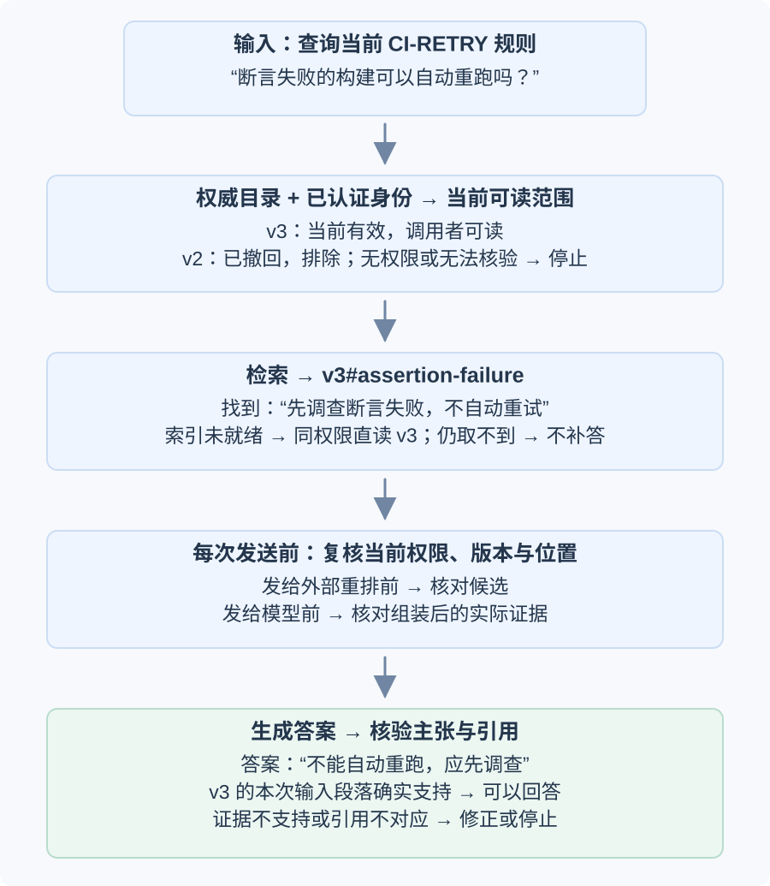
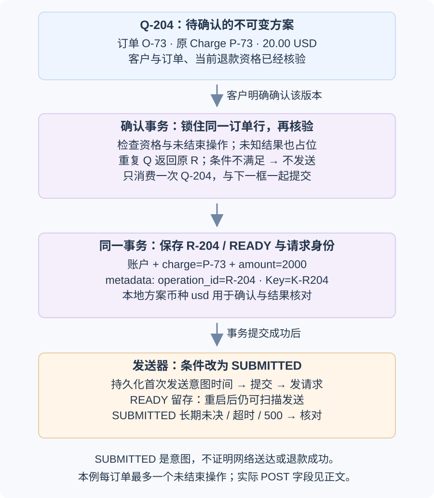
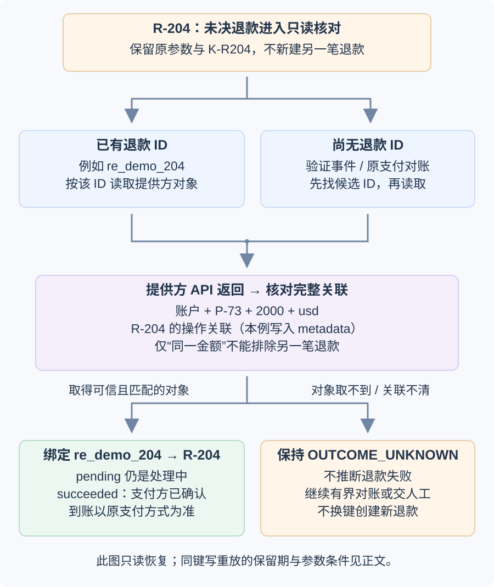

# 如何把 AI 系统设计题转化为有依据的架构？

同样使用语言模型，文档问答可能泄露用户无权访问的文件；退款助手可能重复执行资金写入；代码审查助手可能用大量误报耗尽工程师信任。它们的共同点只是包含生成模型，真正决定架构的是失败代价、可信数据边界、外部副作用和可验证的用户结果。

下面用三个独立的合成案例，沿“用户要什么结果 → 哪些事实必须可信 → 谁有权改变状态 → 用什么证据发布”的顺序推导方案。文档问答只读取资料，退款会写入外部系统，代码审查则把候选意见交给人判断；主循环、固定工作流或检索服务都应由这些差异决定。案例的数字是设计假设，实际方案还要用代表性评估和生产追踪校正。

## 文档问答：权限必须在证据交给模型前生效

### 请求从哪里取得答案？

**案例背景。** 员工问：“按当前 `CI-RETRY` 规则，断言失败的构建可以自动重跑吗？”这是规则查询，不要求系统执行重跑。沿用本库 retrieval-augmented generation (检索增强生成，RAG) 章节的虚构手册：`CI-RETRY-v3#assertion-failure` 当前有效，规定断言失败须先调查、不自动重跑；旧 `v2` 已撤回，曾允许任何失败重试一次。身份层已确认调用者；应用仍要检查此人当前能否读取这份手册。

语料已经预先索引，但“已索引”与“当前有效且获授权”分属两套状态。文档源维护版本、生效时间、删除状态和读取权限；解析与索引流程保留来源 ID、版本、段落位置、更新时间和处理状态，供查询准确找到对应内容。索引更新滞后时，不能用旧版本填补一个看似完整的答案。

检索首先从可信身份和权威来源目录取得允许的来源、版本与范围，再在其中查找候选。身份无效或权限服务超时就停止，不让模型猜权限。`v2` 即使仍存于索引，也不属于本例可用证据；当前 `v3` 尚未索引完成时，可以在相同授权边界下直读 `v3`，或说明暂时无法提供有依据的回答。删除和撤权由应用访问边界先行执行，索引与缓存副本随后清理；命中缓存也要复核当前权限。若产品要求生成期间发生的撤权对本次回复生效，发布前还需再核对，不能只依赖检索时的授权快照。托管检索也未必即时删除：例如 OpenAI Retrieval 明确说明向量存储移除文件后，短时间内仍可能命中旧内容。

检索方法要匹配问题。自然语言表达可以比较 dense retrieval（稠密检索）；精确政策编号需要保留可精确查找的字段，并与 lexical retrieval（词法检索）基线比较。hybrid retrieval（混合检索）可结合两类候选，但是否值得增加索引、重排和维护成本，要看同一组问题上的召回、排序、时延与费用。BM25 的词项相关性不等于编号字段的精确相等。

候选送到外部重排服务或模型之前，都要按当前权威权限与版本检查。组装后再核对实际要发送的全部证据，处理检索期间发生的权限变化；不能只检查最初查询条件。重排只决定候选顺序，不能把被撤回的 `v2` 或无权读取的片段变成合法输入。文档里的指令是待解释的数据，也不能授予工具权限。

本例最后应形成这条可检查的支持关系：

| 实际输入证据 | 回答中的主张 | 检查与结果 |
|---|---|---|
| 当前且可见的 `v3#assertion-failure`：“断言失败须先调查，不自动重试” | “不能按当前规则自动重跑；应先调查断言失败” | 引用确实指向本次输入的同一段落，且段落支持这项主张，可以回答。 |
| 只有旧 `v2`，或 `v3` 读取失败 | 不能建立当前规则结论 | 不用旧片段补答；说明当前证据不足或升级处理。 |
| `v3` 已取得，但答案写成“所有失败都可重跑” | 与证据相反 | 校验不通过，纠正或停止，不因附了引用就放行。 |

如果两份同为当前、且有权读取的来源彼此冲突，应指出冲突并停止给出确定结论或升级核对；不能只选一个高分片段掩盖矛盾。模型调用超时也属于本次请求未完成，应返回明确的失败或恢复入口，不能把未生成的结论当成答案。

这不证明任何一次真实构建属于哪类失败。若还要判断构建 42，须另取得授权日志，并区分“日志记录了什么”和“手册要求什么”。进一步的完整例子见[RAG 如何把历史观察与当前规范一起核验？](../rag/rag-architecture-and-implementation.md)。

上线前的评估要把检索和生成分开：检查证据是否进候选集，答案主张是否由来源支持，引用是否指向本次实际输入的片段；还应包含无答案问题、权限边界、更新与删除。上线后监控索引新鲜度、各阶段延迟、访问拒绝和任务完成率。RAG 的证据组织机制见[RAG 架构与实现](../rag/rag-architecture-and-implementation.md)，统一的配对评估方法见[如何判断 AI 系统是否满足任务契约？](../evaluation/llm-evaluation-methods.md)。

### 用预算推导候选方案

假设一个虚构团队要求高峰处理 6 个查询/秒，端到端 p95（95th percentile，第 95 百分位） 时延目标为 4 秒；允许托管模型 API，但没有专门资源运营 GPU 推理。

> [!example] 将假设工作负载拆成延迟预算
> 下表是用于压测的预算分配，不是测量结果或各阶段 p95：
>
> | 阶段 | 预算 |
> |---|---:|
> | 身份认证与请求建立 | 0.2 秒 |
> | 权限感知检索 | 0.6 秒 |
> | 模型生成 | 2.5 秒 |
> | 引用/结构验证和响应处理 | 0.2 秒 |
> | 网络与队列预留 | 0.5 秒 |
> | 合计分配 | 4.0 秒 |
>
> 阶段预算相加得到 4.0 秒，但每阶段预算不是测得的分位数，阶段 p95 也不能直接相加得出端到端 p95；要用联合负载测试测量完整链路。若请求里经常有很长文档或突发流量，队列和生成尾延迟会改变预算是否成立。

在系统稳定且样本代表长期平均时，可用 Little's Law（利特尔定律） 粗估平均在途请求数：

> [!example] 用平均停留时间估算在途请求
> $$
> L = \lambda W.
> $$
>
> 其中 L 是该阶段长期平均在途请求数；$\lambda_{\mathrm{model}}$ 是进入模型阶段的实际平均准入速率，$W_{\mathrm{model}}$ 是请求从进入到离开同一模型阶段的平均停留时间。假设教学负载中模型阶段的实际平均准入速率为 6 次/秒，且 1.2 秒包含该阶段排队与执行，则 L=6 次/秒 × 1.2 秒=7.2 个平均在途请求。7.2 是长期平均量，无需上取整，也不是 worker (工作进程) 或 GPU 副本数量；缓存、旁路、重试或被拒请求会使模型阶段实际 λ 不同，因此要用测得的准入速率，而非外层 API 的目标速率。队列、突发和目标利用率还要通过实际负载确定。容量计算的机制见[API 容量与背压](../../engineering-foundations/reliability/api-capacity-and-backpressure.md)。

对混合问题，可先比较关键词与向量混合检索和纯词法基线，权限在证据组装前过滤，把托管模型放在该检索服务之后，并明确队列上限和超载行为。如果任务扩展为长报告且无法满足交互时延，可以比较异步排队或批处理，并给用户明确的任务状态与恢复路径。若数据边界改为不能离开内网，就需比较私有或自托管模型，并把 GPU 运维、容量冗余和故障恢复成本纳入；若检索/生成无法满足预算，应先评估候选排序、上下文选择或模型，而不是无条件放宽质量门槛。

## 退款：工具调用返回超时不代表写入失败

退款是有外部副作用的操作。系统要在调用之前验证身份、订单状态、政策资格和明确确认；完成后读取可信交易状态。语言模型可以解析请求或说明流程，却不能成为授权和最终执行边界。

**案例背景。** 客户要求将订单 `O-73` 的已成功扣款的原支付 `P-73` 退款 `20.00 USD`。以下使用 Stripe `/v1/refunds` 的原支付部分退款路径作具体示例；`P-73` 是该次 Charge 的教学别名，真实请求使用提供方的 `ch_...` ID。`R-204` 等同样是教学标识。本例每张订单最多有一个尚未结束的退款操作，不覆盖并发部分退款产品的额度预留设计。

### 确认先绑定完整方案，再产生可发送的操作

应用验证客户与订单归属，读取当前政策和可退金额，形成不可变方案 `Q-204`，展示订单、原支付、金额和币种。确认只对这个方案版本有效；金额或目标改变就要重新确认。

确认事务按订单锁住同一条操作/额度记录，再检查资格与是否已有进行中操作。所有确认入口都遵守这把锁，因此两个不同方案也不能同时通过“没有其他退款”的检查。`OUTCOME_UNKNOWN` 仍占用该订单的未结束名额。经当前身份与方案绑定验证的重复确认，返回原操作，不重新消耗名额。

事务只消费一次 `Q-204`，同时保存 refund operation ID（退款操作 ID）`R-204`、方案摘要、provider（支付提供方）账户范围、完整参数、idempotency key（幂等键）`K-R204`，以及可扫描的 `READY` 待发送状态。确认消费和操作保存一起提交；保存失败时消费也回滚，不能出现“确认已用掉，却找不到退款操作”的中间状态。提供方仍会检查真实剩余可退金额，本地资格检查不能替代它。

独立发送器扫描 `READY`，条件更新为 `SUBMITTED` 并记录本地首次发送意图时间，提交后才进入受限发送边界；实际发送还要满足下文的当前状态与时间窗口检查。若进程在确认提交后退出，`READY` 仍可被恢复；若它在发送前后退出，扫描器会把超过等待期限的未决 `SUBMITTED` 交给下一节的核对路径。这条意图记录不能证明提供方收到请求，也不能因本地崩溃就新建操作。

> [!example] R-204 的方案字段怎样变成一次请求？
> 本地方案保存币种 `usd`，用于确认和后续核对；USD 的 `20.00` 对应 `2000` 美分。本例向 `POST /v1/refunds` 发送 `charge=P-73`、`amount=2000`、`metadata[operation_id]=R-204`，并在请求头发送 `Idempotency-Key: K-R204`；`P-73` 在真实请求中替换为所保存的 Charge ID。提供方账户范围也固定，不因重试切换。
>
> 这样后来收到退款对象时，应用能用 metadata 认回 R-204，再核对原支付、金额与币种。订单号不能充当操作 ID：同一订单可以先后发生多笔独立部分退款，每笔有自己的方案与操作。

### 超时后先恢复事实，不创建另一笔退款

若写入网络超时、返回结果不明的 `500`，或扫描发现发送后没有可信结论的 `SUBMITTED`，将同一个 `R-204` 纳入 `OUTCOME_UNKNOWN` 核对。它可能尚未送达，也可能已创建退款，只是响应丢失。此时保留原操作键、原参数和发送意图，不能把“没收到结果”写成“退款失败”，也不能新建 `R-205` 再试一次。

下面画只读恢复路径。已知唯一 refund ID（退款 ID）就按 ID 读取；未知 ID 时，先从经验证的事件，或在同一提供方账户下按原支付列出的退款记录中寻找候选，再验证它确实对应本次操作。

本例请求已经把 `R-204` 写入 metadata。正常创建响应与中断后的查询结果都要经过同一套对象核对。事件经 webhook（事件回调）签名验证后仍只是核对入口：应用用提供方 API 读取对象，检查账户范围、原支付 `P-73`、金额 `2000`、币种 `usd`，以及与本方已保存操作的关联，再将 `re_demo_204` 绑定到 `R-204`。同一支付可能有两次同额退款，只有金额相同不足以建立关联。关联不清或查询失败就保持未知，交对账或人工处理。

取得可信对象后，再按**当前状态**更新本地记录：

| 提供方确认的事实 | 本方状态与用户可见结果 |
|---|---|
| `pending` | `PROCESSING`，已经知道是哪笔退款，但还不能报告完成。 |
| `requires_action` | `AWAITING_ACTION`，有适用的 `next_action` 时展示后续处理，否则交人工核对；不重新创建退款。 |
| `succeeded` | 条件更新 `R-204` 为 `CONFIRMED`，告知“支付方已确认退款，到账以原支付方式为准”；重复通知不能再产生一次业务记账或通知任务。 |
| `failed` 或 `canceled` | 记录明确失败或取消及原因，再按政策处理后续；不把它们与没有查询结论的未知混合。 |
| 没有可验证的对象或状态 | 保持 `OUTCOME_UNKNOWN`，继续有界对账或交人工；不因重试次数耗尽而推断资金未变。 |

例如，本次超时后收到与 `R-204` 关联的事件，读取 `re_demo_204` 得到 `pending`，本方由未知变为处理中；稍后再次读取为 `succeeded`，才由处理中推进到 `CONFIRMED`。Stripe webhook 可能重复或乱序到达，所以入口验证原始请求体签名并去重事件，业务更新还要以操作状态作条件，不能用一条迟到的旧事件覆盖已确认结果。若之后读取到提供方真实状态变化，则作为新异常进入对账并保留状态历史，不把“避免旧事件回退”实现成忽略后续事实。需要发送通知等额外副作用时，将状态变更与待执行通知一起持久化，由原操作身份去重；“只处理一次”不能只靠内存中的标记。

是否允许写请求重放，要看提供方具体契约。Stripe API v1 在开始执行后保存同键响应（包括 `500`），要求重放参数一致；键至少保留 24 小时，过期清理后复用可能成为新请求。本例用本地持久化的首次发送意图时间作保守起点，不因重试重新计时。首发、恢复接管和 SDK 自动重试都经过同一发送边界：每次真正发出 POST 前，重查持久操作仍允许写入，并核验保守的 24 小时窗口，通过后才按原键原参有界发送；已得到可信结论、窗口将尽或时间不明时都转只读核对，不能拿旧发送许可继续写。调度、退避与网络传输也必须计入截止余量，避免排队请求跨过保留边界。比如首发送者记录意图后暂停，恢复器在第 1 小时已经完成退款，旧发送者第 26 小时恢复时必须停止，而不是继续它之前的 POST。

这种自动重放依赖发送端能约束暂停恢复、SDK 内部重试和发送延迟；单独查一次数据库或发出取消信号不能证明已在途请求按时停止。无法保证请求仍落在安全窗口时，本例停止自动写重试，保留原操作并只读对账或交人工，不以换键解决未知。即使仍在窗口内，同键重放也可能一直返回缓存的 `500`，不能把它当作已经查清结果。API v2 的失败重试语义不同，不把 v1 规则泛化给所有 Stripe API。幂等键也不普遍提供按键查询能力；应分别核验“能否安全重放”和“凭什么找回结果”。

适合的请求路径是认证客户、读取订单和当前政策、应用代码校验资格、向客户展示拟退款金额并确认、执行受限写入、查询最终状态，再报告结果或交人工。步骤可预期且会改变资金状态，因此固定工作流让确认点和停止路径明确。只有当动态工具选择有明确收益、能受限且可观测时，才值得引入 agent loop (智能体循环)。

工具 schema (参数结构定义) 可以约束字段与类型，但不能授权操作或判断退款资格；应用仍需根据认证身份和业务状态校验权限与幂等。上线评估应覆盖常见意图、资格边界、重复请求、超时后结果未知、政策冲突、工具失败和人工升级；生产可观测性需要把每次状态迁移和交易 ID 关联，但避免在通用日志中复制个人或支付正文。有关运行状态与恢复，见[持久化 AI 运行架构](ai-application-architecture.md)；权限、确认与停止路径见[生产环境中的 AI 安全](../safety/ai-safety-in-production.md)。

## 代码审查：误报成本决定自动化边界

代码审查助手需要读取 pull request (PR，合并请求) 的 diff (代码差异) 与必要仓库上下文，输出有证据、能定位的 finding (审查发现)。团队若不愿承受嘈杂评论，应先以草稿形式提供建议，由人决定是否发布；不自动批准或阻止合并。行内意见应锚定到本次改动或平台可接受的 diff 行；证据可以来自相关的未修改代码，但必须说明本 PR 如何引入问题，无法证明时拒绝该 finding。若没有合适的行级锚点，可改用平台支持的文件级意见或摘要供人工审阅。要先确定仓库代码、差异、评论和依赖元数据能否发送到托管服务；若不能越过仓库边界，应比较获准的私有端点或本地模型，同时限制所提供上下文。

**案例背景。** 一个合成 PR 把保存操作的 `await` 去掉。这里假定 `persist(change)` 返回 Promise，写入失败时拒绝；请求适配器等处理函数结束才发送结果，处理函数拒绝时走错误响应：

~~~diff
- await persist(change);
+ void persist(change);
  return { status: 200 };
~~~

如果写入仍在等待，修改前的处理函数不能走到 `200`；修改后却可以立即结束。随后写入失败，已经发出的成功结果也不会被那个拒绝自动撤回。这个 finding 的依据是“当前改动切断了等待关系”，不是单纯发现代码里出现了 `void`。

| 阶段 | 必须保留的输入或产物 | 本例怎样走到下一步 |
|---|---|---|
| 固定审查版本 | PR 身份、base/head commit 与该版本 diff | 保存被删的 `await` 和新增的 `void`，后续证据都对应同一 head。 |
| 收集必要上下文 | `persist` 的返回契约、请求适配器的响应与错误处理 | 若不能确认 Promise 和返回时机，就先补上下文，不凭片段断言一定提前成功。 |
| 生成候选 finding | 位置、触发条件、改动到后果的因果链 | “存储未完成时即可返回 200；之后拒绝不会撤销已发送结果”。 |
| 校验证据与位置 | 必要时最小重现；路径、diff side、行号、head 一致 | 同一受控未结算 Promise 可比较两个版本；没有合适行锚点时改用文件级意见或摘要。 |
| 形成待审草稿 | 去重、按影响排序、抑制无支持意见 | 人决定是否发布；发布前重查 PR head，变化则对新版本重新核验。 |
| 收集反馈 | 接受/驳回原因、修复情况、费用和延迟 | 用于定位下一次改进，不把接受或驳回直接当真值标签。 |

仓库内容和 PR 描述属于不可信输入：分析代码不意味着可以执行其中的脚本，也不能让注释里的命令改写审查权限。若验证必须运行代码，交给受限的验证环境，工具和网络权限另行控制。这里从版本化证据到意见草稿的结构是工程设计；GitHub 的 `commit_id`、`path`、`line` 和 `side` 只规定意见可锚定在哪里，不证明意见正确。

### 用误报与漏报决定发布模式

> [!example] 合成审查样本的 precision 和 recall
> 在与开发调参样本分开的验收标注集上分别统计 true positive (TP，真阳性)、false positive (FP，假阳性) 和 false negative (FN，假阴性)：
>
> ~~~text
> precision = TP / (TP + FP)
> recall    = TP / (TP + FN)
> ~~~
>
> 合成小样本中，按本例被评估的草稿输出、去重后的 finding 计数：TP=15、FP=10、FN=5，因此 precision (精确率)=15/(15+10)=60%，recall (召回率)=15/(15+5)=75%。同一标注问题至多匹配一个发现。精确率回答“这批被评估的发现中多少是真的”，召回率回答“已知问题中多少被找到”；它们的分母分别是系统发现数与标注真问题数，不是 PR 数。样本小、问题类型混合或标签不全时，百分比会不稳定，应按安全、正确性、风格等类别分层并报告样本数。

如果团队目标是让高置信、可证据复核的 finding 节省时间，60% 的 precision 可能不足以自动发评论，但可以继续作为草稿或抑制低置信输出。若漏掉安全问题代价更高，也要监测 recall 和高风险类别，不能只优化精确率让系统变沉默。阈值是产品和工作流决策，先在开发标注样本上选择，再用独立保留样本按最终输出规则验收，不是模型的通用常数。若最终只自动发布草稿的高置信子集，须对该子集重新计算精确率与召回率，不能沿用全部草稿的 60%/75%；后者也只对应这份标注集的已知问题。

上下文可包括 changed lines、附近函数、相关调用方和仓库规范；当上下文限长而被截断时记录省略范围。正确性与安全检查可以分开以便解释，但不要在没有任务收益时把一次审查变成多个昂贵模型调用。对大型或生成代码按文件或逻辑块处理，再合并重复 finding。收集作者接受、驳回和修正时，应解释这些行为仍是有偏反馈，不能直接当成错误标签。

评估集应同时包含已知问题与干净改动；测量按类别的 TP/FP/FN、行号有效率、证据支持、开发者接受/驳回、每次审查费用和增加的工作流延迟。用人工审查基线作比较，不能在没有证据时宣称优于人类审查。评估方法和保留候选版本的门禁见[大语言模型评估方法](../evaluation/llm-evaluation-methods.md)与[Agent 改进与版本验收](../agents/agent-improvement-and-version-acceptance.md)。

## 三个案例的发布证据落点

这三种系统的“成功”不共用一个分数：文档问答关心证据可见性和权限边界；退款要证明交易状态和授权；代码审查需要在误报成本与漏报风险间选工作模式。候选上线前，应固定任务样本、模型和相关配置，以配对基线查任务翻转，同时测成本、延迟和硬门禁。生产后 trace 用于解释实际失败并提出修复方向；修复是否泛化到新问题仍由独立样本验收。奖励训练分数不能替代这一步，线上用户反馈也不能自动视作真值标签。

> [!info]- 来源
> 以下第一手资料支撑对应机制；案例数字是明确标注的假设或合成计算，不是来源中的实测。
>
> - **容量公式。** Little, [“A Proof for the Queuing Formula: L = λW”](https://doi.org/10.1287/opre.9.3.383)，*Operations Research*, 1961, 9(3):383–387；适用于稳定系统的长期平均关系，不直接给出分位数或 worker 配置。
> - **授权与索引删除边界。** [OWASP Authorization Cheat Sheet](https://cheatsheetseries.owasp.org/cheatsheets/Authorization_Cheat_Sheet.html) 的 `Validate the Permissions on Every Request` 和 `Deny by Default`；[OpenAI Retrieval](https://developers.openai.com/api/docs/guides/retrieval) 的 `Vector store file operations` 说明文件删除最终一致。核对日期 2026-11-12；实际发送前复核及 v3/v2 分支是结合这些约束的本例工程设计。
> - **退款幂等与结果读取。** Stripe 官方 [Idempotent requests](https://docs.stripe.com/api/idempotent_requests) 区分 API v1 的同键响应、参数一致性与至少 24 小时保留规则，以及 API v2 的失败重试行为；[Create a refund](https://docs.stripe.com/api/refunds/create) 允许多次部分退款并支持 metadata；[Retrieve a refund](https://docs.stripe.com/api/refunds/retrieve) 按退款 ID 读取，说明“支持幂等键”不等于“可按键查询”。
> - **退款对象与状态。** Stripe 官方 [Refund object](https://docs.stripe.com/api/refunds/object) 给退款对象唯一 ID，并区分 pending、requires_action、succeeded、failed、canceled；存在对象不等于最终成功。金额使用最小货币单位；上面的 USD 例为 2000。核对日期 2026-11-12。
> - **未决写入恢复。** Stripe [Advanced error handling](https://docs.stripe.com/error-low-level) 的 `Network errors`、`Server errors` 与 `POST requests` 支撑首次请求起 24 小时内原键原参重试、500 可能已有副作用和保留期间同键重放仍返回缓存错误。READY 扫描、SUBMITTED 超时核对和按订单串行化是本例应用设计；核对日期 2026-11-12。
> - **退款关联与到账边界。** Stripe [List all refunds](https://docs.stripe.com/api/refunds/list) 支撑按原支付列候选；[Refunds](https://docs.stripe.com/refunds) 的退款跟踪与失败说明支付方处理状态和客户最终收到款项的区别，核对日期 2026-11-12。
> - **退款事件验证、重复与乱序。** Stripe 官方 [Webhooks](https://docs.stripe.com/webhooks) 的 `Verify webhook signatures`、`Event ordering`、`Handle duplicate events` 要求保留原始请求体验签并处理重复/乱序。Q-204 的确认消费、R-204 条件状态和通知去重是应用设计，不是事件投递保证。核对日期 2026-11-12。
> - **结构化输出与工具调用。** OpenAI 官方 [Function calling](https://developers.openai.com/api/docs/guides/function-calling) 和 [Structured outputs](https://developers.openai.com/api/docs/guides/structured-outputs)，截至 2026-11-06 核对。schema 约束接口形状，不代替应用授权与业务状态检查。
> - **PR 审查评论的行级与文件级发布锚点。** GitHub 官方 [Create a review comment](https://docs.github.com/en/rest/pulls/comments#create-a-review-comment-for-a-pull-request)，截至 2026-11-12 核对其 API version header `2026-03-10` 的 `commit_id`、`line`、`side` 与 `subject_type` 参数；`line` 锚定 diff 行，`subject_type` 可选 `line` 或 `file`。平台锚点说明评论能放在哪里，不证明 finding 是否由该 PR 引入。
