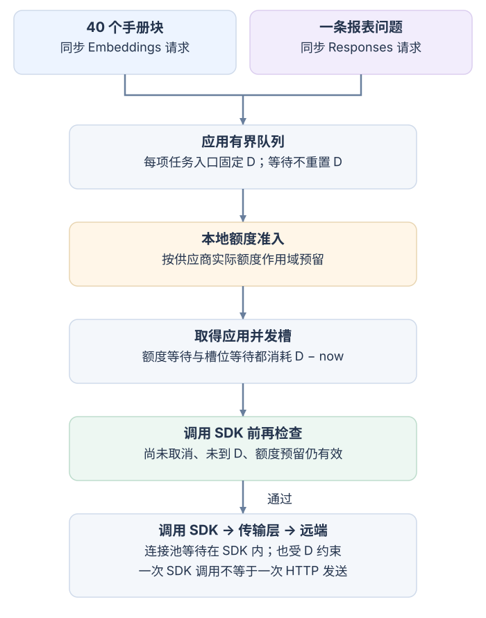
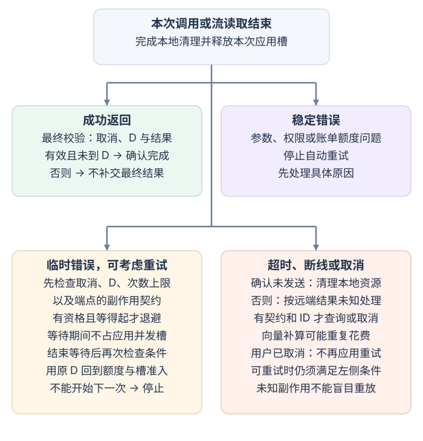

# 怎样让模型 API 调用在限额、失败和截止时间内有界？

一个模型 application programming interface（API，应用程序编程接口）调用可能先在应用队列中等待，再等待配额、并发槽或连接池；发出 Hypertext Transfer Protocol（HTTP，超文本传输协议）请求后，即使 software development kit（SDK，软件开发套件）返回超时，也不能据此断定服务端没有处理请求。要让调用有界，应用须沿着同一条单调时钟截止线管理等待，分清每层的重试，并按端点契约处理“本地停止等待但远端状态未知”。

本文沿用一组公开、合成的 continuous integration（CI，持续集成）手册作为例子：索引任务要为 40 个手册块生成向量，报表页面同时收到一条必须在截止时间前回答的问题。OpenAI 的普通向量创建使用 Embeddings API，报表回答使用 Responses API；它们可以共用本地队列、并发槽或连接池，但只有被供应商归入同一个模型/项目/组织额度作用域时，才竞争对应的供应商配额。若索引改用 Batch API，则它是另一个异步作业接口，有自己的状态和限额。下文用 OpenAI 官方文档及 Python SDK `v3.49.0` 举例；不同供应商、端点和 SDK 版本的计量、重定向、重试与取消契约须分别确认。

## 每次尝试会经过哪些边界？

报表问题在入口时记录 absolute deadline（绝对截止时间）D。D 用同一 event loop（事件循环）的 monotonic clock（单调时钟）表示；它不随系统日历时间校正而倒退。每个阶段剩下的时间都是 `D - now`。图中的队列和本地调度可以由两种工作共用；到真正发送时，再按对应 API 端点和供应商额度作用域准入。

图展示本例两种同步调用：结果或流由这条 HTTP 请求交付；Python 异步客户端只是让应用不阻塞地等待，不会把它变成 Batch 后台作业。图中的额度申请是本地协调器按供应商窗口作准入预留，不是先向供应商发送一条申请请求。Batch 的作业流程在后文单独说明。任一等待阶段被取消或用尽剩余时间，便结束本次尝试并清理已取得的资源；未通过发送前检查就不启动这次 SDK 调用。

任务先经过 bounded queue（有界队列）等待；rate limit（速率限制）决定哪个时间窗能启动请求；随后应用持有 concurrency slot（并发槽），并调用长期复用的 SDK client（客户端）。在本例的 OpenAI SDK 中，connection pool（连接池）属于 SDK 的 HTTPX2 transport（传输层）：池等待发生在 SDK 调用内部，也消耗剩余预算 `D - now`，不是应用在调用 SDK 前另行借出的连接。各边界保护不同资源，不能互相替代：

| 边界 | 限制对象 | 本例中怎样使用 |
|---|---|---|
| 队列长度 | 尚未启动的工作数和内存 | 队列满时拒绝或向上游施加 backpressure（背压）；优先级只改变尚在队列中的调度次序，不能抢回已经被离线工作占用的槽或配额。 |
| 供应商额度 | 在给定时间窗内允许的请求数与 token（词元）估算量 | Embeddings 与 Responses 是不同端点。是否共享某个请求数或 token 额度，要按当前项目、模型和限额组核对；不能仅因都使用模型服务就假设同池。 |
| 应用并发槽 | 当前由应用持有的在途调用数 | 两类工作可共享并发总量，也可给在线问题预留槽；重试退避时释放槽，下一次发送重新申请。 |
| HTTP 连接池 | 可同时取得的连接，以及连接复用 | 长期复用异步客户端可保留 keep-alive（保持活动）连接。池满时等待消耗剩余预算 `D - now`；连接池大小不等于 RPM（requests per minute，每分钟请求数）、TPM（tokens per minute，每分钟词元数）或应用并发策略。 |

非流式结果在解析验收后一次交付；流式内容则在读取过程中逐段校验，确认未取消且未到 D 后交付该段，不必等完整流结束。最终结果或完成标记还需再次检查条件；途中取消或超时则把已显示的部分标为中断，不能把它当作完整答复。若请求是流式响应，应用并发槽应一直占用到读取完成，或流关闭后的本地清理结束。关闭本地流能释放本地资源，但不能推出服务端并发已立即减少。跨多个 worker（工作进程）的额度也不能由每个进程独立计数来保证；若共用一个供应商额度作用域，应在共享协调层原子准入，或使用集中调度器。作粗略容量估算时，若 4 个槽的平均在途时间都是 0.5 秒，持续吞吐约为 `4 / 0.5 = 8` 次/秒；真实上限还受尾延迟、突发模式与 RPM/TPM 限制，不能只按这个平均值配置。

### 先把速率额度换算成可复算的上限

OpenAI Rate limits 指南对适用 `max_tokens` 的文本请求给出一种预估方式：输入按请求字符数估算，速率计算取该输入估算值和输出 `max_tokens` 上限中的较大者。本例假设一个使用这条规则的教学文本端点：每分钟 60 个请求、12,000 个词元，报表输入估算为 900，输出 `max_tokens` 为 300。每次先按 `max(900, 300) = 900` 预留，则 TPM 的固定分钟算术上限为 `⌊12,000 / 900⌋ = 13` 次；RPM 与 TPM 取较小者，仍是 13 次。

这个计算只说明该指南规则下的教学算术，不证明所有端点的实际计量都一样。Responses 请求使用 `max_output_tokens`；不能仅凭字段名称把上述 `max_tokens` 公式推广到每个模型、项目和端点。实际限额、共享范围、估算方式和窗口须查目标项目当前文档与响应头。即使返回了 usage（实际用量），它也不是服务端剩余 RPM/TPM 的余额；只有供应商明示的计量契约允许时，才按已用量调整内部速率预留。

若另一供应商明确按输入加输出上限计算，同一教学数字会变成 `900 + 300 = 1,200` 词元/次，`⌊12,000 / 1,200⌋ = 10` 次/分钟。两个答案来自不同计量规则，不能混用。失败请求也可能计入每分钟额度；重试要按一次新的请求准入。

应用先预留额度再等待并发槽时，应在调用 SDK 前重新检查取消、D 和本地额度预留是否仍有效。SDK 内部的池等待也要受同一个 D 约束；应用在 SDK 方法入口检查一次，不等于已经检查每条 HTTP 请求实际发送时的额度窗口。关闭未计入的 SDK 重试和重定向能限制额外发送数，但即使只有一次发送，也可能在池等待期间跨过预留窗口。若要逐条发送准入，必须把闸门放在池等待之后、可观察并阻止每次实际传输发送的位置。请求确定未发出时，只有本地协调器支持才归还本地预留；无法确定是否发出时，不要用账单 usage 或客户端块 ID 猜测供应商额度状态。应用优先级能安排下一项工作，不能撤销已经发给服务端的调用。

### 离线向量任务何时改用 Batch？

普通 Embeddings API 是同步创建接口：`POST /v1/embeddings` 接收一个或多个输入并返回向量。合并输入可以减少请求数，但不会消除这些输入消耗的 token；仍须按目标模型的单条和整批输入限制切批。该接口文档没有以调用方自定 `chunk_id` 读取旧响应的路径；因此，客户端块 ID 只能查应用缓存或索引，不能当成服务端结果查询键。若请求超时，应用只能先查本地是否已写入结果；若无记录，远端是否已算好仍未知。重算可以补齐纯向量缺项，但可能重复花费；它不是远端结果查询。

Batch API 适合 40 个可延后的索引输入。它的 JSON Lines（JSONL，逐行 JSON）文件每行是一项端点请求，每项有唯一 `custom_id`；一行的 Embeddings 请求可以带多个文本输入。提交后先保存 Batch 返回的 `batch_id`，再查询作业状态；完成后用 `output_file_id` 下载成功结果，用 `error_file_id` 检查失败行。若一行只装一个块，应用可直接把 `custom_id` 映射到该块；若一行包含多个块，应先按 `custom_id` 找回原请求，再用 Batch 输出行中 `response.body.data[].index` 对应请求内的输入位置，映射回各 `chunk_id`。`custom_id` 属于一行请求，不会自动给该行中的每个输入分配单独身份。例如请求行 `ci-part-a` 的输入依次是 `chunk-17`、`chunk-18`，返回 `index=0` 的向量属于 `chunk-17`，`index=1` 属于 `chunk-18`；输出行的排列不决定块的身份。

如果创建 Batch 的响应丢失，原作业仍可能存在；未取得 `batch_id` 时不能直接按 ID 查询或取消。应用可在提交前保存上传的 `input_file_id` 与任务标记，并将标记写入 Batch `metadata`，之后列举作业按文件与标记对账。这些字段不是供应商承诺的唯一或幂等键，临时未找到也不证明未创建；未确认前不盲目补交整个批次。

Batch 有独立于同步端点的速率池和待处理 token 限制，官方完成窗为 24 小时；所以它能吸收离线积压，却不能替一条短时限报表回答。取消 Batch 需要已有 `batch_id`，调用 Batch 的取消端点；状态可能先保持 `cancelling`，直到在途请求结束（最多 10 分钟）才变成 `cancelled`。即便取消，已完成部分仍要通过输出和错误文件对账。这个流程不同于普通同步 Embeddings 重试，也不同于 Responses 后台作业取消。

## 怎样让所有等待共用一个截止时间？

在报表请求入口创建单调时钟截止点 D，并把这个绝对值沿队列、额度等待、并发槽、连接池、网络调用、退避、解析和交付一路传下去。每个等待阶段用 `D - loop.time()` 算剩余时间；不能在出队或每次重试时重新加 30 秒。若应用先预留额度再等待并发槽，调用 SDK 前要再次检查 D、取消状态以及预留是否仍有效；这就是图里的“发送前检查”。连接池在 SDK 内部，若要在池等待后对每条实际发送重新核验，则须采用上节的传输层闸门，SDK 入口检查不能替代它。

传输层阶段时限与应用 D 是不同的契约。OpenAI Python SDK `v3.49.0` 于 2026-11-10 发布，其默认超时对象为 `httpx2.Timeout(600, connect=5.0)`，默认 `max_retries=2`。这不是整项业务等待的 600 秒硬上限：connect 限制建连等待，read/write 限制等待响应或请求体的单个数据块，pool 限制从连接池取得连接；应用队列和退避在它们之外。连接池还可分别配置最大连接数和空闲 keep-alive 数。SDK 提供的默认客户端类还设置连接池上限和 `follow_redirects=True`；若传入自行创建的 HTTPX2 客户端，则应核实该客户端自己的配置。

Python 3.11 可用 `asyncio.timeout_at()` 按单调时钟的绝对时点限制当前任务中的等待。它不会像 `asyncio.wait_for()` 那样为被等待的协程单独包装一个 Task；直接 `await` 也使外部取消与请求完成的边界更清楚。不过取消是协作式的：底层若吞掉取消并做清理，调用方仍可能在 D 之后才恢复执行。因此每次返回前还要核对当前是否已超时，迟到内容不能算按时交付。若界面必须在 D 结束等待，外层等待方须能在 D 独立结束等待，受追踪的工作方继续完成本地清理并禁止迟到交付；远端对账也有单独生命周期。任何本地 timeout 都不能自行证明服务端已停止。

## 哪些错误可以重试？重试会发出几次请求？

application attempt（应用尝试）是应用代码调用一次 SDK；SDK 内部可能有自己的重试；真正的 HTTP 发送数则要看网络上发生了几次请求。OpenAI 当前文档把 429 `rate_limit_error`/`slow_down` 定义为流量增加过快，把 503 `service_unavailable_error`/`server_is_overloaded` 定义为模型暂时过载。下表分开写 JSON 的 `error.type` 和 `error.code`，再依据实际错误决定恢复：

| OpenAI 响应 | 对本次调用的处理 |
|---|---|
| HTTP 429；普通请求数或 token 速率暂时超限 | 等待额度窗口恢复；按实际响应体、有效 `Retry-After` 和下文共同顺序判断是否重新准入。 |
| HTTP 429；`error.type=rate_limit_error`；`error.code=slow_down` | 临时流量爬升过快；它也可能发生在 RPM/TPM 数字以内。按下文的共同顺序判断是否重试。 |
| HTTP 503；`error.type=service_unavailable_error`；`error.code=server_is_overloaded` | 模型临时过载；按下文的共同顺序判断是否重试。 |
| HTTP 429；错误码如 `credit_balance_exhausted`、`organization_spend_limit_exceeded`、`project_spend_limit_exceeded` 或 `organization_usage_limit_exceeded` | 需处理账户或用量限制；相同请求重发不会恢复额度，停止自动重试。实际 `error.type` 以响应体为准。 |
| HTTP 400、401、403 等稳定错误；格式、认证、权限等错误码 | 先修正输入、凭据或权限；原样重发不会改变原因。 |
| 连接错误、超时或其他 5xx | 请求可能未出网，也可能已到服务端而响应丢失；按端点副作用、可查询状态和幂等契约决定是否重放。 |

先检查取消、D、应用已配置的尝试上限（若另有逐发送预算，也检查该预算）以及副作用是否允许重试；任何条件不允许就停止。只有仍具重试资格时，才遵循有效的 `Retry-After`（服务端要求的最早等待时间）；它缺失或无效时，按 OpenAI 指南用有限 exponential backoff（指数退避）并加随机 jitter（抖动）。等待后再检查取消和 D，并重新经过准入。示例代码只接收传输适配器已规范化的非负秒数或 `None`：缺失或无效时传 `None`，再走退避；它不实现 HTTP 日期解析，也不判断不安全副作用是否可重放。退避预算检查要求剩余时间足以等完退避并开始下一次尝试；不够就退出。预算够开始不保证下一次能在 D 前完成。SDK `v3.49.0` 默认按响应状态和 `x-should-retry` 决定是否重试，还会查看请求体能否安全重发及 `Retry-After`；若没有 `x-should-retry: false` 覆盖，该版本会重试连接错误、SDK 捕获的传输超时、HTTP 408、409、429 和 5xx，却不替应用解释 429 的 `error.code`。因此账单额度 429 也可能触发 SDK 内部重试；若业务要求按错误码停止，应用应自行分类并关闭 SDK 自动重试或提供可控策略。该版本的有效服务端等待若超过 120 秒，会跳过 SDK 重试。

这个 SDK 默认 `max_retries=2` 意味着最多三轮 SDK 请求流程（首次加两次内部重试），不是三次线上 HTTP 请求的严格上限。SDK 提供的默认 HTTPX2 客户端 `follow_redirects=True`；一次请求流程可能因重定向发出多条 HTTP 请求。反过来，如果 DNS 或取连接在请求发送前失败，可能一条 HTTP 请求都没有。应用调用三次 SDK，最多是 `3 × 3 = 9` 轮 SDK 请求流程；只有额外假设每轮至多一次 HTTP 发送、且没有重定向或其他传输层重发时，才能把 9 当成网络发送上限。

如果应用要对每一条实际发送做 RPM/TPM 准入，计数与闸门须覆盖实际传输发送的位置和时点，包括内部重试与重定向。关闭这些额外发送只能简化次数管理；只预留一个保守总次数不能保证正确的时间窗额度。重试层叠也会扩大等待和重复成本，最好只保留一个主要的重试所有者。SDK 可安全地重放请求体，不代表包含作业创建或外部工具操作的业务行为天然幂等。对于有副作用的端点，应按其明确支持的幂等键（idempotency key）和状态查询契约处理，不要把 SDK 重试配置当成业务保证。

下图接续前图：本次非流式调用或流读取结束并完成本地清理后，应用释放本次槽位，再确定最终结果或中断状态；流中已交付的片段不在此重新发送。只有该次 SDK 调用的所有内部请求都确认未发送时，失败才只做本地收尾，按协调器规则处理预留；前面某轮已发送或无法确认时，不能用最后一轮的池超时推断远端没有处理。连接失败、超时是否可重试还要通过同一组资格检查，调用方取消则停止应用重试。重试重新经过额度和并发槽准入，沿用入口的 D。取消后的只读对账可以在单独的生命周期继续，不会延长本次用户等待。

### 用例：一条报表问题遇到两秒 Retry-After

假设在线报表问题在入口获准 150ms 总预算，排队与第一次响应已经耗用 100ms；收到 OpenAI 临时 429 时，距原 D 只余 50ms，响应给 `Retry-After: 2`。当前调用确实已发出；服务端提示要求至少等两秒，超过这个问题的截止时间。调度器不等这两秒，也不发第二次请求；它把这次用户等待结束为“暂未完成”，记录请求状态供产品按需提示。后台 40 个向量块可以继续排队或延迟到 Batch，但每次同步尝试仍要按 Embeddings 端点自己的额度重新准入。

若一条同步 embedding（嵌入向量）请求在发送后读超时，先查本地 `chunk_id` 是否已经写入；本地无结果只说明应用未持久化它，不会查询回供应商的同步响应。业务可选择之后重算这个纯向量输入以补齐索引，同时接受可能重复计费；不能把它标记为远端确定失败。若改由 Batch 生成，重试与补缺依据已知 `batch_id`、作业状态、输出/错误文件中的 `custom_id` 和 `data[].index` 完成。报表的 Responses 后台作业则按它自己的 `response_id` 查询或取消，三种身份不能互换。

下列轨迹在文末假客户端中复算。重试提示用例直接从 50ms 的剩余预算开始，验证等不起两秒，不模拟前面的 100ms。每次 `create` 只计一次模拟客户端调用，未模拟真实 HTTP 或 SDK 内部重试：

| 轨迹 | 模拟调用数 | 应用结果 |
|---|---:|---|
| 临时 429 后成功，最多允许三次 | 2 | 第二次返回；共调用两次 |
| 连续 503，最多允许三次 | 3 | 不启动第四次 |
| `Retry-After=2s`，距 D 只余 `0.05s` | 1 | 等不起退避，不启动下一次 |
| 请求开始后调用方取消 | 1 | 传播取消，不启动下一次 |
| 总预算 `10ms`，底层收到取消后再清理 `40ms` | 1 | 约 `50ms` 才返回本地控制权；拒收迟到结果 |

最后一行说明协作式取消不等于硬实时中断，具体耗时受调度影响。界面在 D 停止等待与清理结束是两个时点。

## 取消或断线后怎样辨别结果状态？

在发送前取消的任务可以从队列移除；若只预留了本地配额，可在确认未发送时按协调器规则归还。发送之后，本地取消会阻止后续应用重试，但实际远端状态依端点而异：断开同步连接、取消本地 Task、请求后台作业取消，不是同一个动作。

OpenAI Responses 的读取和取消是不同契约。只要已知 `response_id` 且 Response 仍按项目设置被保留，就可用读取端点查询，包括被保留的同步 Response；`background=true` 不是普通读取的前提。同步响应可通过终止连接来取消；后台 Response 在 `queued` 或 `in_progress` 时可继续轮询，只有后台响应适用 `/v1/responses/{response_id}/cancel`。用户等候截止到达时，若 ID 已知，仍可做只读状态查询；取消和查询也不等于重放。若响应 ID 尚未收到，则不能仅凭本地请求 ID 查询这项远端工作。是否完成、是否计费仍须依据端点状态和计量资料核对。

后台 Responses 还提供专门的断点续流契约，但创建时须同时设置 `background=true, stream=true`。文档指出后台模式当前首词元时延可能高于同步响应；异步轮询和事件恢复也依赖项目的存储/保留设置，不能把 response ID 当成永久保存保证。创建流的 `response.created` 事件携带 `event.response.id`；应用从中持久化 `response_id`，并逐步保存最后一个已处理的事件 `sequence_number`；keepalive（保活事件）不推进持久事件游标。断线后用该响应 ID，并以 `stream=true&starting_after=<最后处理序号>` 继续读取后续事件。交付层也要持久化自己已处理/已呈现到哪个事件，避免恢复时重复显示已经交付的片段。普通同步响应没有这个后台恢复契约；若已经把部分内容显示给用户，应标为中断，不能把一次新的完整生成直接拼到旧文本后面。

Batch 的取消再不同一层：它使用 `batch_id` 取消整个批次，状态可停在 `cancelling` 最长 10 分钟；已完成行仍需从输出和错误文件核对。同步 Embeddings 没有可用客户端 `chunk_id` 调回旧结果的操作；有本地缓存是应用实现的去向，不能伪装成供应商查询。

排障日志适合记录逻辑任务 ID、应用尝试数、可观测的 SDK/传输发送数、请求 ID 或 Response/Batch ID 是否收到、首段用户可见内容的时间、终态和状态查询结果；流式响应中的连接、创建或心跳事件不是用户已看到的内容。不要为了记住“交付了什么”而把原始输出正文写进日志。usage 可以用于账单和任务成本统计，但不等于 rate limit 余额。与索引写入有关的 `chunk_id` 和文档版本应留在应用自己的结果映射中。

40 个块怎样变成向量，以及检索时怎样验证来源，见[怎样从授权文档中检索并核验回答依据？](../rag/rag-architecture-and-implementation.md)。若要把每次真实尝试、未收到 usage 的失败成本与成功报告联系起来，见[如何测量并降低 AI 应用的时延与成本，同时守住任务质量？](ai-latency-and-cost-optimization.md)。

## 可选：用假客户端复算应用尝试和截止边界

> [!example]- 完整可运行的异步假客户端
> 代码仅演示应用级有限尝试、固定绝对截止、单次调用上限、迟到拒收和取消传播；没有实现真实 HTTP、队列、RPM/TPM 准入、连接池或 SDK 内部重试。对于单次传输超时，它保守地返回 `OutcomeUnknown` 并停止，不实现按端点契约安全重放未知结果的分支。`FakeAPI.create` 每执行一次只算一次“模拟客户端调用”，不声称这是一条真实 HTTP 发送。传输适配器要先把有效 Retry-After 规范化成秒数；缺失或无效时传 `None`。
>
> ~~~python
> import asyncio
> import random
>
>
> class ApiError(Exception):
>     def __init__(self, status, error_type, code, *,
>                  retry_after_s=None, retryable=False):
>         super().__init__(f"{status} {error_type} {code}")
>         self.status = status
>         self.error_type = error_type
>         self.code = code
>         self.retry_after_s = retry_after_s
>         self.retryable = retryable
>
>
> class DeadlineExceeded(Exception):
>     pass
>
>
> class OutcomeUnknown(Exception):
>     pass
>
>
> class LateResponse(Exception):
>     pass
>
>
> class FakeAPI:
>     """调用计数是模拟的客户端调用数，不是真实 HTTP 数。"""
>     def __init__(self, outcomes):
>         self.outcomes = list(outcomes)
>         self.simulated_calls = 0
>
>     async def create(self, payload):
>         self.simulated_calls += 1
>         await asyncio.sleep(0)
>         if not self.outcomes:
>             raise AssertionError("假客户端没有预设响应")
>         outcome = self.outcomes.pop(0)
>         if isinstance(outcome, BaseException):
>             raise outcome
>         return outcome
>
>
> class SlowCleanupAPI:
>     """模拟时限取消后仍需 40ms 本地清理才返回的客户端。"""
>     def __init__(self):
>         self.simulated_calls = 0
>
>     async def create(self, payload):
>         self.simulated_calls += 1
>         try:
>             await asyncio.sleep(10)
>         except asyncio.CancelledError:
>             await asyncio.sleep(0.04)
>             return {"late": True}
>
>
> def reject_external_cancel(task, timeout_scope=None):
>     """区分调用方取消与当前 timeout_at 自己发出的那一次取消。"""
>     own_timeout_cancel = int(
>         timeout_scope is not None and timeout_scope.expired()
>     )
>     if task.cancelling() > own_timeout_cancel:
>         raise asyncio.CancelledError
>
>
> def ensure_may_send(deadline, *, loop, task):
>     """应用级检查；SDK 内逐 HTTP 发送须由传输层另行准入。"""
>     reject_external_cancel(task)
>     if loop.time() >= deadline:
>         raise DeadlineExceeded("D 已到，尚未发送")
>
>
> async def bounded_call(
>     client,
>     payload,
>     *,
>     deadline,
>     max_attempts,
>     attempt_timeout_s,
>     base_delay_s=0.05,
>     max_delay_s=1.0,
>     jitter_s=0.02,
>     rng=None,
> ):
>     if max_attempts < 1:
>         raise ValueError("max_attempts 必须至少为 1")
>     if attempt_timeout_s <= 0 or jitter_s < 0:
>         raise ValueError("时限须为正数，抖动不得为负数")
>
>     rng = rng or random.Random()
>     loop = asyncio.get_running_loop()
>     task = asyncio.current_task()
>     if task is None:
>         raise RuntimeError("需要在 asyncio Task 中运行")
>
>     for attempt in range(1, max_attempts + 1):
>         ensure_may_send(deadline, loop=loop, task=task)
>         now = loop.time()
>         attempt_deadline = min(deadline, now + attempt_timeout_s)
>         if now >= attempt_deadline:
>             raise DeadlineExceeded("D 已到，未开始下一次尝试")
>
>         timeout_scope = asyncio.timeout_at(attempt_deadline)
>         try:
>             async with timeout_scope:
>                 # 这是 SDK 方法入口 gate；内部重试/重定向须由传输层逐条准入。
>                 ensure_may_send(deadline, loop=loop, task=task)
>                 if loop.time() >= attempt_deadline:
>                     raise DeadlineExceeded("尝试时限已到，尚未发送")
>                 response = await client.create(payload)
>                 reject_external_cancel(task, timeout_scope)
>                 if (timeout_scope.expired()
>                         or loop.time() >= attempt_deadline):
>                     raise LateResponse("底层清理后返回迟到结果")
>                 return response
>         except asyncio.CancelledError:
>             # 外部取消在同一 Task 中传播，不启动后续尝试。
>             raise
>         except ApiError as exc:
>             # timeout_at.__aexit__ 已撤销自身取消，只检查外部取消。
>             reject_external_cancel(task)
>             if (timeout_scope.expired()
>                     or loop.time() >= attempt_deadline):
>                 raise LateResponse("超时后的错误不进入重试") from exc
>             if not exc.retryable or attempt == max_attempts:
>                 raise
>
>             remaining = deadline - loop.time()
>             if exc.retry_after_s is not None:
>                 # 该值已由适配器解析；负数归零，再加小抖动。
>                 delay = max(0.0, exc.retry_after_s)
>                 delay += rng.uniform(0.0, jitter_s)
>             else:
>                 backoff = min(
>                     max_delay_s,
>                     base_delay_s * (2 ** (attempt - 1)),
>                 )
>                 delay = backoff + rng.uniform(0.0, jitter_s)
>
>             if delay >= remaining:
>                 raise DeadlineExceeded(
>                     "剩余时间不足以等完退避后开始下一次尝试"
>                 ) from exc
>             await asyncio.sleep(delay)
>         except TimeoutError as exc:
>             # timeout_at.__aexit__ 已撤销自身取消，只检查外部取消。
>             reject_external_cancel(task)
>             # 本地请求可能已发出；超时不能证明远端未执行。
>             raise OutcomeUnknown("请求等待超时；远端结果未知") from exc
>
>     raise AssertionError("循环只会返回或抛出异常")
>
>
> def deadline_after(seconds):
>     return asyncio.get_running_loop().time() + seconds
>
>
> async def demo():
>     success_api = FakeAPI([
>         ApiError(
>             429, "rate_limit_error", "slow_down",
>             retry_after_s=0.001, retryable=True,
>         ),
>         {"chunk_id": "handbook-17", "embedding": [0.2, -0.1]},
>     ])
>     # 真实应用应在入队时创建 D；这里用很短的等待代表排队时间。
>     success_deadline = deadline_after(1.0)
>     await asyncio.sleep(0.001)
>     result = await bounded_call(
>         success_api,
>         {"text": "synthetic public CI rule"},
>         deadline=success_deadline,
>         max_attempts=3,
>         attempt_timeout_s=0.5,
>         jitter_s=0,
>     )
>     print("recovered:", result,
>           "模拟客户端调用:", success_api.simulated_calls)
>
>     failed_api = FakeAPI([
>         ApiError(503, "service_unavailable_error",
>                  "server_is_overloaded", retryable=True),
>         ApiError(503, "service_unavailable_error",
>                  "server_is_overloaded", retryable=True),
>         ApiError(503, "service_unavailable_error",
>                  "server_is_overloaded", retryable=True),
>     ])
>     try:
>         await bounded_call(
>             failed_api, {"text": "synthetic public CI rule"},
>             deadline=deadline_after(1.0), max_attempts=3,
>             attempt_timeout_s=0.5, base_delay_s=0.001,
>             max_delay_s=0.01, jitter_s=0,
>         )
>     except ApiError as exc:
>         print("failed:", exc,
>               "模拟客户端调用:", failed_api.simulated_calls)
>
>     retry_after_api = FakeAPI([
>         ApiError(429, "rate_limit_error", "slow_down",
>                  retry_after_s=2, retryable=True),
>     ])
>     try:
>         await bounded_call(
>             retry_after_api, {}, deadline=deadline_after(0.05),
>             max_attempts=3, attempt_timeout_s=0.5, jitter_s=0,
>         )
>     except DeadlineExceeded as exc:
>         print("retry-after:", type(exc).__name__,
>               "模拟客户端调用:", retry_after_api.simulated_calls)
>
>     class SlowAPI:
>         def __init__(self):
>             self.simulated_calls = 0
>             self.started = asyncio.Event()
>
>         async def create(self, payload):
>             self.simulated_calls += 1
>             self.started.set()
>             await asyncio.sleep(10)
>
>     slow_api = SlowAPI()
>     slow_deadline = deadline_after(1.0)
>     task = asyncio.create_task(
>         bounded_call(
>             slow_api, {}, deadline=slow_deadline,
>             max_attempts=3, attempt_timeout_s=0.5,
>         )
>     )
>     await slow_api.started.wait()
>     task.cancel()
>     try:
>         await task
>     except asyncio.CancelledError:
>         print("cancelled locally; simulated calls:",
>               slow_api.simulated_calls)
>
>     late_api = SlowCleanupAPI()
>     late_deadline = deadline_after(0.01)
>     started_at = asyncio.get_running_loop().time()
>     try:
>         await bounded_call(
>             late_api, {}, deadline=late_deadline,
>             max_attempts=3, attempt_timeout_s=0.5,
>         )
>     except LateResponse as exc:
>         elapsed_ms = (
>             asyncio.get_running_loop().time() - started_at
>         ) * 1000
>         print("late result rejected:", type(exc).__name__,
>               "local wait ms:", round(elapsed_ms),
>               "模拟客户端调用:", late_api.simulated_calls)
>
>
> if __name__ == "__main__":
>     asyncio.run(demo())
> ~~~
>
> `deadline_after()` 在示例中于模拟排队之前运行；生产中也应在业务入口创建 D，并将原值传过每个等待层。预算不足的判断只证明“连等待退避并开始下一次调用的时间都没有”，不证明有预算时下一次一定能在 D 前完成。慢清理例把总时限设为 10ms、单次调用上限设为 500ms：底层在 timeout 后继续本地清理时，包装器可在绝对截止点 D 之后才恢复，但会拒绝迟到响应且不发第二次调用。真实连接、SDK 重试和服务端状态不在假客户端范围内。

## 相关笔记

- [怎样从授权文档中检索并核验回答依据？](../rag/rag-architecture-and-implementation.md)：确定文档来源、embedding 契约和 RAG 证据流程。
- [如何测量并降低 AI 应用的时延与成本，同时守住任务质量？](ai-latency-and-cost-optimization.md)：统计时延、缓存和所有尝试的成功任务成本。
- [如何选择 AI 部署方式并安全回滚？](ai-deployment-patterns.md)：把测得的容量、尾延迟和成本交给部署决策。

> [!info]- 来源
> - **同步向量与报表端点。** OpenAI [Create embeddings](https://developers.openai.com/api/reference/resources/embeddings/methods/create) 与 [Create a model response](https://developers.openai.com/api/reference/resources/responses/methods/create)，在线 API 参考，核对于 2026-11-12；分别核实 `POST /embeddings` 和 `POST /responses` 的创建接口与请求参数。请求 ID 不是按应用自定义 `chunk_id` 读取普通同步结果的接口。
> - **RPM/TPM、限额作用域、`Retry-After` 与预留估算。** OpenAI [Rate limits](https://developers.openai.com/api/docs/guides/rate-limits)，在线官方指南，核对于 2026-11-12；§“How do these rate limits work?”, “Rate limits in headers”, “Retrying with exponential backoff” 和 “Reduce the `max_tokens` to match the size of your completions”。指南说明限额可能按模型、项目和组织生效，失败请求可能计入每分钟额度；适用的 `max_tokens` 估算取输入估值和输出上限中的较大者。本文没有据此声称 `max_output_tokens` 在所有 Responses 调用中的服务端计量。
> - **OpenAI 429 与 503 的字段和处理。** OpenAI [Error codes](https://developers.openai.com/api/docs/guides/error-codes) 与 [Rate limits](https://developers.openai.com/api/docs/guides/rate-limits)，在线官方指南，核对于 2026-11-12；核对 429 `rate_limit_error` / `slow_down`、503 `service_unavailable_error` / `server_is_overloaded`、账户额度错误以及最早重试等待。
> - **SDK `v3.49.0` 的重试、请求体和默认 HTTP 客户端。** OpenAI Python SDK [release `v3.49.0`](https://github.com/openai/openai-python/releases/tag/v3.49.0)（2026-11-10）、[`v3.49.0` README](https://github.com/openai/openai-python/blob/v3.49.0/README.md)、[`_constants.py`](https://github.com/openai/openai-python/blob/v3.49.0/src/openai/_constants.py)、[`_base_client.py`](https://github.com/openai/openai-python/blob/v3.49.0/src/openai/_base_client.py)、[HTTPX2 migration notes](https://github.com/openai/openai-python/blob/v3.49.0/httpx2.md)，发行版 2026-11-10。源码常量为默认 `Timeout(600, connect=5.0)`、`max_retries=2`、`MAX_RETRY_AFTER_DELAY=120`；SDK 提供的默认 HTTPX2 客户端跟随重定向；重试判断还检查状态、`x-should-retry`、可重发请求体和 Retry-After。
> - **HTTPX2 阶段超时和连接池。** Pydantic [Timeouts](https://pydantic.dev/docs/httpx2/advanced/timeouts/)、[connection pool limits](https://pydantic.dev/docs/httpx2/httpcore2/connection-pools/) 与 [async client](https://pydantic.dev/docs/httpx2/guides/async/)，在线文档，核对于 2026-11-12；pool、connect、read、write 等待分别配置，read/write 是等待下一个数据块的时限；长期复用客户端可复用连接。
> - **Python `asyncio` 超时边界。** Python 3.11 [asyncio `timeout_at`](https://docs.python.org/3.11/library/asyncio-task.html#asyncio.timeout_at) 文档（此环境实跑 CPython 3.11.13）；`timeout_at` 接受事件循环时钟的绝对时间，`wait_for` 会等待子任务实际取消，可能令总等待超过时限。取消竞态还参考 CPython [#86296](https://github.com/python/cpython/issues/86296) 和 [Python 3.11.18 `asyncio/tasks.py`](https://github.com/python/cpython/blob/v3.11.18/Lib/asyncio/tasks.py#L438)。
> - **Batch 作业结果与取消。** OpenAI [Batch API](https://developers.openai.com/api/docs/guides/batch)、[Create embeddings](https://developers.openai.com/api/reference/resources/embeddings/methods/create) 与 [Cancel batch](https://developers.openai.com/api/reference/resources/batches/methods/cancel)，在线指南/API 参考，核对于 2026-11-12；JSONL 每行一个请求，`custom_id` 标识请求行，Batch 输出行内的 `response.body.data[].index` 表示该 Embeddings 请求中的输入位置；Batch 有独立限额，查询作业及输出/错误文件，以 `batch_id` 取消并可处于 `cancelling` 最多 10 分钟。
> - **后台 Responses 取消与恢复流。** OpenAI [Background mode](https://developers.openai.com/api/docs/guides/background)、[Retrieve response](https://developers.openai.com/api/reference/resources/responses/methods/retrieve) 与 [Cancel response](https://developers.openai.com/api/reference/resources/responses/methods/cancel)，在线文档，核对于 2026-11-12；只有 `background=true` 的响应使用后台取消端点；`background=true, stream=true` 可按持久事件序号续流，keepalive 不推进保存的游标；当前文档还提醒首词元时延可能较高，响应保留取决于项目的存储设置。
> - **已保留 Response 的读取。** OpenAI [Conversation state](https://developers.openai.com/api/docs/guides/conversation-state) 与上述 Retrieve reference，核对日期 2026-11-12。读取已知且仍保留的 Response 不限后台模式；后台创建流的 `response.created` 事件提供响应 ID。
> - **Batch 创建响应丢失后的对账线索。** OpenAI [Create Batch](https://developers.openai.com/api/reference/resources/batches/methods/create) 与 [List Batches](https://developers.openai.com/api/reference/resources/batches/methods/list)，核对日期 2026-11-12；创建接受 `input_file_id` 和 `metadata`，列表返回这些字段。以它们匹配应用任务是本文的对账设计，不是 API 的原子去重承诺。
> - **HTTP Retry-After 字段。** IETF [RFC 9110 §10.2.3](https://www.rfc-editor.org/rfc/rfc9110.html#section-10.2.3)，2022；规范定义服务端的最早等待提示。本文的代码示例接收适配器解析后的秒数或 `None`，不实现头解析。
