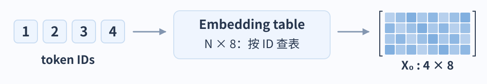
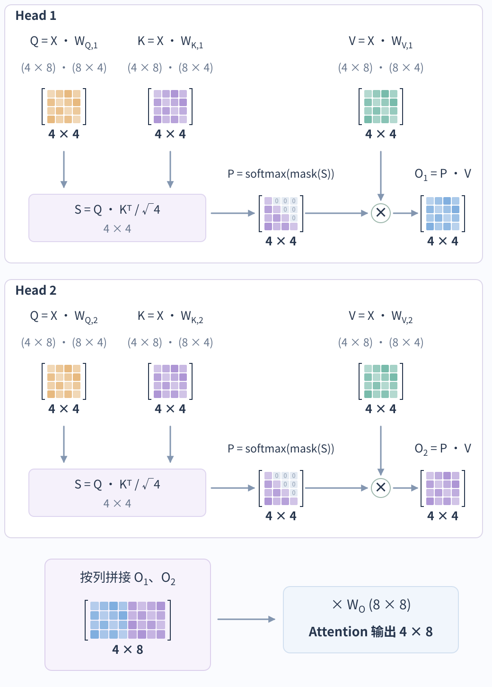
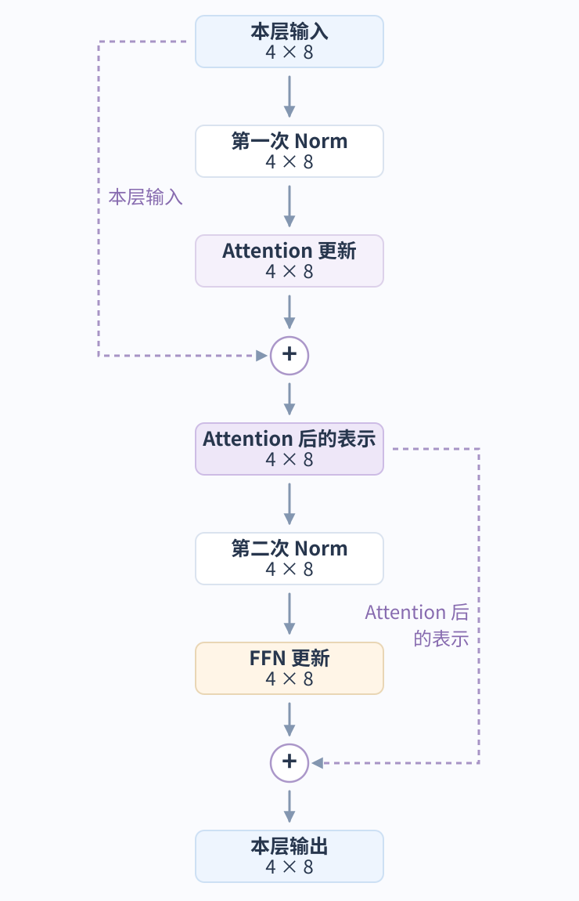
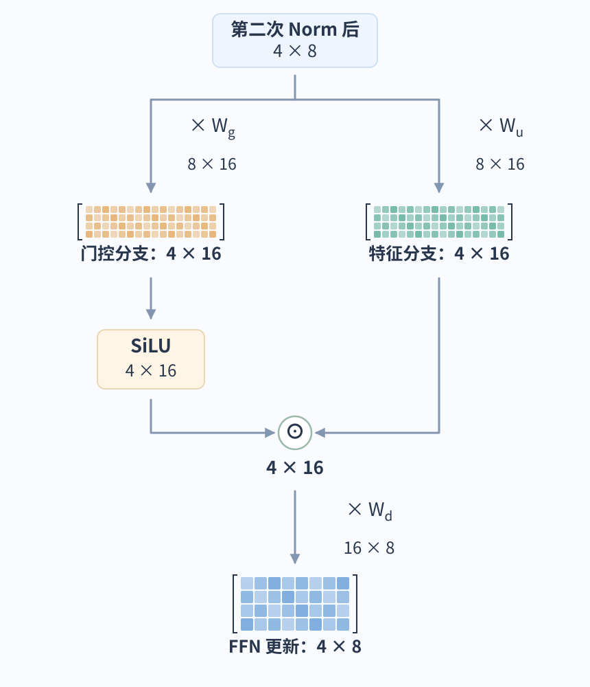
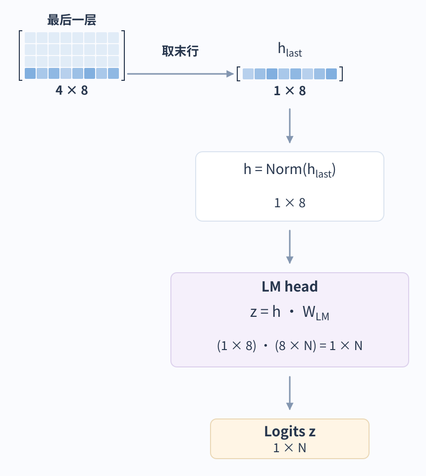
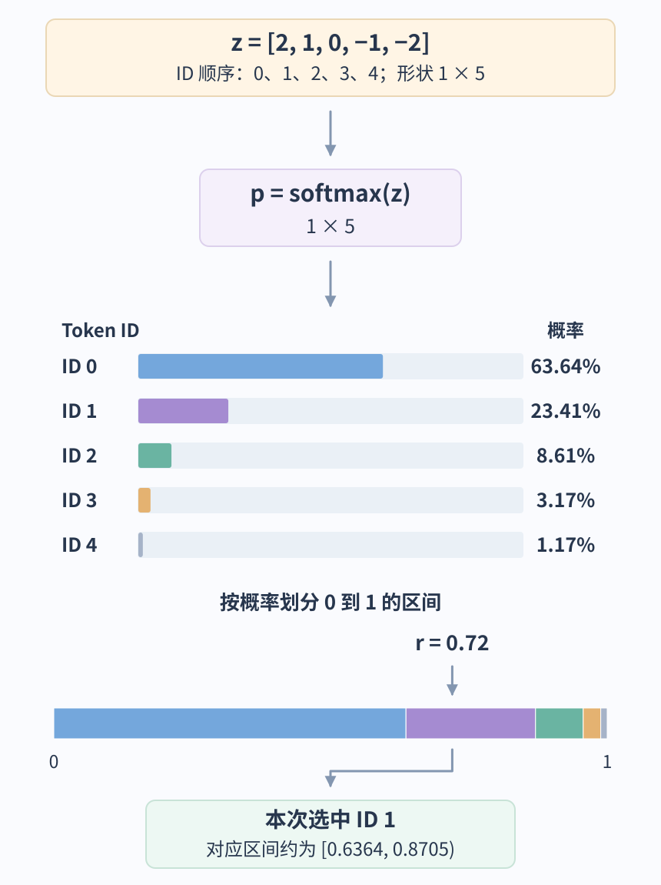

# AI 服务如何将一条消息变成完整回答？

## 案例：解释一次构建失败

想象一位开发者正在使用一款接入构建系统的 AI 助手。构建系统会对一次代码改动运行自动检查，而构建 `42` 失败了。开发者问：`Why did build 42 fail?` 失败详情保存在日志服务中，助手可以通过名为 `read_build_log` 的 tool (工具) 查询。

助手需要取回这些证据并解释日志说明了什么。我们将沿着这个问题走过整个服务流程，从准备模型输入，到返回一份以日志为依据的回答。应用负责管理日志服务的访问；模型先生成获取证据的请求，再利用证据生成说明。这是一个虚构的、由应用管理的 tool-call loop (工具调用循环) 示例。

下图展示成功完成的情形。本次运行包含两次模型调用：第一次生成工具请求；应用读取日志后，第二次生成回答。如果另一个问题本身已经包含足够证据，模型也可以在第一次调用时直接回答。

~~~mermaid
flowchart TD
    Input["1 准备输入 问题 + 指令 + 工具定义"]
    Model["2 运行模型 生成下一段输出"]
    Choice{"模型返回了什么？"}
    Tool["3 执行调用 c1 检查访问权限，再读取构建 42"]
    Context["4 更新输入 加入调用及其结果"]
    Answer["5 完成本次运行 保存并返回说明"]
    Input --> Model --> Choice
    Choice -->|工具请求| Tool
    Tool -->|日志证据或错误| Context
    Context -->|下一次模型调用| Model
    Choice -->|最终回答| Answer
~~~

## 1. 准备模型可见的内容

harness 是负责协调模型与工具的应用代码。它记录调用者身份、为模型选择信息、执行工具，并决定应用何时有结果可返回。本例中的第一次模型调用有三项输入。

| 输入   | 本例中的内容                                          |
| ---- | ----------------------------------------------- |
| 应用指令 | 根据现有证据解释构建失败。                                   |
| 用户消息 | `Why did build 42 fail?`                        |
| 工具定义 | `read_build_log` 接受整数 `build_id`，并返回构建日志中的失败记录。 |

> [!info] 指令、对话与外部状态
> 每次模型调用都会收到经过选择的输入。模型不会自动看到日志服务、应用数据库，或用户此前说过的所有内容。应用必须提供这些信息，或执行能取回信息的工具。

工具定义描述了一个可用操作。只有应用取回日志后，日志内容才会进入对话。应用会保留调用者身份，用于权限检查。

这些输入构成了本次调用的模型 context (上下文)。在较长的对话中，应用还需要决定包含哪些较早的消息和证据。这个选择很重要，因为模型只能依据实际提供的信息，以及训练参数中编码的知识来生成输出。[如何为每次模型调用选择信息](../context/context-engineering-principles.md)

## 2. 生成请求以获取缺失证据

现在，模型拿到了问题，也有办法请求日志。在 inference (推理) 过程中，它处理输入并一次生成一个 token (词元)。本次运行中，输出指定调用 `read_build_log`，并将 `build_id` 设为 `42`。

服务侧先按所用模型的模板组合应用指令、用户消息和工具定义，再由 tokenizer (分词器) 将文本转换为整数 ID。为了看清数据如何变化，下面换成一个小型教学例：**4 个输入 token、8 维表示、2 个 Attention Heads**。这不是构建问题的真实分词结果或线上模型配置；`N` 表示词表大小，图中色块只示意矩阵结构，不是实测参数值。本节图示省略位置编码和 bias，先追踪主干中的张量变化。

**从 ID 到向量。** embedding table (嵌入表) 是模型学习到的参数表。查表后，一行代表序列中的一个位置；一行的八个数共同构成这个位置的 vector (向量)，列并没有预先指定的“篮球”“人物”等词义。

**让位置之间交换信息。** 这份 hidden state (隐藏状态) 进入第一层。先放大看其中的 Attention：图中的 `X` 已经经过本层的第一次 Norm，数值尺度经过归一化，形状仍是 `4 × 8`。这里采用普通 Multi-Head Attention (多头注意力，MHA)：每个 head 用自己的参数，把同一份输入投影为 Query (查询)、Key (键)、Value (值)，分别记为 Q、K、V。$W_{Q,1}$ 表示第一个 head 用来生成 Q 的权重矩阵；下标标识用途和 head，不表示相乘。

Q 与 K 的匹配产生位置之间的分数 S：其中 $S_{i,j}$ 先把 Q 的第 `i` 行与 K 的第 `j` 行按对应坐标相乘、求和，再除以 $\sqrt{4}$。这个 `4` 取自每个 head 的 Q/K 特征维数，恰好与本例的输入位置数相同。图中的 $K^T$ 表示把 K 的行列互换，让一次矩阵乘法算出这些位置对的匹配。

causal mask (因果掩码) 屏蔽未来位置；softmax 只将本行可见位置的分数转为权重 P，未来位置不参与归一化分母，在 P 中为 `0`。用 P 汇集 V 后，两个 head 的输出按列拼接，经过输出投影，结果仍是 `4 × 8`。

> [!info] 怎样读这些矩阵形状？
> $4 \times 8$ 表示四行、每行八个数。乘上 $8 \times 4$ 的投影矩阵后，中间的两个 $8$ 对齐，输出成为 $4 \times 4$：每个位置由八个旧坐标组合出四个新坐标。一个新坐标就是旧坐标与对应权重相乘后求和。
>
> 图中 Q/K/V 的列是特征；P 的行是 query 位置，列是 key 位置（包括当前位置），未来位置的权重为零；即使形状同为 $4 \times 4$，含义也不同。

> [!example] 位置 2 怎样汇集前面的信息？
> 位置 2 的 Q 会与位置 1、2 的 K 匹配，位置 3、4 被 mask 遮住。假设 softmax 后这一行的权重为 `[0.25, 0.75, 0, 0]`，它们的和为 1，那么输出这一行就是 `0.25 × V₁ + 0.75 × V₂`。
>
> 再只看 V 的一个坐标：若位置 1 在此处的值是 `2`，位置 2 是 `6`，汇集后的值就是 `0.25 × 2 + 0.75 × 6 = 5`。其余三个坐标使用同一组位置权重分别计算。这些假设值用于展示 P 怎样把 V 混合成输出。

**把 Attention 放回完整的一层。** 一个 Transformer layer (Transformer 层) 会接连更新两次这份 `4 × 8` 表示：Attention 先从可见位置汇集上下文信息；feed-forward network (前馈网络，FFN) 再加工每一行已经获得的特征。FFN 对四行使用同一组参数，但各行分别计算，这一步不会再去读取其他行。

每一步计算出的都是对当前表示的**更新量**。图中的 `+` 将更新量与该步骤开始时的表示逐元素相加，这条绕过计算的旁路就是 residual connection (残差连接)。例如一个坐标原来是 `0.6`，更新量是 `−0.2`，相加后就是 `0.4`。它让每一步能在已有表示上调整，而不必重新生成全部表示。

Norm 表示 normalization (归一化)，调整每行数值的尺度，形状仍为 `4 × 8`。本例将它放在 Attention 和 FFN **之前**，这种安排称为 pre-norm。

**FFN 怎样加工一行特征？** 本例选用 SwiGLU。它的输入来自上图的第二次 Norm：Attention 更新先加回本层输入，所得表示经过 Norm，再进入 FFN。

把这份输入的一行先看作八个数：FFN 用两张不同的 `8 × 16` 权重矩阵，分别组合出十六个新特征和十六个门控数值。四行一起写出来，两条分支的形状就是 `4 × 16`；增加的是每行的特征数，输入位置仍是四个。

门控分支经过 SiLU 这种 activation function (激活函数)，对每个数做非线性变换，得到随当前输入变化的调节系数。图中的 `⊙` 再把两条分支的对应坐标相乘，调整特征的强弱。最后用 `16 × 8` 的权重矩阵把它们组合回八个数，得到可以加回原表示的 `4 × 8` 更新量。$W_g$、$W_u$、$W_d$ 都是训练学到的参数；门控系数是本次输入算出来的数据。

> [!example] 门控怎样改变特征？
> 只看某一行十六个坐标中的两个。假设特征分支给出 `[2, −1]`，经过 SiLU 的门控分支给出 `[0.5, 2]`，那么对应相乘得到 `[1, −2]`。第一个坐标减弱，第二个坐标的绝对值增大。这些是说明运算的假设值；SiLU 的输出不是概率，可以大于 1，也可以为负数。
>
> `⊙` 是对应位置逐项相乘，形状不变；乘 $W_d$ 则是矩阵乘法，会把十六个坐标重新组合为八个坐标。

这份 FFN 更新会回到完整层图的第二个加号，与**第二次 Norm 之前**的表示相加。完成两次更新后，本层输出交给下一层，总共经过 `L` 层。各层有自己的参数，表示中的信息持续变化；对这四个输入位置而言，层与层之间始终传递 `4 × 8`。上图里临时扩展出的十六个特征，会在这一层的 FFN 内投影回八维。

**从最后一个位置为词表打分。** 这类模型训练时，让每个位置的状态预测紧接它的下一个 token。在这个四位置例子中，第 4 行已能汇集位置 1–4 的信息，因此取它来预测位置 5。把最终归一化后的一行记为 $h$，形状为 `1 × 8`。language model head (语言模型头，LM head) 将它乘以 `8 × N` 的权重矩阵 $W_{LM}$，得到 `1 × N` 的 $z$：词表里的每个候选各有一个 logit (未归一化分数)。本例省略 bias，所以完整关系是 $z=hW_{LM}$。最后输入位置可能是模板附加的 assistant 起始标记，不一定是用户问题末尾的问号。

**从分数得到概率，再选择一个 token。** logits 可以为负数，也不要求加起来等于 1。softmax 将每个分数取指数，再除以这些指数的总和，得到总和为 1 的概率分布。decoding (解码) 决定怎样从这些候选中选出下一个 token；下面展示 sampling (采样) 这条路径。

为了画出完整分布，把本例词表大小具体取为 `N=5`，ID 为 `0–4`，并假设 LM head 输出 `[2, 1, 0, −1, −2]`。此处 temperature (温度) 为 1，也不筛除任何候选，softmax 后 ID `0` 的概率约为 `63.64%`，ID `1` 约为 `23.41%`，其余概率如下图。

可以用一种直观的采样方法理解“按概率选择”：将 `0–1` 区间按五个概率分段，再从整个区间均匀抽一个数，落在哪一段就选择哪个 ID。图中示意抽到 `0.72`，落在 ID `1` 的区间，所以这次选中 ID `1`。概率越大的候选越容易被抽到，但不保证每次都选它。

另一种选择是 greedy decoding (贪心解码)：直接取分数最高的候选，本例会选 ID `0`。因为 softmax 不改变排序，这条路径可以直接对 logits 取最大值，无需先显式计算概率。这里的概率是**下一个 token 的采样概率**，不是整份回答正确的概率。

**把选出的 ID 接回下一轮。** 本例抽中的 ID `1` 成为序列中的位置 `5`。下一轮前向计算只为这个新位置查一行 embedding，得到 `1 × 8` 的输入。每层为它计算 Q/K/V，把新 K/V 加入该层的 KV cache (键值缓存)；它的 Q 与位置 `1–5` 的 K 匹配，并汇集对应的 V。这样便能利用前四个位置的缓存，不必重算它们的 hidden state。最后用位置 `5` 的状态预测位置 `6`，继续相同的循环。

累积输出 ID 由 tokenizer 解码成文本，特殊 token 则由服务按协议解释；循环可以在结束标记或配置的停止条件处结束。这里选用的是带缓存的普通 MHA 教学路径，其他模型可以采用不同头数、位置编码或缓存表示；[模型原理篇](../foundations/how-llms-work.md)会继续展开。这个逐 token 生成过程既能产生回答文本，也能产生表示工具请求的词元；服务还须按协议判断结果是否完整，截断的参数不能当作可执行调用。

如果模型提供 temperature 设置，它会改变 token 采样分布的集中程度，但不能证明结果正确。[应用应如何选择解码设置？](../foundations/how-llms-work.md#%E5%BA%94%E7%94%A8%E5%BA%94%E5%A6%82%E4%BD%95%E9%80%89%E6%8B%A9%E8%A7%A3%E7%A0%81%E8%AE%BE%E7%BD%AE%EF%BC%9F) 会通过特定任务的评估来分析这个选择。若要查看一条模型输入如何逐步经过数值运算，可继续阅读[语言模型如何将提示转换为文本](../foundations/how-llms-work.md)。

针对构建问题，这次生成会按照模型的 tool-call 格式 (工具调用格式) 产生工具名和参数。inference service (推理服务) 会按照模型的 tool-call protocol (工具调用协议) 解释这些词元，并将完整的工具名和参数作为结构化 API 条目提供给应用。用简化记法表示，应用会收到 `tool_call(c1, read_build_log, {build_id: 42})`。ID `c1` 会把工具结果与这次特定请求关联起来。当有多个待处理调用时，这种对应关系很重要，模型才能知道哪条观察结果属于哪个请求。服务侧协调代码会将拟议的调用交给校验流程，从而进入总览图中的工具分支。接下来的步骤会说明执行前的检查。

## 3. 执行请求并读取日志

应用会检查 `read_build_log` 是否可用、`build_id` 是否为所需的整数类型，以及调用者是否有权读取构建 `42`。参数校验确保请求可以被正确解释。authorization (授权) 则确定调用者可以访问哪个资源。只有这些检查全部通过后，应用才会读取日志。如果工具会改变外部状态，例如重启构建，那么重试时还需要考虑前一次尝试是否已经生效。[工具契约与授权](../agents/tool-design-and-function-calling.md)

取回的结果包含模型此前缺少的证据。

| `c1` 的结果字段 | 构建 `42` 的值 |
| --- | --- |
| 失败步骤 | `unit-tests` |
| 失败测试 | `reject_empty_name` |
| 失败断言 | 空名称请求应返回 HTTP `400`，但实际返回了 `200`。 |
| 进程退出状态 | `1` |

如果 authorization 失败，应用可以为 `c1` 返回失败结果，让模型在下一次调用时说明无法获取证据。本例中，工具按照 ID 查询一条已知日志。如果问题需要在大量文档中查找相关段落，应用可以先检索这些段落，再提供给模型生成回答。这个检索与生成过程称为 retrieval-augmented generation (检索增强生成)，简称 RAG。[如何检索证据并据此生成回答](../rag/rag-architecture-and-implementation.md)

## 4. 让模型利用检索到的证据

应用现在发起另一次模型调用。在前次模型可见内容的基础上，加入模型的 `tool_call(c1, …)` 和与之匹配的 `tool_result(c1, …)`。若允许继续调用工具，应用还须按所用接口重新提供工具定义或保留对它的有效引用。调用记录了模型请求的内容，结果则提供工具实际观察到的信息。

第二次输入包含 `unit-tests`、`reject_empty_name`，以及预期的 `400` 与实际观察到的 `200`。这些细节会被格式化并编码为模型 context 的一部分。相同的推理机制会使用相同的训练权重处理扩展后的输入。新证据改变了模型可以据以回答的信息，不需要重新训练模型。权重是持久保存的学到的参数；输入和 hidden state 则是本次运行的数据。[训练如何改变模型参数](../foundations/how-llms-work.md#%E4%B8%8B%E4%B8%80%E4%B8%AA%E8%AF%8D%E5%85%83%E8%AE%AD%E7%BB%83%E5%A6%82%E4%BD%95%E6%9B%B4%E6%96%B0%E8%BF%99%E4%BA%9B%E5%8F%82%E6%95%B0%EF%BC%9F) 会介绍独立的学习过程。

如果证据仍有缺口，模型可以再请求一次工具调用；应用会在配置的调用次数、耗时和成本限制内，重复执行校验、工具操作和结果收集。如果达到限制，应用应根据目前取得的证据，返回未完成或失败的结果。本例中的日志足以说明观察到的失败，因此模型会生成解释。要判断底层代码缺陷，还需要更多证据，例如具体实现和预期行为。[行动、观察与下一步决策](../agents/agent-fundamentals.md#ReAct%20循环怎样让观察影响下一步？)

## 5. 返回说明并完成本次运行

现在，回答可以陈述日志证实的内容。

> [!example] 根据日志返回说明
> 构建 42 在 `unit-tests` 步骤失败。`reject_empty_name` 测试预期空名称请求返回 HTTP `400`，但实际收到 `200`。测试进程以状态 `1` 退出。若要确认底层原因，请对照测试的预期行为检查请求校验逻辑。

第一次模型调用以工具请求结束，因此应用还需要继续工作。第二次调用则正常地以回答结束。在本例中，应用会先保存回答并将本次运行标记为完成，再把结果返回给调用者。如果应用在生成过程中流式传输文本，仍须跟踪生成最终是成功完成还是失败。[运行状态与恢复](ai-application-architecture.md)

区分观察到的失败断言与其底层原因，也能帮助确定评估目标。改变提示词或解码设置后，系统仍应保留日志中的实际值，并避免臆造缺陷原因。评估时也应包含日志缺失或无法访问的情况。[如何判断 AI 系统是否满足任务契约？](../evaluation/llm-evaluation-methods.md) 会进一步说明验收标准和对比方法。

本次服务运行到此结束。若想进一步了解任一次模型调用中的计算过程，可以继续阅读[语言模型如何将提示转换为文本](../foundations/how-llms-work.md)。该章节会依次展开前向计算、解码和训练。

> [!info]- 来源
> 虚构的构建日志场景用于说明下列来源支持的服务机制。
>
> - **SwiGLU 门控。** [GLU Variants Improve Transformer, §2](https://arxiv.org/html/2002.05202#S2) 支持两条扩展分支、SiLU 门控与降维投影；本页选择它作为 FFN 教学结构。
> - **Attention 与逐位置变换。** [Attention Is All You Need, v7, §§3.2–3.5](https://arxiv.org/html/1706.03762v7#S3) 支持注意力的跨位置聚合，以及 FFN 对每个位置分别变换的结构。
> - **词表分数、概率与选择。** [Attention Is All You Need, v7, §3.4](https://arxiv.org/html/1706.03762v7#S3.SS4) 支持线性投影后用 softmax 得到下一词元分布；[Transformers Generation strategies，“Greedy search”与“Sampling”](https://huggingface.co/docs/transformers/generation_strategies#basic-decoding-methods) 说明最高概率选择与按分布采样。本页五候选分数及 `r=0.72` 是教学设定，概率由给出的 logits 计算；区间划分用于解释采样，不指定服务的随机数实现。
> - **输入格式化、分词与缓存生成。** [Transformers chat templates](https://huggingface.co/docs/transformers/chat_templating#add_generation_prompt) 说明了生成标记；其[缓存说明](https://huggingface.co/docs/transformers/main/en/cache_explanation) 介绍了如何复用先前的 K/V。本节图示采用合成 token IDs 和维度；真实分词算法与已复现的例子见[模型原理篇](../foundations/how-llms-work.md)。
> - **结构化请求与应用循环。** [OpenAI function-calling guide](https://developers.openai.com/api/docs/guides/function-calling#the-tool-calling-flow) 和 [Claude tool-use guide](https://platform.claude.com/docs/en/agents-and-tools/tool-use/how-tool-use-works#the-agentic-loop-client-tools) 介绍了工具定义、模型请求、应用执行以及将结果反馈给模型的过程。此处的 `tool_call` 和 `tool_result` 记法仅供说明，并非 SDK schema。运行预算和针对构建日志提出的评估方式是本例中的工程选择。
>
> 查看 [AI 好文集](../../review/ai-literature-index.md) 中的相关论文。
