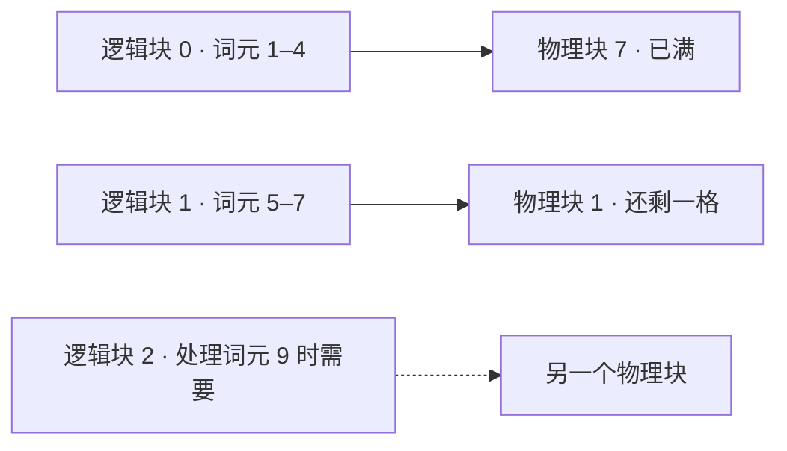
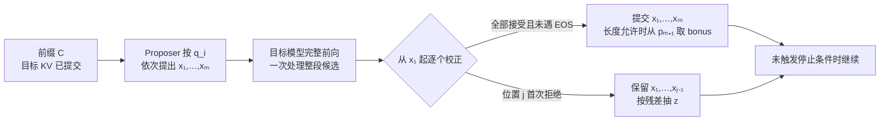

# KV 缓存与调度怎样决定大语言模型的服务容量？

一台模型服务要同时回答 32 个报表助手请求，每条请求的提示与已生成内容合计约 8,192 个词元。模型权重已经能放进 GPU，但请求一多仍会耗尽显存；另一些时候显存够用，回答却迟迟不开始。这一章沿着请求进入、保存历史状态、调度生成、结束回收的过程，解释该怎样算容量，以及哪些优化能改变哪一段成本。

## Prefill（提示预填充）和 decode（增量解码）为何有不同瓶颈？

[模型生成章节](../foundations/how-llms-work.md)说明了因果 attention（注意力）为何能复用历史状态。以下先按普通全量因果注意力的常规缓存路径说明；滑动窗口、压缩或稀疏注意力会改变每层能读取的历史范围与持久状态，须按模型结构分别核算。服务端先对完整提示做 prefill：逐层处理所有提示词元，把各位置的 key/value（键/值，K/V）存入 KV cache（键值缓存），并从最后位置得到第一个输出词元的分布。之后每一步只把新词元送进各层，用新位置的 query（查询）与缓存中的 key（键）以及当前位置的 key 计算分数，再经 softmax 得到权重并聚合对应的 value（值），算出新的状态并追加缓存。因果掩码保证旧位置不读取未来，所以旧 K/V 可沿用；旧 query 不供后续位置读取。

| 阶段 | 一条请求的典型注意力形状 | 常见成本 |
| --- | --- | --- |
| Prefill `T` 个提示词元 | 每个 query 头并行处理 `T` 个 query 和 `T` 个 key，并使用因果掩码 | 多次投影和 FFN 矩阵乘法；长序列要计算大量有效位置对并读写中间状态 |
| 带缓存的单步 decode | 每个 query 头只有一个新 query，与 `C` 个已缓存 key 和当前位置的 key 共 `C+1` 个 key 计算分数，再按权重聚合对应 value | 读取模型权重和历史 K/V，追加新位置的状态；更长前缀增大读取量，并发影响权重摊销与硬件利用率 |

`C` 是该步之前已缓存的词元数。普通 dense attention（稠密注意力）的 decode 注意力仍随历史长度增长；KV 缓存省去旧位置的重复投影与前向，但不省去新 query 对历史 K/V 的读取。Prefill 往往更受计算量影响，低批量 decode 往往更受显存带宽影响，实际瓶颈还取决于模型、并发、长度、精度与硬件。

## 先估 KV 显存，再决定并发

前篇玩具 MHA 缓存三个位置时得到 `2×3×2×4=48` 个数；通用普通注意力模型可把位置数、K/V 头数、头宽和元素字节数扩展为下面的容量估算。对每层都缓存同形状 K/V、元素字节数相同的普通全量注意力模型，单条序列的 KV 数据载荷近似为

$$
\text{bytes}=2\cdot L\cdot T\cdot H_{kv}\cdot d_h\cdot b.
$$

`L` 是层数，`T` 是缓存长度，`Hkv` 是实际存储的 K/V 头数，`dh` 是头宽，`b` 是每个元素的字节数；前面的 `2` 对应 K 和 V。以 32 层、8 个 K/V 头、头宽 128、BF16（每个元素 2 bytes）为例，每词元占 `2×32×8×128×2=131,072 bytes=128 KiB`。缓存到 8,192 个词元，一条序列需要 `1 GiB`；32 条同长度且没有共享前缀的序列需要 `32 GiB` 的 KV 数据载荷。权重、临时激活、块尾空位、量化元数据和调度余量另算。张量并行可能拆分或复制状态，单卡预算要按实际分片和测量核对。

Grouped-query attention (分组查询注意力，GQA) 从模型结构上减少缓存的 K/V 头；KV 量化则减少每个元素占用的字节数，两者可以同时使用。量化还会带来缩放参数、精度损失和内核支持条件，存储比例不能直接视为吞吐比例。滑动窗口、混合状态和潜变量注意力的每层持久状态不同，应按层核算。

如果模型权重本身装不进单卡，分页无法解决权重容量。先比较达到质量门槛的权重量化与多卡切分：tensor parallelism（张量并行）把同层的矩阵或注意力头分给多卡，层内需要交换或汇总结果；pipeline parallelism（流水线并行）把不同层放到不同卡，阶段间传递激活，流水线未填满时会有空转。模型装下后，再按各卡上的权重、KV 和临时缓冲预算接纳序列，并检查互连带宽与 K/V 头的分布。

## MLA 的实际缓存里保存什么？

Multi-Head Latent Attention (MLA，多头潜注意力)把历史 key 和 value 的内容表示联合压到低秩 latent（潜变量）`c_t^KV=W_DKV h_t`，每头内容 key 与 value 都可由它上投影得到。DeepSeek-V3 报告 §2.1.1 给出 latent 与位置 key 的投影关系；在官方参考实现的 `absorb` 路径中，压缩 latent 后还会做 RMSNorm。旋转位置编码（RoPE）所需的位置相关 key 另从 hidden state（隐藏状态）得到，记为 `k_t^R=RoPE(W_KR h_t)`。具体缓存字段取决于 serving 路径：DeepSeek-V3 官方参考实现默认使用 `absorb`，缓存经 RMSNorm 的 KV latent 与独立 RoPE key；压缩 query 的 `c_t^Q` 是另一条计算路径，不能当作 KV cache 内容。

> [!example] 复算 DeepSeek-V3 absorb 路径的缓存载荷
> V3 报告给出的每层 KV latent 维度 `d_c=512`，共享给各注意力头的解耦 RoPE key 维度 `d_h^R=64`，层数 `L=61`。按 BF16 的压缩 `absorb` 缓存，每词元、每层存 `512+64=576` 个数值，即 `576×2=1,152 bytes`；61 层合计 `1,152×61=70,272 bytes/token`，约 `68.6 KiB/token`。8,192 个词元的单条序列约需 `0.536 GiB` 载荷；32 条无前缀共享的同长度序列约需 `17.16 GiB`。这些数不含缓存块元数据、对齐、临时缓冲或其他模型状态。
>
> 若拿一个假设的普通 multi-head attention（多头注意力，MHA）作量纲基线，并设 128 个注意力头、每头 K 和 V 各 128 维，每词元每层需 `2×128×128=32,768` 个数，即 `65,536 bytes`。它与本例 `absorb` 路径的 `1,152 bytes` 相比约为 `56.9:1`。这不是 DeepSeek-V3 `naive` MLA 路径的缓存大小：该路径会按头展开 K/V，并将其写入不同的缓存字段；参考实现的 `naive` 与 `absorb` 分支实际缓存布局不同。此处比较只对照假设的标准 MHA 配置与压缩 `absorb` 缓存，不是端到端显存或速度承诺；并行分片、量化和运行时开销都会改变实测结果。

官方参考实现的 `absorb` 路径会把内容 K 上投影与 query 结合、把内容 V 上投影延后到 latent 加权之后；另一条 `naive` 路径则先展开逐头 K/V，再分别写入 `k_cache` 和 `v_cache`。因此 MLA 的持久缓存形状由具体计算路径决定，本例的 576 标量限定于参考实现的默认压缩 `absorb` 路径。这里关心容量估算与状态布局，矩阵吸收的投影代数见[DeepSeek-V3 MLA 的矩阵吸收与位置表示](../foundations/long-context-attention.md)。

## 区分注意力内核与持久缓存分配

FlashAttention 把 Q/K/V 分块，并在线合并 softmax 统计量，避免把完整注意力分数矩阵写入 HBM（高带宽显存）。它减少一次注意力运算的读写和临时显存，仍执行有效 query-key 对的 dense attention 计算，浮点舍入可能与直接实现不同。FlashAttention-4 进一步针对 Blackwell 的异步矩阵乘与流水线重叠优化；内核选择要看 GPU、形状和引擎版本。

PagedAttention（分页注意力）管理跨解码步骤持久存在的 KV 状态。每条请求的逻辑块按词元顺序增长，块表将它们映射到可不连续的显存物理块；支持该布局的 attention kernel（注意力内核）按映射读取历史 K/V，服务端按需申请和回收物理块。原论文的手算例使用每块 4 个词元：7 个提示词元映射到物理块 7 和物理块 1，第二块尚有一个空位。下一次 decode 填满该槽；再接收一个词元才需申请新块。请求完成后可还块；共享前缀可引用同一块，若两个分支要向同一共享块写入不同内容，则用 copy-on-write（写时复制）隔离改动。

最后一个块仍可能有空位，块表和间接访问也有成本；优势是按实际长度增长，不必为每条请求预留连续的最大序列区，因此可让更多请求驻留并批处理。原论文的吞吐与时延结论属于其 2023 年工作负载和对照系统，独立注意力内核的微基准也测到额外延迟。现代引擎保留分页思想，但计算后端应按模型、GPU 和引擎版本选择；vLLM 将原 CUDA 内核设计页标为历史说明。

### V4 的异构缓存怎样命中、恢复和回收？

上面的普通 K/V 公式假设各层都按相同规则缓存两组随长度增长的张量。DeepSeek-V4 预览模型的 Compressed Sparse Attention（压缩稀疏注意力，CSA）和 Heavily Compressed Attention（重度压缩注意力，HCA）让每请求状态必须按层分类：两类层按压缩率保留已完成的历史 KV；CSA 还需要一条供 top-k 搜索的 indexer（索引器）key；带 sliding-window attention（滑动窗口注意力，SWA）的层保留最近 128 个原始位置；压缩器还保留继续处理下一词元所需的运行状态。下文把压缩率为 4 和 128 的分支简记为 C4、C128。论文把变长的压缩条目放在分页 KV 区，把每序列定长的 state cache（状态缓存）留给 SWA 窗口与压缩器状态。不同层的压缩率、记录宽度和运行状态不同，单一的“每词元字节数”会漏算它们。

定长状态池按活动序列分配槽位，所以即使已完成的压缩 KV 很少，并发序列也会占用各自的 SWA 与尾部状态空间。

| 每请求的状态 | 随新词元发生什么 | 前缀命中或回收时要处理什么 |
| --- | --- | --- |
| 已完成的 CSA/HCA 压缩 KV | 按各层压缩率追加历史条目；SWA 窗口前移不会删除这些远距条目 | 前缀缓存可复用完整压缩块；请求终止或回滚时，按有效前缀长度截断并释放独占页 |
| CSA indexer keys | 每个 CSA 层每完成一条 C4 主压缩 KV，就生成一条对应索引 key；截至 `N` 个位置，两者都是 `floor(N/4)` 条，但向量宽度、精度和每条载荷不同 | 若前缀命中后要继续 CSA 检索，对应索引 key 必须可用。论文未说明其磁盘存储格式；具体保存、恢复或重建方式依服务引擎实现 |
| SWA 最近窗口 | 保留各适用层的最近 128 个原始 KV，窗口移动时淘汰最旧位置 | 可从磁盘命中、最近 checkpoint（检查点）恢复，或从前缀重新计算；这些策略决定存储与重算量 |
| 压缩器运行状态 | HCA 留下尚未凑成 128 个位置的输入；C4 即使组已完整，也会保留上一整组的投影与分数作为下一条压缩记录的重叠输入；主 KV 与 indexer 各有自己的压缩器状态 | 完成的压缩条目本身不包含这些运行状态。继续压缩时必须取得等价状态；命中后恢复该状态或重算来源输入是工程要求，但报告未说明 C4 重叠状态或 indexer keys 的磁盘格式 |

令 `N` 表示已处理的词元数、`m` 表示某层压缩率；`N mod m` 是除以 `m` 的余数。以 V4-Pro 的十进制 `N=1,000,000` 前缀为例，每个 CSA 层有 `floor(N/4)=250,000` 条 C4 主 KV，也有 250,000 条 indexer key；两者条目数相同，载荷不同。每个 HCA 层有 `floor(N/128)=7,812` 条 C128 KV，覆盖至位置 999,936，另有 64 个未完成输入位置。SWA 最近 128 个原始 KV 是另一份状态，依所选窗口缓存策略单独恢复。

`N mod 4=0` 不表示 C4 压缩器没有运行状态：官方参考代码仍为主 KV 与 indexer 各保留最近完整 4 位置组的投影和分数；按一基位置编号，这组是 999,997–1,000,000。压缩条目之外还要取得这两份状态，或重算对应输入，才能继续压缩；这是由公开压缩器实现推出的恢复要求，论文没有说明该重叠状态或 indexer keys 的具体磁盘布局。各层完整的状态计数与载荷示例见[DeepSeek-V4 预览版的逐层 KV、索引器与尾部核算](../foundations/long-context-attention.md#DeepSeek-V4%20预览版按层保存多少状态？)；这里的载荷不含量化 scale、页空位、对齐、临时缓冲或整卡其他占用。

V4 报告把 prefix cache（前缀缓存）的磁盘状态拆成压缩 KV 与 SWA KV 两类。报告明确未完成压缩块需要重算；官方参考代码还表明，继续 CSA 压缩需要 C4 主 KV 和 indexer 各自的最近完整组状态，但论文未给出它们的磁盘格式或持久化办法。SWA 可按三种存储与计算取舍恢复：完整缓存把所有 SWA 条目写盘，命中时只读前缀末尾 128 个；周期检查点每隔 `p` 个词元保存当时的末尾 128 个，再从不晚于命中边界的最近 checkpoint（检查点）重算其后的尾段；零 SWA 缓存不保存窗口条目；命中压缩 KV 后，长前缀重算末尾 `128×L` 个位置即可恢复 `L` 层的末尾窗口，较短前缀则从开头重算。这里的 `L` 倍来自逐层依赖：重建高一层的窗口，还需要前一层更早一个窗口的输入，往下追溯时范围逐层向前扩展。V4-Pro 的 `L=61`，最多重算 7,808 个位置。完整缓存省重算但写盘量较大，零缓存省存储但增加计算；周期检查点通过 `p` 调节两者。它们是报告提出的磁盘策略，不表示所有推理引擎都默认采用同一种方案。

分页池也要按异构状态分别估容量。论文的逻辑对齐单位是 4 与 128 的 least common multiple（最小公倍数，LCM）：`LCM(4,128)=128` 个原始位置；在各自对应层，每 128 个位置产生 32 条 C4 或 1 条 C128 压缩记录。实际逻辑块可以覆盖该单位的整数倍，这不是固定的物理页大小。当前 vLLM 的 V4 compressor 实现给 C4 和 C128 的状态页分别设 `block_size=4` 与 `8`，并让压缩器状态页与 KV block 共享物理张量；这是引擎状态页的另一层“块”。因此接纳并发时，应按每层压缩 KV、CSA indexer、SWA 窗口、尾部状态和引擎页粒度核算，再加量化元数据、填充、工作区与并行分片。纸面数据载荷是下界，不是实际 GPU 显存测量。

请求完成或取消时，调度器释放请求对状态页的引用；引用计数归零后，页才可被回收或复用，前缀缓存策略也可能暂时保留它。逻辑释放、物理页回收和前缀缓存淘汰是不同事件。

以从位置 127 继续验证位置 128 的候选为例；窗口与压缩条目的逐位置变化见[绝对位置 127、128、129 的缓存状态](../foundations/long-context-attention.md#%E6%9C%80%E8%BF%91%20128%20%E4%B8%AA%E5%8E%9F%E5%A7%8B%E4%BD%8D%E7%BD%AE%E4%B8%8E%E6%9C%AA%E5%AE%8C%E6%88%90%E5%B0%BE%E5%9D%97)。若候选被接受，各 C128 层完成一条压缩记录，各 C4 层的主 KV 与 indexer 也各完成一条记录；若候选被拒绝，逻辑前缀回到 127，就必须撤销这些新条目，并恢复到 127 对应的 HCA 未完成输入、C4 重叠状态、indexer 状态和 SWA 窗口。这里描述的是缓存正确性不变量，不限定引擎用暂存、检查点还是重算实现；替换词元尚未经过目标模型前向，因此不会作为已处理位置写入这些状态。通用目标 KV 的拒绝示例见[推测解码的临时缓存](#%E6%8E%A8%E6%B5%8B%E8%A7%A3%E7%A0%81%E5%A6%82%E4%BD%95%E9%AA%8C%E8%AF%81%E5%80%99%E9%80%89%E5%B9%B6%E5%A4%84%E7%90%86%E4%B8%B4%E6%97%B6%E7%BC%93%E5%AD%98%EF%BC%9F)。

## 推测解码如何验证候选并处理临时缓存？

[模型训练中的 MTP](../foundations/how-llms-work.md#%E8%AE%AD%E7%BB%83%E6%97%B6%E5%A6%82%E4%BD%95%E9%A2%84%E6%B5%8B%E5%A4%9A%E4%B8%AA%E6%9C%AA%E6%9D%A5%E8%AF%8D%E5%85%83%EF%BC%9F)介绍了 MTP 的训练接口；服务端还需确定候选从哪里来。普通 draft model（草稿模型）可按 draft distribution（草稿分布）`q_i`逐步提出候选。DeepSeek-V3 的 `D=1` MTP 路径则先由主模型对当前前缀`C`给出$p_1=p(\cdot\mid C)$并产生下一词元`x_1`；MTP block 接收前缀最后位置的 hidden state（隐藏状态）和`Emb(x_1)`，再给出额外候选`x_2`的草稿分布$q_2(\cdot\mid C,x_1)$。因此这一配置的 MTP 模块不是从`C`独立提出任意长的候选串；多于一个额外未来词元需要更大的 MTP 深度或引擎提供的其他 proposer 路径。具体 MTP state（状态）接口和草稿长度随引擎变化。下文先用通用`q_i`说明随机接受与替换，再追踪目标模型的并行计算和 KV 状态。`p_i`是给定当前前缀和已接受候选后，第`i`个位置的目标分布，`q_i`是为该候选实际使用的草稿分布。

### 随机接受和残差替换怎样保留目标分布？

从`q_i`抽到候选词元`x`时必有`q_i(x)>0`，再以`a_i(x)=min(1,p_i(x)/q_i(x))`的概率接受。若拒绝，则从归一化残差分布抽替换词元：

$$
r_i(y)=\frac{[p_i(y)-q_i(y)]_+}{\sum_z[p_i(z)-q_i(z)]_+},
\qquad [u]_+=\max(0,u).
$$

对任意词元`y`，若`q_i(y)>0`，被接受候选贡献的无条件概率质量是`q_i(y)a_i(y)=min(p_i(y),q_i(y))`；若`q_i(y)=0`，草稿不会提出`y`，其接受质量为 0，也等于`min(p_i(y),0)`。拒绝分支补上的质量是`[p_i(y)-q_i(y)]_+`。两者相加正好是`p_i(y)`，所以每个位置经校正后的输出仍服从目标分布。若残差分母为零，说明`p_i=q_i`，候选不会被拒绝，残差分支不会被调用。

> [!example] 复算一次拒绝与替换
> 人为限定没有 EOS 的词表`{A,B,C}`，令`q=(0.6,0.3,0.1)`、`p=(0.3,0.4,0.3)`。若本次提议`A`，接受概率是`min(1,0.3/0.6)=0.5`。未归一化残差为`[p-q]_+=(0,0.1,0.2)`，总和`0.3`，所以拒绝后替换分布是`(0,1/3,2/3)`。仅以“已提议 A”为条件，本次输出会是 A 的概率`0.5`、B 的`1/6`、C 的`1/3`；这里不能加上其他草稿提议情形的质量。要得到总体分布，应分别对所有可能的草稿提议加总：提议 A 贡献`(A:0.3,B:0.1,C:0.2)`；提议 B 因`p(B)/q(B)>1`而必被接受，贡献`(0,0.3,0)`；提议 C 同理必被接受，贡献`(0,0,0.1)`。合并为`(0.3,0.4,0.3)=p`。
>
> 对串行依赖的多个候选，按位置逐个验证并在第一次拒绝处停下。接受到位置`j-1`后若拒绝`x_j`，从该位置的残差分布抽替换词元，并丢弃依赖`x_j`的后续草稿；若替换词元是 EOS，也立即结束生成。若某个候选`x_j`被接受且它是 EOS，同样立即结束，不验证后续草稿，也不抽 bonus。只有全部`m`个候选都被接受、尚未遇到停止词元且长度上限仍允许时，才从目标的下一位置分布抽 bonus token（额外词元）。这保证的是使用相同目标`p_i`时的采样分布；greedy decoding（贪心解码）可以用目标 argmax 匹配、失败时回退到 argmax 的规则，但那是确定性算法，不是这里的随机接受与残差校正。引擎若使用不同的采样过滤、温度或特殊 token 处理，目标分布`p_i`和 draft 分布`q_i`应按实际路径取得。

### 目标模型怎样并行计算整段候选？

设目标模型已经处理并缓存前缀`C`，其最后位置的 logits 已给出$p_1=p(\cdot\mid C)$，可用来验证草稿提出的第一个候选`x_1`。目标模型将整段候选`[x_1,…,x_m]`作为新位置输入完整网络一次；因果掩码使第`j`个候选位置可以读取`C`、此前候选和当前位置`x_j`，该位置随后得到的 logits 是`p_{j+1}`。草稿`x_j`则由位置前的目标 logits `p_j`校正，因此这一轮并行算出`p_2,…,p_{m+1}`。若全数接受，`p_{m+1}`提供 bonus token（额外词元）的分布。对于 DeepSeek-V3 的`D=1` MTP，主模型先给出`p_1`并产生`x_1`，MTP 再提出`x_2`；完整目标前向处理`[x_1,x_2]`得到验证`x_2`所需的`p_2`，并可在接受时从`p_3`取 bonus。这里的`x_1`已按目标分布产生，`q_2`校正针对的是 MTP 提出的额外词元`x_2`。

“并行验证”指候选位置的张量计算在同一轮目标前向中展开；目标模型仍为每个位置执行各层 attention、MoE/FFN 和输出头，层与层仍按顺序运行。这减少的是目标模型 token 步之间的串行等待，不会跳过目标模型对候选位置的计算。若采用抽样，前一小节的`p_i/q_i`校正仍是输出分布契约。

图只画本轮尚未触发停止条件的分支：已接受候选、拒绝后的替换词元或 bonus 若为 EOS，或输出达到长度上限，就立即结束并跳过后续候选与 bonus。

> [!example] 第一次拒绝时，哪些缓存状态有效？
> 已提交前缀为`C`，proposer 提出`[x₁,x₂,x₃]`。目标模型一次前向为这三个输入位置计算了结果和临时 K/V。若`x₁`接受、`x₂`被拒，并从残差抽到替换词元`z`，输出会接在前缀后成为`C,x₁,z`。目标 KV 可以保留`C,x₁`的状态；`x₂`与`x₃`对应的 K/V 是在候选路径上暂存的，应从逻辑缓存长度回退或标记为无效。`z`虽已作为输出词元提交，但目标模型尚未把`z`输入前向，因此它的目标 K/V 要等下一步处理`z`时再计算。若三项候选全被接受，可提交到`x₃`的目标 KV；bonus token 也尚未进入目标缓存。底层物理块不一定立即释放，但逻辑长度和下次读取边界必须只覆盖有效前缀。proposer 自身缓存的回退方式取决于引擎实现。

因此推测解码可同时占用目标与 proposer 的状态，以及候选对应的暂存目标 KV。若一次最多提议`m`个词元，单条活跃序列在目标侧新增的临时 KV 载荷上界约为每词元 KV 载荷乘`m`；峰值还包括 draft 状态、工作区、块尾空位及同批其他请求。以本章 V3 MLA 载荷为例，假设某实现一次输入 3 个候选位置，目标侧暂存上界约`3×70,272=210,816 bytes`（约 206 KiB）/请求；若`B`条序列同时验证，近似再乘`B`。这只是目标 KV 载荷估算，MTP block 状态和引擎分配粒度另算；容量不足时应测引擎如何降低草稿深度、推迟请求或回收缓存。

速度收益来自少做几轮串行的目标模型调用，并让目标计算在多个候选位置上并行；目标模型仍为每个候选位置执行完整计算，proposer 也有成本，拒绝后未提交的后缀计算会浪费。假设词表里没有 EOS、尚未触及长度上限且每轮都能追加词元，固定提议`m`个候选所产生的词元数是已接受前缀长度加一个替换词元，或在全接受时再加一个 bonus；此时其期望为`1 + P(x₁ 接受) + P(x₁,x₂ 均接受) + … + P(x₁,…,x_m 均接受)`。实际生成若接受的候选、拒绝后的替换词元或 bonus 是 EOS，或长度上限阻止继续输出，就立即停止，后续候选和 bonus 不再产生；带停止事件时的实际期望需按这些事件截断。较长草稿只有在前缀联合接受概率足够高、验证成本与额外缓存可承受时才有用。V3 报告在其生成主题评估中，第二词元接受率为 85–90%，并报告 1.8× TPS；该段未提供足以复算所有 batch、硬件、采样和时延分解的细节，所以不能当作不同 serving 配置的加速承诺。

## 按未达标的阶段调度和调优

| 观察到的限制 | 优先尝试 | 验证边界 |
| --- | --- | --- |
| 请求已到但 GPU 尚未开始工作 | 分开测排队、输入组装、分词与传输 | 只有分词确实在关键路径时，才换 tokenizer 后端或提高 CPU 处理能力；保持词元序列和特殊词元规则相同。 |
| 冷请求的长 prompt 首 token 慢 | 使用支持当前 GPU 与模型的内核，减少无用输入，比较长 prefill 的分块预算 | 同时记录 TTFT（请求至首词元时延）和排队时间。分块可让活跃 decode 插入，但长 prompt 本身可能要等更久。 |
| 重复的长 prompt 首 token 慢 | 把稳定模板或文档放在共同前缀，试用引擎 prefix cache（前缀缓存） | 检查实际复用词元数和命中率。语义相同不够，缓存须匹配实际词元序列、模型和适配器状态。 |
| 活跃序列经常碰显存上限 | 限制最大活跃长度与并发，再比较支持的 KV 精度、模型或设备数 | 跟踪实际 KV、抢占与重算。CPU offload（卸载）可用更慢传输换容量，需检查长请求尾时延。 |
| 短请求吞吐低，GPU 利用不足 | 连续批处理在迭代间补入请求并移除已完成请求 | 同看排队和 p95 首词元时延；扩大批次可能让单条请求等待更久。 |
| Decode 的词元间隔长 | 按输出长度与活跃数分桶，测显存带宽，再比较量化或推测解码 | 推测解码要同时测联合接受长度、每轮目标计算量、draft 成本、峰值暂存 KV 与拒绝比例。 |

vLLM V1 的 chunked prefill（分块预填充）把大型 prefill 切成小块并与 decode 混合调度，优先处理排队的 decode；词元预算影响 TTFT 和词元间隔，应按服务流量测试。跨请求 prefix cache 可以复用完整 KV 块与前缀身份。适配器、多模态内容和租户隔离要与部署一致，可用独立缓存范围或引擎支持的租户盐值隔离共享。跨请求命中减少 prefill 工作，但仍要生成新结果；应用层响应缓存则可能跳过整个模型调用。

若分块后长 prefill 仍拉高 decode 时延，可评估 prefill/decode disaggregation（预填充与解码分池）。分池允许分别调整两边容量，但每条请求的 KV 状态要从 prefill worker 传给 decode worker；传输与排队也应计入 TTFT 和吞吐。DistServe 的收益来自论文测过的请求分布、互连与时延目标。

做固定流量回放，记录模型版本、精度、GPU、输入输出长度分布、并发与到达速率、冷暖缓存比例。比较 TTFT、ITL（输出词元间隔）、端到端 p95、吞吐量和满足时延目标的请求数。能处理更多请求却超过交互时延目标的批次，不算解决了交互负载。服务内测量可从引擎基准命令的示例起步；应用级时延与成本见[应用端到端优化](ai-latency-and-cost-optimization.md)。

> [!info]- 来源
> 来源支持的范围与对应章节如下；容量数值是按列明的架构维度与精度复算的载荷估算，不是硬件实测。
>
> - **因果缓存、prefill 与 decode。** [Transformers 缓存说明](https://huggingface.co/docs/transformers/main/en/cache_explanation)；[Sarathi-Serve, §§2–4](https://arxiv.org/abs/2403.02310)；[Mistral 7B, v1, §2, Figures 1–3](https://arxiv.org/html/2310.06825#S2) 对照滑动窗口可见范围与滚动缓存。
> - **普通 K/V 容量、GQA 与量化。** [GQA, EMNLP 2023, §2](https://aclanthology.org/2023.emnlp-main.298/)；[KIVI, §3](https://arxiv.org/abs/2402.02750)；[vLLM KV cache 配置](https://docs.vllm.ai/en/latest/api/vllm/config/cache/)（文档核对日期：2026-11-06）。
> - **MLA 缓存维度与实现分支。** [DeepSeek-V3 Technical Report, arXiv v2, §2.1.1、§4.2](https://arxiv.org/html/2412.19437v2#S2.SS1.SSS1) 给出联合 KV latent、独立 RoPE key、`d_c=512`、`d_h^R=64` 与 61 层等参数；§2.1.1 的投影式未把 RMSNorm 写入。官方 [`inference/model.py`](https://github.com/deepseek-ai/DeepSeek-V3/blob/9b4e9788e4a3a731f7567338ed15d3ec549ce03b/inference/model.py) 默认 `attn_impl="absorb"`，在压缩 latent 后调用 `kv_norm`，并在 `absorb` 分支缓存归一化 latent 与独立 `pe_cache`；`naive` 分支会展开逐头 K/V 并写入 `k_cache/v_cache`（核对仓库提交 `9b4e9788e4a3a731f7567338ed15d3ec549ce03b`，日期：2026-11-06）。MLA 代数的唯一详解见长上下文注意力章节。
> - **FlashAttention 内核。** [FlashAttention, §3](https://arxiv.org/abs/2205.14135)；[FlashAttention-4, 2026](https://arxiv.org/abs/2603.05451)。
> - **分页缓存。** [Kwon et al., PagedAttention, arXiv v1, §§4.2–4.5、§§6–7](https://arxiv.org/html/2309.06180v1) 说明逻辑块、物理块、共享和性能边界；[vLLM 原 PagedAttention 内核说明](https://docs.vllm.ai/en/latest/design/paged_attention/) 将早期 CUDA 内核页标为历史说明。
> - **DeepSeek-V4 异构 KV、前缀命中与 SWA 检查点。** [DeepSeek-V4 Technical Report v1, §3.5.1](https://arxiv.org/html/2606.19348v1#S3.SS5.SSS1) 描述按层变化的压缩 KV、独立 indexer 与固定状态池；[§3.5.2](https://arxiv.org/html/2606.19348v1#S3.SS5.SSS2) 描述未完成压缩尾部重算以及完整/周期/零 SWA 磁盘缓存。截至 2026-11-06，公开 arXiv 版本仍为 v1。官方 V4-Pro [`inference/model.py`](https://huggingface.co/deepseek-ai/DeepSeek-V4-Pro/blob/b5968e9190ef611bbf34a7229255be88a0e937c1/inference/model.py#L279-L359) 的 C4 `Compressor` 保留上一完整组投影与分数，独立 indexer 也有自己的 [`Compressor`](https://huggingface.co/deepseek-ai/DeepSeek-V4-Pro/blob/b5968e9190ef611bbf34a7229255be88a0e937c1/inference/model.py#L380-L421)；这证明运行时重叠状态存在，不代表论文披露了 indexer 或重叠状态的磁盘布局。当前框架快照核对：vLLM `86564975c5a5ba96b0bea94708101480ca18a2cd` 的 [`compressor.py`](https://github.com/vllm-project/vllm/blob/86564975c5a5ba96b0bea94708101480ca18a2cd/vllm/models/deepseek_v4/compressor.py) 展示状态页和 C4/C128 块设置；SGLang `91fd6756e773ab857d5f6ddf3876fead1992b29b` 的 [`deepseek_v4.py`](https://github.com/sgl-project/sglang/blob/91fd6756e773ab857d5f6ddf3876fead1992b29b/python/sglang/srt/models/deepseek_v4.py) 有模型专属 attention backend 与尾部 source 写入路径（核对日期：2026-11-06）。框架代码用于核对实现边界，不代表本文执行了后端或显存实测。
> - **推测采样与 MTP serving。** [Leviathan et al., ICML 2023, §§2.1–2.3](https://proceedings.mlr.press/v202/leviathan23a.html) 支持目标分布校正；[DeepSeek-V3 Technical Report, arXiv v2, §§2.2、5.4.3](https://arxiv.org/html/2412.19437v2#S2.SS2) 报告 MTP 与论文评估结果；vLLM 当前的[原生 MTP 文档](https://docs.vllm.ai/en/latest/features/speculative_decoding/mtp/)和[`deepseek_mtp.py` 实现](https://github.com/vllm-project/vllm/blob/main/vllm/model_executor/models/deepseek_mtp.py)展示了框架特定的草稿接口与配置（核对日期：2026-11-06）。
> - **并行、分块预填充、前缀缓存与负载测试。** [vLLM 并行与扩展](https://docs.vllm.ai/en/latest/serving/parallelism_scaling/)；[vLLM Chunked Prefill](https://docs.vllm.ai/en/stable/configuration/optimization/#chunked-prefill)；[vLLM v0.25.0 Prefix Caching](https://docs.vllm.ai/en/v0.25.0/design/prefix_caching/)；[vLLM Benchmark CLI](https://docs.vllm.ai/en/latest/benchmarking/cli/)。
> - **Prefill/decode 分池。** [DistServe](https://arxiv.org/abs/2401.09670)；收益受论文测过的负载、硬件互连与时延目标约束。
