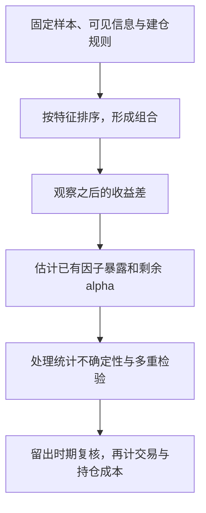

# 从历史收益发现一个因子后，怎样判断它提供了什么证据？

**案例背景。** 研究者怀疑 book-to-market ratio (账面市值比) 较高的股票，后续收益与较低的股票不同。现在有股票特征、收益和发布日期记录。研究要先还原每次建仓时真正可见的信息，再形成组合、测量收益差，并检查这个差是否只是已有风险暴露或反复试验的结果。下面的数字都是合成演算，不是市场数据。

## 特征、收益差和因子为什么不是同一个量？

账面市值比是某个时点每家公司的一项 characteristic (特征)。按它形成的高、低组合，在之后每个月各有收益；两者之差是一条 long–short return (多空组合收益) 序列。只有明确组合构造、样本和持有方式，才能知道这条序列代表什么。

factor (因子) 用来描述共同收益变化的来源。可交易的因子常用 factor-mimicking portfolio (因子模拟组合) 表示；有些模型也使用宏观变量等不可直接交易的因子。一个特征本身不是收益序列，也不自动等于资产对某个因子的暴露。

momentum (动量)、size (规模) 和 value (价值) 分别对应过往收益、公司规模与估值特征等研究方向。动量研究中常见的构造是买入近期赢家、卖空近期输家，具体回看期、跳过期和持有期必须预先规定。具体论文发现的是给定样本、分组和权重下的关系。anomaly (异象) 还需要指定比较的基准模型：只有相对于该模型和检验设计无法解释的规律，才谈得上偏离。它可能来自遗漏风险、错误定价、数据选择或反复筛选，单凭名称不能分辨原因。

## 怎样从建仓时的特征得到下一期收益差？

先约定股票范围、特征可获得时间、分组断点、权重和调仓频率。财报中的“所属年度”不是公开日期；今天数据库修订过的历史值，也不一定是当时投资者看到的版本。使用未来公布的数据给过去建仓排序，就是 look-ahead bias (前视偏差)。只留下今天仍上市的公司，则可能产生 survivorship bias (幸存者偏差)。

> [!example] 两组股票的一个月收益
> 假设建仓时已知四只股票的特征，把 A、B 放入高组，把 C、D 放入低组；组内等权。下一月 A、B 的收益为 `4%`、`2%`，C、D 为 `1%`、`−1%`。
>
> 高组收益为 `(4% + 2%)/2 = 3%`，低组为 `(1% − 1%)/2 = 0%`，高减低得到 `3` 个百分点。若名义上买入 1 元高组、卖空 1 元低组，则毛损益为 `0.03` 元；这不是以零净投入为分母计算的可投资收益率。真实资金、保证金和成本另有口径。

每个建仓日重复同一规则，才得到可分析的收益时间序列。要比较成交成本，应先声明名义头寸和成本分母。例如这一个月按同一名义口径发生 `0.008` 元交易、融资和借券成本，则净损益为 `0.022` 元；不能把毛收益差直接称为可实现利润。

## 双重排序能排除另一项特征的影响吗？

如果高账面市值比组恰好包含更多小公司，收益差可能与规模重叠。double sort (双重排序) 先把两个维度都展开，比较同类规模内部的高低差。

| 分组方式 | 断点怎样决定？ | 比较时保留的差异 |
|---|---|---|
| independent sort (独立排序) | 两个维度各在预先指定的共同参考样本中定断点，再取组的交集 | 各规模组沿用相同的价值断点，单元格可能不均衡 |
| conditional sort (条件排序) | 先按规模分组，再在每个规模组内按价值重新分组 | 每组内部有自己的价值断点，跨组高低标签不一定对应相同数值 |

两档规模乘三档价值得到 `2 × 3 = 6` 个组合；五档乘五档得到 25 个。以六组为例，分别计算小公司和大公司内部的高减低，再按既定权重汇总。若价差在两类规模中都存在，说明这项关联不完全由这种规模分组解释；粗分组仍不能保证消除了所有风险或混杂因素。分组越细，每格样本越少，估计可能越不稳定。条件排序后还可以估计各组合的因子暴露，检查收益差是否伴随不同的 beta；排序不会自动令风险暴露相同。

French 数据库的现行六组合是一个具体实现：每年六月末按规模和账面市值比的交集建组；规模断点来自 NYSE 中位数，价值断点来自 NYSE 的第 30、70 百分位。因此“独立排序”不等于必须用全部待投资股票算断点，参考样本也是设计的一部分。

## 回归怎样把收益分成暴露、alpha 和残差？

对资产或测试组合 $i$，一种可交易因子模型写成：

$$
R_{it}-R_{ft}=\alpha_i+\sum_{k=1}^{K}\beta_{ik}F_{kt}+\varepsilon_{it}.
$$

左边是该期资产收益减去 risk-free rate (无风险利率)，即 excess return (超额收益)。$F_{kt}$ 是第 $k$ 个因子当期的已实现收益，$\beta_{ik}$ 是根据收益共同变化估计的 exposure (暴露)。$\alpha_i$ 是这组因子和样本下的回归截距；$\varepsilon_{it}$ 是该期未被拟合部分解释的 residual (残差)。如果使用非收益型宏观因子，因子单位及系数解释还须相应调整。

接回前面的高减低组合：若两腿使用同一期无风险利率，$(R_H-R_f)-(R_L-R_f)=R_H-R_L$，左侧直接用高减低收益，不再减一次无风险利率。右侧使用事先指定的其他基准因子，检查这条新收益差还留下多少无法解释的部分；不能把完全相同的收益序列同时当作被解释对象和解释因子来证明它有新增价值。

> [!info] 系数乘收益在算什么？
> $\beta=0.5$ 是缩放系数，因子当月收益 $2\%$ 时，该项拟合贡献为 $0.5\times2\%=1\%$。多个因子时，逐项相乘再相加，就是向量点积；它给出本模型这一期的拟合贡献，不是各因素的因果归因。

> [!example] 当月剩余收益不等于 alpha
> 假设经过许多月份回归，估计得到 $\alpha=0.2\%$、$\beta=0.5$。另一个合成月份（不是前面高减低为 3 个百分点的月份），$F_t=2\%$、待解释的组合超额收益为 $1.5\%$，则拟合值为 $0.2\%+0.5\times2\%=1.2\%$，残差为 $0.3\%$。
>
> 只看这一月，减掉因子项会剩下 $0.5\%$，其中既有截距 $0.2\%$，也有当月残差 $0.3\%$；不能把它全部称为已证明的 alpha。截距要从整个拟合样本估计，并附带不确定性。

显著 alpha 表示所选模型在该样本中仍留下定价误差，不自动证明技能或未来机会；换因子集、样本或成本口径，估计就可能变化。多空头寸减少的是某些指定暴露，不会消除市场、行业、流动性等一切风险。

## 时间序列回归与 Fama–MacBeth 分别在问什么？

时间序列回归固定一只资产或组合，沿多个月份估计它对因子收益的 $\beta$ 和 $\alpha$。针对多只测试资产联合检验截距是否为零，例如 Gibbons–Ross–Shanken (GRS) 检验，是在指定模型及其统计假设下检查整体定价误差；经典有限样本 F 检验还依赖给定因子收益后的误差跨资产联合正态、跨期独立、协方差非奇异以及足够样本等条件；不拒绝零假设不等于证明模型正确。

Fama–MacBeth regression (Fama–MacBeth 回归) 则逐期观察横截面。以暴露定价为例，先从时间序列估计各资产暴露，再在每个日期回归。若用于可交易回测，日期 t 的暴露必须只用 t 之前已知数据估计；事后截面定价检验可以有不同的估计窗口，但不能把事后估计包装成当时可用的交易信号：

$$
R_{it}-R_{ft}=\lambda_{0t}+\sum_k\widehat\beta_{ik}\lambda_{kt}+u_{it},\qquad
\overline\lambda_k=\frac1T\sum_{t=1}^T\lambda_{kt}.
$$

一个日期中的每行是一只资产，解释变量是它的暴露；$\lambda_{kt}$ 衡量该期横截面上单位暴露对应的收益差，跨日期平均后估计 exposure price (暴露价格)。例如同一时点三只资产的已估计暴露为 `0.5、1、1.5`，超额收益为 `1%、2%、3%`，这组刻意构造的点落在截距 `0`、斜率 `2%` 的直线上。只有一期不能给出可靠的长期平均价格或标准误。

这里 $\lambda_t$ 是跨资产拟合出的斜率，$F_t$ 是因子组合实际实现的收益；除非满足额外的模型和估计条件，二者不必逐期相等。把特征直接放进横截面回归也是常见研究设计，此时系数解释的是条件特征关联，不能未经论证就叫风险暴露价格。推断时还要考虑暴露估计误差、系数时间序列的相关性和样本长度；不能把股票数多简单当作有很多独立月份。

## 怎样避免在大量试验里挑出偶然赢家？

如果尝试许多信号、持有期、过滤条件和分组方式，却只报告最显著的一个，普通单次检验阈值会夸大证据。应保留候选和选择过程，并按研究设计处理 multiple testing (多重检验)。

> [!example] 为什么“过了 5% 门槛”仍可能只是筛选结果？
> 假设 100 个零假设都为真，每个检验误报概率均为 5%，误报数量的期望就是 `100 × 0.05 = 5`。期望数量的计算不要求检验独立；若额外假设相互独立，至少一次误报的概率为 $1-0.95^{100}\approx99.4\%$。真实因子彼此相关，不能直接套后一个概率，但筛选很多次只公布一个结果的问题仍在。

固定原始任务、数据时间点和选择规则，在开发时期选方案，再在未参与选择的后续时期复核；时间相关数据不能靠任意打乱样本就消除泄漏。复核还应改变合理的数据过滤、权重和交易成本假设，检查结论是否只由少量难交易资产驱动。复制研究提醒我们，数据处理和组合构造会改变发现；不存在一个脱离试验数量、依赖关系和研究目的的万能显著性阈值。

数据版本本身也要留存。French 数据库从 2025 年 1 月发布起改用 CRSP CIZ：月收益由日收益复合，股息按除息日再投资；旧 FIZ 使用月末再投资口径。今天下载的“同一历史区间”未必逐值等于旧文件。保留下载日期、文件版本、处理代码和规则，才能区分策略变化与数据口径变化。

> [!info]- 来源
> - **因子、特征与基准模型：** Fama and French (1992), [The Cross-Section of Expected Stock Returns](https://doi.org/10.1111/j.1540-6261.1992.tb04398.x)；Fama and French (1993), [Common Risk Factors in the Returns on Stocks and Bonds](https://doi.org/10.1016/0304-405X(93)90023-5)。采用模型与测试设计，不把历史样本结果当作当前预期收益。
> - **动量与基金绩效的模型条件：** Carhart (1997), [On Persistence in Mutual Fund Performance](https://doi.org/10.1111/j.1540-6261.1997.tb03808.x)。
> - **时间序列、横截面与截距检验：** Fama and MacBeth (1973), [Risk, Return, and Equilibrium: Empirical Tests](https://doi.org/10.1086/260061)；Gibbons, Ross and Shanken (1989), [A Test of the Efficiency of a Given Portfolio](https://doi.org/10.2307/1913625)。正文数字仅为手工解释公式的合成示例。
> - **六组合的断点、形成时间与数据范围：** Kenneth R. French，[6 Portfolios Formed on Size and Book-to-Market](https://mba.tuck.dartmouth.edu/pages/faculty/ken.french/Data_Library/six_portfolios.html)，Construction 与 Stocks；**当前数据口径和历史档案：** [Data Library](https://mba.tuck.dartmouth.edu/pages/faculty/Ken.French/data_library.html)，页首 CIZ/FIZ 说明，核对日期 2026-11-06。
> - **多重筛选的推断边界：** Harvey, Liu and Zhu (2016), [...and the Cross-Section of Expected Returns](https://www.nber.org/papers/w20592)；**统一构造下的复制：** Hou, Xue and Zhang (2020), [Replicating Anomalies](https://www.nber.org/papers/w23394)。本文只采用多重检验与可复现构造的研究设计要求，不复述各版本异常比例。
