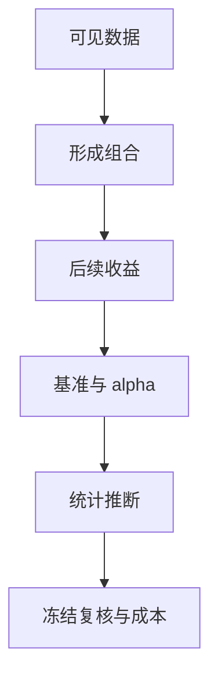
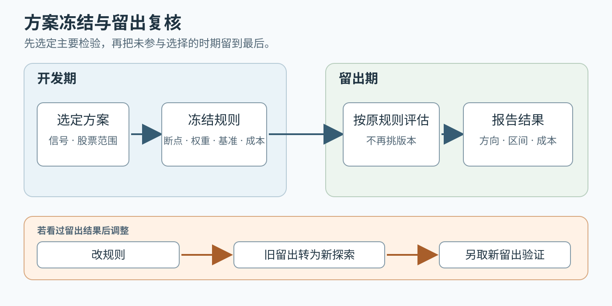

# 从历史收益发现一个因子后，怎样判断它提供了什么证据？

研究者先在探索性历史样本里看到一个候选规律：book-to-market ratio (账面市值比) 较高的股票，后续收益似乎与较低的股票不同。这个观察只是线索；要判断证据到哪一步，须从当时可见的信息、预先定义的组合与基准开始，并把统计不确定性和数据筛选纳入解释。下面的数字都是合成演算，不是市场数据。

**案例背景。** 研究者有股票特征、收益和发布日期记录，接下来重建每次建仓时可用的信息，形成组合，测量收益差，再检查它是否只是已有风险暴露、反复试验或执行成本的结果。

## 特征、收益差和因子为什么不是同一个量？

账面市值比是某个时点每家公司的一项 characteristic (特征)，通常以账面股东权益除以股权市值计算。按它形成的高、低组合，在之后每个月各有收益；两者之差是一条 long–short return (多空组合收益) 序列。只有明确组合构造、样本和持有方式，才能知道这条序列代表什么。

factor (因子) 是用于描述共同收益变化的模型变量。可交易的因子常用 factor-mimicking portfolio (因子模拟组合) 表示；有些模型也使用宏观变量等不可直接交易的因子。一个特征本身不是收益序列，也不自动等于资产对某个因子的暴露。

momentum (动量)、size (规模) 和 value (价值) 分别对应过往收益、公司规模与估值特征等研究方向。动量研究中常见的构造是买入近期赢家、卖空近期输家，具体回看期、跳过期和持有期必须预先规定。具体论文发现的是给定样本、分组和权重下的关系。anomaly (异象) 还需要指定比较的基准模型：只有相对于该模型和检验设计无法解释的规律，才谈得上偏离。它可能来自遗漏风险、错误定价、数据选择或反复筛选，单凭名称不能分辨原因。

## 怎样从建仓时的特征得到下一期收益差？

先约定股票范围、特征可获得时间、分组断点、权重和调仓频率。财报中的“所属年度”不是公开日期；今天数据库修订过的历史值，也不一定是当时投资者看到的版本。使用未来公布的数据给过去建仓排序，就是 look-ahead bias (前视偏差)。例如在合成的 `2026-06-30` 截点建仓，公司 X 的新年度报告到 `2026-07-15` 才公开，这份报告不能用于六月排序；应按预定规则沿用当时可见的旧值或不纳入。只留下今天仍上市的公司，则可能产生 survivorship bias (幸存者偏差)。

> [!example] 两组股票的一个月收益
> 假设建仓时已知四只股票的特征，把 A、B 放入高组，把 C、D 放入低组；组内等权。下一月含分红的总收益分别为 A、B 的 `4%`、`2%` 和 C、D 的 `1%`、`−1%`。若持有期间有股票退市，仍按建仓时归组，并按数据源定义处理它的退市收益与最终分配，不能因它今天不在名单中就从历史组合删掉；CRSP 的总收益与不含分红收益是不同序列。
>
> 高组收益为 `(4% + 2%)/2 = 3%`，低组为 `(1% − 1%)/2 = 0%`，高减低得到 `3` 个百分点。若名义上买入 1 元高组、卖空 1 元低组，毛损益为 `0.03` 元、总毛名义额为 2 元。以总毛名义额为分母是 `1.5%`；以每条腿 1 元为尺度是 `3%`。多空净名义额为零，不能据此得出一个不依赖资本口径的收益率。

每个建仓日重复同一规则，才得到可分析的收益时间序列。要比较成交成本，应先声明名义头寸和成本分母。例如这一个月发生合成的 `0.008` 元交易、融资和借券成本，则净损益为 `0.022` 元；按 2 元总毛名义额计为 `1.1%`，按每条腿 1 元计为 `2.2%`。不能把毛收益差直接称为可实现利润。

## 双重排序能排除另一项特征的影响吗？

如果高账面市值比组恰好包含更多小公司，收益差可能与规模重叠。double sort (双重排序) 先把两个维度都展开，比较同类规模内部的高低差。

| 分组方式 | 断点怎样决定？ | 比较时保留的差异 |
|---|---|---|
| independent sort (独立排序) | 两个维度各在预先指定的共同参考样本中定断点，再取组的交集 | 各规模组沿用相同的价值断点，单元格可能不均衡 |
| conditional sort (条件排序) | 先按规模分组，再在每个规模组内按价值重新分组 | 每组内部有自己的价值断点，跨组高低标签不一定对应相同数值 |

两档规模乘三档价值得到 `2 × 3 = 6` 个组合格；五档乘五档得到 25 格。空格没有可计算收益，应预先规定处理方式。以下是合成汇总：小公司内部高减低为 `4% − 1% = 3` 个百分点，大公司内部为 `2% − 1% = 1` 个百分点；若两种规模按预定等权汇总，整体差为 `2` 个百分点。若价差在两类规模中都存在，说明这项关联不完全由这种规模分组解释；粗分组仍不能保证消除了所有风险或混杂因素。分组越细，每格样本越少，估计可能越不稳定。条件排序后还可以估计各组合的因子暴露，检查收益差是否伴随不同的 beta；排序不会自动令风险暴露相同。

French 的六组合是一个具体实现：在 `t` 年六月末按规模和账面市值比的交集建组，持有窗为 `t` 年 7 月至 `t+1` 年 6 月；规模断点来自 NYSE 中位数，价值断点来自 NYSE 的第 30、70 百分位。六月的账面市值比使用上一日历年内最后一个财年结束日的账面权益，除以上一日历年 12 月市值；合资格股票来自 NYSE、AMEX 与 NASDAQ，并要求有上一日历年的正账面权益、以及上一年底和当年六月的市值数据。因此“独立排序”不等于必须用全部待投资股票算断点，参考样本也是设计的一部分。复用历史文件时还须记录发布日期、版本和修订口径，不能把今天的文件等同于当时数据库快照。

## 回归怎样把收益分成暴露、alpha 和残差？

对资产或测试组合 $i$，一种可交易因子模型写成：

$$
R_{it}-R_{ft}=\alpha_i+\sum_{k=1}^{K}\beta_{ik}F_{kt}+\varepsilon_{it}.
$$

这里 $i$ 是资产或组合，$t$ 是收益实现期，$k=1,\ldots,K$ 遍历模型使用的 $K$ 个因子。左边是该期资产收益减去同一期 risk-free rate (无风险利率)，即 excess return (超额收益)；$R_{ft}$ 是无风险收益，$F_{kt}$ 是第 $k$ 个因子当期的已实现收益。$\beta_{ik}$ 是资产对因子的 exposure (暴露)，$\alpha_i$ 是这组因子和样本下的总体截距，$\varepsilon_{it}$ 表示模型扰动。对样本做回归后得到 $\hat\alpha_i$、$\hat\beta_{ik}$ 与残差 $\hat e_{it}=R_{it}-R_{ft}-\hat\alpha_i-\sum_k\hat\beta_{ik}F_{kt}$；不要把扰动 $\varepsilon_{it}$ 和拟合后的样本残差混作一个量。如果使用非收益型宏观因子，因子单位及系数解释还须相应调整。

接回前面的高减低组合：若两腿使用同一期无风险利率，$(R_H-R_f)-(R_L-R_f)=R_H-R_L$，左侧直接用高减低收益，不再减一次无风险利率。右侧使用事先指定的其他基准因子，检查这条新收益差还留下多少无法解释的部分；不能把完全相同的收益序列同时当作被解释对象和解释因子来证明它有新增价值。

> [!info] 系数乘收益在算什么？
> $\beta=0.5$ 是缩放系数，因子当月收益 $2\%$ 时，该项拟合贡献为 $0.5\times2\%=1\%$。多个因子时，逐项相乘再相加，就是向量点积；它给出本模型这一期的拟合贡献，不是各因素的因果归因。

> [!example] 当月剩余收益不等于 alpha
> 假设用许多月份回归得到合成估计 $\hat\alpha=0.2\%$、$\hat\beta=0.5$。另一个合成月份（不是前面高减低为 3 个百分点的月份），$F_t=2\%$、待解释的组合超额收益为 $1.5\%$，则拟合值为 $0.2\%+0.5\times2\%=1.2\%$，样本残差为 $0.3\%$。
>
> 只看这一月，减掉因子项会剩下 $0.5\%$，其中既有截距 $0.2\%$，也有当月残差 $0.3\%$；不能把它全部称为已证明的 alpha。截距要从整个拟合样本估计，并附带不确定性。

带截距的 ordinary least squares (OLS，普通最小二乘) 选择 $\hat\alpha$ 与各 $\hat\beta_k$，使拟合样本中 $\sum_t \hat e_t^2$ 最小；其样本残差均值为零，所以截距也等于样本平均超额收益减去各因子拟合贡献的平均值。要判断这个 $\hat\alpha$ 是否区别于零，还须用标准误衡量估计精度。月度残差若有异方差或序列相关，标准误应匹配该依赖结构，例如按预先说明的带宽使用 HAC (异方差与自相关一致) 估计；报告方法和窗口，不能把一段月度序列中的每个月当作独立观测。

> [!example] 同一合成 alpha 的单次检验与候选筛选
> 接着上例，假设 $\hat\alpha=0.20\%$/月，标准误为 $0.08$ 个百分点/月。大样本正态近似下，统计量为 $0.20/0.08=2.5$，双侧 $p\approx0.0124$，在单次双侧 $5\%$ 水平下拒绝 $H_0:\alpha=0$。若这项检验来自事先界定的 100 个候选，家族误报率控制在 $5\%$ 的 Bonferroni 单次阈值为 $0.05/100=0.0005$；$0.0124$ 未通过。候选检验是否相互独立不影响 Bonferroni 上界，但各单次 $p$ 值仍须有效。$p$ 值不是“alpha 为零的概率”。这些数值均为合成教学值。

显著 alpha 表示所选模型在该样本中仍留下定价误差，不自动证明技能或未来机会；换因子集、样本或成本口径，估计就可能变化。多空两腿名义金额相等只使净名义额为零，不代表 market beta (市场 beta) 为零：若高组 beta 为合成的 `1.2`、低组为 `0.8`，等金额做多高组、做空低组仍留下 `1.2−0.8=0.4` 的 beta 暴露。行业、流动性等其他暴露也可能保留。

HML (High Minus Low，高减低) 本身就是由规模和账面市值比分组组合构造的高低账面市值比收益差。若新候选与 HML 使用相同成分、权重、断点和调仓期，把完全相同的收益序列再作为基准因子会形成机械重复，不能作为独立验证；定义相近但不完全相同的序列，则回归 alpha 只回答“条件于 HML 后还剩多少”，不抹掉原始收益关联，也不证明其成因。

## 时间序列回归与 Fama–MacBeth 分别在问什么？

时间序列回归固定一只资产或组合，沿多个月份估计它对因子收益的 $\beta$ 和 $\alpha$。针对多只测试资产联合检验截距是否为零，例如 Gibbons–Ross–Shanken (GRS) 检验，是在指定模型及其统计假设下检查整体定价误差；经典有限样本 F 检验还依赖给定因子收益后的误差跨资产联合正态、跨期独立、协方差非奇异以及足够样本等条件；不拒绝零假设不等于证明模型正确。

Fama–MacBeth regression (Fama–MacBeth 回归) 用逐期横截面回归构成一条斜率时间序列，再检验其时间平均。以下明确选用一种点时样本设计：每月 $t$ 的 beta 用一个事先规定、截至 $t-1$ 的扩展历史窗口估计；月 $t$ 收益实现后，再用该月所有合资格资产做横截面回归。这是避免交易检验偷看未来的一种两步设定，不是所有资产定价检验必须采用的唯一窗口；原始研究也在每月回归前使用先前数据估计 beta。

$$
R_{it}-R_{ft}=\lambda_{0t}+\sum_{k=1}^{K}\widehat\beta_{ik,t-1}\lambda_{kt}+u_{it},\qquad
\overline\lambda_k=\frac1T\sum_{t=1}^T\lambda_{kt}.
$$

一个日期中的每行是一只资产；$i$ 表示资产，$k=1,\ldots,K$ 表示模型中的 beta，$t$ 是月度横截面期。$\widehat\beta_{ik,t-1}$ 是仅用截至 $t-1$ 的数据估计的资产暴露，$\lambda_{0t}$ 是当月截面截距，$u_{it}$ 是该资产当月的横截面残差。每期要有足够资产且暴露有足够横截面差异，才能识别截距和各条斜率。$\lambda_{kt}$ 衡量当期横截面中单位 beta 暴露对应的收益差；$T$ 是纳入平均的月份数，$\overline\lambda_k$ 是第 $k$ 条斜率的时间平均。只有当暴露由指定资产定价模型定义、截面斜率可识别且相应定价假设成立时，$\overline\lambda_k$ 才可解释为该暴露的价格；若解释变量直接是特征，$\overline\lambda_k$ 仅是控制其他变量后的条件关联。

例如在同一合成月份，若用截至 $t-1$ 得到的三只资产 beta `0.5、1、1.5`，对应的当月超额收益为 `1%、2%、3%`，这些刻意构造的点落在截距 `0`、斜率 `2%` 的直线上。只有一期横截面不能给出可靠的长期平均价格或标准误。

这里 $\lambda_{kt}$ 是跨资产拟合出的第 $k$ 条斜率，$F_{kt}$ 是该因子组合当期实际实现的收益；除非满足额外的模型和估计条件，二者不必逐期相等。推断 $\overline\lambda_k$ 时要分析这条斜率的时间序列，并考虑 beta 估计误差、序列相关和样本长度；不能把股票数多简单当作有很多独立月份。

## 怎样避免在大量试验里挑出偶然赢家？

如果尝试许多信号、持有期、过滤条件和分组方式，却只报告最显著的一个，普通单次检验阈值会夸大证据。应保留候选和选择过程，并按研究设计处理 multiple testing (多重检验)。

> [!example] 为什么“过了 5% 门槛”仍可能只是筛选结果？
> 假设 100 个零假设都为真，每个检验误报概率均为 5%，误报数量的期望就是 `100 × 0.05 = 5`。期望数量的计算不要求检验独立；若额外假设相互独立，至少一次误报的概率为 $1-0.95^{100}\approx99.4\%$。真实因子彼此相关，不能直接套后一个概率，但筛选很多次只公布一个结果的问题仍在。

上例的 $1-0.95^{100}$ 回答“100 个零假设全真、且检验独立时，至少误报一次的概率是多少”；它不同于某个已选 alpha 的单次 $p$ 值，也不能直接套用于相关候选。对事先定义的一组 100 个检验，Bonferroni 的 `0.0005` 是控制家族误报率的一种保守门槛；若在结果出来后又改信号、持有期或筛选条件，这些新尝试也必须进入选择记录，不能沿用未校正的赢家 p 值。

留出检验要先冻结主要方案，不能看过留出结果后再挑版本。开发期确定主信号和可见信息规则、股票范围、分组断点、权重、调仓、基准模型、成本口径、评估量及推断方法；然后只在未参与选择的后续时期，按同一规则重新建组、估计基准和计算成本后结果，并报告方向、量级和不确定性。预先指定的敏感性检查应完整报告；若根据留出结果改规则，就把该结果期视为新的探索样本，并用另一段未触碰时期验证。若持有期重叠，应让开发期的未来收益标签不跨进留出期，并在标准误中处理重叠相关。

历史收益差支持样本内的关联。只有在标准误与检验设计相符、且适用的多重检验校正后仍有证据拒绝零截距，才可说指定模型在该样本中尚未解释完收益差；否则只报告样本 alpha 估计，不作肯定结论。未被选择过的留出时期检验外部时间段表现，成本口径再限定这组历史证据是否覆盖了执行摩擦。证据到哪一步，就只下到那一步的结论。

数据版本本身也要留存。French Data Library 的美国研究收益自 2025 年 1 月数据发布开始使用 CRSP CIZ：月收益由日收益复合，股息按除息日再投资；旧 FIZ 的月度收益按月末口径再投资股息。今天下载的“同一历史区间”未必逐值等于旧文件。保留下载日期、文件版本、处理代码和规则，才能区分策略变化与数据口径变化。

> [!info]- 来源
> - **因子、特征与基准模型：** Fama and French (1992), [The Cross-Section of Expected Stock Returns](https://doi.org/10.1111/j.1540-6261.1992.tb04398.x)；Fama and French (1993), [Common Risk Factors in the Returns on Stocks and Bonds](https://doi.org/10.1016/0304-405X(93)90023-5)；French Data Library [Fama/French Factors](https://mba.tuck.dartmouth.edu/pages/faculty/Ken.French/Data_Library/f-f_factors.html)，Construction 中的 HML。采用模型与测试设计，不把历史样本结果当作当前预期收益。
> - **动量与基金绩效的模型条件：** Carhart (1997), [On Persistence in Mutual Fund Performance](https://doi.org/10.1111/j.1540-6261.1997.tb03808.x)。
> - **OLS 与月度回归系数的标准误：** Newey and West (1987), [A Simple, Positive Semi-Definite, Heteroskedasticity and Autocorrelation Consistent Covariance Matrix](https://doi.org/10.2307/1913610)，说明 HAC 协方差估计的研究基础；它不是对任意依赖结构都自动有效的修正。
> - **时间序列、横截面与截距检验：** Fama and MacBeth (1973), [Risk, Return, and Equilibrium: Empirical Tests](https://doi.org/10.1086/260061)，§IV A Eq. (10)、§V；Gibbons, Ross and Shanken (1989), [A Test of the Efficiency of a Given Portfolio](https://doi.org/10.2307/1913625)，指定因子模型下的联合截距检验。
> - **退市与总收益数据：** Shumway (1997), [The Delisting Bias in CRSP Data](https://doi.org/10.1111/j.1540-6261.1997.tb03818.x)；CRSP [US Stock Databases 数据说明](https://www.crsp.org/research/crsp-us-stock-databases/?activetab=docs)，Key Data Items 与 Documents & Resources；现行 [Flat File Format 2.0 (CIZ) User Guide](https://indexes.morningstar.com/docs/guide/crsp-us-stock-databases-guide-for-flat-file-format-2-0?isRdp=true)，生效日期 `2026-07-31`，核对日期 `2026-11-13`。收益和退市记录要按所用数据版本的定义处理。
> - **六组合断点、形成期与股票范围：** Kenneth R. French, [6 Portfolios Formed on Size and Book-to-Market](https://mba.tuck.dartmouth.edu/pages/faculty/ken.french/Data_Library/six_portfolios.html)，Construction 与 Stocks；**美国研究收益的 CRSP CIZ/FIZ 口径与历史档案：** [French Data Library](https://mba.tuck.dartmouth.edu/pages/faculty/Ken.French/data_library.html)，核对日期 2026-11-13。
> - **多重筛选、样本外复核与构造复制：** Harvey, Liu and Zhu (2016), […and the Cross-Section of Expected Returns](https://doi.org/10.1093/rfs/hhv059)；McLean and Pontiff (2016), [Does Academic Research Destroy Stock Return Predictability?](https://doi.org/10.1111/jofi.12365)；Hou, Xue and Zhang (2020), [Replicating Anomalies](https://doi.org/10.1093/rfs/hhy131)。正文只采用检验设计与可复现性边界，不把这些论文的样本发现外推为当前市场结果。

本章中涉及证券、组合和检验的数值均为合成演算，不是市场数据或策略回测结果。
