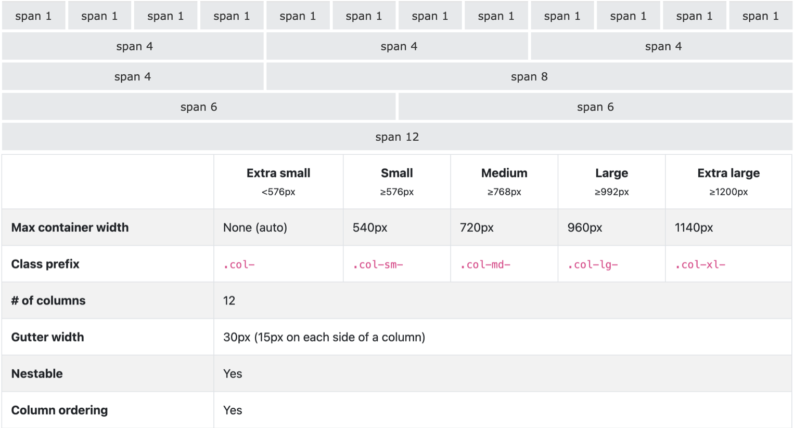

# What do the archived Bootstrap grid examples mean? / 归档中的 Bootstrap 网格示例如何理解？

These examples are specifically for Bootstrap 3.4.1; the included image shows Bootstrap 4 grid tiers. Treat this page as a legacy-project reference and verify the installed framework version before copying a class name or breakpoint. / 代码示例针对 Bootstrap 3.4.1，而附图展示的是 Bootstrap 4 网格断点。请将其作为维护旧项目的参考，并在复制类名或断点前确认项目实际版本。

## Bootstrap

- **Official Website:** [Bootstrap 3.4 CSS documentation](https://getbootstrap.com/docs/3.4/css/)
- **Version:** 3.4.1, a legacy version useful when maintaining existing projects; choose a supported current release for new work.

### Grid System
- **Concept:**
  - The layout is based on a 12-column grid system.
  - Classes define the number of columns an element spans.

**Example**
```html
<div class="container">
    <div class="row">
        <div class="col-lg-3">Column 1</div>
        <div class="col-lg-3">Column 2</div>
        <div class="col-lg-3">Column 3</div>
        <div class="col-lg-3">Column 4</div>
    </div>
</div>
```
- **Classes:**
  - `.container` and `.container-fluid`: Define the fixed or fluid container.
  - `.row`: Defines a row in the grid.
  - `.col-xs-*`, `.col-sm-*`, `.col-md-*`, and `.col-lg-*`: Define column spans at Bootstrap 3's extra-small, small (≥768px), medium (≥992px), and large (≥1200px) breakpoints. For example, `.col-lg-3` spans 3 out of 12 columns from the large breakpoint upward.

### Responsive Design
- **Containers:**
  - `.container`: Fixed width with responsive behavior.
  - `.container-fluid`: Full-width container spanning the entire viewport.

The `grid.png` illustration below depicts Bootstrap 4's grid tiers (`.col-`, `.col-sm-`, `.col-md-`, `.col-lg-`, and `.col-xl-`, with 576/768/992/1200px breakpoints), not the Bootstrap 3 class names and breakpoints used in the example above.



### Components and Utilities
- **Components:**
  - Pre-styled UI elements (buttons, modals, navigation bars, etc.).
  - Example:
    ```html
    <button class="btn btn-primary">Primary Button</button>
    ```
- **Utilities:**
  - Helper classes for margin, padding, text alignment, etc.
  - Example:
    ```html
    <div class="text-center">Centered Text</div>
    ```

## Introducing JavaScript in Bootstrap
- **Dependencies:**
  - Bootstrap 3's JavaScript plugins require jQuery, which must load first. Its CSS and grid system do not require jQuery.

~~~html
<script src="https://code.jquery.com/jquery-3.6.0.min.js"></script>
<script src="path/to/bootstrap.min.js"></script>
~~~

## References

- [CSS Cascading and Inheritance Level 5](https://www.w3.org/TR/css-cascade-5/)
- [CSS Cascading and Inheritance Level 6 (Editor’s Draft)](https://drafts.csswg.org/css-cascade-6/)
- [Selectors Level 4](https://www.w3.org/TR/selectors-4/)
- [CSS Display Level 3](https://www.w3.org/TR/css-display-3/)
- [CSS Overflow Level 3](https://www.w3.org/TR/css-overflow-3/)
- [CSS Positioned Layout Level 3](https://www.w3.org/TR/css-position-3/)
- [CSS Transforms Level 1](https://www.w3.org/TR/css-transforms-1/)
- [CSS Flexible Box Layout Level 1](https://www.w3.org/TR/css-flexbox-1/)
- [CSS Grid Layout Level 2](https://www.w3.org/TR/css-grid-2/)
- [CSS Values and Units Level 4](https://www.w3.org/TR/css-values-4/)
- [Chrome: Avoid large, complex layouts and layout thrashing](https://developer.chrome.com/docs/performance/insights/forced-reflow)
- [Chrome: Avoid non-composited animations](https://developer.chrome.com/docs/lighthouse/performance/non-composited-animations)
- [Bootstrap 3.4 documentation](https://getbootstrap.com/docs/3.4/)
- [Bootstrap 4.6 grid documentation](https://getbootstrap.com/docs/4.6/layout/grid/)
