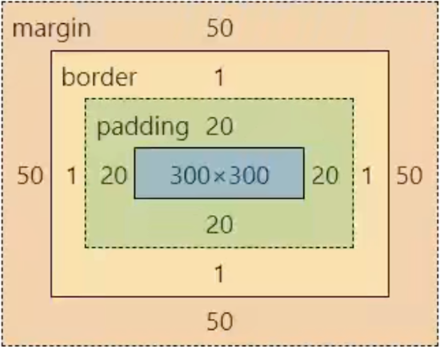

# CSS 盒模型图展示了什么？

图中由内到外是内容区、padding、border 和 margin。中心 `300 × 300` 是内容区；四边各有 `20` padding、`1` border 和 `50` margin。若各数值使用同一单位，则 padding box 为 `340 × 340`，border box 为 `342 × 342`，图示 margin 外缘为 `442 × 442`。图是分层示意，不按尺寸比例绘制；相邻盒子的 margin 还可能折叠，不能直接把图中外缘当作实际布局间距。尺寸规则与可复算的例子见[CSS 盒尺寸演算](../../../../frontend/html-css/box-model-and-bfc.md)。
